# 一、绪论

## 数据结构的基本概念


%%{init: {
  "theme": "base",
  "themeVariables": {
    "primaryColor": "#5b9bd5",
    "primaryTextColor": "#ffffff",
    "primaryBorderColor": "#41719c",
    "lineColor": "#41719c",
    "secondaryColor": "#ffffff",
    "tertiaryColor": "#e2f0d9",
    "fontSize": "14px",
    "fontFamily": "\"Microsoft YaHei\", \"PingFang SC\", \"Segoe UI\", sans-serif"
  },
  "flowchart": {
    "nodeSpacing": 8,
    "rankSpacing": 26,
    "curve": "basis",
    "htmlLabels": true,
    "subGraphTitleMargin": { "top": 0, "bottom": 14 },
    "padding": 4,
    "useMaxWidth": false,
    "wrappingWidth": 1000
  }
}}%%
graph LR
  Root["数据结构"]

  Root --> Basic["基本概念"]
  Root --> Ele["三要素"]

  Basic --> B1["数据"]
  Basic --> B2["数据元素/数据项"]
  Basic --> B3["数据对象/数据结构"]
  Basic --> B4["数据类型/抽象数据类型(ADT)"]

  Ele --> E1["逻辑结构"]
  Ele --> E2["物理结构(存储结构)"]
  Ele --> E3["数据的运算"]

  E1 --> L1["线性结构"]
  E1 --> L2["集合"]
  E1 --> L3["树形结构"]
  E1 --> L4["图结构(网状结构)"]

  E2 --> P1["顺序存储"]
  E2 --> P2["链式存储"]
  E2 --> P3["索引存储"]
  E2 --> P4["散列存储"]

  E3 --> O1["按逻辑结构定义,按存储结构实现"]


  subgraph NL["非线性结构"]
    direction LR
    L2
    L3
    L4
  end

  subgraph N1["定义ADT = 定义逻辑结构 + 运算，即定义数据结构"]
    Basic
    B1
    B2
    B3
    B4
  end

  subgraph N2["确定存储结构 = 表示逻辑结构，存储不同，运算实现不同"]
    E2
    P1
    subgraph NS["非顺序存储"]
      direction LR
      P2
      P3
      P4
    end
  end

  classDef root fill:#5b9bd5,stroke:#41719c,stroke-width:2px,color:#fff,font-weight:bold,font-size:18px;
  classDef lvl1 fill:#9dc3e6,stroke:#2e6da4,stroke-width:2px,color:#0d2f4d,font-size:17px;
  classDef lvl2d fill:#dbe8f6,stroke:#1f4e79,stroke-width:2px,color:#000000,font-size:14px;
  classDef lvl2l fill:#f6fafe,stroke:#c3d9ef,stroke-width:2px,color:#000000,font-size:14px;
  classDef lvl3d fill:#dbe8f6,stroke:#1f4e79,stroke-width:2px,color:#333333,font-size:13px;
  classDef lvl3l fill:#f6fafe,stroke:#c3d9ef,stroke-width:2px,color:#333333,font-size:13px;
  classDef key fill:#fff,stroke:#c00000,stroke-width:3px,color:#000;

  class Root root;
  class Basic,Ele lvl1;
  class B1,B2,B3,B4 lvl2d;
  class E1,E2,E3 lvl2l;
  class L1,L2,L3,L4,O1 lvl3d;
  class P1,P2,P3,P4 lvl3l;
  class B4,E1,E3 key;

  style NL fill:#e2f0d9,stroke:#5b9bd5,color:#000000
  style NS fill:#e2f0d9,stroke:#5b9bd5,color:#000000
  style N1 fill:#f4faf0,stroke:#70ad47,color:#000000,font-size:12px
  style N2 fill:#f4faf0,stroke:#70ad47,color:#000000,font-size:12px


## 算法和算法评价

### 算法的基本概念


%%{init: {
  "theme": "base",
  "themeVariables": {
    "primaryColor": "#5b9bd5",
    "primaryTextColor": "#ffffff",
    "primaryBorderColor": "#41719c",
    "lineColor": "#41719c",
    "secondaryColor": "#ffffff",
    "tertiaryColor": "#e2f0d9",
    "fontSize": "16px",
    "fontFamily": "-apple-system, BlinkMacSystemFont, \"Segoe UI\", Roboto, \"Helvetica Neue\", Arial, \"Noto Sans\", sans-serif"
  },
  "flowchart": {
    "nodeSpacing": 8,
    "rankSpacing": 26,
    "curve": "basis",
    "htmlLabels": true,
    "subGraphTitleMargin": { "top": 0, "bottom": 14 },
    "padding": 4,
    "useMaxWidth": false,
    "wrappingWidth": 1000
  }
}}%%
graph LR
  Root["算法的基本概念"]

  Root --> What["什么是算法"]
  Root --> Five["算法的五个特性"]
  Root --> Good["#quot;好#quot;算法的特质"]

  What --> Prog["程序=数据结构 + 算法"]
  Prog --> P1["数据结构是要处理的信息"]
  Prog --> P2["算法是处理信息的步骤"]

  Five --> F1["有穷性"]
  Five --> F2["确定性"]
  Five --> F3["可行性"]
  Five --> F4["输入"]
  Five --> F5["输出"]

  F1 --> F1a["有穷时间内能执行完"]
  F1a --> F1b["算法是有穷的"]
  F1a --> F1c["程序可以是无穷的"]

  F2 --> F2a["相同输入只会产生相同输出"]
  F3 --> F3a["可以用已有的基本操作实现算法"]
  F4 --> F4a["丢给算法处理的数据"]
  F5 --> F5a["算法处理的结果"]

  Good --> G1["正确性"]
  Good --> G2["可读性"]
  Good --> G3["健壮性"]
  Good --> G4["高效率与低存储量需求"]

  G1 --> G1a["能正确解决问题"]
  G2 --> G2a["对算法的描述要让其他人也看得懂"]
  G3 --> G3a["算法能处理一些异常状况"]
  G4 --> G4a["即算法执行省时、省内存"]
  G4a --> G4b["时间复杂度低、空间复杂度低"]


  subgraph N1["设计一个好的数据结构 / 设计一个好的算法"]
    What
    Prog
    P1
    P2
  end

  subgraph N2["算法必须具备的特性"]
    Five
    F1
    F2
    F3
    F4
    F5
  end

  subgraph N3["设计算法时要尽量追求的目标"]
    G4
    G4a
  end

  classDef root fill:#5b9bd5,stroke:#41719c,stroke-width:2px,color:#fff,font-weight:bold,font-size:20px;
  classDef lvl1 fill:#9dc3e6,stroke:#2e6da4,stroke-width:2px,color:#0d2f4d,font-size:19px;
  classDef lvl2d fill:#dbe8f6,stroke:#1f4e79,stroke-width:2px,color:#000000,font-size:16px;
  classDef lvl2l fill:#f6fafe,stroke:#c3d9ef,stroke-width:2px,color:#000000,font-size:16px;
  classDef lvl3d fill:#dbe8f6,stroke:#1f4e79,stroke-width:2px,color:#333333,font-size:15px;
  classDef lvl3l fill:#f6fafe,stroke:#c3d9ef,stroke-width:2px,color:#333333,font-size:15px;
  classDef lvl4d fill:#dbe8f6,stroke:#1f4e79,stroke-width:1.5px,color:#555555,font-size:14px;
  classDef lvl4l fill:#f6fafe,stroke:#c3d9ef,stroke-width:1.5px,color:#555555,font-size:14px;
  classDef key fill:#fff,stroke:#c00000,stroke-width:3px,color:#000;

  class Root root;
  class What,Five,Good lvl1;
  class Prog,G1,G2,G3,G4 lvl2d;
  class F1,F2,F3,F4,F5 lvl2l;
  class P1,P2,G1a,G3a,F2a,F4a lvl3d;
  class G2a,G4a,F1a,F3a,F5a lvl3l;
  class F1b,F1c lvl4d;
  class G4b lvl4l;
  class G4b key;

  style N1 fill:#f4faf0,stroke:#70ad47,color:#000000,font-size:12px
  style N2 fill:#f4faf0,stroke:#70ad47,color:#000000,font-size:12px
  style N3 fill:#f4faf0,stroke:#70ad47,color:#000000,font-size:12px


### 时间复杂度


%%{init: {
  "theme": "base",
  "themeVariables": {
    "primaryColor": "#5b9bd5",
    "primaryTextColor": "#ffffff",
    "primaryBorderColor": "#41719c",
    "lineColor": "#41719c",
    "secondaryColor": "#ffffff",
    "tertiaryColor": "#e2f0d9",
    "fontSize": "16px",
    "fontFamily": "-apple-system, BlinkMacSystemFont, \"Segoe UI\", Roboto, \"Helvetica Neue\", Arial, \"Noto Sans\", sans-serif"
  },
  "flowchart": {
    "nodeSpacing": 8,
    "rankSpacing": 26,
    "curve": "basis",
    "htmlLabels": true,
    "subGraphTitleMargin": { "top": 0, "bottom": 14 },
    "padding": 4,
    "useMaxWidth": false,
    "wrappingWidth": 1000
  }
}}%%
graph LR
  Root["时间复杂度"]

  Root --> How["如何计算"]
  Root --> Kind["三种复杂度"]

  How --> H1["①找到一个基本操作（最深层循环）"]
  How --> H2["②分析该基本操作的执行次数 x 与问题规模 n 的关系 x=f(n)"]
  How --> H3["③x 的数量级 O(x) 就是算法时间复杂度 T(n)"]

  Kind --> K1["最坏时间复杂度：考虑输入数据“最坏”的情况"]
  Kind --> K2["平均时间复杂度：考虑所有输入数据都等概率出现的情况"]
  Kind --> K3["最好时间复杂度：考虑输入数据“最好”的情况"]

  classDef root fill:#5b9bd5,stroke:#41719c,stroke-width:2px,color:#fff,font-weight:bold,font-size:20px;
  classDef lvl1 fill:#9dc3e6,stroke:#2e6da4,stroke-width:2px,color:#0d2f4d,font-size:19px;
  classDef lvl2d fill:#dbe8f6,stroke:#1f4e79,stroke-width:2px,color:#000000,font-size:16px;
  classDef lvl2l fill:#f6fafe,stroke:#c3d9ef,stroke-width:2px,color:#000000,font-size:16px;

  class Root root;
  class How,Kind lvl1;
  class H1,H2,H3 lvl2d;
  class K1,K2,K3 lvl2l;


### 空间复杂度


%%{init: {
  "theme": "base",
  "themeVariables": {
    "primaryColor": "#5b9bd5",
    "primaryTextColor": "#ffffff",
    "primaryBorderColor": "#41719c",
    "lineColor": "#41719c",
    "secondaryColor": "#ffffff",
    "tertiaryColor": "#e2f0d9",
    "fontSize": "16px",
    "fontFamily": "-apple-system, BlinkMacSystemFont, \"Segoe UI\", Roboto, \"Helvetica Neue\", Arial, \"Noto Sans\", sans-serif"
  },
  "flowchart": {
    "nodeSpacing": 8,
    "rankSpacing": 26,
    "curve": "basis",
    "htmlLabels": true,
    "subGraphTitleMargin": { "top": 0, "bottom": 14 },
    "padding": 4,
    "useMaxWidth": false,
    "wrappingWidth": 1000
  }
}}%%
graph LR
  Root["空间复杂度"]

  Root --> How["如何计算"]

  How --> Plain["普通程序"]
  How --> Recur["递归程序"]

  Plain --> P1["①找到所占空间大小与问题规模相关的变量"]
  Plain --> P2["②分析所占空间 x 与问题规模n 的关系 x=f(n)"]
  Plain --> P3["③x 的数量级 O(x) 就是算法空间复杂度 S(n)"]

  Recur --> R1["①找到递归调用的深度 x 与问题规模n 的关系 x=f(n)"]
  Recur --> R2["②x 的数量级 O(x) 就是算法空间复杂度 S(n)"]
  Recur --> R3["注：有的算法各层函数所需存储空间不同，分析方法略有区别"]

  classDef root fill:#5b9bd5,stroke:#41719c,stroke-width:2px,color:#fff,font-weight:bold,font-size:20px;
  classDef lvl1 fill:#9dc3e6,stroke:#2e6da4,stroke-width:2px,color:#0d2f4d,font-size:19px;
  classDef lvl2d fill:#dbe8f6,stroke:#1f4e79,stroke-width:2px,color:#000000,font-size:16px;
  classDef lvl3d fill:#dbe8f6,stroke:#1f4e79,stroke-width:2px,color:#333333,font-size:15px;
  classDef lvl3l fill:#f6fafe,stroke:#c3d9ef,stroke-width:2px,color:#333333,font-size:15px;

  class Root root;
  class How lvl1;
  class Plain,Recur lvl2d;
  class P1,P2,P3 lvl3d;
  class R1,R2,R3 lvl3l;


# 二、线性表

## 顺序表

### 顺序表的定义


%%{init: {
  "theme": "base",
  "themeVariables": {
    "primaryColor": "#5b9bd5",
    "primaryTextColor": "#ffffff",
    "primaryBorderColor": "#41719c",
    "lineColor": "#41719c",
    "secondaryColor": "#ffffff",
    "tertiaryColor": "#e2f0d9",
    "fontSize": "16px",
    "fontFamily": "-apple-system, BlinkMacSystemFont, \"Segoe UI\", Roboto, \"Helvetica Neue\", Arial, \"Noto Sans\", sans-serif"
  },
  "flowchart": {
    "nodeSpacing": 8,
    "rankSpacing": 26,
    "curve": "basis",
    "htmlLabels": true,
    "subGraphTitleMargin": { "top": 0, "bottom": 14 },
    "padding": 4,
    "useMaxWidth": false,
    "wrappingWidth": 1000
  }
}}%%
graph LR
  Root["顺序表"]

  Root --> Store["存储结构"]
  Root --> Impl["实现方式"]
  Root --> Feat["特点"]

  Store --> S1["逻辑上相邻的数据元素物理上也相邻"]

  Impl --> Static["静态分配"]
  Impl --> Dyn["动态分配"]

  Static --> St1["使用“静态数组”实现"]
  Static --> St2["大小一旦确定就无法改变"]

  Dyn --> Dy1["使用“动态数组”实现"]
  Dyn --> Dy2["L.data = (ElemType *) malloc(sizeof(ElemType) * size)"]
  Dyn --> Dy3["顺序表存满时，可再用 malloc动态拓展顺序表的最大容量"]
  Dyn --> Dy4["需要将数据元素复制到新的存储区域，并用 free 函数释放原区域"]

  Feat --> F1["随机访问"]
  Feat --> F2["存储密度高"]
  Feat --> F3["拓展容量不方便"]
  Feat --> F4["插入、删除数据元素不方便"]

  F1 --> F1a["能在 O(1) 时间内找到第 i 个元素"]

  classDef root fill:#5b9bd5,stroke:#41719c,stroke-width:2px,color:#fff,font-weight:bold,font-size:20px;
  classDef lvl1 fill:#9dc3e6,stroke:#2e6da4,stroke-width:2px,color:#0d2f4d,font-size:19px;
  classDef lvl2d fill:#dbe8f6,stroke:#1f4e79,stroke-width:2px,color:#000000,font-size:16px;
  classDef lvl2l fill:#f6fafe,stroke:#c3d9ef,stroke-width:2px,color:#000000,font-size:16px;
  classDef lvl3d fill:#dbe8f6,stroke:#1f4e79,stroke-width:2px,color:#333333,font-size:15px;
  classDef lvl3l fill:#f6fafe,stroke:#c3d9ef,stroke-width:2px,color:#333333,font-size:15px;

  class Root root;
  class Store,Impl,Feat lvl1;
  class S1,F1,F2,F3,F4 lvl2d;
  class Static,Dyn lvl2l;
  class F1a,St1,St2 lvl3d;
  class Dy1,Dy2,Dy3,Dy4 lvl3l;


> 注：这里的「物理上也相邻」指的是元素在**地址空间**中连续存放（这正是它能 O(1) 随机访问的原因）；引入分页/虚拟存储后，对应的内存**物理页框**并不保证连续。

### 顺序表的基本操作


%%{init: {
  "theme": "base",
  "themeVariables": {
    "primaryColor": "#5b9bd5",
    "primaryTextColor": "#ffffff",
    "primaryBorderColor": "#41719c",
    "lineColor": "#41719c",
    "secondaryColor": "#ffffff",
    "tertiaryColor": "#e2f0d9",
    "fontSize": "16px",
    "fontFamily": "-apple-system, BlinkMacSystemFont, \"Segoe UI\", Roboto, \"Helvetica Neue\", Arial, \"Noto Sans\", sans-serif"
  },
  "flowchart": {
    "nodeSpacing": 8,
    "rankSpacing": 26,
    "curve": "basis",
    "htmlLabels": true,
    "subGraphTitleMargin": { "top": 0, "bottom": 14 },
    "padding": 4,
    "useMaxWidth": false,
    "wrappingWidth": 1000
  }
}}%%
graph LR
  Root["顺序表的基本操作"]

  Root --> Ins["插入"]
  Root --> Del["删除"]

  Ins --> I1["ListInsert(#amp;L,i,e)"]
  Ins --> I2["插入位置之后的元素都要后移"]
  Ins --> I3["时间复杂度"]
  I1 --> I1a["将元素 e 插入到 L 的第 i 个位置"]
  I3 --> I3a["最好 O(1)、最坏 O(n)、平均 O(n)"]

  Del --> D1["ListDelete(#amp;L,i,#amp;e)"]
  Del --> D2["删除位置之后的元素都要前移"]
  Del --> D3["时间复杂度"]
  D1 --> D1a["将 L 的第 i 个元素删除，并用 e 返回"]
  D3 --> D3a["最好 O(1)、最坏 O(n)、平均 O(n)"]

  Root --> Pos["按位查找"]
  Root --> Val["按值查找"]

  Pos --> P1["GetElem(L,i)"]
  Pos --> P2["时间复杂度"]
  P1 --> P1a["获取表 L 中第 i 个位置的元素的值"]
  P1 --> P1b["用数组下标即可得到第 i 个元素L.data[i-1]"]
  P2 --> P2a["最好/最坏/平均时间复杂度都是 O(1)"]

  Val --> V1["LocateElem(L,e)"]
  Val --> V2["时间复杂度"]
  V1 --> V1a["在顺序表 L 中查找第一个元素值等于 e 的元素，并返回其位序"]
  V1 --> V1b["从第一个元素开始依次往后检索"]
  V2 --> V2a["最好 O(1)：目标元素在第一个位置"]
  V2 --> V2b["最坏 O(n)：目标元素在最后一个位置"]
  V2 --> V2c["平均 O(n)：目标元素在每个位置的概率相同"]

  classDef root fill:#5b9bd5,stroke:#41719c,stroke-width:2px,color:#fff,font-weight:bold,font-size:20px;
  classDef lvl1 fill:#9dc3e6,stroke:#2e6da4,stroke-width:2px,color:#0d2f4d,font-size:19px;
  classDef lvl2d fill:#dbe8f6,stroke:#1f4e79,stroke-width:2px,color:#000000,font-size:16px;
  classDef lvl2l fill:#f6fafe,stroke:#c3d9ef,stroke-width:2px,color:#000000,font-size:16px;
  classDef lvl3d fill:#dbe8f6,stroke:#1f4e79,stroke-width:2px,color:#333333,font-size:15px;
  classDef lvl3l fill:#f6fafe,stroke:#c3d9ef,stroke-width:2px,color:#333333,font-size:15px;

  class Root root;
  class Ins,Del,Pos,Val lvl1;
  class I1,I2,I3,P1,P2 lvl2d;
  class D1,D2,D3,V1,V2 lvl2l;
  class I1a,P1a,P1b,D1a,V1a,V1b lvl3d;
  class I3a,P2a,D3a,V2a,V2b,V2c lvl3l;


## 链表

### 单链表的定义


%%{init: {
  "theme": "base",
  "themeVariables": {
    "primaryColor": "#5b9bd5",
    "primaryTextColor": "#ffffff",
    "primaryBorderColor": "#41719c",
    "lineColor": "#41719c",
    "secondaryColor": "#ffffff",
    "tertiaryColor": "#e2f0d9",
    "fontSize": "16px",
    "fontFamily": "-apple-system, BlinkMacSystemFont, \"Segoe UI\", Roboto, \"Helvetica Neue\", Arial, \"Noto Sans\", sans-serif"
  },
  "flowchart": {
    "nodeSpacing": 8,
    "rankSpacing": 26,
    "curve": "basis",
    "htmlLabels": true,
    "subGraphTitleMargin": { "top": 0, "bottom": 14 },
    "padding": 4,
    "useMaxWidth": false,
    "wrappingWidth": 1000
  }
}}%%
graph LR
  Root["单链表的定义"]

  Root --> Type["单链表"]
  Root --> Code["用代码定义一个单链表"]
  Root --> Impl["两种实现"]
  Root --> Other["其他值得注意的点"]

  Type --> T1["用“链式存储”(存储结构)实现了“线性结构”(逻辑结构)"]
  Type --> T2["一个结点存储一个数据元素"]
  Type --> T3["各结点间的先后关系用一个指针表示"]

  Code --> C1["<span style='color:#1f4e79 !important'>typedef</span> <span style='color:#2e7d32 !important'>struct</span> <span style='color:#0f7b6c !important'>LNode</span>{<br>&nbsp<span style='color:#0f7b6c !important'>ElemType</span> <span style='color:#7a3e9d !important'>data</span>;<br>&nbsp<span style='color:#2e7d32 !important'>struct</span> <span style='color:#0f7b6c !important'>LNode</span> <span style='color:#7a3e9d !important'>*next</span>;<br>}<span style='color:#0f7b6c !important'>LNode</span>, <span style='color:#0f7b6c !important'>*LinkList</span>"]

  Impl --> NoHead["不带头结点"]
  Impl --> Head["带头结点"]
  NoHead --> N1["√空表判断：L==NULL。写代码不方便"]
  Head --> H1["√空表判断：L->next==NULL。写代码更方便"]

  Other --> Typedef["typedef 关键字的用法"]
  Typedef --> D1["“LinkList” 等价于 “LNode *”"]
  Typedef --> D2["前者强调这是链表，后者强调这是结点"]
  Typedef --> D3["合适的地方使用合适的名字，代码可读性更高"]

  subgraph A1["头结点不存数据，只是为了操作方便"]
    Head
    H1
  end

  classDef root fill:#5b9bd5,stroke:#41719c,stroke-width:2px,color:#fff,font-weight:bold,font-size:20px;
  classDef lvl1 fill:#9dc3e6,stroke:#2e6da4,stroke-width:2px,color:#0d2f4d,font-size:19px;
  classDef lvl2d fill:#dbe8f6,stroke:#1f4e79,stroke-width:2px,color:#000000,font-size:16px;
  classDef lvl2l fill:#f6fafe,stroke:#c3d9ef,stroke-width:2px,color:#000000,font-size:16px;
  classDef lvl3d fill:#dbe8f6,stroke:#1f4e79,stroke-width:2px,color:#333333,font-size:15px;
  classDef lvl3l fill:#f6fafe,stroke:#c3d9ef,stroke-width:2px,color:#333333,font-size:15px;
  classDef key fill:#fff,stroke:#c00000,stroke-width:3px,color:#000;

  class Root root;
  class Type,Code,Impl,Other lvl1;
  class T1,T2,T3,NoHead,Head lvl2d;
  class C1,Typedef lvl2l;
  class N1,D1,D2,D3 lvl3d;
  class H1 lvl3l;
  class T1,T3,NoHead,Head key;

  style A1 fill:#f4faf0,stroke:#70ad47,color:#000000,font-size:12px



### 单链表的操作


%%{init: {
  "theme": "base",
  "themeVariables": {
    "primaryColor": "#5b9bd5",
    "primaryTextColor": "#ffffff",
    "primaryBorderColor": "#41719c",
    "lineColor": "#41719c",
    "secondaryColor": "#ffffff",
    "tertiaryColor": "#e2f0d9",
    "fontSize": "16px",
    "fontFamily": "-apple-system, BlinkMacSystemFont, \"Segoe UI\", Roboto, \"Helvetica Neue\", Arial, \"Noto Sans\", sans-serif"
  },
  "flowchart": {
    "nodeSpacing": 8,
    "rankSpacing": 26,
    "curve": "basis",
    "htmlLabels": true,
    "subGraphTitleMargin": { "top": 0, "bottom": 14 },
    "padding": 4,
    "useMaxWidth": false,
    "wrappingWidth": 1000
  }
}}%%
graph LR
  Root["单链表的操作"]

  Root --> InsDel["插入删除"]
  Root --> Search["查找"]
  Root --> Build["建立"]

  InsDel --> Ins["插入"]
  InsDel --> Del["删除"]

  Ins --> I1["按位序插入"]
  Ins --> I2["指定结点的后插操作"]
  Ins --> I3["指定结点的前插操作"]
  I1 --> I1a["带头结点"]
  I1 --> I1b["不带头结点"]

  Del --> D1["按位序删除"]
  Del --> D2["指定结点的删除"]

  Search --> S1["按位查找"]
  Search --> S2["按值查找"]
  Search --> S3["求单链表长度"]
  Search --> S4["Key"]
  S1 --> S1a["注意与“顺序表”对比"]
  S1 --> S1b["单链表<span style='color:#c00000 !important'>不具备“随机访问”的特性</span>，只能依次扫描"]
  S4 --> S4a["三种基本操作的时间复杂度都是 O(n)"]
  S4 --> S4b["如何写循环扫描各个结点的代码逻辑"]
  S4 --> S4c["注意边界条件的处理"]

  Build --> B1["尾插法"]
  Build --> B2["头插法"]

  subgraph A1["注意审题：带头否？"]
    I1
    I1a
    I1b
  end

  classDef root fill:#5b9bd5,stroke:#41719c,stroke-width:2px,color:#fff,font-weight:bold,font-size:20px;
  classDef lvl1 fill:#9dc3e6,stroke:#2e6da4,stroke-width:2px,color:#0d2f4d,font-size:19px;
  classDef lvl2d fill:#dbe8f6,stroke:#1f4e79,stroke-width:2px,color:#000000,font-size:16px;
  classDef lvl2l fill:#f6fafe,stroke:#c3d9ef,stroke-width:2px,color:#000000,font-size:16px;
  classDef lvl3d fill:#dbe8f6,stroke:#1f4e79,stroke-width:2px,color:#333333,font-size:15px;
  classDef lvl3l fill:#f6fafe,stroke:#c3d9ef,stroke-width:2px,color:#333333,font-size:15px;
  classDef lvl4d fill:#dbe8f6,stroke:#1f4e79,stroke-width:1.5px,color:#555555,font-size:14px;
  classDef key fill:#fff,stroke:#c00000,stroke-width:3px,color:#000;

  class Root root;
  class InsDel,Search,Build lvl1;
  class Ins,Del,B1,B2 lvl2d;
  class S1,S2,S3,S4 lvl2l;
  class I1,I2,I3,S1a,S1b lvl3d;
  class D1,D2,S4a,S4b,S4c lvl3l;
  class I1a,I1b lvl4d;
  class S1 key;

  style A1 fill:#f4faf0,stroke:#70ad47,color:#000000,font-size:12px



### 双链表


%%{init: {
  "theme": "base",
  "themeVariables": {
    "primaryColor": "#5b9bd5",
    "primaryTextColor": "#ffffff",
    "primaryBorderColor": "#41719c",
    "lineColor": "#41719c",
    "secondaryColor": "#ffffff",
    "tertiaryColor": "#e2f0d9",
    "fontSize": "16px",
    "fontFamily": "-apple-system, BlinkMacSystemFont, \"Segoe UI\", Roboto, \"Helvetica Neue\", Arial, \"Noto Sans\", sans-serif"
  },
  "flowchart": {
    "nodeSpacing": 8,
    "rankSpacing": 26,
    "curve": "basis",
    "htmlLabels": true,
    "subGraphTitleMargin": { "top": 0, "bottom": 14 },
    "padding": 4,
    "useMaxWidth": false,
    "wrappingWidth": 1000
  }
}}%%
graph LR
  Root["双链表"]

  Root --> Init["初始化"]
  Root --> Ins["插入（后插）"]
  Root --> Del["删除（后删）"]
  Root --> Trav["遍历"]

  Init --> Init1["头结点的 prior、next 都指向 NULL"]

  Ins --> Ins1["注意新插入结点、前驱结点、后继结点的指针修改"]
  Ins --> Ins2["边界情况：新插入结点在最后一个位置，需特殊处理"]

  Del --> Del1["注意删除结点的前驱结点、后继结点的指针修改"]
  Del --> Del2["边界情况：如果被删除结点是最后一个数据结点，需特殊处理"]

  Trav --> Trav1["从一个给定结点开始，后向遍历、前向遍历的实现（循环的终止条件）"]
  Trav --> Trav2["链表不具备随机存取特性，查找操作只能通过顺序遍历实现"]

  classDef root fill:#5b9bd5,stroke:#41719c,stroke-width:2px,color:#fff,font-weight:bold,font-size:20px;
  classDef lvl1 fill:#9dc3e6,stroke:#2e6da4,stroke-width:2px,color:#0d2f4d,font-size:19px;
  classDef lvl2d fill:#dbe8f6,stroke:#1f4e79,stroke-width:2px,color:#000000,font-size:16px;
  classDef lvl2l fill:#f6fafe,stroke:#c3d9ef,stroke-width:2px,color:#000000,font-size:16px;

  class Root root;
  class Init,Ins,Del,Trav lvl1;
  class Init1,Del1,Del2 lvl2d;
  class Ins1,Ins2,Trav1,Trav2 lvl2l;



### 循环链表与静态链表


%%{init: {
  "theme": "base",
  "themeVariables": {
    "primaryColor": "#5b9bd5",
    "primaryTextColor": "#ffffff",
    "primaryBorderColor": "#41719c",
    "lineColor": "#41719c",
    "secondaryColor": "#ffffff",
    "tertiaryColor": "#e2f0d9",
    "fontSize": "16px",
    "fontFamily": "-apple-system, BlinkMacSystemFont, \"Segoe UI\", Roboto, \"Helvetica Neue\", Arial, \"Noto Sans\", sans-serif"
  },
  "flowchart": {
    "nodeSpacing": 8,
    "rankSpacing": 26,
    "curve": "basis",
    "htmlLabels": true,
    "subGraphTitleMargin": { "top": 0, "bottom": 14 },
    "padding": 4,
    "useMaxWidth": false,
    "wrappingWidth": 1000
  }
}}%%
graph LR
  Root["循环链表与静态链表"]

  Root --> SC["循环单链表"]
  Root --> DC["循环双链表"]
  Root --> Q["代码问题"]
  Root --> SL["静态链表"]

  SC --> SC1["空表：头结点的 next 指向它自己"]
  SC --> SC2["非空表：表尾结点的 next 指向头结点"]
  SC --> SC3["从任一结点出发都能找到表中其他所有结点"]

  DC --> DC1["空表：头结点的 next、prior 都指向它自己"]
  DC --> DC2["非空表：表尾的 next 指向头结点，头结点的 prior 指向表尾结点"]
  DC --> DC3["从任一结点出发都能前向、后向遍历整个链表"]

  Q --> Q1["如何判空"]
  Q --> Q2["如何判断结点 p 是否为表尾/表头结点"]
  Q --> Q3["如何在表头、表中、表尾插入/删除一个结点"]

  SL --> SL1["用数组描述的链表，又叫「游标实现」"]
  SL --> SL2["数据域 data + 游标 next（存下一个元素在数组中的下标）"]
  SL --> SL3["数组下标 0 当「头结点」，-1 表示表尾"]
  SL --> SL4["查找：从头结点出发挨个往后遍历，O(n)"]
  SL --> SL5["插入位序 i 的结点：<br>①找到一个空闲结点，存入数据元素<br>②从头结点出发找到位序 i-1 的结点"]
  SL --> SL6["用代码定义"]

  SL6 --> SLC["<span style='color:#1f4e79 !important'>#define</span> <span style='color:#0f7b6c !important'>MaxSize</span> 10<br><span style='color:#1f4e79 !important'>typedef</span> <span style='color:#2e7d32 !important'>struct</span> {<br>&nbsp<span style='color:#0f7b6c !important'>ElemType</span> <span style='color:#7a3e9d !important'>data</span>;<br>&nbsp<span style='color:#2e7d32 !important'>int</span> <span style='color:#7a3e9d !important'>next</span>;<br>} <span style='color:#0f7b6c !important'>SLinkList</span>[<span style='color:#0f7b6c !important'>MaxSize</span>]"]

  classDef root fill:#5b9bd5,stroke:#41719c,stroke-width:2px,color:#fff,font-weight:bold,font-size:20px;
  classDef lvl1 fill:#9dc3e6,stroke:#2e6da4,stroke-width:2px,color:#0d2f4d,font-size:19px;
  classDef lvl2d fill:#dbe8f6,stroke:#1f4e79,stroke-width:2px,color:#000000,font-size:16px;
  classDef lvl2l fill:#f6fafe,stroke:#c3d9ef,stroke-width:2px,color:#000000,font-size:16px;
  classDef lvl3d fill:#dbe8f6,stroke:#1f4e79,stroke-width:2px,color:#333333,font-size:15px;

  class Root root;
  class SC,DC,Q,SL lvl1;
  class SC1,SC2,SC3,Q1,Q2,Q3 lvl2d;
  class DC1,DC2,DC3,SL1,SL2,SL3,SL4,SL5,SL6 lvl2l;
  class SLC lvl3d;


> 注：「代码问题」那三条是循环链表最容易考的地方，答案补在这里——**带头结点**时，循环单链表判空 ⇔ `L->next == L`，结点 p 是表尾 ⇔ `p->next == L`，p 是头结点 ⇔ `p == L`；循环双链表判空同样是 `L->next == L`（此时 `L->prior == L` 也成立），判表尾也看 `p->next == L`。不带头结点时不用绕弯子，空表就是 `L == NULL`。
>
> 循环单链表在**表尾**插入、删除都要先找到前驱结点，是 O(n)；如果让 L 指向**表尾结点**，表头、表尾的插入就都能 O(1) 完成——循环双链表因为能反向找前驱，两端的插入删除都是 O(1)。
>
> 静态链表这两条约定单独记（按课件）：下标 0 固定当「头结点」，`-1` 表示表尾，所以最多存 `MaxSize - 1` 个数据元素；「找一个空闲结点」要靠自己判断（课件里用 `next == -2` 标记空闲）。它和顺序表一样是预先分配一片连续空间，但插入删除只改游标、不移动元素；长处是在不支持指针的语言里也能用链式思想，短处是容量固定、查找仍需从头遍历。


### 顺序表与链表的比较


%%{init: {
  "theme": "base",
  "themeVariables": {
    "primaryColor": "#5b9bd5",
    "primaryTextColor": "#ffffff",
    "primaryBorderColor": "#41719c",
    "lineColor": "#41719c",
    "secondaryColor": "#ffffff",
    "tertiaryColor": "#e2f0d9",
    "fontSize": "16px",
    "fontFamily": "-apple-system, BlinkMacSystemFont, \"Segoe UI\", Roboto, \"Helvetica Neue\", Arial, \"Noto Sans\", sans-serif"
  },
  "flowchart": {
    "nodeSpacing": 8,
    "rankSpacing": 26,
    "curve": "basis",
    "htmlLabels": true,
    "subGraphTitleMargin": { "top": 0, "bottom": 14 },
    "padding": 4,
    "useMaxWidth": false,
    "wrappingWidth": 1000
  }
}}%%
graph LR
  Root["顺序表与链表的比较"]

  Root --> Logic["逻辑结构相同"]
  Root --> Store["存储结构不同"]
  Root --> Ops["基本操作效率不同"]
  Root --> Conc["结论"]

  Logic --> L1["都是线性结构，都属于线性表"]

  Store --> S1["顺序表：顺序存储，逻辑相邻的元素物理上也相邻"]
  Store --> S2["链表：链式存储，逻辑相邻的元素物理上不必相邻"]
  S1 --> S1a["能随机访问，存储密度高"]
  S1 --> S1b["要求一片连续空间，容量固定"]
  S2 --> S2a["不要求连续空间，容量灵活"]
  S2 --> S2b["不能随机访问，指针域有额外开销"]

  Ops --> O1["初始化：顺序表要预先分配连续空间，链表只要一个头结点"]
  Ops --> O2["插入：顺序表平均要移动 n/2 个元素，链表只需改指针"]
  Ops --> O3["删除：顺序表平均要移动 (n-1)/2 个元素，链表只需改指针"]
  Ops --> O4["查找：顺序表按位 O(1)、按值 O(n)<br>链表两种查找都只能顺序扫描，都是 O(n)"]

  Conc --> C1["各有优缺点，用哪个要具体问题具体分析"]

  classDef root fill:#5b9bd5,stroke:#41719c,stroke-width:2px,color:#fff,font-weight:bold,font-size:20px;
  classDef lvl1 fill:#9dc3e6,stroke:#2e6da4,stroke-width:2px,color:#0d2f4d,font-size:19px;
  classDef lvl2d fill:#dbe8f6,stroke:#1f4e79,stroke-width:2px,color:#000000,font-size:16px;
  classDef lvl2l fill:#f6fafe,stroke:#c3d9ef,stroke-width:2px,color:#000000,font-size:16px;
  classDef lvl3d fill:#dbe8f6,stroke:#1f4e79,stroke-width:2px,color:#333333,font-size:15px;
  classDef lvl3l fill:#f6fafe,stroke:#c3d9ef,stroke-width:2px,color:#333333,font-size:15px;

  class Root root;
  class Logic,Store,Ops,Conc lvl1;
  class L1,O1,O2,O3,O4 lvl2d;
  class S1,S2,C1 lvl2l;
  class S1a,S1b lvl3d;
  class S2a,S2b lvl3l;


> 注：这是那道 6 分简答题的答题框架——按「逻辑结构 → 存储结构 → 基本操作的实现效率」三段答，每一段都把顺序表和链表对着说，最后落到「各有优缺点、具体问题具体分析」。两个容易漏的细节：链表的插入删除「只需改指针」说的是**已经找到位置之后**（定位本身还是 O(n)）；顺序表插入、删除平均要移动的元素个数分别是 n/2 和 (n−1)/2（都按表长 n 算）。

# 三、栈、队列和数组

## 栈

### 栈的基本概念


%%{init: {
  "theme": "base",
  "themeVariables": {
    "primaryColor": "#5b9bd5",
    "primaryTextColor": "#ffffff",
    "primaryBorderColor": "#41719c",
    "lineColor": "#41719c",
    "secondaryColor": "#ffffff",
    "tertiaryColor": "#e2f0d9",
    "fontSize": "16px",
    "fontFamily": "-apple-system, BlinkMacSystemFont, \"Segoe UI\", Roboto, \"Helvetica Neue\", Arial, \"Noto Sans\", sans-serif"
  },
  "flowchart": {
    "nodeSpacing": 8,
    "rankSpacing": 26,
    "curve": "basis",
    "htmlLabels": true,
    "subGraphTitleMargin": { "top": 0, "bottom": 14 },
    "padding": 4,
    "useMaxWidth": false,
    "wrappingWidth": 1000
  }
}}%%
graph LR
  Root["栈（Stack）"]

  Root --> Def["定义"]
  Root --> Ops["基本操作"]

  Def --> D1["一种操作受限的线性表，只能在栈顶插入、删除"]
  Def --> D2["特性：后进先出（LIFO）"]
  Def --> D3["术语：栈顶、栈底、空栈"]

  Ops --> O1["创、销"]
  Ops --> O2["增、删（进栈、出栈，只能在栈顶操作）"]
  Ops --> O3["查（获得栈顶元素，但不删除）"]
  Ops --> O4["判空"]

  classDef root fill:#5b9bd5,stroke:#41719c,stroke-width:2px,color:#fff,font-weight:bold,font-size:20px;
  classDef lvl1 fill:#9dc3e6,stroke:#2e6da4,stroke-width:2px,color:#0d2f4d,font-size:19px;
  classDef lvl2d fill:#dbe8f6,stroke:#1f4e79,stroke-width:2px,color:#000000,font-size:16px;
  classDef lvl2l fill:#f6fafe,stroke:#c3d9ef,stroke-width:2px,color:#000000,font-size:16px;

  class Root root;
  class Def,Ops lvl1;
  class D1,D2,D3 lvl2d;
  class O1,O2,O3,O4 lvl2l;


> 注：图上的「创、销、增、删、查」是课件习惯的动词写法，对应到 ADT 里的操作名就是 InitStack/DestroyStack、Push/Pop、GetTop——按「创销、增减、查、判空」这套记，和写代码时的函数名对得上就够了。


### 顺序栈


%%{init: {
  "theme": "base",
  "themeVariables": {
    "primaryColor": "#5b9bd5",
    "primaryTextColor": "#ffffff",
    "primaryBorderColor": "#41719c",
    "lineColor": "#41719c",
    "secondaryColor": "#ffffff",
    "tertiaryColor": "#e2f0d9",
    "fontSize": "16px",
    "fontFamily": "-apple-system, BlinkMacSystemFont, \"Segoe UI\", Roboto, \"Helvetica Neue\", Arial, \"Noto Sans\", sans-serif"
  },
  "flowchart": {
    "nodeSpacing": 8,
    "rankSpacing": 26,
    "curve": "basis",
    "htmlLabels": true,
    "subGraphTitleMargin": { "top": 0, "bottom": 14 },
    "padding": 4,
    "useMaxWidth": false,
    "wrappingWidth": 1000
  }
}}%%
graph LR
  Root["顺序栈"]

  Root --> Base["顺序存储：用静态数组实现，还要记录栈顶指针"]
  Root --> Ops["基本操作：创、增、删、查"]
  Root --> Impl["两种实现"]
  Root --> Share["共享栈"]

  Impl --> T1["初始化时 top = -1"]
  T1 --> T1a["入栈：<span style='color:#0f7b6c !important'>S</span>.<span style='color:#7a3e9d !important'>data</span>[++<span style='color:#0f7b6c !important'>S</span>.<span style='color:#7a3e9d !important'>top</span>] = <span style='color:#7a3e9d !important'>x</span>"]
  T1 --> T1b["出栈：<span style='color:#7a3e9d !important'>x</span> = <span style='color:#0f7b6c !important'>S</span>.<span style='color:#7a3e9d !important'>data</span>[<span style='color:#0f7b6c !important'>S</span>.<span style='color:#7a3e9d !important'>top</span>--]"]
  T1 --> T1c["获得栈顶元素：<span style='color:#7a3e9d !important'>x</span> = <span style='color:#0f7b6c !important'>S</span>.<span style='color:#7a3e9d !important'>data</span>[<span style='color:#0f7b6c !important'>S</span>.<span style='color:#7a3e9d !important'>top</span>]"]
  T1 --> T1d["栈空 / 栈满条件是？"]

  Impl --> T2["初始化时 top = 0"]
  T2 --> T2a["入栈：<span style='color:#0f7b6c !important'>S</span>.<span style='color:#7a3e9d !important'>data</span>[<span style='color:#0f7b6c !important'>S</span>.<span style='color:#7a3e9d !important'>top</span>++] = <span style='color:#7a3e9d !important'>x</span>"]
  T2 --> T2b["出栈：<span style='color:#7a3e9d !important'>x</span> = <span style='color:#0f7b6c !important'>S</span>.<span style='color:#7a3e9d !important'>data</span>[--<span style='color:#0f7b6c !important'>S</span>.<span style='color:#7a3e9d !important'>top</span>]"]
  T2 --> T2c["获得栈顶元素：<span style='color:#7a3e9d !important'>x</span> = <span style='color:#0f7b6c !important'>S</span>.<span style='color:#7a3e9d !important'>data</span>[<span style='color:#0f7b6c !important'>S</span>.<span style='color:#7a3e9d !important'>top</span> - 1]"]
  T2 --> T2d["栈空 / 栈满条件是？"]

  Share --> Sh1["两个栈共享同一片内存空间，从两端向中间增长"]
  Share --> Sh2["初始化：0 号栈 top0 = -1，1 号栈 top1 = MaxSize"]
  Share --> Sh3["栈满：top0 + 1 == top1"]

  classDef root fill:#5b9bd5,stroke:#41719c,stroke-width:2px,color:#fff,font-weight:bold,font-size:20px;
  classDef lvl1 fill:#9dc3e6,stroke:#2e6da4,stroke-width:2px,color:#0d2f4d,font-size:19px;
  classDef lvl2d fill:#dbe8f6,stroke:#1f4e79,stroke-width:2px,color:#000000,font-size:16px;
  classDef lvl2l fill:#f6fafe,stroke:#c3d9ef,stroke-width:2px,color:#000000,font-size:16px;
  classDef lvl3d fill:#dbe8f6,stroke:#1f4e79,stroke-width:2px,color:#333333,font-size:15px;
  classDef lvl3l fill:#f6fafe,stroke:#c3d9ef,stroke-width:2px,color:#333333,font-size:15px;

  class Root root;
  class Base,Ops,Impl,Share lvl1;
  class T1,T2 lvl2d;
  class Sh1,Sh2,Sh3 lvl2l;
  class T1a,T1b,T1c,T1d lvl3d;
  class T2a,T2b,T2c,T2d lvl3l;


> 注：课件里那两个「栈空 / 栈满条件是？」的答案——**top 指向栈顶元素**（top 从 −1 开始）时，栈空是 `top == -1`、栈满是 `top == MaxSize - 1`；**top 指向下一个空闲位置**（top 从 0 开始）时，栈空是 `top == 0`、栈满是 `top == MaxSize`。两套写法是成套的：入栈/出栈语句、判空判满条件必须一起换，别混着写。共享栈栈满就是 `top0 + 1 == top1`，这时再进栈就上溢。


### 链栈


%%{init: {
  "theme": "base",
  "themeVariables": {
    "primaryColor": "#5b9bd5",
    "primaryTextColor": "#ffffff",
    "primaryBorderColor": "#41719c",
    "lineColor": "#41719c",
    "secondaryColor": "#ffffff",
    "tertiaryColor": "#e2f0d9",
    "fontSize": "16px",
    "fontFamily": "-apple-system, BlinkMacSystemFont, \"Segoe UI\", Roboto, \"Helvetica Neue\", Arial, \"Noto Sans\", sans-serif"
  },
  "flowchart": {
    "nodeSpacing": 8,
    "rankSpacing": 26,
    "curve": "basis",
    "htmlLabels": true,
    "subGraphTitleMargin": { "top": 0, "bottom": 14 },
    "padding": 4,
    "useMaxWidth": false,
    "wrappingWidth": 1000
  }
}}%%
graph LR
  Root["链栈"]

  Root --> Store["用链式存储方式实现的栈"]
  Root --> Impl["两种实现方式"]
  Root --> Ops["重要基本操作"]

  Impl --> I1["带头结点"]
  Impl --> I2["不带头结点（推荐）"]

  Ops --> O1["创（初始化）"]
  Ops --> O2["增（进栈）"]
  Ops --> O3["删（出栈）"]
  Ops --> O4["查（获取栈顶元素）"]
  Ops --> O5["如何判空、判满？"]

  classDef root fill:#5b9bd5,stroke:#41719c,stroke-width:2px,color:#fff,font-weight:bold,font-size:20px;
  classDef lvl1 fill:#9dc3e6,stroke:#2e6da4,stroke-width:2px,color:#0d2f4d,font-size:19px;
  classDef lvl2d fill:#dbe8f6,stroke:#1f4e79,stroke-width:2px,color:#000000,font-size:16px;
  classDef lvl2l fill:#f6fafe,stroke:#c3d9ef,stroke-width:2px,color:#000000,font-size:16px;
  classDef key fill:#fff,stroke:#c00000,stroke-width:3px,color:#000;

  class Root root;
  class Store,Impl,Ops lvl1;
  class I1,I2 lvl2d;
  class O1,O2,O3,O4,O5 lvl2l;
  class I2 key;


> 注：链栈其实**没有「栈满」这回事**——只要内存还够，进栈就一直能成功（课件把它列出来，是为了让你记住「链式存储不用判满、只有判空」）。判空看有没有头结点：带头结点时 `L->next == NULL`，不带头结点时 `L == NULL`。课件推荐不带头结点，是因为栈只在栈顶这一头操作，头结点帮不上忙，省掉它就少一层跳转、代码也更短。


## 队列

### 队列的基本概念


%%{init: {
  "theme": "base",
  "themeVariables": {
    "primaryColor": "#5b9bd5",
    "primaryTextColor": "#ffffff",
    "primaryBorderColor": "#41719c",
    "lineColor": "#41719c",
    "secondaryColor": "#ffffff",
    "tertiaryColor": "#e2f0d9",
    "fontSize": "16px",
    "fontFamily": "-apple-system, BlinkMacSystemFont, \"Segoe UI\", Roboto, \"Helvetica Neue\", Arial, \"Noto Sans\", sans-serif"
  },
  "flowchart": {
    "nodeSpacing": 8,
    "rankSpacing": 26,
    "curve": "basis",
    "htmlLabels": true,
    "subGraphTitleMargin": { "top": 0, "bottom": 14 },
    "padding": 4,
    "useMaxWidth": false,
    "wrappingWidth": 1000
  }
}}%%
graph LR
  Root["队列"]

  Root --> Def["定义"]
  Root --> Ops["基本操作"]

  Def --> D1["一种操作受限的线性表，只能在队尾插入、在队头删除"]
  Def --> D2["特性：先进先出（FIFO）"]
  Def --> D3["术语：队头、队尾、空队列、队头元素、队尾元素"]

  Ops --> O1["创、销"]
  Ops --> O2["增、删（入队、出队，只能在规定的一端进行）"]
  Ops --> O3["查（获得队头元素，但不删除）"]
  Ops --> O4["判空"]

  classDef root fill:#5b9bd5,stroke:#41719c,stroke-width:2px,color:#fff,font-weight:bold,font-size:20px;
  classDef lvl1 fill:#9dc3e6,stroke:#2e6da4,stroke-width:2px,color:#0d2f4d,font-size:19px;
  classDef lvl2d fill:#dbe8f6,stroke:#1f4e79,stroke-width:2px,color:#000000,font-size:16px;
  classDef lvl2l fill:#f6fafe,stroke:#c3d9ef,stroke-width:2px,color:#000000,font-size:16px;

  class Root root;
  class Def,Ops lvl1;
  class D1,D2,D3 lvl2d;
  class O1,O2,O3,O4 lvl2l;


> 注：和栈那一张对照着记——栈是「只能在栈顶插、只能在栈顶删」，队列是「只能在队尾插、只能在队头删」，所以栈是 LIFO、队列是 FIFO。同样地，「创销、增减、查、判空」对应 ADT 里的 InitQueue/DestroyQueue、EnQueue/DeQueue、GetHead。


### 队列的顺序实现


%%{init: {
  "theme": "base",
  "themeVariables": {
    "primaryColor": "#5b9bd5",
    "primaryTextColor": "#ffffff",
    "primaryBorderColor": "#41719c",
    "lineColor": "#41719c",
    "secondaryColor": "#ffffff",
    "tertiaryColor": "#e2f0d9",
    "fontSize": "16px",
    "fontFamily": "-apple-system, BlinkMacSystemFont, \"Segoe UI\", Roboto, \"Helvetica Neue\", Arial, \"Noto Sans\", sans-serif"
  },
  "flowchart": {
    "nodeSpacing": 8,
    "rankSpacing": 26,
    "curve": "basis",
    "htmlLabels": true,
    "subGraphTitleMargin": { "top": 0, "bottom": 14 },
    "padding": 4,
    "useMaxWidth": false,
    "wrappingWidth": 1000
  }
}}%%
graph LR
  Root["队列的顺序实现"]

  Root --> Idea["实现思想"]
  Root --> Key["重要考点"]
  Root --> Ana["分析思路"]

  Idea --> I1["用静态数组存放数据元素，设置 front、rear 指针"]
  Idea --> I2["循环队列：用取模运算把存储空间在逻辑上变成「环状」"]
  Idea --> I3["<span style='color:#0f7b6c !important'>Q</span>.<span style='color:#7a3e9d !important'>rear</span> = (<span style='color:#0f7b6c !important'>Q</span>.<span style='color:#7a3e9d !important'>rear</span> + 1) % <span style='color:#0f7b6c !important'>MaxSize</span>"]

  Key --> K1["如何初始化、入队、出队"]
  Key --> K2["如何判空、判满"]
  Key --> K3["如何计算队列的长度"]

  Ana --> A1["确定 front、rear 指针的指向"]
  A1 --> A1a["① rear 指向队尾元素的后一个位置"]
  A1 --> A1b["② rear 指向队尾元素"]

  Ana --> A2["确定判空、判满的方法"]
  A2 --> A2a["a. 牺牲一个存储单元"]
  A2 --> A2b["b. 增加 size 变量记录队列长度"]
  A2 --> A2c["c. 增加 tag = 0/1，标记最近一次操作是出队还是入队"]
  A2 --> A2d["…"]

  subgraph N1["思考：分别采用 ①a、①b、①c、②a、②b、②c 策略时，这些操作怎么实现？"]
    K1
    K2
    K3
  end
  style N1 fill:#f4faf0,stroke:#70ad47,color:#000000,font-size:12px

  classDef root fill:#5b9bd5,stroke:#41719c,stroke-width:2px,color:#fff,font-weight:bold,font-size:20px;
  classDef lvl1 fill:#9dc3e6,stroke:#2e6da4,stroke-width:2px,color:#0d2f4d,font-size:19px;
  classDef lvl2d fill:#dbe8f6,stroke:#1f4e79,stroke-width:2px,color:#000000,font-size:16px;
  classDef lvl2l fill:#f6fafe,stroke:#c3d9ef,stroke-width:2px,color:#000000,font-size:16px;
  classDef lvl3d fill:#dbe8f6,stroke:#1f4e79,stroke-width:2px,color:#333333,font-size:15px;
  classDef lvl3l fill:#f6fafe,stroke:#c3d9ef,stroke-width:2px,color:#333333,font-size:15px;

  class Root root;
  class Idea,Key,Ana lvl1;
  class A1,A2,K1,K2,K3 lvl2d;
  class I1,I2,I3 lvl2l;
  class A1a,A1b lvl3d;
  class A2a,A2b,A2c,A2d lvl3l;


> 注：绿框那个思考题的答案（都按 rear 指向**队尾元素的后一个位置**来说）——**牺牲一个单元**：队空 `front == rear`，队满 `(rear+1)%MaxSize == front`，队长 `(rear-front+MaxSize)%MaxSize`；**用 size 变量**：队空 `size == 0`，队满 `size == MaxSize`；**用 tag 标记**：队空 `front == rear && tag == 0`，队满 `front == rear && tag == 1`。
>
> 如果改成 rear 指向**队尾元素本身**（就是分析思路里的②），入队要「先 `rear=(rear+1)%MaxSize`，再存元素」，队空变成 `(rear+1)%MaxSize == front`，牺牲单元时队满则是 `(rear+2)%MaxSize == front`——这一套和①不能混用，做题时先看清题目用的是哪一种。


### 队列的链式实现


%%{init: {
  "theme": "base",
  "themeVariables": {
    "primaryColor": "#5b9bd5",
    "primaryTextColor": "#ffffff",
    "primaryBorderColor": "#41719c",
    "lineColor": "#41719c",
    "secondaryColor": "#ffffff",
    "tertiaryColor": "#e2f0d9",
    "fontSize": "16px",
    "fontFamily": "-apple-system, BlinkMacSystemFont, \"Segoe UI\", Roboto, \"Helvetica Neue\", Arial, \"Noto Sans\", sans-serif"
  },
  "flowchart": {
    "nodeSpacing": 8,
    "rankSpacing": 26,
    "curve": "basis",
    "htmlLabels": true,
    "subGraphTitleMargin": { "top": 0, "bottom": 14 },
    "padding": 4,
    "useMaxWidth": false,
    "wrappingWidth": 1000
  }
}}%%
graph LR
  Root["队列的链式实现"]

  Root --> Impl["用链式存储实现队列"]
  Root --> Ops["基本操作"]
  Root --> Code["用代码定义"]

  Impl --> Impl1["带头结点"]
  Impl --> Impl2["不带头结点"]

  Ops --> O1["创（初始化）"]
  Ops --> O2["增（入队）"]
  Ops --> O3["删（出队）"]
  Ops --> O4["查（获取队头元素）"]
  Ops --> O5["判空"]
  Ops --> O6["判满？不存在的"]

  O2 --> O2a["注意第一个元素入队"]
  O3 --> O3a["注意最后一个元素出队"]

  Code --> C1["<span style='color:#1f4e79 !important'>typedef</span> <span style='color:#2e7d32 !important'>struct</span> <span style='color:#0f7b6c !important'>LinkNode</span>{<br>&nbsp;&nbsp;<span style='color:#0f7b6c !important'>ElemType</span> <span style='color:#7a3e9d !important'>data</span>;<br>&nbsp;&nbsp;<span style='color:#2e7d32 !important'>struct</span> <span style='color:#0f7b6c !important'>LinkNode</span> <span style='color:#7a3e9d !important'>*next</span>;<br>}<span style='color:#0f7b6c !important'>LinkNode</span>"]
  Code --> C2["<span style='color:#1f4e79 !important'>typedef</span> <span style='color:#2e7d32 !important'>struct</span>{<br>&nbsp;&nbsp;<span style='color:#0f7b6c !important'>LinkNode</span> <span style='color:#7a3e9d !important'>*front</span>, <span style='color:#7a3e9d !important'>*rear</span>;<br>}<span style='color:#0f7b6c !important'>LinkQueue</span>"]

  classDef root fill:#5b9bd5,stroke:#41719c,stroke-width:2px,color:#fff,font-weight:bold,font-size:20px;
  classDef lvl1 fill:#9dc3e6,stroke:#2e6da4,stroke-width:2px,color:#0d2f4d,font-size:19px;
  classDef lvl2d fill:#dbe8f6,stroke:#1f4e79,stroke-width:2px,color:#000000,font-size:16px;
  classDef lvl2l fill:#f6fafe,stroke:#c3d9ef,stroke-width:2px,color:#000000,font-size:16px;
  classDef lvl3d fill:#dbe8f6,stroke:#1f4e79,stroke-width:2px,color:#333333,font-size:15px;
  classDef lvl3l fill:#f6fafe,stroke:#c3d9ef,stroke-width:2px,color:#333333,font-size:15px;

  class Root root;
  class Impl,Ops,Code lvl1;
  class Impl1,Impl2,C1,C2 lvl2d;
  class O1,O2,O3,O4,O5,O6 lvl2l;
  class O2a lvl3d;
  class O3a lvl3l;


> 注：链队列同样**不用判满**（内存够就一直能入队），图上那两条「注意」是入队、出队里唯一要特殊处理的边界：**入队时如果队列本来是空的**，新结点既是队尾也是队头，必须让 `front` 也指向它（不带头结点时就是 `front = rear = 新结点`）；**出队时如果删掉的是最后一个元素**，要把 `rear` 拉回和 `front` 相同的位置（不带头结点时则把 `front`、`rear` 都置为 `NULL`），否则 `rear` 会指向一个已经被释放的结点。


### 队列的变种


%%{init: {
  "theme": "base",
  "themeVariables": {
    "primaryColor": "#5b9bd5",
    "primaryTextColor": "#ffffff",
    "primaryBorderColor": "#41719c",
    "lineColor": "#41719c",
    "secondaryColor": "#ffffff",
    "tertiaryColor": "#e2f0d9",
    "fontSize": "16px",
    "fontFamily": "-apple-system, BlinkMacSystemFont, \"Segoe UI\", Roboto, \"Helvetica Neue\", Arial, \"Noto Sans\", sans-serif"
  },
  "flowchart": {
    "nodeSpacing": 8,
    "rankSpacing": 26,
    "curve": "basis",
    "htmlLabels": true,
    "subGraphTitleMargin": { "top": 0, "bottom": 14 },
    "padding": 4,
    "useMaxWidth": false,
    "wrappingWidth": 1000
  }
}}%%
graph LR
  Root["队列的变种"]

  Root --> DQ["双端队列"]
  Root --> InLim["输入受限的双端队列"]
  Root --> OutLim["输出受限的双端队列"]
  Root --> Point["考点：对输出序列合法性的判断"]

  DQ --> DQ1["允许从两端插入、两端删除的队列"]
  InLim --> InLim1["允许从两端删除、从一端插入的队列"]
  OutLim --> OutLim1["允许从两端插入、从一端删除的队列"]

  subgraph N1["在栈中合法的输出序列，在双端队列中必定合法"]
    Point
  end
  style N1 fill:#f4faf0,stroke:#70ad47,color:#000000,font-size:12px

  classDef root fill:#5b9bd5,stroke:#41719c,stroke-width:2px,color:#fff,font-weight:bold,font-size:20px;
  classDef lvl1 fill:#9dc3e6,stroke:#2e6da4,stroke-width:2px,color:#0d2f4d,font-size:19px;
  classDef lvl2d fill:#dbe8f6,stroke:#1f4e79,stroke-width:2px,color:#000000,font-size:16px;
  classDef lvl2l fill:#f6fafe,stroke:#c3d9ef,stroke-width:2px,color:#000000,font-size:16px;

  class Root root;
  class DQ,InLim,OutLim,Point lvl1;
  class DQ1,OutLim1 lvl2d;
  class InLim1 lvl2l;


> 注：这一节的考题就是「给你一个输出序列，判断它能不能由双端队列得到」。判断可以用绿框那条结论省力——先在栈里过一遍：**栈里出不来的序列，双端队列里也一定出不来**；栈里能出来的，再看它是不是只在「一端插入」或「一端删除」上受限，逐一试操作就行。


## 栈和队列的应用

### 栈在括号匹配中的应用


%%{init: {
  "theme": "base",
  "themeVariables": {
    "primaryColor": "#5b9bd5",
    "primaryTextColor": "#ffffff",
    "primaryBorderColor": "#41719c",
    "lineColor": "#41719c",
    "secondaryColor": "#ffffff",
    "tertiaryColor": "#e2f0d9",
    "fontSize": "16px",
    "fontFamily": "-apple-system, BlinkMacSystemFont, \"Segoe UI\", Roboto, \"Helvetica Neue\", Arial, \"Noto Sans\", sans-serif"
  },
  "flowchart": {
    "nodeSpacing": 8,
    "rankSpacing": 26,
    "curve": "basis",
    "htmlLabels": true,
    "subGraphTitleMargin": { "top": 0, "bottom": 14 },
    "padding": 4,
    "useMaxWidth": false,
    "wrappingWidth": 1000
  }
}}%%
graph LR
  Root["栈在括号匹配中的应用"]

  Root --> S1["从左到右扫描每个字符"]
  Root --> S2["遇到左括号：压入栈"]
  Root --> S3["遇到右括号"]
  Root --> S4["扫描结束后：栈空才算匹配成功"]

  S3 --> S3a["栈空 → 匹配失败"]
  S3 --> S3b["栈不空 → 弹出栈顶，比对括号类型"]
  S3b --> S3b1["类型不相同 → 匹配失败"]
  S3b --> S3b2["类型相同 → 继续扫描"]

  classDef root fill:#5b9bd5,stroke:#41719c,stroke-width:2px,color:#fff,font-weight:bold,font-size:20px;
  classDef lvl1 fill:#9dc3e6,stroke:#2e6da4,stroke-width:2px,color:#0d2f4d,font-size:19px;
  classDef lvl2d fill:#dbe8f6,stroke:#1f4e79,stroke-width:2px,color:#000000,font-size:16px;
  classDef lvl3d fill:#dbe8f6,stroke:#1f4e79,stroke-width:2px,color:#333333,font-size:15px;

  class Root root;
  class S1,S2,S3,S4 lvl1;
  class S3a,S3b lvl2d;
  class S3b1,S3b2 lvl3d;


```c
#define MaxSize 10            // 定义栈中元素的最大个数
typedef struct {
    char data[MaxSize];       // 静态数组存放栈中元素
    int top;                  // 栈顶指针
} SqStack;

void InitStack(SqStack &S);              // 初始化栈
bool StackEmpty(SqStack S);              // 判断栈是否为空
bool Push(SqStack &S, char x);           // 新元素入栈
bool Pop(SqStack &S, char &x);           // 栈顶元素出栈，用 x 返回

bool bracketCheck(char str[], int length) {
    SqStack S;
    InitStack(S);                                   // 初始化一个栈
    for (int i = 0; i < length; i++) {
        if (str[i] == '(' || str[i] == '[' || str[i] == '{') {
            Push(S, str[i]);                        // 扫描到左括号，入栈
        } else {
            if (StackEmpty(S))                      // 扫描到右括号，且当前栈空
                return false;                       // 匹配失败
            char topElem;
            Pop(S, topElem);                        // 栈顶元素出栈
            if (str[i] == ')' && topElem != '(')
                return false;
            if (str[i] == ']' && topElem != '[')
                return false;
            if (str[i] == '}' && topElem != '{')
                return false;
        }
    }
    return StackEmpty(S);                           // 全部括号检索完，栈空说明匹配成功
}
```

> 注：为什么用栈——「最近一个还没配对的左括号」要最先被检查，正好就是**后进先出**。三类括号混用时必须**类型也相同**才算匹配，`[(])` 这种是错的（所以代码里才针对 `)` `]` `}` 各写了一条比对）。最后那句 `return StackEmpty(S)` 不能省：像 `(()` 这样「左括号多了」的情况，扫描过程中不会报错，只有扫完发现**栈不空**才能判失败；反过来栈空但先遇到右括号（比如 `)(`），是在循环里就 `return false` 了。


### 表达式求值问题


%%{init: {
  "theme": "base",
  "themeVariables": {
    "primaryColor": "#5b9bd5",
    "primaryTextColor": "#ffffff",
    "primaryBorderColor": "#41719c",
    "lineColor": "#41719c",
    "secondaryColor": "#ffffff",
    "tertiaryColor": "#e2f0d9",
    "fontSize": "16px",
    "fontFamily": "-apple-system, BlinkMacSystemFont, \"Segoe UI\", Roboto, \"Helvetica Neue\", Arial, \"Noto Sans\", sans-serif"
  },
  "flowchart": {
    "nodeSpacing": 8,
    "rankSpacing": 26,
    "curve": "basis",
    "htmlLabels": true,
    "subGraphTitleMargin": { "top": 0, "bottom": 14 },
    "padding": 4,
    "useMaxWidth": false,
    "wrappingWidth": 1000
  }
}}%%
graph LR
  Root["表达式求值问题"]

  Root --> Cpt["概念"]
  Root --> Kind["三种表达式"]
  Root --> Post["后缀表达式"]
  Root --> Pre["前缀表达式"]

  Cpt --> Cpt1["运算符、操作数、界限符"]

  Kind --> Kind1["中缀表达式：运算符在操作数中间"]
  Kind --> Kind2["后缀表达式（逆波兰式）：运算符在操作数后面"]
  Kind --> Kind3["前缀表达式（波兰式）：运算符在操作数前面"]

  Post --> Post1["中缀转后缀"]
  Post1 --> Post1a["① 按「左优先」原则确定运算符的运算次序"]
  Post1 --> Post1b["② 按①定好的次序，把每个运算符和它相邻的两个操作数<br>按「左操作数 右操作数 运算符」合体"]

  Post --> Post2["后缀转中缀"]
  Post2 --> Post2a["从左往右扫描，遇到运算符就把「左操作数 右操作数 运算符」<br>写成「（左操作数 运算符 右操作数）」"]

  Post --> Post3["计算"]
  Post3 --> Post3a["从左往右扫描：操作数入栈，遇到运算符弹出两个栈顶元素<br>运算后压回（注意：先弹出的是「右操作数」）"]

  Pre --> Pre1["中缀转前缀"]
  Pre1 --> Pre1a["① 按「右优先」原则确定运算符的运算次序"]
  Pre1 --> Pre1b["② 按①定好的次序，把每个运算符和它相邻的两个操作数<br>按「运算符 左操作数 右操作数」合体"]

  Pre --> Pre2["计算"]
  Pre2 --> Pre2a["从右往左扫描：操作数入栈，遇到运算符弹出两个栈顶元素<br>运算后压回（注意：先弹出的是「左操作数」）"]

  subgraph N1["一个中缀表达式可以对应多个后缀、前缀表达式"]
    Kind
    Kind1
    Kind2
    Kind3
  end
  style N1 fill:#f4faf0,stroke:#70ad47,color:#000000,font-size:12px

  subgraph N2["一个中缀表达式只对应一个后缀表达式（保证算法的「确定性」）"]
    Post1
    Post1a
    Post1b
  end
  style N2 fill:#f4faf0,stroke:#70ad47,color:#000000,font-size:12px

  classDef root fill:#5b9bd5,stroke:#41719c,stroke-width:2px,color:#fff,font-weight:bold,font-size:20px;
  classDef lvl1 fill:#9dc3e6,stroke:#2e6da4,stroke-width:2px,color:#0d2f4d,font-size:19px;
  classDef lvl2d fill:#dbe8f6,stroke:#1f4e79,stroke-width:2px,color:#000000,font-size:16px;
  classDef lvl2l fill:#f6fafe,stroke:#c3d9ef,stroke-width:2px,color:#000000,font-size:16px;
  classDef lvl3d fill:#dbe8f6,stroke:#1f4e79,stroke-width:2px,color:#333333,font-size:15px;
  classDef lvl3l fill:#f6fafe,stroke:#c3d9ef,stroke-width:2px,color:#333333,font-size:15px;

  class Root root;
  class Cpt,Kind,Post,Pre lvl1;
  class Cpt1,Post1,Post2,Post3 lvl2d;
  class Kind1,Kind2,Kind3,Pre1,Pre2 lvl2l;
  class Post1a,Post1b,Post3a,Pre2a lvl3d;
  class Post2a,Pre1a,Pre1b lvl3l;



### 用栈实现表达式的转换与计算


%%{init: {
  "theme": "base",
  "themeVariables": {
    "primaryColor": "#5b9bd5",
    "primaryTextColor": "#ffffff",
    "primaryBorderColor": "#41719c",
    "lineColor": "#41719c",
    "secondaryColor": "#ffffff",
    "tertiaryColor": "#e2f0d9",
    "fontSize": "16px",
    "fontFamily": "-apple-system, BlinkMacSystemFont, \"Segoe UI\", Roboto, \"Helvetica Neue\", Arial, \"Noto Sans\", sans-serif"
  },
  "flowchart": {
    "nodeSpacing": 8,
    "rankSpacing": 26,
    "curve": "basis",
    "htmlLabels": true,
    "subGraphTitleMargin": { "top": 0, "bottom": 14 },
    "padding": 4,
    "useMaxWidth": false,
    "wrappingWidth": 1000
  }
}}%%
graph LR
  Root["用栈实现表达式的转换与计算"]

  Root --> M["中缀转后缀"]
  Root --> P["后缀表达式的计算"]
  Root --> C["中缀表达式的计算"]

  M --> M1["初始化一个栈：存放暂时还不能确定运算顺序的运算符"]
  M --> M2["遇到操作数：直接加入后缀表达式"]
  M --> M3["遇到界限符：「(」直接入栈；遇到「)」依次弹出栈内运算符<br>并加入后缀表达式，直到弹出「(」为止（「(」不加入）"]
  M --> M4["遇到运算符：弹出栈内优先级高于或等于它的运算符<br>加入后缀表达式（碰到「(」或栈空就停），再把当前运算符入栈"]
  M --> M5["处理完所有字符后，把栈里剩余的运算符依次弹出并加入后缀表达式"]

  P --> P1["从左往右扫描下一个元素"]
  P --> P2["遇到操作数：压入栈，继续扫描"]
  P --> P3["遇到运算符：弹出两个栈顶元素执行相应运算<br>结果压回栈顶（先弹出的是「右操作数」）"]

  C --> C1["初始化两个栈：操作数栈和运算符栈"]
  C --> C2["遇到操作数：压入操作数栈"]
  C --> C3["遇到运算符或界限符：按「中缀转后缀」的逻辑压入运算符栈<br>每弹出一个运算符，就弹出两个操作数栈顶元素执行运算<br>运算结果再压回操作数栈"]

  classDef root fill:#5b9bd5,stroke:#41719c,stroke-width:2px,color:#fff,font-weight:bold,font-size:20px;
  classDef lvl1 fill:#9dc3e6,stroke:#2e6da4,stroke-width:2px,color:#0d2f4d,font-size:19px;
  classDef lvl2d fill:#dbe8f6,stroke:#1f4e79,stroke-width:2px,color:#000000,font-size:16px;
  classDef lvl2l fill:#f6fafe,stroke:#c3d9ef,stroke-width:2px,color:#000000,font-size:16px;

  class Root root;
  class M,P,C lvl1;
  class M1,M2,M3,M4,M5,C1,C2,C3 lvl2d;
  class P1,P2,P3 lvl2l;


> 注：几个容易混的点——**「左优先」「右优先」是为了消除歧义**：同一个中缀表达式本来可以对应多个后缀、前缀表达式（运算次序不同，结果就不同），规定「左优先」（转后缀）或「右优先」（转前缀）之后，每个运算符的运算次序就唯一确定，转换结果也就唯一了，这就是课件说的「确保算法的确定性」。后缀表达式的**计算**从左边扫，**先弹出的是右操作数**，做减法、除法时顺序别弄反；前缀表达式的计算从右边扫，**先弹出的反而是左操作数**。中缀表达式求值要两个栈（操作数栈 + 运算符栈），而且「转后缀」和「算结果」是同时进行的——每弹出一个运算符就立刻算一次。


## 特殊矩阵的压缩存储


%%{init: {
  "theme": "base",
  "themeVariables": {
    "primaryColor": "#5b9bd5",
    "primaryTextColor": "#ffffff",
    "primaryBorderColor": "#41719c",
    "lineColor": "#41719c",
    "secondaryColor": "#ffffff",
    "tertiaryColor": "#e2f0d9",
    "fontSize": "16px",
    "fontFamily": "-apple-system, BlinkMacSystemFont, \"Segoe UI\", Roboto, \"Helvetica Neue\", Arial, \"Noto Sans\", sans-serif"
  },
  "flowchart": {
    "nodeSpacing": 8,
    "rankSpacing": 26,
    "curve": "basis",
    "htmlLabels": true,
    "subGraphTitleMargin": { "top": 0, "bottom": 14 },
    "padding": 4,
    "useMaxWidth": false,
    "wrappingWidth": 1000
  }
}}%%
graph LR
  Root["特殊矩阵的压缩存储"]

  Root --> Sym["对称矩阵"]
  Root --> Tri["三角矩阵"]
  Root --> Band["三对角矩阵（带状矩阵）"]
  Root --> Sparse["稀疏矩阵"]

  Sym --> Sym1["特点：a[i][j] == a[j][i]（对方阵的任意元素都成立）"]
  Sym --> Sym2["压缩：只存主对角线 + 下三角区（或主对角线 + 上三角区）"]

  Tri --> Tri1["特点：上三角区全为常量（下三角矩阵）<br>或下三角区全为常量（上三角矩阵）"]
  Tri --> Tri2["压缩：按行优先 / 列优先依次存非常量区域<br>并在最后一个位置存放常量 c"]

  Band --> Band1["特点：当 |i - j| #gt; 1 时，a[i][j] == 0（1 #lt;= i, j #lt;= n）"]
  Band --> Band2["压缩：按行优先 / 列优先依次存带状区域"]

  Sparse --> Sp1["非零元素的个数远小于零元素的个数"]
  Sparse --> Sp2["压缩：只存储非零元素"]
  Sp2 --> Sp2a["顺序存储：三元组 （行, 列, 值）"]
  Sp2 --> Sp2b["链式存储：十字链表法"]
  Sp2b --> Sp2b1["每个结点：行、列、值，外加「同列的下一个元素」<br>和「同行的下一个元素」两个指针"]

  classDef root fill:#5b9bd5,stroke:#41719c,stroke-width:2px,color:#fff,font-weight:bold,font-size:20px;
  classDef lvl1 fill:#9dc3e6,stroke:#2e6da4,stroke-width:2px,color:#0d2f4d,font-size:19px;
  classDef lvl2d fill:#dbe8f6,stroke:#1f4e79,stroke-width:2px,color:#000000,font-size:16px;
  classDef lvl2l fill:#f6fafe,stroke:#c3d9ef,stroke-width:2px,color:#000000,font-size:16px;
  classDef lvl3d fill:#dbe8f6,stroke:#1f4e79,stroke-width:2px,color:#333333,font-size:15px;
  classDef lvl4d fill:#dbe8f6,stroke:#1f4e79,stroke-width:1.5px,color:#555555,font-size:14px;

  class Root root;
  class Sym,Tri,Band,Sparse lvl1;
  class Sym1,Sym2,Band1,Band2 lvl2d;
  class Tri1,Tri2,Sp1,Sp2 lvl2l;
  class Sp2a,Sp2b lvl3d;
  class Sp2b1 lvl4d;


> 注：压缩存储的考点几乎都落在**下标换算**上——把二维矩阵的 (i, j) 映射到一维数组里存哪一位，四类矩阵各有各的映射公式，做题前先看清题目用的是「行优先」还是「列优先」。
>
> 第二张图是稀疏矩阵的**十字链表结点**：每个非零元素是一个结点，里面存行、列、值，外加两个指针——一个指向**同列的下一个非零元素**，一个指向**同行**的下一个非零元素（所以叫十字）。这样做的好处是插入、删除时能沿行、沿列两条链同时找到位置；对比之下，稀疏矩阵的顺序存储用三元组（行, 列, 值），结构简单但**失去了随机存取的特性**，想找某个位置的元素得从头扫一遍。


# 四、串

## 串的模式匹配

### 朴素模式匹配算法


%%{init: {
  "theme": "base",
  "themeVariables": {
    "primaryColor": "#5b9bd5",
    "primaryTextColor": "#ffffff",
    "primaryBorderColor": "#41719c",
    "lineColor": "#41719c",
    "secondaryColor": "#ffffff",
    "tertiaryColor": "#e2f0d9",
    "fontSize": "16px",
    "fontFamily": "-apple-system, BlinkMacSystemFont, \"Segoe UI\", Roboto, \"Helvetica Neue\", Arial, \"Noto Sans\", sans-serif"
  },
  "flowchart": {
    "nodeSpacing": 8,
    "rankSpacing": 26,
    "curve": "basis",
    "htmlLabels": true,
    "subGraphTitleMargin": { "top": 0, "bottom": 14 },
    "padding": 4,
    "useMaxWidth": false,
    "wrappingWidth": 1000
  }
}}%%
graph LR
  Root["朴素模式匹配算法"]

  Root --> Idea["算法思想"]
  Root --> Cplx["最坏时间复杂度：O(nm)"]

  Idea --> I1["主串长度 n，模式串长度 m"]
  Idea --> I2["把主串中所有长度为 m 的子串与模式串对比"]
  Idea --> I3["找到第一个与模式串匹配的子串，返回它的起始位置"]
  Idea --> I4["若所有子串都不匹配，则返回 0"]

  classDef root fill:#5b9bd5,stroke:#41719c,stroke-width:2px,color:#fff,font-weight:bold,font-size:20px;
  classDef lvl1 fill:#9dc3e6,stroke:#2e6da4,stroke-width:2px,color:#0d2f4d,font-size:19px;
  classDef lvl2d fill:#dbe8f6,stroke:#1f4e79,stroke-width:2px,color:#000000,font-size:16px;

  class Root root;
  class Idea,Cplx lvl1;
  class I1,I2,I3,I4 lvl2d;


```c
int Index(SString S, SString T) {
    int i = 1, j = 1;
    while (i <= S.length && j <= T.length) {
        if (S.ch[i] == T.ch[j]) {
            ++i; ++j;                        // 继续比较后继字符
        } else {
            i = i - j + 2;                   // 指针后退重新开始匹配（主串指针 i 回溯）
            j = 1;
        }
    }
    if (j > T.length)
        return i - T.length;                 // 匹配成功
    else
        return 0;
}
```

```c
int Index_KMP(SString S, SString T, int next[]) {
    int i = 1, j = 1;
    while (i <= S.length && j <= T.length) {
        if (j == 0 || S.ch[i] == T.ch[j]) {
            ++i; ++j;                        // 继续比较后继字符
        } else {
            j = next[j];                     // 模式串向右移动（主串指针 i 不回溯）
        }
    }
    if (j > T.length)
        return i - T.length;                 // 匹配成功
    else
        return 0;
}
```

> 注：两份代码只差 `else` 分支——朴素算法用 `i = i - j + 2` 把主串指针退回这次匹配的起点再往后一格（课件说的「i 疯狂回溯」），KMP 让主串指针原地不动、只把模式串右滑到 `next[j]`。也正因为一个回溯、一个不回溯，朴素的最坏时间复杂度是 O(nm)，KMP 是 O(m+n)。
>
> 另外注意 KMP 里多出来的 `j == 0` 这个条件：`next[1]` 是 0，当模式串的第一个字符就失配时 `j = next[j]` 会把 j 置 0，这时要让主串和模式串同时后移一位（`++i; ++j;`），否则 i 就卡住不动了。


### 求 next 数组


%%{init: {
  "theme": "base",
  "themeVariables": {
    "primaryColor": "#5b9bd5",
    "primaryTextColor": "#ffffff",
    "primaryBorderColor": "#41719c",
    "lineColor": "#41719c",
    "secondaryColor": "#ffffff",
    "tertiaryColor": "#e2f0d9",
    "fontSize": "16px",
    "fontFamily": "-apple-system, BlinkMacSystemFont, \"Segoe UI\", Roboto, \"Helvetica Neue\", Arial, \"Noto Sans\", sans-serif"
  },
  "flowchart": {
    "nodeSpacing": 8,
    "rankSpacing": 26,
    "curve": "basis",
    "htmlLabels": true,
    "subGraphTitleMargin": { "top": 0, "bottom": 14 },
    "padding": 4,
    "useMaxWidth": false,
    "wrappingWidth": 1000
  }
}}%%
graph LR
  Root["求 next 数组"]

  Root --> N1["next[1] 无脑写 0"]
  Root --> N2["next[2] 无脑写 1"]
  Root --> N3["其他位置"]
  Root --> Cx["复杂度（KMP）"]

  N3 --> N3a["在不匹配的位置前面划一根「分界线」"]
  N3 --> N3b["模式串一步步往后退，直到分界线之前「能对上」<br>或者模式串完全跨过分界线为止"]
  N3 --> N3c["此时 j 指向哪儿，next 数组的值就是多少"]

  Cx --> Cx1["求 next 数组：O(m)"]
  Cx --> Cx2["模式匹配过程：最坏 O(n)，合起来 O(m+n)"]

  classDef root fill:#5b9bd5,stroke:#41719c,stroke-width:2px,color:#fff,font-weight:bold,font-size:20px;
  classDef lvl1 fill:#9dc3e6,stroke:#2e6da4,stroke-width:2px,color:#0d2f4d,font-size:19px;
  classDef lvl2d fill:#dbe8f6,stroke:#1f4e79,stroke-width:2px,color:#000000,font-size:16px;
  classDef lvl2l fill:#f6fafe,stroke:#c3d9ef,stroke-width:2px,color:#000000,font-size:16px;

  class Root root;
  class N1,N2,N3,Cx lvl1;
  class N3a,N3b,N3c lvl2d;
  class Cx1,Cx2 lvl2l;


> 注：拿课件那个例子 **T = 'abaabc'** 走一遍（字符串下标从 1 开始，`ch[0]` 不用）：
>
> | j | 1 | 2 | 3 | 4 | 5 | 6 |
> | --- | --- | --- | --- | --- | --- | --- |
> | T | a | b | a | a | b | c |
> | next[j] | 0 | 1 | 1 | 2 | 2 | 3 |
>
> 前两个不用算（`next[1]=0`、`next[2]=1`），从 j=3 起逐个套「分界线」规则。等效的记法（考试里更快）是：**`next[j]` = T[1..j-1] 的最长相等前后缀长度 + 1**——比如 j=4 时看 `aba`，最长相等前后缀是 `a`（长度 1），所以 `next[4] = 2`。要是记不住「分界线」，就用这个前后缀的算法，两个算出来一定一样。

```c
nextval[1] = 0;
for (int j = 2; j <= T.length; j++) {
    if (T.ch[next[j]] == T.ch[j])
        nextval[j] = nextval[next[j]];
    else
        nextval[j] = next[j];
}
```

> 注：**`nextval` 要解决的是 `next` 的「重复比较」问题。** 按 `next[j]` 滑过去之后，如果模式串在那个位置上的字符和刚刚失配的那个字符**一样**，这次比较必然又失败——白比一次。举个具体的：模式串 T = 'abaabc' 在 **j=3** 处失配时（此时前面 `ab` 已经匹配上，失配的是 `T[3] = 'a'`），套 `next` 会滑到 j=1，可 `T[1]` 也是 `'a'`——上一步刚刚证明主串那个字符不等于 `'a'`，这一步注定又失败。`nextval` 就是把这种「滑过去还是同一个字符」的情况提前压掉：把 `next[3]` 从 1 改成 0，直接退到「模式串整体右移一格」那个状态。
>
> 逐行看这段代码：
>
> - `nextval[1] = 0;` 是规定，和 `next[1] = 0` 对齐（j=1 时没有可退的余地）；
> - 循环**必须从 `j = 2` 往后推、顺序不能反**：因为对 j ≥ 2 恒有 `next[j] < j`，所以 `nextval[next[j]]` 用到的一定是**已经算好**的更小下标——这也是它能写成一层循环的原因；
> - 判据 `T.ch[next[j]] == T.ch[j]` 判的就是「滑过去以后字符还是不是同一个」：**相等** → 这次比较注定失败，于是不取 `next[j]`，而取 `nextval[next[j]]`（继续往下退，一直退到不同为止——注意这里用的是 `nextval` 而不是 `next`，否则只压掉一层，退两次还是可能撞上同一个字符）；**不相等** → 没有冗余，`nextval[j]` 就原样保持 `next[j]`。
>
> 拿 **T = 'abaabc'** 逐位走一遍（下标从 1 开始，`ch[0]` 不用）：
>
> | j | T[j] | next[j] | T[next[j]] | 相等？ | nextval[j] |
> | --- | --- | --- | --- | --- | --- |
> | 2 | b | 1 | a | 否 | next[2] = 1 |
> | 3 | a | 1 | a | **是** | nextval[1] = **0** |
> | 4 | a | 2 | b | 否 | next[4] = 2 |
> | 5 | b | 2 | b | **是** | nextval[2] = **1** |
> | 6 | c | 3 | a | 否 | next[6] = 3 |
>
> 两个数组放一起对比，只有 j=3、j=5 两处变了（加粗的就是变化值）：
>
> | j | 1 | 2 | 3 | 4 | 5 | 6 |
> | --- | --- | --- | --- | --- | --- | --- |
> | T | a | b | a | a | b | c |
> | next[j] | 0 | 1 | 1 | 2 | 2 | 3 |
> | nextval[j] | 0 | 1 | **0** | 2 | **1** | 3 |
>
> 用上 `nextval` 之后，匹配过程**仍然是主串指针 i 不回退**，只是每次失配时模式串一次滑得更靠右、少做几次注定失败的比较（退到 0 的场合就走 KMP 里 `j == 0` 那个分支，主串和模式串同时后移一位）。求 `nextval` 本身只是把 `next` 数组再线性扫一遍，还是 O(m)，所以 KMP 整体的 O(m+n) 不变。


# 五、树与二叉树

## 树

### 树的基本概念


%%{init: {
  "theme": "base",
  "themeVariables": {
    "primaryColor": "#5b9bd5",
    "primaryTextColor": "#ffffff",
    "primaryBorderColor": "#41719c",
    "lineColor": "#41719c",
    "secondaryColor": "#ffffff",
    "tertiaryColor": "#e2f0d9",
    "fontSize": "16px",
    "fontFamily": "-apple-system, BlinkMacSystemFont, \"Segoe UI\", Roboto, \"Helvetica Neue\", Arial, \"Noto Sans\", sans-serif"
  },
  "flowchart": {
    "nodeSpacing": 8,
    "rankSpacing": 26,
    "curve": "basis",
    "htmlLabels": true,
    "subGraphTitleMargin": { "top": 0, "bottom": 14 },
    "padding": 4,
    "useMaxWidth": false,
    "wrappingWidth": 1000
  }
}}%%
graph LR
  Root["树"]

  Root --> Basic["基本概念"]
  Root --> Term["基本术语"]

  Basic --> Basic1["结点、边、根结点、叶子结点、分支结点、子树"]

  Term --> Rel["结点之间的关系"]
  Rel --> Rel1["父结点（双亲结点）、孩子结点"]
  Rel --> Rel2["祖先结点、子孙结点"]
  Rel --> Rel3["兄弟结点、堂兄弟结点"]
  Rel --> Rel4["结点之间的路径——只能从上往下"]
  Rel --> Rel5["路径长度——路径上经过多少条边"]

  Term --> Attr["结点、树的属性"]
  Attr --> Attr1["结点的层次（深度）、结点的高度"]
  Attr --> Attr2["树的深度（高度）"]
  Attr --> Attr3["结点的度"]
  Attr3 --> Attr3a["结点的分支数"]
  Attr --> Attr4["树的度"]
  Attr4 --> Attr4a["树中各结点的度的最大值"]

  Term --> Ord["有序树 VS 无序树"]
  Ord --> Ord1["逻辑上看，各子树是否有序、位置是否可互换"]

  Term --> Forest["森林"]
  Forest --> Forest1["由 m（m ≥ 0）个互不相交的树组成森林"]

  classDef root fill:#5b9bd5,stroke:#41719c,stroke-width:2px,color:#fff,font-weight:bold,font-size:20px;
  classDef lvl1 fill:#9dc3e6,stroke:#2e6da4,stroke-width:2px,color:#0d2f4d,font-size:19px;
  classDef lvl2d fill:#dbe8f6,stroke:#1f4e79,stroke-width:2px,color:#000000,font-size:16px;
  classDef lvl2l fill:#f6fafe,stroke:#c3d9ef,stroke-width:2px,color:#000000,font-size:16px;
  classDef lvl3d fill:#dbe8f6,stroke:#1f4e79,stroke-width:2px,color:#333333,font-size:15px;
  classDef lvl3l fill:#f6fafe,stroke:#c3d9ef,stroke-width:2px,color:#333333,font-size:15px;
  classDef lvl4d fill:#dbe8f6,stroke:#1f4e79,stroke-width:1.5px,color:#555555,font-size:14px;
  classDef lvl4l fill:#f6fafe,stroke:#c3d9ef,stroke-width:1.5px,color:#555555,font-size:14px;

  class Root root;
  class Basic,Term lvl1;
  class Basic1 lvl2d;
  class Rel,Attr,Ord,Forest lvl2l;
  class Rel1,Rel2,Rel3,Rel4,Rel5,Ord1 lvl3d;
  class Attr1,Attr2,Attr3,Attr4,Forest1 lvl3l;
  class Attr3a lvl4d;
  class Attr4a lvl4l;


> 注：几个容易混的名词——**结点的层次**（深度）是自顶向下数（根是第 1 层），**结点的高度**是自底向上数（最远的叶子是第 1 层），而**树的深度**（高度）就是整棵树里结点的最大层次。课件特意点出「路径只能从上往下」和「路径长度 = 路径上经过的边数」，是因为这两句常被拿来出选择题（同一层的两个结点之间、从下往上的走法都不算路径）。
>
> 图上圈出来的「**子树**」是这一节的考点眼：树的定义是**递归**的——每棵子树本身也是一棵树，所以后面讲遍历、求树高、判两棵树是否相同，都可以写成递归。另外别把「结点的度」（这个结点有几个孩子）和「树的度」（所有结点的度里的**最大值**）混起来。


### 树的常考性质


%%{init: {
  "theme": "base",
  "themeVariables": {
    "primaryColor": "#5b9bd5",
    "primaryTextColor": "#ffffff",
    "primaryBorderColor": "#41719c",
    "lineColor": "#41719c",
    "secondaryColor": "#ffffff",
    "tertiaryColor": "#e2f0d9",
    "fontSize": "16px",
    "fontFamily": "-apple-system, BlinkMacSystemFont, \"Segoe UI\", Roboto, \"Helvetica Neue\", Arial, \"Noto Sans\", sans-serif"
  },
  "flowchart": {
    "nodeSpacing": 8,
    "rankSpacing": 26,
    "curve": "basis",
    "htmlLabels": true,
    "subGraphTitleMargin": { "top": 0, "bottom": 14 },
    "padding": 4,
    "useMaxWidth": false,
    "wrappingWidth": 1000
  }
}}%%
graph LR
  Root["树的常考性质"]

  Root --> P1["考点1：结点数 = 总度数 + 1"]
  Root --> P2["考点2"]
  Root --> P3["考点3：度为 m 的树第 i 层至多有几个结点？"]
  Root --> P4["考点4：高度为 h 的 m 叉树至多有几个结点？"]
  Root --> P5["考点5"]
  Root --> P6["考点6：具有 n 个结点的 m 叉树的最小高度为？"]

  P2 --> P2a["度为 m 的树"]
  P2 --> P2b["m 叉树"]
  P2a --> P2a1["至少有一个结点的度 = m"]
  P2a --> P2a2["一定是非空树"]
  P2b --> P2b1["允许所有结点的度都 #lt; m"]
  P2b --> P2b2["可以是空树"]

  P5 --> P5a["高度为 h 的 m 叉树至少有多少个结点？"]
  P5 --> P5b["高度为 h、度为 m 的树至少有多少个结点？"]

  classDef root fill:#5b9bd5,stroke:#41719c,stroke-width:2px,color:#fff,font-weight:bold,font-size:20px;
  classDef lvl1 fill:#9dc3e6,stroke:#2e6da4,stroke-width:2px,color:#0d2f4d,font-size:19px;
  classDef lvl2d fill:#dbe8f6,stroke:#1f4e79,stroke-width:2px,color:#000000,font-size:16px;
  classDef lvl2l fill:#f6fafe,stroke:#c3d9ef,stroke-width:2px,color:#000000,font-size:16px;
  classDef lvl3d fill:#dbe8f6,stroke:#1f4e79,stroke-width:2px,color:#333333,font-size:15px;
  classDef lvl3l fill:#f6fafe,stroke:#c3d9ef,stroke-width:2px,color:#333333,font-size:15px;
  classDef key fill:#fff,stroke:#c00000,stroke-width:3px,color:#000;

  class Root root;
  class P1,P2,P3,P4,P5,P6 lvl1;
  class P2a,P2b lvl2d;
  class P5a,P5b lvl2l;
  class P2a1,P2a2 lvl3d;
  class P2b1,P2b2 lvl3l;
  class P2a,P2b,P5a,P5b key;


> 注：课件只给了问题，答案补在这里（默认都是「根是第 1 层」）：
>
> - **考点1**：结点数 = 总度数 + 1。因为每条边贡献一个度，n 个结点的树恰好有 n − 1 条边。
> - **考点2**：**度为 m 的树**要求"至少有一个结点的度恰好等于 m"，所以它一定非空；**m 叉树**只要求每个结点的度都 ≤ m，允许所有结点度都小于 m，也允许是空树。一句话：m 叉树是"上限"，度为 m 的树是"必须达到"。
> - **考点3**：第 i 层**至多 m^(i-1)** 个结点。顺着推就是考点4。
> - **考点4**：高度为 h 的 m 叉树**至多 (m^h − 1)/(m − 1)** 个结点（每层都塞满 m^(i-1) 个，等比数列求和）。
> - **考点5**：高度为 h 的 **m 叉树至少 h 个**结点（每层最少留 1 个，退化成一条链）；高度为 h、**度为 m 的树至少 h + m − 1 个**结点（链是 h 个，可还得有一个结点凑够 m 个孩子，所以再多 m − 1 个）。
> - **考点6**：具有 n 个结点的 m 叉树**最小高度是 ⌈logₘ(n(m − 1) + 1)⌉**——把 n 代进考点4那个"塞满"的公式反解 h，再向上取整。
>
> 考点2、考点5 这两组（图上标红的）最容易被出成"下列说法正确的是"，核心就记住：**"m 叉树"只管上限、可以是空的；"度为 m 的树"必须真的有 m 个孩子的结点。**

## 二叉树

### 二叉树的概念与特殊二叉树


%%{init: {
  "theme": "base",
  "themeVariables": {
    "primaryColor": "#5b9bd5",
    "primaryTextColor": "#ffffff",
    "primaryBorderColor": "#41719c",
    "lineColor": "#41719c",
    "secondaryColor": "#ffffff",
    "tertiaryColor": "#e2f0d9",
    "fontSize": "16px",
    "fontFamily": "-apple-system, BlinkMacSystemFont, \"Segoe UI\", Roboto, \"Helvetica Neue\", Arial, \"Noto Sans\", sans-serif"
  },
  "flowchart": {
    "nodeSpacing": 8,
    "rankSpacing": 26,
    "curve": "basis",
    "htmlLabels": true,
    "subGraphTitleMargin": { "top": 0, "bottom": 14 },
    "padding": 4,
    "useMaxWidth": false,
    "wrappingWidth": 1000
  }
}}%%
graph LR
  Root["二叉树"]

  Root --> Basic["基本概念"]
  Root --> Special["特殊二叉树"]

  Basic --> B1["可以为空二叉树"]
  Basic --> B2["任意结点的度 ≤ 2"]
  Basic --> B3["是有序树，左子树、右子树不可颠倒"]
  Basic --> B4["思考：二叉树 VS 度为 2 的有序树"]

  Special --> S1["满二叉树：高度为 h，含有 2^h − 1 个结点"]
  Special --> S2["完全二叉树：在满二叉树的基础上，可去掉若干个编号更大的结点"]
  Special --> S3["二叉排序树：左子树关键字 #lt; 根结点关键字 #lt; 右子树关键字"]
  Special --> S4["平衡二叉树：左右子树深度差不超过 1"]

  classDef root fill:#5b9bd5,stroke:#41719c,stroke-width:2px,color:#fff,font-weight:bold,font-size:20px;
  classDef lvl1 fill:#9dc3e6,stroke:#2e6da4,stroke-width:2px,color:#0d2f4d,font-size:19px;
  classDef lvl2d fill:#dbe8f6,stroke:#1f4e79,stroke-width:2px,color:#000000,font-size:16px;
  classDef lvl2l fill:#f6fafe,stroke:#c3d9ef,stroke-width:2px,color:#000000,font-size:16px;
  classDef key fill:#fff,stroke:#c00000,stroke-width:3px,color:#000;

  class Root root;
  class Basic,Special lvl1;
  class B1,B2,B3,B4 lvl2d;
  class S1,S2,S3,S4 lvl2l;
  class S1,S2 key;


> 注：图上「特殊二叉树」里打红框的两个（满二叉树、完全二叉树）是后面的重点，另外这里那个**思考题**是爱考的辨析——**二叉树不是「度为 2 的有序树」**：
>
> - 「度为 2 的树」要求**至少有一个结点的度恰好等于 2**，而二叉树允许所有结点的度都小于 2，还允许是空树；
> - 二叉树的孩子**区分左右**，就算某结点只有一个孩子，也要说清它是左孩子还是右孩子，所以 n 个结点能构成的二叉树形状，比「度为 2 的有序树」多得多。


### 二叉树的常考性质


%%{init: {
  "theme": "base",
  "themeVariables": {
    "primaryColor": "#5b9bd5",
    "primaryTextColor": "#ffffff",
    "primaryBorderColor": "#41719c",
    "lineColor": "#41719c",
    "secondaryColor": "#ffffff",
    "tertiaryColor": "#e2f0d9",
    "fontSize": "16px",
    "fontFamily": "-apple-system, BlinkMacSystemFont, \"Segoe UI\", Roboto, \"Helvetica Neue\", Arial, \"Noto Sans\", sans-serif"
  },
  "flowchart": {
    "nodeSpacing": 8,
    "rankSpacing": 26,
    "curve": "basis",
    "htmlLabels": true,
    "subGraphTitleMargin": { "top": 0, "bottom": 14 },
    "padding": 4,
    "useMaxWidth": false,
    "wrappingWidth": 1000
  }
}}%%
graph LR
  Root["二叉树的常考性质"]

  Root --> P1["考点1：n₀ = n₂ + 1"]
  Root --> P2["考点2：第 i 层至多有多少个结点？"]

  P1 --> P1a["也就是「叶子结点比二分支结点多一个」"]
  P2 --> P2a["二叉树：第 i 层至多有 2^(i-1) 个结点（i ≥ 1）"]
  P2 --> P2b["m 叉树：第 i 层至多有 m^(i-1) 个结点（i ≥ 1）"]

  classDef root fill:#5b9bd5,stroke:#41719c,stroke-width:2px,color:#fff,font-weight:bold,font-size:20px;
  classDef lvl1 fill:#9dc3e6,stroke:#2e6da4,stroke-width:2px,color:#0d2f4d,font-size:19px;
  classDef lvl2d fill:#dbe8f6,stroke:#1f4e79,stroke-width:2px,color:#000000,font-size:16px;
  classDef lvl2l fill:#f6fafe,stroke:#c3d9ef,stroke-width:2px,color:#000000,font-size:16px;

  class Root root;
  class P1,P2 lvl1;
  class P1a lvl2d;
  class P2a,P2b lvl2l;


> 注：这两个考点的推导和用法：
>
> - **考点1** 只用了两条式子（设结点总数为 n）：① 按结点数数，`n = n₀ + n₁ + n₂`；② 按度数数，`n = n₁ + 2n₂ + 1`——这里用的正是上一节的「结点数 = 总度数 + 1」（n₁ 个结点各贡献 1 个度，n₂ 个各贡献 2 个度）。② 减 ① 立刻就得到 `n₀ = n₂ + 1`。
> - **考点2** 的 `2^(i-1)` 说的是「最多」：第 i 层**塞满**才是这个数（第 1 层 1 个、第 2 层 2 个、第 3 层 4 个……）。这条对 m 叉树同样成立，把 2 换成 m 就是 `m^(i-1)`；注意指数是 i−1 而不是 i，因为根算第 1 层。


### 完全二叉树的常考性质


%%{init: {
  "theme": "base",
  "themeVariables": {
    "primaryColor": "#5b9bd5",
    "primaryTextColor": "#ffffff",
    "primaryBorderColor": "#41719c",
    "lineColor": "#41719c",
    "secondaryColor": "#ffffff",
    "tertiaryColor": "#e2f0d9",
    "fontSize": "16px",
    "fontFamily": "-apple-system, BlinkMacSystemFont, \"Segoe UI\", Roboto, \"Helvetica Neue\", Arial, \"Noto Sans\", sans-serif"
  },
  "flowchart": {
    "nodeSpacing": 8,
    "rankSpacing": 26,
    "curve": "basis",
    "htmlLabels": true,
    "subGraphTitleMargin": { "top": 0, "bottom": 14 },
    "padding": 4,
    "useMaxWidth": false,
    "wrappingWidth": 1000
  }
}}%%
graph LR
  Root["完全二叉树的常考性质"]

  Root --> H["考点1：高度 h 与结点数 n"]
  Root --> N["考点2：由 n 推出 n₀、n₁、n₂"]

  H --> H1["具有 n 个（n #gt; 0）结点的完全二叉树<br>高度 h 为 ⌈log₂(n + 1)⌉ 或 ⌊log₂n⌋ + 1"]
  H --> H2["高为 h − 1 的满二叉树共有 2^(h−1) − 1 个结点"]
  H --> H3["高为 h 的完全二叉树：至少 2^(h−1) 个结点，至多 2^h − 1 个结点"]

  N --> N1["完全二叉树最多只有一个度为 1 的结点，即 n₁ = 0 或 1"]
  N --> N2["由 n₀ = n₂ + 1 可知：n₀ + n₂ 一定是奇数"]
  N --> N3["若有 2k 个（偶数）结点：n₁ = 1，n₀ = k，n₂ = k − 1"]
  N --> N4["若有 2k − 1 个（奇数）结点：n₁ = 0，n₀ = k，n₂ = k − 1"]

  classDef root fill:#5b9bd5,stroke:#41719c,stroke-width:2px,color:#fff,font-weight:bold,font-size:20px;
  classDef lvl1 fill:#9dc3e6,stroke:#2e6da4,stroke-width:2px,color:#0d2f4d,font-size:19px;
  classDef lvl2d fill:#dbe8f6,stroke:#1f4e79,stroke-width:2px,color:#000000,font-size:16px;
  classDef lvl2l fill:#f6fafe,stroke:#c3d9ef,stroke-width:2px,color:#000000,font-size:16px;

  class Root root;
  class H,N lvl1;
  class H1,H2,H3 lvl2d;
  class N1,N2,N3,N4 lvl2l;


> 注：完全二叉树的「高度」和「结点数」可以互推，记住两个极端就够：
>
> - 同高度的二叉树里，**最胖**的是满二叉树（高度 h 至多 `2^h − 1` 个结点），**最瘦**的每层只有 1 个（高度 h 至少 h 个结点）；把这两个极端限制到"完全二叉树"上，就得到图上那句「高为 h 的完全二叉树至少有 `2^(h−1)` 个、至多有 `2^h − 1` 个结点」——下界 `2^(h−1)` 的意思是：高度到了 h，前 h−1 层必须**填满**，第 h 层至少 1 个。
> - 反过来由 n 求 h：`h = ⌈log₂(n + 1)⌉ = ⌊log₂n⌋ + 1`，两个式子完全等价，考试里哪个好算用哪个。
> - 考点2 的突破口是「**完全二叉树最多只有一个度为 1 的结点**」：因为完全二叉树是按层编号连续排列的，只可能在最后一个"半满"的位置出现一个只有一个孩子的结点。有了这个前提，配上 `n₀ = n₂ + 1`，就能由 n 反推出三个数量：`n = 2k` 时 `n₁ = 1、n₀ = k、n₂ = k − 1`；`n = 2k − 1` 时 `n₁ = 0、n₀ = k、n₂ = k − 1`。可以自己代回去验算：2k 时 k + 1 + (k−1) = 2k ✓。
>
> 这一节的公式速查：**二叉树** `n₀ = n₂ + 1`、第 i 层至多 `2^(i-1)` 个、高度 h 至多 `2^h − 1` 个；**完全二叉树** 高度 `h = ⌈log₂(n+1)⌉ = ⌊log₂n⌋ + 1`、由 n 推 n₀/n₁/n₂ 见上。

### 二叉树的存储结构


%%{init: {
  "theme": "base",
  "themeVariables": {
    "primaryColor": "#5b9bd5",
    "primaryTextColor": "#ffffff",
    "primaryBorderColor": "#41719c",
    "lineColor": "#41719c",
    "secondaryColor": "#ffffff",
    "tertiaryColor": "#e2f0d9",
    "fontSize": "16px",
    "fontFamily": "-apple-system, BlinkMacSystemFont, \"Segoe UI\", Roboto, \"Helvetica Neue\", Arial, \"Noto Sans\", sans-serif"
  },
  "flowchart": {
    "nodeSpacing": 8,
    "rankSpacing": 26,
    "curve": "basis",
    "htmlLabels": true,
    "subGraphTitleMargin": { "top": 0, "bottom": 14 },
    "padding": 4,
    "useMaxWidth": false,
    "wrappingWidth": 1000
  }
}}%%
graph LR
  Root["二叉树的存储结构"]

  Root --> Seq["顺序存储"]
  Root --> Link["链式存储"]

  Seq --> S1["用一组连续空间依次存放，结点编号必须与完全二叉树对应"]
  Seq --> S2["基本操作：i 的左孩子 2i、右孩子 2i+1、父节点 ⌊i/2⌋"]
  Seq --> S3["完全二叉树（n 个结点）的三个判断：<br>2i #lt;= n 有左孩子、2i+1 #lt;= n 有右孩子、i #gt; ⌊n/2⌋ 是叶子"]
  Seq --> S4["最坏情况：高度 h 的单支树只有 h 个结点<br>也要占 2^h − 1 个存储单元"]
  Seq --> S5["结论：只适合存储完全二叉树"]

  Link --> L1["每个结点：数据域 data + 左孩子指针、右孩子指针"]
  Link --> L2["用代码定义"]
  Link --> L3["n 个结点的二叉链表共有 n + 1 个空链域"]

  L2 --> Code["<span style='color:#1f4e79 !important'>typedef</span> <span style='color:#2e7d32 !important'>struct</span> <span style='color:#0f7b6c !important'>BiTNode</span>{<br>&nbsp;&nbsp;<span style='color:#0f7b6c !important'>ElemType</span> <span style='color:#7a3e9d !important'>data</span>;<br>&nbsp;&nbsp;<span style='color:#2e7d32 !important'>struct</span> <span style='color:#0f7b6c !important'>BiTNode</span> <span style='color:#7a3e9d !important'>*lchild</span>, <span style='color:#7a3e9d !important'>*rchild</span>;<br>}<span style='color:#0f7b6c !important'>BiTNode</span>, <span style='color:#0f7b6c !important'>*BiTree</span>"]

  classDef root fill:#5b9bd5,stroke:#41719c,stroke-width:2px,color:#fff,font-weight:bold,font-size:20px;
  classDef lvl1 fill:#9dc3e6,stroke:#2e6da4,stroke-width:2px,color:#0d2f4d,font-size:19px;
  classDef lvl2d fill:#dbe8f6,stroke:#1f4e79,stroke-width:2px,color:#000000,font-size:16px;
  classDef lvl2l fill:#f6fafe,stroke:#c3d9ef,stroke-width:2px,color:#000000,font-size:16px;
  classDef lvl3d fill:#dbe8f6,stroke:#1f4e79,stroke-width:2px,color:#333333,font-size:15px;
  classDef key fill:#fff,stroke:#c00000,stroke-width:3px,color:#000;

  class Root root;
  class Seq,Link lvl1;
  class S1,S2,S3,S4,S5 lvl2d;
  class L1,L2,L3 lvl2l;
  class Code lvl3d;
  class S1,L3 key;


> 注：**顺序存储**这里有三句话要记牢：
>
> - **一定要把二叉树的结点编号与完全二叉树对应起来**：第 1 层 1 个、第 2 层 2 个、第 3 层 4 个…… 按这个编号把结点依次放进数组（`t[0]` 空着不用，从 `t[1]` 开始放）。只有这样，下标之间才有「左孩子 2i、右孩子 2i+1、父节点 ⌊i/2⌋」这种干净的关系。
> - 那三个判断（`2i ≤ n` 有左孩子、`2i+1 ≤ n` 有右孩子、`i > ⌊n/2⌋` 是叶子）**只在完全二叉树上成立**。如果树不是完全二叉树，公式照样能算出下标，但那个位置可能是空的，判断就错了——所以用之前先确认「它是完全二叉树」。
> - 顺序存储的**最坏情况**是单支树（所有结点只有右孩子）：高度 h 却只有 h 个结点，也要占满 `2^h − 1` 个存储单元（编号直接顶到最后一层的最大编号）。所以结论就是图上那句：**二叉树的顺序存储只适合完全二叉树**，一般的二叉树用链式存储。
>
> 注：`n 个结点的二叉链表共有 n + 1 个空链域` 是送分点，两行就能推出来——每个结点有两个指针域，一共 2n 个；其中真正指向孩子的只有 n − 1 个（n 个结点里除根以外，每个都被一条边指着，而 n 个结点的树正好 n − 1 条边）；于是空链域 = 2n − (n − 1) = **n + 1**。这个结论后面「线索二叉树」会直接用到——线索化就是把这些空链域利用起来。

## 二叉树的遍历

### 三种遍历方法


%%{init: {
  "theme": "base",
  "themeVariables": {
    "primaryColor": "#5b9bd5",
    "primaryTextColor": "#ffffff",
    "primaryBorderColor": "#41719c",
    "lineColor": "#41719c",
    "secondaryColor": "#ffffff",
    "tertiaryColor": "#e2f0d9",
    "fontSize": "16px",
    "fontFamily": "-apple-system, BlinkMacSystemFont, \"Segoe UI\", Roboto, \"Helvetica Neue\", Arial, \"Noto Sans\", sans-serif"
  },
  "flowchart": {
    "nodeSpacing": 8,
    "rankSpacing": 26,
    "curve": "basis",
    "htmlLabels": true,
    "subGraphTitleMargin": { "top": 0, "bottom": 14 },
    "padding": 4,
    "useMaxWidth": false,
    "wrappingWidth": 1000
  }
}}%%
graph LR
  Root["二叉树的遍历"]

  Root --> Meth["三种方法"]
  Root --> Exp["遍历算数表达式树"]
  Root --> Exam["考点：求遍历序列"]

  Meth --> M1["先序遍历：根、左、右"]
  Meth --> M2["中序遍历：左、根、右"]
  Meth --> M3["后序遍历：左、右、根"]

  Exp --> E1["先序遍历得前缀表达式"]
  Exp --> E2["中序遍历得中缀表达式（没有括号）"]
  Exp --> E3["后序遍历得后缀表达式"]

  Exam --> X1["分支结点逐层展开法…"]
  Exam --> X2["「从你的全世界路过」法"]
  X2 --> X2a["先序——第一次路过时访问"]
  X2 --> X2b["中序——第二次路过时访问"]
  X2 --> X2c["后序——第三次路过时访问"]

  subgraph N1["空间复杂度：O(h)"]
    Meth
    M1
    M2
    M3
  end
  style N1 fill:#f4faf0,stroke:#70ad47,color:#000000,font-size:12px

  classDef root fill:#5b9bd5,stroke:#41719c,stroke-width:2px,color:#fff,font-weight:bold,font-size:20px;
  classDef lvl1 fill:#9dc3e6,stroke:#2e6da4,stroke-width:2px,color:#0d2f4d,font-size:19px;
  classDef lvl2d fill:#dbe8f6,stroke:#1f4e79,stroke-width:2px,color:#000000,font-size:16px;
  classDef lvl2l fill:#f6fafe,stroke:#c3d9ef,stroke-width:2px,color:#000000,font-size:16px;
  classDef lvl3d fill:#dbe8f6,stroke:#1f4e79,stroke-width:2px,color:#333333,font-size:15px;

  class Root root;
  class Meth,Exp,Exam lvl1;
  class M1,M2,M3,X1,X2 lvl2d;
  class E1,E2,E3 lvl2l;
  class X2a,X2b,X2c lvl3d;


> 注：三个紫色旁注框说的是「三种方法」的空间复杂度 **O(h)**（h 是树高）——先序、中序、后序都是**递归**实现的，递归调用栈最深就是树高。
>
> - 「遍历算数表达式树」这三条要连起来记：前缀、中缀、后缀表达式，其实就是**同一棵表达式树**的先序、中序、后序遍历结果；其中**中序遍历得到的中缀表达式没有括号**，因为括号信息已经藏在树的形状里了——这正是前面「用栈实现中缀转后缀」的理论背景。
> - 求遍历序列的两个方法：**分支结点逐层展开法**是从根开始，遇到分支结点就把它摊成「根(左)(右)」，一层层展开到全是叶子；**「从你的全世界路过」法**更直观——每个结点有三个"经过时刻"（第一次经过、从左子树回来、从右子树回来），先序、中序、后序分别在第 1、2、3 次经过时访问它。自己做题时哪个顺手用哪个。


### 层序遍历


%%{init: {
  "theme": "base",
  "themeVariables": {
    "primaryColor": "#5b9bd5",
    "primaryTextColor": "#ffffff",
    "primaryBorderColor": "#41719c",
    "lineColor": "#41719c",
    "secondaryColor": "#ffffff",
    "tertiaryColor": "#e2f0d9",
    "fontSize": "16px",
    "fontFamily": "-apple-system, BlinkMacSystemFont, \"Segoe UI\", Roboto, \"Helvetica Neue\", Arial, \"Noto Sans\", sans-serif"
  },
  "flowchart": {
    "nodeSpacing": 8,
    "rankSpacing": 26,
    "curve": "basis",
    "htmlLabels": true,
    "subGraphTitleMargin": { "top": 0, "bottom": 14 },
    "padding": 4,
    "useMaxWidth": false,
    "wrappingWidth": 1000
  }
}}%%
graph LR
  Root["层序遍历"]

  Root --> Idea["算法思想：借助一个辅助队列"]

  Idea --> L1["① 初始化一个辅助队列"]
  Idea --> L2["② 根结点入队"]
  Idea --> L3["③ 若队列非空，队头结点出队、访问<br>并把它的左、右孩子依次插入队尾（如果有）"]
  Idea --> L4["④ 重复 ③，直到队列为空"]

  classDef root fill:#5b9bd5,stroke:#41719c,stroke-width:2px,color:#fff,font-weight:bold,font-size:20px;
  classDef lvl1 fill:#9dc3e6,stroke:#2e6da4,stroke-width:2px,color:#0d2f4d,font-size:19px;
  classDef lvl2d fill:#dbe8f6,stroke:#1f4e79,stroke-width:2px,color:#000000,font-size:16px;

  class Root root;
  class Idea lvl1;
  class L1,L2,L3,L4 lvl2d;


```c
// 二叉树的结点（链式存储）
typedef struct BiTNode{
    ElemType data;
    struct BiTNode *lchild, *rchild;
} BiTNode, *BiTree;

// 链式队列结点
typedef struct LinkNode{
    BiTNode *data;                    // 存指针而不是结点
    struct LinkNode *next;
} LinkNode;

typedef struct{
    LinkNode *front, *rear;           // 队头、队尾
} LinkQueue;

// 层序遍历
void LevelOrder(BiTree T) {
    LinkQueue Q;
    InitQueue(Q);                     // 初始化辅助队列
    BiTree p;
    EnQueue(Q, T);                    // 将根结点入队
    while (!IsEmpty(Q)) {             // 队列不空则循环
        DeQueue(Q, p);                // 队头结点出队
        visit(p);                     // 访问出队结点
        if (p->lchild != NULL)
            EnQueue(Q, p->lchild);    // 左孩子入队
        if (p->rchild != NULL)
            EnQueue(Q, p->rchild);    // 右孩子入队
    }
}
```

> 注：层序遍历是四种遍历里**唯一不用递归**的——另外三种靠递归（本质是栈），所以空间是 O(h)；层序遍历靠队列，队列里最多同时放着「最宽那一层」的全部结点，空间最坏是 **O(n)**。这是它们最容易考的区别。
>
> 还有个细节别写错：队列里存的是**结点的指针**（`LinkNode` 的 `data` 是 `BiTNode *`），不是把整个结点复制进队列——这样出队之后才能顺着 `p->lchild`、`p->rchild` 找到它的孩子。图上那句「存指针而不是结点」说的就是这个。


### 由遍历序列构造二叉树


%%{init: {
  "theme": "base",
  "themeVariables": {
    "primaryColor": "#5b9bd5",
    "primaryTextColor": "#ffffff",
    "primaryBorderColor": "#41719c",
    "lineColor": "#41719c",
    "secondaryColor": "#ffffff",
    "tertiaryColor": "#e2f0d9",
    "fontSize": "16px",
    "fontFamily": "-apple-system, BlinkMacSystemFont, \"Segoe UI\", Roboto, \"Helvetica Neue\", Arial, \"Noto Sans\", sans-serif"
  },
  "flowchart": {
    "nodeSpacing": 8,
    "rankSpacing": 26,
    "curve": "basis",
    "htmlLabels": true,
    "subGraphTitleMargin": { "top": 0, "bottom": 14 },
    "padding": 4,
    "useMaxWidth": false,
    "wrappingWidth": 1000
  }
}}%%
graph LR
  Root["由二叉树的遍历序列构造二叉树"]

  Root --> C1["前序 + 中序"]
  Root --> C2["后序 + 中序"]
  Root --> C3["层序 + 中序"]

  C1 --> C1a["前序：根在序列最前面<br>中序：根把序列切成左、右子树"]
  C2 --> C2a["后序：根在序列最后面<br>中序同样用来切左右子树"]
  C3 --> C3a["层序：第一个就是根<br>接着是左子树的根、右子树的根……"]

  classDef root fill:#5b9bd5,stroke:#41719c,stroke-width:2px,color:#fff,font-weight:bold,font-size:20px;
  classDef lvl1 fill:#9dc3e6,stroke:#2e6da4,stroke-width:2px,color:#0d2f4d,font-size:19px;
  classDef lvl2d fill:#dbe8f6,stroke:#1f4e79,stroke-width:2px,color:#000000,font-size:16px;
  classDef lvl2l fill:#f6fafe,stroke:#c3d9ef,stroke-width:2px,color:#000000,font-size:16px;

  class Root root;
  class C1,C2,C3 lvl1;
  class C1a,C3a lvl2d;
  class C2a lvl2l;


> 注：构造题的套路就三句话——**先找到根，再用中序把左右子树切开，然后对左右子树递归**。三种组合里「根」分别藏在：**前序**序列的**第一个**、**后序**序列的**最后一个**、**层序**序列的**第一个**；而**中序序列永远负责"切"**（根左边的都是左子树的结点、右边的都是右子树的结点）。所以：
>
> - 只给「前序 + 中序」、「后序 + 中序」、「层序 + 中序」这三种组合，都能**唯一确定**一棵二叉树（课件只列这三种，就是这个意思）；
> - **「前序 + 后序」不行**：这两个序列都只能告诉你"根是谁"，分不清剩下的结点里哪些属于左子树、哪些属于右子树——只有当这棵树的每个结点都最多只有一个孩子时，它才能被唯一确定。
## 线索二叉树

### 二叉树的线索化


%%{init: {
  "theme": "base",
  "themeVariables": {
    "primaryColor": "#5b9bd5",
    "primaryTextColor": "#ffffff",
    "primaryBorderColor": "#41719c",
    "lineColor": "#41719c",
    "secondaryColor": "#ffffff",
    "tertiaryColor": "#e2f0d9",
    "fontSize": "16px",
    "fontFamily": "-apple-system, BlinkMacSystemFont, \"Segoe UI\", Roboto, \"Helvetica Neue\", Arial, \"Noto Sans\", sans-serif"
  },
  "flowchart": {
    "nodeSpacing": 8,
    "rankSpacing": 26,
    "curve": "basis",
    "htmlLabels": true,
    "subGraphTitleMargin": { "top": 0, "bottom": 14 },
    "padding": 4,
    "useMaxWidth": false,
    "wrappingWidth": 1000
  }
}}%%
graph LR
  Root["二叉树线索化"]

  Root --> In["中序线索化"]
  Root --> Pre["先序线索化"]
  Root --> Post["后序线索化"]
  Root --> Core["核心"]
  Root --> Trap["易错点"]

  In --> In1["得到中序线索二叉树"]
  Pre --> Pre1["得到先序线索二叉树"]
  Post --> Post1["得到后序线索二叉树"]

  Core --> Core1["中序 / 先序 / 后序遍历算法的改造<br>访问一个结点时，连接它和前驱结点的线索信息"]
  Core --> Core2["用一个指针 pre 记录当前访问结点的前驱结点"]

  Trap --> Trap1["最后一个结点的 rchild、rtag 的处理"]
  Trap --> Trap2["先序线索化中要处理「爱滴魔力转圈圈」问题<br>当 ltag == 0 时，才能对左子树先序线索化"]

  classDef root fill:#5b9bd5,stroke:#41719c,stroke-width:2px,color:#fff,font-weight:bold,font-size:20px;
  classDef lvl1 fill:#9dc3e6,stroke:#2e6da4,stroke-width:2px,color:#0d2f4d,font-size:19px;
  classDef lvl2d fill:#dbe8f6,stroke:#1f4e79,stroke-width:2px,color:#000000,font-size:16px;
  classDef lvl2l fill:#f6fafe,stroke:#c3d9ef,stroke-width:2px,color:#000000,font-size:16px;
  classDef key fill:#fff,stroke:#c00000,stroke-width:3px,color:#000;

  class Root root;
  class In,Pre,Post,Core,Trap lvl1;
  class In1,Post1,Trap1,Trap2 lvl2d;
  class Pre1,Core1,Core2 lvl2l;
  class Trap key;


> 注：线索化就是把上一节说的那 **n + 1 个空链域**利用起来——空的 `lchild` 改成指向前驱、空的 `rchild` 改成指向后继，并用 `ltag`、`rtag` 标记这个指针到底是「孩子」还是「线索」（**0 = 指向孩子，1 = 指向线索**）。这样遍历就不需要栈 / 递归了，从第一个结点顺着线索就能一路走完。

```c
// 线索二叉树的结点（比普通二叉链表多了两个标志位）
typedef struct ThreadNode{
    ElemType data;
    struct ThreadNode *lchild, *rchild;
    int ltag, rtag;            // 0 表示指向孩子，1 表示指向前驱 / 后继（线索）
} ThreadNode, *ThreadTree;

// 中序线索化（三种线索化里最常考的版本）
void InThread(ThreadTree p, ThreadTree &pre) {
    if (p != NULL) {
        InThread(p->lchild, pre);                     // 递归，线索化左子树
        if (p->lchild == NULL) {                      // 左子树为空，建立前驱线索
            p->lchild = pre;
            p->ltag = 1;
        }
        if (pre != NULL && pre->rchild == NULL) {     // 建立前驱结点的后继线索
            pre->rchild = p;
            pre->rtag = 1;
        }
        pre = p;
        InThread(p->rchild, pre);                     // 递归，线索化右子树
    }
}

// 中序线索化二叉树 T
void CreateInThread(ThreadTree T) {
    ThreadTree pre = NULL;
    if (T != NULL) {                                  // 非空二叉树，线索化
        InThread(T, pre);
        pre->rchild = NULL;                           // 处理遍历的最后一个结点
        pre->rtag = 1;
    }
}
```

```c
// 先序线索化：和中序只差两处（整段挪到递归之前 + 递归左子树前要判 ltag）
void PreThread(ThreadTree p, ThreadTree &pre) {
    if (p != NULL) {
        if (p->lchild == NULL) { p->lchild = pre; p->ltag = 1; }        // 先处理线索
        if (pre != NULL && pre->rchild == NULL) { pre->rchild = p; pre->rtag = 1; }
        pre = p;
        if (p->ltag == 0)                       // ★ 必须先判 ltag，否则会顺着线索转圈圈
            PreThread(p->lchild, pre);
        PreThread(p->rchild, pre);
    }
}
// 后序线索化：把「处理线索 + pre = p」整段挪到两次递归之后即可，其余完全一样
```

> 注：三种线索化**共用同一套骨架**，区别只在「处理线索 + `pre = p`」这一段放在哪里——中序放两次递归**中间**、先序放递归**之前**、后序放递归**之后**。所以上面只给中序的完整实现，再加先序的那两处差异就够了。
>
> 课件里那两个思考题的答案：
>
> - **`pre` 为什么是引用类型（`ThreadTree &pre`）**：整棵树的线索化要**共用同一个 pre**（它始终记录"上一个访问过的结点"），递归里对它的修改必须传回上层，所以要用引用（C 语言里就写成指向指针的指针）。
> - **中序的包装函数里处理最后一个结点时，为什么不用判断 `rchild` 是否为 NULL**：中序遍历的最后一个结点是**最右下**的那个结点，它本来就没有右孩子（`rchild` 必然是 NULL），所以直接 `pre->rchild = NULL; pre->rtag = 1;` 就行。**后序就不一样**：后序遍历的最后一个结点是**根**，根的 `rchild` 完全可能不空，所以后序的包装函数里必须写成 `if (pre->rchild == NULL) pre->rtag = 1;`（课件特意把这一句圈了出来）。
> - 先序那个「**爱滴魔力转圈圈**」：先序是先处理线索、再递归左子树，可左孩子指针刚刚可能已经被改成"指向前驱"的线索了，这时要是还递归进去，就会顺着线索绕回前驱、无限打转——所以递归左子树前必须先判 `ltag == 0`（确认它真的还是个孩子）。
## 树、森林

### 树、森林的存储结构


%%{init: {
  "theme": "base",
  "themeVariables": {
    "primaryColor": "#5b9bd5",
    "primaryTextColor": "#ffffff",
    "primaryBorderColor": "#41719c",
    "lineColor": "#41719c",
    "secondaryColor": "#ffffff",
    "tertiaryColor": "#e2f0d9",
    "fontSize": "16px",
    "fontFamily": "-apple-system, BlinkMacSystemFont, \"Segoe UI\", Roboto, \"Helvetica Neue\", Arial, \"Noto Sans\", sans-serif"
  },
  "flowchart": {
    "nodeSpacing": 8,
    "rankSpacing": 26,
    "curve": "basis",
    "htmlLabels": true,
    "subGraphTitleMargin": { "top": 0, "bottom": 14 },
    "padding": 4,
    "useMaxWidth": false,
    "wrappingWidth": 1000
  }
}}%%
graph LR
  Root["树、森林的存储结构"]

  Root --> Parent["双亲表示法"]
  Root --> Child["孩子表示法"]
  Root --> Sib["孩子兄弟表示法"]

  Parent --> P1["顺序存储结点数据，结点中保存父节点在数组中的下标"]
  Parent --> P2["优点：找父节点方便；缺点：找孩子不方便"]

  Child --> C1["顺序存储结点数据，结点中保存孩子链表的头指针<br>（顺序 + 链式存储）"]
  Child --> C2["优点：找孩子方便；缺点：找父节点不方便"]

  Sib --> S1["用二叉链表存储结点——左孩子、右兄弟"]
  Sib --> S2["用于存储森林时，将森林中每棵树的根节点<br>视为平级的兄弟关系"]
  Sib --> S3["从存储的视角来看，形态上和二叉树类似"]

  classDef root fill:#5b9bd5,stroke:#41719c,stroke-width:2px,color:#fff,font-weight:bold,font-size:20px;
  classDef lvl1 fill:#9dc3e6,stroke:#2e6da4,stroke-width:2px,color:#0d2f4d,font-size:19px;
  classDef lvl2d fill:#dbe8f6,stroke:#1f4e79,stroke-width:2px,color:#000000,font-size:16px;
  classDef lvl2l fill:#f6fafe,stroke:#c3d9ef,stroke-width:2px,color:#000000,font-size:16px;
  classDef key fill:#fff,stroke:#c00000,stroke-width:3px,color:#000;

  class Root root;
  class Parent,Child,Sib lvl1;
  class P1,P2,S1,S2,S3 lvl2d;
  class C1,C2 lvl2l;
  class Sib key;


> 注：三种表示法各有各的用武之地——**双亲表示法**适合"往上找"（后面讲并查集用的就是它）；**孩子表示法**适合"往下找孩子"；**孩子兄弟表示法**（课件打星的那个）两种都兼顾，而且它有个额外好处：树/森林存出来是**二叉链表的形态**，于是树和二叉树的很多操作代码可以直接复用——下一节的"转换"就是冲着这一点来的。


### 树、森林与二叉树的转换


%%{init: {
  "theme": "base",
  "themeVariables": {
    "primaryColor": "#5b9bd5",
    "primaryTextColor": "#ffffff",
    "primaryBorderColor": "#41719c",
    "lineColor": "#41719c",
    "secondaryColor": "#ffffff",
    "tertiaryColor": "#e2f0d9",
    "fontSize": "16px",
    "fontFamily": "-apple-system, BlinkMacSystemFont, \"Segoe UI\", Roboto, \"Helvetica Neue\", Arial, \"Noto Sans\", sans-serif"
  },
  "flowchart": {
    "nodeSpacing": 8,
    "rankSpacing": 26,
    "curve": "basis",
    "htmlLabels": true,
    "subGraphTitleMargin": { "top": 0, "bottom": 14 },
    "padding": 4,
    "useMaxWidth": false,
    "wrappingWidth": 1000
  }
}}%%
graph LR
  Root["树、森林与二叉树的转换"]

  Root --> Key["Key"]
  Root --> ToBi["树、森林 转二叉树"]
  Root --> FromBi["二叉树 转 树、森林"]

  Key --> K1["本质：用孩子兄弟表示法存储树或森林，形态上与二叉树类似"]
  Key --> K2["用孩子兄弟表示法存储森林时，<br>将森林中每棵树的根节点视为平级的兄弟关系"]

  ToBi --> T1["按「层序」依次处理每个结点"]
  ToBi --> T2["如果当前结点有孩子：<br>把所有孩子「用右指针串成糖葫芦」<br>再把第一个孩子挂在当前结点的左指针下方"]

  FromBi --> F1["按「层序」恢复每个结点的孩子"]
  FromBi --> F2["恢复一个结点的孩子：<br>如果当前结点有左孩子，就把左孩子<br>连着「一整串右指针糖葫芦」拆下来，按顺序挂到它下面"]

  classDef root fill:#5b9bd5,stroke:#41719c,stroke-width:2px,color:#fff,font-weight:bold,font-size:20px;
  classDef lvl1 fill:#9dc3e6,stroke:#2e6da4,stroke-width:2px,color:#0d2f4d,font-size:19px;
  classDef lvl2d fill:#dbe8f6,stroke:#1f4e79,stroke-width:2px,color:#000000,font-size:16px;
  classDef lvl2l fill:#f6fafe,stroke:#c3d9ef,stroke-width:2px,color:#000000,font-size:16px;
  classDef key fill:#fff,stroke:#c00000,stroke-width:3px,color:#000;

  class Root root;
  class Key,ToBi,FromBi lvl1;
  class K1,K2,F1,F2 lvl2d;
  class T1,T2 lvl2l;
  class Key key;


> 注：转换的口诀就是「**左孩子右兄弟**」——树里每个结点的「第一个孩子」变成二叉树里的左孩子，「下一个兄弟」变成右孩子；森林则把各棵树的根再串成兄弟（相当于给森林虚拟一个根）。课件说的「糖葫芦」就是右指针串起来的兄弟链，反过来（二叉树 → 树、森林）就是把这串糖葫芦拆开。
>
> 有个容易忽略的细节：**二叉树 → 森林**时，如果这棵二叉树的根**没有右孩子**，它只能还原成**一棵树**；根**有右孩子**，还原出来才是**森林**（右链每掰开一节，就对应森林里的一棵树）。

### 树、森林的遍历


%%{init: {
  "theme": "base",
  "themeVariables": {
    "primaryColor": "#5b9bd5",
    "primaryTextColor": "#ffffff",
    "primaryBorderColor": "#41719c",
    "lineColor": "#41719c",
    "secondaryColor": "#ffffff",
    "tertiaryColor": "#e2f0d9",
    "fontSize": "16px",
    "fontFamily": "-apple-system, BlinkMacSystemFont, \"Segoe UI\", Roboto, \"Helvetica Neue\", Arial, \"Noto Sans\", sans-serif"
  },
  "flowchart": {
    "nodeSpacing": 8,
    "rankSpacing": 26,
    "curve": "basis",
    "htmlLabels": true,
    "subGraphTitleMargin": { "top": 0, "bottom": 14 },
    "padding": 4,
    "useMaxWidth": false,
    "wrappingWidth": 1000
  }
}}%%
graph LR
  Root["树、森林的遍历"]

  Root --> Tree["树的遍历"]
  Root --> Forest["森林的遍历"]
  Root --> Map["与二叉树遍历的对应"]

  Tree --> T1["先根遍历：先访问根结点，再依次先根遍历每一棵子树"]
  Tree --> T2["后根遍历：先依次后根遍历每一棵子树，最后访问根结点"]
  Tree --> T3["层次遍历：自上而下、自左向右逐层访问，借助一个队列"]

  Forest --> F1["先序遍历：依次对每棵树做先根遍历"]
  Forest --> F2["中序遍历（后序遍历）：依次对每棵树做后根遍历"]

  Map --> M1["树的先根遍历 ≡ 二叉树的先序遍历"]
  Map --> M2["树的后根遍历 ≡ 二叉树的中序遍历"]
  Map --> M3["森林的先序遍历 ≡ 二叉树的先序<br>森林的中序遍历 ≡ 二叉树的中序"]
  Map --> M4["层次遍历没有这种对应：兄弟被挂成右孩子，<br>在二叉链表上做层序得到的顺序会变"]

  classDef root fill:#5b9bd5,stroke:#41719c,stroke-width:2px,color:#fff,font-weight:bold,font-size:20px;
  classDef lvl1 fill:#9dc3e6,stroke:#2e6da4,stroke-width:2px,color:#0d2f4d,font-size:19px;
  classDef lvl2d fill:#dbe8f6,stroke:#1f4e79,stroke-width:2px,color:#000000,font-size:16px;
  classDef lvl2l fill:#f6fafe,stroke:#c3d9ef,stroke-width:2px,color:#000000,font-size:16px;

  class Root root;
  class Tree,Forest,Map lvl1;
  class T1,T2,T3,M1,M2,M3,M4 lvl2d;
  class F1,F2 lvl2l;


> 注：树的遍历有**先根、后根、层次**三种，唯独**没有"中序遍历"**——树的一个结点可以有多个孩子，"先左根后右"这种"根在中间"的切法就无从谈起。**层次遍历**就是"自上而下、自左向右逐层访问"，思路和二叉树的层序遍历一样，也是借助一个队列。森林的遍历则可以偷懒：**先序遍历森林 = 依次对每棵树做先根遍历**，**中序（后序）遍历森林 = 依次对每棵树做后根遍历**，所以只要会算单棵树的先根、后根序列就够了。
>
> 三者之间的对应关系是必背的（用「孩子兄弟法」把树/森林转成二叉树之后，遍历结果正好对上）：
>
> | 树 | 森林 | 二叉树 |
> | --- | --- | --- |
> | 先根遍历 | 先序遍历 | 先序遍历 |
> | 后根遍历 | 中序遍历（也称后序遍历） | 中序遍历 |
>
> 记忆的办法很简单：转换时**第一个孩子**变成了左孩子，于是「先访问根、再管孩子」的先根/先序遍历，自然就是二叉树的**先序**遍历；而「先管完所有孩子、最后才访问根」的后根遍历、以及森林里「先管完第一棵树、再访问它的根」的中序（后序）遍历，落在二叉树上正好是"根在中间"的**中序**遍历。
>
> 做题时这两条等价关系最常用：**树的先根遍历序列 = 对应二叉树的先序序列**，**树的后根遍历序列 = 对应二叉树的中序序列**——题目给"树的遍历序列"，实质上就是给你一棵二叉树的遍历序列。
>
> 唯独**层次遍历没有这种对应**：孩子的兄弟被挂成了右孩子，在二叉链表上做层序会把兄弟链整条拉过来，顺序就乱了。拿最小的例子验一下——根 A 有三个孩子 B、C、D，其中 B 又有一个孩子 E：树的层序是 `A B C D E`，而对应二叉树的层序却是 `A B E C D`。

## 树与二叉树的应用

### 哈夫曼树与哈夫曼编码


%%{init: {
  "theme": "base",
  "themeVariables": {
    "primaryColor": "#5b9bd5",
    "primaryTextColor": "#ffffff",
    "primaryBorderColor": "#41719c",
    "lineColor": "#41719c",
    "secondaryColor": "#ffffff",
    "tertiaryColor": "#e2f0d9",
    "fontSize": "16px",
    "fontFamily": "-apple-system, BlinkMacSystemFont, \"Segoe UI\", Roboto, \"Helvetica Neue\", Arial, \"Noto Sans\", sans-serif"
  },
  "flowchart": {
    "nodeSpacing": 8,
    "rankSpacing": 26,
    "curve": "basis",
    "htmlLabels": true,
    "subGraphTitleMargin": { "top": 0, "bottom": 14 },
    "padding": 4,
    "useMaxWidth": false,
    "wrappingWidth": 1000
  }
}}%%
graph LR
  Root["哈夫曼树"]

  Root --> Concept["概念"]
  Root --> Build["构造哈夫曼树"]
  Root --> Code["哈夫曼编码"]

  Concept --> C1["结点的权：某种特定含义的数值"]
  Concept --> C2["结点的带权路径长度 = 根到结点路径长度 × 结点的权值"]
  Concept --> C3["树的带权路径长度（WPL）<br>= 树中所有叶子结点的带权路径长度之和"]
  Concept --> C4["哈夫曼树（最优二叉树）：含给定 n 个带权叶结点、<br>且 WPL 最小的那棵二叉树"]

  Build --> B1["每次选两个根结点权值最小的树合并，<br>二者权值之和作为新根结点的权值"]
  Build --> B2["哈夫曼树不唯一，但 WPL 必然都是最小值"]

  Code --> K1["将字符频次作为字符结点的权值，构造哈夫曼树，<br>即可得哈夫曼编码，可用于数据压缩"]
  Code --> K2["前缀编码——没有一个编码是另一个编码的前缀"]
  Code --> K3["固定长度编码——每个字符用相等长度的二进制位表示"]
  Code --> K4["可变长度编码——允许对不同字符用不等长的二进制位表示"]

  classDef root fill:#5b9bd5,stroke:#41719c,stroke-width:2px,color:#fff,font-weight:bold,font-size:20px;
  classDef lvl1 fill:#9dc3e6,stroke:#2e6da4,stroke-width:2px,color:#0d2f4d,font-size:19px;
  classDef lvl2d fill:#dbe8f6,stroke:#1f4e79,stroke-width:2px,color:#000000,font-size:16px;
  classDef lvl2l fill:#f6fafe,stroke:#c3d9ef,stroke-width:2px,color:#000000,font-size:16px;

  class Root root;
  class Concept,Build,Code lvl1;
  class C1,C2,C3,C4,K1,K2,K3,K4 lvl2d;
  class B1,B2 lvl2l;


> 注：**哈夫曼编码天然是前缀编码**——字符只放在**叶子结点**上，根到某个叶子的路径不可能是到另一个叶子的路径的前缀，所以不会出现"某个编码是另一个编码的前缀"这种事，这也正是它能唯一解码的原因。另外注意权值和深度的关系：权值小的字符被放得离根更远、编码更长，权值大的反而更短——**WPL 最小在编码上的含义就是"平均编码长度最短"**。

### 并查集


%%{init: {
  "theme": "base",
  "themeVariables": {
    "primaryColor": "#5b9bd5",
    "primaryTextColor": "#ffffff",
    "primaryBorderColor": "#41719c",
    "lineColor": "#41719c",
    "secondaryColor": "#ffffff",
    "tertiaryColor": "#e2f0d9",
    "fontSize": "16px",
    "fontFamily": "-apple-system, BlinkMacSystemFont, \"Segoe UI\", Roboto, \"Helvetica Neue\", Arial, \"Noto Sans\", sans-serif"
  },
  "flowchart": {
    "nodeSpacing": 8,
    "rankSpacing": 26,
    "curve": "basis",
    "htmlLabels": true,
    "subGraphTitleMargin": { "top": 0, "bottom": 14 },
    "padding": 4,
    "useMaxWidth": false,
    "wrappingWidth": 1000
  }
}}%%
graph LR
  Root["并查集"]

  Root --> Elem["三要素"]
  Root --> Opt["优化"]

  Elem --> Logic["逻辑结构 —— 元素之间为#quot;集合#quot;关系"]
  Elem --> Basic["基本操作"]
  Elem --> Store["存储结构 —— 顺序存储，每个集合组织成一棵树，<br>采用#quot;双亲表示法#quot;"]

  Basic --> B1["初始化 —— 将所有数组元素初始化为 −1"]
  Basic --> B2["Find(S[ ], x) —— #quot;查#quot;，找到元素 x 所属集合"]
  Basic --> B3["Union(S[ ], root1, root2) —— #quot;并#quot;，<br>将两个集合合并为一个集合"]

  Opt --> O1["用根节点的绝对值表示该树（集合）的结点总数"]
  Opt --> O2["Union 操作合并两棵树时，小树并入大树"]

  classDef root fill:#5b9bd5,stroke:#41719c,stroke-width:2px,color:#fff,font-weight:bold,font-size:20px;
  classDef lvl1 fill:#9dc3e6,stroke:#2e6da4,stroke-width:2px,color:#0d2f4d,font-size:19px;
  classDef lvl2d fill:#dbe8f6,stroke:#1f4e79,stroke-width:2px,color:#000000,font-size:16px;
  classDef lvl2l fill:#f6fafe,stroke:#c3d9ef,stroke-width:2px,color:#000000,font-size:16px;
  classDef lvl3d fill:#dbe8f6,stroke:#1f4e79,stroke-width:2px,color:#000000,font-size:15px;

  class Root root;
  class Elem,Opt lvl1;
  class Logic,Basic,Store lvl2d;
  class O1,O2 lvl2l;
  class B1,B2,B3 lvl3d;


```c
#define SIZE 13
int UFSets[SIZE];                  // 集合元素数组

// 初始化并查集
void Initial(int S[]){
    for (int i = 0; i < SIZE; i++)
        S[i] = -1;
}

// Find「查」操作：找 x 所属集合（返回 x 所属根结点）
int Find(int S[], int x){
    while (S[x] >= 0)              // 循环寻找 x 的根
        x = S[x];
    return x;                      // 根的 S[ ] 小于 0
}

// Union「并」操作：将两个集合合并为一个
void Union(int S[], int Root1, int Root2){
    // 要求 Root1 与 Root2 是不同的集合
    if (Root1 == Root2) return;
    // 将根 Root2 连接到另一根 Root1 下面
    S[Root2] = Root1;
}
```

> 注：并查集的数据结构其实**就是一个数组**——`S[i]` 里存的是结点 `i` 的双亲下标（数组下标 = 元素编号，数组值 = 父结点下标），所以它用的就是前面讲过的**双亲表示法**。这里的约定是：**根结点不是任何人的孩子**，于是用"负值"表示"我是根"——最朴素的写法统一置 `-1`，后面讲"小树并入大树"时会改成 `-|该集合的结点总数|`，一个负值同时表达"我是根"和"这棵树有几个结点"。
>
> 三个操作的套路：`Initial` 把每个位置都置 `-1`，让每个元素**各自成为一个集合**；`Find` 顺着 `S[x]` 一路往上爬，直到遇到负值，那个下标就是 x 所在集合的根——**最坏要爬 n 层，所以 O(n)**；`Union` 只是把一棵树的根挂到另一个根下面（`S[Root2] = Root1`），**改一个数组元素就完事，O(1)**。

```c
// Union「并」操作优化：小树合并到大树
void Union(int S[], int Root1, int Root2){
    if (Root1 == Root2) return;
    if (S[Root2] > S[Root1]) {         // Root2 所在树的结点数更少
        S[Root1] += S[Root2];          // 累加结点总数
        S[Root2] = Root1;              // 小树合并到大树
    } else {
        S[Root2] += S[Root1];          // 累加结点总数
        S[Root1] = Root2;              // 小树合并到大树
    }
}
```

> 注：基本版 `Union` 只花 O(1)，可它**不关心两棵树谁大谁小**——谁挂在谁下面，完全取决于调用时传参的顺序。最坏情况下每次都把"大树挂到小树"下面，n 个元素就会串成一条链，`Find` 跟着退化成 O(n)。所以这里改成**按大小合并**：判断依据换成了结点数的多少——因为根结点的值是"负的结点总数"，所以 `S[Root2] > S[Root1]`（例如 `-2 > -5`）恰好说明 **Root2 那棵树的结点更少**，于是把它挂到 Root1 下面，再把两边的结点总数累加到新根上。效果是**任何一个结点的深度都不会超过 ⌊log₂n⌋ + 1**——因为一个结点每被"并入"一次，它所在的树至少翻一倍；于是 `Find` 的最坏时间复杂度从 O(n) 降到了 **O(log₂n)**。

```c
// Find「查」操作优化：先找到根结点，再进行「压缩路径」
int Find(int S[], int x){
    int root = x;
    while (S[root] >= 0)               // 循环找到根
        root = S[root];
    while (x != root) {                // 压缩路径
        int t = S[x];                  // t 指向 x 的父结点
        S[x] = root;                   // x 直接挂到根结点下
        x = t;
    }
    return root;                       // 返回根结点编号
}
```

> 注：`Find` 之所以慢，是因为树可能很高，每次都得一层层往上爬。**路径压缩**的思路是：既然这次查找已经走完了从 x 到根的整条路径，那就顺手**把路径上所有结点都挂成根的直接孩子**（`S[x] = root` 这一句），树的形状立刻变扁，以后再查这几个结点就是"一步到根"。第二层 `while` 里必须先 `int t = S[x]` 把原来的父结点存下来、再改 `S[x]`，否则往上走的线索就断了。
>
> 两个优化是**互补**的：小树并入大树保证"树高有上限"，路径压缩让树**越查越扁**；两者一起用，单次 `Find` 的**均摊**时间可以看作常数（严格说是 O(α(n))，α 是反阿克曼函数，增长慢到实际感受不到）。另外注意路径压缩只改"谁是谁的父亲"，**根的负值始终还是"该集合的结点总数"**，所以按大小合并的判断不会因此失效。

# 六、图

## 图的基本概念

### 基本概念与术语


%%{init: {
  "theme": "base",
  "themeVariables": {
    "primaryColor": "#5b9bd5",
    "primaryTextColor": "#ffffff",
    "primaryBorderColor": "#41719c",
    "lineColor": "#41719c",
    "secondaryColor": "#ffffff",
    "tertiaryColor": "#e2f0d9",
    "fontSize": "16px",
    "fontFamily": "-apple-system, BlinkMacSystemFont, \"Segoe UI\", Roboto, \"Helvetica Neue\", Arial, \"Noto Sans\", sans-serif"
  },
  "flowchart": {
    "nodeSpacing": 8,
    "rankSpacing": 26,
    "curve": "basis",
    "htmlLabels": true,
    "subGraphTitleMargin": { "top": 0, "bottom": 14 },
    "padding": 4,
    "useMaxWidth": false,
    "wrappingWidth": 1000
  }
}}%%
graph LR
  Root["图的基本概念"]

  Root --> Def["定义：G = (V, E)，顶点集 V、边集 E"]
  Root --> Kind["无向图（无向边/边）、有向图（有向边/弧）"]
  Root --> Deg["顶点的度、出度、入度（无向图？有向图？）"]
  Root --> Weight["边的权、带权图/网"]
  Root --> Rel["点到点的关系"]
  Root --> Local["图的局部"]
  Root --> Spec["几种特殊形态的图"]

  Rel --> R1["路径、回路、简单路径、简单回路"]
  Rel --> R2["路径长度"]
  Rel --> R3["点到点的距离（最短路径）"]
  Rel --> R4["无向图顶点的连通性、连通图"]
  Rel --> R5["有向图顶点的强连通性、强连通图"]

  Local --> Lc1["子图"]
  Local --> Lc2["连通分量——极大连通子图"]
  Local --> Lc3["强连通分量——极大强连通子图"]
  Local --> Lc4["连通无向图的生成树——包含全部顶点的极小连通子图"]
  Local --> Lc5["非连通无向图的生成森林——各连通分量的生成树"]

  Spec --> S1["完全图"]
  Spec --> S2["稠密图、稀疏图"]
  Spec --> S3["树、森林、有向树"]

  classDef root fill:#5b9bd5,stroke:#41719c,stroke-width:2px,color:#fff,font-weight:bold,font-size:20px;
  classDef lvl1 fill:#9dc3e6,stroke:#2e6da4,stroke-width:2px,color:#0d2f4d,font-size:19px;
  classDef lvl2d fill:#dbe8f6,stroke:#1f4e79,stroke-width:2px,color:#000000,font-size:16px;
  classDef lvl2l fill:#f6fafe,stroke:#c3d9ef,stroke-width:2px,color:#000000,font-size:16px;

  class Root root;
  class Def,Kind,Deg,Weight,Rel,Local,Spec lvl1;
  class R1,R2,R3,R4,R5,S1,S2,S3 lvl2d;
  class Lc1,Lc2,Lc3,Lc4,Lc5 lvl2l;


> 注：课件里"（无向图？有向图？）"那个问号是在提醒你分清概念——**无向图里只有"度"**（顶点关联了几条边），**有向图里才分"出度 / 入度"**（顶点的度 = 出度 + 入度）。另外"路径长度"在**非带权图**里就是路径上**边的条数**，在带权图里则是各边**权值之和**；而"点到点的距离"特指**最短路径的长度**，两点之间没有路径时约定距离为 **∞**。

### 常考性质


%%{init: {
  "theme": "base",
  "themeVariables": {
    "primaryColor": "#5b9bd5",
    "primaryTextColor": "#ffffff",
    "primaryBorderColor": "#41719c",
    "lineColor": "#41719c",
    "secondaryColor": "#ffffff",
    "tertiaryColor": "#e2f0d9",
    "fontSize": "16px",
    "fontFamily": "-apple-system, BlinkMacSystemFont, \"Segoe UI\", Roboto, \"Helvetica Neue\", Arial, \"Noto Sans\", sans-serif"
  },
  "flowchart": {
    "nodeSpacing": 8,
    "rankSpacing": 26,
    "curve": "basis",
    "htmlLabels": true,
    "subGraphTitleMargin": { "top": 0, "bottom": 14 },
    "padding": 4,
    "useMaxWidth": false,
    "wrappingWidth": 1000
  }
}}%%
graph LR
  Root["图的常考性质"]

  Root --> Undir["n 个顶点的无向图 G"]
  Root --> Dir["n 个顶点的有向图 G"]

  Undir --> U1["所有顶点的度之和 = 2|E|"]
  Undir --> U2["若 G 连通，最少有 n − 1 条边（就是树）<br>若 |E| > n − 1，则一定有回路"]
  Undir --> U3["若 G 非连通，最多可能有 C(n−1, 2) 条边"]
  Undir --> U4["无向完全图共有 C(n, 2) 条边"]

  Dir --> D1["所有顶点的出度之和 = 入度之和 = |E|"]
  Dir --> D2["所有顶点的度之和 = 2|E|"]
  Dir --> D3["若 G 强连通，最少有 n 条边（形成回路）"]
  Dir --> D4["有向完全图共有 2C(n, 2) 条边"]

  classDef root fill:#5b9bd5,stroke:#41719c,stroke-width:2px,color:#fff,font-weight:bold,font-size:20px;
  classDef lvl1 fill:#9dc3e6,stroke:#2e6da4,stroke-width:2px,color:#0d2f4d,font-size:19px;
  classDef lvl2d fill:#dbe8f6,stroke:#1f4e79,stroke-width:2px,color:#000000,font-size:16px;
  classDef lvl2l fill:#f6fafe,stroke:#c3d9ef,stroke-width:2px,color:#000000,font-size:16px;

  class Root root;
  class Undir,Dir lvl1;
  class U1,U2,U3,U4 lvl2d;
  class D1,D2,D3,D4 lvl2l;


> 注：这几条别死记，都能一句话推出来——**度之和 = 2|E|** 是因为每条边正好给两个端点各贡献 1 度（有向图则是每条边贡献一个出度、一个入度，所以**出度和 = 入度和 = |E|**）；**连通的 n 个顶点最少 n − 1 条边**，因为再少就没法把 n 个点连成一整块（此时正好是一棵树），而多到 n 条边就必然出现回路；**非连通图最多 C(n−1, 2) 条边**，做法是"晾一个顶点出去不管，剩下 n − 1 个点连成无向完全图"；**完全图**就是把所有能连的点对都连上，n 个点共有 `n(n−1)/2` 个点对，有向图每个点对能连两个方向，所以是它的 2 倍。

## 图的存储及基本操作

### 邻接矩阵法


%%{init: {
  "theme": "base",
  "themeVariables": {
    "primaryColor": "#5b9bd5",
    "primaryTextColor": "#ffffff",
    "primaryBorderColor": "#41719c",
    "lineColor": "#41719c",
    "secondaryColor": "#ffffff",
    "tertiaryColor": "#e2f0d9",
    "fontSize": "16px",
    "fontFamily": "-apple-system, BlinkMacSystemFont, \"Segoe UI\", Roboto, \"Helvetica Neue\", Arial, \"Noto Sans\", sans-serif"
  },
  "flowchart": {
    "nodeSpacing": 8,
    "rankSpacing": 26,
    "curve": "basis",
    "htmlLabels": true,
    "subGraphTitleMargin": { "top": 0, "bottom": 14 },
    "padding": 4,
    "useMaxWidth": false,
    "wrappingWidth": 1000
  }
}}%%
graph LR
  Root["邻接矩阵法"]

  Root --> Deg["计算指定顶点的度、入度、出度"]
  Root --> Adj["找与顶点相邻的边（出边、入边）"]
  Root --> Weight["带权图的存储"]
  Root --> Space["空间复杂度 O(|V|²)，适合存储稠密图"]
  Root --> Sym["无向图的邻接矩阵是对称矩阵"]
  Root --> Pow["邻接矩阵的幂 Aⁿ 的含义"]

  Deg --> D1["无向图：第 i 行（列）非零元素数 = 该顶点的度"]
  Deg --> D2["有向图：第 i 行非零元素数 = 出度<br>第 i 列非零元素数 = 入度"]
  Deg --> D3["两种图都只扫一行（一列）——O(|V|)"]

  Adj --> A1["出边：扫第 i 行，每个非零元素对应一条出边"]
  Adj --> A2["入边：扫第 i 列（无向图对称，扫行扫列都一样）"]
  Adj --> A3["时间复杂度同样只跟顶点数有关——O(|V|)"]

  Weight --> W1["有边时存权值 w，无边时用 ∞ 表示"]
  Weight --> W2["顶点到自身存 0（矩阵对角元都是 0）"]

  Sym --> Sym1["只存上（下）三角，压成一维数组：n(n+1)/2 个元素"]

  Pow --> Pow1["Aⁿ[i][j] = 顶点 i 到 j 长度为 n 的路径数目"]

  classDef root fill:#5b9bd5,stroke:#41719c,stroke-width:2px,color:#fff,font-weight:bold,font-size:20px;
  classDef lvl1 fill:#9dc3e6,stroke:#2e6da4,stroke-width:2px,color:#0d2f4d,font-size:19px;
  classDef lvl2d fill:#dbe8f6,stroke:#1f4e79,stroke-width:2px,color:#000000,font-size:16px;
  classDef lvl2l fill:#f6fafe,stroke:#c3d9ef,stroke-width:2px,color:#000000,font-size:16px;

  class Root root;
  class Deg,Adj,Weight,Space,Sym,Pow lvl1;
  class D1,D2,D3,W1,W2,Pow1 lvl2d;
  class A1,A2,A3,Sym1 lvl2l;


> 注：压缩存储那句可以说得更具体——对称矩阵只存**下三角**（含对角线）就够了，元素个数是 **n(n+1)/2**：对角线上的 n 个元素只出现一次，对角线以下的元素两两对称、只留一个，跟前面「特殊矩阵的压缩存储」是同一套办法。
>
> `Aⁿ` 那条别死记：**每乘一次 A，就相当于"沿着边再走一步"**——`A²[i][j]` 是把每个中间点 k 的 `A[i][k] × A[k][j]` 加起来，也就是在问"i→k、k→j 这两条边能不能接上"，把所有长度为 2 的路径数汇总；再乘一次 A 就是再走一条边，所以 `Aⁿ[i][j]` 自然就是"i 到 j 长度为 n 的路径数目"。前提是矩阵按"有边记 1、无边记 0"来写，矩阵乘法用普通的整数乘加。

### 邻接表


%%{init: {
  "theme": "base",
  "themeVariables": {
    "primaryColor": "#5b9bd5",
    "primaryTextColor": "#ffffff",
    "primaryBorderColor": "#41719c",
    "lineColor": "#41719c",
    "secondaryColor": "#ffffff",
    "tertiaryColor": "#e2f0d9",
    "fontSize": "16px",
    "fontFamily": "-apple-system, BlinkMacSystemFont, \"Segoe UI\", Roboto, \"Helvetica Neue\", Arial, \"Noto Sans\", sans-serif"
  },
  "flowchart": {
    "nodeSpacing": 8,
    "rankSpacing": 26,
    "curve": "basis",
    "htmlLabels": true,
    "subGraphTitleMargin": { "top": 0, "bottom": 14 },
    "padding": 4,
    "useMaxWidth": false,
    "wrappingWidth": 1000
  }
}}%%
graph LR
  Root["邻接表"]

  Root --> Space["空间复杂度与适用场景"]
  Root --> Uniq["表示方式不唯一"]
  Root --> Deg["求顶点的度、出度、入度"]
  Root --> Adj["找与顶点相连的边（弧）"]

  Space --> S1["无向图 O(|V| + 2|E|)（每条边存了两份）<br>有向图 O(|V| + |E|)"]
  Space --> S2["适合存储稀疏图——顶点多、边少时比邻接矩阵省很多"]

  Uniq --> Un1["各顶点边表里结点的排列顺序可以不同，<br>所以同一个图可以有多种邻接表"]

  Deg --> D1["无向图：读该顶点的边表，结点个数就是它的度"]
  Deg --> D2["有向图出度：数该顶点邻接表的结点数，很方便"]
  Deg --> D3["有向图入度：不方便——要扫描所有顶点的邻接表<br>（看谁的边表里出现了 v），或另建逆邻接表"]

  Adj --> A1["出边（从 v 出发的弧）：顺着 v 的邻接表读一遍即可"]
  Adj --> A2["入边（指向 v 的弧）：有向图不方便，同样要扫描全部邻接表"]
  Adj --> A3["无向图不分出边、入边，读自己的边表就是全部相邻边"]

  classDef root fill:#5b9bd5,stroke:#41719c,stroke-width:2px,color:#fff,font-weight:bold,font-size:20px;
  classDef lvl1 fill:#9dc3e6,stroke:#2e6da4,stroke-width:2px,color:#0d2f4d,font-size:19px;
  classDef lvl2d fill:#dbe8f6,stroke:#1f4e79,stroke-width:2px,color:#000000,font-size:16px;
  classDef lvl2l fill:#f6fafe,stroke:#c3d9ef,stroke-width:2px,color:#000000,font-size:16px;

  class Root root;
  class Space,Uniq,Deg,Adj lvl1;
  class S1,S2,D1,D2,D3 lvl2d;
  class Un1,A1,A2,A3 lvl2l;


> 注：邻接表的结构就是"**顶点表数组 + 每个顶点挂一条边表（单链表）**"，所以读某个顶点的信息，只要顺着它自己那条链表走。和上一张图对照着记最省事——**邻接矩阵**求度、找相邻边都得**遍历一行或一列**（总是 O(|V|)），好处是表示方式**唯一**、判断两点间有没有边直接查 `A[i][j]`；**邻接表**求度、找相邻边都是"读自己的边表"（代价与该顶点的度同阶，而不是 O(|V|)），代价是**有向图求入度、找入边必须扫描所有顶点的边表**（O(|V| + |E|)），而且表示方式**不唯一**。一句话总结：**稀疏图用邻接表，稠密图用邻接矩阵**；有向图如果经常要"找入边/求入度"，就再建一张**逆邻接表**来补。

### 十字链表


%%{init: {
  "theme": "base",
  "themeVariables": {
    "primaryColor": "#5b9bd5",
    "primaryTextColor": "#ffffff",
    "primaryBorderColor": "#41719c",
    "lineColor": "#41719c",
    "secondaryColor": "#ffffff",
    "tertiaryColor": "#e2f0d9",
    "fontSize": "16px",
    "fontFamily": "-apple-system, BlinkMacSystemFont, \"Segoe UI\", Roboto, \"Helvetica Neue\", Arial, \"Noto Sans\", sans-serif"
  },
  "flowchart": {
    "nodeSpacing": 8,
    "rankSpacing": 26,
    "curve": "basis",
    "htmlLabels": true,
    "subGraphTitleMargin": { "top": 0, "bottom": 14 },
    "padding": 4,
    "useMaxWidth": false,
    "wrappingWidth": 1000
  }
}}%%
graph LR
  Root["十字链表（只能存有向图）"]

  Root --> Struct["结点结构"]
  Root --> Chain["两条链的含义"]
  Root --> Why["为什么方便"]
  Root --> Limit["表示方式不唯一"]

  Struct --> S1["顶点结点：data ｜ firstin ｜ firstout"]
  Struct --> S2["弧结点：tailvex ｜ headvex ｜ info<br>hlink ｜ tlink"]

  Chain --> C1["tlink 串起「弧尾相同」的弧——从同一个顶点发出的弧"]
  Chain --> C2["hlink 串起「弧头相同」的弧——都指向同一个顶点的弧"]
  Chain --> C3["firstout、firstin 分别指向这两条链上的第一个弧结点"]

  Why --> W1["求某个顶点的出弧、入弧，都是#quot;顺着链走一遍#quot;"]
  Why --> W2["每条弧只存一个结点：空间 O(|V| + |E|)"]
  Why --> W3["删边、删顶点只要改指针（邻接表删无向图的边很麻烦）"]

  classDef root fill:#5b9bd5,stroke:#41719c,stroke-width:2px,color:#fff,font-weight:bold,font-size:20px;
  classDef lvl1 fill:#9dc3e6,stroke:#2e6da4,stroke-width:2px,color:#0d2f4d,font-size:19px;
  classDef lvl2d fill:#dbe8f6,stroke:#1f4e79,stroke-width:2px,color:#000000,font-size:16px;
  classDef lvl2l fill:#f6fafe,stroke:#c3d9ef,stroke-width:2px,color:#000000,font-size:16px;

  class Root root;
  class Struct,Chain,Why,Limit lvl1;
  class S1,S2,W1,W2,W3 lvl2d;
  class C1,C2,C3 lvl2l;


> 注：十字链表本质上是"**给邻接表补上入边**"——邻接表只存了"出边表"（相当于只有 `firstout` + `tlink` 这一条链），十字链表额外给每个顶点加了 `firstin`，并把所有"指向同一个顶点"的弧用 `hlink` 串起来，于是**求入度和求出度一样方便**，而每条弧仍然只占一个结点，空间还是 O(|V| + |E|)。代价是它**只能存有向图**（无向图的边得拆成两条相反方向的弧，反而更费），而且链上弧的先后顺序可以不同，所以同一个图能画出多种十字链表。


> 注：左边是**顶点结点**（`A`～`D` 存在 `data` 域里，后面两个指针分别指向"以它为弧头的第一条弧"和"以它为弧尾的第一条弧"），右边是**弧结点**（`tailvex`、`headvex` 记下弧尾、弧头的顶点编号，下面两个指针把"弧头相同"的弧和"弧尾相同"的弧各自串成一条链）。读的时候顺着链走：**从 `firstout` 出发只走 `tlink`，数出来的就是出度；从 `firstin` 出发只走 `hlink`，数出来的就是入度**——同一个弧结点同时待在这两条链上，这正是它两头都方便的原因；链尾为空用 `∧` 表示。

### 邻接多重表


%%{init: {
  "theme": "base",
  "themeVariables": {
    "primaryColor": "#5b9bd5",
    "primaryTextColor": "#ffffff",
    "primaryBorderColor": "#41719c",
    "lineColor": "#41719c",
    "secondaryColor": "#ffffff",
    "tertiaryColor": "#e2f0d9",
    "fontSize": "16px",
    "fontFamily": "-apple-system, BlinkMacSystemFont, \"Segoe UI\", Roboto, \"Helvetica Neue\", Arial, \"Noto Sans\", sans-serif"
  },
  "flowchart": {
    "nodeSpacing": 8,
    "rankSpacing": 26,
    "curve": "basis",
    "htmlLabels": true,
    "subGraphTitleMargin": { "top": 0, "bottom": 14 },
    "padding": 4,
    "useMaxWidth": false,
    "wrappingWidth": 1000
  }
}}%%
graph LR
  Root["邻接多重表（只能存无向图）"]

  Root --> Struct["结点结构"]
  Root --> Chain["两条链的含义"]
  Root --> Why["为什么方便"]
  Root --> Limit["表示方式不唯一"]

  Struct --> S1["顶点结点：data ｜ firstedge"]
  Struct --> S2["边结点：i ｜ j ｜ info<br>iLink ｜ jLink"]

  Chain --> C1["iLink 串起「依附于顶点 i」的其他边"]
  Chain --> C2["jLink 串起「依附于顶点 j」的其他边"]
  Chain --> C3["一条边只建一个结点，却同时挂在两个端点的链上"]

  Why --> W1["每条边只占一个结点：空间 O(|V| + |E|)（邻接表要存两份）"]
  Why --> W2["删边、删顶点只要摘一次链、改几个指针"]
  Why --> W3["找某个顶点的所有邻边，顺着 firstedge 走一遍即可"]

  classDef root fill:#5b9bd5,stroke:#41719c,stroke-width:2px,color:#fff,font-weight:bold,font-size:20px;
  classDef lvl1 fill:#9dc3e6,stroke:#2e6da4,stroke-width:2px,color:#0d2f4d,font-size:19px;
  classDef lvl2d fill:#dbe8f6,stroke:#1f4e79,stroke-width:2px,color:#000000,font-size:16px;
  classDef lvl2l fill:#f6fafe,stroke:#c3d9ef,stroke-width:2px,color:#000000,font-size:16px;

  class Root root;
  class Struct,Chain,Why,Limit lvl1;
  class S1,S2,W1,W2,W3 lvl2d;
  class C1,C2,C3 lvl2l;


> 注：邻接多重表解决的是**无向图"一条边存两份"**的问题——一条边只建**一个**边结点，这个结点同时挂在它两个端点的链上（靠 `iLink`、`jLink` 各自往下走），所以**删一条边只要摘一次链、改两个指针**，删顶点也方便；这正是邻接表在无向图上的最大痛点（邻接表里一条边出现在两个顶点的边表中，删一次要动两处）。它的空间同样是 O(|V| + |E|)，但**只能存无向图**；链上边的先后顺序可以不同，表示方式也不唯一。


> 注：左边是**顶点结点**（`data` + `firstedge`，指向与它相连的第一条边），右边是**边结点**（`i`、`j` 记下这条边的两个端点，`iLink` 指向下一条依附于 i 的边、`jLink` 指向下一条依附于 j 的边）。注意**每条边只建一个结点**，却同时出现在两个端点的链上——比如 `⟨0,1⟩` 既挂在 A 的链上、也挂在 B 的链上，所以删一条边只要摘一次链、改两个指针即可；链尾为空同样用 `∧` 表示。

### 图的基本操作

| 操作 | 含义 |
| --- | --- |
| `Adjacent(G, x, y)` | 判断图 G 中是否存在边 ⟨x, y⟩ 或 (x, y) |
| `Neighbors(G, x)` | 列出图 G 中与结点 x 邻接的边 |
| `InsertVertex(G, x)` | 在图 G 中插入顶点 x |
| `DeleteVertex(G, x)` | 从图 G 中删除顶点 x |
| `AddEdge(G, x, y)` | 若无向边 (x, y) 或有向边 ⟨x, y⟩ 不存在，则向图 G 中添加该边 |
| `RemoveEdge(G, x, y)` | 若无向边 (x, y) 或有向边 ⟨x, y⟩ 存在，则从图 G 中删除该边 |
| `FirstNeighbor(G, x)` | 求图 G 中顶点 x 的第一个邻接点，若有则返回顶点号；若 x 没有邻接点或图中不存在 x，则返回 -1 |
| `NextNeighbor(G, x, y)` | 假设图 G 中顶点 y 是顶点 x 的一个邻接点，返回除 y 之外顶点 x 的下一个邻接点的顶点号；若 y 是 x 的最后一个邻接点，则返回 -1 |
| `Get_edge_value(G, x, y)` | 获取图 G 中边 (x, y) 或 ⟨x, y⟩ 对应的权值 |
| `Set_edge_value(G, x, y, v)` | 设置图 G 中边 (x, y) 或 ⟨x, y⟩ 对应的权值为 v |

> 注：这十来个函数就是一套「图」的**标准接口**，课件的写法里用 `⟨x, y⟩` 表示**有向边**（x 是弧尾、y 是弧头），`(x, y)` 表示**无向边**。它们的**具体代价完全取决于存储结构**：比如 `Adjacent`，邻接矩阵里直接查 `A[x][y]` 是 O(1)，邻接表里则要顺着 x 的边表找；反过来 `DeleteVertex` 在邻接矩阵里要移动大量数据，邻接表里就轻得多——所以"哪个操作方便"不是绝对的，得先说清楚图是用什么存的。
>
> 另外 `FirstNeighbor` 和 `NextNeighbor` 是**配套**用的：先用前者拿到第一个邻接点，再用后者一个一个往后走，就能**枚举出某个顶点的所有邻接点**——后面的 BFS、DFS 遍历就是靠这一对操作往外扩的（这也是它们在考点里出现得最多的原因）。

## 图的遍历

### 广度优先遍历（BFS）


%%{init: {
  "theme": "base",
  "themeVariables": {
    "primaryColor": "#5b9bd5",
    "primaryTextColor": "#ffffff",
    "primaryBorderColor": "#41719c",
    "lineColor": "#41719c",
    "secondaryColor": "#ffffff",
    "tertiaryColor": "#e2f0d9",
    "fontSize": "16px",
    "fontFamily": "-apple-system, BlinkMacSystemFont, \"Segoe UI\", Roboto, \"Helvetica Neue\", Arial, \"Noto Sans\", sans-serif"
  },
  "flowchart": {
    "nodeSpacing": 8,
    "rankSpacing": 26,
    "curve": "basis",
    "htmlLabels": true,
    "subGraphTitleMargin": { "top": 0, "bottom": 14 },
    "padding": 4,
    "useMaxWidth": false,
    "wrappingWidth": 1000
  }
}}%%
graph LR
  Root["图的 BFS"]

  Root --> Analogy["类似于树的层序遍历"]
  Root --> Key["算法要点"]
  Root --> Complexity["复杂度"]
  Root --> Tree["广度优先生成树"]

  Key --> K1["需要一个辅助队列"]
  Key --> K2["核心问题：如何从一个顶点找到与它邻接的其他顶点"]
  Key --> K3["visited 数组标记已访问，防止重复访问"]
  Key --> K4["非连通图要单独处理：每个连通分量都要调用一次 BFS"]

  Complexity --> C1["空间复杂度 O(|V|)——辅助队列"]
  Complexity --> Time["时间复杂度 = 访问结点的时间 + 访问所有边的时间"]
  Time --> T1["邻接矩阵：O(|V|²)"]
  Time --> T2["邻接表：O(|V| + |E|)"]

  Tree --> G1["由广度优先遍历确定的树"]
  Tree --> G2["邻接表存储不唯一 → 遍历序列、生成树也不唯一"]
  Tree --> G3["遍历非连通图得到的是广度优先生成森林"]

  classDef root fill:#5b9bd5,stroke:#41719c,stroke-width:2px,color:#fff,font-weight:bold,font-size:20px;
  classDef lvl1 fill:#9dc3e6,stroke:#2e6da4,stroke-width:2px,color:#0d2f4d,font-size:19px;
  classDef lvl2d fill:#dbe8f6,stroke:#1f4e79,stroke-width:2px,color:#000000,font-size:16px;
  classDef lvl2l fill:#f6fafe,stroke:#c3d9ef,stroke-width:2px,color:#000000,font-size:16px;
  classDef lvl3d fill:#dbe8f6,stroke:#1f4e79,stroke-width:2px,color:#333333,font-size:15px;

  class Root root;
  class Analogy,Key,Complexity,Tree lvl1;
  class K1,K2,K3,K4,G1,G2,G3 lvl2d;
  class C1,Time lvl2l;
  class T1,T2 lvl3d;


> 注：BFS 的骨架就是"**逐层扩散**"——访问一个顶点后，把它**所有还没访问的邻接点**依次入队，再按入队顺序一个一个出队处理，所以需要一个**辅助队列**、一个 **visited 数组**（不标记就会来回绕圈）。课上用红箭头点出的那句"**如何处理非连通图**"是这里最容易漏的：一次 BFS 只能走完**一个连通分量**，非连通图必须在外面再套一层循环，**对每个未访问的顶点都调用一次 BFS**，否则剩下的分量永远访问不到——代码里的 `BFSTraverse` 就是干这件事的。时间复杂度也好推：它是"访问各顶点的开销 + 找每个顶点的邻接点的开销"，而后者取决于存储结构——邻接矩阵要扫一行（O(|V|)），乘上 |V| 个顶点就是 **O(|V|²)**；邻接表只要走各自的边表，合计 **O(|V| + |E|)**。

```c
bool visited[MAX_VERTEX_NUM];          // 访问标记数组

// 对图 G 进行广度优先遍历
void BFSTraverse(Graph G){
    for (i = 0; i < G.vexnum; ++i)
        visited[i] = FALSE;            // 访问标记数组初始化
    InitQueue(Q);                      // 初始化辅助队列 Q
    for (i = 0; i < G.vexnum; ++i)     // 从 0 号顶点开始遍历
        if (!visited[i])               // 对每个连通分量调用一次 BFS
            BFS(G, i);                 // vi 未访问过，从 vi 开始 BFS
}

// 广度优先遍历
void BFS(Graph G, int v){              // 从顶点 v 出发，广度优先遍历图 G
    visit(v);                          // 访问初始顶点 v
    visited[v] = TRUE;                 // 对 v 做已访问标记
    EnQueue(Q, v);                     // 顶点 v 入队列 Q
    while (!isEmpty(Q)){
        DeQueue(Q, v);                 // 顶点 v 出队列
        for (w = FirstNeighbor(G, v); w >= 0; w = NextNeighbor(G, v, w))
            // 检测 v 所有邻接点
            if (!visited[w]) {         // w 为 v 的尚未访问的邻接顶点
                visit(w);              // 访问顶点 w
                visited[w] = TRUE;     // 对 w 做已访问标记
                EnQueue(Q, w);         // 顶点 w 入队列 Q
            }
    }
}
```

> 注：代码里有两处值得盯一下。一是 `BFSTraverse` 里那层**外层 for 循环**——它遍历所有顶点，遇到没访问过的就调用一次 `BFS`，这正是"处理非连通图"的写法（连通图只会有一次调用）。二是内层那个 `for (w = FirstNeighbor(G, v); w >= 0; w = NextNeighbor(G, v, w))`——用的就是上一节表里那对配套操作：`FirstNeighbor` 取第一个邻接点，`NextNeighbor` 往后逐个走，走到 -1 说明枚举完了；换成邻接表存储，这一段就等价于"顺着 v 的边表走一遍"。

### 深度优先遍历（DFS）


%%{init: {
  "theme": "base",
  "themeVariables": {
    "primaryColor": "#5b9bd5",
    "primaryTextColor": "#ffffff",
    "primaryBorderColor": "#41719c",
    "lineColor": "#41719c",
    "secondaryColor": "#ffffff",
    "tertiaryColor": "#e2f0d9",
    "fontSize": "16px",
    "fontFamily": "-apple-system, BlinkMacSystemFont, \"Segoe UI\", Roboto, \"Helvetica Neue\", Arial, \"Noto Sans\", sans-serif"
  },
  "flowchart": {
    "nodeSpacing": 8,
    "rankSpacing": 26,
    "curve": "basis",
    "htmlLabels": true,
    "subGraphTitleMargin": { "top": 0, "bottom": 14 },
    "padding": 4,
    "useMaxWidth": false,
    "wrappingWidth": 1000
  }
}}%%
graph LR
  Root["图的 DFS"]

  Root --> Key["算法要点"]
  Root --> Complexity["复杂度分析"]
  Root --> Tree["深度优先生成树"]

  Key --> K1["递归地深入探索未被访问过的邻接点（类似树的先根遍历）"]
  Key --> K2["如何从一个顶点找到与它邻接的其他顶点"]
  Key --> K3["visited 数组防止重复访问"]
  Key --> K4["如何处理非连通图"]

  Complexity --> C1["空间复杂度 O(|V|)——来自递归工作栈"]
  Complexity --> Time["时间复杂度 = 访问结点的时间 + 访问所有边的时间"]
  Time --> T1["邻接矩阵：O(|V|²)"]
  Time --> T2["邻接表：O(|V| + |E|)"]

  Tree --> G1["由深度优先遍历确定的树"]
  Tree --> G2["邻接表存储不唯一 → 深度优先遍历序列、生成树也不唯一"]
  Tree --> G3["遍历非连通图可得深度优先生成森林"]

  classDef root fill:#5b9bd5,stroke:#41719c,stroke-width:2px,color:#fff,font-weight:bold,font-size:20px;
  classDef lvl1 fill:#9dc3e6,stroke:#2e6da4,stroke-width:2px,color:#0d2f4d,font-size:19px;
  classDef lvl2d fill:#dbe8f6,stroke:#1f4e79,stroke-width:2px,color:#000000,font-size:16px;
  classDef lvl2l fill:#f6fafe,stroke:#c3d9ef,stroke-width:2px,color:#000000,font-size:16px;
  classDef lvl3d fill:#dbe8f6,stroke:#1f4e79,stroke-width:2px,color:#333333,font-size:15px;

  class Root root;
  class Key,Complexity,Tree lvl1;
  class K1,K2,K3,K4,G1,G2,G3 lvl2d;
  class C1,Time lvl2l;
  class T1,T2 lvl3d;


> 注：DFS 是**一条道走到黑**——访问 v 之后立刻挑一个没访问过的邻接点递归下去，走不动了再退回来换下一个（所以它像**树的先根遍历**，本质是靠**递归工作栈**回溯；空间 O(|V|) 就是递归最深时系统栈的规模）。同样要有 **visited 数组**防止绕回已访问的点、避免重复。非连通图的处理和 BFS 一模一样：一次 DFS 只能走完一个连通分量，要在外面套一层循环对每个未访问顶点都调用一次。复杂度也和 BFS 同构——"访问各顶点 + 找各顶点的邻接点"，邻接矩阵 O(|V|²)、邻接表 O(|V| + |E|)。

```c
bool visited[MAX_VERTEX_NUM];          // 访问标记数组

// 对图 G 进行深度优先遍历
void DFSTraverse(Graph G){
    for (v = 0; v < G.vexnum; ++v)
        visited[v] = FALSE;            // 初始化已访问标记数据
    for (v = 0; v < G.vexnum; ++v)     // 本代码中是从 v=0 开始遍历
        if (!visited[v])
            DFS(G, v);
}

// 从顶点 v 出发，深度优先遍历图 G
void DFS(Graph G, int v){
    visit(v);                          // 访问顶点 v
    visited[v] = TRUE;                 // 设已访问标记
    for (w = FirstNeighbor(G, v); w >= 0; w = NextNeighbor(G, v, w))
        if (!visited[w]) {             // w 为 v 的尚未访问的邻接顶点
            DFS(G, w);
        }
}
```

> 注：和 BFS 对着看最省事——`DFSTraverse` 的外层循环还是"处理非连通图"那一套；内层还是 `FirstNeighbor` + `NextNeighbor` 枚举邻接点，只是**把"入队"换成了"递归调用自己"**：BFS 靠辅助队列记住"下一层要访问谁"，DFS 靠系统栈记住"回来以后该接着看谁"。所以 DFS 代码短得多，代价是递归太深可能爆栈。

### 图的遍历与连通性


%%{init: {
  "theme": "base",
  "themeVariables": {
    "primaryColor": "#5b9bd5",
    "primaryTextColor": "#ffffff",
    "primaryBorderColor": "#41719c",
    "lineColor": "#41719c",
    "secondaryColor": "#ffffff",
    "tertiaryColor": "#e2f0d9",
    "fontSize": "16px",
    "fontFamily": "-apple-system, BlinkMacSystemFont, \"Segoe UI\", Roboto, \"Helvetica Neue\", Arial, \"Noto Sans\", sans-serif"
  },
  "flowchart": {
    "nodeSpacing": 8,
    "rankSpacing": 26,
    "curve": "basis",
    "htmlLabels": true,
    "subGraphTitleMargin": { "top": 0, "bottom": 14 },
    "padding": 4,
    "useMaxWidth": false,
    "wrappingWidth": 1000
  }
}}%%
graph LR
  Root["图的遍历与连通性"]

  Root --> U["无向图"]
  Root --> D["有向图"]

  U --> U1["DFS/BFS 调用次数 = 连通分量数"]
  D --> D1["从起始顶点到其他顶点都有路径 → 只需调用 1 次"]
  D --> D2["强连通图：从任一顶点出发都只需调用 1 次"]

  classDef root fill:#5b9bd5,stroke:#41719c,stroke-width:2px,color:#fff,font-weight:bold,font-size:20px;
  classDef lvl1 fill:#9dc3e6,stroke:#2e6da4,stroke-width:2px,color:#0d2f4d,font-size:19px;
  classDef lvl2d fill:#dbe8f6,stroke:#1f4e79,stroke-width:2px,color:#000000,font-size:16px;
  classDef lvl2l fill:#f6fafe,stroke:#c3d9ef,stroke-width:2px,color:#000000,font-size:16px;

  class Root root;
  class U,D lvl1;
  class U1 lvl2d;
  class D1,D2 lvl2l;


> 注：这块把"遍历"和"连通性"接上了（对 DFS、BFS 都成立）：一次遍历只能走完一个连通分量，所以**无向图调用了几次遍历函数，就有几个连通分量**——这本身就是一个常用考点（"图有几个连通分量""图是否连通"）。有向图要分两档：普通有向图只要**从起始顶点能走到其余所有顶点**（相当于以它为根能生成一棵树），一次就够；**强连通图**则是随便从哪个顶点出发都只需一次。

## 图的应用

### 最小生成树


%%{init: {
  "theme": "base",
  "themeVariables": {
    "primaryColor": "#5b9bd5",
    "primaryTextColor": "#ffffff",
    "primaryBorderColor": "#41719c",
    "lineColor": "#41719c",
    "secondaryColor": "#ffffff",
    "tertiaryColor": "#e2f0d9",
    "fontSize": "16px",
    "fontFamily": "-apple-system, BlinkMacSystemFont, \"Segoe UI\", Roboto, \"Helvetica Neue\", Arial, \"Noto Sans\", sans-serif"
  },
  "flowchart": {
    "nodeSpacing": 8,
    "rankSpacing": 26,
    "curve": "basis",
    "htmlLabels": true,
    "subGraphTitleMargin": { "top": 0, "bottom": 14 },
    "padding": 4,
    "useMaxWidth": false,
    "wrappingWidth": 1000
  }
}}%%
graph LR
  Root["最小生成树（MST）"]

  Root --> Def["定义"]
  Root --> Prim["Prim 算法（普里姆）"]
  Root --> Kruskal["Kruskal 算法（克鲁斯卡尔）"]

  Def --> D1["前提：带权连通无向图 G = (V, E)"]
  Def --> D2["生成树不同，每棵树的权（边权之和）也可能不同"]
  Def --> D3["权值之和最小的那棵生成树，就是最小生成树（MST）"]

  Prim --> P1["从某一个顶点开始构建生成树"]
  Prim --> P2["每次将代价最小的新顶点纳入生成树，直到所有顶点都纳入"]
  Prim --> P3["时间复杂度 O(|V|²)，适合用于边稠密图"]

  Kruskal --> K1["每次选一条权值最小的边，使这条边的两头连通<br>（原本已经连通的不选）"]
  Kruskal --> K2["直到所有结点都连通"]
  Kruskal --> K3["时间复杂度 O(|E|log₂|E|)，适合用于边稀疏图"]

  classDef root fill:#5b9bd5,stroke:#41719c,stroke-width:2px,color:#fff,font-weight:bold,font-size:20px;
  classDef lvl1 fill:#9dc3e6,stroke:#2e6da4,stroke-width:2px,color:#0d2f4d,font-size:19px;
  classDef lvl2d fill:#dbe8f6,stroke:#1f4e79,stroke-width:2px,color:#000000,font-size:16px;
  classDef lvl2l fill:#f6fafe,stroke:#c3d9ef,stroke-width:2px,color:#000000,font-size:16px;

  class Root root;
  class Def,Prim,Kruskal lvl1;
  class D1,D2,D3,K1,K2,K3 lvl2d;
  class P1,P2,P3 lvl2l;


> 注：两个算法都是**贪心**，区别只在"贪什么"——**Prim 加点**（盯着已选的顶点集合，每次把"离这棵树最近"的那个新顶点拉进来）、**Kruskal 加边**（盯着所有的边，从小到大挑，只要这条边的两头还没连通就要它）。所以记忆口诀是"**稠密图用 Prim、稀疏图用 Kruskal**"，正好对应两者的复杂度：Prim 只跟顶点数有关 O(|V|²)，边再多也不怕；Kruskal 要先把边排序，代价 O(|E|log₂|E|)，边少的时候很划算。
>
> 两个容易考的细节：一是**最小生成树可能不唯一**（图里有若干条权值相同的边时，选哪条都能得到一棵 MST），但它们的**权值之和一定相同**（都是最小值）；二是 Kruskal 里"这条边的两头是否已经连通"这个判断，实现时**通常用并查集**来做（每条边的两个端点分别查它俩的根，根相同就是已经连通、这条边会成环要跳过）——正好用上前面学的那套 `Find` / `Union`。

### 最短路径


%%{init: {
  "theme": "base",
  "themeVariables": {
    "primaryColor": "#5b9bd5",
    "primaryTextColor": "#ffffff",
    "primaryBorderColor": "#41719c",
    "lineColor": "#41719c",
    "secondaryColor": "#ffffff",
    "tertiaryColor": "#e2f0d9",
    "fontSize": "16px",
    "fontFamily": "-apple-system, BlinkMacSystemFont, \"Segoe UI\", Roboto, \"Helvetica Neue\", Arial, \"Noto Sans\", sans-serif"
  },
  "flowchart": {
    "nodeSpacing": 8,
    "rankSpacing": 26,
    "curve": "basis",
    "htmlLabels": true,
    "subGraphTitleMargin": { "top": 0, "bottom": 14 },
    "padding": 4,
    "useMaxWidth": false,
    "wrappingWidth": 1000
  }
}}%%
graph LR
  Root["最短路径问题"]

  Root --> Single["单源最短路径<br>（某个顶点到其余各顶点）"]
  Root --> All["各顶点间的最短路径<br>（任意两点之间）"]

  Single --> S1["BFS 算法（无权图）"]
  Single --> S2["Dijkstra 算法（带权图、无权图）"]

  All --> A1["Floyd 算法（带权图、无权图）"]

  classDef root fill:#5b9bd5,stroke:#41719c,stroke-width:2px,color:#fff,font-weight:bold,font-size:20px;
  classDef lvl1 fill:#9dc3e6,stroke:#2e6da4,stroke-width:2px,color:#0d2f4d,font-size:19px;
  classDef lvl2d fill:#dbe8f6,stroke:#1f4e79,stroke-width:2px,color:#000000,font-size:16px;
  classDef lvl2l fill:#f6fafe,stroke:#c3d9ef,stroke-width:2px,color:#000000,font-size:16px;

  class Root root;
  class Single,All lvl1;
  class S1,S2 lvl2d;
  class A1 lvl2l;


> 注：这张图把这块的"四种组合"一次摆清楚了——**单源**（从某个顶点出发到其余各点）有两条路：**BFS 只适用于无权图**（每条边都当成 1 步），**Dijkstra 带权图、无权图都能用**；**各顶点之间**（任意两点）则用 **Floyd**，同样带权无权都行。做题有两个高频坑：**Dijkstra 处理不了带负权值的边**（它每轮都贪心地"选当前最近的顶点"，有负权边时这个贪心就不成立了），而 **Floyd 允许负权边、但不允许存在由负权边构成的回路**。

```c
// 求顶点 u 到其他顶点的最短路径
void BFS_MIN_Distance(Graph G, int u){
    // d[i] 表示从 u 到 i 结点的最短路径
    for (i = 0; i < G.vexnum; ++i){
        d[i] = ∞;                      // 初始化路径长度
        path[i] = -1;                  // 最短路径从哪个顶点过来
    }
    d[u] = 0;
    visited[u] = TRUE;
    EnQueue(Q, u);
    while (!isEmpty(Q)){               // BFS 算法主过程
        DeQueue(Q, u);                 // 队头元素 u 出队
        for (w = FirstNeighbor(G, u); w >= 0; w = NextNeighbor(G, u, w))
            if (!visited[w]) {         // w 为 u 的尚未访问的邻接顶点
                d[w] = d[u] + 1;       // 路径长度加 1
                path[w] = u;           // 最短路径应从 u 到 w
                visited[w] = TRUE;     // 设已访问标记
                EnQueue(Q, w);         // 顶点 w 入队
            }
    }
}
```

> 注：这段代码就是在 BFS 的骨架上**多带了两个数组**：`d[]` 记"从起点 u 到该顶点的最短路径长度"，`path[]` 记"这个顶点是从谁那一步走过来的"（想输出具体路径，就顺着 `path` 一路回溯回 u）。之所以第一次碰到 w 就敢直接写 `d[w] = d[u] + 1`，是因为 BFS 是**逐层扩散**的：第一次访问到某个顶点时，走的一定是边数最少的那条路。注意**这个"最先碰到就是最短"的结论只在无权图上成立**（每条边都算 1 步），带权的图就得换 Dijkstra 了。复杂度和 BFS 完全一样：时间 O(|V|²)（邻接矩阵）或 O(|V| + |E|)（邻接表），空间 O(|V|)。


> 注：上图就是 Dijkstra 常考的那个例子（带权有向图，弧上的数字是权值）。算法只有三样东西要维护：**`final[]`**（标记某个顶点是否已经"定下来"）、**`dist[]`**（当前从起点到各顶点的最短路径长度）、**`path[]`**（最短路径上该顶点的前驱，用来回溯出具体路径）。过程分两步——**初始**：只把起点 v0 定下来（`final[v0]=true`、`dist[v0]=0`、`path[v0]=-1`），其余顶点 `dist` 先填"从 v0 直达的弧权"，没有直达弧就是 ∞、`path` 填 -1；**然后循环 n-1 轮**：每轮在所有 `final` 还是 false 的顶点里挑 **`dist` 最小的那个 v_i**，它就是这一轮被"定下来"的顶点，接着用它去**松弛**它出发的每一条弧——若 `dist[i] + arcs[i][j] < dist[j]`，就更新 `dist[j] = dist[i] + arcs[i][j]`、`path[j] = i`。
>
> 为什么每轮挑出来的那个顶点就能直接断定"它的 dist 已经是最终最短距离"？因为它已经是**剩下顶点里离起点最近**的了，任何绕道都得先经过一个更远的顶点，只会更长——**这个贪心的正确性依赖"边的权值非负"**（所以 Dijkstra 处理不了负权边，前面那条注里说过）。复杂度也由这个循环决定：一共 n-1 轮，每轮要 O(n) 找出最小者，所以 **O(|V|²)**；三个数组各 |V|，空间 **O(|V|)**。

以 v0 为起点时，三个数组的**初始状态**（就是课件右上那三行）：

| 顶点 | final | dist | path |
| --- | --- | --- | --- |
| v0 | ✓（起点） | 0 | -1 |
| v1 | ✗ | 10 | 0 |
| v2 | ✗ | ∞ | -1 |
| v3 | ✗ | ∞ | -1 |
| v4 | ✗ | 5 | 0 |

接下来逐轮走一遍（每轮把 dist 最小的那个顶点定下来，再用它松弛邻接点；`←` 后面写的是这次松弛用的式子）：

| 轮次 | 本轮确定的顶点 | dist[v1] | dist[v2] | dist[v3] | dist[v4] |
| --- | --- | --- | --- | --- | --- |
| 初始 | —（只有 v0 已定） | 10 | ∞ | ∞ | 5 |
| 第 1 轮 | v4（5 最小） | 8 ← 5+3 | ∞ | 7 ← 5+2 | 5 |
| 第 2 轮 | v3（7 最小） | 8 | 16 ← 7+9 | 7 | 5 |
| 第 3 轮 | v1（8 最小） | 8 | 9 ← 8+1 | 7 | 5 |
| 第 4 轮 | v2（9 最小） | 8 | 9 | 7 | 5 |

> 注：走完可得 v0 到各顶点的最短路径：**v4 是 5**（v0→v4）、**v3 是 7**（v0→v4→v3）、**v1 是 8**（v0→v4→v1）、**v2 是 9**（v0→v4→v1→v2）。注意 path 只在 dist **变小**时才跟着改：`path[v1]` 从 0 改成 4、`path[v3]` 从 -1 改成 4、`path[v2]` 先变成 3（dist=16）后来又变成 1（dist=9）——想输出路径，就从终点顺着 `path` 一路往回走，直到 -1 为止。

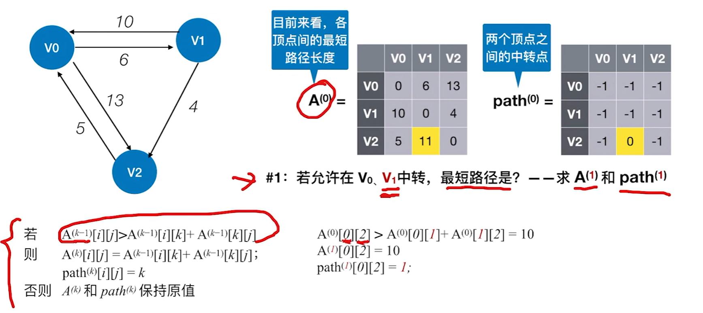

> 注：Floyd 的思路是**动态规划**——把"允许经过哪些顶点中转"分成 n 个阶段：**初始**一个中转点都不允许（这时的 A 就是邻接矩阵）、**#0** 允许在 v0 中转、**#1** 允许在 v0、v1 中转、……一直做到 **#n-1**（允许所有顶点中转），最后得到的 A 就是任意两点间的最短路径长度。每个阶段只需在上一阶段的基础上"拿 k 号顶点试一次"：若 `A(k-1)[i][j] > A(k-1)[i][k] + A(k-1)[k][j]`，就把 `A(k)[i][j]` 更新成右边那两项之和、同时令 `path(k)[i][j] = k`；否则 A 和 path 都原样保留。实现就是**三重循环**（外层枚举中转点 k，内层枚举 i、j），所以**时间 O(|V|³)**、**空间 O(|V|²)**（两个 n×n 矩阵）。
>
> 和 Dijkstra 对比着记：Dijkstra 求的是**单源**，Floyd 一次就把**所有点对**都算出来，代码还更短；代价是复杂度上了个台阶（O(|V|³)），而且同样要求"**允许负权边、不允许有负权回路**"。

把这个例题逐阶段走一遍（每轮只会在"用 k 当中转更短"的格子上动手）：

| 阶段 | 允许中转的顶点 | 本轮被更新的格子 | path 变化 |
| --- | --- | --- | --- |
| 初始 A⁽⁻¹⁾ | 一个都不允许 | 就是邻接矩阵：v2→v1 没有直达弧，记 ∞ | 全为 -1 |
| #0 | v0 | `A[2][1]`：∞ → 11 = 5+6（v2→v0→v1） | `path[2][1] = 0` |
| #1 | v0、v1 | `A[0][2]`：13 → 10 = 6+4（v0→v1→v2） | `path[0][2] = 1` |
| #2 | v0、v1、v2 | `A[1][0]`：10 → 9 = 4+5（v1→v2→v0） | `path[1][0] = 2` |

跑完三个阶段后，两个矩阵分别是：

| A⁽²⁾ | → v0 | → v1 | → v2 |
| --- | --- | --- | --- |
| v0 出发 | 0 | 6 | 10 |
| v1 出发 | 9 | 0 | 4 |
| v2 出发 | 5 | 11 | 0 |

| path⁽²⁾ | → v0 | → v1 | → v2 |
| --- | --- | --- | --- |
| v0 出发 | -1 | -1 | 1 |
| v1 出发 | 2 | -1 | -1 |
| v2 出发 | -1 | 0 | -1 |

> 注：A⁽²⁾ 就是答案——**v0→v1 是 6、v0→v2 是 10、v1→v0 是 9、v1→v2 是 4、v2→v0 是 5、v2→v1 是 11**（对角线 0）。`path[i][j]` 里存的是**中转点**而不是前驱，所以还原路径要"两头再查一次"：比如 v1→v0 的最短长度是 9，`path[1][0] = 2` 说明要经过 v2，再查 `path[1][2] = -1`（v1→v2 直达）和 `path[2][0] = -1`（v2→v0 直达），拼起来就是 **v1→v2→v0**；同理 `path[2][1] = 0` 给出 **v2→v0→v1**。中转点为 -1 就表示这一段是直达的，不用再拆。

### 用有向无环图表示表达式

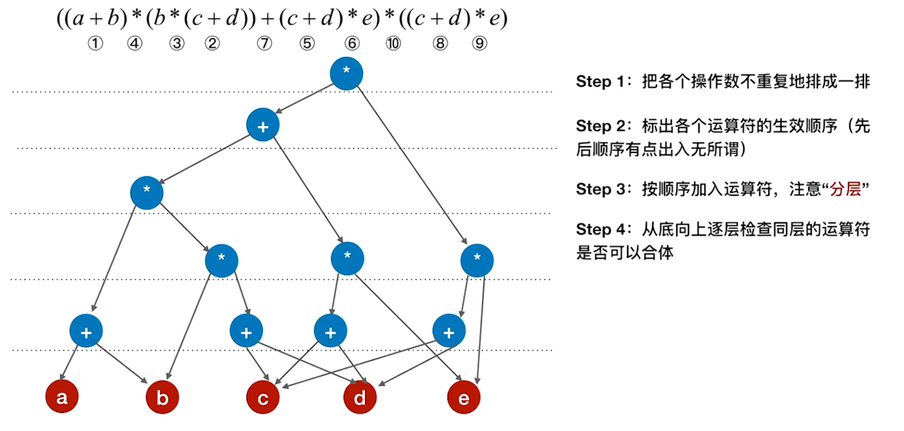

> 注：用**有向无环图（DAG）**表示表达式的意义在于**共享相同的子表达式**——图的**叶子结点是操作数**、**内部结点是运算符**，只要两个结点代表的是"同一个子表达式"（同一个运算符、参与运算的两部分也相同），就**合并成同一个结点**。所以和二叉树形式相比，同一个表达式用 DAG 表示**结点数少得多**：上面这个例子里 `c+d` 出现了 3 次、`(c+d)*e` 出现了 2 次，合并后各只留一个结点，`c`、`d` 这些操作数也只画一次。

画的过程就是课件那四步：

| 步骤 | 做什么 |
| --- | --- |
| Step 1 | 把各个操作数**不重复地排成一排**，作为最底层的叶子 |
| Step 2 | 标出各个运算符的**生效顺序**（先后顺序有点出入无所谓） |
| Step 3 | 按顺序**加入运算符**，注意"**分层**"——每个运算符只作用于它下面已经画好的那部分 |
| Step 4 | **从底向上逐层检查**同层的运算符能不能"**合体**"（相同的子表达式合并成一个结点） |

上面那张图是前三步的结果（顶上一行还标着运算符的生效顺序），下面这张是合体之后最终的 DAG：

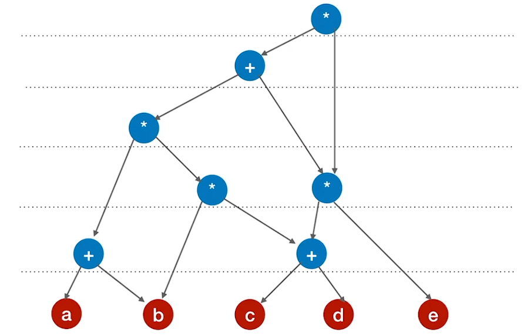

> 注：对着两张图看，被合掉的就是那些重复的子表达式——`c+d` 从 3 份变 1 份、`(c+d)*e` 从 2 份变 1 份，`c`、`d` 于是也各自只出现一次，整张图的结点数比二叉树形式少了一截。课件在 Step 2 特意说"顺序有点出入无所谓"，是因为**顺序只影响中间的分层过程**，最后合体出来的是同一张 DAG（每个不同的子表达式对应一个结点）。做题时抓两条判据：**合并的依据是"同一个子表达式"**（运算符相同、参与运算的两部分也相同），**合完之后仍要保持原来的运算先后关系**，不能把先后弄反。

### 拓扑排序


%%{init: {
  "theme": "base",
  "themeVariables": {
    "primaryColor": "#5b9bd5",
    "primaryTextColor": "#ffffff",
    "primaryBorderColor": "#41719c",
    "lineColor": "#41719c",
    "secondaryColor": "#ffffff",
    "tertiaryColor": "#e2f0d9",
    "fontSize": "16px",
    "fontFamily": "-apple-system, BlinkMacSystemFont, \"Segoe UI\", Roboto, \"Helvetica Neue\", Arial, \"Noto Sans\", sans-serif"
  },
  "flowchart": {
    "nodeSpacing": 8,
    "rankSpacing": 26,
    "curve": "basis",
    "htmlLabels": true,
    "subGraphTitleMargin": { "top": 0, "bottom": 14 },
    "padding": 4,
    "useMaxWidth": false,
    "wrappingWidth": 1000
  }
}}%%
graph LR
  Root["拓扑排序"]

  Root --> Aov["AOV 网"]
  Root --> Topo["拓扑排序"]
  Root --> Rev["逆拓扑排序"]
  Root --> Dfs["另一种实现方式：<br>用 DFS 实现拓扑排序/逆拓扑排序"]
  Root --> Prop["性质"]

  Aov --> A1["顶点代表活动，有向边 ⟨vi, vj⟩ 表示活动 vi 必须先于 vj 进行"]
  Aov --> A2["AOV 网一定是 DAG 图，不能有环"]

  Topo --> T1["① 从 AOV 网中选择一个没有前驱（入度为 0）的顶点并输出"]
  Topo --> T2["② 从网中删除该顶点和所有以它为起点的有向边"]
  Topo --> T3["③ 重复 ① 和 ②，直到当前的 AOV 网为空"]

  Rev --> R1["① 从 AOV 网中选择一个没有后继（出度为 0）的顶点并输出"]
  Rev --> R2["② 从网中删除该顶点和所有以它为终点的有向边"]
  Rev --> R3["③ 重复 ① 和 ②，直到当前的 AOV 网为空"]

  Prop --> P1["拓扑排序、逆拓扑排序序列可能不唯一"]
  Prop --> P2["若图中有环，则不存在拓扑排序序列/逆拓扑排序序列"]

  classDef root fill:#5b9bd5,stroke:#41719c,stroke-width:2px,color:#fff,font-weight:bold,font-size:20px;
  classDef lvl1 fill:#9dc3e6,stroke:#2e6da4,stroke-width:2px,color:#0d2f4d,font-size:19px;
  classDef lvl2d fill:#dbe8f6,stroke:#1f4e79,stroke-width:2px,color:#000000,font-size:16px;
  classDef lvl2l fill:#f6fafe,stroke:#c3d9ef,stroke-width:2px,color:#000000,font-size:16px;

  class Root root;
  class Aov,Topo,Rev,Dfs,Prop lvl1;
  class A1,A2,R1,R2,R3 lvl2d;
  class T1,T2,T3,P1,P2 lvl2l;


```c
bool TopologicalSort(Graph G){
    InitStack(S);                      // 初始化栈，存储入度为 0 的顶点
    for (int i = 0; i < G.vexnum; i++)
        if (indegree[i] == 0)
            Push(S, i);                // 将所有入度为 0 的顶点进栈
    int count = 0;                     // 计数，记录当前已经输出的顶点数
    while (!IsEmpty(S)){               // 栈不空，则存在入度为 0 的顶点
        Pop(S, i);                     // 栈顶元素出栈
        print[count++] = i;            // 输出顶点 i
        for (p = G.vertices[i].firstarc; p; p = p->nextarc){
            // 将所有 i 指向的顶点的入度减 1，并将入度减为 0 的顶点压入栈 S
            v = p->adjvex;
            if (!(--indegree[v]))
                Push(S, v);            // 入度为 0，则入栈
        }
    }
    if (count < G.vexnum)
        return false;                  // 排序失败，有向图中有回路
    else
        return true;                   // 拓扑排序成功
}
```

> 注：代码就是照着那三步写的——`indegree[]` 存每个顶点的入度，先把入度为 0 的顶点**压栈**；弹出一个顶点并输出后，把它**所有出边**指向的顶点入度减 1，谁减到 0 就压栈。`count` 记录已经输出的顶点数，最后 `count < G.vexnum` 说明没排完：此时网里剩下的顶点**每个都还有前驱**（互相牵制），也就是**图中有回路**（课件那个红色气泡），所以拓扑排序也常被拿来**判断有向图里有没有回路**。另外课件用的是栈，其实**换成队列一样能排**，只是得到的拓扑序列可能不同（都属于合法的拓扑序列）。

```c
void DFSTraverse(Graph G){             // 对图 G 进行深度优先遍历
    for (v = 0; v < G.vexnum; ++v)
        visited[v] = FALSE;            // 初始化已访问标记数据
    for (v = 0; v < G.vexnum; ++v)     // 本代码中是从 v=0 开始遍历
        if (!visited[v])
            DFS(G, v);
}

void DFS(Graph G, int v){              // 从顶点 v 出发，深度优先遍历图 G
    visited[v] = TRUE;                 // 设已访问标记
    for (w = FirstNeighbor(G, v); w >= 0; w = NextNeighbor(G, v, w))
        if (!visited[w]) {             // w 为 v 的尚未访问的邻接顶点
            DFS(G, w);
        }
    print(v);                          // 输出顶点：放在递归之后，得到的就是逆拓扑序列
}
```

> 注：**逆拓扑排序**用 DFS 实现最省事——照常递归访问邻接点，只把"输出顶点"这一步挪到**递归返回之后**。这样当一个顶点被输出时，它的所有后继都已经输出完了，得到的恰好是逆拓扑序列。所以这份代码和前面「深度优先遍历（DFS）」那一节的差别，就只在**输出顶点的位置**：那节是在进入时 `visit(v)`，这里挪到了两次递归之后——记的时候盯住"**print 在哪**"就够了。

两种做法的时间复杂度都跟着**存储结构**走（这也正是前面「图的存储及基本操作」里那句"稠密图用邻接矩阵、稀疏图用邻接表"落到具体算法上的样子）：

| 存储结构 | 拓扑排序 | 逆拓扑排序（DFS 实现） |
| --- | --- | --- |
| 邻接表 | O(\|V\| + \|E\|) | O(\|V\| + \|E\|) |
| 邻接矩阵 | O(\|V\|²) | O(\|V\|²) |

> 注：差别就在于"**找一个顶点的出边/邻接点要花多少时间**"。邻接表里顺着该顶点的边表走一趟就行，所有顶点的边表加起来正好是 |E| 条边，再加上每个顶点进出栈（或每次 DFS 调用）一次的 |V|，所以是 **O(|V| + |E|)**；邻接矩阵里不管图里实际有多少条边，处理每个顶点都得**扫一整行（或一整列）**，|V| 个顶点乘上去就是 **O(|V|²)**。

### 关键路径


%%{init: {
  "theme": "base",
  "themeVariables": {
    "primaryColor": "#5b9bd5",
    "primaryTextColor": "#ffffff",
    "primaryBorderColor": "#41719c",
    "lineColor": "#41719c",
    "secondaryColor": "#ffffff",
    "tertiaryColor": "#e2f0d9",
    "fontSize": "16px",
    "fontFamily": "-apple-system, BlinkMacSystemFont, \"Segoe UI\", Roboto, \"Helvetica Neue\", Arial, \"Noto Sans\", sans-serif"
  },
  "flowchart": {
    "nodeSpacing": 8,
    "rankSpacing": 26,
    "curve": "basis",
    "htmlLabels": true,
    "subGraphTitleMargin": { "top": 0, "bottom": 14 },
    "padding": 4,
    "useMaxWidth": false,
    "wrappingWidth": 1000
  }
}}%%
graph LR
  Root["关键路径"]

  Root --> Aoe["AOE 网"]
  Root --> Solve["求解方法"]
  Root --> Prop["特性"]

  Aoe --> A1["在带权有向图中，顶点表示事件、有向边表示活动，<br>边上的权值表示完成该活动的开销"]
  Aoe --> A2["相关概念"]

  A2 --> B1["仅有一个入度为 0 的顶点 = 开始顶点（源点），<br>它表示整个工程的开始"]
  A2 --> B2["也仅有一个出度为 0 的顶点 = 结束顶点（汇点），<br>它表示整个工程的结束"]
  A2 --> B3["从源点到汇点的路径可能有多条，其中最长的<br>称为关键路径，其上的活动称为关键活动"]

  Solve --> S1["① 求所有事件的最早发生时间 ve()"]
  Solve --> S2["② 求所有事件的最迟发生时间 vl()"]
  Solve --> S3["③ 求所有活动的最早发生时间 e()"]
  Solve --> S4["④ 求所有活动的最迟发生时间 l()"]
  Solve --> S5["⑤ 求所有活动的时间余量 d()"]
  S5 --> S6["d(i) = 0 的活动就是关键活动，由关键活动可得关键路径"]

  Prop --> P1["若关键活动耗时增加，则整个工程的工期将增长"]
  Prop --> P2["缩短关键活动的时间，可以缩短整个工程的工期"]
  Prop --> P3["当缩短到一定程度时，关键活动可能会变成非关键活动"]
  Prop --> P4["可能有多条关键路径：只加快其中一条上的活动<br>并不能缩短工期，要加快所有关键路径都包含的活动"]

  classDef root fill:#5b9bd5,stroke:#41719c,stroke-width:2px,color:#fff,font-weight:bold,font-size:20px;
  classDef lvl1 fill:#9dc3e6,stroke:#2e6da4,stroke-width:2px,color:#0d2f4d,font-size:19px;
  classDef lvl2d fill:#dbe8f6,stroke:#1f4e79,stroke-width:2px,color:#000000,font-size:16px;
  classDef lvl2l fill:#f6fafe,stroke:#c3d9ef,stroke-width:2px,color:#000000,font-size:16px;
  classDef lvl3d fill:#dbe8f6,stroke:#1f4e79,stroke-width:2px,color:#333333,font-size:15px;
  classDef lvl3l fill:#f6fafe,stroke:#c3d9ef,stroke-width:2px,color:#333333,font-size:15px;

  class Root root;
  class Aoe,Solve,Prop lvl1;
  class A1,A2,P1,P2,P3,P4 lvl2d;
  class S1,S2,S3,S4,S5 lvl2l;
  class B1,B2,B3 lvl3d;
  class S6 lvl3l;


> 注：上面那五步的公式，展开就是下面这张表——**ve 从源点往汇点推**、**vl 从汇点往回推**，然后把"事件的时间"落到"活动的时间"上，差值就是每个活动能拖多久：

| 步骤 | 求什么 | 怎么算 |
| --- | --- | --- |
| ① | 事件 vk 的**最早**发生时间 `ve(k)` | 按**拓扑序**递推：`ve(源点) = 0`；`ve(k) = max{ ve(j) + w(vj → vk) }`，j 取遍所有指向 vk 的顶点 |
| ② | 事件 vk 的**最迟**发生时间 `vl(k)` | 按**逆拓扑序**递推：`vl(汇点) = ve(汇点)`；`vl(k) = min{ vl(j) − w(vk → vj) }`，j 取遍所有从 vk 出发的顶点 |
| ③ | 活动 ai = ⟨vk, vj⟩ 的**最早**开始时间 `e(i)` | `e(i) = ve(k)`——直接取**弧尾**（起点事件）的最早发生时间 |
| ④ | 活动 ai 的**最迟**开始时间 `l(i)` | `l(i) = vl(j) − w(vk → vj)`——用**弧头**（终点事件）的最迟发生时间减掉这个活动自己的耗时 |
| ⑤ | 活动 ai 的**时间余量** `d(i)` | `d(i) = l(i) − e(i)`；**d(i) = 0 的活动就是关键活动**，把它们连起来就是关键路径 |

> 注：这五步的直觉其实很朴素——`ve` 是"这件事**最早**能发生的时间"（把前面所有活动都做完），`vl` 是"这件事**最晚**能不拖累工期地发生的时间"；到了活动这一层，`e` 就是"这个活动最早能开工"，`l` 是"最晚必须开工"，两者一减，`d` 就是"**这个活动能摸鱼多久而不影响总工期**"。摸不了鱼的（`d = 0`）自然就是关键活动——它们串起来的那条从源点到汇点的最长路径，长度就是整个工程的工期。

拿下面这张 AOE 网走一遍（V1 是源点、V6 是汇点，a1~a8 是活动，边上的数字是耗时）：

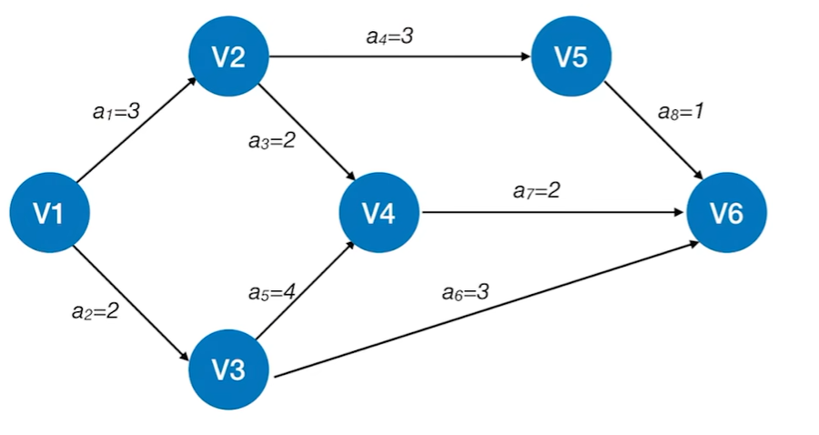

**① ② 求各事件的最早 / 最迟发生时间**（拓扑序：V1→V2→V3→V4→V5→V6）：

| 事件 | V1 | V2 | V3 | V4 | V5 | V6 |
| --- | --- | --- | --- | --- | --- | --- |
| `ve(k)` | 0 | 3 | 2 | 6 | 6 | 8 |
| `vl(k)` | 0 | 4 | 2 | 6 | 7 | 8 |

比如 `ve(V4) = max{ ve(V2)+2, ve(V3)+4 } = max{5, 6} = 6`，`ve(V6) = max{ 6+2, 2+3, 6+1 } = 8`；反过来 `vl(V5) = vl(V6) − 1 = 7`，`vl(V2) = min{ vl(V4)−2, vl(V5)−3 } = min{4, 4} = 4`。

**③ ④ ⑤ 求各活动的最早 / 最迟开始时间与时间余量**：

| 活动 | 弧 | 耗时 | `e(i)` | `l(i)` | `d(i)` | 关键活动 |
| --- | --- | --- | --- | --- | --- | --- |
| a1 | V1→V2 | 3 | 0 | 1 | 1 | |
| a2 | V1→V3 | 2 | 0 | 0 | **0** | ✔ |
| a3 | V2→V4 | 2 | 3 | 4 | 1 | |
| a4 | V2→V5 | 3 | 3 | 4 | 1 | |
| a5 | V3→V4 | 4 | 2 | 2 | **0** | ✔ |
| a6 | V3→V6 | 3 | 2 | 5 | 3 | |
| a7 | V4→V6 | 2 | 6 | 6 | **0** | ✔ |
| a8 | V5→V6 | 1 | 6 | 7 | 1 | |

> 注：`d = 0` 的只有 **a2、a5、a7**，所以关键路径是 **V1 →(a2)→ V3 →(a5)→ V4 →(a7)→ V6**，长度 2 + 4 + 2 = **8**，也就是整个工程的工期（其余两条从 V1 到 V6 的路径分别是 3+2+2 = 7 和 3+3+1 = 7，都比它短）。这个例子也正好印证导图里"特性"那几条：关键活动**一个都不能拖**（a2、a5、a7 只要有一个变慢，工期立刻跟着涨）；反过来想缩短工期，就得动关键活动——但缩短到一定程度它可能就变成非关键活动了；而且**如果有多条关键路径，只加速其中一条是没用的**，得加快所有关键路径都包含的活动。

# 七、查找

## 查找的基本概念


%%{init: {
  "theme": "base",
  "themeVariables": {
    "primaryColor": "#5b9bd5",
    "primaryTextColor": "#ffffff",
    "primaryBorderColor": "#41719c",
    "lineColor": "#41719c",
    "secondaryColor": "#ffffff",
    "tertiaryColor": "#e2f0d9",
    "fontSize": "16px",
    "fontFamily": "-apple-system, BlinkMacSystemFont, \"Segoe UI\", Roboto, \"Helvetica Neue\", Arial, \"Noto Sans\", sans-serif"
  },
  "flowchart": {
    "nodeSpacing": 8,
    "rankSpacing": 26,
    "curve": "basis",
    "htmlLabels": true,
    "subGraphTitleMargin": { "top": 0, "bottom": 14 },
    "padding": 4,
    "useMaxWidth": false,
    "wrappingWidth": 1000
  }
}}%%
graph LR
  Root["查找"]

  Root --> Basic["基本概念"]
  Root --> Eff["查找算法的效率评价"]

  Basic --> B1["查找：找到符合条件的数据元素（记录）"]
  Basic --> B2["查找表：由同一类型的数据元素（记录）组成"]
  Basic --> B3["关键字：唯一标识数据元素的数据项"]

  B2 --> C1["静态查找表：只需要查找操作"]
  B2 --> C2["动态查找表：除了查找，还需要增/删数据元素"]

  Eff --> E1["平均查找长度 ASL"]
  Eff --> E2["通常考虑查找成功、查找失败两种情况下的 ASL"]

  classDef root fill:#5b9bd5,stroke:#41719c,stroke-width:2px,color:#fff,font-weight:bold,font-size:20px;
  classDef lvl1 fill:#9dc3e6,stroke:#2e6da4,stroke-width:2px,color:#0d2f4d,font-size:19px;
  classDef lvl2d fill:#dbe8f6,stroke:#1f4e79,stroke-width:2px,color:#000000,font-size:16px;
  classDef lvl2l fill:#f6fafe,stroke:#c3d9ef,stroke-width:2px,color:#000000,font-size:16px;
  classDef lvl3d fill:#dbe8f6,stroke:#1f4e79,stroke-width:2px,color:#333333,font-size:15px;

  class Root root;
  class Basic,Eff lvl1;
  class B1,B2,B3 lvl2d;
  class E1,E2 lvl2l;
  class C1,C2 lvl3d;


> 注：导图里那个 **ASL（Average Search Length，平均查找长度）** 就是衡量"找一个元素平均要比多少次"的指标，课件只给了名字，把它展开是这么个式子：`ASL = Σ P_i × C_i`（i 从 1 到 n）。三个量的意思是——**n** 是查找表的长度（元素个数）；**P_i** 是查找第 i 个元素的概率（题目一般默认各元素等概率，也就是 `P_i = 1/n`，于是 `ASL = (1/n) × Σ C_i`，退化成"平均比较次数"）；**C_i** 是找到第 i 个元素**需要比较的次数**，它取决于具体的查找算法和存储结构（后面每一节的效率分析，都是在算这个 Σ）。
>
> 注意 ASL 有**两种口径**：`ASL_成功` 是查找成功时的平均比较次数，`ASL_失败` 是"目标不在表里"时的平均比较次数——算失败的 ASL 时，要把**所有可能导致失败的情况**都枚举出来再平均（比如顺序查找里有 n+1 种失败位置），所以它通常和成功的那个不相等，**两个都要会算**。

## 顺序查找


%%{init: {
  "theme": "base",
  "themeVariables": {
    "primaryColor": "#5b9bd5",
    "primaryTextColor": "#ffffff",
    "primaryBorderColor": "#41719c",
    "lineColor": "#41719c",
    "secondaryColor": "#ffffff",
    "tertiaryColor": "#e2f0d9",
    "fontSize": "16px",
    "fontFamily": "-apple-system, BlinkMacSystemFont, \"Segoe UI\", Roboto, \"Helvetica Neue\", Arial, \"Noto Sans\", sans-serif"
  },
  "flowchart": {
    "nodeSpacing": 8,
    "rankSpacing": 26,
    "curve": "basis",
    "htmlLabels": true,
    "subGraphTitleMargin": { "top": 0, "bottom": 14 },
    "padding": 4,
    "useMaxWidth": false,
    "wrappingWidth": 1000
  }
}}%%
graph LR
  Root["顺序查找"]

  Root --> Impl["算法实现"]
  Root --> Opt["优化"]
  Root --> Cplx["时间复杂度 O(n)"]

  Impl --> I1["从头到尾（或者从尾到头）挨个比较"]
  Impl --> I2["适用于顺序表、链表；表中元素有序、无序都行"]
  Impl --> I3["可在 0 号位置存「哨兵」，从尾部向头部挨个查找<br>优点：循环时无需判断下标是否越界"]

  Opt --> O1["若表中元素有序"]
  Opt --> O2["若各个关键字被查概率不同"]

  O1 --> O1a["一旦当前关键字大于（小于）目标，即可断定查找失败"]
  O1 --> O1b["优点：查找失败时 ASL 更少"]
  O1 --> O1c["查找判定树：成功结点的对比次数 = 结点所在层数，<br>失败结点的对比次数 = 其父结点所在层数"]

  O2 --> O2a["可按被查概率降序排列"]
  O2 --> O2b["优点：查找成功时 ASL 更少"]

  classDef root fill:#5b9bd5,stroke:#41719c,stroke-width:2px,color:#fff,font-weight:bold,font-size:20px;
  classDef lvl1 fill:#9dc3e6,stroke:#2e6da4,stroke-width:2px,color:#0d2f4d,font-size:19px;
  classDef lvl2d fill:#dbe8f6,stroke:#1f4e79,stroke-width:2px,color:#000000,font-size:16px;
  classDef lvl2l fill:#f6fafe,stroke:#c3d9ef,stroke-width:2px,color:#000000,font-size:16px;
  classDef lvl3d fill:#dbe8f6,stroke:#1f4e79,stroke-width:2px,color:#333333,font-size:15px;
  classDef lvl3l fill:#f6fafe,stroke:#c3d9ef,stroke-width:2px,color:#333333,font-size:15px;

  class Root root;
  class Impl,Opt,Cplx lvl1;
  class I1,I2,I3 lvl2d;
  class O1,O2 lvl2l;
  class O1a,O1b,O1c lvl3d;
  class O2a,O2b lvl3l;


```c
typedef struct{                        // 查找表的数据结构（顺序表）
    ElemType *elem;                    // 动态数组基址
    int TableLen;                      // 表的长度
} SSTable;

// 顺序查找
int Search_Seq(SSTable ST, ElemType key){
    int i;
    for (i = 0; i < ST.TableLen && ST.elem[i] != key; ++i);
    // 查找成功，则返回元素下标；查找失败，则返回 -1
    return i == ST.TableLen ? -1 : i;
}
```

> 注：这段代码是**不带哨兵**的版本——循环条件里要同时判断 `i < ST.TableLen`（防越界）和元素是否相等，找不到就返回 -1。课件导图里说的"**0 号位置存哨兵**"是另一种写法：把 `elem[0]` 当成 key 的副本，然后从**表尾往表头**扫，这样循环里只剩"元素是否相等"一个判断（因为哨兵一定能"拦住"循环），省掉每次的下标越界检查——注意这要求**元素从下标 1 开始存**。
>
> 效率上（等概率，每个位置的比较次数就是它的"找到要走几步"）：**`ASL_成功 = (n + 1) / 2`**（Σ 从 1 到 n 再除以 n）；**`ASL_失败`** 则要看写法——**不带哨兵**时得把 n 个元素全比一遍才知道没有，代价 **n**；**带哨兵**时最后还会跟 0 号位置的哨兵比一次，代价 **n + 1**（课件说的"顺序查找有 n+1 种失败位置"说的就是这个）。

> 注：导图里那两条**优化**针对的正是上面这两个数字。
>
> - **表内元素有序**时：一旦发现"当前关键字已经比目标大（或小）"，后面就不可能有了，可以**直接断定失败**，于是 `ASL_失败` 明显变小（不用再傻等到表尾）；分析它靠**查找判定树**——把比较过程画成树后，**成功结点花了几层就是比了几次，失败结点则比到它的父结点那一层为止**，以此算出两个 ASL。
> - **各关键字被查概率不同**时：把**概率大的放在前面**（按概率降序排列），这样大多数查找几步就命中，`ASL_成功` 变小——但注意表就不再有序了，前面那条"失败时提前停"的优化也就用不上了，两种优化是**互斥**的，得看题意选。

## 折半查找


%%{init: {
  "theme": "base",
  "themeVariables": {
    "primaryColor": "#5b9bd5",
    "primaryTextColor": "#ffffff",
    "primaryBorderColor": "#41719c",
    "lineColor": "#41719c",
    "secondaryColor": "#ffffff",
    "tertiaryColor": "#e2f0d9",
    "fontSize": "16px",
    "fontFamily": "-apple-system, BlinkMacSystemFont, \"Segoe UI\", Roboto, \"Helvetica Neue\", Arial, \"Noto Sans\", sans-serif"
  },
  "flowchart": {
    "nodeSpacing": 8,
    "rankSpacing": 26,
    "curve": "basis",
    "htmlLabels": true,
    "subGraphTitleMargin": { "top": 0, "bottom": 14 },
    "padding": 4,
    "useMaxWidth": false,
    "wrappingWidth": 1000
  }
}}%%
graph LR
  Root["折半查找"]

  Root --> Scope["适用范围"]
  Root --> Idea["算法思想"]
  Root --> Tree["判定树"]
  Root --> Cplx["时间复杂度 O(log₂n)"]

  Scope --> S1["只适用于有序的顺序表"]

  Idea --> I1["在 [low, high] 之间找目标关键字，每次比较 mid = (low+high)/2"]
  Idea --> I2["按 mid 与目标的大小关系调整 low 或 high，不断缩小范围"]
  Idea --> I3["若 low > high，则查找失败"]

  Tree --> Build["构造"]
  Tree --> Prop["特性"]

  Build --> B1["由 mid 所指元素把区间分割成左、右两棵子树"]
  Build --> B2["Key：右子树结点数 − 左子树结点数 = 0 或 1"]

  Prop --> P1["判定树是平衡的二叉排序树（左 < 中 < 右）"]
  Prop --> P2["只有最下面一层是不满的"]
  Prop --> P3["有 n 个关键字时，失败结点有 n + 1 个"]
  Prop --> P4["树高 h = ⌈log₂(n + 1)⌉（不包含失败结点）"]

  classDef root fill:#5b9bd5,stroke:#41719c,stroke-width:2px,color:#fff,font-weight:bold,font-size:20px;
  classDef lvl1 fill:#9dc3e6,stroke:#2e6da4,stroke-width:2px,color:#0d2f4d,font-size:19px;
  classDef lvl2d fill:#dbe8f6,stroke:#1f4e79,stroke-width:2px,color:#000000,font-size:16px;
  classDef lvl2l fill:#f6fafe,stroke:#c3d9ef,stroke-width:2px,color:#000000,font-size:16px;
  classDef lvl3d fill:#dbe8f6,stroke:#1f4e79,stroke-width:2px,color:#333333,font-size:15px;
  classDef lvl3l fill:#f6fafe,stroke:#c3d9ef,stroke-width:2px,color:#333333,font-size:15px;

  class Root root;
  class Scope,Idea,Tree,Cplx lvl1;
  class S1,Build,Prop lvl2d;
  class I1,I2,I3 lvl2l;
  class B1,B2 lvl3d;
  class P1,P2,P3,P4 lvl3l;


```c
typedef struct{                        // 查找表的数据结构（顺序表）
    ElemType *elem;                    // 动态数组基址
    int TableLen;                      // 表的长度
} SSTable;

// 折半查找
int Binary_Search(SSTable L, ElemType key){
    int low = 0, high = L.TableLen - 1, mid;
    while (low <= high){
        mid = (low + high) / 2;        // 取中间位置
        if (L.elem[mid] == key)
            return mid;                // 查找成功则返回所在位置
        else if (L.elem[mid] > key)
            high = mid - 1;            // 从前半部分继续查找
        else
            low = mid + 1;             // 从后半部分继续查找
    }
    return -1;                         // 查找失败，返回 -1
}
```

> 注：**ASL 怎么补**——折半查找的过程画成判定树后，"比较几次"就等于"结点在第几层"，所以 `ASL_成功` 就是把**每层的结点数 × 层数**加起来除以 n。以 n = 11 为例，判定树第 1 层 1 个、第 2 层 2 个、第 3 层 4 个、第 4 层 4 个，于是 `ASL_成功 = (1×1 + 2×2 + 4×3 + 4×4) / 11 = 33 / 11 = 3`。
>
> `ASL_失败` 同理，只是数的是**失败结点**（判定树里那些方框）：n 个关键字一共引出 n + 1 = 12 个失败结点，它们"比到父结点那一层为止"——这 12 个里有 4 个挂在第 3 层、8 个挂在第 4 层，所以 `ASL_失败 = (4×3 + 8×4) / 12 = 44 / 12 ≈ 3.67`。两个数都是 log 量级，这正是折半查找 O(log₂n) 比顺序查找 O(n) 强的地方。

> 注：**如果 mid 取上界**（`mid = ⌈(low + high) / 2⌉`，即两个中间位置时选右边那个），会有什么不同？把判定树画出来就清楚了——它只是把原来的树**左右镜像**了一下：课件那条 Key 写的是"右子树 − 左子树 = 0 或 1"（下界取整时左子树偏小），**取上界后变成"左子树 − 右子树 = 0 或 1"**。但每一步仍然是"把区间一分为二、两边结点数最多差 1"，所以**树高还是 ⌈log₂(n+1)⌉、每一层的结点数也完全一样**（只是哪些元素落在哪一层换了位置），于是**两个 ASL、时间复杂度统统不变**，依旧是 O(log₂n)。做题时按题目规定的取整方式画树就行，最后算出来的 ASL 数值是一致的。

## 分块查找


%%{init: {
  "theme": "base",
  "themeVariables": {
    "primaryColor": "#5b9bd5",
    "primaryTextColor": "#ffffff",
    "primaryBorderColor": "#41719c",
    "lineColor": "#41719c",
    "secondaryColor": "#ffffff",
    "tertiaryColor": "#e2f0d9",
    "fontSize": "16px",
    "fontFamily": "-apple-system, BlinkMacSystemFont, \"Segoe UI\", Roboto, \"Helvetica Neue\", Arial, \"Noto Sans\", sans-serif"
  },
  "flowchart": {
    "nodeSpacing": 8,
    "rankSpacing": 26,
    "curve": "basis",
    "htmlLabels": true,
    "subGraphTitleMargin": { "top": 0, "bottom": 14 },
    "padding": 4,
    "useMaxWidth": false,
    "wrappingWidth": 1000
  }
}}%%
graph LR
  Root["分块查找"]

  Root --> Def["又称「索引顺序查找」：<br>数据分块存储，块内无序、块间有序"]
  Root --> Idea["算法思想"]
  Root --> Asl["ASL"]
  Root --> Trap["易错点"]

  Idea --> I1["索引表中记录每个分块的最大关键字、分块的区间"]
  Idea --> I2["先查索引表（顺序或折半），再在分块内顺序查找"]

  Asl --> A1["总 ASL = 查索引表的平均查找长度 + 查分块的平均查找长度"]
  Asl --> A2["设 n 个记录、均匀分成 b 块、每块 s 个记录"]
  Asl --> A3["顺序查找索引表：ASL = (b + 1)/2 + (s + 1)/2<br>当 s = √n（此时 b = √n）时最小，为 √n + 1"]
  Asl --> A4["折半查找索引表：ASL = ⌈log₂(b + 1)⌉ + (s + 1)/2"]

  Trap --> T1["折半查找索引表时，若表里没有目标关键字，折半最终停在<br>low > high，此时要到 low 所指的那个分块里去找"]

  classDef root fill:#5b9bd5,stroke:#41719c,stroke-width:2px,color:#fff,font-weight:bold,font-size:20px;
  classDef lvl1 fill:#9dc3e6,stroke:#2e6da4,stroke-width:2px,color:#0d2f4d,font-size:19px;
  classDef lvl2d fill:#dbe8f6,stroke:#1f4e79,stroke-width:2px,color:#000000,font-size:16px;
  classDef lvl2l fill:#f6fafe,stroke:#c3d9ef,stroke-width:2px,color:#000000,font-size:16px;

  class Root root;
  class Def,Idea,Asl,Trap lvl1;
  class I1,I2,T1 lvl2d;
  class A1,A2,A3,A4 lvl2l;


> 注：分块查找又叫**索引顺序查找**，前提是数据**分块存储**，而且必须满足"**块内无序、块间有序**"——每块内部不必有序，但**后一块里任意一个关键字都要大于前一块的最大关键字**。索引表就是为这件事服务的：它只记两样东西，**每个分块的最大关键字**和**该分块的区间**（比如下面图中第一块最大是 10、占下标 [0,1]）。查找分两步：**先在索引表里定出目标可能落在哪一块**（索引表本身可以顺序查找，也可以折半查找），**再在该块内顺序查找**——所以它的效率介于顺序查找和折半查找之间。

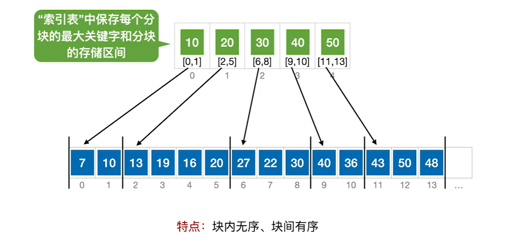

把两部分加起来就是总的平均查找长度（都是"查找成功"的口径，且假设每个记录被查概率相同）：

| 索引表的查找方式 | ASL |
| --- | --- |
| 顺序查找索引表 | `(b + 1) / 2 + (s + 1) / 2` |
| 折半查找索引表 | `⌈log₂(b + 1)⌉ + (s + 1) / 2` |

> 注：这两个式子拆开看就不难记——**前半段是"定块"的代价**：索引表有 b 项，用顺序查找就是顺序查找的老结论 `(b+1)/2`，换成折半查找就是判定树的高度 `⌈log₂(b+1)⌉`；**后半段是"块内找"的代价**：块内是顺序查找，s 个记录平均要比较 `(s+1)/2` 次。所以 `ASL = 定块 + 块内`，两部分相加即可。
>
> 用顺序查找索引表时还能顺手求个 **s 取多少最优**：因为 `b = n / s`，代入得 `ASL = (n/s + s + 2)/2`，由均值不等式，当 `s = √n`（此时 `b = √n`）时 `n/s + s` 取到最小值 `2√n`，于是 **`ASL_最小 = √n + 1`**。换成折半查找索引表，前半段变成 log 级别，所以**块数 b 越多、每块 s 越小越划算**（但 b 大了索引表本身占的空间也大，这是另一回事）。

## 二叉排序树

### 二叉排序树的概念


%%{init: {
  "theme": "base",
  "themeVariables": {
    "primaryColor": "#5b9bd5",
    "primaryTextColor": "#ffffff",
    "primaryBorderColor": "#41719c",
    "lineColor": "#41719c",
    "secondaryColor": "#ffffff",
    "tertiaryColor": "#e2f0d9",
    "fontSize": "16px",
    "fontFamily": "-apple-system, BlinkMacSystemFont, \"Segoe UI\", Roboto, \"Helvetica Neue\", Arial, \"Noto Sans\", sans-serif"
  },
  "flowchart": {
    "nodeSpacing": 8,
    "rankSpacing": 26,
    "curve": "basis",
    "htmlLabels": true,
    "subGraphTitleMargin": { "top": 0, "bottom": 14 },
    "padding": 4,
    "useMaxWidth": false,
    "wrappingWidth": 1000
  }
}}%%
graph LR
  Root["二叉排序树"]

  Root --> Def["二叉排序树的定义"]
  Root --> Search["查找操作"]
  Root --> Insert["插入操作"]
  Root --> Delete["删除操作"]
  Root --> Eff["查找效率分析"]

  Def --> D1["左子树结点值 #lt; 根结点值 #lt; 右子树结点值"]
  Def --> D2["默认不允许两个结点的关键字相同"]

  Search --> S1["从根节点开始，目标值更小往左找，目标值更大往右找"]

  Insert --> I1["找到应该插入的位置（一定是叶子结点），一定要注意修改其父节点指针"]

  Delete --> Del1["①被删结点为叶子，直接删除"]
  Delete --> Del2["②被删结点只有左或只有右子树，用其子树顶替其位置"]
  Delete --> Del3["③被删结点有左、右子树"]

  Del3 --> Del3a["可用其后继结点顶替，再删除后继结点"]
  Del3 --> Del3b["或用其前驱结点顶替，再删除前驱结点"]
  Del3 --> Del3c["前驱：左子树中最右下的结点"]
  Del3 --> Del3d["后继：右子树中最左下的结点"]

  Eff --> Eff1["取决于树的高度，最好 O(log n)，最坏 O(n)"]
  Eff --> Eff2["平均查找长度的计算"]

  Eff2 --> Eff2a["查找成功的情况"]
  Eff2 --> Eff2b["查找失败的情况（需补充失败结点）"]

  classDef root fill:#5b9bd5,stroke:#41719c,stroke-width:2px,color:#fff,font-weight:bold,font-size:20px;
  classDef lvl1 fill:#9dc3e6,stroke:#2e6da4,stroke-width:2px,color:#0d2f4d,font-size:19px;
  classDef lvl2d fill:#dbe8f6,stroke:#1f4e79,stroke-width:2px,color:#000000,font-size:16px;
  classDef lvl2l fill:#f6fafe,stroke:#c3d9ef,stroke-width:2px,color:#000000,font-size:16px;
  classDef lvl3d fill:#dbe8f6,stroke:#1f4e79,stroke-width:2px,color:#333333,font-size:15px;
  classDef lvl3l fill:#f6fafe,stroke:#c3d9ef,stroke-width:2px,color:#333333,font-size:15px;
  classDef key fill:#fff,stroke:#c00000,stroke-width:3px,color:#000;

  class Root root;
  class Def,Search,Insert,Delete,Eff lvl1;
  class D1,D2,I1,Eff1,Eff2 lvl2d;
  class S1,Del1,Del2,Del3 lvl2l;
  class Del3a,Del3b,Del3c,Del3d lvl3d;
  class Eff2a,Eff2b lvl3l;
  class D1,Delete,Eff2 key;


> 注：**左子树 < 根 < 右子树**这个次序，等价于说**对这棵树做中序遍历会得到递增序列**——这正是二叉排序树能像折半查找那样"一路排除一半"的根据，也是判断"某个序列能否构成二叉排序树"的常用依据。

平均查找长度只跟**树的形状**有关，跟关键字的具体取值无关——查找走的是一条从根往下的路径，成功的代价就是目标结点所在的层数，失败的代价则是"比到最后一个结点为止"的次数。所以只要知道**每一层各有多少个结点**，两个 ASL 就能直接算出来。设树高为 h、第 i 层有 nᵢ 个结点（Σnᵢ = n）：

- **查找成功**：`ASL_成功 = (Σ nᵢ × i) / n`，把每层的"结点数 × 层数"加起来再除以结点总数 n——它其实就是**所有结点层数的平均值**。
- **查找失败**：失败意味着走到了**空指针**。把每个空指针看成一个**失败结点**，n 个结点正好引出 n + 1 个失败结点，而每个失败结点的代价是**它父结点的层数**（比到父结点为止，再往下就落空了）：`ASL_失败 = (Σ 失败结点父结点的层数) / (n + 1)`。

拿下面这棵 6 个结点的树（关键字按 45、24、53、12、37、93 的顺序插入）算一遍：它第 1 层 1 个、第 2 层 2 个、第 3 层 3 个结点，树高 h = 3，正好是 6 个结点能达到的最小高度。


%%{init: {
  "theme": "base",
  "themeVariables": {
    "primaryColor": "#5b9bd5",
    "primaryTextColor": "#ffffff",
    "primaryBorderColor": "#41719c",
    "lineColor": "#41719c",
    "secondaryColor": "#ffffff",
    "tertiaryColor": "#e2f0d9",
    "fontSize": "16px",
    "fontFamily": "-apple-system, BlinkMacSystemFont, \"Segoe UI\", Roboto, \"Helvetica Neue\", Arial, \"Noto Sans\", sans-serif"
  },
  "flowchart": {
    "nodeSpacing": 8,
    "rankSpacing": 26,
    "curve": "basis",
    "htmlLabels": true,
    "subGraphTitleMargin": { "top": 0, "bottom": 14 },
    "padding": 4,
    "useMaxWidth": false,
    "wrappingWidth": 1000
  }
}}%%
graph TD
  N45["45"]

  N45 --> N24["24"]
  N45 --> N53["53"]

  N24 --> N12["12"]
  N24 --> N37["37"]

  N53 --> N93["93"]

  classDef root fill:#5b9bd5,stroke:#41719c,stroke-width:2px,color:#fff,font-weight:bold,font-size:20px;
  classDef lvl1 fill:#9dc3e6,stroke:#2e6da4,stroke-width:2px,color:#0d2f4d,font-size:19px;
  classDef lvl2d fill:#dbe8f6,stroke:#1f4e79,stroke-width:2px,color:#000000,font-size:16px;
  classDef lvl2l fill:#f6fafe,stroke:#c3d9ef,stroke-width:2px,color:#000000,font-size:16px;

  class N45 root;
  class N24,N53 lvl1;
  class N12,N37 lvl2d;
  class N93 lvl2l;


`ASL_成功 = (1×1 + 2×2 + 3×3) / 6 = 14 / 6 ≈ 2.33`

它的 7 个失败结点里，有 1 个挂在第 2 层、6 个挂在第 3 层，代价按父结点的层数算，也就是 2 次和 3 次：

`ASL_失败 = (1×2 + 6×3) / 7 = 20 / 7 ≈ 2.86`

**和结点数 n、树高 h 的关系**：失败结点的个数 n + 1 只由 n 决定；而两个 ASL 都是"路径长度的平均值"，所以 n 固定时它们取决于**树高 h**——h 既是路径长度的上限，也决定了有多少结点（以及失败结点）被压在最下面几层。把 h 的两个极端代进去：

- **树最矮**时（h = ⌈log₂(n + 1)⌉，结点尽量往上面几层挤，失败结点集中在最下面两层），两者都是 **log₂n 量级**：上面那棵树就是这一档，`ASL_成功 ≈ 2.33`、`ASL_失败 ≈ 2.86`，都在 log₂6 ≈ 2.6 上下。
- **树最高**时（h = n，即退化成单支树），查找成功的平均代价是 `ASL_成功 = (1 + 2 + … + n) / n = (n + 1) / 2`，失败还要再吃亏一档，`ASL_失败` 也涨到 **n/2 量级**——那 6 个关键字改成按 12、24、37、45、53、93 的顺序插入就是这种 h = 6 的单支树：`ASL_成功 = 3.5`、`ASL_失败 = 27 / 7 ≈ 3.86`。

所以 n 固定时，**ASL 的上下界都由树高决定**：最平衡时是 O(log₂n)，退化成单支树时是 O(n)。同一组关键字，仅仅换个插入顺序，效率就差一大截——这正是后面要引入平衡二叉树的理由。

## 平衡二叉树

### 平衡二叉树的插入


%%{init: {
  "theme": "base",
  "themeVariables": {
    "primaryColor": "#5b9bd5",
    "primaryTextColor": "#ffffff",
    "primaryBorderColor": "#41719c",
    "lineColor": "#41719c",
    "secondaryColor": "#ffffff",
    "tertiaryColor": "#e2f0d9",
    "fontSize": "16px",
    "fontFamily": "-apple-system, BlinkMacSystemFont, \"Segoe UI\", Roboto, \"Helvetica Neue\", Arial, \"Noto Sans\", sans-serif"
  },
  "flowchart": {
    "nodeSpacing": 8,
    "rankSpacing": 26,
    "curve": "basis",
    "htmlLabels": true,
    "subGraphTitleMargin": { "top": 0, "bottom": 14 },
    "padding": 4,
    "useMaxWidth": false,
    "wrappingWidth": 1000
  }
}}%%
graph LR
  Root["平衡二叉树"]

  Root --> Def["定义"]
  Root --> Ins["插入操作"]
  Root --> Adj["调整「不平衡」"]
  Root --> Eff["查找效率分析"]

  Def --> D1["树上任一结点的左子树和右子树的高度之差不超过 1"]
  Def --> D2["结点的平衡因子 = 左子树高 − 右子树高"]

  Ins --> I1["和二叉排序树一样，找合适的位置插入"]
  Ins --> I2["新插入的结点可能导致其祖先们平衡因子改变，导致失衡"]

  Adj --> A0["找到最小不平衡子树进行调整，记最小不平衡子树的根为 A"]
  Adj --> TLL["LL"]
  Adj --> TRR["RR"]
  Adj --> TLR["LR"]
  Adj --> TRL["RL"]

  TLL --> LL1["在 A 的左孩子的左子树插入导致 A 不平衡，将 A 的左孩子右上旋"]
  TRR --> RR1["在 A 的右孩子的右子树插入导致 A 不平衡，将 A 的右孩子左上旋"]
  TLR --> LR1["在 A 的左孩子的右子树插入导致 A 不平衡，<br>将 A 的左孩子的右孩子先左上旋再右上旋"]
  TRL --> RL1["在 A 的右孩子的左子树插入导致 A 不平衡，<br>将 A 的右孩子的左孩子先右上旋再左上旋"]

  Eff --> E1["考点：高为 h 的平衡二叉树最少有几个结点——递推求解"]
  Eff --> E2["平衡二叉树最大深度为 O(log n)，<br>平均查找长度 / 查找的时间复杂度为 O(log n)"]

  classDef root fill:#5b9bd5,stroke:#41719c,stroke-width:2px,color:#fff,font-weight:bold,font-size:20px;
  classDef lvl1 fill:#9dc3e6,stroke:#2e6da4,stroke-width:2px,color:#0d2f4d,font-size:19px;
  classDef lvl2d fill:#dbe8f6,stroke:#1f4e79,stroke-width:2px,color:#000000,font-size:16px;
  classDef lvl2l fill:#f6fafe,stroke:#c3d9ef,stroke-width:2px,color:#000000,font-size:16px;
  classDef lvl3d fill:#dbe8f6,stroke:#1f4e79,stroke-width:2px,color:#333333,font-size:15px;
  classDef lvl3l fill:#f6fafe,stroke:#c3d9ef,stroke-width:2px,color:#333333,font-size:15px;
  classDef key fill:#fff,stroke:#c00000,stroke-width:3px,color:#000;

  class Root root;
  class Def,Ins,Adj,Eff lvl1;
  class D1,D2,A0,TLL,TRR,TLR,TRL lvl2d;
  class I1,I2,E1,E2 lvl2l;
  class LL1,LR1 lvl3d;
  class RR1,RL1 lvl3l;
  class Adj,RL1 key;


> 注：定义里"高度之差不超过 1"是**每个结点都要满足**的——只要有任意一个结点的平衡因子绝对值超过 1，整棵树就不叫平衡二叉树了。

导图里 LL / RR / LR / RL 说的"右上旋""左上旋"，是两种基本操作。以右旋为例，把 f 向右下转、p 向右上转，用指针写出来只有三句（f 是爹，p 是它的左孩子，gf 是 f 的爹）：

```c
// 右旋：f 向右下转，p 向右上转（p 本来是 f 的左孩子）
f->lchild = p->rchild;      // ① 把 p 的右子树过继给 f，当 f 的左子树
p->rchild = f;              // ② f 变成 p 的右孩子
gf->lchild/rchild = p;      // ③ 让 p 顶替 f 原来的位置（f 原是 gf 的左孩子就赋 lchild，反之赋 rchild）

// 左旋：f 向左下转，p 向左上转（p 本来是 f 的右孩子）
f->rchild = p->lchild;      // ① 把 p 的左子树过继给 f，当 f 的右子树
p->lchild = f;              // ② f 变成 p 的左孩子
gf->lchild/rchild = p;      // ③ 让 p 顶替 f 原来的位置
```

四种情况画出来就是下面这张图：

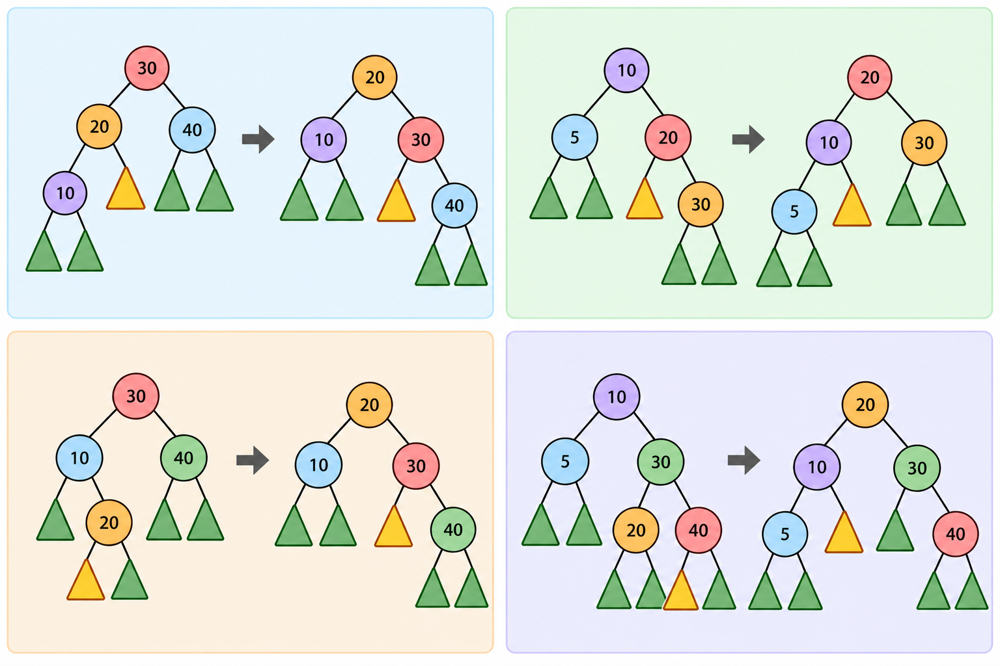

> 注：四格按阅读顺序依次是 **LL、RR、LR、RL**，和导图里的四条一一对应；每格左边是旋转前、右边是旋转后，三角形表示空子树。四种调整的套路是一样的——**把三个结点里数值居中的那个提上去当子树的根**，LL、RR 一次转到位；LR、RL 因为是"折线"型的插入，要先转一次拧成直链，再按 LL、RR 的方式转第二次。

最后把导图里那个考点补齐：**高为 h 的平衡二叉树最少有几个结点**？设最少结点数为 N(h)，从根往下推：

- 根结点占 1 个，剩下的结点分布在左、右两棵子树上。
- 想让结点数最少，两棵子树就得**尽量矮**；但根的平衡因子又要求左右子树**高度差不超过 1**，所以只能做到"**一棵高 h − 1、另一棵高 h − 2**"——再矮一档，高度差就超过 1 了。

于是得到递推式 `N(h) = N(h − 1) + N(h − 2) + 1`，边界是 `N(0) = 0`（空树）、`N(1) = 1`（只有根）。它其实就是"每个数加 1"的斐波那契数列：

| 树高 h | 0 | 1 | 2 | 3 | 4 | 5 | 6 |
| --- | --- | --- | --- | --- | --- | --- | --- |
| 最少结点数 N(h) | 0 | 1 | 2 | 4 | 7 | 12 | 20 |

这张表两种用法都要会：**正着用**是"给定高度 h，至少要这么多结点"；**反着用**是常见考法——"n 个结点的平衡二叉树最高能到几层"，比如 n = 7 时树高最多 4 层（想再高一层，至少要 12 个结点）。也正因为 N(h) 是随 h 指数增长的，才推得出"平衡二叉树最大深度为 O(log₂n)"这个结论。

### 平衡二叉树的删除

删掉一个结点以后，可能失衡的只可能是**被删结点的祖先**，所以修的办法就是"从删除的位置一路往上查"。具体步骤如下：

1. **先把结点删掉**（方法同二叉排序树）：
   - 被删结点是叶子，直接删；
   - 被删结点只有一个子树，用子树顶替删除位置；
   - 被删结点有左、右两棵子树，用前驱（或后继）结点顶替，并**转化为对前驱（或后继）结点的删除**。
2. **一路向北**：顺着祖先往上找**最小不平衡子树**；一路上去都没失衡，那就结束了。
3. **调整平衡**：对最小不平衡子树做旋转，把它调回平衡——用的还是插入时那四种调整（LL / RR / LR / RL），哪边高就把哪边的孩子转上来。
4. 如果**不平衡向上传导**，回到第 2 步继续：对最小不平衡子树的旋转可能把这棵子树变矮，从而让更上面的祖先也跟着失衡，所以一次旋转不一定够用。

最后记一个数：**平衡二叉树删除操作的时间复杂度 = O(log₂n)**——删结点、向上找最小不平衡子树、做旋转，走的都是"根到叶子"这一条路径。

## 红黑树

### 红黑树的定义和性质


%%{init: {
  "theme": "base",
  "themeVariables": {
    "primaryColor": "#5b9bd5",
    "primaryTextColor": "#ffffff",
    "primaryBorderColor": "#41719c",
    "lineColor": "#41719c",
    "secondaryColor": "#ffffff",
    "tertiaryColor": "#e2f0d9",
    "fontSize": "16px",
    "fontFamily": "-apple-system, BlinkMacSystemFont, \"Segoe UI\", Roboto, \"Helvetica Neue\", Arial, \"Noto Sans\", sans-serif"
  },
  "flowchart": {
    "nodeSpacing": 8,
    "rankSpacing": 26,
    "curve": "basis",
    "htmlLabels": true,
    "subGraphTitleMargin": { "top": 0, "bottom": 14 },
    "padding": 4,
    "useMaxWidth": false,
    "wrappingWidth": 1000
  }
}}%%
graph LR
  Root["红黑树"]

  Root --> Def["红黑树是一棵二叉排序树：<br>左子树结点值 ≤ 根结点值 ≤ 右子树结点值"]
  Root --> Req["与普通 BST 相比，多了五条要求"]
  Root --> Prop["性质"]

  Req --> R1["① 每个结点或是红色，或是黑色"]
  Req --> R2["② 根结点是黑色的"]
  Req --> R3["③ 叶结点（外部结点、NULL 结点、失败结点）都是黑色的"]
  Req --> R4["④ 不存在两个相邻的红结点<br>（红结点的父结点和孩子结点都是黑色的）"]
  Req --> R5["⑤ 对每个结点，从它到任一叶结点的简单路径上，<br>所含黑结点的数目相同"]

  Prop --> P1["性质 1：从根结点到叶结点的最长路径不大于最短路径的 2 倍"]
  Prop --> P2["性质 2：有 n 个内部结点的红黑树，高度 h ≤ 2log₂(n + 1)"]
  Prop --> Ph["红黑树查找操作的时间复杂度 = O(log₂n)"]

  subgraph N1["口诀：左根右，根叶黑；不红红，黑路同"]
    direction LR
    Req
    R1
    R2
    R3
    R4
    R5
  end

  classDef root fill:#5b9bd5,stroke:#41719c,stroke-width:2px,color:#fff,font-weight:bold,font-size:20px;
  classDef lvl1 fill:#9dc3e6,stroke:#2e6da4,stroke-width:2px,color:#0d2f4d,font-size:19px;
  classDef lvl2d fill:#dbe8f6,stroke:#1f4e79,stroke-width:2px,color:#000000,font-size:16px;
  classDef lvl2l fill:#f6fafe,stroke:#c3d9ef,stroke-width:2px,color:#000000,font-size:16px;
  classDef key fill:#fff,stroke:#c00000,stroke-width:3px,color:#000;

  class Root root;
  class Def,Req,Prop lvl1;
  class R1,R2,R3,R4,R5 lvl2d;
  class P1,P2,Ph lvl2l;
  class Ph key;
  style N1 fill:#f4faf0,stroke:#70ad47,color:#000000,font-size:12px


> 注：口诀拆开看——「左根右」是说它首先得是一棵二叉排序树（左 ≤ 根 ≤ 右），「根叶黑」对应 ②③（根结点和叶结点都必须是黑的），「不红红」对应 ④，「黑路同」对应 ⑤。

导图里性质 1、性质 2 的证明也是顺着那五条推出来的，顺手补上：

- **性质 1 的证明**：⑤保证了**任一条从根到叶的路径上黑结点个数都相同**（记这个数为黑高 bh）；④又说明**路径上不可能连着出现两个红结点**，红结点只能夹在黑结点中间，所以每条路径上"红结点数 ≤ 黑结点数"，路径长度最多是黑高的 2 倍。于是**最长路径 ≤ 2bh ≤ 2 × 最短路径**。
- **性质 2 的证明**：设红黑树高度为 h。既然红结点不超过一半，就有**根的黑高 bh ≥ h / 2**；另一方面，黑高为 bh 的红黑树**至少有 2^bh − 1 个内部结点**（结点最少的情形就是所有结点全黑、形成一棵高 bh 的满二叉树），所以 `n ≥ 2^(h/2) − 1`。两边整理一下，就得到 **`h ≤ 2log₂(n + 1)`**。

把这一章的三种树放在一起看就更清楚了——**它们都是二叉排序树**，区别只在于"额外加了什么约束"：

- **二叉排序树**只要求"左 ≤ 根 ≤ 右"（中序遍历有序），树形完全由插入顺序决定，所以插入有序序列就会退化成单支树，高度最坏能到 n。
- **平衡二叉树**在它上面**直接限制高度**：任一结点的左右子树高度差不超过 1。这条约束把树高死死卡在 O(log₂n)——高 h 至少要 N(h) 个结点（N(3)=4、N(4)=7、N(5)=12……），反过来 n 个结点时高度就只有 log 量级。
- **红黑树**不限制高度差，改用**颜色**兜底：靠"根叶黑、不红红、黑路同"这几条，间接保证**最长路径不超过最短路径的 2 倍**，于是高度上限是 2log₂(n+1)——仍然是 O(log₂n)，但界限比平衡二叉树松。

| 结构 | 必须满足的性质 | 树高 | 最坏查找 | 插入 / 删除怎么调 |
| --- | --- | --- | --- | --- |
| 二叉排序树 | 只有"左 ≤ 根 ≤ 右" | 最坏到 n（退化时） | O(n) | 不用调 |
| 平衡二叉树 | 左右子树高度差 ≤ 1 | O(log₂n)（被 N(h) 卡得很紧） | O(log₂n) | 插入最多 1 次调整（单旋或双旋）；**删除可能一路向上转 O(log₂n) 次** |
| 红黑树 | 5 条颜色性质 | ≤ 2log₂(n+1)（比 AVL 松） | O(log₂n)，比较次数略多 | 插入最多 2 次、删除最多 3 次旋转，其余靠变色 |

> 注：**红黑树不是平衡二叉树**——它的左右子树高度差可以超过 1（高度上限 2log₂(n+1) 比 AVL 松），所以它是"弱平衡"的二叉排序树；做题时"红黑树是平衡二叉树"这种说法要判错，更准确的说法是：红黑树是一种近似平衡的二叉排序树。也正因为查找同样是 O(log₂n)，而插入删除的旋转次数是常数级，红黑树才成了 C++ 的 map / set、Java 的 TreeMap 这类容器的底层结构。

### 红黑树的插入

插入就两步：**先按二叉排序树的规则把结点挂上去，再检查有没有破坏红黑性质**。整个检查是**自下而上**做的，流程图如下。


%%{init: {
  "theme": "base",
  "themeVariables": {
    "primaryColor": "#5b9bd5",
    "primaryTextColor": "#ffffff",
    "primaryBorderColor": "#41719c",
    "lineColor": "#41719c",
    "secondaryColor": "#ffffff",
    "tertiaryColor": "#e2f0d9",
    "fontSize": "16px",
    "fontFamily": "-apple-system, BlinkMacSystemFont, \"Segoe UI\", Roboto, \"Helvetica Neue\", Arial, \"Noto Sans\", sans-serif"
  },
  "flowchart": {
    "nodeSpacing": 8,
    "rankSpacing": 26,
    "curve": "basis",
    "htmlLabels": true,
    "subGraphTitleMargin": { "top": 0, "bottom": 14 },
    "padding": 4,
    "useMaxWidth": false,
    "wrappingWidth": 1000
  }
}}%%
graph TD
  Start["插入：按二叉排序树的位置挂上去<br>新结点一律染成红色"]
  Q1{"父结点是黑色的？"}
  Ok1["调整结束"]
  Q2{"叔叔是红色的？"}
  C1["红叔：染色——父、叔变黑，爷爷变红"]
  C2["把爷爷当成新插入的结点<br>回到上面继续检查；传到根就把根染黑"]
  D1["黑叔：旋转——LL / RR 单旋，LR / RL 双旋"]
  D2["变色——旋转后子树的新根染黑、原来的爷爷染红"]
  Ok2["调整结束（不会再往上影响）"]

  Start --> Q1
  Q1 -->|是| Ok1
  Q1 -->|否| Q2
  Q2 -->|是| C1
  Q2 -->|否| D1
  C1 --> C2
  C2 -.-> Q1
  D1 --> D2
  D2 --> Ok2

  classDef root fill:#5b9bd5,stroke:#41719c,stroke-width:2px,color:#fff,font-weight:bold,font-size:18px;
  classDef dec fill:#ffffff,stroke:#5b9bd5,stroke-width:2px,color:#0d2f4d,font-size:16px;
  classDef fix fill:#dbe8f6,stroke:#1f4e79,stroke-width:2px,color:#000000,font-size:16px;
  classDef done fill:#e2f0d9,stroke:#5b9bd5,stroke-width:2px,color:#000000,font-size:16px;

  class Start root;
  class Q1,Q2 dec;
  class C1,C2,D1,D2 fix;
  class Ok1,Ok2 done;


**为什么新结点一定是红的？** ⑤要求"每条路径上的黑结点数相同"，插一个黑结点会让这条路径的黑高多 1，整棵树立刻处处违例；插红结点则**不改变任何路径的黑结点数**，最多只是和父结点凑成"红红"（违反④）。也就是说，**只可能坏一条规矩，而且这条规矩好修**——这就是新结点染红的原因。

**接下来看父结点的颜色。** 下面把每种情况都画出来（深色＝黑结点，红色＝红结点，虚线框＝"其它子树"，内容任意、这里只看黑高；∅ 表示空指针，也算黑）。

**① 父结点是黑的**：没有红红，什么都不用做，插入结束。

**② 父结点是红的，叔叔也是红的 → 染色**


%%{init: {
  "theme": "base",
  "themeVariables": {
    "primaryColor": "#5b9bd5",
    "primaryTextColor": "#ffffff",
    "primaryBorderColor": "#41719c",
    "lineColor": "#41719c",
    "secondaryColor": "#ffffff",
    "tertiaryColor": "#e2f0d9",
    "fontSize": "16px",
    "fontFamily": "-apple-system, BlinkMacSystemFont, \"Segoe UI\", Roboto, \"Helvetica Neue\", Arial, \"Noto Sans\", sans-serif"
  },
  "flowchart": {
    "nodeSpacing": 8,
    "rankSpacing": 26,
    "curve": "basis",
    "htmlLabels": true,
    "subGraphTitleMargin": { "top": 0, "bottom": 14 },
    "padding": 4,
    "useMaxWidth": false,
    "wrappingWidth": 1000
  }
}}%%
graph TD
  subgraph After1["红叔：调整后"]
    fA["爷 A（红）"] --> fP["父 P（黑）"]
    fA --> fU["叔 U（黑）"]
    fP --> fX["新 X（红）"]
  end
  subgraph Before1["红叔：调整前"]
    bA["爷 A（黑）"] --> bP["父 P（红）"]
    bA --> bU["叔 U（红）"]
    bP --> bX["新 X（红）"]
  end

  classDef rbBlack fill:#333333,stroke:#000000,stroke-width:2px,color:#ffffff,font-size:16px;
  classDef rbRed fill:#c00000,stroke:#8b0000,stroke-width:2px,color:#ffffff,font-size:16px;

  class bA,fP,fU rbBlack;
  class bP,bU,bX,fX,fA rbRed;


① 父结点、叔叔都染黑，爷爷染红——**结构一点没动**，只改了颜色；
② 但爷爷变红后可能和它的父结点又凑成红红，所以要**把爷爷当成新插入的结点，回到最上面继续查**；一路传到根的话，把根重新染黑就完事（根必须是黑的）。

**③ 父结点是红的，叔叔是黑的 → 旋转 + 变色**

叔叔是黑的（NULL 也算黑）时要旋转。先看红红是"直的"还是"折的"，四种情况如下。

**LL 型**：新结点在父结点左边、父结点在爷爷左边。**对爷爷右旋，再把父结点染黑、爷爷染红**，收工。


%%{init: {
  "theme": "base",
  "themeVariables": {
    "primaryColor": "#5b9bd5",
    "primaryTextColor": "#ffffff",
    "primaryBorderColor": "#41719c",
    "lineColor": "#41719c",
    "secondaryColor": "#ffffff",
    "tertiaryColor": "#e2f0d9",
    "fontSize": "16px",
    "fontFamily": "-apple-system, BlinkMacSystemFont, \"Segoe UI\", Roboto, \"Helvetica Neue\", Arial, \"Noto Sans\", sans-serif"
  },
  "flowchart": {
    "nodeSpacing": 8,
    "rankSpacing": 26,
    "curve": "basis",
    "htmlLabels": true,
    "subGraphTitleMargin": { "top": 0, "bottom": 14 },
    "padding": 4,
    "useMaxWidth": false,
    "wrappingWidth": 1000
  }
}}%%
graph TD
  subgraph After2["LL：调整后"]
    cP["父 P（黑）"] --> cX["新 X（红）"]
    cP --> cA["爷 A（红）"]
    cA --> cT1["子树 T₁"]
    cA --> cT2["子树 T₂"]
  end
  subgraph Before2["LL：调整前"]
    bA["爷 A（黑）"] --> bP["父 P（红）"]
    bA --> bT2["子树 T₂"]
    bP --> bX["新 X（红）"]
    bP --> bT1["子树 T₁"]
  end

  classDef rbBlack fill:#333333,stroke:#000000,stroke-width:2px,color:#ffffff,font-size:16px;
  classDef rbRed fill:#c00000,stroke:#8b0000,stroke-width:2px,color:#ffffff,font-size:16px;
  classDef rbSub fill:#f2f2f2,stroke:#999999,stroke-width:1.5px,stroke-dasharray:4 3,color:#333333,font-size:14px;

  class bA,cP rbBlack;
  class bP,bX,cX,cA rbRed;
  class bT1,bT2,cT1,cT2 rbSub;


旋转的实质是**把父结点转上来当子树的根**：本来就是"直"的，一次右旋就到位。

**RR 型**：新结点在父结点右边、父结点在爷爷右边。**对爷爷左旋，再把父结点染黑、爷爷染红**。


%%{init: {
  "theme": "base",
  "themeVariables": {
    "primaryColor": "#5b9bd5",
    "primaryTextColor": "#ffffff",
    "primaryBorderColor": "#41719c",
    "lineColor": "#41719c",
    "secondaryColor": "#ffffff",
    "tertiaryColor": "#e2f0d9",
    "fontSize": "16px",
    "fontFamily": "-apple-system, BlinkMacSystemFont, \"Segoe UI\", Roboto, \"Helvetica Neue\", Arial, \"Noto Sans\", sans-serif"
  },
  "flowchart": {
    "nodeSpacing": 8,
    "rankSpacing": 26,
    "curve": "basis",
    "htmlLabels": true,
    "subGraphTitleMargin": { "top": 0, "bottom": 14 },
    "padding": 4,
    "useMaxWidth": false,
    "wrappingWidth": 1000
  }
}}%%
graph TD
  subgraph After3["RR：调整后"]
    cP["父 P（黑）"] --> cA["爷 A（红）"]
    cP --> cX["新 X（红）"]
    cA --> cT1["子树 T₁"]
    cA --> cT2["子树 T₂"]
  end
  subgraph Before3["RR：调整前"]
    bA["爷 A（黑）"] --> bT1["子树 T₁"]
    bA --> bP["父 P（红）"]
    bP --> bT2["子树 T₂"]
    bP --> bX["新 X（红）"]
  end

  classDef rbBlack fill:#333333,stroke:#000000,stroke-width:2px,color:#ffffff,font-size:16px;
  classDef rbRed fill:#c00000,stroke:#8b0000,stroke-width:2px,color:#ffffff,font-size:16px;
  classDef rbSub fill:#f2f2f2,stroke:#999999,stroke-width:1.5px,stroke-dasharray:4 3,color:#333333,font-size:14px;

  class bA,cP rbBlack;
  class bP,bX,cX,cA rbRed;
  class bT1,bT2,cT1,cT2 rbSub;


和 LL 完全对称：**把父结点转上来当根**，再换一下父子俩的颜色。

**LR 型**：新结点在父结点右边、父结点在爷爷左边（"折线"型）。**先对父结点左旋**，把折线拧成 LL 那种直线；**再对爷爷右旋**；最后**新结点染黑、爷爷染红**（父结点保持红）。


%%{init: {
  "theme": "base",
  "themeVariables": {
    "primaryColor": "#5b9bd5",
    "primaryTextColor": "#ffffff",
    "primaryBorderColor": "#41719c",
    "lineColor": "#41719c",
    "secondaryColor": "#ffffff",
    "tertiaryColor": "#e2f0d9",
    "fontSize": "16px",
    "fontFamily": "-apple-system, BlinkMacSystemFont, \"Segoe UI\", Roboto, \"Helvetica Neue\", Arial, \"Noto Sans\", sans-serif"
  },
  "flowchart": {
    "nodeSpacing": 8,
    "rankSpacing": 26,
    "curve": "basis",
    "htmlLabels": true,
    "subGraphTitleMargin": { "top": 0, "bottom": 14 },
    "padding": 4,
    "useMaxWidth": false,
    "wrappingWidth": 1000
  }
}}%%
graph TD
  subgraph After4["LR：调整后"]
    cX["新 X（黑）"] --> cP["父 P（红）"]
    cX --> cA["爷 A（红）"]
    cP --> cT1["子树 T₁"]
    cP --> cN1["∅"]
    cA --> cN2["∅"]
    cA --> cT3["子树 T₃"]
  end
  subgraph Before4["LR：调整前"]
    bA["爷 A（黑）"] --> bP["父 P（红）"]
    bA --> bT3["子树 T₃"]
    bP --> bT1["子树 T₁"]
    bP --> bX["新 X（红）"]
  end

  classDef rbBlack fill:#333333,stroke:#000000,stroke-width:2px,color:#ffffff,font-size:16px;
  classDef rbRed fill:#c00000,stroke:#8b0000,stroke-width:2px,color:#ffffff,font-size:16px;
  classDef rbSub fill:#f2f2f2,stroke:#999999,stroke-width:1.5px,stroke-dasharray:4 3,color:#333333,font-size:14px;
  classDef rbNil fill:#ffffff,stroke:#bbbbbb,stroke-width:1px,stroke-dasharray:2 2,color:#888888,font-size:13px;

  class bA,cX rbBlack;
  class bP,bX,cP,cA rbRed;
  class bT1,bT3,cT1,cT3 rbSub;
  class cN1,cN2 rbNil;


两次旋转做完，"根"变成了原来的**新结点**——所以这次染黑的是**新结点**，爷爷还是红。

**RL 型**：新结点在父结点左边、父结点在爷爷右边（也是"折线"型）。**先对父结点右旋**拧直，**再对爷爷左旋**，最后**新结点染黑、爷爷染红**。


%%{init: {
  "theme": "base",
  "themeVariables": {
    "primaryColor": "#5b9bd5",
    "primaryTextColor": "#ffffff",
    "primaryBorderColor": "#41719c",
    "lineColor": "#41719c",
    "secondaryColor": "#ffffff",
    "tertiaryColor": "#e2f0d9",
    "fontSize": "16px",
    "fontFamily": "-apple-system, BlinkMacSystemFont, \"Segoe UI\", Roboto, \"Helvetica Neue\", Arial, \"Noto Sans\", sans-serif"
  },
  "flowchart": {
    "nodeSpacing": 8,
    "rankSpacing": 26,
    "curve": "basis",
    "htmlLabels": true,
    "subGraphTitleMargin": { "top": 0, "bottom": 14 },
    "padding": 4,
    "useMaxWidth": false,
    "wrappingWidth": 1000
  }
}}%%
graph TD
  subgraph After5["RL：调整后"]
    cX["新 X（黑）"] --> cA["爷 A（红）"]
    cX --> cP["父 P（红）"]
    cA --> cT1["子树 T₁"]
    cA --> cN1["∅"]
    cP --> cN2["∅"]
    cP --> cT3["子树 T₃"]
  end
  subgraph Before5["RL：调整前"]
    bA["爷 A（黑）"] --> bT1["子树 T₁"]
    bA --> bP["父 P（红）"]
    bP --> bX["新 X（红）"]
    bP --> bT3["子树 T₃"]
  end

  classDef rbBlack fill:#333333,stroke:#000000,stroke-width:2px,color:#ffffff,font-size:16px;
  classDef rbRed fill:#c00000,stroke:#8b0000,stroke-width:2px,color:#ffffff,font-size:16px;
  classDef rbSub fill:#f2f2f2,stroke:#999999,stroke-width:1.5px,stroke-dasharray:4 3,color:#333333,font-size:14px;
  classDef rbNil fill:#ffffff,stroke:#bbbbbb,stroke-width:1px,stroke-dasharray:2 2,color:#888888,font-size:13px;

  class bA,cX rbBlack;
  class bP,bX,cP,cA rbRed;
  class bT1,bT3,cT1,cT3 rbSub;
  class cN1,cN2 rbNil;


和 LR 镜像，套路一样：**折线先拧直、再往上转一次，最后新根染黑、爷爷染红**。

> 注：**旋转类调整（LL / RR / LR / RL）都能一次收工、不会再往上影响**——旋完子树的新根是黑的，红红消掉了，黑高也没变，上面的祖先看不出区别；而**染色类（红叔）只是改颜色、结构不动**，代价是爷爷变红了，得把爷爷当成新结点继续往上查，最坏一路查到根。所以整个调整是自下而上的：**染色最多 O(log₂n) 次、旋转最多 2 次**，插入的总时间复杂度是 O(log₂n)——这也正是红黑树比平衡二叉树"好养"的地方：AVL 要盯着高度差，红黑树大部分时候只是变个颜色。

### 红黑树的删除

这一节的考点就三条，先摆在前面（课件上标了黄底）：

- 红黑树**删除操作的时间复杂度 = O(log₂n)**；
- 删除结点的处理方式和**二叉排序树的删除完全一样**；
- 按上一条删完之后，**可能破坏"红黑特性"**，这时要**调整结点的颜色和位置**，让它重新满足红黑特性。

第三条才是要花心思的地方，下面把"什么时候要调、怎么调"讲清楚。

**第一步：先按二叉排序树的办法把结点摘掉。** 三种情况和 BST 完全一样——被删结点是叶子就直接删；只有一个孩子就让孩子顶替它；有左右两棵子树就用**前驱**（或后继）顶替，并转成删除前驱（或后继）。注意后一种情况里，**真正"走掉"的是那个前驱/后继结点**，所以后面的判断要盯着它，而不是盯着原来那个结点。

**第二步：判断红黑特性有没有被破坏。** 删除只会影响"黑路同"（⑤），不会造出红红（④）：

- **真正走掉的那个结点是红色的** → 黑结点数没变，什么都不用做；
- **真正走掉的是黑结点，但顶替上来的孩子是红的** → 直接**把孩子染黑**，少掉的黑补回来了，结束；
- **真正走掉的是黑结点，顶替上来的是黑结点或空指针** → 这条路径上**少了一个黑结点**，相当于在这个位置挂了一个"**双黑**"，得想办法消掉。

**第三步：消双黑。** 把"顶着双黑"的位置记作 x（它可能是个空指针），然后看它的**兄弟 w**：


%%{init: {
  "theme": "base",
  "themeVariables": {
    "primaryColor": "#5b9bd5",
    "primaryTextColor": "#ffffff",
    "primaryBorderColor": "#41719c",
    "lineColor": "#41719c",
    "secondaryColor": "#ffffff",
    "tertiaryColor": "#e2f0d9",
    "fontSize": "16px",
    "fontFamily": "-apple-system, BlinkMacSystemFont, \"Segoe UI\", Roboto, \"Helvetica Neue\", Arial, \"Noto Sans\", sans-serif"
  },
  "flowchart": {
    "nodeSpacing": 8,
    "rankSpacing": 26,
    "curve": "basis",
    "htmlLabels": true,
    "subGraphTitleMargin": { "top": 0, "bottom": 14 },
    "padding": 4,
    "useMaxWidth": false,
    "wrappingWidth": 1000
  }
}}%%
graph TD
  S["删除：先按二叉排序树把结点摘掉"]
  Q1{"真正走掉的那个结点是红的？"}
  Ok1["黑高没变，不用调整"]
  Q2{"顶替上来的孩子是红的？"}
  Ok2["直接染黑，结束"]
  X["这个位置少了一个黑结点<br>记作「双黑 x」，看它的兄弟 w"]
  C1["情况一：w 是红的<br>w 染黑、父染红，朝 x 这侧旋转父 → 变成下面两种"]
  C2["情况二：w 是黑的，而且有红孩子<br>旋转 + 变色，一次收工"]
  C3["情况三：w 是黑的，孩子全是黑的<br>w 染红，双黑上移给父，继续往上看"]

  S --> Q1
  Q1 -->|是| Ok1
  Q1 -->|否| Q2
  Q2 -->|是| Ok2
  Q2 -->|否| X
  X --> C1
  X --> C2
  X --> C3

  classDef root fill:#5b9bd5,stroke:#41719c,stroke-width:2px,color:#fff,font-weight:bold,font-size:18px;
  classDef dec fill:#ffffff,stroke:#5b9bd5,stroke-width:2px,color:#0d2f4d,font-size:16px;
  classDef fix fill:#dbe8f6,stroke:#1f4e79,stroke-width:2px,color:#000000,font-size:16px;
  classDef done fill:#e2f0d9,stroke:#5b9bd5,stroke-width:2px,color:#000000,font-size:16px;

  class S root;
  class Q1,Q2 dec;
  class X,C1,C2,C3 fix;
  class Ok1,Ok2 done;


下面把三种情况各画一遍（"双黑"结点 x 用**黑底红框**标出来，方便对照）：

**情况一：兄弟 w 是红的**


%%{init: {
  "theme": "base",
  "themeVariables": {
    "primaryColor": "#5b9bd5",
    "primaryTextColor": "#ffffff",
    "primaryBorderColor": "#41719c",
    "lineColor": "#41719c",
    "secondaryColor": "#ffffff",
    "tertiaryColor": "#e2f0d9",
    "fontSize": "16px",
    "fontFamily": "-apple-system, BlinkMacSystemFont, \"Segoe UI\", Roboto, \"Helvetica Neue\", Arial, \"Noto Sans\", sans-serif"
  },
  "flowchart": {
    "nodeSpacing": 8,
    "rankSpacing": 26,
    "curve": "basis",
    "htmlLabels": true,
    "subGraphTitleMargin": { "top": 0, "bottom": 14 },
    "padding": 4,
    "useMaxWidth": false,
    "wrappingWidth": 1000
  }
}}%%
graph TD
  subgraph After6["情况一：调整后"]
    aW["兄弟 w（黑）"] --> aP["父 P（红）"]
    aW --> aT2["子树 T₂"]
    aP --> aX["x（双黑）"]
    aP --> aT1["子树 T₁"]
  end
  subgraph Before6["情况一：调整前"]
    bP["父 P（黑）"] --> bX["x（双黑）"]
    bP --> bW["兄弟 w（红）"]
    bW --> bT1["子树 T₁"]
    bW --> bT2["子树 T₂"]
  end

  classDef rbBlack fill:#333333,stroke:#000000,stroke-width:2px,color:#ffffff,font-size:16px;
  classDef rbRed fill:#c00000,stroke:#8b0000,stroke-width:2px,color:#ffffff,font-size:16px;
  classDef rbSub fill:#f2f2f2,stroke:#999999,stroke-width:1.5px,stroke-dasharray:4 3,color:#333333,font-size:14px;
  classDef rbX fill:#333333,stroke:#c00000,stroke-width:3px,color:#ffffff,font-size:16px;

  class bP,aW rbBlack;
  class bW,aP rbRed;
  class bT1,bT2,aT1,aT2 rbSub;
  class bX,aX rbX;


w 是红的，说明 w 的两个孩子一定是黑的，所以先把 w **染黑**、把父结点**染红**，再朝 x 这一侧**旋转父结点**——w 转上来当了这棵子树的根。转完之后，x 的**新兄弟变成黑结点**了，问题就落进情况二或情况三。注意**这一步只是"换个姿势"，x 的双黑还没消掉**。

**情况二：兄弟 w 是黑的，而且 w 有红孩子**


%%{init: {
  "theme": "base",
  "themeVariables": {
    "primaryColor": "#5b9bd5",
    "primaryTextColor": "#ffffff",
    "primaryBorderColor": "#41719c",
    "lineColor": "#41719c",
    "secondaryColor": "#ffffff",
    "tertiaryColor": "#e2f0d9",
    "fontSize": "16px",
    "fontFamily": "-apple-system, BlinkMacSystemFont, \"Segoe UI\", Roboto, \"Helvetica Neue\", Arial, \"Noto Sans\", sans-serif"
  },
  "flowchart": {
    "nodeSpacing": 8,
    "rankSpacing": 26,
    "curve": "basis",
    "htmlLabels": true,
    "subGraphTitleMargin": { "top": 0, "bottom": 14 },
    "padding": 4,
    "useMaxWidth": false,
    "wrappingWidth": 1000
  }
}}%%
graph TD
  subgraph After7["情况二：调整后"]
    aW["兄弟 w（父原来的颜色）"] --> aP["父 P（黑）"]
    aW --> aR["w 的红孩子（黑）"]
    aP --> aX["x（黑）"]
    aP --> aT1["子树 T₁"]
  end
  subgraph Before7["情况二：调整前"]
    bP["父 P（黑）"] --> bX["x（双黑）"]
    bP --> bW["兄弟 w（黑）"]
    bW --> bT1["子树 T₁"]
    bW --> bR["w 的红孩子"]
  end

  classDef rbBlack fill:#333333,stroke:#000000,stroke-width:2px,color:#ffffff,font-size:16px;
  classDef rbRed fill:#c00000,stroke:#8b0000,stroke-width:2px,color:#ffffff,font-size:16px;
  classDef rbSub fill:#f2f2f2,stroke:#999999,stroke-width:1.5px,stroke-dasharray:4 3,color:#333333,font-size:14px;
  classDef rbX fill:#333333,stroke:#c00000,stroke-width:3px,color:#ffffff,font-size:16px;

  class bP,bW,aW,aP,aR,aX rbBlack;
  class bR rbRed;
  class bT1,aT1 rbSub;
  class bX rbX;


这次是**一次收工**：把 w 子树里那个红结点提上来补黑。具体做法是——**把父结点的颜色给 w，父结点自己染黑，w 的红孩子也染黑，然后朝 x 这一侧旋转父结点**（图里画的是红孩子在 w 外侧的情形）。做完之后 x 的双黑就没了（它跟着父变黑），黑高也对上了。

> 注：如果红孩子在 w 的**内侧**（比如 w 是右兄弟、红的却是 w 的左孩子），就先对 w 转一次把它换到外侧，再按上面的做法转父结点——和插入时 LL / RR 单旋、LR / RL 双旋是同一个道理，看红孩子在哪一侧而已。

**情况三：兄弟 w 是黑的，而且 w 的孩子都是黑的**


%%{init: {
  "theme": "base",
  "themeVariables": {
    "primaryColor": "#5b9bd5",
    "primaryTextColor": "#ffffff",
    "primaryBorderColor": "#41719c",
    "lineColor": "#41719c",
    "secondaryColor": "#ffffff",
    "tertiaryColor": "#e2f0d9",
    "fontSize": "16px",
    "fontFamily": "-apple-system, BlinkMacSystemFont, \"Segoe UI\", Roboto, \"Helvetica Neue\", Arial, \"Noto Sans\", sans-serif"
  },
  "flowchart": {
    "nodeSpacing": 8,
    "rankSpacing": 26,
    "curve": "basis",
    "htmlLabels": true,
    "subGraphTitleMargin": { "top": 0, "bottom": 14 },
    "padding": 4,
    "useMaxWidth": false,
    "wrappingWidth": 1000
  }
}}%%
graph TD
  subgraph After8["情况三：调整后（父原来是红的）"]
    aP["父 P（黑）"] --> aX["x（黑）"]
    aP --> aW["兄弟 w（红）"]
    aW --> aT1["子树 T₁"]
    aW --> aT2["子树 T₂"]
  end
  subgraph Before8["情况三：调整前"]
    bP["父 P（红）"] --> bX["x（双黑）"]
    bP --> bW["兄弟 w（黑）"]
    bW --> bT1["子树 T₁"]
    bW --> bT2["子树 T₂"]
  end

  classDef rbBlack fill:#333333,stroke:#000000,stroke-width:2px,color:#ffffff,font-size:16px;
  classDef rbRed fill:#c00000,stroke:#8b0000,stroke-width:2px,color:#ffffff,font-size:16px;
  classDef rbSub fill:#f2f2f2,stroke:#999999,stroke-width:1.5px,stroke-dasharray:4 3,color:#333333,font-size:14px;
  classDef rbX fill:#333333,stroke:#c00000,stroke-width:3px,color:#ffffff,font-size:16px;

  class bW,aP,aX rbBlack;
  class bP,aW rbRed;
  class bT1,bT2,aT1,aT2 rbSub;
  class bX rbX;


w 是黑的、孩子又都是黑的（空指针也算黑），没法像情况二那样从 w 子树里"借"一个黑结点，只能**把兄弟 w 染红**：这样 w 那条路径也少了一个黑结点，两边就一样黑了——但"少一个黑"的问题被**推给了父结点**（双黑上移）。接下来重新判断：

- 父结点原来是**红色**的 → 直接把父**染黑**（就是图里画的这种），收工；
- 父结点原来是**黑色**的 → 父现在也算"双黑"，继续往上处理；真传到根就直接结束（根染黑就行）。

> 注：整个删除调整是自下而上进行的，**染色最多 O(log₂n) 次、旋转最多 3 次**，所以删除的时间复杂度还是 **O(log₂n)**——和课件上那条"重要考点"对上了。

## B树

### B树的性质

**B 树，又称多路平衡查找树。** B 树中**所有结点的孩子个数的最大值**称为 B 树的**阶**，通常用 m 表示。一棵 **m 阶 B 树**，或为空树，或为满足下面这些特性的 m 叉树：

1. 树中每个结点**至多有 m 棵子树**，即至多含有 **m − 1 个关键字**；
2. 若根结点不是终端结点，则**至少有两棵子树**；
3. 除根结点外的所有非叶结点**至少有 ⌈m / 2⌉ 棵子树**，即至少含有 **⌈m / 2⌉ − 1 个关键字**；
4. 所有非叶结点的结构是 `n | P₀ | K₁ | P₁ | K₂ | P₂ | … | Kₙ | Pₙ`：其中 Kᵢ（i = 1, 2, …, n）为结点的关键字，且 **K₁ < K₂ < … < Kₙ**；Pᵢ（i = 0, 1, …, n）为指向子树根结点的指针，且 **Pᵢ₋₁ 所指子树中所有结点的关键字均小于 Kᵢ，Pᵢ 所指子树中所有结点的关键字均大于 Kᵢ**；n 是结点中关键字的个数，满足 **⌈m / 2⌉ − 1 ≤ n ≤ m − 1**；
5. 所有的**叶结点都出现在同一层次上，并且不带信息**（可以视为外部结点，或类似于折半查找判定树的查找失败结点——实际上这些结点不存在，指向这些结点的指针为空）。

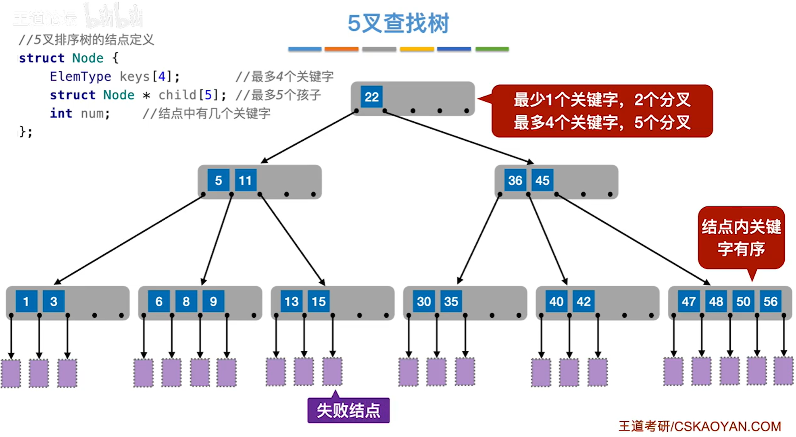

> 注：这就是一棵 **5 阶 B 树**（m = 5）——每个结点最多 4 个关键字、5 个分叉（最右侧的 47、48、50、56 正好塞满 4 个），除根以外的每个结点至少 2 个关键字、3 个分叉，结点里面的关键字有序，最下面那排紫色方框就是统一落在同一层的失败结点。图左上角那段结构体也把这个"上限"写死了：`keys[4]` 最多 4 个关键字、`child[5]` 最多 5 个孩子、`num` 记当前有几个关键字。

> 注：**"阶"说的是孩子个数的上限**，不是关键字个数的上限（关键字最多 m − 1 个，孩子最多 m 个）；另外那两条"下限"——除根以外的非叶结点至少 ⌈m / 2⌉ 棵子树、⌈m / 2⌉ − 1 个关键字——是算高度、判断"这棵树合不合法"的根据。

**那么，含 n 个关键字的 m 阶 B 树，高度最小多少、最大多少？** 设树高为 h。这里的 h 按**含关键字的结点**的层数来数：根结点是第 1 层，最下面一层真结点是第 h 层，外面那层空叶结点不算。

**最小高度：让每一层塞满。** 想矮，就得让每个结点都取满 m 棵子树、m − 1 个关键字，这样 h 层最多能装下

$$(m-1) + m(m-1) + m^2(m-1) + \cdots + m^{h-1}(m-1) = m^h - 1$$

个关键字。要装下 n 个，就得

$$m^h - 1 \ge n$$

于是

$$h_{\min} = \lceil \log_m (n+1) \rceil$$

**最大高度：让每一层尽量空。** 想高，就得让每个结点都贴着下限放——根结点只有 1 个关键字（2 棵子树），其余非叶结点都只有 ⌈m / 2⌉ − 1 个关键字、⌈m / 2⌉ 棵子树。这样 h 层**最少**能装下：

- 第 1 层是根，1 个关键字；
- 第 2 层起，结点个数每层乘以 ⌈m / 2⌉，每个结点贡献 ⌈m / 2⌉ − 1 个关键字。

加起来是

$$1 + 2(\lceil m/2 \rceil - 1)\left(1 + \lceil m/2 \rceil + \cdots + \lceil m/2 \rceil^{h-2}\right) = 2\lceil m/2 \rceil^{h-1} - 1$$

个关键字。要有这么多关键字才撑得起 h 层，也就是

$$2\lceil m/2 \rceil^{h-1} - 1 \le n$$

于是

$$h_{\max} = \log_{\lceil m/2 \rceil}\frac{n+1}{2} + 1$$

**换个角度也能得到同一个式子**（王道课件走的就是这条路）：含 n 个关键字的 B 树**一定有 n + 1 个失败结点**；而各层结点数最少是 1、2、2⌈m / 2⌉、…、2⌈m / 2⌉^(h−2)（第 h 层），所以第 h + 1 层的失败结点至少有 2⌈m / 2⌉^(h−1) 个，于是

$$n + 1 \ge 2\lceil m/2 \rceil^{h-1}$$

一样解出 $$h \le \log_{\lceil m/2 \rceil}\frac{n+1}{2} + 1$$——两条路殊途同归：一个数关键字，一个数失败结点。

举个具体的数：**5 阶 B 树**（m = 5，⌈m / 2⌉ = 3）含 **20 个关键字**时，最小高度 = ⌈log₅21⌉ = 2；最大高度要满足 2·3^(h−1) − 1 ≤ 20，即 3^(h−1) ≤ 10.5，h − 1 ≤ 2.14，所以 h 最多到 **3 层**。

> 注：这两个式子里的 h 都**只数含关键字的结点**。有的教材把最下面那层空叶结点也算成高度，那样两个式子都要 **+1**（上面的例子就会写成 3 和 4）。做题时先看清题目怎么定义树高。

> 注：这两个公式反过来用是另一类常考题——**h 层的 m 阶 B 树，最少 / 最多有几个关键字**：最多 $m^h - 1$ 个，最少 $2\lceil m/2 \rceil^{h-1} - 1$ 个（比如 3 阶、3 层最多 26 个、最少 7 个）。"给层数问关键字范围"和"给关键字问层数范围"本来就是同一件事的两面。

### B树的插入删除


%%{init: {
  "theme": "base",
  "themeVariables": {
    "primaryColor": "#5b9bd5",
    "primaryTextColor": "#ffffff",
    "primaryBorderColor": "#41719c",
    "lineColor": "#41719c",
    "secondaryColor": "#ffffff",
    "tertiaryColor": "#e2f0d9",
    "fontSize": "16px",
    "fontFamily": "-apple-system, BlinkMacSystemFont, \"Segoe UI\", Roboto, \"Helvetica Neue\", Arial, \"Noto Sans\", sans-serif"
  },
  "flowchart": {
    "nodeSpacing": 8,
    "rankSpacing": 26,
    "curve": "basis",
    "htmlLabels": true,
    "subGraphTitleMargin": { "top": 0, "bottom": 14 },
    "padding": 4,
    "useMaxWidth": false,
    "wrappingWidth": 1000
  }
}}%%
graph LR
  Root["B树"]

  Root --> Ins["插入"]
  Root --> Del["删除"]

  Ins --> I1["通过「查找」确定插入位置（一定是在终端结点）"]
  Ins --> I2["若插入后结点关键字个数未超过上限，则无需做其他处理"]
  Ins --> I3["若插入后关键字个数超过上限 → 分裂：<br>把中间元素放到父结点中，当前结点裂成两半；<br>父结点关键字 +1，若也超上限就继续向上分裂；<br>根结点分裂会让 B 树高度 +1"]

  Del --> NT["非终端结点关键字"]
  Del --> TM["终端结点关键字"]

  NT --> D1["用其直接前驱或直接后继替代其位置，<br>转化为对「终端结点」的删除"]
  NT --> D2["直接前驱：左指针所指子树中<br>「最右下」的那个元素"]
  NT --> D3["直接后继：右指针所指子树中<br>「最左下」的那个元素"]

  TM --> T1["删除后结点关键字个数未低于下限，无需任何处理"]
  TM --> T2["低于下限"]

  T2 --> B1["右兄弟够借：用当前结点的后继、<br>后继的后继依次顶替空缺"]
  T2 --> B2["左兄弟够借：用当前结点的前驱、<br>前驱的前驱依次顶替空缺"]
  T2 --> B3["左（右）兄弟都不够借，<br>就要和父结点里的关键字、左（右）兄弟合并；<br>合并会让父结点关键字 −1，可能还要继续往上合并"]

  classDef root fill:#5b9bd5,stroke:#41719c,stroke-width:2px,color:#fff,font-weight:bold,font-size:20px;
  classDef lvl1 fill:#9dc3e6,stroke:#2e6da4,stroke-width:2px,color:#0d2f4d,font-size:19px;
  classDef lvl2d fill:#dbe8f6,stroke:#1f4e79,stroke-width:2px,color:#000000,font-size:16px;
  classDef lvl2l fill:#f6fafe,stroke:#c3d9ef,stroke-width:2px,color:#000000,font-size:16px;
  classDef lvl3d fill:#dbe8f6,stroke:#1f4e79,stroke-width:2px,color:#333333,font-size:15px;
  classDef lvl3l fill:#f6fafe,stroke:#c3d9ef,stroke-width:2px,color:#333333,font-size:15px;
  classDef lvl4d fill:#dbe8f6,stroke:#1f4e79,stroke-width:1.5px,color:#333333,font-size:14px;
  classDef key fill:#fff,stroke:#c00000,stroke-width:3px,color:#000;

  class Root root;
  class Ins,Del lvl1;
  class I1,I2,I3 lvl2d;
  class NT,TM lvl2l;
  class D1,D2,D3 lvl3d;
  class T1,T2 lvl3l;
  class B1,B2,B3 lvl4d;
  class Ins,Del key;


> 注：图里左下角那两条"核心要求"，其实就是上一节那两条性质——① 除根以外的结点关键字个数满足 ⌈m / 2⌉ − 1 ≤ n ≤ m − 1，这是"兄弟够不够借、要不要合并"的尺子；② 子树₀ < 关键字₁ < 子树₁ < 关键字₂ < 子树₂ < …，这是查找定位、以及插到哪个位置、删完拿谁顶上来的依据。插入和删除的所有动作，都是在这两条的约束下"拆"或"凑"。

## B+ 树

B+ 树是 B 树的升级版，数据库和文件系统的索引基本都用它。它最突出的特点是：**不管查找成功还是失败，都要一路走到最下面那层叶子结点**——在 B 树里可能半路就命中了，B+ 树里不会。

一棵 **m 阶的 B+ 树**需满足下列条件：

1. 每个分支结点**最多有 m 棵子树**（孩子结点）；
2. **非叶根结点至少有两棵子树**，其他每个分支结点**至少有 ⌈m / 2⌉ 棵子树**——换成关键字个数说就是：根结点 $1 \le n \le m-1$，其余结点 $\lceil m/2 \rceil - 1 \le n \le m-1$，这两条和 B 树是一样的；
3. **结点的子树个数与关键字个数相等**（B 树是"n 个关键字配 n + 1 棵子树"，B+ 树是 n 个关键字正好配 n 棵子树）；
4. 所有**叶结点包含全部关键字**及指向相应记录的指针，叶结点中的关键字按大小顺序排列，并且**相邻叶结点按大小顺序相互链接起来**。

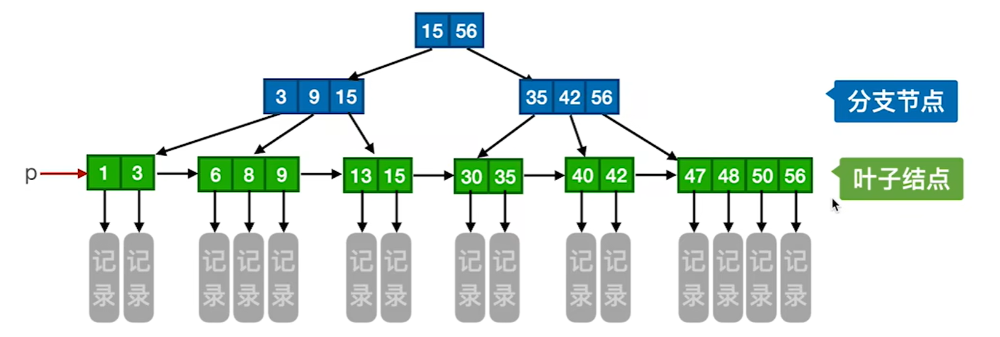

> 注：图中蓝色的是**分支结点**，只做索引、不带记录指针；绿色的是**叶子结点**，装着全部关键字和指向记录的指针，并且左右串成一条链；p 是指向最小关键字的指针，顺着这条链就能**顺序**扫过所有关键字。

**B 树和 B+ 树的区别**，整理成一张表：

| 对比项 | B 树 | B+ 树 |
| --- | --- | --- |
| n 个关键字对应几棵子树 | n 个关键字 → **n + 1 棵子树** | n 个关键字 → **n 棵子树** |
| 关键字会不会重复 | 每个关键字**只出现一次** | 叶结点里**包含全部关键字**，非叶结点里的那些只是又抄了一份当索引 |
| 记录指针放在哪 | **每个结点**都带着关键字对应记录的存储指针 | 只有**叶结点**带记录指针，非叶结点**仅起索引作用** |
| 查找会停在哪一层 | 可能半路命中就停 | **无论成功还是失败，都要走到最下面那层叶子** |
| 查找速度 | **不稳定**（命中得早快、命中得晚慢，最坏要走到叶子） | **稳定**（每次都要走到叶子，比较次数差不多） |
| 顺序查找 / 范围查找 | **不支持**（想按顺序扫只能中序遍历整棵树） | **支持**：顺着叶子之间那条链扫过去就行 |
| 分叉下限、各子树高度 | 除根以外至少 $\lceil m/2 \rceil$ 个分叉，任意结点的子树一样高 | 和 B 树**一样** |

> 注：**为什么数据库、文件系统更爱用 B+ 树**？因为非叶结点只放索引、不放记录指针，**一个磁盘块里就能装下更多关键字**，相当于阶 m 更大；阶一大起来，树就更矮，查找时"读盘"的次数（基本就等于树高）也就更少。再加上叶子之间有链，做范围查询、顺序遍历都很便宜。

## 散列表

### 散列表的概念


%%{init: {
  "theme": "base",
  "themeVariables": {
    "primaryColor": "#5b9bd5",
    "primaryTextColor": "#ffffff",
    "primaryBorderColor": "#41719c",
    "lineColor": "#41719c",
    "secondaryColor": "#ffffff",
    "tertiaryColor": "#e2f0d9",
    "fontSize": "16px",
    "fontFamily": "-apple-system, BlinkMacSystemFont, \"Segoe UI\", Roboto, \"Helvetica Neue\", Arial, \"Noto Sans\", sans-serif"
  },
  "flowchart": {
    "nodeSpacing": 8,
    "rankSpacing": 26,
    "curve": "basis",
    "htmlLabels": true,
    "subGraphTitleMargin": { "top": 0, "bottom": 14 },
    "padding": 4,
    "useMaxWidth": false,
    "wrappingWidth": 1000
  }
}}%%
graph LR
  Root["散列表的基本概念"]

  Root --> Hash["散列表"]
  Root --> Func["散列函数"]
  Root --> Syn["同义词"]
  Root --> Col["冲突（碰撞）"]
  Root --> Q["有待解决的问题"]

  Hash --> H1["又称哈希表，可以根据数据元素的关键字<br>计算出它在散列表中的存储地址"]
  Func --> F1["建立了「关键字」→「存储地址」的映射关系"]
  Syn --> S1["若不同的关键字通过散列函数映射到同一地址，<br>则称它们为「同义词」"]
  Col --> C1["在散列表中插入一个数据元素时，<br>若插入的位置已经存储了其他元素，<br>则称这种情况为「冲突（碰撞）」"]

  Q --> Q1["如何减少「冲突」？"]
  Q --> Q2["如何处理「冲突」？"]

  Q1 --> Q1a["构造更适合的散列函数"]
  Q2 --> Q2a["拉链法"]
  Q2 --> Q2b["开放定址法"]

  classDef root fill:#5b9bd5,stroke:#41719c,stroke-width:2px,color:#fff,font-weight:bold,font-size:20px;
  classDef lvl1 fill:#9dc3e6,stroke:#2e6da4,stroke-width:2px,color:#0d2f4d,font-size:19px;
  classDef lvl2d fill:#dbe8f6,stroke:#1f4e79,stroke-width:2px,color:#000000,font-size:16px;
  classDef lvl2l fill:#f6fafe,stroke:#c3d9ef,stroke-width:2px,color:#000000,font-size:16px;
  classDef lvl3d fill:#dbe8f6,stroke:#1f4e79,stroke-width:2px,color:#333333,font-size:15px;
  classDef lvl3l fill:#f6fafe,stroke:#c3d9ef,stroke-width:2px,color:#333333,font-size:15px;
  classDef key fill:#fff,stroke:#c00000,stroke-width:3px,color:#000;

  class Root root;
  class Hash,Func,Syn,Col,Q lvl1;
  class H1,S1,Q1,Q2 lvl2d;
  class F1,C1 lvl2l;
  class Q1a lvl3d;
  class Q2a,Q2b lvl3l;
  class Hash,Func key;


> 注：这张图的两个重点是**散列表**和**散列函数**——散列表之所以能"一步到位"，全靠散列函数把关键字直接算成地址；代价是关键字算出来的地址可能撞车（同义词、冲突），所以后面才有"怎么选散列函数"和"怎么处理冲突"两件事。

### 散列表的构造

构造散列函数的目标只有一个：让关键字**尽量均匀**地散开到整张表里，少发生冲突。常见的有下面四种：


%%{init: {
  "theme": "base",
  "themeVariables": {
    "primaryColor": "#5b9bd5",
    "primaryTextColor": "#ffffff",
    "primaryBorderColor": "#41719c",
    "lineColor": "#41719c",
    "secondaryColor": "#ffffff",
    "tertiaryColor": "#e2f0d9",
    "fontSize": "16px",
    "fontFamily": "-apple-system, BlinkMacSystemFont, \"Segoe UI\", Roboto, \"Helvetica Neue\", Arial, \"Noto Sans\", sans-serif"
  },
  "flowchart": {
    "nodeSpacing": 8,
    "rankSpacing": 26,
    "curve": "basis",
    "htmlLabels": true,
    "subGraphTitleMargin": { "top": 0, "bottom": 14 },
    "padding": 4,
    "useMaxWidth": false,
    "wrappingWidth": 1000
  }
}}%%
graph LR
  Root2["散列函数的构造"]

  Root2 --> Div["除留余数法"]
  Root2 --> Lin["直接定址法"]
  Root2 --> Dig["数字分析法"]
  Root2 --> Squ["平方取中法"]

  Div --> D1["散列地址：H(key) = key % p<br>（p 通常是不大于散列表表长的最大质数）"]
  Div --> D2["适用场景：较为通用，只要关键字是整数即可"]

  Lin --> L1["散列地址：H(key) = a × key + b<br>（其中 a、b 是常数）"]
  Lin --> L2["适用场景：关键字分布基本连续"]

  Dig --> G1["选取数码分布较为均匀的若干位<br>作为散列地址"]
  Dig --> G2["适用场景：关键字集合已知，<br>且关键字某几位数码分布均匀"]

  Squ --> S2["计算关键字的平方，<br>取中间几位作为散列地址"]
  Squ --> S3["适用场景：关键字的每位取值都不够均匀"]

  classDef root fill:#5b9bd5,stroke:#41719c,stroke-width:2px,color:#fff,font-weight:bold,font-size:20px;
  classDef lvl1 fill:#9dc3e6,stroke:#2e6da4,stroke-width:2px,color:#0d2f4d,font-size:19px;
  classDef lvl2d fill:#dbe8f6,stroke:#1f4e79,stroke-width:2px,color:#000000,font-size:16px;
  classDef lvl2l fill:#f6fafe,stroke:#c3d9ef,stroke-width:2px,color:#000000,font-size:16px;
  classDef key fill:#fff,stroke:#c00000,stroke-width:3px,color:#000;

  class Root2 root;
  class Div,Lin,Dig,Squ lvl1;
  class D1,D2,G1,G2 lvl2d;
  class L1,L2,S2,S3 lvl2l;
  class Div key;


四个方法各举个小例子，看个意思：

| 方法 | 举例 |
| --- | --- |
| 除留余数法 | 表长 13（13 是不大于表长的最大质数），H(key) = key % 13：关键字 19 → 地址 6，26 → 地址 0 |
| 直接定址法 | H(key) = key − 1000：关键字 1000、1001、1002 分别落到地址 0、1、2 |
| 数字分析法 | 一批学号前 4 位都一样，就取后 4 位当散列地址 |
| 平方取中法 | 关键字 1234，1234² = 1522756，取中间 3 位 227 当散列地址 |

> 注：四个里**除留余数法最常用**（前面那颗星就是指它），因为它最通用、只要关键字是整数就能用；其余三个都得看关键字长什么样才划算。至于冲突怎么处理（拉链法、开放定址法），放在后面单独展开。

### 拉链法

把所有"同义词"用**链表**串起来：散列表的每个槽位放一个链表头指针，算出来地址相同的关键字就挂到同一条链上。这是最省心的处理冲突方式——插入、查找、删除都是在链表上做，**删除可以直接把结点摘掉**。

比如表长 13、散列函数 H(key) = key % 13，依次插入关键字 {19, 14, 23, 1, 68, 20, 84, 27, 55, 11, 10, 79}：

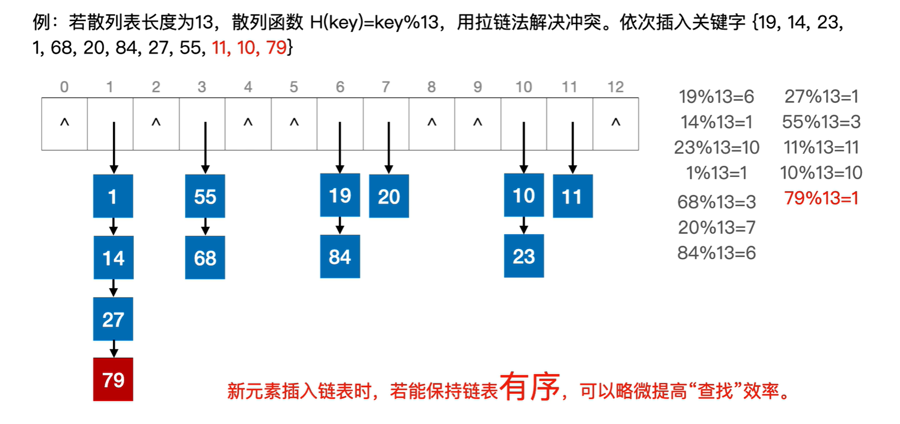

> 注：插入时如果顺手把链表保持**有序**（图里地址 1 那条链就是 1 → 14 → 27 → 79 递增的），查找时就能少比几个结点，略微提高效率。

### 开放定址法

开放定址法不开链表，而是**在表里继续往后找空位**：发生冲突时按一个"探测序列" dᵢ 探测下一个地址，公式是 Hᵢ = (H(key) + dᵢ) % m。


%%{init: {
  "theme": "base",
  "themeVariables": {
    "primaryColor": "#5b9bd5",
    "primaryTextColor": "#ffffff",
    "primaryBorderColor": "#41719c",
    "lineColor": "#41719c",
    "secondaryColor": "#ffffff",
    "tertiaryColor": "#e2f0d9",
    "fontSize": "16px",
    "fontFamily": "-apple-system, BlinkMacSystemFont, \"Segoe UI\", Roboto, \"Helvetica Neue\", Arial, \"Noto Sans\", sans-serif"
  },
  "flowchart": {
    "nodeSpacing": 8,
    "rankSpacing": 26,
    "curve": "basis",
    "htmlLabels": true,
    "subGraphTitleMargin": { "top": 0, "bottom": 14 },
    "padding": 4,
    "useMaxWidth": false,
    "wrappingWidth": 1000
  }
}}%%
graph LR
  Root3["开放定址法"]

  Root3 --> Basic["基本原理"]
  Root3 --> Ops["元素的操作"]
  Root3 --> Probes["四种常用的「探测序列」"]

  Basic --> B1["当初始散列地址发生冲突时，<br>根据「探测序列」dᵢ 探测下一个地址"]

  Ops --> INS["插入"]
  Ops --> SCH["查找"]
  Ops --> DEL["删除"]

  INS --> I1["根据散列函数算出初始地址，若发生冲突，<br>就「探测」下一个地址，<br>直到找到一个空闲地址即可插入"]
  SCH --> S1["根据散列函数算出初始地址，对比关键字；<br>不匹配就「探测」下一个地址，<br>直到关键字匹配（成功）或探测到空位置（失败）"]
  DEL --> DE1["先按「查找」的规则找到目标元素，<br>若查找成功就把目标元素<span style='color:#c00000 !important'>逻辑删除</span>，<br>不能物理删除"]

  Probes --> LIN["线性探测法"]
  Probes --> SQU["平方探测法"]
  Probes --> DBL["双散列法"]
  Probes --> RND["伪随机序列法"]

  LIN --> L1["dᵢ = 0, 1, 2, 3, …, m − 1"]
  SQU --> Q1["dᵢ = 0², 1², −1², 2², −2², …, k², −k²<br>（其中 k ≤ m / 2）"]
  DBL --> B2["dᵢ = i × hash₂(key)<br>（其中 hash₂(key) 是另一个散列函数）"]
  RND --> R1["dᵢ 是一个伪随机序列，<br>如 dᵢ = 0, 5, 3, 11, …"]

  classDef root fill:#5b9bd5,stroke:#41719c,stroke-width:2px,color:#fff,font-weight:bold,font-size:20px;
  classDef lvl1 fill:#9dc3e6,stroke:#2e6da4,stroke-width:2px,color:#0d2f4d,font-size:19px;
  classDef lvl2d fill:#dbe8f6,stroke:#1f4e79,stroke-width:2px,color:#000000,font-size:16px;
  classDef lvl2l fill:#f6fafe,stroke:#c3d9ef,stroke-width:2px,color:#000000,font-size:16px;
  classDef lvl3d fill:#dbe8f6,stroke:#1f4e79,stroke-width:2px,color:#333333,font-size:15px;
  classDef lvl3l fill:#f6fafe,stroke:#c3d9ef,stroke-width:2px,color:#333333,font-size:15px;
  classDef key fill:#fff,stroke:#c00000,stroke-width:3px,color:#000;

  class Root3 root;
  class Basic,Ops,Probes lvl1;
  class B1,LIN,SQU,DBL,RND lvl2d;
  class INS,SCH,DEL lvl2l;
  class I1,DE1,Q1,R1 lvl3d;
  class S1,L1,B2 lvl3l;
  class DEL,LIN key;


> 注：**开放定址法里删除元素只能"逻辑删除"**（图中那个红框就是提醒这条）——因为查找是沿"探测路径"一个个试过来的，如果直接把元素物理删掉、把槽位清空，那么**当初被它挤到后面的同义词**，一探测到这个空位就会判断"查找失败"，从此再也找不到（路径被截断了）。所以删除时只给这个位置**打一个"已删除"标记**：查找遇到它继续往下探，插入时则可以覆盖它。

### 散列表的性能分析

散列表的查找效率用 **ASL**（平均查找长度）衡量，而 ASL 取决于三件事：**散列函数选得好不好、冲突怎么处理、装填因子多大**。

**先看 ASL 怎么算（以开放定址法为例）**。题目是：散列表长 16、初始为空，H(key) = key % 13，用线性探测法处理冲突，依次插入 {19, 14, 23, 1, 68, 20, 84, 27, 55, 11, 10, 79}。

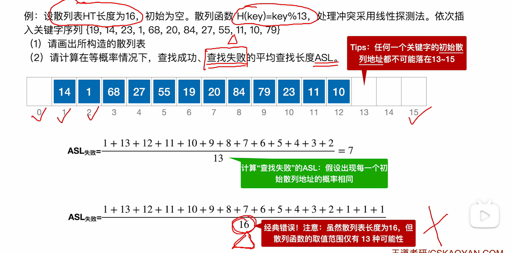

**查找成功：分子是"每个关键字的查找长度"之和，分母是关键字个数 n。**

"某个关键字的查找长度"就是找到它要比较几次（等于它落在表里第几个探测位置上）。这张表里 12 个关键字按槽位顺序，比较次数分别是 1、2、1、4、3、1、1、3、9、1、1、3，加起来 30：

$$ASL_{成功} = \frac{1+2+1+4+3+1+1+3+9+1+1+3}{12} = \frac{30}{12} = 2.5$$

**查找失败：分子是"从每个可能的初始散列地址出发、一直探测到空位为止"的比较次数之和，分母是散列函数值域的大小。**

失败的分母**不是表长**：H(key) = key % 13 只能算出 0~12 这 13 个地址，13、14、15 永远不可能是任何一个关键字的初始地址，所以分母是 **13**：

$$ASL_{失败} = \frac{1+13+12+11+10+9+8+7+6+5+4+3+2}{13} = \frac{91}{13} = 7$$

> 注：这里有个经典错误——拿 16 当分母，把 13、14、15 那三个永远到不了的槽位也算进去。记住这句话就行：**查找失败的分母是"散列函数的取值个数"，不是"表的长度"**。成功和失败的分母不一样，是这道题最容易翻车的地方。

**装填因子 α**：**表中已装元素个数 n ÷ 散列表表长 m**。

$$α = \frac{n}{m}$$

它反映的是表的**装满程度**：α 越大，表里越挤，冲突越容易发生，ASL 越长；α 越小，表越空，冲突少、查找快，但空间就浪费得多。所以有个结论要记住——**散列表的 ASL 只取决于"散列函数、处理冲突的方法、装填因子 α"这三样，并不直接依赖 n 或 m**；也正因为如此，我们才能用"把表开大一点、把 α 压下去"的办法换查找速度。

> 注：开放定址法的 α 一定小于 1（表满了就没地方探测了）；拉链法没有"表满"的限制，α 是可以大于 1 的。

**聚集现象（堆积）**：在**线性探测法**里，探测序列是一串连续地址，所以同义词会占住一片**连续的**区域；更麻烦的是**本来不冲突**的关键字，只要初始地址落进这片区域，也会被"粘"到区域末尾，把它越撑越大——这就是聚集（堆积）。区域越大，后面落进来的关键字探测得越久，ASL 也就越长。

平方探测法之所以能**减少聚集**，是因为它的探测序列 dᵢ = 0², 1², −1², 2², −2², … 是**跳着走**的，不会把元素挤成一整片连续区域，"不同初始地址互相粘"的堆积基本就消掉了。当然它也有代价：初始地址相同的那些同义词，仍然走同一条探测序列。

# 八、排序

## 排序的基本概念


%%{init: {
  "theme": "base",
  "themeVariables": {
    "primaryColor": "#5b9bd5",
    "primaryTextColor": "#ffffff",
    "primaryBorderColor": "#41719c",
    "lineColor": "#41719c",
    "secondaryColor": "#ffffff",
    "tertiaryColor": "#e2f0d9",
    "fontSize": "16px",
    "fontFamily": "-apple-system, BlinkMacSystemFont, \"Segoe UI\", Roboto, \"Helvetica Neue\", Arial, \"Noto Sans\", sans-serif"
  },
  "flowchart": {
    "nodeSpacing": 8,
    "rankSpacing": 26,
    "curve": "basis",
    "htmlLabels": true,
    "subGraphTitleMargin": { "top": 0, "bottom": 14 },
    "padding": 4,
    "useMaxWidth": false,
    "wrappingWidth": 1000
  }
}}%%
graph LR
  Root0["排序"]

  Root0 --> Def0["将各元素按关键字递增或递减的顺序重新排列"]
  Root0 --> Eval["评价指标"]
  Root0 --> Cls["分类"]

  Eval --> Stable["稳定性"]
  Eval --> Complexity["时间复杂度、空间复杂度"]

  Stable --> S1["关键字相同的元素经过排序后相对顺序是否会改变"]

  Cls --> Inner["内部排序"]
  Cls --> Outer["外部排序"]

  Inner --> I1["数据都在内存中"]
  Outer --> O1["数据太多，无法全部放入内存"]

  classDef root fill:#5b9bd5,stroke:#41719c,stroke-width:2px,color:#fff,font-weight:bold,font-size:20px;
  classDef lvl1 fill:#9dc3e6,stroke:#2e6da4,stroke-width:2px,color:#0d2f4d,font-size:19px;
  classDef lvl2d fill:#dbe8f6,stroke:#1f4e79,stroke-width:2px,color:#000000,font-size:16px;
  classDef lvl2l fill:#f6fafe,stroke:#c3d9ef,stroke-width:2px,color:#000000,font-size:16px;
  classDef lvl3d fill:#dbe8f6,stroke:#1f4e79,stroke-width:2px,color:#333333,font-size:15px;
  classDef lvl3l fill:#f6fafe,stroke:#c3d9ef,stroke-width:2px,color:#333333,font-size:15px;
  classDef key fill:#fff,stroke:#c00000,stroke-width:3px,color:#000;

  class Root0 root;
  class Def0,Eval,Cls lvl1;
  class Stable,Complexity lvl2d;
  class Inner,Outer lvl2l;
  class S1,O1 lvl3d;
  class I1 lvl3l;
  class Cls key;


> 注：图上"稳定性"那条说的就是——排序前后**关键字相同的元素相对顺序没变**，这个算法就叫**稳定**的；变了就叫不稳定。

## 插入排序

### 直接插入和折半插入


%%{init: {
  "theme": "base",
  "themeVariables": {
    "primaryColor": "#5b9bd5",
    "primaryTextColor": "#ffffff",
    "primaryBorderColor": "#41719c",
    "lineColor": "#41719c",
    "secondaryColor": "#ffffff",
    "tertiaryColor": "#e2f0d9",
    "fontSize": "16px",
    "fontFamily": "-apple-system, BlinkMacSystemFont, \"Segoe UI\", Roboto, \"Helvetica Neue\", Arial, \"Noto Sans\", sans-serif"
  },
  "flowchart": {
    "nodeSpacing": 8,
    "rankSpacing": 26,
    "curve": "basis",
    "htmlLabels": true,
    "subGraphTitleMargin": { "top": 0, "bottom": 14 },
    "padding": 4,
    "useMaxWidth": false,
    "wrappingWidth": 1000
  }
}}%%
graph LR
  Root4["插入排序"]

  Root4 --> Idea["算法思想"]
  Root4 --> Dir["直接插入排序"]
  Root4 --> Bin["折半插入排序"]
  Root4 --> Perf["性能"]

  Idea --> I1["每次将一个待排序的记录按其关键字大小<br>插入到前面已排好序的子序列中，<br>直到全部记录插入完成"]

  Dir --> D1["顺序查找找到插入的位置，<br>适用于顺序表、链表"]

  Bin --> B1["折半查找找到应插入的位置，<br>仅适用于顺序表"]
  Bin --> B2["注意：一直到 low > high 时才停止折半查找。<br>当 mid 所指元素等于当前元素时，<br>应继续令 low = mid + 1，以保证「稳定性」；<br>最终应将当前元素插入到 low 所指位置（即 high + 1）"]

  Perf --> Sp["空间复杂度"]
  Perf --> Tm["时间复杂度"]
  Perf --> St["稳定性"]

  Sp --> S1["O(1)"]
  Tm --> T1["最好"]
  Tm --> T2["最坏"]
  Tm --> T3["平均"]
  St --> S2["稳定"]

  T1 --> T1a["原本有序 O(n)"]
  T2 --> T2a["原本逆序 O(n²)"]
  T3 --> T3a["O(n²)"]

  classDef root fill:#5b9bd5,stroke:#41719c,stroke-width:2px,color:#fff,font-weight:bold,font-size:20px;
  classDef lvl1 fill:#9dc3e6,stroke:#2e6da4,stroke-width:2px,color:#0d2f4d,font-size:19px;
  classDef lvl2d fill:#dbe8f6,stroke:#1f4e79,stroke-width:2px,color:#000000,font-size:16px;
  classDef lvl2l fill:#f6fafe,stroke:#c3d9ef,stroke-width:2px,color:#000000,font-size:16px;
  classDef lvl3d fill:#dbe8f6,stroke:#1f4e79,stroke-width:2px,color:#333333,font-size:15px;
  classDef lvl3l fill:#f6fafe,stroke:#c3d9ef,stroke-width:2px,color:#333333,font-size:15px;
  classDef lvl4d fill:#dbe8f6,stroke:#1f4e79,stroke-width:1.5px,color:#333333,font-size:14px;
  classDef lvl4l fill:#f6fafe,stroke:#c3d9ef,stroke-width:1.5px,color:#333333,font-size:14px;
  classDef key fill:#fff,stroke:#c00000,stroke-width:3px,color:#000;

  class Root4 root;
  class Idea,Dir,Bin,Perf lvl1;
  class I1,B1,B2 lvl2d;
  class D1,Sp,Tm,St lvl2l;
  class S1,S2 lvl3d;
  class T1,T2,T3 lvl3l;
  class T1a,T3a lvl4d;
  class T2a lvl4l;
  class B2 key;


**直接插入排序**：从后往前顺序查找，找到该插入的位置就把它塞进去——顺序表和链表都能用。

```c
//直接插入排序
void InsertSort(int A[],int n){
    int i,j,temp;
    for(i=1;i<n;i++)                            //将各元素插入已排好序的序列中
        if(A[i]<A[i-1]){                        //若A[i]关键字小于前驱
            temp=A[i];                          //用temp暂存A[i]
            for(j=i-1;j>=0 && A[j]>temp;--j)    //检查所有前面已排好序的元素
                A[j+1]=A[j];                    //所有大于temp的元素都向后移位
            A[j+1]=temp;                        //复制到插入位置
        }
}
```

**折半插入排序**：用折半查找来确定插入位置（比顺序查找快），但**只能用于顺序表**——链表没法折半。

```c
//折半插入排序
void InsertSort(int A[],int n){
    int i,j,low,high,mid;
    for(i=2;i<=n;i++){                    //依次将A[2]～A[n]插入前面的已排序序列
        A[0]=A[i];                        //将A[i]暂存到A[0]
        low=1;high=i-1;                   //设置折半查找的范围
        while(low<=high){                 //折半查找（默认递增有序）
            mid=(low+high)/2;             //取中间点
            if(A[mid]>A[0]) high=mid-1;   //查找左半子表
            else low=mid+1;               //查找右半子表
        }
        for(j=i-1;j>=high+1;--j)
            A[j+1]=A[j];                  //统一后移元素，空出插入位置
        A[high+1]=A[0];                   //插入操作
    }
}
```

> 注：两段代码的下标约定不一样——上面那段用 `A[0..n-1]` 存数据、拿 `temp` 暂存；下面那段是课件常见的 1-based 写法，数据放在 `A[1..n]`，**`A[0]` 空出来当暂存单元**（顺带起哨兵的作用）。做题时照题目给的下标约定来就行。

### 希尔排序


%%{init: {
  "theme": "base",
  "themeVariables": {
    "primaryColor": "#5b9bd5",
    "primaryTextColor": "#ffffff",
    "primaryBorderColor": "#41719c",
    "lineColor": "#41719c",
    "secondaryColor": "#ffffff",
    "tertiaryColor": "#e2f0d9",
    "fontSize": "16px",
    "fontFamily": "-apple-system, BlinkMacSystemFont, \"Segoe UI\", Roboto, \"Helvetica Neue\", Arial, \"Noto Sans\", sans-serif"
  },
  "flowchart": {
    "nodeSpacing": 8,
    "rankSpacing": 26,
    "curve": "basis",
    "htmlLabels": true,
    "subGraphTitleMargin": { "top": 0, "bottom": 14 },
    "padding": 4,
    "useMaxWidth": false,
    "wrappingWidth": 1000
  }
}}%%
graph LR
  Root5["希尔排序"]

  Root5 --> Def5["先将待排序表分割成若干形如<br>L[i, i + d, i + 2d, …, i + kd] 的「特殊」子表，<br>对各个子表分别进行直接插入排序；<br>缩小增量 d，重复上述过程，直到 d = 1 为止"]
  Root5 --> Perf5["性能"]
  Root5 --> Hot["高频题型：给出增量序列，<br>分析每一趟排序后的状态"]

  Perf5 --> Sp5["空间复杂度"]
  Perf5 --> Tm5["时间复杂度"]
  Perf5 --> St5["稳定性"]
  Perf5 --> App5["适用性"]

  Sp5 --> S5["O(1)"]
  Tm5 --> T5["未知，但优于直接插入排序"]
  St5 --> S6["不稳定"]
  App5 --> A5["仅可用于顺序表"]

  classDef root fill:#5b9bd5,stroke:#41719c,stroke-width:2px,color:#fff,font-weight:bold,font-size:20px;
  classDef lvl1 fill:#9dc3e6,stroke:#2e6da4,stroke-width:2px,color:#0d2f4d,font-size:19px;
  classDef lvl2d fill:#dbe8f6,stroke:#1f4e79,stroke-width:2px,color:#000000,font-size:16px;
  classDef lvl2l fill:#f6fafe,stroke:#c3d9ef,stroke-width:2px,color:#000000,font-size:16px;
  classDef lvl3d fill:#dbe8f6,stroke:#1f4e79,stroke-width:2px,color:#333333,font-size:15px;
  classDef lvl3l fill:#f6fafe,stroke:#c3d9ef,stroke-width:2px,color:#333333,font-size:15px;
  classDef key fill:#fff,stroke:#c00000,stroke-width:3px,color:#000;

  class Root5 root;
  class Def5,Perf5,Hot lvl1;
  class Sp5,Tm5,St5,App5 lvl2d;
  class S5,S6 lvl3d;
  class T5,A5 lvl3l;
  class Def5 key;


```c
//希尔排序
void ShellSort(int A[],int n){
    int d, i, j;
    //A[0]只是暂存单元，不是哨兵，当j<=0时，插入位置已到
    for(d= n/2; d>=1; d=d/2)          //步长变化
        for(i=d+1; i<=n; ++i)
            if(A[i]<A[i-d]){          //需将A[i]插入有序增量表
                A[0]=A[i];            //暂存在A[0]
                for(j= i-d; j>0 && A[0]<A[j]; j-=d)
                    A[j+d]=A[j];      //记录后移，查找插入的位置
                A[j+d]=A[0];          //插入
            }//if
}
```

> 注：课件里增量序列取 d = n/2、n/4、…、1，这只是其中一种取法——**增量序列不唯一，只要最后一趟是 d = 1 就行**，但取法不同效率也不一样，这也是"时间复杂度未知"的原因。

下面这张图把**同一个数组用两种不同的增量序列各走了一遍**，正好演示那个高频题型"分析每一趟排序后的状态"：

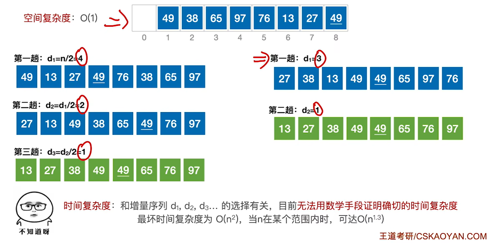

原数组是 `A[1..8]` = 49, 38, 65, 97, 76, 13, 27, 49（`A[0]` 空着当暂存单元；图里第二个 49 画了下划线，方便盯住它俩的相对顺序）。

**左半边：增量序列 4、2、1。**

- 第一趟 d = 4：把表分成 (49, 76)、(38, 13)、(65, 27)、(97, 49) 四个子表（每个子表内部相邻元素相隔 4 个位置），各自做直接插入排序 → 49, 13, 27, 49, 76, 38, 65, 97；
- 第二趟 d = 2：分成 (49, 27, 76, 65) 和 (13, 49, 38, 97) 两个子表，各自排序 → 27, 13, 49, 38, 65, 49, 76, 97；
- 第三趟 d = 1：整个表做一次直接插入排序 → 13, 27, 38, 49, 49, 65, 76, 97，完成。

**右半边：换成增量序列 3、1。**

- 第一趟 d = 3：分成 (49, 97, 27)、(38, 76, 49)、(65, 13) 三个子表，各自排序 → 27, 38, 13, 49, 49, 65, 97, 76；
- 第二趟 d = 1：整个表插入排序 → 13, 27, 38, 49, 49, 65, 76, 97，完成。

同一组数据、两种增量序列，最终结果一样，但**中间过程不同、趟数也不同**——这就是"增量序列不唯一"的直观体现。

另外能看出来希尔排序为什么比直接插入排序快：前面几趟是**粗调**（d 大时每个子表很短，排起来代价很小），它的真正目的是让表变得**基本有序**；等到最后一趟 d = 1 时，表已经相当有序了，而插入排序在"原本有序"的情况下只要 O(n)，所以整体才比一上来就做插入排序划算。

> 注：时间复杂度**与增量序列的选择有关**，至今没法用数学手段证明确切的时间复杂度——最坏是 O(n²)，当 n 在某个范围内时可以到 O(n^1.3)。另外图里那两个 49 的相对顺序在两种序列下恰好都没变，但希尔排序**并不保证**这一点，它是不稳定的。

## 交换排序

### 冒泡排序


%%{init: {
  "theme": "base",
  "themeVariables": {
    "primaryColor": "#5b9bd5",
    "primaryTextColor": "#ffffff",
    "primaryBorderColor": "#41719c",
    "lineColor": "#41719c",
    "secondaryColor": "#ffffff",
    "tertiaryColor": "#e2f0d9",
    "fontSize": "16px",
    "fontFamily": "-apple-system, BlinkMacSystemFont, \"Segoe UI\", Roboto, \"Helvetica Neue\", Arial, \"Noto Sans\", sans-serif"
  },
  "flowchart": {
    "nodeSpacing": 8,
    "rankSpacing": 26,
    "curve": "basis",
    "htmlLabels": true,
    "subGraphTitleMargin": { "top": 0, "bottom": 14 },
    "padding": 4,
    "useMaxWidth": false,
    "wrappingWidth": 1000
  }
}}%%
graph LR
  Root6["冒泡排序"]

  Root6 --> Prin["算法原理"]
  Root6 --> Perf6["性能"]

  Prin --> P1["从后往前（或从前往后）两两比较相邻元素的值，<br>若为逆序就交换它们，直到序列比较完；<br>这算「一趟」冒泡排序，<br>最多只需 n − 1 趟"]
  Prin --> P2["每一趟排序都可以使一个元素移动到最终位置，<br>已经确定最终位置的元素在之后的处理中无需再对比"]
  Prin --> P3["如果某一趟排序过程中未发生「交换」，<br>则算法可提前结束"]

  Perf6 --> Sp6["空间复杂度"]
  Perf6 --> Tm6["时间复杂度"]
  Perf6 --> St6["稳定性"]
  Perf6 --> App6["适用性"]

  Sp6 --> S7["O(1)"]
  Tm6 --> T6["最好 O(n)"]
  Tm6 --> T7["最差 O(n²)"]
  Tm6 --> T8["平均 O(n²)"]
  St6 --> S8["稳定"]
  App6 --> A6["顺序表、链表都可以"]

  T6 --> T6a["有序"]
  T7 --> T7a["逆序"]

  classDef root fill:#5b9bd5,stroke:#41719c,stroke-width:2px,color:#fff,font-weight:bold,font-size:20px;
  classDef lvl1 fill:#9dc3e6,stroke:#2e6da4,stroke-width:2px,color:#0d2f4d,font-size:19px;
  classDef lvl2d fill:#dbe8f6,stroke:#1f4e79,stroke-width:2px,color:#000000,font-size:16px;
  classDef lvl2l fill:#f6fafe,stroke:#c3d9ef,stroke-width:2px,color:#000000,font-size:16px;
  classDef lvl3d fill:#dbe8f6,stroke:#1f4e79,stroke-width:2px,color:#333333,font-size:15px;
  classDef lvl3l fill:#f6fafe,stroke:#c3d9ef,stroke-width:2px,color:#333333,font-size:15px;
  classDef lvl4d fill:#dbe8f6,stroke:#1f4e79,stroke-width:1.5px,color:#333333,font-size:14px;
  classDef lvl4l fill:#f6fafe,stroke:#c3d9ef,stroke-width:1.5px,color:#333333,font-size:14px;
  classDef key fill:#fff,stroke:#c00000,stroke-width:3px,color:#000;

  class Root6 root;
  class Prin,Perf6 lvl1;
  class P1,P2,P3 lvl2d;
  class Sp6,Tm6,St6,App6 lvl2l;
  class S7,S8 lvl3d;
  class T6,T7,T8,A6 lvl3l;
  class T6a lvl4d;
  class T7a lvl4l;


```c
//交换
void swap(int &a, int &b){
    int temp = a;
    a = b;
    b = temp;
}

//冒泡排序
void BubbleSort(int A[],int n){
    for(int i=0;i<n-1;i++){
        bool flag=false;                 //表示本趟冒泡是否发生交换的标志
        for(int j=n-1;j>i;j--)           //一趟冒泡过程
            if(A[j-1]>A[j]){             //若为逆序
                swap(A[j-1],A[j]);       //交换
                flag=true;
            }
        if(flag==false)
            return;                      //本趟遍历后没有发生交换，说明表已经有序
    }
}
```

> 注：性能里那个"最好 O(n)"全靠代码里的 `flag`——如果表本来就有序，第一趟从头扫一遍会发现一次交换都没发生，直接 `return` 结束，只花了 O(n) 时间。

### 快速排序

**算法思想**：在待排序表 `L[1..n]` 中任取一个元素 pivot 作为**枢轴**（或基准，通常取首元素），通过一趟排序把表划分成独立的两部分 `L[1..k-1]` 和 `L[k+1..n]`，使得前者中的元素都**小于** pivot、后者中的元素都**大于等于** pivot，于是 pivot 就落到了它的最终位置 `L(k)` 上——这个过程叫一次「**划分**」。然后分别对两个子表递归地重复上述过程，直到每部分内只剩一个元素或为空，所有元素就都放到了最终位置上。


%%{init: {
  "theme": "base",
  "themeVariables": {
    "primaryColor": "#5b9bd5",
    "primaryTextColor": "#ffffff",
    "primaryBorderColor": "#41719c",
    "lineColor": "#41719c",
    "secondaryColor": "#ffffff",
    "tertiaryColor": "#e2f0d9",
    "fontSize": "16px",
    "fontFamily": "-apple-system, BlinkMacSystemFont, \"Segoe UI\", Roboto, \"Helvetica Neue\", Arial, \"Noto Sans\", sans-serif"
  },
  "flowchart": {
    "nodeSpacing": 8,
    "rankSpacing": 26,
    "curve": "basis",
    "htmlLabels": true,
    "subGraphTitleMargin": { "top": 0, "bottom": 14 },
    "padding": 4,
    "useMaxWidth": false,
    "wrappingWidth": 1000
  }
}}%%
graph LR
  Root7["快速排序"]

  Root7 --> Deep["算法表现主要取决于递归深度：<br>每次「划分」越均匀，递归深度越低；<br>越不均匀，递归深度越深"]
  Root7 --> Perf7["性能"]

  Perf7 --> Sp7["空间复杂度"]
  Perf7 --> Tm7["时间复杂度"]
  Perf7 --> St7["稳定性"]

  Sp7 --> Sp7a["最好 O(log₂n)"]
  Sp7 --> Sp7b["最坏 O(n)"]

  Tm7 --> Tm7a["最好 O(n log₂n)：<br>每次划分都很平均"]
  Tm7 --> Tm7b["最坏 O(n²)：<br>原本正序或逆序"]
  Tm7 --> Tm7c["平均 O(n log₂n)"]

  St7 --> St7a["不稳定"]

  classDef root fill:#5b9bd5,stroke:#41719c,stroke-width:2px,color:#fff,font-weight:bold,font-size:20px;
  classDef lvl1 fill:#9dc3e6,stroke:#2e6da4,stroke-width:2px,color:#0d2f4d,font-size:19px;
  classDef lvl2d fill:#dbe8f6,stroke:#1f4e79,stroke-width:2px,color:#000000,font-size:16px;
  classDef lvl2l fill:#f6fafe,stroke:#c3d9ef,stroke-width:2px,color:#000000,font-size:16px;
  classDef lvl3d fill:#dbe8f6,stroke:#1f4e79,stroke-width:2px,color:#333333,font-size:15px;
  classDef lvl3l fill:#f6fafe,stroke:#c3d9ef,stroke-width:2px,color:#333333,font-size:15px;
  classDef key fill:#fff,stroke:#c00000,stroke-width:3px,color:#000;

  class Root7 root;
  class Deep,Perf7 lvl1;
  class Sp7,Tm7,St7 lvl2d;
  class Sp7a,Sp7b,St7a lvl3d;
  class Tm7a,Tm7b,Tm7c lvl3l;


**为什么是"O(n × 递归层数)"？** 每一层划分都要把这一层的元素扫一遍（代价 O(n)），层数则取决于划分得均不均匀：

- 每次都能把序列**均匀分成两半**时，层数是 log₂n，时间就是 **O(n log₂n)**（最好、平均都是这个量级）；
- 如果序列**原本就有序或逆序**，每次划分都极不均匀（枢轴总是落在最边上），层数退化成 n，时间就变成 **O(n²)**。

空间复杂度就是**递归栈的深度**，同样正比于层数，所以**最好 O(log₂n)、最坏 O(n)**。也正因为最坏情况出在"枢轴选得太偏"，常见的优化就是**尽量选能把数据中分的枢轴**（随机取、或者取头、中、尾三个数的中位数）。

```c
//用第一个元素将待排序序列划分成左右两个部分
int Partition(int A[],int low,int high){
    int pivot=A[low];                 //第一个元素作为枢轴
    while(low<high){                  //用low、high搜索枢轴的最终位置
        while(low<high&&A[high]>=pivot) --high;
        A[low]=A[high];               //比枢轴小的元素移动到左端
        while(low<high&&A[low]<=pivot) ++low;
        A[high]=A[low];               //比枢轴大的元素移动到右端
    }
    A[low]=pivot;                     //枢轴元素存放到最终位置
    return low;                       //返回存放枢轴的最终位置
}

//快速排序
void QuickSort(int A[],int low,int high){
    if(low<high){                             //递归跳出的条件
        int pivotpos=Partition(A,low,high);   //划分
        QuickSort(A,low,pivotpos-1);          //划分左子表
        QuickSort(A,pivotpos+1,high);         //划分右子表
    }
}
```

> 注：**"一趟排序"和"一次划分"不是一回事**——408 原题里的定义是："对所有尚未确定最终位置的元素进行一遍处理"才算**一趟**排序。所以一次划分只能确定**一个**元素（也就是枢轴）的最终位置，而一趟排序可能确定**多个**元素的最终位置。这是快排最容易混的一个说法，选择题常在这里挖坑。

## 选择排序

### 简单选择排序


%%{init: {
  "theme": "base",
  "themeVariables": {
    "primaryColor": "#5b9bd5",
    "primaryTextColor": "#ffffff",
    "primaryBorderColor": "#41719c",
    "lineColor": "#41719c",
    "secondaryColor": "#ffffff",
    "tertiaryColor": "#e2f0d9",
    "fontSize": "16px",
    "fontFamily": "-apple-system, BlinkMacSystemFont, \"Segoe UI\", Roboto, \"Helvetica Neue\", Arial, \"Noto Sans\", sans-serif"
  },
  "flowchart": {
    "nodeSpacing": 8,
    "rankSpacing": 26,
    "curve": "basis",
    "htmlLabels": true,
    "subGraphTitleMargin": { "top": 0, "bottom": 14 },
    "padding": 4,
    "useMaxWidth": false,
    "wrappingWidth": 1000
  }
}}%%
graph LR
  Root8["简单选择排序"]

  Root8 --> Prin8["算法原理"]
  Root8 --> Perf8["性能"]

  Prin8 --> A8["每一趟在待排序元素中选取关键字最小的元素，<br>加入有序子序列"]
  Prin8 --> A9["必须进行总共 n − 1 趟处理"]

  Perf8 --> Sp8["空间复杂度"]
  Perf8 --> Tm8["时间复杂度"]
  Perf8 --> St8["稳定性"]
  Perf8 --> App8["适用性"]

  Sp8 --> S9["O(1)"]
  Tm8 --> T9["O(n²)"]
  St8 --> S10["不稳定"]
  App8 --> A10["顺序表、链表都可以"]

  classDef root fill:#5b9bd5,stroke:#41719c,stroke-width:2px,color:#fff,font-weight:bold,font-size:20px;
  classDef lvl1 fill:#9dc3e6,stroke:#2e6da4,stroke-width:2px,color:#0d2f4d,font-size:19px;
  classDef lvl2d fill:#dbe8f6,stroke:#1f4e79,stroke-width:2px,color:#000000,font-size:16px;
  classDef lvl2l fill:#f6fafe,stroke:#c3d9ef,stroke-width:2px,color:#000000,font-size:16px;
  classDef lvl3d fill:#dbe8f6,stroke:#1f4e79,stroke-width:2px,color:#333333,font-size:15px;
  classDef lvl3l fill:#f6fafe,stroke:#c3d9ef,stroke-width:2px,color:#333333,font-size:15px;
  classDef key fill:#fff,stroke:#c00000,stroke-width:3px,color:#000;

  class Root8 root;
  class Prin8,Perf8 lvl1;
  class A8,A9 lvl2d;
  class Sp8,Tm8,St8,App8 lvl2l;
  class S9,S10 lvl3d;
  class T9,A10 lvl3l;


```c
//简单选择排序
void SelectSort(int A[],int n){
    for(int i=0; i<n-1; i++){              //一共进行n-1趟
        int min=i;                         //记录最小元素位置
        for(int j=i+1;j<n;j++)             //在A[i…n-1]中选择最小的元素
            if(A[j]<A[min]) min=j;         //更新最小元素位置
        if(min!=i) swap(A[i],A[min]);      //封装的swap()函数共移动元素3次
    }
}

//交换
void swap(int &a, int &b){
    int temp = a;
    a = b;
    b = temp;
}
```

> 注：每一趟**最多只交换一次**（`min != i` 才换），而一次交换要移动 3 个元素，所以简单选择排序的**元素移动次数最多 3(n − 1) 次、最少 0 次**——这就是它"移动次数少"这个特点的来历（代价是比较次数多：无论如何都要比 n(n−1)/2 次）。

### 堆排序

堆排序用到的"堆"，其实就是**顺序存储的完全二叉树**——这里正好把二叉树的顺序存储用上了：结点 i 的左孩子是 2i、右孩子是 2i + 1、父结点是 i/2；编号 ≤ $\lfloor n/2 \rfloor$ 的结点都是分支结点。


%%{init: {
  "theme": "base",
  "themeVariables": {
    "primaryColor": "#5b9bd5",
    "primaryTextColor": "#ffffff",
    "primaryBorderColor": "#41719c",
    "lineColor": "#41719c",
    "secondaryColor": "#ffffff",
    "tertiaryColor": "#e2f0d9",
    "fontSize": "16px",
    "fontFamily": "-apple-system, BlinkMacSystemFont, \"Segoe UI\", Roboto, \"Helvetica Neue\", Arial, \"Noto Sans\", sans-serif"
  },
  "flowchart": {
    "nodeSpacing": 8,
    "rankSpacing": 26,
    "curve": "basis",
    "htmlLabels": true,
    "subGraphTitleMargin": { "top": 0, "bottom": 14 },
    "padding": 4,
    "useMaxWidth": false,
    "wrappingWidth": 1000
  }
}}%%
graph LR
  Root9["堆排序"]

  Root9 --> Heap["堆"]
  Root9 --> Idea9["算法思想（以大根堆为例）"]
  Root9 --> Feat["特性"]

  Heap --> Seq["顺序存储的「完全二叉树」"]
  Heap --> Kind["大根堆（根 ≥ 左、右）；<br>小根堆（根 ≤ 左、右）"]

  Seq --> Sq1["结点 i 的左孩子是 2i，右孩子是 2i + 1，<br>父结点是 i / 2"]
  Seq --> Sq2["编号 ≤ n/2（向下取整）的结点都是分支结点"]

  Idea9 --> Build["建堆"]
  Idea9 --> Sort["排序"]

  Build --> Bd1["编号 ≤ n/2（向下取整）的结点依次「下坠」调整<br>（自底向上处理各分支结点）"]
  Build --> Bd2["调整规则：小元素逐层「下坠」<br>（与关键字更大的孩子交换）"]

  Sort --> So1["将堆顶元素加入有序子序列<br>（堆顶元素与堆底元素交换）"]
  Sort --> So2["堆底元素换到堆顶后需要「下坠」调整，<br>恢复「大根堆」的特性"]
  Sort --> So3["上述过程重复 n − 1 趟"]

  Feat --> SpH["空间复杂度"]
  Feat --> TmH["时间复杂度"]
  Feat --> StH["稳定性"]
  Feat --> Rule["基于大根堆的堆排序得到「递增序列」，<br>基于小根堆的堆排序得到「递减序列」"]

  SpH --> SpV["O(1)"]
  TmH --> TmV["建堆 O(n)、排序 O(n log n)；<br>总的时间复杂度 = O(n log n)"]
  StH --> StV["不稳定"]

  classDef root fill:#5b9bd5,stroke:#41719c,stroke-width:2px,color:#fff,font-weight:bold,font-size:20px;
  classDef lvl1 fill:#9dc3e6,stroke:#2e6da4,stroke-width:2px,color:#0d2f4d,font-size:19px;
  classDef lvl2d fill:#dbe8f6,stroke:#1f4e79,stroke-width:2px,color:#000000,font-size:16px;
  classDef lvl2l fill:#f6fafe,stroke:#c3d9ef,stroke-width:2px,color:#000000,font-size:16px;
  classDef lvl3d fill:#dbe8f6,stroke:#1f4e79,stroke-width:2px,color:#333333,font-size:15px;
  classDef lvl3l fill:#f6fafe,stroke:#c3d9ef,stroke-width:2px,color:#333333,font-size:15px;
  classDef key fill:#fff,stroke:#c00000,stroke-width:3px,color:#000;

  class Root9 root;
  class Heap,Idea9,Feat lvl1;
  class Seq,Kind,SpH,TmH,StH,Rule lvl2d;
  class Build,Sort lvl2l;
  class Sq1,Sq2,So1,So2,So3,TmV lvl3d;
  class Bd1,Bd2,SpV,StV lvl3l;


**建堆（以大根堆为例）**：先把数组按完全二叉树的样子"打开"，然后**从后往前**（从 $\lfloor n/2 \rfloor$ 到 1）依次检查每一个非终端结点，不满足"根 ≥ 左右孩子"的，就把它和**更大的那个孩子**交换。

**下坠**：交换之后，如果有小元素被换到了孩子的位置上，就要**以这个孩子为根**用同样的办法继续判断、调整；如果它又成了"小元素"，那就继续往下坠——一直坠到满足大根堆的要求、或者落到叶子为止。

> 注：建堆过程中关键字的比较次数**不超过 4n**，所以建堆的时间复杂度是 O(n)。为什么这么"便宜"？因为**下坠的次数和结点所在的层高有关**——越靠下的结点数量越多，但它们需要下坠的距离越短，加起来是 O(n) 量级的，而不是 O(n log n)。这也是"从 ⌊n/2⌋ 往前、自底向上建堆"比"一个一个插入建堆"更快的原因。

```c
//建立大根堆
void BuildMaxHeap(int A[],int len){
    for(int i=len/2;i>0;i--)             //从后往前调整所有非终端结点
        HeadAdjust(A,i,len);
}

//将以 k 为根的子树调整为大根堆
void HeadAdjust(int A[],int k,int len){
    A[0]=A[k];                           //A[0]暂存子树的根结点
    for(int i=2*k;i<=len;i*=2){          //沿key较大的子结点向下筛选
        if(i<len&&A[i]<A[i+1])
            i++;                         //取key较大的子结点的下标
        if(A[0]>=A[i]) break;            //筛选结束
        else{
            A[k]=A[i];                   //将A[i]调整到双亲结点上
            k=i;                         //修改k值，以便继续向下筛选
        }
    }
    A[k]=A[0];                           //被筛选结点的值放入最终位置
}
```

```c
//堆排序的完整逻辑
void HeapSort(int A[],int len){
    BuildMaxHeap(A,len);        //初始建堆
    for(int i=len;i>1;i--){     //n-1趟的交换和建堆过程
        swap(A[i],A[1]);        //堆顶元素和堆底元素交换
        HeadAdjust(A,1,i-1);    //把剩余的待排序元素整理成堆
    }
}
```

### 堆的插入删除


%%{init: {
  "theme": "base",
  "themeVariables": {
    "primaryColor": "#5b9bd5",
    "primaryTextColor": "#ffffff",
    "primaryBorderColor": "#41719c",
    "lineColor": "#41719c",
    "secondaryColor": "#ffffff",
    "tertiaryColor": "#e2f0d9",
    "fontSize": "16px",
    "fontFamily": "-apple-system, BlinkMacSystemFont, \"Segoe UI\", Roboto, \"Helvetica Neue\", Arial, \"Noto Sans\", sans-serif"
  },
  "flowchart": {
    "nodeSpacing": 8,
    "rankSpacing": 26,
    "curve": "basis",
    "htmlLabels": true,
    "subGraphTitleMargin": { "top": 0, "bottom": 14 },
    "padding": 4,
    "useMaxWidth": false,
    "wrappingWidth": 1000
  }
}}%%
graph LR
  RootA["堆"]

  RootA --> InsA["插入"]
  RootA --> DelA["删除"]
  RootA --> CmpA["关键字对比次数"]
  RootA --> OpsA["基本操作"]

  InsA --> InsA1["新元素放到表尾（堆底）"]
  InsA --> InsA2["根据大/小根堆的要求，新元素不断「上升」，<br>直到无法继续上升为止"]

  DelA --> DelA1["被删除元素用表尾（堆底）元素替代"]
  DelA --> DelA2["根据大/小根堆的要求，替代元素不断「下坠」，<br>直到无法继续下坠为止"]

  CmpA --> CmpA1["每次「上升」调整只需对比关键字 1 次"]
  CmpA --> CmpA2["每次「下坠」调整可能需要对比关键字 2 次，<br>也可能只需对比 1 次"]

  OpsA --> OpsA1["i 的左孩子 —— 2i"]
  OpsA --> OpsA2["i 的右孩子 —— 2i + 1"]
  OpsA --> OpsA3["i 的父结点 —— i/2（向下取整）"]

  classDef root fill:#5b9bd5,stroke:#41719c,stroke-width:2px,color:#fff,font-weight:bold,font-size:20px;
  classDef lvl1 fill:#9dc3e6,stroke:#2e6da4,stroke-width:2px,color:#0d2f4d,font-size:19px;
  classDef lvl2d fill:#dbe8f6,stroke:#1f4e79,stroke-width:2px,color:#000000,font-size:16px;
  classDef lvl2l fill:#f6fafe,stroke:#c3d9ef,stroke-width:2px,color:#000000,font-size:16px;
  classDef key fill:#fff,stroke:#c00000,stroke-width:3px,color:#000;

  class RootA root;
  class InsA,DelA,CmpA,OpsA lvl1;
  class InsA1,InsA2,CmpA1,CmpA2 lvl2d;
  class DelA1,DelA2,OpsA1,OpsA2,OpsA3 lvl2l;
  class InsA,DelA key;


> 注：图里"上升每次只需对比 1 次"，是拿新元素和它的**父结点**比一下就行；"下坠可能要比 2 次"，是因为要先在两个**孩子**里挑出关键字更大的那个（1 次），再拿它和要下坠的元素比（1 次）——如果这个结点只有一个孩子，就省掉"挑"的那一次，只比 1 次。

## 归并排序


%%{init: {
  "theme": "base",
  "themeVariables": {
    "primaryColor": "#5b9bd5",
    "primaryTextColor": "#ffffff",
    "primaryBorderColor": "#41719c",
    "lineColor": "#41719c",
    "secondaryColor": "#ffffff",
    "tertiaryColor": "#e2f0d9",
    "fontSize": "16px",
    "fontFamily": "-apple-system, BlinkMacSystemFont, \"Segoe UI\", Roboto, \"Helvetica Neue\", Arial, \"Noto Sans\", sans-serif"
  },
  "flowchart": {
    "nodeSpacing": 8,
    "rankSpacing": 26,
    "curve": "basis",
    "htmlLabels": true,
    "subGraphTitleMargin": { "top": 0, "bottom": 14 },
    "padding": 4,
    "useMaxWidth": false,
    "wrappingWidth": 1000
  }
}}%%
graph LR
  RootB["归并排序"]

  RootB --> Merg["Merge（归并）"]
  RootB --> AlgoB["归并排序算法"]
  RootB --> PerfB["性能"]

  Merg --> Mb1["把两个或多个有序的子序列合并为一个"]
  Merg --> Mb2["2 路归并——二合一"]
  Merg --> Mb3["k 路归并——k 合一"]

  AlgoB --> Ab1["① 若 low #lt; high，<br>就从中间 mid = (low + high) / 2 处把序列分开"]
  AlgoB --> Ab2["② 对左半部分 [low, mid] 递归地进行归并排序"]
  AlgoB --> Ab3["③ 对右半部分 [mid + 1, high] 递归地进行归并排序"]
  AlgoB --> Ab4["④ 将左右两个有序子序列 Merge 为一个"]

  PerfB --> SpB["空间复杂度"]
  PerfB --> TmB["时间复杂度"]
  PerfB --> StB["稳定性"]

  SpB --> SpBv["O(n)"]
  TmB --> TmBv["O(n log n)"]
  StB --> StBv["稳定的"]

  classDef root fill:#5b9bd5,stroke:#41719c,stroke-width:2px,color:#fff,font-weight:bold,font-size:20px;
  classDef lvl1 fill:#9dc3e6,stroke:#2e6da4,stroke-width:2px,color:#0d2f4d,font-size:19px;
  classDef lvl2d fill:#dbe8f6,stroke:#1f4e79,stroke-width:2px,color:#000000,font-size:16px;
  classDef lvl2l fill:#f6fafe,stroke:#c3d9ef,stroke-width:2px,color:#000000,font-size:16px;
  classDef lvl3d fill:#dbe8f6,stroke:#1f4e79,stroke-width:2px,color:#333333,font-size:15px;
  classDef lvl3l fill:#f6fafe,stroke:#c3d9ef,stroke-width:2px,color:#333333,font-size:15px;
  classDef key fill:#fff,stroke:#c00000,stroke-width:3px,color:#000;

  class RootB root;
  class Merg,AlgoB,PerfB lvl1;
  class Mb1,Mb2,Mb3,SpB,TmB,StB lvl2d;
  class Ab1,Ab2,Ab3,Ab4 lvl2l;
  class SpBv,StBv lvl3d;
  class TmBv lvl3l;


> 注：归并排序的时间复杂度**与初始序列怎么排无关**——最好、最坏、平均都是 O(n log₂n)，因为它总是规规矩矩地"先劈两半、再合并"。代价是那个辅助数组 B：空间复杂度 O(n)，这也是它最大的缺点。

```c
int *B=(int *)malloc(n*sizeof(int));      //辅助数组B

//A[low…mid]和A[mid+1…high]各自有序，将两个部分归并
void Merge(int A[],int low,int mid,int high){
    int i,j,k;
    for(k=low;k<=high;k++)
        B[k]=A[k];                        //将A中所有元素复制到B中
    for(i=low,j=mid+1,k=i;i<=mid&&j<=high;k++){
        if(B[i]<=B[j])
            A[k]=B[i++];                  //将较小值复制到A中
        else
            A[k]=B[j++];
    }//for
    while(i<=mid)   A[k++]=B[i++];
    while(j<=high)  A[k++]=B[j++];
}

void MergeSort(int A[],int low,int high){
    if(low<high){
        int mid=(low+high)/2;             //从中间划分
        MergeSort(A,low,mid);             //对左半部分归并排序
        MergeSort(A,mid+1,high);          //对右半部分归并排序
        Merge(A,low,mid,high);            //归并
    }//if
}
```

## 基数排序


%%{init: {
  "theme": "base",
  "themeVariables": {
    "primaryColor": "#5b9bd5",
    "primaryTextColor": "#ffffff",
    "primaryBorderColor": "#41719c",
    "lineColor": "#41719c",
    "secondaryColor": "#ffffff",
    "tertiaryColor": "#e2f0d9",
    "fontSize": "16px",
    "fontFamily": "-apple-system, BlinkMacSystemFont, \"Segoe UI\", Roboto, \"Helvetica Neue\", Arial, \"Noto Sans\", sans-serif"
  },
  "flowchart": {
    "nodeSpacing": 8,
    "rankSpacing": 26,
    "curve": "basis",
    "htmlLabels": true,
    "subGraphTitleMargin": { "top": 0, "bottom": 14 },
    "padding": 4,
    "useMaxWidth": false,
    "wrappingWidth": 1000
  }
}}%%
graph LR
  RootC["基数排序"]

  RootC --> IdeaC["算法思想"]
  RootC --> PerfC["性能"]
  RootC --> GoodC["擅长处理"]

  IdeaC --> Ic1["将整个关键字拆分为 d 位（或「组」）"]
  IdeaC --> Ic2["按照各个关键字位权重递增的次序（如：个、十、百），<br>做 d 趟「分配」和「收集」；<br>若当前处理的关键字位可能取得 r 个值，<br>则需要建立 r 个队列"]
  IdeaC --> Ic3["分配：顺序扫描各个元素，<br>根据当前处理的关键字位把元素插入相应队列。<br>一趟分配耗时 O(n)"]
  IdeaC --> Ic4["收集：把各个队列中的结点依次出队并链接。<br>一趟收集耗时 O(r)"]

  PerfC --> SpC["空间复杂度"]
  PerfC --> TmC["时间复杂度"]
  PerfC --> StC["稳定性"]

  SpC --> SpCv["O(r)"]
  TmC --> TmCv["O(d(n + r))"]
  StC --> StCv["稳"]

  GoodC --> Gc1["① 数据元素的关键字可以方便地<br>拆分为 d 组，且 d 较小"]
  GoodC --> Gc2["② 每组关键字的取值范围不大，即 r 较小"]
  GoodC --> Gc3["③ 数据元素个数 n 较大"]

  classDef root fill:#5b9bd5,stroke:#41719c,stroke-width:2px,color:#fff,font-weight:bold,font-size:20px;
  classDef lvl1 fill:#9dc3e6,stroke:#2e6da4,stroke-width:2px,color:#0d2f4d,font-size:19px;
  classDef lvl2d fill:#dbe8f6,stroke:#1f4e79,stroke-width:2px,color:#000000,font-size:16px;
  classDef lvl2l fill:#f6fafe,stroke:#c3d9ef,stroke-width:2px,color:#000000,font-size:16px;
  classDef lvl3d fill:#dbe8f6,stroke:#1f4e79,stroke-width:2px,color:#333333,font-size:15px;
  classDef lvl3l fill:#f6fafe,stroke:#c3d9ef,stroke-width:2px,color:#333333,font-size:15px;
  classDef key fill:#fff,stroke:#c00000,stroke-width:3px,color:#000;

  class RootC root;
  class IdeaC,PerfC,GoodC lvl1;
  class Ic1,Ic2,Ic3,Ic4,Gc1,Gc2,Gc3 lvl2d;
  class SpC,TmC,StC lvl2l;
  class SpCv,StCv lvl3d;
  class TmCv lvl3l;
  class Gc1 key;


```c
typedef struct LinkNode{
    ElemType data;
    struct LinkNode *next;
}LinkNode, *LinkList;

typedef struct{                 //链式队列
    LinkNode *front,*rear;      //队列的队头和队尾指针
}LinkQueue;
```

> 注：基数排序通常**基于链式存储实现**——它要反复把结点从队头"摘下来"、再串到另一个队列的队尾，用链表最顺手。也正因为要开 **r 个辅助队列**（链式队列），空间复杂度才是 O(r)；而时间是"一趟分配 O(n) + 一趟收集 O(r)"，一共做 d 趟，加起来就是 O(d(n + r))。

## 计数排序


%%{init: {
  "theme": "base",
  "themeVariables": {
    "primaryColor": "#5b9bd5",
    "primaryTextColor": "#ffffff",
    "primaryBorderColor": "#41719c",
    "lineColor": "#41719c",
    "secondaryColor": "#ffffff",
    "tertiaryColor": "#e2f0d9",
    "fontSize": "16px",
    "fontFamily": "-apple-system, BlinkMacSystemFont, \"Segoe UI\", Roboto, \"Helvetica Neue\", Arial, \"Noto Sans\", sans-serif"
  },
  "flowchart": {
    "nodeSpacing": 8,
    "rankSpacing": 26,
    "curve": "basis",
    "htmlLabels": true,
    "subGraphTitleMargin": { "top": 0, "bottom": 14 },
    "padding": 4,
    "useMaxWidth": false,
    "wrappingWidth": 1000
  }
}}%%
graph LR
  RootD["计数排序"]

  RootD --> CondD["适用条件"]
  RootD --> ImplD["算法实现"]
  RootD --> PerfD["算法性能"]

  CondD --> Cd1["待排序元素的关键字是整数型"]
  CondD --> Cd2["待排序元素的取值范围是 [0, k)，且 k 值较小，<br>k 与 O(n) 同数量级"]

  ImplD --> Id1["创建一个长度为 k 的辅助数组 C[k]"]
  ImplD --> Id2["Step 1：遍历待排序数组 A[n]，<br>用 C[i] 统计 A[] 中元素值 i 出现的次数<br>（元素值只可能是 0 ~ k−1，与 C 的下标一一对应）"]
  ImplD --> Id3["Step 2：再次处理辅助数组 C，<br>最终用 C[i] 统计 ≤ i 的元素个数"]
  ImplD --> Id4["Step 3：从后往前依次处理各个待排序元素，<br>结合辅助数组 C 实现排序<br>（从后往前处理可确保排序的稳定性）"]

  PerfD --> TmD["时间复杂度 O(n + k)：<br>k 与 O(n) 同数量级时退化成 O(n)"]
  PerfD --> SpD["空间复杂度 O(n + k)：<br>O(n) 来自输出数组 B[n]，O(k) 来自辅助数组 C[k]；<br>k 与 O(n) 同数量级时退化成 O(n)"]
  PerfD --> StD["稳定性：稳"]

  classDef root fill:#5b9bd5,stroke:#41719c,stroke-width:2px,color:#fff,font-weight:bold,font-size:20px;
  classDef lvl1 fill:#9dc3e6,stroke:#2e6da4,stroke-width:2px,color:#0d2f4d,font-size:19px;
  classDef lvl2d fill:#dbe8f6,stroke:#1f4e79,stroke-width:2px,color:#000000,font-size:16px;
  classDef lvl2l fill:#f6fafe,stroke:#c3d9ef,stroke-width:2px,color:#000000,font-size:16px;
  classDef key fill:#fff,stroke:#c00000,stroke-width:3px,color:#000;

  class RootD root;
  class CondD,ImplD,PerfD lvl1;
  class Cd1,Cd2,TmD,SpD,StD lvl2d;
  class Id1,Id2,Id3,Id4 lvl2l;
  class CondD key;


```c
// 计数排序
void CountSort(int A[], int B[], int n, int k){
    int i, C[k];                    //辅助数组C的长度取决于待排序元素的取值范围
    for(i=0;i<k;i++)                //初始化计数数组
        C[i]=0;
    for(i=0;i<n;i++)                //Step1：遍历待排序数组，统计每个元素出现的次数
        C[A[i]]++;
    for(i=1;i<k;i++)                //Step2：再次处理辅助数组，C[i] 保存的是 ≤ i 的元素个数
        C[i]=C[i]+C[i-1];
    for(i=n-1;i>=0;i--){            //Step3：利用辅助数组C实现排序（从后往前，保证稳定）
        C[A[i]]=C[A[i]]-1;
        B[C[A[i]]]=A[i];            //将元素 A[i] 放在输出数组 B[] 的正确位置
    }
}
```

> 注：计数排序是典型的"**空间**"换"**时间**"——它额外开了一个长度 k 的辅助数组 C 和一个长度 n 的输出数组 B，换来了线性的时间。所以它的适用场景是**待排序元素的取值范围 k 较小**（和 O(n) 同一个数量级）：这时 O(n + k) 就等于 O(n)，比 O(n log₂n) 的快排、堆排还快；反过来，要是 k 大得离谱（比如 k > O(n log₂n)），它就还不如那些 O(n log₂n) 的算法。

## 外部排序

### 外部排序的方法

前面那些排序算法都建立在"数据能全部放进内存"这个前提上（所以叫**内部排序**）。而**外部排序**要处理的是"数据太多、内存装不下"的情况：文件在磁盘上，只能**一块一块读进内存**处理，再把结果写回磁盘。所以外部排序 = **内存里排序 + 反复读写外存**，它的大头开销就在"读盘写盘"上。


%%{init: {
  "theme": "base",
  "themeVariables": {
    "primaryColor": "#5b9bd5",
    "primaryTextColor": "#ffffff",
    "primaryBorderColor": "#41719c",
    "lineColor": "#41719c",
    "secondaryColor": "#ffffff",
    "tertiaryColor": "#e2f0d9",
    "fontSize": "16px",
    "fontFamily": "-apple-system, BlinkMacSystemFont, \"Segoe UI\", Roboto, \"Helvetica Neue\", Arial, \"Noto Sans\", sans-serif"
  },
  "flowchart": {
    "nodeSpacing": 8,
    "rankSpacing": 26,
    "curve": "basis",
    "htmlLabels": true,
    "subGraphTitleMargin": { "top": 0, "bottom": 14 },
    "padding": 4,
    "useMaxWidth": false,
    "wrappingWidth": 1000
  }
}}%%
graph LR
  RootE["外部排序"]

  RootE --> BufE["要进行 k 路归并排序，<br>需要在内存中分配 k 个输入缓冲区<br>和 1 个输出缓冲区"]
  RootE --> StepE["步骤"]
  RootE --> HowE["如何进行 k 路归并"]
  RootE --> CostE["外部排序时间开销"]
  RootE --> OptE["优化"]

  StepE --> Se1["① 生成 r 个初始归并段<br>（对 L 个记录进行内部排序，<br>组成一个有序的初始归并段）"]
  StepE --> Se2["② 进行 S 趟 k 路归并，<br>S = log_k r（向上取整）"]

  HowE --> He1["把 k 个归并段的块读入 k 个输入缓冲区"]
  HowE --> He2["用「归并排序」的方法从 k 个归并段中<br>选出最小记录，暂存到输出缓冲区"]
  HowE --> He3["当输出缓冲区满时，写出外存"]

  CostE --> Ce1["读写外存的时间 + 内部排序所需时间<br>+ 内部归并所需时间"]

  OptE --> Op1["增加归并路数 k，进行多路平衡归并"]
  OptE --> Op2["减少初始归并段数量 r"]

  Op1 --> Op1a["代价 1：需要增加相应的输入缓冲区"]
  Op1 --> Op1b["代价 2：每次从 k 个归并段中选一个最小元素<br>需要 (k − 1) 次关键字对比"]

  classDef root fill:#5b9bd5,stroke:#41719c,stroke-width:2px,color:#fff,font-weight:bold,font-size:20px;
  classDef lvl1 fill:#9dc3e6,stroke:#2e6da4,stroke-width:2px,color:#0d2f4d,font-size:19px;
  classDef lvl2d fill:#dbe8f6,stroke:#1f4e79,stroke-width:2px,color:#000000,font-size:16px;
  classDef lvl2l fill:#f6fafe,stroke:#c3d9ef,stroke-width:2px,color:#000000,font-size:16px;
  classDef lvl3d fill:#dbe8f6,stroke:#1f4e79,stroke-width:2px,color:#333333,font-size:15px;
  classDef lvl3l fill:#f6fafe,stroke:#c3d9ef,stroke-width:2px,color:#333333,font-size:15px;
  classDef key fill:#fff,stroke:#c00000,stroke-width:3px,color:#000;

  class RootE root;
  class BufE,StepE,HowE,CostE,OptE lvl1;
  class Se1,Se2,Ce1 lvl2d;
  class He1,He2,He3,Op1,Op2 lvl2l;
  class Op1a,Op1b lvl3d;


**先看整个流程。** 下面这张图是一个具体的例子：文件被分成 **16 块**，每 8 块一组，先在内存里各自排序、写回磁盘，于是得到 **8 个初始归并段 R1 ~ R8**；接下来做 **3 趟两路归并**（8 → 4 → 2 → 1），最后得到有序文件。

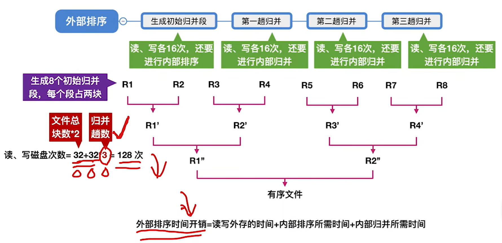

算一下开销：每一趟都要把整个文件**读一遍、写一遍**，也就是"16 次读 + 16 次写 = 32 次"；再加上一开始生成初始归并段那 32 次，所以**读写磁盘次数 = 32 + 32 × 3 = 128 次**——注意归并趟数这里是 3，所以是"文件总块数 × 2 + 文件总块数 × 2 × 归并趟数"。

**那"k 路归并"具体是怎么做的？** 内存里开 **k 个输入缓冲区 + 1 个输出缓冲区**：把 k 个归并段的块分别读进 k 个输入缓冲区，用归并排序的办法从里面挑出最小的记录送进输出缓冲区，输出缓冲区满了就写回磁盘、接着挑下一个。

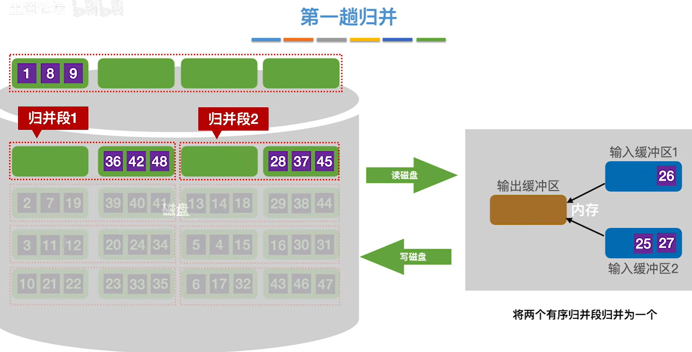

**时间开销由三部分构成**：**读写外存的时间 + 内部排序所需时间 + 内部归并所需时间**。其中读写外存（磁盘 I/O）是大头——所以优化的方向就是"**减少磁盘读写次数**"，而磁盘读写次数正比于归并趟数。

**优化：多路归并。** 把两路归并换成 **4 路归并**，还是 8 个初始归并段，归并趟数就从 3 趟降到 **2 趟**（8 → 2 → 1），读写磁盘次数降到 **32 + 32 × 2 = 96 次**。

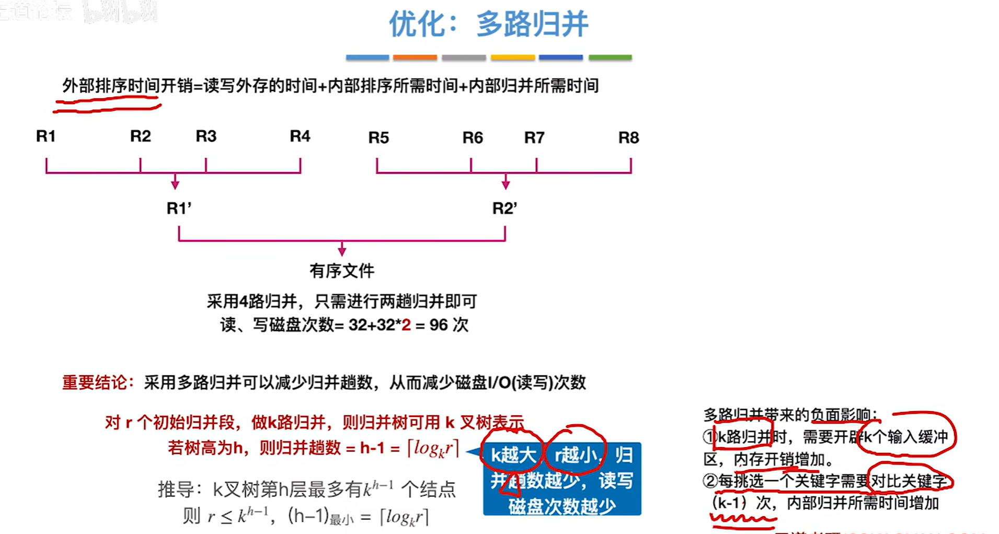

为什么趟数能这么算？因为**归并过程可以用一棵 k 叉树表示**（归并树）：第 h 层最多有 $k^{h-1}$ 个结点，而初始归并段有 r 个，所以必须 $r \le k^{h-1}$，取最小的 h 就是

$$归并趟数 = h - 1 = \lceil \log_k r \rceil$$

于是有**重要结论**：**k 越大、r 越小，归并趟数越少，读写磁盘次数越少。**

> 注：**"k 路归并"和"k 路平衡归并"不是一回事**，这里容易踩坑。平衡归并要求两件事：**① 最多只能有 k 个段归并为一个；② 每一趟归并中，若有 m 个归并段参与归并，就应该得到 $\lceil m/k \rceil$ 个新的归并段**。前面 8 个段做 4 路归并得到 8/4 = 2 个段，是平衡的；但要是像这样归并：R1+R2 → R1′、R3+R4 → R2′、R5+R6+R7+R8 → R3′，一趟下来得到 3 个段——它**依然是"4 路归并"，但不是"4 路平衡归并"**（归并得不均匀，趟数更多）。做题时看到"平衡"两个字，要盯的就是每一趟有没有把 m 个段尽量摊成 $\lceil m/k \rceil$ 份。

> 注：按上面这种办法生成的初始归并段，数量是可以直接算出来的——若文件共 **N 个记录**、**内存工作区能容纳 L 个记录**，则**初始归并段数量 r = N / L**。想让 r 更小（从而继续减少归并趟数），可以用"**置换-选择排序**"：它能突破"一个归并段最多等于内存容量"的限制，生成更长的初始归并段（后面单独展开）。

> 注：多路归并不是"免费的"，两个代价要记住——**① k 越大，内存里要开的输入缓冲区越多（内存开销增加）；② 每挑一个最小元素需要对比 (k − 1) 次关键字（内部归并时间增加）**。所以 k 不能无限增大，实际会结合"败者树"之类的办法来降低挑选代价（见下一节）。

### 败者树

上面那个"代价 2"说得很清楚：k 路归并时，每挑一个最小元素都要在 k 个归并段里比 (k − 1) 次关键字——k 一大，这笔内部归并的开销就很可观。**败者树就是专门用来削这笔开销的**：它把"从 k 个归并段里挑出最小"从 O(k) 降到 O(log₂k)。

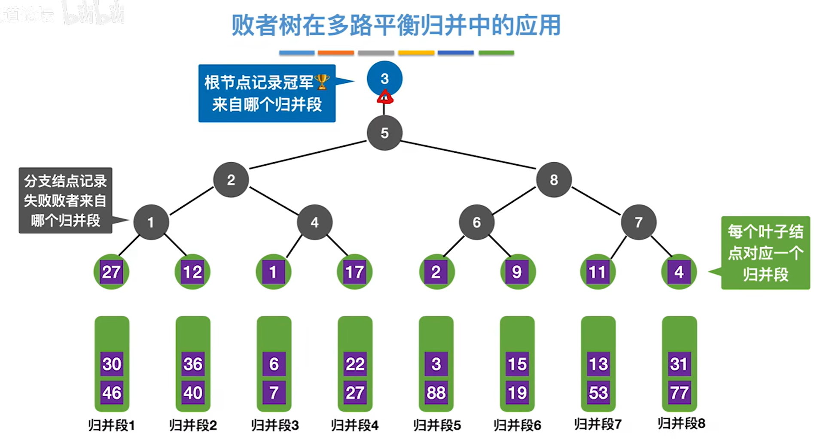

**先看这棵树是怎么长出来的**（图里是 8 路归并）：

- **每个叶子结点对应一个归并段**，里面放的是这个归并段**当前的头元素**——图中从左到右是 27、12、1、17、2、9、11、4；
- **分支结点里记的不是元素，而是"败者"来自哪个归并段**（也就是这一场比输的那个段号）；
- **根结点记的是"冠军"来自哪个归并段**——图里是 3，因为归并段 3 的头元素 1 是这八个里的最小值。

**具体怎么工作，从下往上看就清楚了**：

1. **两两比较、层层向上**：每比完一场，**胜者继续往上走，败者的段号留在这一层的结点里**。最左边 27（段 1）和 12（段 2）比，12 赢、27 输，结点记 1；再往上 12（段 2）和 1（段 3）比，1 赢、12 输，结点记 2；最上面 1（段 3）和 2（段 5）比，2 输，结点记 5——**最后根结点记下冠军 3**。
2. **输出**：根结点说冠军来自段 3，那就把段 3 的头元素 **1** 输出。注意这一趟"挑最小"总共只比了 log₂8 = 3 次，而不是 k − 1 = 7 次。
3. **更新**：段 3 的下一个元素顶上那片叶子（图中段 3 的下一个是 6），然后**只需要沿着"这片叶子 → 根"这一条路径重新比赛**，把沿途结点记的败者更新一遍，其他结点完全不用动——一次更新只要 O(log₂k)。
4. 重复第 2、3 步，直到所有归并段都被取空。

> 注：所以败者树"便宜"在哪就一目了然了——**建树只比 k − 1 次，之后每挑一个元素只比 ⌈log₂k⌉ 次**（走一条根到叶的路径），比"老老实实比 k − 1 次"省得多，而且 k 越大越划算。前面说"增大 k 会让内部归并时间增加"，有了败者树这笔账就补回来了：内部归并的时间从 O(n·k) 降到 O(n·log₂k)。

**换个更正式的说法**：败者树可以看成一棵**完全二叉树**，只是**多了一个"头"**——**k 个叶结点**分别对应 k 个归并段中当前参加比较的元素，而**非叶子结点用来记住左右子树里的"失败者"**，让胜者继续往上比，一直比到根结点。

![败者树（k = 5 的例子）：ls[0] 记冠军，ls[1] ~ ls[4] 记各内部结点的败者，叶结点 b0 ~ b4 是五个归并段的当前元素](408数据结构/loser-tree-array.png)

> 注：图里 k = 5，五个叶结点 b0 ~ b4 依次是 10、9、20、6、12。两两往上比：b3 的 6 和 b4 的 12 比，败者是 b4，结点记 **4**；胜者 6 再和 b0 的 10 比，败者是 b0，结点记 **0**；另一边 b1 的 9 和 b2 的 20 比，败者是 b2，结点记 **2**；最后 6 和 9 比，败者是 b1，结点记 **1**——根结点的 ls[0] 记下**冠军 3**（也就是 b3，值为 6，最小）。所以整棵败者树**用一个数组就能表示**：**ls[0] 存冠军，ls[1] ~ ls[k−1] 存各内部结点记的败者**，上例就是 `{3, 1, 0, 2, 4}`。

### 置换-选择排序

前面埋了一条伏笔：按老办法生成初始归并段，**一条归并段的长度被内存工作区卡死**——文件有 N 个记录、内存工作区能容纳 w 个记录，每次读 w 个进来排好序、写出去，就得到一条长度恰好为 w 的归并段，于是**初始归并段数量 r = N / w**。**置换-选择排序改的就是这条上限**：同样只有 w 个记录的工作区，它生成的初始归并段**平均长度约为 2w**，也就是 r 大约减半。r 小了，归并趟数 $S = \lceil \log_k r \rceil$ 就少，读写磁盘的次数跟着少——这就是它全部的优化意义。

**算法本身很朴素**：设初始待排文件为 FI、初始归并段输出文件为 FO、内存工作区为 WA（可容纳 w 个记录），FI 待排，FO 和 WA 的初始状态为空。

1. 从 FI 输入 w 个记录到工作区 WA。
2. 从 WA 中选出其中关键字取最小值的记录，记为 MINIMAX 记录。
3. 将 MINIMAX 记录输出到 FO 中去。
4. 若 FI 不空，则从 FI 输入下一个记录到 WA 中。
5. 从 WA 中所有关键字比 MINIMAX 记录的关键字大的记录中选出最小关键字记录，作为新的 MINIMAX 记录。
6. 重复 3) ~ 5)，直至在 WA 中选不出新的 MINIMAX 记录为止，由此得到一个初始归并段，输出一个归并段的结束标志到 FO 中去。
7. 重复 2) ~ 6)，直至 WA 为空。由此得到全部初始归并段。

**名字的来历就在第 2 步和第 4 步**：第 2 步要"**选**"出最小的记录输出，第 4 步又从 FI 读进来一个记录**替换**它的位置（第 5 步接着选），合起来就是"置换-选择"。而**真正让归并段突破 w 的，是第 5 步里那句"比 MINIMAX 大"**：只有比刚输出的 MINIMAX **大**的记录，才有资格排进**同一条**归并段；比它**小**的记录这一轮选不上，只能**留在 WA 里等下一段**——于是归并段的长度不再受"工作区只有 w 个位置"限制了。

**拿一个具体的例子走一遍**（w = 3）：此刻 FO 里的归并段 1 已经写进了 4、6、7、9、11、13 六个记录，MINIMAX = 13（也就是刚被选出去的那个），WA 里是 14、10、16，FI 里还剩 15 个记录。

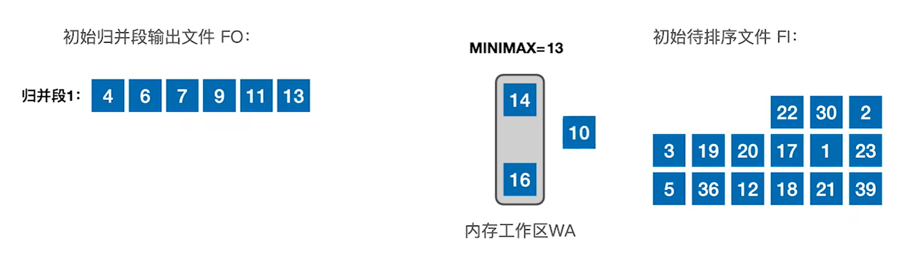

盯住 WA 里那三个记录：**14、16 都比 13 大**，有资格接着排进归并段 1；**10 比 13 小**，这一轮直接出局，留在 WA 里等下一段。接着这轮"选择 + 置换"就是：输出 14、从 FI 补进 22；输出 16、补进 30；输出 22、补进 2；输出 30、补进 3——此时 WA = {2, 10, 3}，**三个记录全都比 MINIMAX = 30 小**，在 WA 里再也选不出新的 MINIMAX 了，这一条归并段到此截止。

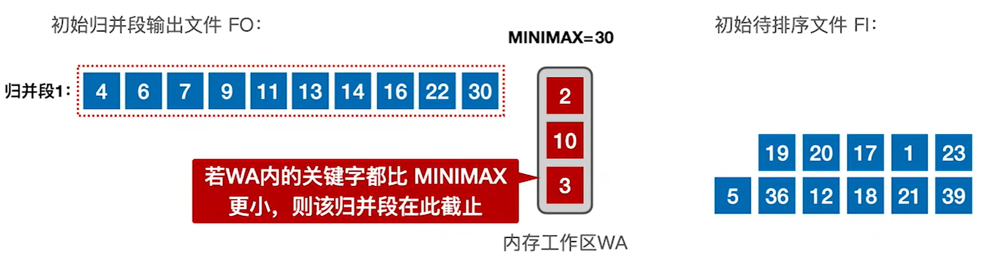

数一数：**归并段 1 里有 10 个记录，而 w 只有 3**——一条归并段装下了三倍多的记录。剩下的记录接着走：段 2 从 WA 里留下的 {2, 3, 10} 开始，得到 2、3、10、17、19、20、23、36（8 个记录）；段 3 是 1、5、12、18、21、39（6 个记录）。**24 个记录、w = 3，一共只生成了 3 条初始归并段**（平均每条 8 个记录，比理论上的平均水平 2w = 6 个还更好一点）。

**所以"改变了什么"就很清楚了**：

| | 老办法（每次读 w 个记录进内存排好、写出去成段） | 置换-选择排序 |
| --- | --- | --- |
| 一条初始归并段能装 | 最多**恰好 w 个记录** | 不受 w 限制，**平均约 2w 个** |
| 初始归并段数量 r | r = N / w | r ≈ N / 2w，**大约减半** |
| 对后续的影响 | 归并趟数 $S = \lceil \log_k r \rceil$ | **r 小 → S 小 → 读写磁盘次数少** |

**优化体现在哪里，用上面那个例子算账最直观**：24 个记录、w = 3，按老办法算出来是 r = 24 / 3 = **8 条**归并段，两路归并要 $\lceil \log_2 8 \rceil$ = **3 趟**；置换-选择只生成 **3 条**归并段，两路归并只要 $\lceil \log_2 3 \rceil$ = **2 趟**——少一趟就少把整个文件读写一遍。换成 3 路归并同理：$\lceil \log_3 8 \rceil$ = 2 趟 对 $\lceil \log_3 3 \rceil$ = 1 趟。**置换-选择排序没有让任何一次比较变快，它改变的是"初始归并段的长度和数量"，然后省在归并趟数上。**

> 注：**置换-选择排序本身并不排序，它只负责"生成初始归并段"这一步。** 整条流水线仍然是"生成初始归并段 → 多路平衡归并"，它把第一阶段的产出（段的长度、段数）改好了，后面的归并照做不误——别以为用了它就不用归并了。

> 注：**第 2 步和第 5 步那个"从 WA 里选最小"，实际实现时就是用上一节的败者树做的**——WA 里的 w 个记录就是败者树的 w 个叶结点，每输出一个、补进一个，只要沿着一条路径重比 $\lceil \log_2 w \rceil$ 次就能选出下一个 MINIMAX。

> 注：**置换-选择排序生成的归并段长度是不固定的**（本例是 10、8、6，长短不一，最后一条可能很短）。这给归并提出一个新问题：长短不一的归并段怎么搭配着归并才最省读写？——接下来讲的"**最佳归并树**"就是解决这个的。

### 最佳归并树

**先接上上一节的尾巴**：置换-选择排序把初始归并段做长了，代价是各条段**长短不齐**（我们那个例子就是 10、8、6）。于是冒出一个新问题——**这几条长短不一的段，按什么次序归并最省磁盘读写？** 这件事有严格的最优解：把归并方案画成一棵"归并树"，再用哈夫曼树的办法构造它，这棵树就叫**最佳归并树**。


%%{init: {
  "theme": "base",
  "themeVariables": {
    "primaryColor": "#5b9bd5",
    "primaryTextColor": "#ffffff",
    "primaryBorderColor": "#41719c",
    "lineColor": "#41719c",
    "secondaryColor": "#ffffff",
    "tertiaryColor": "#e2f0d9",
    "fontSize": "16px",
    "fontFamily": "-apple-system, BlinkMacSystemFont, \"Segoe UI\", Roboto, \"Helvetica Neue\", Arial, \"Noto Sans\", sans-serif"
  },
  "flowchart": {
    "nodeSpacing": 8,
    "rankSpacing": 26,
    "curve": "basis",
    "htmlLabels": true,
    "subGraphTitleMargin": { "top": 0, "bottom": 14 },
    "padding": 4,
    "useMaxWidth": false,
    "wrappingWidth": 1000
  }
}}%%
graph LR
  Root["最佳归并树"]

  Root --> Base["理论基础"]
  Root --> Strict["注意：k 叉归并的最佳归并树<br>一定是严格 k 叉树，即树中<br>只有度为 k、度为 0 的结点"]
  Root --> How["如何构造"]

  Base --> B1["每个初始归并段对应一个叶子结点，<br>把归并段的块数作为叶子的权值"]
  Base --> B2["归并树的 WPL =<br>树中所有叶结点的带权路径长度之和"]
  Base --> B3["归并过程中的磁盘 I/O 次数<br>= 归并树的 WPL × 2"]

  How --> Pad["补充虚段"]
  How --> Huff["构造 k 叉哈夫曼树"]

  Pad --> P1["① 若（初始归并段数量 − 1）% （k − 1）<br>= 0，说明刚好可以构成严格 k 叉树，<br>此时不需要添加虚段"]
  Pad --> P2["② 若（初始归并段数量 − 1）% （k − 1）<br>= u ≠ 0，则需要补充<br>(k − 1) − u 个虚段"]

  Huff --> H1["每次选择 k 个根结点权值最小的树合并，<br>并将 k 个根结点的权值之和<br>作为新的根结点的权值"]

  classDef root fill:#5b9bd5,stroke:#41719c,stroke-width:2px,color:#fff,font-weight:bold,font-size:20px;
  classDef lvl1 fill:#9dc3e6,stroke:#2e6da4,stroke-width:2px,color:#0d2f4d,font-size:19px;
  classDef lvl2d fill:#dbe8f6,stroke:#1f4e79,stroke-width:2px,color:#000000,font-size:16px;
  classDef lvl2l fill:#f6fafe,stroke:#c3d9ef,stroke-width:2px,color:#000000,font-size:16px;
  classDef lvl3d fill:#dbe8f6,stroke:#1f4e79,stroke-width:2px,color:#333333,font-size:15px;
  classDef lvl3l fill:#f6fafe,stroke:#c3d9ef,stroke-width:2px,color:#333333,font-size:15px;

  class Root root;
  class Base,Strict,How lvl1;
  class B1,B2,B3 lvl2d;
  class Pad,Huff lvl2l;
  class P1,P2 lvl3d;
  class H1 lvl3l;


**理论基础：归并方案为什么能算成一棵树。** 把 k 路归并的过程画成树：**每个初始归并段对应一个叶子结点，叶子的权值就取这条归并段的块数**；每往上走一层，代表"把 k 条段归并成一条新段"这一步；而**一个叶子在树里的深度，正好是这条段参与归并的次数**。一条段每参与一次归并，它的每一块都要被读进来、写出去各一遍，所以

$$归并过程中的磁盘 I/O 次数 = 归并树的 WPL \times 2 = 2\sum_{i=1}^{r} w_i\,l_i$$

（$w_i$ 是第 i 条初始归并段的块数、$l_i$ 是它对应叶子的深度，WPL 就是**树中所有叶结点的带权路径长度之和**。）于是"少读写"就等价于"**让 WPL 最小**"——而带权路径长度最小的 k 叉树正是**哈夫曼树**（第五章那棵）。所以最佳归并树就是**k 叉哈夫曼树**，直觉还是哈夫曼那一句：**权值（段长）越大，越该放在离根近的地方**，因为离根近 = 参与归并的次数少 = 被读写得少。

**第二步要盯住"严格"两个字**：k 叉归并的最佳归并树一定是**严格 k 叉树**，即树里只有度为 k 的结点和度为 0 的叶结点，不存在"孩子没凑满 k 个"的结点。可初始归并段的条数是给定的，未必凑得成严格 k 叉树——凑不成就要**补虚段**。

**到底补几段？** 设度为 k 的结点有 $n_k$ 个、叶结点有 $n_0$ 个，树的结点总数 $n = n_0 + n_k$；而在严格 k 叉树里，除根以外的每个结点都恰好是"某个结点的某一个孩子"，所以 $n = k\,n_k + 1$。两式一联立：

$$n_0 + n_k = k\,n_k + 1 \quad\Longrightarrow\quad n_0 = (k - 1)\,n_k + 1 \quad\Longrightarrow\quad n_k = \frac{n_0 - 1}{k - 1}$$

也就是说，**叶结点数减 1 必须能被 k − 1 整除**（叶结点数 = 初始归并段数量 + 虚段数量）。于是：

- 若 $(初始归并段数量 - 1) \bmod (k - 1) = 0$：刚好能构成严格 k 叉树，**不需要添加虚段**；
- 若 $(初始归并段数量 - 1) \bmod (k - 1) = u \ne 0$：需要补充 **$(k - 1) - u$ 个虚段**。

**第三步，构造 k 叉哈夫曼树**：每次从当前所有树里挑**根结点权值最小的 k 棵**合并成一棵新树，新根结点的权值 = 这 k 个权值之和；重复到只剩一棵树为止。

**先算一个 2 路归并的例子**（就用上一节那三条段）：段长 10、8、6，$n_0 = 3$。k = 2 时 $k - 1 = 1$，$(3 - 1) \bmod 1 = 0$，**不用补虚段**（其实两路归并永远不用补——任何数除以 1 都整除）。按哈夫曼先合并 6 和 8 得 14、再和 10 合并得 24：

$$WPL = 6\times2 + 8\times2 + 10\times1 = 38,\qquad I/O = 2 \times 38 = 76\ \text{次}$$

反过来先合并 10 和 8（得 18）、再和 6 合并：

$$WPL = 10\times2 + 8\times2 + 6\times1 = 46,\qquad I/O = 2 \times 46 = 92\ \text{次}$$

**同一批段，只是换了归并次序，就多读写 16 次**——长段（10）从"读两遍"变成"读一遍"、短段（6）从"读一遍"变成"读两遍"，账就是从这里来的。

**再看一个需要补虚段的例子（3 路归并）**：4 条段，长度 1、3、5、7。$n_0 = 4$，$(4 - 1) \bmod (3 - 1) = 1 = u \ne 0$，所以要补 $(k - 1) - u = 2 - 1 = 1$ **个虚段**（长度为 0），叶结点变成 5 个，$(5 - 1) \bmod 2 = 0$ ✓。构造：先挑最小的三个根 0、1、3 合并成 4；此时剩下 4、5、7 三个根，正好凑一次合并成 16。

| 归并段 | 长度（权值） | 叶子深度 | 带权路径长度 |
| --- | --- | --- | --- |
| 段 1 | 1 | 2 | 2 |
| 段 2 | 3 | 2 | 6 |
| 段 3 | 5 | 1 | 5 |
| 段 4 | 7 | 1 | 7 |
| 虚段 | 0 | 2 | 0 |

$$WPL = 2 + 6 + 5 + 7 + 0 = 20,\qquad I/O = 2 \times 20 = 40\ \text{次}$$

换成物理过程看更直观：**第 1 趟只并了段 1（长度 1）和段 2（长度 3）**——"3 路"里的第 3 路就是那个虚段，空着、没数据可读——得到长度 4 的段；**第 2 趟把 4、5、7 三条段并成 16**。于是短的段被读写两遍、长的段只读写一遍，总 I/O = 2 × (1 + 3) + 2 × (4 + 5 + 7) = 40 次，和 WPL 算出来的完全一致。

> 注：虚段在物理上就是"这一路没有数据"，所以权值为 0、不产生任何 I/O——**补虚段只补树的形状，不补代价**。

> 注：段长都一样时（每条 w 个块、共 r 条），严格 k 叉树的叶子全在第 $S = \lceil \log_k r \rceil$ 层，$WPL = N \cdot S$、$I/O = 2N \cdot S$，正是上一节那句"每趟读写一遍整个文件"；最佳归并树只是把它推广到了段长不齐的情形。

> 注：这里最容易错的就是**忘了补虚段**——段数不满足整除关系就直接合并，最后一趟会"凑不满 k 路"，算出来的 WPL 偏大（上面那个 3 路例子会从 20 涨到 25）。
