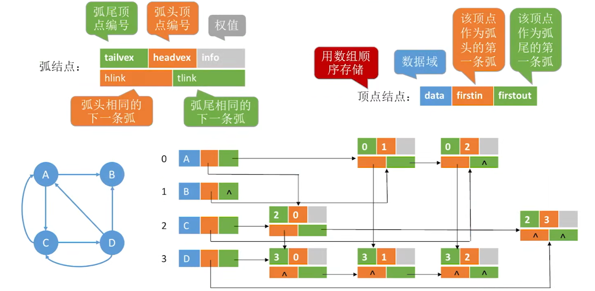
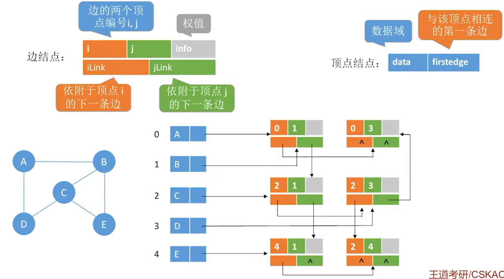
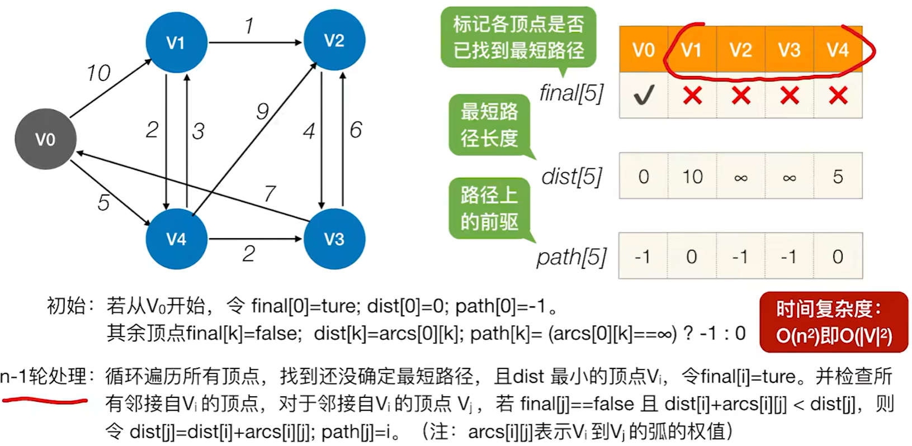

# 一、绪论


%%{init: {
  "theme": "base",
  "themeVariables": {
    "primaryColor": "#5b9bd5",
    "primaryTextColor": "#ffffff",
    "primaryBorderColor": "#41719c",
    "lineColor": "#41719c",
    "secondaryColor": "#ffffff",
    "tertiaryColor": "#e2f0d9",
    "fontSize": "14px",
    "fontFamily": "\"Microsoft YaHei\", \"PingFang SC\", \"Segoe UI\", sans-serif"
  },
  "flowchart": {
    "nodeSpacing": 8,
    "rankSpacing": 26,
    "curve": "basis",
    "htmlLabels": true,
    "subGraphTitleMargin": { "top": 0, "bottom": 14 },
    "padding": 4,
    "useMaxWidth": false,
    "wrappingWidth": 1000
  }
}}%%
graph LR
  Root["数据结构"]

  Root --> Basic["基本概念"]
  Root --> Ele["三要素"]

  Basic --> B1["数据"]
  Basic --> B2["数据元素/数据项"]
  Basic --> B3["数据对象/数据结构"]
  Basic --> B4["数据类型/抽象数据类型(ADT)"]

  Ele --> E1["逻辑结构"]
  Ele --> E2["物理结构(存储结构)"]
  Ele --> E3["数据的运算"]

  E1 --> L1["线性结构"]
  E1 --> L2["集合"]
  E1 --> L3["树形结构"]
  E1 --> L4["图结构(网状结构)"]

  E2 --> P1["顺序存储"]
  E2 --> P2["链式存储"]
  E2 --> P3["索引存储"]
  E2 --> P4["散列存储"]

  E3 --> O1["按逻辑结构定义,按存储结构实现"]


  subgraph NL["非线性结构"]
    direction LR
    L2
    L3
    L4
  end

  subgraph N1["定义ADT = 定义逻辑结构 + 运算，即定义数据结构"]
    Basic
    B1
    B2
    B3
    B4
  end

  subgraph N2["确定存储结构 = 表示逻辑结构，存储不同，运算实现不同"]
    E2
    P1
    subgraph NS["非顺序存储"]
      direction LR
      P2
      P3
      P4
    end
  end

  classDef root fill:#5b9bd5,stroke:#41719c,stroke-width:2px,color:#fff,font-weight:bold,font-size:18px;
  classDef lvl1 fill:#9dc3e6,stroke:#2e6da4,stroke-width:2px,color:#0d2f4d,font-size:17px;
  classDef lvl2d fill:#dbe8f6,stroke:#1f4e79,stroke-width:2px,color:#000000,font-size:14px;
  classDef lvl2l fill:#f6fafe,stroke:#c3d9ef,stroke-width:2px,color:#000000,font-size:14px;
  classDef lvl3d fill:#dbe8f6,stroke:#1f4e79,stroke-width:2px,color:#333333,font-size:13px;
  classDef lvl3l fill:#f6fafe,stroke:#c3d9ef,stroke-width:2px,color:#333333,font-size:13px;
  classDef key fill:#fff,stroke:#c00000,stroke-width:3px,color:#000;

  class Root root;
  class Basic,Ele lvl1;
  class B1,B2,B3,B4 lvl2d;
  class E1,E2,E3 lvl2l;
  class L1,L2,L3,L4,O1 lvl3d;
  class P1,P2,P3,P4 lvl3l;
  class B4,E1,E3 key;

  style NL fill:#e2f0d9,stroke:#5b9bd5,color:#000000
  style NS fill:#e2f0d9,stroke:#5b9bd5,color:#000000
  style N1 fill:#f4faf0,stroke:#70ad47,color:#000000,font-size:12px
  style N2 fill:#f4faf0,stroke:#70ad47,color:#000000,font-size:12px



%%{init: {
  "theme": "base",
  "themeVariables": {
    "primaryColor": "#5b9bd5",
    "primaryTextColor": "#ffffff",
    "primaryBorderColor": "#41719c",
    "lineColor": "#41719c",
    "secondaryColor": "#ffffff",
    "tertiaryColor": "#e2f0d9",
    "fontSize": "16px",
    "fontFamily": "-apple-system, BlinkMacSystemFont, \"Segoe UI\", Roboto, \"Helvetica Neue\", Arial, \"Noto Sans\", sans-serif"
  },
  "flowchart": {
    "nodeSpacing": 8,
    "rankSpacing": 26,
    "curve": "basis",
    "htmlLabels": true,
    "subGraphTitleMargin": { "top": 0, "bottom": 14 },
    "padding": 4,
    "useMaxWidth": false,
    "wrappingWidth": 1000
  }
}}%%
graph LR
  Root["算法的基本概念"]

  Root --> What["什么是算法"]
  Root --> Five["算法的五个特性"]
  Root --> Good["#quot;好#quot;算法的特质"]

  What --> Prog["程序=数据结构 + 算法"]
  Prog --> P1["数据结构是要处理的信息"]
  Prog --> P2["算法是处理信息的步骤"]

  Five --> F1["有穷性"]
  Five --> F2["确定性"]
  Five --> F3["可行性"]
  Five --> F4["输入"]
  Five --> F5["输出"]

  F1 --> F1a["有穷时间内能执行完"]
  F1a --> F1b["算法是有穷的"]
  F1a --> F1c["程序可以是无穷的"]

  F2 --> F2a["相同输入只会产生相同输出"]
  F3 --> F3a["可以用已有的基本操作实现算法"]
  F4 --> F4a["丢给算法处理的数据"]
  F5 --> F5a["算法处理的结果"]

  Good --> G1["正确性"]
  Good --> G2["可读性"]
  Good --> G3["健壮性"]
  Good --> G4["高效率与低存储量需求"]

  G1 --> G1a["能正确解决问题"]
  G2 --> G2a["对算法的描述要让其他人也看得懂"]
  G3 --> G3a["算法能处理一些异常状况"]
  G4 --> G4a["即算法执行省时、省内存"]
  G4a --> G4b["时间复杂度低、空间复杂度低"]


  subgraph N1["设计一个好的数据结构 / 设计一个好的算法"]
    What
    Prog
    P1
    P2
  end

  subgraph N2["算法必须具备的特性"]
    Five
    F1
    F2
    F3
    F4
    F5
  end

  subgraph N3["设计算法时要尽量追求的目标"]
    G4
    G4a
  end

  classDef root fill:#5b9bd5,stroke:#41719c,stroke-width:2px,color:#fff,font-weight:bold,font-size:20px;
  classDef lvl1 fill:#9dc3e6,stroke:#2e6da4,stroke-width:2px,color:#0d2f4d,font-size:19px;
  classDef lvl2d fill:#dbe8f6,stroke:#1f4e79,stroke-width:2px,color:#000000,font-size:16px;
  classDef lvl2l fill:#f6fafe,stroke:#c3d9ef,stroke-width:2px,color:#000000,font-size:16px;
  classDef lvl3d fill:#dbe8f6,stroke:#1f4e79,stroke-width:2px,color:#333333,font-size:15px;
  classDef lvl3l fill:#f6fafe,stroke:#c3d9ef,stroke-width:2px,color:#333333,font-size:15px;
  classDef lvl4d fill:#dbe8f6,stroke:#1f4e79,stroke-width:1.5px,color:#555555,font-size:14px;
  classDef lvl4l fill:#f6fafe,stroke:#c3d9ef,stroke-width:1.5px,color:#555555,font-size:14px;
  classDef key fill:#fff,stroke:#c00000,stroke-width:3px,color:#000;

  class Root root;
  class What,Five,Good lvl1;
  class Prog,G1,G2,G3,G4 lvl2d;
  class F1,F2,F3,F4,F5 lvl2l;
  class P1,P2,G1a,G3a,F2a,F4a lvl3d;
  class G2a,G4a,F1a,F3a,F5a lvl3l;
  class F1b,F1c lvl4d;
  class G4b lvl4l;
  class G4b key;

  style N1 fill:#f4faf0,stroke:#70ad47,color:#000000,font-size:12px
  style N2 fill:#f4faf0,stroke:#70ad47,color:#000000,font-size:12px
  style N3 fill:#f4faf0,stroke:#70ad47,color:#000000,font-size:12px



%%{init: {
  "theme": "base",
  "themeVariables": {
    "primaryColor": "#5b9bd5",
    "primaryTextColor": "#ffffff",
    "primaryBorderColor": "#41719c",
    "lineColor": "#41719c",
    "secondaryColor": "#ffffff",
    "tertiaryColor": "#e2f0d9",
    "fontSize": "16px",
    "fontFamily": "-apple-system, BlinkMacSystemFont, \"Segoe UI\", Roboto, \"Helvetica Neue\", Arial, \"Noto Sans\", sans-serif"
  },
  "flowchart": {
    "nodeSpacing": 8,
    "rankSpacing": 26,
    "curve": "basis",
    "htmlLabels": true,
    "subGraphTitleMargin": { "top": 0, "bottom": 14 },
    "padding": 4,
    "useMaxWidth": false,
    "wrappingWidth": 1000
  }
}}%%
graph LR
  Root["时间复杂度"]

  Root --> How["如何计算"]
  Root --> Kind["三种复杂度"]

  How --> H1["①找到一个基本操作（最深层循环）"]
  How --> H2["②分析该基本操作的执行次数 x 与问题规模 n 的关系 x=f(n)"]
  How --> H3["③x 的数量级 O(x) 就是算法时间复杂度 T(n)"]

  Kind --> K1["最坏时间复杂度：考虑输入数据“最坏”的情况"]
  Kind --> K2["平均时间复杂度：考虑所有输入数据都等概率出现的情况"]
  Kind --> K3["最好时间复杂度：考虑输入数据“最好”的情况"]

  classDef root fill:#5b9bd5,stroke:#41719c,stroke-width:2px,color:#fff,font-weight:bold,font-size:20px;
  classDef lvl1 fill:#9dc3e6,stroke:#2e6da4,stroke-width:2px,color:#0d2f4d,font-size:19px;
  classDef lvl2d fill:#dbe8f6,stroke:#1f4e79,stroke-width:2px,color:#000000,font-size:16px;
  classDef lvl2l fill:#f6fafe,stroke:#c3d9ef,stroke-width:2px,color:#000000,font-size:16px;

  class Root root;
  class How,Kind lvl1;
  class H1,H2,H3 lvl2d;
  class K1,K2,K3 lvl2l;



%%{init: {
  "theme": "base",
  "themeVariables": {
    "primaryColor": "#5b9bd5",
    "primaryTextColor": "#ffffff",
    "primaryBorderColor": "#41719c",
    "lineColor": "#41719c",
    "secondaryColor": "#ffffff",
    "tertiaryColor": "#e2f0d9",
    "fontSize": "16px",
    "fontFamily": "-apple-system, BlinkMacSystemFont, \"Segoe UI\", Roboto, \"Helvetica Neue\", Arial, \"Noto Sans\", sans-serif"
  },
  "flowchart": {
    "nodeSpacing": 8,
    "rankSpacing": 26,
    "curve": "basis",
    "htmlLabels": true,
    "subGraphTitleMargin": { "top": 0, "bottom": 14 },
    "padding": 4,
    "useMaxWidth": false,
    "wrappingWidth": 1000
  }
}}%%
graph LR
  Root["空间复杂度"]

  Root --> How["如何计算"]

  How --> Plain["普通程序"]
  How --> Recur["递归程序"]

  Plain --> P1["①找到所占空间大小与问题规模相关的变量"]
  Plain --> P2["②分析所占空间 x 与问题规模n 的关系 x=f(n)"]
  Plain --> P3["③x 的数量级 O(x) 就是算法空间复杂度 S(n)"]

  Recur --> R1["①找到递归调用的深度 x 与问题规模n 的关系 x=f(n)"]
  Recur --> R2["②x 的数量级 O(x) 就是算法空间复杂度 S(n)"]
  Recur --> R3["注：有的算法各层函数所需存储空间不同，分析方法略有区别"]

  classDef root fill:#5b9bd5,stroke:#41719c,stroke-width:2px,color:#fff,font-weight:bold,font-size:20px;
  classDef lvl1 fill:#9dc3e6,stroke:#2e6da4,stroke-width:2px,color:#0d2f4d,font-size:19px;
  classDef lvl2d fill:#dbe8f6,stroke:#1f4e79,stroke-width:2px,color:#000000,font-size:16px;
  classDef lvl3d fill:#dbe8f6,stroke:#1f4e79,stroke-width:2px,color:#333333,font-size:15px;
  classDef lvl3l fill:#f6fafe,stroke:#c3d9ef,stroke-width:2px,color:#333333,font-size:15px;

  class Root root;
  class How lvl1;
  class Plain,Recur lvl2d;
  class P1,P2,P3 lvl3d;
  class R1,R2,R3 lvl3l;


# 二、线性表

## 顺序表


%%{init: {
  "theme": "base",
  "themeVariables": {
    "primaryColor": "#5b9bd5",
    "primaryTextColor": "#ffffff",
    "primaryBorderColor": "#41719c",
    "lineColor": "#41719c",
    "secondaryColor": "#ffffff",
    "tertiaryColor": "#e2f0d9",
    "fontSize": "16px",
    "fontFamily": "-apple-system, BlinkMacSystemFont, \"Segoe UI\", Roboto, \"Helvetica Neue\", Arial, \"Noto Sans\", sans-serif"
  },
  "flowchart": {
    "nodeSpacing": 8,
    "rankSpacing": 26,
    "curve": "basis",
    "htmlLabels": true,
    "subGraphTitleMargin": { "top": 0, "bottom": 14 },
    "padding": 4,
    "useMaxWidth": false,
    "wrappingWidth": 1000
  }
}}%%
graph LR
  Root["顺序表"]

  Root --> Store["存储结构"]
  Root --> Impl["实现方式"]
  Root --> Feat["特点"]

  Store --> S1["逻辑上相邻的数据元素物理上也相邻"]

  Impl --> Static["静态分配"]
  Impl --> Dyn["动态分配"]

  Static --> St1["使用“静态数组”实现"]
  Static --> St2["大小一旦确定就无法改变"]

  Dyn --> Dy1["使用“动态数组”实现"]
  Dyn --> Dy2["L.data = (ElemType *) malloc(sizeof(ElemType) * size)"]
  Dyn --> Dy3["顺序表存满时，可再用 malloc动态拓展顺序表的最大容量"]
  Dyn --> Dy4["需要将数据元素复制到新的存储区域，并用 free 函数释放原区域"]

  Feat --> F1["随机访问"]
  Feat --> F2["存储密度高"]
  Feat --> F3["拓展容量不方便"]
  Feat --> F4["插入、删除数据元素不方便"]

  F1 --> F1a["能在 O(1) 时间内找到第 i 个元素"]

  classDef root fill:#5b9bd5,stroke:#41719c,stroke-width:2px,color:#fff,font-weight:bold,font-size:20px;
  classDef lvl1 fill:#9dc3e6,stroke:#2e6da4,stroke-width:2px,color:#0d2f4d,font-size:19px;
  classDef lvl2d fill:#dbe8f6,stroke:#1f4e79,stroke-width:2px,color:#000000,font-size:16px;
  classDef lvl2l fill:#f6fafe,stroke:#c3d9ef,stroke-width:2px,color:#000000,font-size:16px;
  classDef lvl3d fill:#dbe8f6,stroke:#1f4e79,stroke-width:2px,color:#333333,font-size:15px;
  classDef lvl3l fill:#f6fafe,stroke:#c3d9ef,stroke-width:2px,color:#333333,font-size:15px;

  class Root root;
  class Store,Impl,Feat lvl1;
  class S1,F1,F2,F3,F4 lvl2d;
  class Static,Dyn lvl2l;
  class F1a,St1,St2 lvl3d;
  class Dy1,Dy2,Dy3,Dy4 lvl3l;


> 注：这里的「物理上也相邻」指的是元素在**地址空间**中连续存放（这正是它能 O(1) 随机访问的原因）；引入分页/虚拟存储后，对应的内存**物理页框**并不保证连续。


%%{init: {
  "theme": "base",
  "themeVariables": {
    "primaryColor": "#5b9bd5",
    "primaryTextColor": "#ffffff",
    "primaryBorderColor": "#41719c",
    "lineColor": "#41719c",
    "secondaryColor": "#ffffff",
    "tertiaryColor": "#e2f0d9",
    "fontSize": "16px",
    "fontFamily": "-apple-system, BlinkMacSystemFont, \"Segoe UI\", Roboto, \"Helvetica Neue\", Arial, \"Noto Sans\", sans-serif"
  },
  "flowchart": {
    "nodeSpacing": 8,
    "rankSpacing": 26,
    "curve": "basis",
    "htmlLabels": true,
    "subGraphTitleMargin": { "top": 0, "bottom": 14 },
    "padding": 4,
    "useMaxWidth": false,
    "wrappingWidth": 1000
  }
}}%%
graph LR
  Root["顺序表的基本操作"]

  Root --> Ins["插入"]
  Root --> Del["删除"]

  Ins --> I1["ListInsert(#amp;L,i,e)"]
  Ins --> I2["插入位置之后的元素都要后移"]
  Ins --> I3["时间复杂度"]
  I1 --> I1a["将元素 e 插入到 L 的第 i 个位置"]
  I3 --> I3a["最好 O(1)、最坏 O(n)、平均 O(n)"]

  Del --> D1["ListDelete(#amp;L,i,#amp;e)"]
  Del --> D2["删除位置之后的元素都要前移"]
  Del --> D3["时间复杂度"]
  D1 --> D1a["将 L 的第 i 个元素删除，并用 e 返回"]
  D3 --> D3a["最好 O(1)、最坏 O(n)、平均 O(n)"]

  Root --> Pos["按位查找"]
  Root --> Val["按值查找"]

  Pos --> P1["GetElem(L,i)"]
  Pos --> P2["时间复杂度"]
  P1 --> P1a["获取表 L 中第 i 个位置的元素的值"]
  P1 --> P1b["用数组下标即可得到第 i 个元素L.data[i-1]"]
  P2 --> P2a["最好/最坏/平均时间复杂度都是 O(1)"]

  Val --> V1["LocateElem(L,e)"]
  Val --> V2["时间复杂度"]
  V1 --> V1a["在顺序表 L 中查找第一个元素值等于 e 的元素，并返回其位序"]
  V1 --> V1b["从第一个元素开始依次往后检索"]
  V2 --> V2a["最好 O(1)：目标元素在第一个位置"]
  V2 --> V2b["最坏 O(n)：目标元素在最后一个位置"]
  V2 --> V2c["平均 O(n)：目标元素在每个位置的概率相同"]

  classDef root fill:#5b9bd5,stroke:#41719c,stroke-width:2px,color:#fff,font-weight:bold,font-size:20px;
  classDef lvl1 fill:#9dc3e6,stroke:#2e6da4,stroke-width:2px,color:#0d2f4d,font-size:19px;
  classDef lvl2d fill:#dbe8f6,stroke:#1f4e79,stroke-width:2px,color:#000000,font-size:16px;
  classDef lvl2l fill:#f6fafe,stroke:#c3d9ef,stroke-width:2px,color:#000000,font-size:16px;
  classDef lvl3d fill:#dbe8f6,stroke:#1f4e79,stroke-width:2px,color:#333333,font-size:15px;
  classDef lvl3l fill:#f6fafe,stroke:#c3d9ef,stroke-width:2px,color:#333333,font-size:15px;

  class Root root;
  class Ins,Del,Pos,Val lvl1;
  class I1,I2,I3,P1,P2 lvl2d;
  class D1,D2,D3,V1,V2 lvl2l;
  class I1a,P1a,P1b,D1a,V1a,V1b lvl3d;
  class I3a,P2a,D3a,V2a,V2b,V2c lvl3l;


## 链表


%%{init: {
  "theme": "base",
  "themeVariables": {
    "primaryColor": "#5b9bd5",
    "primaryTextColor": "#ffffff",
    "primaryBorderColor": "#41719c",
    "lineColor": "#41719c",
    "secondaryColor": "#ffffff",
    "tertiaryColor": "#e2f0d9",
    "fontSize": "16px",
    "fontFamily": "-apple-system, BlinkMacSystemFont, \"Segoe UI\", Roboto, \"Helvetica Neue\", Arial, \"Noto Sans\", sans-serif"
  },
  "flowchart": {
    "nodeSpacing": 8,
    "rankSpacing": 26,
    "curve": "basis",
    "htmlLabels": true,
    "subGraphTitleMargin": { "top": 0, "bottom": 14 },
    "padding": 4,
    "useMaxWidth": false,
    "wrappingWidth": 1000
  }
}}%%
graph LR
  Root["单链表的定义"]

  Root --> Type["单链表"]
  Root --> Code["用代码定义一个单链表"]
  Root --> Impl["两种实现"]
  Root --> Other["其他值得注意的点"]

  Type --> T1["用“链式存储”(存储结构)实现了“线性结构”(逻辑结构)"]
  Type --> T2["一个结点存储一个数据元素"]
  Type --> T3["各结点间的先后关系用一个指针表示"]

  Code --> C1["<span style='color:#1f4e79 !important'>typedef</span> <span style='color:#2e7d32 !important'>struct</span> <span style='color:#0f7b6c !important'>LNode</span>{<br>&nbsp<span style='color:#0f7b6c !important'>ElemType</span> <span style='color:#7a3e9d !important'>data</span>;<br>&nbsp<span style='color:#2e7d32 !important'>struct</span> <span style='color:#0f7b6c !important'>LNode</span> <span style='color:#7a3e9d !important'>*next</span>;<br>}<span style='color:#0f7b6c !important'>LNode</span>, <span style='color:#0f7b6c !important'>*LinkList</span>"]

  Impl --> NoHead["不带头结点"]
  Impl --> Head["带头结点"]
  NoHead --> N1["√空表判断：L==NULL。写代码不方便"]
  Head --> H1["√空表判断：L->next==NULL。写代码更方便"]

  Other --> Typedef["typedef 关键字的用法"]
  Typedef --> D1["“LinkList” 等价于 “LNode *”"]
  Typedef --> D2["前者强调这是链表，后者强调这是结点"]
  Typedef --> D3["合适的地方使用合适的名字，代码可读性更高"]

  subgraph A1["头结点不存数据，只是为了操作方便"]
    Head
    H1
  end

  classDef root fill:#5b9bd5,stroke:#41719c,stroke-width:2px,color:#fff,font-weight:bold,font-size:20px;
  classDef lvl1 fill:#9dc3e6,stroke:#2e6da4,stroke-width:2px,color:#0d2f4d,font-size:19px;
  classDef lvl2d fill:#dbe8f6,stroke:#1f4e79,stroke-width:2px,color:#000000,font-size:16px;
  classDef lvl2l fill:#f6fafe,stroke:#c3d9ef,stroke-width:2px,color:#000000,font-size:16px;
  classDef lvl3d fill:#dbe8f6,stroke:#1f4e79,stroke-width:2px,color:#333333,font-size:15px;
  classDef lvl3l fill:#f6fafe,stroke:#c3d9ef,stroke-width:2px,color:#333333,font-size:15px;
  classDef key fill:#fff,stroke:#c00000,stroke-width:3px,color:#000;

  class Root root;
  class Type,Code,Impl,Other lvl1;
  class T1,T2,T3,NoHead,Head lvl2d;
  class C1,Typedef lvl2l;
  class N1,D1,D2,D3 lvl3d;
  class H1 lvl3l;
  class T1,T3,NoHead,Head key;

  style A1 fill:#f4faf0,stroke:#70ad47,color:#000000,font-size:12px




%%{init: {
  "theme": "base",
  "themeVariables": {
    "primaryColor": "#5b9bd5",
    "primaryTextColor": "#ffffff",
    "primaryBorderColor": "#41719c",
    "lineColor": "#41719c",
    "secondaryColor": "#ffffff",
    "tertiaryColor": "#e2f0d9",
    "fontSize": "16px",
    "fontFamily": "-apple-system, BlinkMacSystemFont, \"Segoe UI\", Roboto, \"Helvetica Neue\", Arial, \"Noto Sans\", sans-serif"
  },
  "flowchart": {
    "nodeSpacing": 8,
    "rankSpacing": 26,
    "curve": "basis",
    "htmlLabels": true,
    "subGraphTitleMargin": { "top": 0, "bottom": 14 },
    "padding": 4,
    "useMaxWidth": false,
    "wrappingWidth": 1000
  }
}}%%
graph LR
  Root["单链表的操作"]

  Root --> InsDel["插入删除"]
  Root --> Search["查找"]
  Root --> Build["建立"]

  InsDel --> Ins["插入"]
  InsDel --> Del["删除"]

  Ins --> I1["按位序插入"]
  Ins --> I2["指定结点的后插操作"]
  Ins --> I3["指定结点的前插操作"]
  I1 --> I1a["带头结点"]
  I1 --> I1b["不带头结点"]

  Del --> D1["按位序删除"]
  Del --> D2["指定结点的删除"]

  Search --> S1["按位查找"]
  Search --> S2["按值查找"]
  Search --> S3["求单链表长度"]
  Search --> S4["Key"]
  S1 --> S1a["注意与“顺序表”对比"]
  S1 --> S1b["单链表<span style='color:#c00000 !important'>不具备“随机访问”的特性</span>，只能依次扫描"]
  S4 --> S4a["三种基本操作的时间复杂度都是 O(n)"]
  S4 --> S4b["如何写循环扫描各个结点的代码逻辑"]
  S4 --> S4c["注意边界条件的处理"]

  Build --> B1["尾插法"]
  Build --> B2["头插法"]

  subgraph A1["注意审题：带头否？"]
    I1
    I1a
    I1b
  end

  classDef root fill:#5b9bd5,stroke:#41719c,stroke-width:2px,color:#fff,font-weight:bold,font-size:20px;
  classDef lvl1 fill:#9dc3e6,stroke:#2e6da4,stroke-width:2px,color:#0d2f4d,font-size:19px;
  classDef lvl2d fill:#dbe8f6,stroke:#1f4e79,stroke-width:2px,color:#000000,font-size:16px;
  classDef lvl2l fill:#f6fafe,stroke:#c3d9ef,stroke-width:2px,color:#000000,font-size:16px;
  classDef lvl3d fill:#dbe8f6,stroke:#1f4e79,stroke-width:2px,color:#333333,font-size:15px;
  classDef lvl3l fill:#f6fafe,stroke:#c3d9ef,stroke-width:2px,color:#333333,font-size:15px;
  classDef lvl4d fill:#dbe8f6,stroke:#1f4e79,stroke-width:1.5px,color:#555555,font-size:14px;
  classDef key fill:#fff,stroke:#c00000,stroke-width:3px,color:#000;

  class Root root;
  class InsDel,Search,Build lvl1;
  class Ins,Del,B1,B2 lvl2d;
  class S1,S2,S3,S4 lvl2l;
  class I1,I2,I3,S1a,S1b lvl3d;
  class D1,D2,S4a,S4b,S4c lvl3l;
  class I1a,I1b lvl4d;
  class S1 key;

  style A1 fill:#f4faf0,stroke:#70ad47,color:#000000,font-size:12px




%%{init: {
  "theme": "base",
  "themeVariables": {
    "primaryColor": "#5b9bd5",
    "primaryTextColor": "#ffffff",
    "primaryBorderColor": "#41719c",
    "lineColor": "#41719c",
    "secondaryColor": "#ffffff",
    "tertiaryColor": "#e2f0d9",
    "fontSize": "16px",
    "fontFamily": "-apple-system, BlinkMacSystemFont, \"Segoe UI\", Roboto, \"Helvetica Neue\", Arial, \"Noto Sans\", sans-serif"
  },
  "flowchart": {
    "nodeSpacing": 8,
    "rankSpacing": 26,
    "curve": "basis",
    "htmlLabels": true,
    "subGraphTitleMargin": { "top": 0, "bottom": 14 },
    "padding": 4,
    "useMaxWidth": false,
    "wrappingWidth": 1000
  }
}}%%
graph LR
  Root["双链表"]

  Root --> Init["初始化"]
  Root --> Ins["插入（后插）"]
  Root --> Del["删除（后删）"]
  Root --> Trav["遍历"]

  Init --> Init1["头结点的 prior、next 都指向 NULL"]

  Ins --> Ins1["注意新插入结点、前驱结点、后继结点的指针修改"]
  Ins --> Ins2["边界情况：新插入结点在最后一个位置，需特殊处理"]

  Del --> Del1["注意删除结点的前驱结点、后继结点的指针修改"]
  Del --> Del2["边界情况：如果被删除结点是最后一个数据结点，需特殊处理"]

  Trav --> Trav1["从一个给定结点开始，后向遍历、前向遍历的实现（循环的终止条件）"]
  Trav --> Trav2["链表不具备随机存取特性，查找操作只能通过顺序遍历实现"]

  classDef root fill:#5b9bd5,stroke:#41719c,stroke-width:2px,color:#fff,font-weight:bold,font-size:20px;
  classDef lvl1 fill:#9dc3e6,stroke:#2e6da4,stroke-width:2px,color:#0d2f4d,font-size:19px;
  classDef lvl2d fill:#dbe8f6,stroke:#1f4e79,stroke-width:2px,color:#000000,font-size:16px;
  classDef lvl2l fill:#f6fafe,stroke:#c3d9ef,stroke-width:2px,color:#000000,font-size:16px;

  class Root root;
  class Init,Ins,Del,Trav lvl1;
  class Init1,Del1,Del2 lvl2d;
  class Ins1,Ins2,Trav1,Trav2 lvl2l;




%%{init: {
  "theme": "base",
  "themeVariables": {
    "primaryColor": "#5b9bd5",
    "primaryTextColor": "#ffffff",
    "primaryBorderColor": "#41719c",
    "lineColor": "#41719c",
    "secondaryColor": "#ffffff",
    "tertiaryColor": "#e2f0d9",
    "fontSize": "16px",
    "fontFamily": "-apple-system, BlinkMacSystemFont, \"Segoe UI\", Roboto, \"Helvetica Neue\", Arial, \"Noto Sans\", sans-serif"
  },
  "flowchart": {
    "nodeSpacing": 8,
    "rankSpacing": 26,
    "curve": "basis",
    "htmlLabels": true,
    "subGraphTitleMargin": { "top": 0, "bottom": 14 },
    "padding": 4,
    "useMaxWidth": false,
    "wrappingWidth": 1000
  }
}}%%
graph LR
  Root["循环链表与静态链表"]

  Root --> SC["循环单链表"]
  Root --> DC["循环双链表"]
  Root --> Q["代码问题"]
  Root --> SL["静态链表"]

  SC --> SC1["空表：头结点的 next 指向它自己"]
  SC --> SC2["非空表：表尾结点的 next 指向头结点"]
  SC --> SC3["从任一结点出发都能找到表中其他所有结点"]

  DC --> DC1["空表：头结点的 next、prior 都指向它自己"]
  DC --> DC2["非空表：表尾的 next 指向头结点，头结点的 prior 指向表尾结点"]
  DC --> DC3["从任一结点出发都能前向、后向遍历整个链表"]

  Q --> Q1["如何判空"]
  Q --> Q2["如何判断结点 p 是否为表尾/表头结点"]
  Q --> Q3["如何在表头、表中、表尾插入/删除一个结点"]

  SL --> SL1["用数组描述的链表，又叫「游标实现」"]
  SL --> SL2["数据域 data + 游标 next（存下一个元素在数组中的下标）"]
  SL --> SL3["数组下标 0 当「头结点」，-1 表示表尾"]
  SL --> SL4["查找：从头结点出发挨个往后遍历，O(n)"]
  SL --> SL5["插入位序 i 的结点：<br>①找到一个空闲结点，存入数据元素<br>②从头结点出发找到位序 i-1 的结点"]
  SL --> SL6["用代码定义"]

  SL6 --> SLC["<span style='color:#1f4e79 !important'>#define</span> <span style='color:#0f7b6c !important'>MaxSize</span> 10<br><span style='color:#1f4e79 !important'>typedef</span> <span style='color:#2e7d32 !important'>struct</span> {<br>&nbsp<span style='color:#0f7b6c !important'>ElemType</span> <span style='color:#7a3e9d !important'>data</span>;<br>&nbsp<span style='color:#2e7d32 !important'>int</span> <span style='color:#7a3e9d !important'>next</span>;<br>} <span style='color:#0f7b6c !important'>SLinkList</span>[<span style='color:#0f7b6c !important'>MaxSize</span>]"]

  classDef root fill:#5b9bd5,stroke:#41719c,stroke-width:2px,color:#fff,font-weight:bold,font-size:20px;
  classDef lvl1 fill:#9dc3e6,stroke:#2e6da4,stroke-width:2px,color:#0d2f4d,font-size:19px;
  classDef lvl2d fill:#dbe8f6,stroke:#1f4e79,stroke-width:2px,color:#000000,font-size:16px;
  classDef lvl2l fill:#f6fafe,stroke:#c3d9ef,stroke-width:2px,color:#000000,font-size:16px;
  classDef lvl3d fill:#dbe8f6,stroke:#1f4e79,stroke-width:2px,color:#333333,font-size:15px;

  class Root root;
  class SC,DC,Q,SL lvl1;
  class SC1,SC2,SC3,Q1,Q2,Q3 lvl2d;
  class DC1,DC2,DC3,SL1,SL2,SL3,SL4,SL5,SL6 lvl2l;
  class SLC lvl3d;


> 注：「代码问题」那三条是循环链表最容易考的地方，答案补在这里——**带头结点**时，循环单链表判空 ⇔ `L->next == L`，结点 p 是表尾 ⇔ `p->next == L`，p 是头结点 ⇔ `p == L`；循环双链表判空同样是 `L->next == L`（此时 `L->prior == L` 也成立），判表尾也看 `p->next == L`。不带头结点时不用绕弯子，空表就是 `L == NULL`。
>
> 循环单链表在**表尾**插入、删除都要先找到前驱结点，是 O(n)；如果让 L 指向**表尾结点**，表头、表尾的插入就都能 O(1) 完成——循环双链表因为能反向找前驱，两端的插入删除都是 O(1)。
>
> 静态链表这两条约定单独记（按课件）：下标 0 固定当「头结点」，`-1` 表示表尾，所以最多存 `MaxSize - 1` 个数据元素；「找一个空闲结点」要靠自己判断（课件里用 `next == -2` 标记空闲）。它和顺序表一样是预先分配一片连续空间，但插入删除只改游标、不移动元素；长处是在不支持指针的语言里也能用链式思想，短处是容量固定、查找仍需从头遍历。



%%{init: {
  "theme": "base",
  "themeVariables": {
    "primaryColor": "#5b9bd5",
    "primaryTextColor": "#ffffff",
    "primaryBorderColor": "#41719c",
    "lineColor": "#41719c",
    "secondaryColor": "#ffffff",
    "tertiaryColor": "#e2f0d9",
    "fontSize": "16px",
    "fontFamily": "-apple-system, BlinkMacSystemFont, \"Segoe UI\", Roboto, \"Helvetica Neue\", Arial, \"Noto Sans\", sans-serif"
  },
  "flowchart": {
    "nodeSpacing": 8,
    "rankSpacing": 26,
    "curve": "basis",
    "htmlLabels": true,
    "subGraphTitleMargin": { "top": 0, "bottom": 14 },
    "padding": 4,
    "useMaxWidth": false,
    "wrappingWidth": 1000
  }
}}%%
graph LR
  Root["顺序表与链表的比较"]

  Root --> Logic["逻辑结构相同"]
  Root --> Store["存储结构不同"]
  Root --> Ops["基本操作效率不同"]
  Root --> Conc["结论"]

  Logic --> L1["都是线性结构，都属于线性表"]

  Store --> S1["顺序表：顺序存储，逻辑相邻的元素物理上也相邻"]
  Store --> S2["链表：链式存储，逻辑相邻的元素物理上不必相邻"]
  S1 --> S1a["能随机访问，存储密度高"]
  S1 --> S1b["要求一片连续空间，容量固定"]
  S2 --> S2a["不要求连续空间，容量灵活"]
  S2 --> S2b["不能随机访问，指针域有额外开销"]

  Ops --> O1["初始化：顺序表要预先分配连续空间，链表只要一个头结点"]
  Ops --> O2["插入：顺序表平均要移动 n/2 个元素，链表只需改指针"]
  Ops --> O3["删除：顺序表平均要移动 (n-1)/2 个元素，链表只需改指针"]
  Ops --> O4["查找：顺序表按位 O(1)、按值 O(n)<br>链表两种查找都只能顺序扫描，都是 O(n)"]

  Conc --> C1["各有优缺点，用哪个要具体问题具体分析"]

  classDef root fill:#5b9bd5,stroke:#41719c,stroke-width:2px,color:#fff,font-weight:bold,font-size:20px;
  classDef lvl1 fill:#9dc3e6,stroke:#2e6da4,stroke-width:2px,color:#0d2f4d,font-size:19px;
  classDef lvl2d fill:#dbe8f6,stroke:#1f4e79,stroke-width:2px,color:#000000,font-size:16px;
  classDef lvl2l fill:#f6fafe,stroke:#c3d9ef,stroke-width:2px,color:#000000,font-size:16px;
  classDef lvl3d fill:#dbe8f6,stroke:#1f4e79,stroke-width:2px,color:#333333,font-size:15px;
  classDef lvl3l fill:#f6fafe,stroke:#c3d9ef,stroke-width:2px,color:#333333,font-size:15px;

  class Root root;
  class Logic,Store,Ops,Conc lvl1;
  class L1,O1,O2,O3,O4 lvl2d;
  class S1,S2,C1 lvl2l;
  class S1a,S1b lvl3d;
  class S2a,S2b lvl3l;


> 注：这是那道 6 分简答题的答题框架——按「逻辑结构 → 存储结构 → 基本操作的实现效率」三段答，每一段都把顺序表和链表对着说，最后落到「各有优缺点、具体问题具体分析」。两个容易漏的细节：链表的插入删除「只需改指针」说的是**已经找到位置之后**（定位本身还是 O(n)）；顺序表插入、删除平均要移动的元素个数分别是 n/2 和 (n−1)/2（都按表长 n 算）。

# 三、栈、队列和数组

## 栈


%%{init: {
  "theme": "base",
  "themeVariables": {
    "primaryColor": "#5b9bd5",
    "primaryTextColor": "#ffffff",
    "primaryBorderColor": "#41719c",
    "lineColor": "#41719c",
    "secondaryColor": "#ffffff",
    "tertiaryColor": "#e2f0d9",
    "fontSize": "16px",
    "fontFamily": "-apple-system, BlinkMacSystemFont, \"Segoe UI\", Roboto, \"Helvetica Neue\", Arial, \"Noto Sans\", sans-serif"
  },
  "flowchart": {
    "nodeSpacing": 8,
    "rankSpacing": 26,
    "curve": "basis",
    "htmlLabels": true,
    "subGraphTitleMargin": { "top": 0, "bottom": 14 },
    "padding": 4,
    "useMaxWidth": false,
    "wrappingWidth": 1000
  }
}}%%
graph LR
  Root["栈（Stack）"]

  Root --> Def["定义"]
  Root --> Ops["基本操作"]

  Def --> D1["一种操作受限的线性表，只能在栈顶插入、删除"]
  Def --> D2["特性：后进先出（LIFO）"]
  Def --> D3["术语：栈顶、栈底、空栈"]

  Ops --> O1["创、销"]
  Ops --> O2["增、删（进栈、出栈，只能在栈顶操作）"]
  Ops --> O3["查（获得栈顶元素，但不删除）"]
  Ops --> O4["判空"]

  classDef root fill:#5b9bd5,stroke:#41719c,stroke-width:2px,color:#fff,font-weight:bold,font-size:20px;
  classDef lvl1 fill:#9dc3e6,stroke:#2e6da4,stroke-width:2px,color:#0d2f4d,font-size:19px;
  classDef lvl2d fill:#dbe8f6,stroke:#1f4e79,stroke-width:2px,color:#000000,font-size:16px;
  classDef lvl2l fill:#f6fafe,stroke:#c3d9ef,stroke-width:2px,color:#000000,font-size:16px;

  class Root root;
  class Def,Ops lvl1;
  class D1,D2,D3 lvl2d;
  class O1,O2,O3,O4 lvl2l;


> 注：图上的「创、销、增、删、查」是课件习惯的动词写法，对应到 ADT 里的操作名就是 InitStack/DestroyStack、Push/Pop、GetTop——按「创销、增减、查、判空」这套记，和写代码时的函数名对得上就够了。



%%{init: {
  "theme": "base",
  "themeVariables": {
    "primaryColor": "#5b9bd5",
    "primaryTextColor": "#ffffff",
    "primaryBorderColor": "#41719c",
    "lineColor": "#41719c",
    "secondaryColor": "#ffffff",
    "tertiaryColor": "#e2f0d9",
    "fontSize": "16px",
    "fontFamily": "-apple-system, BlinkMacSystemFont, \"Segoe UI\", Roboto, \"Helvetica Neue\", Arial, \"Noto Sans\", sans-serif"
  },
  "flowchart": {
    "nodeSpacing": 8,
    "rankSpacing": 26,
    "curve": "basis",
    "htmlLabels": true,
    "subGraphTitleMargin": { "top": 0, "bottom": 14 },
    "padding": 4,
    "useMaxWidth": false,
    "wrappingWidth": 1000
  }
}}%%
graph LR
  Root["顺序栈"]

  Root --> Base["顺序存储：用静态数组实现，还要记录栈顶指针"]
  Root --> Ops["基本操作：创、增、删、查"]
  Root --> Impl["两种实现"]
  Root --> Share["共享栈"]

  Impl --> T1["初始化时 top = -1"]
  T1 --> T1a["入栈：<span style='color:#0f7b6c !important'>S</span>.<span style='color:#7a3e9d !important'>data</span>[++<span style='color:#0f7b6c !important'>S</span>.<span style='color:#7a3e9d !important'>top</span>] = <span style='color:#7a3e9d !important'>x</span>"]
  T1 --> T1b["出栈：<span style='color:#7a3e9d !important'>x</span> = <span style='color:#0f7b6c !important'>S</span>.<span style='color:#7a3e9d !important'>data</span>[<span style='color:#0f7b6c !important'>S</span>.<span style='color:#7a3e9d !important'>top</span>--]"]
  T1 --> T1c["获得栈顶元素：<span style='color:#7a3e9d !important'>x</span> = <span style='color:#0f7b6c !important'>S</span>.<span style='color:#7a3e9d !important'>data</span>[<span style='color:#0f7b6c !important'>S</span>.<span style='color:#7a3e9d !important'>top</span>]"]
  T1 --> T1d["栈空 / 栈满条件是？"]

  Impl --> T2["初始化时 top = 0"]
  T2 --> T2a["入栈：<span style='color:#0f7b6c !important'>S</span>.<span style='color:#7a3e9d !important'>data</span>[<span style='color:#0f7b6c !important'>S</span>.<span style='color:#7a3e9d !important'>top</span>++] = <span style='color:#7a3e9d !important'>x</span>"]
  T2 --> T2b["出栈：<span style='color:#7a3e9d !important'>x</span> = <span style='color:#0f7b6c !important'>S</span>.<span style='color:#7a3e9d !important'>data</span>[--<span style='color:#0f7b6c !important'>S</span>.<span style='color:#7a3e9d !important'>top</span>]"]
  T2 --> T2c["获得栈顶元素：<span style='color:#7a3e9d !important'>x</span> = <span style='color:#0f7b6c !important'>S</span>.<span style='color:#7a3e9d !important'>data</span>[<span style='color:#0f7b6c !important'>S</span>.<span style='color:#7a3e9d !important'>top</span> - 1]"]
  T2 --> T2d["栈空 / 栈满条件是？"]

  Share --> Sh1["两个栈共享同一片内存空间，从两端向中间增长"]
  Share --> Sh2["初始化：0 号栈 top0 = -1，1 号栈 top1 = MaxSize"]
  Share --> Sh3["栈满：top0 + 1 == top1"]

  classDef root fill:#5b9bd5,stroke:#41719c,stroke-width:2px,color:#fff,font-weight:bold,font-size:20px;
  classDef lvl1 fill:#9dc3e6,stroke:#2e6da4,stroke-width:2px,color:#0d2f4d,font-size:19px;
  classDef lvl2d fill:#dbe8f6,stroke:#1f4e79,stroke-width:2px,color:#000000,font-size:16px;
  classDef lvl2l fill:#f6fafe,stroke:#c3d9ef,stroke-width:2px,color:#000000,font-size:16px;
  classDef lvl3d fill:#dbe8f6,stroke:#1f4e79,stroke-width:2px,color:#333333,font-size:15px;
  classDef lvl3l fill:#f6fafe,stroke:#c3d9ef,stroke-width:2px,color:#333333,font-size:15px;

  class Root root;
  class Base,Ops,Impl,Share lvl1;
  class T1,T2 lvl2d;
  class Sh1,Sh2,Sh3 lvl2l;
  class T1a,T1b,T1c,T1d lvl3d;
  class T2a,T2b,T2c,T2d lvl3l;


> 注：课件里那两个「栈空 / 栈满条件是？」的答案——**top 指向栈顶元素**（top 从 −1 开始）时，栈空是 `top == -1`、栈满是 `top == MaxSize - 1`；**top 指向下一个空闲位置**（top 从 0 开始）时，栈空是 `top == 0`、栈满是 `top == MaxSize`。两套写法是成套的：入栈/出栈语句、判空判满条件必须一起换，别混着写。共享栈栈满就是 `top0 + 1 == top1`，这时再进栈就上溢。



%%{init: {
  "theme": "base",
  "themeVariables": {
    "primaryColor": "#5b9bd5",
    "primaryTextColor": "#ffffff",
    "primaryBorderColor": "#41719c",
    "lineColor": "#41719c",
    "secondaryColor": "#ffffff",
    "tertiaryColor": "#e2f0d9",
    "fontSize": "16px",
    "fontFamily": "-apple-system, BlinkMacSystemFont, \"Segoe UI\", Roboto, \"Helvetica Neue\", Arial, \"Noto Sans\", sans-serif"
  },
  "flowchart": {
    "nodeSpacing": 8,
    "rankSpacing": 26,
    "curve": "basis",
    "htmlLabels": true,
    "subGraphTitleMargin": { "top": 0, "bottom": 14 },
    "padding": 4,
    "useMaxWidth": false,
    "wrappingWidth": 1000
  }
}}%%
graph LR
  Root["链栈"]

  Root --> Store["用链式存储方式实现的栈"]
  Root --> Impl["两种实现方式"]
  Root --> Ops["重要基本操作"]

  Impl --> I1["带头结点"]
  Impl --> I2["不带头结点（推荐）"]

  Ops --> O1["创（初始化）"]
  Ops --> O2["增（进栈）"]
  Ops --> O3["删（出栈）"]
  Ops --> O4["查（获取栈顶元素）"]
  Ops --> O5["如何判空、判满？"]

  classDef root fill:#5b9bd5,stroke:#41719c,stroke-width:2px,color:#fff,font-weight:bold,font-size:20px;
  classDef lvl1 fill:#9dc3e6,stroke:#2e6da4,stroke-width:2px,color:#0d2f4d,font-size:19px;
  classDef lvl2d fill:#dbe8f6,stroke:#1f4e79,stroke-width:2px,color:#000000,font-size:16px;
  classDef lvl2l fill:#f6fafe,stroke:#c3d9ef,stroke-width:2px,color:#000000,font-size:16px;
  classDef key fill:#fff,stroke:#c00000,stroke-width:3px,color:#000;

  class Root root;
  class Store,Impl,Ops lvl1;
  class I1,I2 lvl2d;
  class O1,O2,O3,O4,O5 lvl2l;
  class I2 key;


> 注：链栈其实**没有「栈满」这回事**——只要内存还够，进栈就一直能成功（课件把它列出来，是为了让你记住「链式存储不用判满、只有判空」）。判空看有没有头结点：带头结点时 `L->next == NULL`，不带头结点时 `L == NULL`。课件推荐不带头结点，是因为栈只在栈顶这一头操作，头结点帮不上忙，省掉它就少一层跳转、代码也更短。


## 队列


%%{init: {
  "theme": "base",
  "themeVariables": {
    "primaryColor": "#5b9bd5",
    "primaryTextColor": "#ffffff",
    "primaryBorderColor": "#41719c",
    "lineColor": "#41719c",
    "secondaryColor": "#ffffff",
    "tertiaryColor": "#e2f0d9",
    "fontSize": "16px",
    "fontFamily": "-apple-system, BlinkMacSystemFont, \"Segoe UI\", Roboto, \"Helvetica Neue\", Arial, \"Noto Sans\", sans-serif"
  },
  "flowchart": {
    "nodeSpacing": 8,
    "rankSpacing": 26,
    "curve": "basis",
    "htmlLabels": true,
    "subGraphTitleMargin": { "top": 0, "bottom": 14 },
    "padding": 4,
    "useMaxWidth": false,
    "wrappingWidth": 1000
  }
}}%%
graph LR
  Root["队列"]

  Root --> Def["定义"]
  Root --> Ops["基本操作"]

  Def --> D1["一种操作受限的线性表，只能在队尾插入、在队头删除"]
  Def --> D2["特性：先进先出（FIFO）"]
  Def --> D3["术语：队头、队尾、空队列、队头元素、队尾元素"]

  Ops --> O1["创、销"]
  Ops --> O2["增、删（入队、出队，只能在规定的一端进行）"]
  Ops --> O3["查（获得队头元素，但不删除）"]
  Ops --> O4["判空"]

  classDef root fill:#5b9bd5,stroke:#41719c,stroke-width:2px,color:#fff,font-weight:bold,font-size:20px;
  classDef lvl1 fill:#9dc3e6,stroke:#2e6da4,stroke-width:2px,color:#0d2f4d,font-size:19px;
  classDef lvl2d fill:#dbe8f6,stroke:#1f4e79,stroke-width:2px,color:#000000,font-size:16px;
  classDef lvl2l fill:#f6fafe,stroke:#c3d9ef,stroke-width:2px,color:#000000,font-size:16px;

  class Root root;
  class Def,Ops lvl1;
  class D1,D2,D3 lvl2d;
  class O1,O2,O3,O4 lvl2l;


> 注：和栈那一张对照着记——栈是「只能在栈顶插、只能在栈顶删」，队列是「只能在队尾插、只能在队头删」，所以栈是 LIFO、队列是 FIFO。同样地，「创销、增减、查、判空」对应 ADT 里的 InitQueue/DestroyQueue、EnQueue/DeQueue、GetHead。



%%{init: {
  "theme": "base",
  "themeVariables": {
    "primaryColor": "#5b9bd5",
    "primaryTextColor": "#ffffff",
    "primaryBorderColor": "#41719c",
    "lineColor": "#41719c",
    "secondaryColor": "#ffffff",
    "tertiaryColor": "#e2f0d9",
    "fontSize": "16px",
    "fontFamily": "-apple-system, BlinkMacSystemFont, \"Segoe UI\", Roboto, \"Helvetica Neue\", Arial, \"Noto Sans\", sans-serif"
  },
  "flowchart": {
    "nodeSpacing": 8,
    "rankSpacing": 26,
    "curve": "basis",
    "htmlLabels": true,
    "subGraphTitleMargin": { "top": 0, "bottom": 14 },
    "padding": 4,
    "useMaxWidth": false,
    "wrappingWidth": 1000
  }
}}%%
graph LR
  Root["队列的顺序实现"]

  Root --> Idea["实现思想"]
  Root --> Key["重要考点"]
  Root --> Ana["分析思路"]

  Idea --> I1["用静态数组存放数据元素，设置 front、rear 指针"]
  Idea --> I2["循环队列：用取模运算把存储空间在逻辑上变成「环状」"]
  Idea --> I3["<span style='color:#0f7b6c !important'>Q</span>.<span style='color:#7a3e9d !important'>rear</span> = (<span style='color:#0f7b6c !important'>Q</span>.<span style='color:#7a3e9d !important'>rear</span> + 1) % <span style='color:#0f7b6c !important'>MaxSize</span>"]

  Key --> K1["如何初始化、入队、出队"]
  Key --> K2["如何判空、判满"]
  Key --> K3["如何计算队列的长度"]

  Ana --> A1["确定 front、rear 指针的指向"]
  A1 --> A1a["① rear 指向队尾元素的后一个位置"]
  A1 --> A1b["② rear 指向队尾元素"]

  Ana --> A2["确定判空、判满的方法"]
  A2 --> A2a["a. 牺牲一个存储单元"]
  A2 --> A2b["b. 增加 size 变量记录队列长度"]
  A2 --> A2c["c. 增加 tag = 0/1，标记最近一次操作是出队还是入队"]
  A2 --> A2d["…"]

  subgraph N1["思考：分别采用 ①a、①b、①c、②a、②b、②c 策略时，这些操作怎么实现？"]
    K1
    K2
    K3
  end
  style N1 fill:#f4faf0,stroke:#70ad47,color:#000000,font-size:12px

  classDef root fill:#5b9bd5,stroke:#41719c,stroke-width:2px,color:#fff,font-weight:bold,font-size:20px;
  classDef lvl1 fill:#9dc3e6,stroke:#2e6da4,stroke-width:2px,color:#0d2f4d,font-size:19px;
  classDef lvl2d fill:#dbe8f6,stroke:#1f4e79,stroke-width:2px,color:#000000,font-size:16px;
  classDef lvl2l fill:#f6fafe,stroke:#c3d9ef,stroke-width:2px,color:#000000,font-size:16px;
  classDef lvl3d fill:#dbe8f6,stroke:#1f4e79,stroke-width:2px,color:#333333,font-size:15px;
  classDef lvl3l fill:#f6fafe,stroke:#c3d9ef,stroke-width:2px,color:#333333,font-size:15px;

  class Root root;
  class Idea,Key,Ana lvl1;
  class A1,A2,K1,K2,K3 lvl2d;
  class I1,I2,I3 lvl2l;
  class A1a,A1b lvl3d;
  class A2a,A2b,A2c,A2d lvl3l;


> 注：绿框那个思考题的答案（都按 rear 指向**队尾元素的后一个位置**来说）——**牺牲一个单元**：队空 `front == rear`，队满 `(rear+1)%MaxSize == front`，队长 `(rear-front+MaxSize)%MaxSize`；**用 size 变量**：队空 `size == 0`，队满 `size == MaxSize`；**用 tag 标记**：队空 `front == rear && tag == 0`，队满 `front == rear && tag == 1`。
>
> 如果改成 rear 指向**队尾元素本身**（就是分析思路里的②），入队要「先 `rear=(rear+1)%MaxSize`，再存元素」，队空变成 `(rear+1)%MaxSize == front`，牺牲单元时队满则是 `(rear+2)%MaxSize == front`——这一套和①不能混用，做题时先看清题目用的是哪一种。



%%{init: {
  "theme": "base",
  "themeVariables": {
    "primaryColor": "#5b9bd5",
    "primaryTextColor": "#ffffff",
    "primaryBorderColor": "#41719c",
    "lineColor": "#41719c",
    "secondaryColor": "#ffffff",
    "tertiaryColor": "#e2f0d9",
    "fontSize": "16px",
    "fontFamily": "-apple-system, BlinkMacSystemFont, \"Segoe UI\", Roboto, \"Helvetica Neue\", Arial, \"Noto Sans\", sans-serif"
  },
  "flowchart": {
    "nodeSpacing": 8,
    "rankSpacing": 26,
    "curve": "basis",
    "htmlLabels": true,
    "subGraphTitleMargin": { "top": 0, "bottom": 14 },
    "padding": 4,
    "useMaxWidth": false,
    "wrappingWidth": 1000
  }
}}%%
graph LR
  Root["队列的链式实现"]

  Root --> Impl["用链式存储实现队列"]
  Root --> Ops["基本操作"]
  Root --> Code["用代码定义"]

  Impl --> Impl1["带头结点"]
  Impl --> Impl2["不带头结点"]

  Ops --> O1["创（初始化）"]
  Ops --> O2["增（入队）"]
  Ops --> O3["删（出队）"]
  Ops --> O4["查（获取队头元素）"]
  Ops --> O5["判空"]
  Ops --> O6["判满？不存在的"]

  O2 --> O2a["注意第一个元素入队"]
  O3 --> O3a["注意最后一个元素出队"]

  Code --> C1["<span style='color:#1f4e79 !important'>typedef</span> <span style='color:#2e7d32 !important'>struct</span> <span style='color:#0f7b6c !important'>LinkNode</span>{<br>&nbsp;&nbsp;<span style='color:#0f7b6c !important'>ElemType</span> <span style='color:#7a3e9d !important'>data</span>;<br>&nbsp;&nbsp;<span style='color:#2e7d32 !important'>struct</span> <span style='color:#0f7b6c !important'>LinkNode</span> <span style='color:#7a3e9d !important'>*next</span>;<br>}<span style='color:#0f7b6c !important'>LinkNode</span>"]
  Code --> C2["<span style='color:#1f4e79 !important'>typedef</span> <span style='color:#2e7d32 !important'>struct</span>{<br>&nbsp;&nbsp;<span style='color:#0f7b6c !important'>LinkNode</span> <span style='color:#7a3e9d !important'>*front</span>, <span style='color:#7a3e9d !important'>*rear</span>;<br>}<span style='color:#0f7b6c !important'>LinkQueue</span>"]

  classDef root fill:#5b9bd5,stroke:#41719c,stroke-width:2px,color:#fff,font-weight:bold,font-size:20px;
  classDef lvl1 fill:#9dc3e6,stroke:#2e6da4,stroke-width:2px,color:#0d2f4d,font-size:19px;
  classDef lvl2d fill:#dbe8f6,stroke:#1f4e79,stroke-width:2px,color:#000000,font-size:16px;
  classDef lvl2l fill:#f6fafe,stroke:#c3d9ef,stroke-width:2px,color:#000000,font-size:16px;
  classDef lvl3d fill:#dbe8f6,stroke:#1f4e79,stroke-width:2px,color:#333333,font-size:15px;
  classDef lvl3l fill:#f6fafe,stroke:#c3d9ef,stroke-width:2px,color:#333333,font-size:15px;

  class Root root;
  class Impl,Ops,Code lvl1;
  class Impl1,Impl2,C1,C2 lvl2d;
  class O1,O2,O3,O4,O5,O6 lvl2l;
  class O2a lvl3d;
  class O3a lvl3l;


> 注：链队列同样**不用判满**（内存够就一直能入队），图上那两条「注意」是入队、出队里唯一要特殊处理的边界：**入队时如果队列本来是空的**，新结点既是队尾也是队头，必须让 `front` 也指向它（不带头结点时就是 `front = rear = 新结点`）；**出队时如果删掉的是最后一个元素**，要把 `rear` 拉回和 `front` 相同的位置（不带头结点时则把 `front`、`rear` 都置为 `NULL`），否则 `rear` 会指向一个已经被释放的结点。



%%{init: {
  "theme": "base",
  "themeVariables": {
    "primaryColor": "#5b9bd5",
    "primaryTextColor": "#ffffff",
    "primaryBorderColor": "#41719c",
    "lineColor": "#41719c",
    "secondaryColor": "#ffffff",
    "tertiaryColor": "#e2f0d9",
    "fontSize": "16px",
    "fontFamily": "-apple-system, BlinkMacSystemFont, \"Segoe UI\", Roboto, \"Helvetica Neue\", Arial, \"Noto Sans\", sans-serif"
  },
  "flowchart": {
    "nodeSpacing": 8,
    "rankSpacing": 26,
    "curve": "basis",
    "htmlLabels": true,
    "subGraphTitleMargin": { "top": 0, "bottom": 14 },
    "padding": 4,
    "useMaxWidth": false,
    "wrappingWidth": 1000
  }
}}%%
graph LR
  Root["队列的变种"]

  Root --> DQ["双端队列"]
  Root --> InLim["输入受限的双端队列"]
  Root --> OutLim["输出受限的双端队列"]
  Root --> Point["考点：对输出序列合法性的判断"]

  DQ --> DQ1["允许从两端插入、两端删除的队列"]
  InLim --> InLim1["允许从两端删除、从一端插入的队列"]
  OutLim --> OutLim1["允许从两端插入、从一端删除的队列"]

  subgraph N1["在栈中合法的输出序列，在双端队列中必定合法"]
    Point
  end
  style N1 fill:#f4faf0,stroke:#70ad47,color:#000000,font-size:12px

  classDef root fill:#5b9bd5,stroke:#41719c,stroke-width:2px,color:#fff,font-weight:bold,font-size:20px;
  classDef lvl1 fill:#9dc3e6,stroke:#2e6da4,stroke-width:2px,color:#0d2f4d,font-size:19px;
  classDef lvl2d fill:#dbe8f6,stroke:#1f4e79,stroke-width:2px,color:#000000,font-size:16px;
  classDef lvl2l fill:#f6fafe,stroke:#c3d9ef,stroke-width:2px,color:#000000,font-size:16px;

  class Root root;
  class DQ,InLim,OutLim,Point lvl1;
  class DQ1,OutLim1 lvl2d;
  class InLim1 lvl2l;


> 注：这一节的考题就是「给你一个输出序列，判断它能不能由双端队列得到」。判断可以用绿框那条结论省力——先在栈里过一遍：**栈里出不来的序列，双端队列里也一定出不来**；栈里能出来的，再看它是不是只在「一端插入」或「一端删除」上受限，逐一试操作就行。


## 栈和队列的应用


%%{init: {
  "theme": "base",
  "themeVariables": {
    "primaryColor": "#5b9bd5",
    "primaryTextColor": "#ffffff",
    "primaryBorderColor": "#41719c",
    "lineColor": "#41719c",
    "secondaryColor": "#ffffff",
    "tertiaryColor": "#e2f0d9",
    "fontSize": "16px",
    "fontFamily": "-apple-system, BlinkMacSystemFont, \"Segoe UI\", Roboto, \"Helvetica Neue\", Arial, \"Noto Sans\", sans-serif"
  },
  "flowchart": {
    "nodeSpacing": 8,
    "rankSpacing": 26,
    "curve": "basis",
    "htmlLabels": true,
    "subGraphTitleMargin": { "top": 0, "bottom": 14 },
    "padding": 4,
    "useMaxWidth": false,
    "wrappingWidth": 1000
  }
}}%%
graph LR
  Root["栈在括号匹配中的应用"]

  Root --> S1["从左到右扫描每个字符"]
  Root --> S2["遇到左括号：压入栈"]
  Root --> S3["遇到右括号"]
  Root --> S4["扫描结束后：栈空才算匹配成功"]

  S3 --> S3a["栈空 → 匹配失败"]
  S3 --> S3b["栈不空 → 弹出栈顶，比对括号类型"]
  S3b --> S3b1["类型不相同 → 匹配失败"]
  S3b --> S3b2["类型相同 → 继续扫描"]

  classDef root fill:#5b9bd5,stroke:#41719c,stroke-width:2px,color:#fff,font-weight:bold,font-size:20px;
  classDef lvl1 fill:#9dc3e6,stroke:#2e6da4,stroke-width:2px,color:#0d2f4d,font-size:19px;
  classDef lvl2d fill:#dbe8f6,stroke:#1f4e79,stroke-width:2px,color:#000000,font-size:16px;
  classDef lvl3d fill:#dbe8f6,stroke:#1f4e79,stroke-width:2px,color:#333333,font-size:15px;

  class Root root;
  class S1,S2,S3,S4 lvl1;
  class S3a,S3b lvl2d;
  class S3b1,S3b2 lvl3d;


```c
#define MaxSize 10            // 定义栈中元素的最大个数
typedef struct {
    char data[MaxSize];       // 静态数组存放栈中元素
    int top;                  // 栈顶指针
} SqStack;

void InitStack(SqStack &S);              // 初始化栈
bool StackEmpty(SqStack S);              // 判断栈是否为空
bool Push(SqStack &S, char x);           // 新元素入栈
bool Pop(SqStack &S, char &x);           // 栈顶元素出栈，用 x 返回

bool bracketCheck(char str[], int length) {
    SqStack S;
    InitStack(S);                                   // 初始化一个栈
    for (int i = 0; i < length; i++) {
        if (str[i] == '(' || str[i] == '[' || str[i] == '{') {
            Push(S, str[i]);                        // 扫描到左括号，入栈
        } else {
            if (StackEmpty(S))                      // 扫描到右括号，且当前栈空
                return false;                       // 匹配失败
            char topElem;
            Pop(S, topElem);                        // 栈顶元素出栈
            if (str[i] == ')' && topElem != '(')
                return false;
            if (str[i] == ']' && topElem != '[')
                return false;
            if (str[i] == '}' && topElem != '{')
                return false;
        }
    }
    return StackEmpty(S);                           // 全部括号检索完，栈空说明匹配成功
}
```

> 注：为什么用栈——「最近一个还没配对的左括号」要最先被检查，正好就是**后进先出**。三类括号混用时必须**类型也相同**才算匹配，`[(])` 这种是错的（所以代码里才针对 `)` `]` `}` 各写了一条比对）。最后那句 `return StackEmpty(S)` 不能省：像 `(()` 这样「左括号多了」的情况，扫描过程中不会报错，只有扫完发现**栈不空**才能判失败；反过来栈空但先遇到右括号（比如 `)(`），是在循环里就 `return false` 了。



%%{init: {
  "theme": "base",
  "themeVariables": {
    "primaryColor": "#5b9bd5",
    "primaryTextColor": "#ffffff",
    "primaryBorderColor": "#41719c",
    "lineColor": "#41719c",
    "secondaryColor": "#ffffff",
    "tertiaryColor": "#e2f0d9",
    "fontSize": "16px",
    "fontFamily": "-apple-system, BlinkMacSystemFont, \"Segoe UI\", Roboto, \"Helvetica Neue\", Arial, \"Noto Sans\", sans-serif"
  },
  "flowchart": {
    "nodeSpacing": 8,
    "rankSpacing": 26,
    "curve": "basis",
    "htmlLabels": true,
    "subGraphTitleMargin": { "top": 0, "bottom": 14 },
    "padding": 4,
    "useMaxWidth": false,
    "wrappingWidth": 1000
  }
}}%%
graph LR
  Root["表达式求值问题"]

  Root --> Cpt["概念"]
  Root --> Kind["三种表达式"]
  Root --> Post["后缀表达式"]
  Root --> Pre["前缀表达式"]

  Cpt --> Cpt1["运算符、操作数、界限符"]

  Kind --> Kind1["中缀表达式：运算符在操作数中间"]
  Kind --> Kind2["后缀表达式（逆波兰式）：运算符在操作数后面"]
  Kind --> Kind3["前缀表达式（波兰式）：运算符在操作数前面"]

  Post --> Post1["中缀转后缀"]
  Post1 --> Post1a["① 按「左优先」原则确定运算符的运算次序"]
  Post1 --> Post1b["② 按①定好的次序，把每个运算符和它相邻的两个操作数<br>按「左操作数 右操作数 运算符」合体"]

  Post --> Post2["后缀转中缀"]
  Post2 --> Post2a["从左往右扫描，遇到运算符就把「左操作数 右操作数 运算符」<br>写成「（左操作数 运算符 右操作数）」"]

  Post --> Post3["计算"]
  Post3 --> Post3a["从左往右扫描：操作数入栈，遇到运算符弹出两个栈顶元素<br>运算后压回（注意：先弹出的是「右操作数」）"]

  Pre --> Pre1["中缀转前缀"]
  Pre1 --> Pre1a["① 按「右优先」原则确定运算符的运算次序"]
  Pre1 --> Pre1b["② 按①定好的次序，把每个运算符和它相邻的两个操作数<br>按「运算符 左操作数 右操作数」合体"]

  Pre --> Pre2["计算"]
  Pre2 --> Pre2a["从右往左扫描：操作数入栈，遇到运算符弹出两个栈顶元素<br>运算后压回（注意：先弹出的是「左操作数」）"]

  subgraph N1["一个中缀表达式可以对应多个后缀、前缀表达式"]
    Kind
    Kind1
    Kind2
    Kind3
  end
  style N1 fill:#f4faf0,stroke:#70ad47,color:#000000,font-size:12px

  subgraph N2["一个中缀表达式只对应一个后缀表达式（保证算法的「确定性」）"]
    Post1
    Post1a
    Post1b
  end
  style N2 fill:#f4faf0,stroke:#70ad47,color:#000000,font-size:12px

  classDef root fill:#5b9bd5,stroke:#41719c,stroke-width:2px,color:#fff,font-weight:bold,font-size:20px;
  classDef lvl1 fill:#9dc3e6,stroke:#2e6da4,stroke-width:2px,color:#0d2f4d,font-size:19px;
  classDef lvl2d fill:#dbe8f6,stroke:#1f4e79,stroke-width:2px,color:#000000,font-size:16px;
  classDef lvl2l fill:#f6fafe,stroke:#c3d9ef,stroke-width:2px,color:#000000,font-size:16px;
  classDef lvl3d fill:#dbe8f6,stroke:#1f4e79,stroke-width:2px,color:#333333,font-size:15px;
  classDef lvl3l fill:#f6fafe,stroke:#c3d9ef,stroke-width:2px,color:#333333,font-size:15px;

  class Root root;
  class Cpt,Kind,Post,Pre lvl1;
  class Cpt1,Post1,Post2,Post3 lvl2d;
  class Kind1,Kind2,Kind3,Pre1,Pre2 lvl2l;
  class Post1a,Post1b,Post3a,Pre2a lvl3d;
  class Post2a,Pre1a,Pre1b lvl3l;




%%{init: {
  "theme": "base",
  "themeVariables": {
    "primaryColor": "#5b9bd5",
    "primaryTextColor": "#ffffff",
    "primaryBorderColor": "#41719c",
    "lineColor": "#41719c",
    "secondaryColor": "#ffffff",
    "tertiaryColor": "#e2f0d9",
    "fontSize": "16px",
    "fontFamily": "-apple-system, BlinkMacSystemFont, \"Segoe UI\", Roboto, \"Helvetica Neue\", Arial, \"Noto Sans\", sans-serif"
  },
  "flowchart": {
    "nodeSpacing": 8,
    "rankSpacing": 26,
    "curve": "basis",
    "htmlLabels": true,
    "subGraphTitleMargin": { "top": 0, "bottom": 14 },
    "padding": 4,
    "useMaxWidth": false,
    "wrappingWidth": 1000
  }
}}%%
graph LR
  Root["用栈实现表达式的转换与计算"]

  Root --> M["中缀转后缀"]
  Root --> P["后缀表达式的计算"]
  Root --> C["中缀表达式的计算"]

  M --> M1["初始化一个栈：存放暂时还不能确定运算顺序的运算符"]
  M --> M2["遇到操作数：直接加入后缀表达式"]
  M --> M3["遇到界限符：「(」直接入栈；遇到「)」依次弹出栈内运算符<br>并加入后缀表达式，直到弹出「(」为止（「(」不加入）"]
  M --> M4["遇到运算符：弹出栈内优先级高于或等于它的运算符<br>加入后缀表达式（碰到「(」或栈空就停），再把当前运算符入栈"]
  M --> M5["处理完所有字符后，把栈里剩余的运算符依次弹出并加入后缀表达式"]

  P --> P1["从左往右扫描下一个元素"]
  P --> P2["遇到操作数：压入栈，继续扫描"]
  P --> P3["遇到运算符：弹出两个栈顶元素执行相应运算<br>结果压回栈顶（先弹出的是「右操作数」）"]

  C --> C1["初始化两个栈：操作数栈和运算符栈"]
  C --> C2["遇到操作数：压入操作数栈"]
  C --> C3["遇到运算符或界限符：按「中缀转后缀」的逻辑压入运算符栈<br>每弹出一个运算符，就弹出两个操作数栈顶元素执行运算<br>运算结果再压回操作数栈"]

  classDef root fill:#5b9bd5,stroke:#41719c,stroke-width:2px,color:#fff,font-weight:bold,font-size:20px;
  classDef lvl1 fill:#9dc3e6,stroke:#2e6da4,stroke-width:2px,color:#0d2f4d,font-size:19px;
  classDef lvl2d fill:#dbe8f6,stroke:#1f4e79,stroke-width:2px,color:#000000,font-size:16px;
  classDef lvl2l fill:#f6fafe,stroke:#c3d9ef,stroke-width:2px,color:#000000,font-size:16px;

  class Root root;
  class M,P,C lvl1;
  class M1,M2,M3,M4,M5,C1,C2,C3 lvl2d;
  class P1,P2,P3 lvl2l;


> 注：几个容易混的点——**「左优先」「右优先」是为了消除歧义**：同一个中缀表达式本来可以对应多个后缀、前缀表达式（运算次序不同，结果就不同），规定「左优先」（转后缀）或「右优先」（转前缀）之后，每个运算符的运算次序就唯一确定，转换结果也就唯一了，这就是课件说的「确保算法的确定性」。后缀表达式的**计算**从左边扫，**先弹出的是右操作数**，做减法、除法时顺序别弄反；前缀表达式的计算从右边扫，**先弹出的反而是左操作数**。中缀表达式求值要两个栈（操作数栈 + 运算符栈），而且「转后缀」和「算结果」是同时进行的——每弹出一个运算符就立刻算一次。


## 特殊矩阵的压缩存储


%%{init: {
  "theme": "base",
  "themeVariables": {
    "primaryColor": "#5b9bd5",
    "primaryTextColor": "#ffffff",
    "primaryBorderColor": "#41719c",
    "lineColor": "#41719c",
    "secondaryColor": "#ffffff",
    "tertiaryColor": "#e2f0d9",
    "fontSize": "16px",
    "fontFamily": "-apple-system, BlinkMacSystemFont, \"Segoe UI\", Roboto, \"Helvetica Neue\", Arial, \"Noto Sans\", sans-serif"
  },
  "flowchart": {
    "nodeSpacing": 8,
    "rankSpacing": 26,
    "curve": "basis",
    "htmlLabels": true,
    "subGraphTitleMargin": { "top": 0, "bottom": 14 },
    "padding": 4,
    "useMaxWidth": false,
    "wrappingWidth": 1000
  }
}}%%
graph LR
  Root["特殊矩阵的压缩存储"]

  Root --> Sym["对称矩阵"]
  Root --> Tri["三角矩阵"]
  Root --> Band["三对角矩阵（带状矩阵）"]
  Root --> Sparse["稀疏矩阵"]

  Sym --> Sym1["特点：a[i][j] == a[j][i]（对方阵的任意元素都成立）"]
  Sym --> Sym2["压缩：只存主对角线 + 下三角区（或主对角线 + 上三角区）"]

  Tri --> Tri1["特点：上三角区全为常量（下三角矩阵）<br>或下三角区全为常量（上三角矩阵）"]
  Tri --> Tri2["压缩：按行优先 / 列优先依次存非常量区域<br>并在最后一个位置存放常量 c"]

  Band --> Band1["特点：当 |i - j| #gt; 1 时，a[i][j] == 0（1 #lt;= i, j #lt;= n）"]
  Band --> Band2["压缩：按行优先 / 列优先依次存带状区域"]

  Sparse --> Sp1["非零元素的个数远小于零元素的个数"]
  Sparse --> Sp2["压缩：只存储非零元素"]
  Sp2 --> Sp2a["顺序存储：三元组 （行, 列, 值）"]
  Sp2 --> Sp2b["链式存储：十字链表法"]
  Sp2b --> Sp2b1["每个结点：行、列、值，外加「同列的下一个元素」<br>和「同行的下一个元素」两个指针"]

  classDef root fill:#5b9bd5,stroke:#41719c,stroke-width:2px,color:#fff,font-weight:bold,font-size:20px;
  classDef lvl1 fill:#9dc3e6,stroke:#2e6da4,stroke-width:2px,color:#0d2f4d,font-size:19px;
  classDef lvl2d fill:#dbe8f6,stroke:#1f4e79,stroke-width:2px,color:#000000,font-size:16px;
  classDef lvl2l fill:#f6fafe,stroke:#c3d9ef,stroke-width:2px,color:#000000,font-size:16px;
  classDef lvl3d fill:#dbe8f6,stroke:#1f4e79,stroke-width:2px,color:#333333,font-size:15px;
  classDef lvl4d fill:#dbe8f6,stroke:#1f4e79,stroke-width:1.5px,color:#555555,font-size:14px;

  class Root root;
  class Sym,Tri,Band,Sparse lvl1;
  class Sym1,Sym2,Band1,Band2 lvl2d;
  class Tri1,Tri2,Sp1,Sp2 lvl2l;
  class Sp2a,Sp2b lvl3d;
  class Sp2b1 lvl4d;


> 注：压缩存储的考点几乎都落在**下标换算**上——把二维矩阵的 (i, j) 映射到一维数组里存哪一位，四类矩阵各有各的映射公式，做题前先看清题目用的是「行优先」还是「列优先」。
>
> 第二张图是稀疏矩阵的**十字链表结点**：每个非零元素是一个结点，里面存行、列、值，外加两个指针——一个指向**同列的下一个非零元素**，一个指向**同行**的下一个非零元素（所以叫十字）。这样做的好处是插入、删除时能沿行、沿列两条链同时找到位置；对比之下，稀疏矩阵的顺序存储用三元组（行, 列, 值），结构简单但**失去了随机存取的特性**，想找某个位置的元素得从头扫一遍。


# 四、串


%%{init: {
  "theme": "base",
  "themeVariables": {
    "primaryColor": "#5b9bd5",
    "primaryTextColor": "#ffffff",
    "primaryBorderColor": "#41719c",
    "lineColor": "#41719c",
    "secondaryColor": "#ffffff",
    "tertiaryColor": "#e2f0d9",
    "fontSize": "16px",
    "fontFamily": "-apple-system, BlinkMacSystemFont, \"Segoe UI\", Roboto, \"Helvetica Neue\", Arial, \"Noto Sans\", sans-serif"
  },
  "flowchart": {
    "nodeSpacing": 8,
    "rankSpacing": 26,
    "curve": "basis",
    "htmlLabels": true,
    "subGraphTitleMargin": { "top": 0, "bottom": 14 },
    "padding": 4,
    "useMaxWidth": false,
    "wrappingWidth": 1000
  }
}}%%
graph LR
  Root["朴素模式匹配算法"]

  Root --> Idea["算法思想"]
  Root --> Cplx["最坏时间复杂度：O(nm)"]

  Idea --> I1["主串长度 n，模式串长度 m"]
  Idea --> I2["把主串中所有长度为 m 的子串与模式串对比"]
  Idea --> I3["找到第一个与模式串匹配的子串，返回它的起始位置"]
  Idea --> I4["若所有子串都不匹配，则返回 0"]

  classDef root fill:#5b9bd5,stroke:#41719c,stroke-width:2px,color:#fff,font-weight:bold,font-size:20px;
  classDef lvl1 fill:#9dc3e6,stroke:#2e6da4,stroke-width:2px,color:#0d2f4d,font-size:19px;
  classDef lvl2d fill:#dbe8f6,stroke:#1f4e79,stroke-width:2px,color:#000000,font-size:16px;

  class Root root;
  class Idea,Cplx lvl1;
  class I1,I2,I3,I4 lvl2d;


```c
int Index(SString S, SString T) {
    int i = 1, j = 1;
    while (i <= S.length && j <= T.length) {
        if (S.ch[i] == T.ch[j]) {
            ++i; ++j;                        // 继续比较后继字符
        } else {
            i = i - j + 2;                   // 指针后退重新开始匹配（主串指针 i 回溯）
            j = 1;
        }
    }
    if (j > T.length)
        return i - T.length;                 // 匹配成功
    else
        return 0;
}
```

```c
int Index_KMP(SString S, SString T, int next[]) {
    int i = 1, j = 1;
    while (i <= S.length && j <= T.length) {
        if (j == 0 || S.ch[i] == T.ch[j]) {
            ++i; ++j;                        // 继续比较后继字符
        } else {
            j = next[j];                     // 模式串向右移动（主串指针 i 不回溯）
        }
    }
    if (j > T.length)
        return i - T.length;                 // 匹配成功
    else
        return 0;
}
```

> 注：两份代码只差 `else` 分支——朴素算法用 `i = i - j + 2` 把主串指针退回这次匹配的起点再往后一格（课件说的「i 疯狂回溯」），KMP 让主串指针原地不动、只把模式串右滑到 `next[j]`。也正因为一个回溯、一个不回溯，朴素的最坏时间复杂度是 O(nm)，KMP 是 O(m+n)。
>
> 另外注意 KMP 里多出来的 `j == 0` 这个条件：`next[1]` 是 0，当模式串的第一个字符就失配时 `j = next[j]` 会把 j 置 0，这时要让主串和模式串同时后移一位（`++i; ++j;`），否则 i 就卡住不动了。



%%{init: {
  "theme": "base",
  "themeVariables": {
    "primaryColor": "#5b9bd5",
    "primaryTextColor": "#ffffff",
    "primaryBorderColor": "#41719c",
    "lineColor": "#41719c",
    "secondaryColor": "#ffffff",
    "tertiaryColor": "#e2f0d9",
    "fontSize": "16px",
    "fontFamily": "-apple-system, BlinkMacSystemFont, \"Segoe UI\", Roboto, \"Helvetica Neue\", Arial, \"Noto Sans\", sans-serif"
  },
  "flowchart": {
    "nodeSpacing": 8,
    "rankSpacing": 26,
    "curve": "basis",
    "htmlLabels": true,
    "subGraphTitleMargin": { "top": 0, "bottom": 14 },
    "padding": 4,
    "useMaxWidth": false,
    "wrappingWidth": 1000
  }
}}%%
graph LR
  Root["求 next 数组"]

  Root --> N1["next[1] 无脑写 0"]
  Root --> N2["next[2] 无脑写 1"]
  Root --> N3["其他位置"]
  Root --> Cx["复杂度（KMP）"]

  N3 --> N3a["在不匹配的位置前面划一根「分界线」"]
  N3 --> N3b["模式串一步步往后退，直到分界线之前「能对上」<br>或者模式串完全跨过分界线为止"]
  N3 --> N3c["此时 j 指向哪儿，next 数组的值就是多少"]

  Cx --> Cx1["求 next 数组：O(m)"]
  Cx --> Cx2["模式匹配过程：最坏 O(n)，合起来 O(m+n)"]

  classDef root fill:#5b9bd5,stroke:#41719c,stroke-width:2px,color:#fff,font-weight:bold,font-size:20px;
  classDef lvl1 fill:#9dc3e6,stroke:#2e6da4,stroke-width:2px,color:#0d2f4d,font-size:19px;
  classDef lvl2d fill:#dbe8f6,stroke:#1f4e79,stroke-width:2px,color:#000000,font-size:16px;
  classDef lvl2l fill:#f6fafe,stroke:#c3d9ef,stroke-width:2px,color:#000000,font-size:16px;

  class Root root;
  class N1,N2,N3,Cx lvl1;
  class N3a,N3b,N3c lvl2d;
  class Cx1,Cx2 lvl2l;


> 注：拿课件那个例子 **T = 'abaabc'** 走一遍（字符串下标从 1 开始，`ch[0]` 不用）：
>
> | j | 1 | 2 | 3 | 4 | 5 | 6 |
> | --- | --- | --- | --- | --- | --- | --- |
> | T | a | b | a | a | b | c |
> | next[j] | 0 | 1 | 1 | 2 | 2 | 3 |
>
> 前两个不用算（`next[1]=0`、`next[2]=1`），从 j=3 起逐个套「分界线」规则。等效的记法（考试里更快）是：**`next[j]` = T[1..j-1] 的最长相等前后缀长度 + 1**——比如 j=4 时看 `aba`，最长相等前后缀是 `a`（长度 1），所以 `next[4] = 2`。要是记不住「分界线」，就用这个前后缀的算法，两个算出来一定一样。

```c
nextval[1] = 0;
for (int j = 2; j <= T.length; j++) {
    if (T.ch[next[j]] == T.ch[j])
        nextval[j] = nextval[next[j]];
    else
        nextval[j] = next[j];
}
```

> 注：**`nextval` 要解决的是 `next` 的「重复比较」问题。** 按 `next[j]` 滑过去之后，如果模式串在那个位置上的字符和刚刚失配的那个字符**一样**，这次比较必然又失败——白比一次。举个具体的：模式串 T = 'abaabc' 在 **j=3** 处失配时（此时前面 `ab` 已经匹配上，失配的是 `T[3] = 'a'`），套 `next` 会滑到 j=1，可 `T[1]` 也是 `'a'`——上一步刚刚证明主串那个字符不等于 `'a'`，这一步注定又失败。`nextval` 就是把这种「滑过去还是同一个字符」的情况提前压掉：把 `next[3]` 从 1 改成 0，直接退到「模式串整体右移一格」那个状态。
>
> 逐行看这段代码：
>
> - `nextval[1] = 0;` 是规定，和 `next[1] = 0` 对齐（j=1 时没有可退的余地）；
> - 循环**必须从 `j = 2` 往后推、顺序不能反**：因为对 j ≥ 2 恒有 `next[j] < j`，所以 `nextval[next[j]]` 用到的一定是**已经算好**的更小下标——这也是它能写成一层循环的原因；
> - 判据 `T.ch[next[j]] == T.ch[j]` 判的就是「滑过去以后字符还是不是同一个」：**相等** → 这次比较注定失败，于是不取 `next[j]`，而取 `nextval[next[j]]`（继续往下退，一直退到不同为止——注意这里用的是 `nextval` 而不是 `next`，否则只压掉一层，退两次还是可能撞上同一个字符）；**不相等** → 没有冗余，`nextval[j]` 就原样保持 `next[j]`。
>
> 拿 **T = 'abaabc'** 逐位走一遍（下标从 1 开始，`ch[0]` 不用）：
>
> | j | T[j] | next[j] | T[next[j]] | 相等？ | nextval[j] |
> | --- | --- | --- | --- | --- | --- |
> | 2 | b | 1 | a | 否 | next[2] = 1 |
> | 3 | a | 1 | a | **是** | nextval[1] = **0** |
> | 4 | a | 2 | b | 否 | next[4] = 2 |
> | 5 | b | 2 | b | **是** | nextval[2] = **1** |
> | 6 | c | 3 | a | 否 | next[6] = 3 |
>
> 两个数组放一起对比，只有 j=3、j=5 两处变了（加粗的就是变化值）：
>
> | j | 1 | 2 | 3 | 4 | 5 | 6 |
> | --- | --- | --- | --- | --- | --- | --- |
> | T | a | b | a | a | b | c |
> | next[j] | 0 | 1 | 1 | 2 | 2 | 3 |
> | nextval[j] | 0 | 1 | **0** | 2 | **1** | 3 |
>
> 用上 `nextval` 之后，匹配过程**仍然是主串指针 i 不回退**，只是每次失配时模式串一次滑得更靠右、少做几次注定失败的比较（退到 0 的场合就走 KMP 里 `j == 0` 那个分支，主串和模式串同时后移一位）。求 `nextval` 本身只是把 `next` 数组再线性扫一遍，还是 O(m)，所以 KMP 整体的 O(m+n) 不变。


# 五、树与二叉树

## 树


%%{init: {
  "theme": "base",
  "themeVariables": {
    "primaryColor": "#5b9bd5",
    "primaryTextColor": "#ffffff",
    "primaryBorderColor": "#41719c",
    "lineColor": "#41719c",
    "secondaryColor": "#ffffff",
    "tertiaryColor": "#e2f0d9",
    "fontSize": "16px",
    "fontFamily": "-apple-system, BlinkMacSystemFont, \"Segoe UI\", Roboto, \"Helvetica Neue\", Arial, \"Noto Sans\", sans-serif"
  },
  "flowchart": {
    "nodeSpacing": 8,
    "rankSpacing": 26,
    "curve": "basis",
    "htmlLabels": true,
    "subGraphTitleMargin": { "top": 0, "bottom": 14 },
    "padding": 4,
    "useMaxWidth": false,
    "wrappingWidth": 1000
  }
}}%%
graph LR
  Root["树"]

  Root --> Basic["基本概念"]
  Root --> Term["基本术语"]

  Basic --> Basic1["结点、边、根结点、叶子结点、分支结点、子树"]

  Term --> Rel["结点之间的关系"]
  Rel --> Rel1["父结点（双亲结点）、孩子结点"]
  Rel --> Rel2["祖先结点、子孙结点"]
  Rel --> Rel3["兄弟结点、堂兄弟结点"]
  Rel --> Rel4["结点之间的路径——只能从上往下"]
  Rel --> Rel5["路径长度——路径上经过多少条边"]

  Term --> Attr["结点、树的属性"]
  Attr --> Attr1["结点的层次（深度）、结点的高度"]
  Attr --> Attr2["树的深度（高度）"]
  Attr --> Attr3["结点的度"]
  Attr3 --> Attr3a["结点的分支数"]
  Attr --> Attr4["树的度"]
  Attr4 --> Attr4a["树中各结点的度的最大值"]

  Term --> Ord["有序树 VS 无序树"]
  Ord --> Ord1["逻辑上看，各子树是否有序、位置是否可互换"]

  Term --> Forest["森林"]
  Forest --> Forest1["由 m（m ≥ 0）个互不相交的树组成森林"]

  classDef root fill:#5b9bd5,stroke:#41719c,stroke-width:2px,color:#fff,font-weight:bold,font-size:20px;
  classDef lvl1 fill:#9dc3e6,stroke:#2e6da4,stroke-width:2px,color:#0d2f4d,font-size:19px;
  classDef lvl2d fill:#dbe8f6,stroke:#1f4e79,stroke-width:2px,color:#000000,font-size:16px;
  classDef lvl2l fill:#f6fafe,stroke:#c3d9ef,stroke-width:2px,color:#000000,font-size:16px;
  classDef lvl3d fill:#dbe8f6,stroke:#1f4e79,stroke-width:2px,color:#333333,font-size:15px;
  classDef lvl3l fill:#f6fafe,stroke:#c3d9ef,stroke-width:2px,color:#333333,font-size:15px;
  classDef lvl4d fill:#dbe8f6,stroke:#1f4e79,stroke-width:1.5px,color:#555555,font-size:14px;
  classDef lvl4l fill:#f6fafe,stroke:#c3d9ef,stroke-width:1.5px,color:#555555,font-size:14px;

  class Root root;
  class Basic,Term lvl1;
  class Basic1 lvl2d;
  class Rel,Attr,Ord,Forest lvl2l;
  class Rel1,Rel2,Rel3,Rel4,Rel5,Ord1 lvl3d;
  class Attr1,Attr2,Attr3,Attr4,Forest1 lvl3l;
  class Attr3a lvl4d;
  class Attr4a lvl4l;


> 注：几个容易混的名词——**结点的层次（深度）**是自顶向下数（根是第 1 层），**结点的高度**是自底向上数（最远的叶子是第 1 层），而**树的深度（高度）**就是整棵树里结点的最大层次。课件特意点出「路径只能从上往下」和「路径长度 = 路径上经过的边数」，是因为这两句常被拿来出选择题（同一层的两个结点之间、从下往上的走法都不算路径）。
>
> 图上圈出来的「**子树**」是这一节的考点眼：树的定义是**递归**的——每棵子树本身也是一棵树，所以后面讲遍历、求树高、判两棵树是否相同，都可以写成递归。另外别把「结点的度」（这个结点有几个孩子）和「树的度」（所有结点的度里的**最大值**）混起来。



%%{init: {
  "theme": "base",
  "themeVariables": {
    "primaryColor": "#5b9bd5",
    "primaryTextColor": "#ffffff",
    "primaryBorderColor": "#41719c",
    "lineColor": "#41719c",
    "secondaryColor": "#ffffff",
    "tertiaryColor": "#e2f0d9",
    "fontSize": "16px",
    "fontFamily": "-apple-system, BlinkMacSystemFont, \"Segoe UI\", Roboto, \"Helvetica Neue\", Arial, \"Noto Sans\", sans-serif"
  },
  "flowchart": {
    "nodeSpacing": 8,
    "rankSpacing": 26,
    "curve": "basis",
    "htmlLabels": true,
    "subGraphTitleMargin": { "top": 0, "bottom": 14 },
    "padding": 4,
    "useMaxWidth": false,
    "wrappingWidth": 1000
  }
}}%%
graph LR
  Root["树的常考性质"]

  Root --> P1["考点1：结点数 = 总度数 + 1"]
  Root --> P2["考点2"]
  Root --> P3["考点3：度为 m 的树第 i 层至多有几个结点？"]
  Root --> P4["考点4：高度为 h 的 m 叉树至多有几个结点？"]
  Root --> P5["考点5"]
  Root --> P6["考点6：具有 n 个结点的 m 叉树的最小高度为？"]

  P2 --> P2a["度为 m 的树"]
  P2 --> P2b["m 叉树"]
  P2a --> P2a1["至少有一个结点的度 = m"]
  P2a --> P2a2["一定是非空树"]
  P2b --> P2b1["允许所有结点的度都 #lt; m"]
  P2b --> P2b2["可以是空树"]

  P5 --> P5a["高度为 h 的 m 叉树至少有多少个结点？"]
  P5 --> P5b["高度为 h、度为 m 的树至少有多少个结点？"]

  classDef root fill:#5b9bd5,stroke:#41719c,stroke-width:2px,color:#fff,font-weight:bold,font-size:20px;
  classDef lvl1 fill:#9dc3e6,stroke:#2e6da4,stroke-width:2px,color:#0d2f4d,font-size:19px;
  classDef lvl2d fill:#dbe8f6,stroke:#1f4e79,stroke-width:2px,color:#000000,font-size:16px;
  classDef lvl2l fill:#f6fafe,stroke:#c3d9ef,stroke-width:2px,color:#000000,font-size:16px;
  classDef lvl3d fill:#dbe8f6,stroke:#1f4e79,stroke-width:2px,color:#333333,font-size:15px;
  classDef lvl3l fill:#f6fafe,stroke:#c3d9ef,stroke-width:2px,color:#333333,font-size:15px;
  classDef key fill:#fff,stroke:#c00000,stroke-width:3px,color:#000;

  class Root root;
  class P1,P2,P3,P4,P5,P6 lvl1;
  class P2a,P2b lvl2d;
  class P5a,P5b lvl2l;
  class P2a1,P2a2 lvl3d;
  class P2b1,P2b2 lvl3l;
  class P2a,P2b,P5a,P5b key;


> 注：课件只给了问题，答案补在这里（默认都是「根是第 1 层」）：
>
> - **考点1**：结点数 = 总度数 + 1。因为每条边贡献一个度，n 个结点的树恰好有 n − 1 条边。
> - **考点2**：**度为 m 的树**要求"至少有一个结点的度恰好等于 m"，所以它一定非空；**m 叉树**只要求每个结点的度都 ≤ m，允许所有结点度都小于 m，也允许是空树。一句话：m 叉树是"上限"，度为 m 的树是"必须达到"。
> - **考点3**：第 i 层**至多 m^(i-1)** 个结点。顺着推就是考点4。
> - **考点4**：高度为 h 的 m 叉树**至多 (m^h − 1)/(m − 1)** 个结点（每层都塞满 m^(i-1) 个，等比数列求和）。
> - **考点5**：高度为 h 的 **m 叉树至少 h 个**结点（每层最少留 1 个，退化成一条链）；高度为 h、**度为 m 的树至少 h + m − 1 个**结点（链是 h 个，可还得有一个结点凑够 m 个孩子，所以再多 m − 1 个）。
> - **考点6**：具有 n 个结点的 m 叉树**最小高度是 ⌈logₘ(n(m − 1) + 1)⌉**——把 n 代进考点4那个"塞满"的公式反解 h，再向上取整。
>
> 考点2、考点5 这两组（图上标红的）最容易被出成"下列说法正确的是"，核心就记住：**"m 叉树"只管上限、可以是空的；"度为 m 的树"必须真的有 m 个孩子的结点。**

## 二叉树


%%{init: {
  "theme": "base",
  "themeVariables": {
    "primaryColor": "#5b9bd5",
    "primaryTextColor": "#ffffff",
    "primaryBorderColor": "#41719c",
    "lineColor": "#41719c",
    "secondaryColor": "#ffffff",
    "tertiaryColor": "#e2f0d9",
    "fontSize": "16px",
    "fontFamily": "-apple-system, BlinkMacSystemFont, \"Segoe UI\", Roboto, \"Helvetica Neue\", Arial, \"Noto Sans\", sans-serif"
  },
  "flowchart": {
    "nodeSpacing": 8,
    "rankSpacing": 26,
    "curve": "basis",
    "htmlLabels": true,
    "subGraphTitleMargin": { "top": 0, "bottom": 14 },
    "padding": 4,
    "useMaxWidth": false,
    "wrappingWidth": 1000
  }
}}%%
graph LR
  Root["二叉树"]

  Root --> Basic["基本概念"]
  Root --> Special["特殊二叉树"]

  Basic --> B1["可以为空二叉树"]
  Basic --> B2["任意结点的度 ≤ 2"]
  Basic --> B3["是有序树，左子树、右子树不可颠倒"]
  Basic --> B4["思考：二叉树 VS 度为 2 的有序树"]

  Special --> S1["满二叉树：高度为 h，含有 2^h − 1 个结点"]
  Special --> S2["完全二叉树：在满二叉树的基础上，可去掉若干个编号更大的结点"]
  Special --> S3["二叉排序树：左子树关键字 #lt; 根结点关键字 #lt; 右子树关键字"]
  Special --> S4["平衡二叉树：左右子树深度差不超过 1"]

  classDef root fill:#5b9bd5,stroke:#41719c,stroke-width:2px,color:#fff,font-weight:bold,font-size:20px;
  classDef lvl1 fill:#9dc3e6,stroke:#2e6da4,stroke-width:2px,color:#0d2f4d,font-size:19px;
  classDef lvl2d fill:#dbe8f6,stroke:#1f4e79,stroke-width:2px,color:#000000,font-size:16px;
  classDef lvl2l fill:#f6fafe,stroke:#c3d9ef,stroke-width:2px,color:#000000,font-size:16px;
  classDef key fill:#fff,stroke:#c00000,stroke-width:3px,color:#000;

  class Root root;
  class Basic,Special lvl1;
  class B1,B2,B3,B4 lvl2d;
  class S1,S2,S3,S4 lvl2l;
  class S1,S2 key;


> 注：图上「特殊二叉树」里打红框的两个（满二叉树、完全二叉树）是后面的重点，另外这里那个**思考题**是爱考的辨析——**二叉树不是「度为 2 的有序树」**：
>
> - 「度为 2 的树」要求**至少有一个结点的度恰好等于 2**，而二叉树允许所有结点的度都小于 2，还允许是空树；
> - 二叉树的孩子**区分左右**，就算某结点只有一个孩子，也要说清它是左孩子还是右孩子，所以 n 个结点能构成的二叉树形状，比「度为 2 的有序树」多得多。



%%{init: {
  "theme": "base",
  "themeVariables": {
    "primaryColor": "#5b9bd5",
    "primaryTextColor": "#ffffff",
    "primaryBorderColor": "#41719c",
    "lineColor": "#41719c",
    "secondaryColor": "#ffffff",
    "tertiaryColor": "#e2f0d9",
    "fontSize": "16px",
    "fontFamily": "-apple-system, BlinkMacSystemFont, \"Segoe UI\", Roboto, \"Helvetica Neue\", Arial, \"Noto Sans\", sans-serif"
  },
  "flowchart": {
    "nodeSpacing": 8,
    "rankSpacing": 26,
    "curve": "basis",
    "htmlLabels": true,
    "subGraphTitleMargin": { "top": 0, "bottom": 14 },
    "padding": 4,
    "useMaxWidth": false,
    "wrappingWidth": 1000
  }
}}%%
graph LR
  Root["二叉树的常考性质"]

  Root --> P1["考点1：n₀ = n₂ + 1"]
  Root --> P2["考点2：第 i 层至多有多少个结点？"]

  P1 --> P1a["也就是「叶子结点比二分支结点多一个」"]
  P2 --> P2a["二叉树：第 i 层至多有 2^(i-1) 个结点（i ≥ 1）"]
  P2 --> P2b["m 叉树：第 i 层至多有 m^(i-1) 个结点（i ≥ 1）"]

  classDef root fill:#5b9bd5,stroke:#41719c,stroke-width:2px,color:#fff,font-weight:bold,font-size:20px;
  classDef lvl1 fill:#9dc3e6,stroke:#2e6da4,stroke-width:2px,color:#0d2f4d,font-size:19px;
  classDef lvl2d fill:#dbe8f6,stroke:#1f4e79,stroke-width:2px,color:#000000,font-size:16px;
  classDef lvl2l fill:#f6fafe,stroke:#c3d9ef,stroke-width:2px,color:#000000,font-size:16px;

  class Root root;
  class P1,P2 lvl1;
  class P1a lvl2d;
  class P2a,P2b lvl2l;


> 注：这两个考点的推导和用法：
>
> - **考点1** 只用了两条式子（设结点总数为 n）：① 按结点数数，`n = n₀ + n₁ + n₂`；② 按度数数，`n = n₁ + 2n₂ + 1`——这里用的正是上一节的「结点数 = 总度数 + 1」（n₁ 个结点各贡献 1 个度，n₂ 个各贡献 2 个度）。② 减 ① 立刻就得到 `n₀ = n₂ + 1`。
> - **考点2** 的 `2^(i-1)` 说的是「最多」：第 i 层**塞满**才是这个数（第 1 层 1 个、第 2 层 2 个、第 3 层 4 个……）。这条对 m 叉树同样成立，把 2 换成 m 就是 `m^(i-1)`；注意指数是 i−1 而不是 i，因为根算第 1 层。



%%{init: {
  "theme": "base",
  "themeVariables": {
    "primaryColor": "#5b9bd5",
    "primaryTextColor": "#ffffff",
    "primaryBorderColor": "#41719c",
    "lineColor": "#41719c",
    "secondaryColor": "#ffffff",
    "tertiaryColor": "#e2f0d9",
    "fontSize": "16px",
    "fontFamily": "-apple-system, BlinkMacSystemFont, \"Segoe UI\", Roboto, \"Helvetica Neue\", Arial, \"Noto Sans\", sans-serif"
  },
  "flowchart": {
    "nodeSpacing": 8,
    "rankSpacing": 26,
    "curve": "basis",
    "htmlLabels": true,
    "subGraphTitleMargin": { "top": 0, "bottom": 14 },
    "padding": 4,
    "useMaxWidth": false,
    "wrappingWidth": 1000
  }
}}%%
graph LR
  Root["完全二叉树的常考性质"]

  Root --> H["考点1：高度 h 与结点数 n"]
  Root --> N["考点2：由 n 推出 n₀、n₁、n₂"]

  H --> H1["具有 n 个（n #gt; 0）结点的完全二叉树<br>高度 h 为 ⌈log₂(n + 1)⌉ 或 ⌊log₂n⌋ + 1"]
  H --> H2["高为 h − 1 的满二叉树共有 2^(h−1) − 1 个结点"]
  H --> H3["高为 h 的完全二叉树：至少 2^(h−1) 个结点，至多 2^h − 1 个结点"]

  N --> N1["完全二叉树最多只有一个度为 1 的结点，即 n₁ = 0 或 1"]
  N --> N2["由 n₀ = n₂ + 1 可知：n₀ + n₂ 一定是奇数"]
  N --> N3["若有 2k 个（偶数）结点：n₁ = 1，n₀ = k，n₂ = k − 1"]
  N --> N4["若有 2k − 1 个（奇数）结点：n₁ = 0，n₀ = k，n₂ = k − 1"]

  classDef root fill:#5b9bd5,stroke:#41719c,stroke-width:2px,color:#fff,font-weight:bold,font-size:20px;
  classDef lvl1 fill:#9dc3e6,stroke:#2e6da4,stroke-width:2px,color:#0d2f4d,font-size:19px;
  classDef lvl2d fill:#dbe8f6,stroke:#1f4e79,stroke-width:2px,color:#000000,font-size:16px;
  classDef lvl2l fill:#f6fafe,stroke:#c3d9ef,stroke-width:2px,color:#000000,font-size:16px;

  class Root root;
  class H,N lvl1;
  class H1,H2,H3 lvl2d;
  class N1,N2,N3,N4 lvl2l;


> 注：完全二叉树的「高度」和「结点数」可以互推，记住两个极端就够：
>
> - 同高度的二叉树里，**最胖**的是满二叉树（高度 h 至多 `2^h − 1` 个结点），**最瘦**的每层只有 1 个（高度 h 至少 h 个结点）；把这两个极端限制到"完全二叉树"上，就得到图上那句「高为 h 的完全二叉树至少有 `2^(h−1)` 个、至多有 `2^h − 1` 个结点」——下界 `2^(h−1)` 的意思是：高度到了 h，前 h−1 层必须**填满**，第 h 层至少 1 个。
> - 反过来由 n 求 h：`h = ⌈log₂(n + 1)⌉ = ⌊log₂n⌋ + 1`，两个式子完全等价，考试里哪个好算用哪个。
> - 考点2 的突破口是「**完全二叉树最多只有一个度为 1 的结点**」：因为完全二叉树是按层编号连续排列的，只可能在最后一个"半满"的位置出现一个只有一个孩子的结点。有了这个前提，配上 `n₀ = n₂ + 1`，就能由 n 反推出三个数量：`n = 2k` 时 `n₁ = 1、n₀ = k、n₂ = k − 1`；`n = 2k − 1` 时 `n₁ = 0、n₀ = k、n₂ = k − 1`。可以自己代回去验算：2k 时 k + 1 + (k−1) = 2k ✓。
>
> 这一节的公式速查：**二叉树** `n₀ = n₂ + 1`、第 i 层至多 `2^(i-1)` 个、高度 h 至多 `2^h − 1` 个；**完全二叉树** 高度 `h = ⌈log₂(n+1)⌉ = ⌊log₂n⌋ + 1`、由 n 推 n₀/n₁/n₂ 见上。


%%{init: {
  "theme": "base",
  "themeVariables": {
    "primaryColor": "#5b9bd5",
    "primaryTextColor": "#ffffff",
    "primaryBorderColor": "#41719c",
    "lineColor": "#41719c",
    "secondaryColor": "#ffffff",
    "tertiaryColor": "#e2f0d9",
    "fontSize": "16px",
    "fontFamily": "-apple-system, BlinkMacSystemFont, \"Segoe UI\", Roboto, \"Helvetica Neue\", Arial, \"Noto Sans\", sans-serif"
  },
  "flowchart": {
    "nodeSpacing": 8,
    "rankSpacing": 26,
    "curve": "basis",
    "htmlLabels": true,
    "subGraphTitleMargin": { "top": 0, "bottom": 14 },
    "padding": 4,
    "useMaxWidth": false,
    "wrappingWidth": 1000
  }
}}%%
graph LR
  Root["二叉树的存储结构"]

  Root --> Seq["顺序存储"]
  Root --> Link["链式存储"]

  Seq --> S1["用一组连续空间依次存放，结点编号必须与完全二叉树对应"]
  Seq --> S2["基本操作：i 的左孩子 2i、右孩子 2i+1、父节点 ⌊i/2⌋"]
  Seq --> S3["完全二叉树（n 个结点）的三个判断：<br>2i #lt;= n 有左孩子、2i+1 #lt;= n 有右孩子、i #gt; ⌊n/2⌋ 是叶子"]
  Seq --> S4["最坏情况：高度 h 的单支树只有 h 个结点<br>也要占 2^h − 1 个存储单元"]
  Seq --> S5["结论：只适合存储完全二叉树"]

  Link --> L1["每个结点：数据域 data + 左孩子指针、右孩子指针"]
  Link --> L2["用代码定义"]
  Link --> L3["n 个结点的二叉链表共有 n + 1 个空链域"]

  L2 --> Code["<span style='color:#1f4e79 !important'>typedef</span> <span style='color:#2e7d32 !important'>struct</span> <span style='color:#0f7b6c !important'>BiTNode</span>{<br>&nbsp;&nbsp;<span style='color:#0f7b6c !important'>ElemType</span> <span style='color:#7a3e9d !important'>data</span>;<br>&nbsp;&nbsp;<span style='color:#2e7d32 !important'>struct</span> <span style='color:#0f7b6c !important'>BiTNode</span> <span style='color:#7a3e9d !important'>*lchild</span>, <span style='color:#7a3e9d !important'>*rchild</span>;<br>}<span style='color:#0f7b6c !important'>BiTNode</span>, <span style='color:#0f7b6c !important'>*BiTree</span>"]

  classDef root fill:#5b9bd5,stroke:#41719c,stroke-width:2px,color:#fff,font-weight:bold,font-size:20px;
  classDef lvl1 fill:#9dc3e6,stroke:#2e6da4,stroke-width:2px,color:#0d2f4d,font-size:19px;
  classDef lvl2d fill:#dbe8f6,stroke:#1f4e79,stroke-width:2px,color:#000000,font-size:16px;
  classDef lvl2l fill:#f6fafe,stroke:#c3d9ef,stroke-width:2px,color:#000000,font-size:16px;
  classDef lvl3d fill:#dbe8f6,stroke:#1f4e79,stroke-width:2px,color:#333333,font-size:15px;
  classDef key fill:#fff,stroke:#c00000,stroke-width:3px,color:#000;

  class Root root;
  class Seq,Link lvl1;
  class S1,S2,S3,S4,S5 lvl2d;
  class L1,L2,L3 lvl2l;
  class Code lvl3d;
  class S1,L3 key;


> 注：**顺序存储**这里有三句话要记牢：
>
> - **一定要把二叉树的结点编号与完全二叉树对应起来**：第 1 层 1 个、第 2 层 2 个、第 3 层 4 个…… 按这个编号把结点依次放进数组（`t[0]` 空着不用，从 `t[1]` 开始放）。只有这样，下标之间才有「左孩子 2i、右孩子 2i+1、父节点 ⌊i/2⌋」这种干净的关系。
> - 那三个判断（`2i ≤ n` 有左孩子、`2i+1 ≤ n` 有右孩子、`i > ⌊n/2⌋` 是叶子）**只在完全二叉树上成立**。如果树不是完全二叉树，公式照样能算出下标，但那个位置可能是空的，判断就错了——所以用之前先确认「它是完全二叉树」。
> - 顺序存储的**最坏情况**是单支树（所有结点只有右孩子）：高度 h 却只有 h 个结点，也要占满 `2^h − 1` 个存储单元（编号直接顶到最后一层的最大编号）。所以结论就是图上那句：**二叉树的顺序存储只适合完全二叉树**，一般的二叉树用链式存储。
>
> 注：`n 个结点的二叉链表共有 n + 1 个空链域` 是送分点，两行就能推出来——每个结点有两个指针域，一共 2n 个；其中真正指向孩子的只有 n − 1 个（n 个结点里除根以外，每个都被一条边指着，而 n 个结点的树正好 n − 1 条边）；于是空链域 = 2n − (n − 1) = **n + 1**。这个结论后面「线索二叉树」会直接用到——线索化就是把这些空链域利用起来。

## 二叉树的遍历


%%{init: {
  "theme": "base",
  "themeVariables": {
    "primaryColor": "#5b9bd5",
    "primaryTextColor": "#ffffff",
    "primaryBorderColor": "#41719c",
    "lineColor": "#41719c",
    "secondaryColor": "#ffffff",
    "tertiaryColor": "#e2f0d9",
    "fontSize": "16px",
    "fontFamily": "-apple-system, BlinkMacSystemFont, \"Segoe UI\", Roboto, \"Helvetica Neue\", Arial, \"Noto Sans\", sans-serif"
  },
  "flowchart": {
    "nodeSpacing": 8,
    "rankSpacing": 26,
    "curve": "basis",
    "htmlLabels": true,
    "subGraphTitleMargin": { "top": 0, "bottom": 14 },
    "padding": 4,
    "useMaxWidth": false,
    "wrappingWidth": 1000
  }
}}%%
graph LR
  Root["二叉树的遍历"]

  Root --> Meth["三种方法"]
  Root --> Exp["遍历算数表达式树"]
  Root --> Exam["考点：求遍历序列"]

  Meth --> M1["先序遍历：根、左、右"]
  Meth --> M2["中序遍历：左、根、右"]
  Meth --> M3["后序遍历：左、右、根"]

  Exp --> E1["先序遍历得前缀表达式"]
  Exp --> E2["中序遍历得中缀表达式（没有括号）"]
  Exp --> E3["后序遍历得后缀表达式"]

  Exam --> X1["分支结点逐层展开法…"]
  Exam --> X2["「从你的全世界路过」法"]
  X2 --> X2a["先序——第一次路过时访问"]
  X2 --> X2b["中序——第二次路过时访问"]
  X2 --> X2c["后序——第三次路过时访问"]

  subgraph N1["空间复杂度：O(h)"]
    Meth
    M1
    M2
    M3
  end
  style N1 fill:#f4faf0,stroke:#70ad47,color:#000000,font-size:12px

  classDef root fill:#5b9bd5,stroke:#41719c,stroke-width:2px,color:#fff,font-weight:bold,font-size:20px;
  classDef lvl1 fill:#9dc3e6,stroke:#2e6da4,stroke-width:2px,color:#0d2f4d,font-size:19px;
  classDef lvl2d fill:#dbe8f6,stroke:#1f4e79,stroke-width:2px,color:#000000,font-size:16px;
  classDef lvl2l fill:#f6fafe,stroke:#c3d9ef,stroke-width:2px,color:#000000,font-size:16px;
  classDef lvl3d fill:#dbe8f6,stroke:#1f4e79,stroke-width:2px,color:#333333,font-size:15px;

  class Root root;
  class Meth,Exp,Exam lvl1;
  class M1,M2,M3,X1,X2 lvl2d;
  class E1,E2,E3 lvl2l;
  class X2a,X2b,X2c lvl3d;


> 注：三个紫色旁注框说的是「三种方法」的空间复杂度 **O(h)**（h 是树高）——先序、中序、后序都是**递归**实现的，递归调用栈最深就是树高。
>
> - 「遍历算数表达式树」这三条要连起来记：前缀、中缀、后缀表达式，其实就是**同一棵表达式树**的先序、中序、后序遍历结果；其中**中序遍历得到的中缀表达式没有括号**，因为括号信息已经藏在树的形状里了——这正是前面「用栈实现中缀转后缀」的理论背景。
> - 求遍历序列的两个方法：**分支结点逐层展开法**是从根开始，遇到分支结点就把它摊成「根(左)(右)」，一层层展开到全是叶子；**「从你的全世界路过」法**更直观——每个结点有三个"经过时刻"（第一次经过、从左子树回来、从右子树回来），先序、中序、后序分别在第 1、2、3 次经过时访问它。自己做题时哪个顺手用哪个。



%%{init: {
  "theme": "base",
  "themeVariables": {
    "primaryColor": "#5b9bd5",
    "primaryTextColor": "#ffffff",
    "primaryBorderColor": "#41719c",
    "lineColor": "#41719c",
    "secondaryColor": "#ffffff",
    "tertiaryColor": "#e2f0d9",
    "fontSize": "16px",
    "fontFamily": "-apple-system, BlinkMacSystemFont, \"Segoe UI\", Roboto, \"Helvetica Neue\", Arial, \"Noto Sans\", sans-serif"
  },
  "flowchart": {
    "nodeSpacing": 8,
    "rankSpacing": 26,
    "curve": "basis",
    "htmlLabels": true,
    "subGraphTitleMargin": { "top": 0, "bottom": 14 },
    "padding": 4,
    "useMaxWidth": false,
    "wrappingWidth": 1000
  }
}}%%
graph LR
  Root["层序遍历"]

  Root --> Idea["算法思想：借助一个辅助队列"]

  Idea --> L1["① 初始化一个辅助队列"]
  Idea --> L2["② 根结点入队"]
  Idea --> L3["③ 若队列非空，队头结点出队、访问<br>并把它的左、右孩子依次插入队尾（如果有）"]
  Idea --> L4["④ 重复 ③，直到队列为空"]

  classDef root fill:#5b9bd5,stroke:#41719c,stroke-width:2px,color:#fff,font-weight:bold,font-size:20px;
  classDef lvl1 fill:#9dc3e6,stroke:#2e6da4,stroke-width:2px,color:#0d2f4d,font-size:19px;
  classDef lvl2d fill:#dbe8f6,stroke:#1f4e79,stroke-width:2px,color:#000000,font-size:16px;

  class Root root;
  class Idea lvl1;
  class L1,L2,L3,L4 lvl2d;


```c
// 二叉树的结点（链式存储）
typedef struct BiTNode{
    ElemType data;
    struct BiTNode *lchild, *rchild;
} BiTNode, *BiTree;

// 链式队列结点
typedef struct LinkNode{
    BiTNode *data;                    // 存指针而不是结点
    struct LinkNode *next;
} LinkNode;

typedef struct{
    LinkNode *front, *rear;           // 队头、队尾
} LinkQueue;

// 层序遍历
void LevelOrder(BiTree T) {
    LinkQueue Q;
    InitQueue(Q);                     // 初始化辅助队列
    BiTree p;
    EnQueue(Q, T);                    // 将根结点入队
    while (!IsEmpty(Q)) {             // 队列不空则循环
        DeQueue(Q, p);                // 队头结点出队
        visit(p);                     // 访问出队结点
        if (p->lchild != NULL)
            EnQueue(Q, p->lchild);    // 左孩子入队
        if (p->rchild != NULL)
            EnQueue(Q, p->rchild);    // 右孩子入队
    }
}
```

> 注：层序遍历是四种遍历里**唯一不用递归**的——另外三种靠递归（本质是栈），所以空间是 O(h)；层序遍历靠队列，队列里最多同时放着「最宽那一层」的全部结点，空间最坏是 **O(n)**。这是它们最容易考的区别。
>
> 还有个细节别写错：队列里存的是**结点的指针**（`LinkNode` 的 `data` 是 `BiTNode *`），不是把整个结点复制进队列——这样出队之后才能顺着 `p->lchild`、`p->rchild` 找到它的孩子。图上那句「存指针而不是结点」说的就是这个。



%%{init: {
  "theme": "base",
  "themeVariables": {
    "primaryColor": "#5b9bd5",
    "primaryTextColor": "#ffffff",
    "primaryBorderColor": "#41719c",
    "lineColor": "#41719c",
    "secondaryColor": "#ffffff",
    "tertiaryColor": "#e2f0d9",
    "fontSize": "16px",
    "fontFamily": "-apple-system, BlinkMacSystemFont, \"Segoe UI\", Roboto, \"Helvetica Neue\", Arial, \"Noto Sans\", sans-serif"
  },
  "flowchart": {
    "nodeSpacing": 8,
    "rankSpacing": 26,
    "curve": "basis",
    "htmlLabels": true,
    "subGraphTitleMargin": { "top": 0, "bottom": 14 },
    "padding": 4,
    "useMaxWidth": false,
    "wrappingWidth": 1000
  }
}}%%
graph LR
  Root["由二叉树的遍历序列构造二叉树"]

  Root --> C1["前序 + 中序"]
  Root --> C2["后序 + 中序"]
  Root --> C3["层序 + 中序"]

  C1 --> C1a["前序：根在序列最前面<br>中序：根把序列切成左、右子树"]
  C2 --> C2a["后序：根在序列最后面<br>中序同样用来切左右子树"]
  C3 --> C3a["层序：第一个就是根<br>接着是左子树的根、右子树的根……"]

  classDef root fill:#5b9bd5,stroke:#41719c,stroke-width:2px,color:#fff,font-weight:bold,font-size:20px;
  classDef lvl1 fill:#9dc3e6,stroke:#2e6da4,stroke-width:2px,color:#0d2f4d,font-size:19px;
  classDef lvl2d fill:#dbe8f6,stroke:#1f4e79,stroke-width:2px,color:#000000,font-size:16px;
  classDef lvl2l fill:#f6fafe,stroke:#c3d9ef,stroke-width:2px,color:#000000,font-size:16px;

  class Root root;
  class C1,C2,C3 lvl1;
  class C1a,C3a lvl2d;
  class C2a lvl2l;


> 注：构造题的套路就三句话——**先找到根，再用中序把左右子树切开，然后对左右子树递归**。三种组合里「根」分别藏在：**前序**序列的**第一个**、**后序**序列的**最后一个**、**层序**序列的**第一个**；而**中序序列永远负责"切"**（根左边的都是左子树的结点、右边的都是右子树的结点）。所以：
>
> - 只给「前序 + 中序」、「后序 + 中序」、「层序 + 中序」这三种组合，都能**唯一确定**一棵二叉树（课件只列这三种，就是这个意思）；
> - **「前序 + 后序」不行**：这两个序列都只能告诉你"根是谁"，分不清剩下的结点里哪些属于左子树、哪些属于右子树——只有当这棵树的每个结点都最多只有一个孩子时，它才能被唯一确定。
## 线索二叉树


%%{init: {
  "theme": "base",
  "themeVariables": {
    "primaryColor": "#5b9bd5",
    "primaryTextColor": "#ffffff",
    "primaryBorderColor": "#41719c",
    "lineColor": "#41719c",
    "secondaryColor": "#ffffff",
    "tertiaryColor": "#e2f0d9",
    "fontSize": "16px",
    "fontFamily": "-apple-system, BlinkMacSystemFont, \"Segoe UI\", Roboto, \"Helvetica Neue\", Arial, \"Noto Sans\", sans-serif"
  },
  "flowchart": {
    "nodeSpacing": 8,
    "rankSpacing": 26,
    "curve": "basis",
    "htmlLabels": true,
    "subGraphTitleMargin": { "top": 0, "bottom": 14 },
    "padding": 4,
    "useMaxWidth": false,
    "wrappingWidth": 1000
  }
}}%%
graph LR
  Root["二叉树线索化"]

  Root --> In["中序线索化"]
  Root --> Pre["先序线索化"]
  Root --> Post["后序线索化"]
  Root --> Core["核心"]
  Root --> Trap["易错点"]

  In --> In1["得到中序线索二叉树"]
  Pre --> Pre1["得到先序线索二叉树"]
  Post --> Post1["得到后序线索二叉树"]

  Core --> Core1["中序 / 先序 / 后序遍历算法的改造<br>访问一个结点时，连接它和前驱结点的线索信息"]
  Core --> Core2["用一个指针 pre 记录当前访问结点的前驱结点"]

  Trap --> Trap1["最后一个结点的 rchild、rtag 的处理"]
  Trap --> Trap2["先序线索化中要处理「爱滴魔力转圈圈」问题<br>当 ltag == 0 时，才能对左子树先序线索化"]

  classDef root fill:#5b9bd5,stroke:#41719c,stroke-width:2px,color:#fff,font-weight:bold,font-size:20px;
  classDef lvl1 fill:#9dc3e6,stroke:#2e6da4,stroke-width:2px,color:#0d2f4d,font-size:19px;
  classDef lvl2d fill:#dbe8f6,stroke:#1f4e79,stroke-width:2px,color:#000000,font-size:16px;
  classDef lvl2l fill:#f6fafe,stroke:#c3d9ef,stroke-width:2px,color:#000000,font-size:16px;
  classDef key fill:#fff,stroke:#c00000,stroke-width:3px,color:#000;

  class Root root;
  class In,Pre,Post,Core,Trap lvl1;
  class In1,Post1,Trap1,Trap2 lvl2d;
  class Pre1,Core1,Core2 lvl2l;
  class Trap key;


> 注：线索化就是把上一节说的那 **n + 1 个空链域**利用起来——空的 `lchild` 改成指向前驱、空的 `rchild` 改成指向后继，并用 `ltag`、`rtag` 标记这个指针到底是「孩子」还是「线索」（**0 = 指向孩子，1 = 指向线索**）。这样遍历就不需要栈 / 递归了，从第一个结点顺着线索就能一路走完。

```c
// 线索二叉树的结点（比普通二叉链表多了两个标志位）
typedef struct ThreadNode{
    ElemType data;
    struct ThreadNode *lchild, *rchild;
    int ltag, rtag;            // 0 表示指向孩子，1 表示指向前驱 / 后继（线索）
} ThreadNode, *ThreadTree;

// 中序线索化（三种线索化里最常考的版本）
void InThread(ThreadTree p, ThreadTree &pre) {
    if (p != NULL) {
        InThread(p->lchild, pre);                     // 递归，线索化左子树
        if (p->lchild == NULL) {                      // 左子树为空，建立前驱线索
            p->lchild = pre;
            p->ltag = 1;
        }
        if (pre != NULL && pre->rchild == NULL) {     // 建立前驱结点的后继线索
            pre->rchild = p;
            pre->rtag = 1;
        }
        pre = p;
        InThread(p->rchild, pre);                     // 递归，线索化右子树
    }
}

// 中序线索化二叉树 T
void CreateInThread(ThreadTree T) {
    ThreadTree pre = NULL;
    if (T != NULL) {                                  // 非空二叉树，线索化
        InThread(T, pre);
        pre->rchild = NULL;                           // 处理遍历的最后一个结点
        pre->rtag = 1;
    }
}
```

```c
// 先序线索化：和中序只差两处（整段挪到递归之前 + 递归左子树前要判 ltag）
void PreThread(ThreadTree p, ThreadTree &pre) {
    if (p != NULL) {
        if (p->lchild == NULL) { p->lchild = pre; p->ltag = 1; }        // 先处理线索
        if (pre != NULL && pre->rchild == NULL) { pre->rchild = p; pre->rtag = 1; }
        pre = p;
        if (p->ltag == 0)                       // ★ 必须先判 ltag，否则会顺着线索转圈圈
            PreThread(p->lchild, pre);
        PreThread(p->rchild, pre);
    }
}
// 后序线索化：把「处理线索 + pre = p」整段挪到两次递归之后即可，其余完全一样
```

> 注：三种线索化**共用同一套骨架**，区别只在「处理线索 + `pre = p`」这一段放在哪里——中序放两次递归**中间**、先序放递归**之前**、后序放递归**之后**。所以上面只给中序的完整实现，再加先序的那两处差异就够了。
>
> 课件里那两个思考题的答案：
>
> - **`pre` 为什么是引用类型（`ThreadTree &pre`）**：整棵树的线索化要**共用同一个 pre**（它始终记录"上一个访问过的结点"），递归里对它的修改必须传回上层，所以要用引用（C 语言里就写成指向指针的指针）。
> - **中序的包装函数里处理最后一个结点时，为什么不用判断 `rchild` 是否为 NULL**：中序遍历的最后一个结点是**最右下**的那个结点，它本来就没有右孩子（`rchild` 必然是 NULL），所以直接 `pre->rchild = NULL; pre->rtag = 1;` 就行。**后序就不一样**：后序遍历的最后一个结点是**根**，根的 `rchild` 完全可能不空，所以后序的包装函数里必须写成 `if (pre->rchild == NULL) pre->rtag = 1;`（课件特意把这一句圈了出来）。
> - 先序那个「**爱滴魔力转圈圈**」：先序是先处理线索、再递归左子树，可左孩子指针刚刚可能已经被改成"指向前驱"的线索了，这时要是还递归进去，就会顺着线索绕回前驱、无限打转——所以递归左子树前必须先判 `ltag == 0`（确认它真的还是个孩子）。
## 树、森林


%%{init: {
  "theme": "base",
  "themeVariables": {
    "primaryColor": "#5b9bd5",
    "primaryTextColor": "#ffffff",
    "primaryBorderColor": "#41719c",
    "lineColor": "#41719c",
    "secondaryColor": "#ffffff",
    "tertiaryColor": "#e2f0d9",
    "fontSize": "16px",
    "fontFamily": "-apple-system, BlinkMacSystemFont, \"Segoe UI\", Roboto, \"Helvetica Neue\", Arial, \"Noto Sans\", sans-serif"
  },
  "flowchart": {
    "nodeSpacing": 8,
    "rankSpacing": 26,
    "curve": "basis",
    "htmlLabels": true,
    "subGraphTitleMargin": { "top": 0, "bottom": 14 },
    "padding": 4,
    "useMaxWidth": false,
    "wrappingWidth": 1000
  }
}}%%
graph LR
  Root["树、森林的存储结构"]

  Root --> Parent["双亲表示法"]
  Root --> Child["孩子表示法"]
  Root --> Sib["孩子兄弟表示法"]

  Parent --> P1["顺序存储结点数据，结点中保存父节点在数组中的下标"]
  Parent --> P2["优点：找父节点方便；缺点：找孩子不方便"]

  Child --> C1["顺序存储结点数据，结点中保存孩子链表的头指针<br>（顺序 + 链式存储）"]
  Child --> C2["优点：找孩子方便；缺点：找父节点不方便"]

  Sib --> S1["用二叉链表存储结点——左孩子、右兄弟"]
  Sib --> S2["用于存储森林时，将森林中每棵树的根节点<br>视为平级的兄弟关系"]
  Sib --> S3["从存储的视角来看，形态上和二叉树类似"]

  classDef root fill:#5b9bd5,stroke:#41719c,stroke-width:2px,color:#fff,font-weight:bold,font-size:20px;
  classDef lvl1 fill:#9dc3e6,stroke:#2e6da4,stroke-width:2px,color:#0d2f4d,font-size:19px;
  classDef lvl2d fill:#dbe8f6,stroke:#1f4e79,stroke-width:2px,color:#000000,font-size:16px;
  classDef lvl2l fill:#f6fafe,stroke:#c3d9ef,stroke-width:2px,color:#000000,font-size:16px;
  classDef key fill:#fff,stroke:#c00000,stroke-width:3px,color:#000;

  class Root root;
  class Parent,Child,Sib lvl1;
  class P1,P2,S1,S2,S3 lvl2d;
  class C1,C2 lvl2l;
  class Sib key;


> 注：三种表示法各有各的用武之地——**双亲表示法**适合"往上找"（后面讲并查集用的就是它）；**孩子表示法**适合"往下找孩子"；**孩子兄弟表示法**（课件打星的那个）两种都兼顾，而且它有个额外好处：树/森林存出来是**二叉链表的形态**，于是树和二叉树的很多操作代码可以直接复用——下一节的"转换"就是冲着这一点来的。



%%{init: {
  "theme": "base",
  "themeVariables": {
    "primaryColor": "#5b9bd5",
    "primaryTextColor": "#ffffff",
    "primaryBorderColor": "#41719c",
    "lineColor": "#41719c",
    "secondaryColor": "#ffffff",
    "tertiaryColor": "#e2f0d9",
    "fontSize": "16px",
    "fontFamily": "-apple-system, BlinkMacSystemFont, \"Segoe UI\", Roboto, \"Helvetica Neue\", Arial, \"Noto Sans\", sans-serif"
  },
  "flowchart": {
    "nodeSpacing": 8,
    "rankSpacing": 26,
    "curve": "basis",
    "htmlLabels": true,
    "subGraphTitleMargin": { "top": 0, "bottom": 14 },
    "padding": 4,
    "useMaxWidth": false,
    "wrappingWidth": 1000
  }
}}%%
graph LR
  Root["树、森林与二叉树的转换"]

  Root --> Key["Key"]
  Root --> ToBi["树、森林 转二叉树"]
  Root --> FromBi["二叉树 转 树、森林"]

  Key --> K1["本质：用孩子兄弟表示法存储树或森林，形态上与二叉树类似"]
  Key --> K2["用孩子兄弟表示法存储森林时，<br>将森林中每棵树的根节点视为平级的兄弟关系"]

  ToBi --> T1["按「层序」依次处理每个结点"]
  ToBi --> T2["如果当前结点有孩子：<br>把所有孩子「用右指针串成糖葫芦」<br>再把第一个孩子挂在当前结点的左指针下方"]

  FromBi --> F1["按「层序」恢复每个结点的孩子"]
  FromBi --> F2["恢复一个结点的孩子：<br>如果当前结点有左孩子，就把左孩子<br>连着「一整串右指针糖葫芦」拆下来，按顺序挂到它下面"]

  classDef root fill:#5b9bd5,stroke:#41719c,stroke-width:2px,color:#fff,font-weight:bold,font-size:20px;
  classDef lvl1 fill:#9dc3e6,stroke:#2e6da4,stroke-width:2px,color:#0d2f4d,font-size:19px;
  classDef lvl2d fill:#dbe8f6,stroke:#1f4e79,stroke-width:2px,color:#000000,font-size:16px;
  classDef lvl2l fill:#f6fafe,stroke:#c3d9ef,stroke-width:2px,color:#000000,font-size:16px;
  classDef key fill:#fff,stroke:#c00000,stroke-width:3px,color:#000;

  class Root root;
  class Key,ToBi,FromBi lvl1;
  class K1,K2,F1,F2 lvl2d;
  class T1,T2 lvl2l;
  class Key key;


> 注：转换的口诀就是「**左孩子右兄弟**」——树里每个结点的「第一个孩子」变成二叉树里的左孩子，「下一个兄弟」变成右孩子；森林则把各棵树的根再串成兄弟（相当于给森林虚拟一个根）。课件说的「糖葫芦」就是右指针串起来的兄弟链，反过来（二叉树 → 树、森林）就是把这串糖葫芦拆开。
>
> 有个容易忽略的细节：**二叉树 → 森林**时，如果这棵二叉树的根**没有右孩子**，它只能还原成**一棵树**；根**有右孩子**，还原出来才是**森林**（右链每掰开一节，就对应森林里的一棵树）。


%%{init: {
  "theme": "base",
  "themeVariables": {
    "primaryColor": "#5b9bd5",
    "primaryTextColor": "#ffffff",
    "primaryBorderColor": "#41719c",
    "lineColor": "#41719c",
    "secondaryColor": "#ffffff",
    "tertiaryColor": "#e2f0d9",
    "fontSize": "16px",
    "fontFamily": "-apple-system, BlinkMacSystemFont, \"Segoe UI\", Roboto, \"Helvetica Neue\", Arial, \"Noto Sans\", sans-serif"
  },
  "flowchart": {
    "nodeSpacing": 8,
    "rankSpacing": 26,
    "curve": "basis",
    "htmlLabels": true,
    "subGraphTitleMargin": { "top": 0, "bottom": 14 },
    "padding": 4,
    "useMaxWidth": false,
    "wrappingWidth": 1000
  }
}}%%
graph LR
  Root["树、森林的遍历"]

  Root --> Tree["树的遍历"]
  Root --> Forest["森林的遍历"]
  Root --> Map["与二叉树遍历的对应"]

  Tree --> T1["先根遍历：先访问根结点，再依次先根遍历每一棵子树"]
  Tree --> T2["后根遍历：先依次后根遍历每一棵子树，最后访问根结点"]
  Tree --> T3["层次遍历：自上而下、自左向右逐层访问，借助一个队列"]

  Forest --> F1["先序遍历：依次对每棵树做先根遍历"]
  Forest --> F2["中序遍历（后序遍历）：依次对每棵树做后根遍历"]

  Map --> M1["树的先根遍历 ≡ 二叉树的先序遍历"]
  Map --> M2["树的后根遍历 ≡ 二叉树的中序遍历"]
  Map --> M3["森林的先序遍历 ≡ 二叉树的先序<br>森林的中序遍历 ≡ 二叉树的中序"]
  Map --> M4["层次遍历没有这种对应：兄弟被挂成右孩子，<br>在二叉链表上做层序得到的顺序会变"]

  classDef root fill:#5b9bd5,stroke:#41719c,stroke-width:2px,color:#fff,font-weight:bold,font-size:20px;
  classDef lvl1 fill:#9dc3e6,stroke:#2e6da4,stroke-width:2px,color:#0d2f4d,font-size:19px;
  classDef lvl2d fill:#dbe8f6,stroke:#1f4e79,stroke-width:2px,color:#000000,font-size:16px;
  classDef lvl2l fill:#f6fafe,stroke:#c3d9ef,stroke-width:2px,color:#000000,font-size:16px;

  class Root root;
  class Tree,Forest,Map lvl1;
  class T1,T2,T3,M1,M2,M3,M4 lvl2d;
  class F1,F2 lvl2l;


> 注：树的遍历有**先根、后根、层次**三种，唯独**没有"中序遍历"**——树的一个结点可以有多个孩子，"先左根后右"这种"根在中间"的切法就无从谈起。**层次遍历**就是"自上而下、自左向右逐层访问"，思路和二叉树的层序遍历一样，也是借助一个队列。森林的遍历则可以偷懒：**先序遍历森林 = 依次对每棵树做先根遍历**，**中序（后序）遍历森林 = 依次对每棵树做后根遍历**，所以只要会算单棵树的先根、后根序列就够了。
>
> 三者之间的对应关系是必背的（用「孩子兄弟法」把树/森林转成二叉树之后，遍历结果正好对上）：
>
> | 树 | 森林 | 二叉树 |
> | --- | --- | --- |
> | 先根遍历 | 先序遍历 | 先序遍历 |
> | 后根遍历 | 中序遍历（也称后序遍历） | 中序遍历 |
>
> 记忆的办法很简单：转换时**第一个孩子**变成了左孩子，于是「先访问根、再管孩子」的先根/先序遍历，自然就是二叉树的**先序**遍历；而「先管完所有孩子、最后才访问根」的后根遍历、以及森林里「先管完第一棵树、再访问它的根」的中序（后序）遍历，落在二叉树上正好是"根在中间"的**中序**遍历。
>
> 做题时这两条等价关系最常用：**树的先根遍历序列 = 对应二叉树的先序序列**，**树的后根遍历序列 = 对应二叉树的中序序列**——题目给"树的遍历序列"，实质上就是给你一棵二叉树的遍历序列。
>
> 唯独**层次遍历没有这种对应**：孩子的兄弟被挂成了右孩子，在二叉链表上做层序会把兄弟链整条拉过来，顺序就乱了。拿最小的例子验一下——根 A 有三个孩子 B、C、D，其中 B 又有一个孩子 E：树的层序是 `A B C D E`，而对应二叉树的层序却是 `A B E C D`。

## 树与二叉树的应用


%%{init: {
  "theme": "base",
  "themeVariables": {
    "primaryColor": "#5b9bd5",
    "primaryTextColor": "#ffffff",
    "primaryBorderColor": "#41719c",
    "lineColor": "#41719c",
    "secondaryColor": "#ffffff",
    "tertiaryColor": "#e2f0d9",
    "fontSize": "16px",
    "fontFamily": "-apple-system, BlinkMacSystemFont, \"Segoe UI\", Roboto, \"Helvetica Neue\", Arial, \"Noto Sans\", sans-serif"
  },
  "flowchart": {
    "nodeSpacing": 8,
    "rankSpacing": 26,
    "curve": "basis",
    "htmlLabels": true,
    "subGraphTitleMargin": { "top": 0, "bottom": 14 },
    "padding": 4,
    "useMaxWidth": false,
    "wrappingWidth": 1000
  }
}}%%
graph LR
  Root["哈夫曼树"]

  Root --> Concept["概念"]
  Root --> Build["构造哈夫曼树"]
  Root --> Code["哈夫曼编码"]

  Concept --> C1["结点的权：某种特定含义的数值"]
  Concept --> C2["结点的带权路径长度 = 根到结点路径长度 × 结点的权值"]
  Concept --> C3["树的带权路径长度（WPL）<br>= 树中所有叶子结点的带权路径长度之和"]
  Concept --> C4["哈夫曼树（最优二叉树）：含给定 n 个带权叶结点、<br>且 WPL 最小的那棵二叉树"]

  Build --> B1["每次选两个根结点权值最小的树合并，<br>二者权值之和作为新根结点的权值"]
  Build --> B2["哈夫曼树不唯一，但 WPL 必然都是最小值"]

  Code --> K1["将字符频次作为字符结点的权值，构造哈夫曼树，<br>即可得哈夫曼编码，可用于数据压缩"]
  Code --> K2["前缀编码——没有一个编码是另一个编码的前缀"]
  Code --> K3["固定长度编码——每个字符用相等长度的二进制位表示"]
  Code --> K4["可变长度编码——允许对不同字符用不等长的二进制位表示"]

  classDef root fill:#5b9bd5,stroke:#41719c,stroke-width:2px,color:#fff,font-weight:bold,font-size:20px;
  classDef lvl1 fill:#9dc3e6,stroke:#2e6da4,stroke-width:2px,color:#0d2f4d,font-size:19px;
  classDef lvl2d fill:#dbe8f6,stroke:#1f4e79,stroke-width:2px,color:#000000,font-size:16px;
  classDef lvl2l fill:#f6fafe,stroke:#c3d9ef,stroke-width:2px,color:#000000,font-size:16px;

  class Root root;
  class Concept,Build,Code lvl1;
  class C1,C2,C3,C4,K1,K2,K3,K4 lvl2d;
  class B1,B2 lvl2l;


> 注：**哈夫曼编码天然是前缀编码**——字符只放在**叶子结点**上，根到某个叶子的路径不可能是到另一个叶子的路径的前缀，所以不会出现"某个编码是另一个编码的前缀"这种事，这也正是它能唯一解码的原因。另外注意权值和深度的关系：权值小的字符被放得离根更远、编码更长，权值大的反而更短——**WPL 最小在编码上的含义就是"平均编码长度最短"**。


%%{init: {
  "theme": "base",
  "themeVariables": {
    "primaryColor": "#5b9bd5",
    "primaryTextColor": "#ffffff",
    "primaryBorderColor": "#41719c",
    "lineColor": "#41719c",
    "secondaryColor": "#ffffff",
    "tertiaryColor": "#e2f0d9",
    "fontSize": "16px",
    "fontFamily": "-apple-system, BlinkMacSystemFont, \"Segoe UI\", Roboto, \"Helvetica Neue\", Arial, \"Noto Sans\", sans-serif"
  },
  "flowchart": {
    "nodeSpacing": 8,
    "rankSpacing": 26,
    "curve": "basis",
    "htmlLabels": true,
    "subGraphTitleMargin": { "top": 0, "bottom": 14 },
    "padding": 4,
    "useMaxWidth": false,
    "wrappingWidth": 1000
  }
}}%%
graph LR
  Root["并查集"]

  Root --> Elem["三要素"]
  Root --> Opt["优化"]

  Elem --> Logic["逻辑结构 —— 元素之间为#quot;集合#quot;关系"]
  Elem --> Basic["基本操作"]
  Elem --> Store["存储结构 —— 顺序存储，每个集合组织成一棵树，<br>采用#quot;双亲表示法#quot;"]

  Basic --> B1["初始化 —— 将所有数组元素初始化为 −1"]
  Basic --> B2["Find(S[ ], x) —— #quot;查#quot;，找到元素 x 所属集合"]
  Basic --> B3["Union(S[ ], root1, root2) —— #quot;并#quot;，<br>将两个集合合并为一个集合"]

  Opt --> O1["用根节点的绝对值表示该树（集合）的结点总数"]
  Opt --> O2["Union 操作合并两棵树时，小树并入大树"]

  classDef root fill:#5b9bd5,stroke:#41719c,stroke-width:2px,color:#fff,font-weight:bold,font-size:20px;
  classDef lvl1 fill:#9dc3e6,stroke:#2e6da4,stroke-width:2px,color:#0d2f4d,font-size:19px;
  classDef lvl2d fill:#dbe8f6,stroke:#1f4e79,stroke-width:2px,color:#000000,font-size:16px;
  classDef lvl2l fill:#f6fafe,stroke:#c3d9ef,stroke-width:2px,color:#000000,font-size:16px;
  classDef lvl3d fill:#dbe8f6,stroke:#1f4e79,stroke-width:2px,color:#000000,font-size:15px;

  class Root root;
  class Elem,Opt lvl1;
  class Logic,Basic,Store lvl2d;
  class O1,O2 lvl2l;
  class B1,B2,B3 lvl3d;


```c
#define SIZE 13
int UFSets[SIZE];                  // 集合元素数组

// 初始化并查集
void Initial(int S[]){
    for (int i = 0; i < SIZE; i++)
        S[i] = -1;
}

// Find「查」操作：找 x 所属集合（返回 x 所属根结点）
int Find(int S[], int x){
    while (S[x] >= 0)              // 循环寻找 x 的根
        x = S[x];
    return x;                      // 根的 S[ ] 小于 0
}

// Union「并」操作：将两个集合合并为一个
void Union(int S[], int Root1, int Root2){
    // 要求 Root1 与 Root2 是不同的集合
    if (Root1 == Root2) return;
    // 将根 Root2 连接到另一根 Root1 下面
    S[Root2] = Root1;
}
```

> 注：并查集的数据结构其实**就是一个数组**——`S[i]` 里存的是结点 `i` 的双亲下标（数组下标 = 元素编号，数组值 = 父结点下标），所以它用的就是前面讲过的**双亲表示法**。这里的约定是：**根结点不是任何人的孩子**，于是用"负值"表示"我是根"——最朴素的写法统一置 `-1`，后面讲"小树并入大树"时会改成 `-|该集合的结点总数|`，一个负值同时表达"我是根"和"这棵树有几个结点"。
>
> 三个操作的套路：`Initial` 把每个位置都置 `-1`，让每个元素**各自成为一个集合**；`Find` 顺着 `S[x]` 一路往上爬，直到遇到负值，那个下标就是 x 所在集合的根——**最坏要爬 n 层，所以 O(n)**；`Union` 只是把一棵树的根挂到另一个根下面（`S[Root2] = Root1`），**改一个数组元素就完事，O(1)**。

```c
// Union「并」操作优化：小树合并到大树
void Union(int S[], int Root1, int Root2){
    if (Root1 == Root2) return;
    if (S[Root2] > S[Root1]) {         // Root2 所在树的结点数更少
        S[Root1] += S[Root2];          // 累加结点总数
        S[Root2] = Root1;              // 小树合并到大树
    } else {
        S[Root2] += S[Root1];          // 累加结点总数
        S[Root1] = Root2;              // 小树合并到大树
    }
}
```

> 注：基本版 `Union` 只花 O(1)，可它**不关心两棵树谁大谁小**——谁挂在谁下面，完全取决于调用时传参的顺序。最坏情况下每次都把"大树挂到小树"下面，n 个元素就会串成一条链，`Find` 跟着退化成 O(n)。所以这里改成**按大小合并**：判断依据换成了结点数的多少——因为根结点的值是"负的结点总数"，所以 `S[Root2] > S[Root1]`（例如 `-2 > -5`）恰好说明 **Root2 那棵树的结点更少**，于是把它挂到 Root1 下面，再把两边的结点总数累加到新根上。效果是**任何一个结点的深度都不会超过 ⌊log₂n⌋ + 1**——因为一个结点每被"并入"一次，它所在的树至少翻一倍；于是 `Find` 的最坏时间复杂度从 O(n) 降到了 **O(log₂n)**。

```c
// Find「查」操作优化：先找到根结点，再进行「压缩路径」
int Find(int S[], int x){
    int root = x;
    while (S[root] >= 0)               // 循环找到根
        root = S[root];
    while (x != root) {                // 压缩路径
        int t = S[x];                  // t 指向 x 的父结点
        S[x] = root;                   // x 直接挂到根结点下
        x = t;
    }
    return root;                       // 返回根结点编号
}
```

> 注：`Find` 之所以慢，是因为树可能很高，每次都得一层层往上爬。**路径压缩**的思路是：既然这次查找已经走完了从 x 到根的整条路径，那就顺手**把路径上所有结点都挂成根的直接孩子**（`S[x] = root` 这一句），树的形状立刻变扁，以后再查这几个结点就是"一步到根"。第二层 `while` 里必须先 `int t = S[x]` 把原来的父结点存下来、再改 `S[x]`，否则往上走的线索就断了。
>
> 两个优化是**互补**的：小树并入大树保证"树高有上限"，路径压缩让树**越查越扁**；两者一起用，单次 `Find` 的**均摊**时间可以看作常数（严格说是 O(α(n))，α 是反阿克曼函数，增长慢到实际感受不到）。另外注意路径压缩只改"谁是谁的父亲"，**根的负值始终还是"该集合的结点总数"**，所以按大小合并的判断不会因此失效。

# 六、图

## 图的基本概念


%%{init: {
  "theme": "base",
  "themeVariables": {
    "primaryColor": "#5b9bd5",
    "primaryTextColor": "#ffffff",
    "primaryBorderColor": "#41719c",
    "lineColor": "#41719c",
    "secondaryColor": "#ffffff",
    "tertiaryColor": "#e2f0d9",
    "fontSize": "16px",
    "fontFamily": "-apple-system, BlinkMacSystemFont, \"Segoe UI\", Roboto, \"Helvetica Neue\", Arial, \"Noto Sans\", sans-serif"
  },
  "flowchart": {
    "nodeSpacing": 8,
    "rankSpacing": 26,
    "curve": "basis",
    "htmlLabels": true,
    "subGraphTitleMargin": { "top": 0, "bottom": 14 },
    "padding": 4,
    "useMaxWidth": false,
    "wrappingWidth": 1000
  }
}}%%
graph LR
  Root["图的基本概念"]

  Root --> Def["定义：G = (V, E)，顶点集 V、边集 E"]
  Root --> Kind["无向图（无向边/边）、有向图（有向边/弧）"]
  Root --> Deg["顶点的度、出度、入度（无向图？有向图？）"]
  Root --> Weight["边的权、带权图/网"]
  Root --> Rel["点到点的关系"]
  Root --> Local["图的局部"]
  Root --> Spec["几种特殊形态的图"]

  Rel --> R1["路径、回路、简单路径、简单回路"]
  Rel --> R2["路径长度"]
  Rel --> R3["点到点的距离（最短路径）"]
  Rel --> R4["无向图顶点的连通性、连通图"]
  Rel --> R5["有向图顶点的强连通性、强连通图"]

  Local --> Lc1["子图"]
  Local --> Lc2["连通分量——极大连通子图"]
  Local --> Lc3["强连通分量——极大强连通子图"]
  Local --> Lc4["连通无向图的生成树——包含全部顶点的极小连通子图"]
  Local --> Lc5["非连通无向图的生成森林——各连通分量的生成树"]

  Spec --> S1["完全图"]
  Spec --> S2["稠密图、稀疏图"]
  Spec --> S3["树、森林、有向树"]

  classDef root fill:#5b9bd5,stroke:#41719c,stroke-width:2px,color:#fff,font-weight:bold,font-size:20px;
  classDef lvl1 fill:#9dc3e6,stroke:#2e6da4,stroke-width:2px,color:#0d2f4d,font-size:19px;
  classDef lvl2d fill:#dbe8f6,stroke:#1f4e79,stroke-width:2px,color:#000000,font-size:16px;
  classDef lvl2l fill:#f6fafe,stroke:#c3d9ef,stroke-width:2px,color:#000000,font-size:16px;

  class Root root;
  class Def,Kind,Deg,Weight,Rel,Local,Spec lvl1;
  class R1,R2,R3,R4,R5,S1,S2,S3 lvl2d;
  class Lc1,Lc2,Lc3,Lc4,Lc5 lvl2l;


> 注：课件里"（无向图？有向图？）"那个问号是在提醒你分清概念——**无向图里只有"度"**（顶点关联了几条边），**有向图里才分"出度 / 入度"**（顶点的度 = 出度 + 入度）。另外"路径长度"在**非带权图**里就是路径上**边的条数**，在带权图里则是各边**权值之和**；而"点到点的距离"特指**最短路径的长度**，两点之间没有路径时约定距离为 **∞**。


%%{init: {
  "theme": "base",
  "themeVariables": {
    "primaryColor": "#5b9bd5",
    "primaryTextColor": "#ffffff",
    "primaryBorderColor": "#41719c",
    "lineColor": "#41719c",
    "secondaryColor": "#ffffff",
    "tertiaryColor": "#e2f0d9",
    "fontSize": "16px",
    "fontFamily": "-apple-system, BlinkMacSystemFont, \"Segoe UI\", Roboto, \"Helvetica Neue\", Arial, \"Noto Sans\", sans-serif"
  },
  "flowchart": {
    "nodeSpacing": 8,
    "rankSpacing": 26,
    "curve": "basis",
    "htmlLabels": true,
    "subGraphTitleMargin": { "top": 0, "bottom": 14 },
    "padding": 4,
    "useMaxWidth": false,
    "wrappingWidth": 1000
  }
}}%%
graph LR
  Root["图的常考性质"]

  Root --> Undir["n 个顶点的无向图 G"]
  Root --> Dir["n 个顶点的有向图 G"]

  Undir --> U1["所有顶点的度之和 = 2|E|"]
  Undir --> U2["若 G 连通，最少有 n − 1 条边（就是树）<br>若 |E| > n − 1，则一定有回路"]
  Undir --> U3["若 G 非连通，最多可能有 C(n−1, 2) 条边"]
  Undir --> U4["无向完全图共有 C(n, 2) 条边"]

  Dir --> D1["所有顶点的出度之和 = 入度之和 = |E|"]
  Dir --> D2["所有顶点的度之和 = 2|E|"]
  Dir --> D3["若 G 强连通，最少有 n 条边（形成回路）"]
  Dir --> D4["有向完全图共有 2C(n, 2) 条边"]

  classDef root fill:#5b9bd5,stroke:#41719c,stroke-width:2px,color:#fff,font-weight:bold,font-size:20px;
  classDef lvl1 fill:#9dc3e6,stroke:#2e6da4,stroke-width:2px,color:#0d2f4d,font-size:19px;
  classDef lvl2d fill:#dbe8f6,stroke:#1f4e79,stroke-width:2px,color:#000000,font-size:16px;
  classDef lvl2l fill:#f6fafe,stroke:#c3d9ef,stroke-width:2px,color:#000000,font-size:16px;

  class Root root;
  class Undir,Dir lvl1;
  class U1,U2,U3,U4 lvl2d;
  class D1,D2,D3,D4 lvl2l;


> 注：这几条别死记，都能一句话推出来——**度之和 = 2|E|** 是因为每条边正好给两个端点各贡献 1 度（有向图则是每条边贡献一个出度、一个入度，所以**出度和 = 入度和 = |E|**）；**连通的 n 个顶点最少 n − 1 条边**，因为再少就没法把 n 个点连成一整块（此时正好是一棵树），而多到 n 条边就必然出现回路；**非连通图最多 C(n−1, 2) 条边**，做法是"晾一个顶点出去不管，剩下 n − 1 个点连成无向完全图"；**完全图**就是把所有能连的点对都连上，n 个点共有 `n(n−1)/2` 个点对，有向图每个点对能连两个方向，所以是它的 2 倍。

## 图的存储及基本操作


%%{init: {
  "theme": "base",
  "themeVariables": {
    "primaryColor": "#5b9bd5",
    "primaryTextColor": "#ffffff",
    "primaryBorderColor": "#41719c",
    "lineColor": "#41719c",
    "secondaryColor": "#ffffff",
    "tertiaryColor": "#e2f0d9",
    "fontSize": "16px",
    "fontFamily": "-apple-system, BlinkMacSystemFont, \"Segoe UI\", Roboto, \"Helvetica Neue\", Arial, \"Noto Sans\", sans-serif"
  },
  "flowchart": {
    "nodeSpacing": 8,
    "rankSpacing": 26,
    "curve": "basis",
    "htmlLabels": true,
    "subGraphTitleMargin": { "top": 0, "bottom": 14 },
    "padding": 4,
    "useMaxWidth": false,
    "wrappingWidth": 1000
  }
}}%%
graph LR
  Root["邻接矩阵法"]

  Root --> Deg["计算指定顶点的度、入度、出度"]
  Root --> Adj["找与顶点相邻的边（出边、入边）"]
  Root --> Weight["带权图的存储"]
  Root --> Space["空间复杂度 O(|V|²)，适合存储稠密图"]
  Root --> Sym["无向图的邻接矩阵是对称矩阵"]
  Root --> Pow["邻接矩阵的幂 Aⁿ 的含义"]

  Deg --> D1["无向图：第 i 行（列）非零元素数 = 该顶点的度"]
  Deg --> D2["有向图：第 i 行非零元素数 = 出度<br>第 i 列非零元素数 = 入度"]
  Deg --> D3["两种图都只扫一行（一列）——O(|V|)"]

  Adj --> A1["出边：扫第 i 行，每个非零元素对应一条出边"]
  Adj --> A2["入边：扫第 i 列（无向图对称，扫行扫列都一样）"]
  Adj --> A3["时间复杂度同样只跟顶点数有关——O(|V|)"]

  Weight --> W1["有边时存权值 w，无边时用 ∞ 表示"]
  Weight --> W2["顶点到自身存 0（矩阵对角元都是 0）"]

  Sym --> Sym1["只存上（下）三角，压成一维数组：n(n+1)/2 个元素"]

  Pow --> Pow1["Aⁿ[i][j] = 顶点 i 到 j 长度为 n 的路径数目"]

  classDef root fill:#5b9bd5,stroke:#41719c,stroke-width:2px,color:#fff,font-weight:bold,font-size:20px;
  classDef lvl1 fill:#9dc3e6,stroke:#2e6da4,stroke-width:2px,color:#0d2f4d,font-size:19px;
  classDef lvl2d fill:#dbe8f6,stroke:#1f4e79,stroke-width:2px,color:#000000,font-size:16px;
  classDef lvl2l fill:#f6fafe,stroke:#c3d9ef,stroke-width:2px,color:#000000,font-size:16px;

  class Root root;
  class Deg,Adj,Weight,Space,Sym,Pow lvl1;
  class D1,D2,D3,W1,W2,Pow1 lvl2d;
  class A1,A2,A3,Sym1 lvl2l;


> 注：压缩存储那句可以说得更具体——对称矩阵只存**下三角（含对角线）**就够了，元素个数是 **n(n+1)/2**：对角线上的 n 个元素只出现一次，对角线以下的元素两两对称、只留一个，跟前面「特殊矩阵的压缩存储」是同一套办法。
>
> `Aⁿ` 那条别死记：**每乘一次 A，就相当于"沿着边再走一步"**——`A²[i][j]` 是把每个中间点 k 的 `A[i][k] × A[k][j]` 加起来，也就是在问"i→k、k→j 这两条边能不能接上"，把所有长度为 2 的路径数汇总；再乘一次 A 就是再走一条边，所以 `Aⁿ[i][j]` 自然就是"i 到 j 长度为 n 的路径数目"。前提是矩阵按"有边记 1、无边记 0"来写，矩阵乘法用普通的整数乘加。


%%{init: {
  "theme": "base",
  "themeVariables": {
    "primaryColor": "#5b9bd5",
    "primaryTextColor": "#ffffff",
    "primaryBorderColor": "#41719c",
    "lineColor": "#41719c",
    "secondaryColor": "#ffffff",
    "tertiaryColor": "#e2f0d9",
    "fontSize": "16px",
    "fontFamily": "-apple-system, BlinkMacSystemFont, \"Segoe UI\", Roboto, \"Helvetica Neue\", Arial, \"Noto Sans\", sans-serif"
  },
  "flowchart": {
    "nodeSpacing": 8,
    "rankSpacing": 26,
    "curve": "basis",
    "htmlLabels": true,
    "subGraphTitleMargin": { "top": 0, "bottom": 14 },
    "padding": 4,
    "useMaxWidth": false,
    "wrappingWidth": 1000
  }
}}%%
graph LR
  Root["邻接表"]

  Root --> Space["空间复杂度与适用场景"]
  Root --> Uniq["表示方式不唯一"]
  Root --> Deg["求顶点的度、出度、入度"]
  Root --> Adj["找与顶点相连的边（弧）"]

  Space --> S1["无向图 O(|V| + 2|E|)（每条边存了两份）<br>有向图 O(|V| + |E|)"]
  Space --> S2["适合存储稀疏图——顶点多、边少时比邻接矩阵省很多"]

  Uniq --> Un1["各顶点边表里结点的排列顺序可以不同，<br>所以同一个图可以有多种邻接表"]

  Deg --> D1["无向图：读该顶点的边表，结点个数就是它的度"]
  Deg --> D2["有向图出度：数该顶点邻接表的结点数，很方便"]
  Deg --> D3["有向图入度：不方便——要扫描所有顶点的邻接表<br>（看谁的边表里出现了 v），或另建逆邻接表"]

  Adj --> A1["出边（从 v 出发的弧）：顺着 v 的邻接表读一遍即可"]
  Adj --> A2["入边（指向 v 的弧）：有向图不方便，同样要扫描全部邻接表"]
  Adj --> A3["无向图不分出边、入边，读自己的边表就是全部相邻边"]

  classDef root fill:#5b9bd5,stroke:#41719c,stroke-width:2px,color:#fff,font-weight:bold,font-size:20px;
  classDef lvl1 fill:#9dc3e6,stroke:#2e6da4,stroke-width:2px,color:#0d2f4d,font-size:19px;
  classDef lvl2d fill:#dbe8f6,stroke:#1f4e79,stroke-width:2px,color:#000000,font-size:16px;
  classDef lvl2l fill:#f6fafe,stroke:#c3d9ef,stroke-width:2px,color:#000000,font-size:16px;

  class Root root;
  class Space,Uniq,Deg,Adj lvl1;
  class S1,S2,D1,D2,D3 lvl2d;
  class Un1,A1,A2,A3 lvl2l;


> 注：邻接表的结构就是"**顶点表数组 + 每个顶点挂一条边表（单链表）**"，所以读某个顶点的信息，只要顺着它自己那条链表走。和上一张图对照着记最省事——**邻接矩阵**求度、找相邻边都得**遍历一行或一列**（总是 O(|V|)），好处是表示方式**唯一**、判断两点间有没有边直接查 `A[i][j]`；**邻接表**求度、找相邻边都是"读自己的边表"（代价与该顶点的度同阶，而不是 O(|V|)），代价是**有向图求入度、找入边必须扫描所有顶点的边表**（O(|V| + |E|)），而且表示方式**不唯一**。一句话总结：**稀疏图用邻接表，稠密图用邻接矩阵**；有向图如果经常要"找入边/求入度"，就再建一张**逆邻接表**来补。


%%{init: {
  "theme": "base",
  "themeVariables": {
    "primaryColor": "#5b9bd5",
    "primaryTextColor": "#ffffff",
    "primaryBorderColor": "#41719c",
    "lineColor": "#41719c",
    "secondaryColor": "#ffffff",
    "tertiaryColor": "#e2f0d9",
    "fontSize": "16px",
    "fontFamily": "-apple-system, BlinkMacSystemFont, \"Segoe UI\", Roboto, \"Helvetica Neue\", Arial, \"Noto Sans\", sans-serif"
  },
  "flowchart": {
    "nodeSpacing": 8,
    "rankSpacing": 26,
    "curve": "basis",
    "htmlLabels": true,
    "subGraphTitleMargin": { "top": 0, "bottom": 14 },
    "padding": 4,
    "useMaxWidth": false,
    "wrappingWidth": 1000
  }
}}%%
graph LR
  Root["十字链表（只能存有向图）"]

  Root --> Struct["结点结构"]
  Root --> Chain["两条链的含义"]
  Root --> Why["为什么方便"]
  Root --> Limit["表示方式不唯一"]

  Struct --> S1["顶点结点：data ｜ firstin ｜ firstout"]
  Struct --> S2["弧结点：tailvex ｜ headvex ｜ info<br>hlink ｜ tlink"]

  Chain --> C1["tlink 串起「弧尾相同」的弧——从同一个顶点发出的弧"]
  Chain --> C2["hlink 串起「弧头相同」的弧——都指向同一个顶点的弧"]
  Chain --> C3["firstout、firstin 分别指向这两条链上的第一个弧结点"]

  Why --> W1["求某个顶点的出弧、入弧，都是#quot;顺着链走一遍#quot;"]
  Why --> W2["每条弧只存一个结点：空间 O(|V| + |E|)"]
  Why --> W3["删边、删顶点只要改指针（邻接表删无向图的边很麻烦）"]

  classDef root fill:#5b9bd5,stroke:#41719c,stroke-width:2px,color:#fff,font-weight:bold,font-size:20px;
  classDef lvl1 fill:#9dc3e6,stroke:#2e6da4,stroke-width:2px,color:#0d2f4d,font-size:19px;
  classDef lvl2d fill:#dbe8f6,stroke:#1f4e79,stroke-width:2px,color:#000000,font-size:16px;
  classDef lvl2l fill:#f6fafe,stroke:#c3d9ef,stroke-width:2px,color:#000000,font-size:16px;

  class Root root;
  class Struct,Chain,Why,Limit lvl1;
  class S1,S2,W1,W2,W3 lvl2d;
  class C1,C2,C3 lvl2l;


> 注：十字链表本质上是"**给邻接表补上入边**"——邻接表只存了"出边表"（相当于只有 `firstout` + `tlink` 这一条链），十字链表额外给每个顶点加了 `firstin`，并把所有"指向同一个顶点"的弧用 `hlink` 串起来，于是**求入度和求出度一样方便**，而每条弧仍然只占一个结点，空间还是 O(|V| + |E|)。代价是它**只能存有向图**（无向图的边得拆成两条相反方向的弧，反而更费），而且链上弧的先后顺序可以不同，所以同一个图能画出多种十字链表。



> 注：左边是**顶点结点**（`A`～`D` 存在 `data` 域里，后面两个指针分别指向"以它为弧头的第一条弧"和"以它为弧尾的第一条弧"），右边是**弧结点**（`tailvex`、`headvex` 记下弧尾、弧头的顶点编号，下面两个指针把"弧头相同"的弧和"弧尾相同"的弧各自串成一条链）。读的时候顺着链走：**从 `firstout` 出发只走 `tlink`，数出来的就是出度；从 `firstin` 出发只走 `hlink`，数出来的就是入度**——同一个弧结点同时待在这两条链上，这正是它两头都方便的原因；链尾为空用 `∧` 表示。


%%{init: {
  "theme": "base",
  "themeVariables": {
    "primaryColor": "#5b9bd5",
    "primaryTextColor": "#ffffff",
    "primaryBorderColor": "#41719c",
    "lineColor": "#41719c",
    "secondaryColor": "#ffffff",
    "tertiaryColor": "#e2f0d9",
    "fontSize": "16px",
    "fontFamily": "-apple-system, BlinkMacSystemFont, \"Segoe UI\", Roboto, \"Helvetica Neue\", Arial, \"Noto Sans\", sans-serif"
  },
  "flowchart": {
    "nodeSpacing": 8,
    "rankSpacing": 26,
    "curve": "basis",
    "htmlLabels": true,
    "subGraphTitleMargin": { "top": 0, "bottom": 14 },
    "padding": 4,
    "useMaxWidth": false,
    "wrappingWidth": 1000
  }
}}%%
graph LR
  Root["邻接多重表（只能存无向图）"]

  Root --> Struct["结点结构"]
  Root --> Chain["两条链的含义"]
  Root --> Why["为什么方便"]
  Root --> Limit["表示方式不唯一"]

  Struct --> S1["顶点结点：data ｜ firstedge"]
  Struct --> S2["边结点：i ｜ j ｜ info<br>iLink ｜ jLink"]

  Chain --> C1["iLink 串起「依附于顶点 i」的其他边"]
  Chain --> C2["jLink 串起「依附于顶点 j」的其他边"]
  Chain --> C3["一条边只建一个结点，却同时挂在两个端点的链上"]

  Why --> W1["每条边只占一个结点：空间 O(|V| + |E|)（邻接表要存两份）"]
  Why --> W2["删边、删顶点只要摘一次链、改几个指针"]
  Why --> W3["找某个顶点的所有邻边，顺着 firstedge 走一遍即可"]

  classDef root fill:#5b9bd5,stroke:#41719c,stroke-width:2px,color:#fff,font-weight:bold,font-size:20px;
  classDef lvl1 fill:#9dc3e6,stroke:#2e6da4,stroke-width:2px,color:#0d2f4d,font-size:19px;
  classDef lvl2d fill:#dbe8f6,stroke:#1f4e79,stroke-width:2px,color:#000000,font-size:16px;
  classDef lvl2l fill:#f6fafe,stroke:#c3d9ef,stroke-width:2px,color:#000000,font-size:16px;

  class Root root;
  class Struct,Chain,Why,Limit lvl1;
  class S1,S2,W1,W2,W3 lvl2d;
  class C1,C2,C3 lvl2l;


> 注：邻接多重表解决的是**无向图"一条边存两份"**的问题——一条边只建**一个**边结点，这个结点同时挂在它两个端点的链上（靠 `iLink`、`jLink` 各自往下走），所以**删一条边只要摘一次链、改两个指针**，删顶点也方便；这正是邻接表在无向图上的最大痛点（邻接表里一条边出现在两个顶点的边表中，删一次要动两处）。它的空间同样是 O(|V| + |E|)，但**只能存无向图**；链上边的先后顺序可以不同，表示方式也不唯一。



> 注：左边是**顶点结点**（`data` + `firstedge`，指向与它相连的第一条边），右边是**边结点**（`i`、`j` 记下这条边的两个端点，`iLink` 指向下一条依附于 i 的边、`jLink` 指向下一条依附于 j 的边）。注意**每条边只建一个结点**，却同时出现在两个端点的链上——比如 `⟨0,1⟩` 既挂在 A 的链上、也挂在 B 的链上，所以删一条边只要摘一次链、改两个指针即可；链尾为空同样用 `∧` 表示。

| 操作 | 含义 |
| --- | --- |
| `Adjacent(G, x, y)` | 判断图 G 中是否存在边 ⟨x, y⟩ 或 (x, y) |
| `Neighbors(G, x)` | 列出图 G 中与结点 x 邻接的边 |
| `InsertVertex(G, x)` | 在图 G 中插入顶点 x |
| `DeleteVertex(G, x)` | 从图 G 中删除顶点 x |
| `AddEdge(G, x, y)` | 若无向边 (x, y) 或有向边 ⟨x, y⟩ 不存在，则向图 G 中添加该边 |
| `RemoveEdge(G, x, y)` | 若无向边 (x, y) 或有向边 ⟨x, y⟩ 存在，则从图 G 中删除该边 |
| `FirstNeighbor(G, x)` | 求图 G 中顶点 x 的第一个邻接点，若有则返回顶点号；若 x 没有邻接点或图中不存在 x，则返回 -1 |
| `NextNeighbor(G, x, y)` | 假设图 G 中顶点 y 是顶点 x 的一个邻接点，返回除 y 之外顶点 x 的下一个邻接点的顶点号；若 y 是 x 的最后一个邻接点，则返回 -1 |
| `Get_edge_value(G, x, y)` | 获取图 G 中边 (x, y) 或 ⟨x, y⟩ 对应的权值 |
| `Set_edge_value(G, x, y, v)` | 设置图 G 中边 (x, y) 或 ⟨x, y⟩ 对应的权值为 v |

> 注：这十来个函数就是一套「图」的**标准接口**，课件的写法里用 `⟨x, y⟩` 表示**有向边**（x 是弧尾、y 是弧头），`(x, y)` 表示**无向边**。它们的**具体代价完全取决于存储结构**：比如 `Adjacent`，邻接矩阵里直接查 `A[x][y]` 是 O(1)，邻接表里则要顺着 x 的边表找；反过来 `DeleteVertex` 在邻接矩阵里要移动大量数据，邻接表里就轻得多——所以"哪个操作方便"不是绝对的，得先说清楚图是用什么存的。
>
> 另外 `FirstNeighbor` 和 `NextNeighbor` 是**配套**用的：先用前者拿到第一个邻接点，再用后者一个一个往后走，就能**枚举出某个顶点的所有邻接点**——后面的 BFS、DFS 遍历就是靠这一对操作往外扩的（这也是它们在考点里出现得最多的原因）。

## 图的遍历


%%{init: {
  "theme": "base",
  "themeVariables": {
    "primaryColor": "#5b9bd5",
    "primaryTextColor": "#ffffff",
    "primaryBorderColor": "#41719c",
    "lineColor": "#41719c",
    "secondaryColor": "#ffffff",
    "tertiaryColor": "#e2f0d9",
    "fontSize": "16px",
    "fontFamily": "-apple-system, BlinkMacSystemFont, \"Segoe UI\", Roboto, \"Helvetica Neue\", Arial, \"Noto Sans\", sans-serif"
  },
  "flowchart": {
    "nodeSpacing": 8,
    "rankSpacing": 26,
    "curve": "basis",
    "htmlLabels": true,
    "subGraphTitleMargin": { "top": 0, "bottom": 14 },
    "padding": 4,
    "useMaxWidth": false,
    "wrappingWidth": 1000
  }
}}%%
graph LR
  Root["图的 BFS"]

  Root --> Analogy["类似于树的层序遍历"]
  Root --> Key["算法要点"]
  Root --> Complexity["复杂度"]
  Root --> Tree["广度优先生成树"]

  Key --> K1["需要一个辅助队列"]
  Key --> K2["核心问题：如何从一个顶点找到与它邻接的其他顶点"]
  Key --> K3["visited 数组标记已访问，防止重复访问"]
  Key --> K4["非连通图要单独处理：每个连通分量都要调用一次 BFS"]

  Complexity --> C1["空间复杂度 O(|V|)——辅助队列"]
  Complexity --> Time["时间复杂度 = 访问结点的时间 + 访问所有边的时间"]
  Time --> T1["邻接矩阵：O(|V|²)"]
  Time --> T2["邻接表：O(|V| + |E|)"]

  Tree --> G1["由广度优先遍历确定的树"]
  Tree --> G2["邻接表存储不唯一 → 遍历序列、生成树也不唯一"]
  Tree --> G3["遍历非连通图得到的是广度优先生成森林"]

  classDef root fill:#5b9bd5,stroke:#41719c,stroke-width:2px,color:#fff,font-weight:bold,font-size:20px;
  classDef lvl1 fill:#9dc3e6,stroke:#2e6da4,stroke-width:2px,color:#0d2f4d,font-size:19px;
  classDef lvl2d fill:#dbe8f6,stroke:#1f4e79,stroke-width:2px,color:#000000,font-size:16px;
  classDef lvl2l fill:#f6fafe,stroke:#c3d9ef,stroke-width:2px,color:#000000,font-size:16px;
  classDef lvl3d fill:#dbe8f6,stroke:#1f4e79,stroke-width:2px,color:#333333,font-size:15px;

  class Root root;
  class Analogy,Key,Complexity,Tree lvl1;
  class K1,K2,K3,K4,G1,G2,G3 lvl2d;
  class C1,Time lvl2l;
  class T1,T2 lvl3d;


> 注：BFS 的骨架就是"**逐层扩散**"——访问一个顶点后，把它**所有还没访问的邻接点**依次入队，再按入队顺序一个一个出队处理，所以需要一个**辅助队列**、一个 **visited 数组**（不标记就会来回绕圈）。课上用红箭头点出的那句"**如何处理非连通图**"是这里最容易漏的：一次 BFS 只能走完**一个连通分量**，非连通图必须在外面再套一层循环，**对每个未访问的顶点都调用一次 BFS**，否则剩下的分量永远访问不到——代码里的 `BFSTraverse` 就是干这件事的。时间复杂度也好推：它是"访问各顶点的开销 + 找每个顶点的邻接点的开销"，而后者取决于存储结构——邻接矩阵要扫一行（O(|V|)），乘上 |V| 个顶点就是 **O(|V|²)**；邻接表只要走各自的边表，合计 **O(|V| + |E|)**。

```c
bool visited[MAX_VERTEX_NUM];          // 访问标记数组

// 对图 G 进行广度优先遍历
void BFSTraverse(Graph G){
    for (i = 0; i < G.vexnum; ++i)
        visited[i] = FALSE;            // 访问标记数组初始化
    InitQueue(Q);                      // 初始化辅助队列 Q
    for (i = 0; i < G.vexnum; ++i)     // 从 0 号顶点开始遍历
        if (!visited[i])               // 对每个连通分量调用一次 BFS
            BFS(G, i);                 // vi 未访问过，从 vi 开始 BFS
}

// 广度优先遍历
void BFS(Graph G, int v){              // 从顶点 v 出发，广度优先遍历图 G
    visit(v);                          // 访问初始顶点 v
    visited[v] = TRUE;                 // 对 v 做已访问标记
    EnQueue(Q, v);                     // 顶点 v 入队列 Q
    while (!isEmpty(Q)){
        DeQueue(Q, v);                 // 顶点 v 出队列
        for (w = FirstNeighbor(G, v); w >= 0; w = NextNeighbor(G, v, w))
            // 检测 v 所有邻接点
            if (!visited[w]) {         // w 为 v 的尚未访问的邻接顶点
                visit(w);              // 访问顶点 w
                visited[w] = TRUE;     // 对 w 做已访问标记
                EnQueue(Q, w);         // 顶点 w 入队列 Q
            }
    }
}
```

> 注：代码里有两处值得盯一下。一是 `BFSTraverse` 里那层**外层 for 循环**——它遍历所有顶点，遇到没访问过的就调用一次 `BFS`，这正是"处理非连通图"的写法（连通图只会有一次调用）。二是内层那个 `for (w = FirstNeighbor(G, v); w >= 0; w = NextNeighbor(G, v, w))`——用的就是上一节表里那对配套操作：`FirstNeighbor` 取第一个邻接点，`NextNeighbor` 往后逐个走，走到 -1 说明枚举完了；换成邻接表存储，这一段就等价于"顺着 v 的边表走一遍"。


%%{init: {
  "theme": "base",
  "themeVariables": {
    "primaryColor": "#5b9bd5",
    "primaryTextColor": "#ffffff",
    "primaryBorderColor": "#41719c",
    "lineColor": "#41719c",
    "secondaryColor": "#ffffff",
    "tertiaryColor": "#e2f0d9",
    "fontSize": "16px",
    "fontFamily": "-apple-system, BlinkMacSystemFont, \"Segoe UI\", Roboto, \"Helvetica Neue\", Arial, \"Noto Sans\", sans-serif"
  },
  "flowchart": {
    "nodeSpacing": 8,
    "rankSpacing": 26,
    "curve": "basis",
    "htmlLabels": true,
    "subGraphTitleMargin": { "top": 0, "bottom": 14 },
    "padding": 4,
    "useMaxWidth": false,
    "wrappingWidth": 1000
  }
}}%%
graph LR
  Root["图的 DFS"]

  Root --> Key["算法要点"]
  Root --> Complexity["复杂度分析"]
  Root --> Tree["深度优先生成树"]

  Key --> K1["递归地深入探索未被访问过的邻接点（类似树的先根遍历）"]
  Key --> K2["如何从一个顶点找到与它邻接的其他顶点"]
  Key --> K3["visited 数组防止重复访问"]
  Key --> K4["如何处理非连通图"]

  Complexity --> C1["空间复杂度 O(|V|)——来自递归工作栈"]
  Complexity --> Time["时间复杂度 = 访问结点的时间 + 访问所有边的时间"]
  Time --> T1["邻接矩阵：O(|V|²)"]
  Time --> T2["邻接表：O(|V| + |E|)"]

  Tree --> G1["由深度优先遍历确定的树"]
  Tree --> G2["邻接表存储不唯一 → 深度优先遍历序列、生成树也不唯一"]
  Tree --> G3["遍历非连通图可得深度优先生成森林"]

  classDef root fill:#5b9bd5,stroke:#41719c,stroke-width:2px,color:#fff,font-weight:bold,font-size:20px;
  classDef lvl1 fill:#9dc3e6,stroke:#2e6da4,stroke-width:2px,color:#0d2f4d,font-size:19px;
  classDef lvl2d fill:#dbe8f6,stroke:#1f4e79,stroke-width:2px,color:#000000,font-size:16px;
  classDef lvl2l fill:#f6fafe,stroke:#c3d9ef,stroke-width:2px,color:#000000,font-size:16px;
  classDef lvl3d fill:#dbe8f6,stroke:#1f4e79,stroke-width:2px,color:#333333,font-size:15px;

  class Root root;
  class Key,Complexity,Tree lvl1;
  class K1,K2,K3,K4,G1,G2,G3 lvl2d;
  class C1,Time lvl2l;
  class T1,T2 lvl3d;


> 注：DFS 是**一条道走到黑**——访问 v 之后立刻挑一个没访问过的邻接点递归下去，走不动了再退回来换下一个（所以它像**树的先根遍历**，本质是靠**递归工作栈**回溯；空间 O(|V|) 就是递归最深时系统栈的规模）。同样要有 **visited 数组**防止绕回已访问的点、避免重复。非连通图的处理和 BFS 一模一样：一次 DFS 只能走完一个连通分量，要在外面套一层循环对每个未访问顶点都调用一次。复杂度也和 BFS 同构——"访问各顶点 + 找各顶点的邻接点"，邻接矩阵 O(|V|²)、邻接表 O(|V| + |E|)。

```c
bool visited[MAX_VERTEX_NUM];          // 访问标记数组

// 对图 G 进行深度优先遍历
void DFSTraverse(Graph G){
    for (v = 0; v < G.vexnum; ++v)
        visited[v] = FALSE;            // 初始化已访问标记数据
    for (v = 0; v < G.vexnum; ++v)     // 本代码中是从 v=0 开始遍历
        if (!visited[v])
            DFS(G, v);
}

// 从顶点 v 出发，深度优先遍历图 G
void DFS(Graph G, int v){
    visit(v);                          // 访问顶点 v
    visited[v] = TRUE;                 // 设已访问标记
    for (w = FirstNeighbor(G, v); w >= 0; w = NextNeighbor(G, v, w))
        if (!visited[w]) {             // w 为 v 的尚未访问的邻接顶点
            DFS(G, w);
        }
}
```

> 注：和 BFS 对着看最省事——`DFSTraverse` 的外层循环还是"处理非连通图"那一套；内层还是 `FirstNeighbor` + `NextNeighbor` 枚举邻接点，只是**把"入队"换成了"递归调用自己"**：BFS 靠辅助队列记住"下一层要访问谁"，DFS 靠系统栈记住"回来以后该接着看谁"。所以 DFS 代码短得多，代价是递归太深可能爆栈。


%%{init: {
  "theme": "base",
  "themeVariables": {
    "primaryColor": "#5b9bd5",
    "primaryTextColor": "#ffffff",
    "primaryBorderColor": "#41719c",
    "lineColor": "#41719c",
    "secondaryColor": "#ffffff",
    "tertiaryColor": "#e2f0d9",
    "fontSize": "16px",
    "fontFamily": "-apple-system, BlinkMacSystemFont, \"Segoe UI\", Roboto, \"Helvetica Neue\", Arial, \"Noto Sans\", sans-serif"
  },
  "flowchart": {
    "nodeSpacing": 8,
    "rankSpacing": 26,
    "curve": "basis",
    "htmlLabels": true,
    "subGraphTitleMargin": { "top": 0, "bottom": 14 },
    "padding": 4,
    "useMaxWidth": false,
    "wrappingWidth": 1000
  }
}}%%
graph LR
  Root["图的遍历与连通性"]

  Root --> U["无向图"]
  Root --> D["有向图"]

  U --> U1["DFS/BFS 调用次数 = 连通分量数"]
  D --> D1["从起始顶点到其他顶点都有路径 → 只需调用 1 次"]
  D --> D2["强连通图：从任一顶点出发都只需调用 1 次"]

  classDef root fill:#5b9bd5,stroke:#41719c,stroke-width:2px,color:#fff,font-weight:bold,font-size:20px;
  classDef lvl1 fill:#9dc3e6,stroke:#2e6da4,stroke-width:2px,color:#0d2f4d,font-size:19px;
  classDef lvl2d fill:#dbe8f6,stroke:#1f4e79,stroke-width:2px,color:#000000,font-size:16px;
  classDef lvl2l fill:#f6fafe,stroke:#c3d9ef,stroke-width:2px,color:#000000,font-size:16px;

  class Root root;
  class U,D lvl1;
  class U1 lvl2d;
  class D1,D2 lvl2l;


> 注：这块把"遍历"和"连通性"接上了（对 DFS、BFS 都成立）：一次遍历只能走完一个连通分量，所以**无向图调用了几次遍历函数，就有几个连通分量**——这本身就是一个常用考点（"图有几个连通分量""图是否连通"）。有向图要分两档：普通有向图只要**从起始顶点能走到其余所有顶点**（相当于以它为根能生成一棵树），一次就够；**强连通图**则是随便从哪个顶点出发都只需一次。

## 图的应用


%%{init: {
  "theme": "base",
  "themeVariables": {
    "primaryColor": "#5b9bd5",
    "primaryTextColor": "#ffffff",
    "primaryBorderColor": "#41719c",
    "lineColor": "#41719c",
    "secondaryColor": "#ffffff",
    "tertiaryColor": "#e2f0d9",
    "fontSize": "16px",
    "fontFamily": "-apple-system, BlinkMacSystemFont, \"Segoe UI\", Roboto, \"Helvetica Neue\", Arial, \"Noto Sans\", sans-serif"
  },
  "flowchart": {
    "nodeSpacing": 8,
    "rankSpacing": 26,
    "curve": "basis",
    "htmlLabels": true,
    "subGraphTitleMargin": { "top": 0, "bottom": 14 },
    "padding": 4,
    "useMaxWidth": false,
    "wrappingWidth": 1000
  }
}}%%
graph LR
  Root["最小生成树（MST）"]

  Root --> Def["定义"]
  Root --> Prim["Prim 算法（普里姆）"]
  Root --> Kruskal["Kruskal 算法（克鲁斯卡尔）"]

  Def --> D1["前提：带权连通无向图 G = (V, E)"]
  Def --> D2["生成树不同，每棵树的权（边权之和）也可能不同"]
  Def --> D3["权值之和最小的那棵生成树，就是最小生成树（MST）"]

  Prim --> P1["从某一个顶点开始构建生成树"]
  Prim --> P2["每次将代价最小的新顶点纳入生成树，直到所有顶点都纳入"]
  Prim --> P3["时间复杂度 O(|V|²)，适合用于边稠密图"]

  Kruskal --> K1["每次选一条权值最小的边，使这条边的两头连通<br>（原本已经连通的不选）"]
  Kruskal --> K2["直到所有结点都连通"]
  Kruskal --> K3["时间复杂度 O(|E|log₂|E|)，适合用于边稀疏图"]

  classDef root fill:#5b9bd5,stroke:#41719c,stroke-width:2px,color:#fff,font-weight:bold,font-size:20px;
  classDef lvl1 fill:#9dc3e6,stroke:#2e6da4,stroke-width:2px,color:#0d2f4d,font-size:19px;
  classDef lvl2d fill:#dbe8f6,stroke:#1f4e79,stroke-width:2px,color:#000000,font-size:16px;
  classDef lvl2l fill:#f6fafe,stroke:#c3d9ef,stroke-width:2px,color:#000000,font-size:16px;

  class Root root;
  class Def,Prim,Kruskal lvl1;
  class D1,D2,D3,K1,K2,K3 lvl2d;
  class P1,P2,P3 lvl2l;


> 注：两个算法都是**贪心**，区别只在"贪什么"——**Prim 加点**（盯着已选的顶点集合，每次把"离这棵树最近"的那个新顶点拉进来）、**Kruskal 加边**（盯着所有的边，从小到大挑，只要这条边的两头还没连通就要它）。所以记忆口诀是"**稠密图用 Prim、稀疏图用 Kruskal**"，正好对应两者的复杂度：Prim 只跟顶点数有关 O(|V|²)，边再多也不怕；Kruskal 要先把边排序，代价 O(|E|log₂|E|)，边少的时候很划算。
>
> 两个容易考的细节：一是**最小生成树可能不唯一**（图里有若干条权值相同的边时，选哪条都能得到一棵 MST），但它们的**权值之和一定相同**（都是最小值）；二是 Kruskal 里"这条边的两头是否已经连通"这个判断，实现时**通常用并查集**来做（每条边的两个端点分别查它俩的根，根相同就是已经连通、这条边会成环要跳过）——正好用上前面学的那套 `Find` / `Union`。


%%{init: {
  "theme": "base",
  "themeVariables": {
    "primaryColor": "#5b9bd5",
    "primaryTextColor": "#ffffff",
    "primaryBorderColor": "#41719c",
    "lineColor": "#41719c",
    "secondaryColor": "#ffffff",
    "tertiaryColor": "#e2f0d9",
    "fontSize": "16px",
    "fontFamily": "-apple-system, BlinkMacSystemFont, \"Segoe UI\", Roboto, \"Helvetica Neue\", Arial, \"Noto Sans\", sans-serif"
  },
  "flowchart": {
    "nodeSpacing": 8,
    "rankSpacing": 26,
    "curve": "basis",
    "htmlLabels": true,
    "subGraphTitleMargin": { "top": 0, "bottom": 14 },
    "padding": 4,
    "useMaxWidth": false,
    "wrappingWidth": 1000
  }
}}%%
graph LR
  Root["最短路径问题"]

  Root --> Single["单源最短路径<br>（某个顶点到其余各顶点）"]
  Root --> All["各顶点间的最短路径<br>（任意两点之间）"]

  Single --> S1["BFS 算法（无权图）"]
  Single --> S2["Dijkstra 算法（带权图、无权图）"]

  All --> A1["Floyd 算法（带权图、无权图）"]

  classDef root fill:#5b9bd5,stroke:#41719c,stroke-width:2px,color:#fff,font-weight:bold,font-size:20px;
  classDef lvl1 fill:#9dc3e6,stroke:#2e6da4,stroke-width:2px,color:#0d2f4d,font-size:19px;
  classDef lvl2d fill:#dbe8f6,stroke:#1f4e79,stroke-width:2px,color:#000000,font-size:16px;
  classDef lvl2l fill:#f6fafe,stroke:#c3d9ef,stroke-width:2px,color:#000000,font-size:16px;

  class Root root;
  class Single,All lvl1;
  class S1,S2 lvl2d;
  class A1 lvl2l;


> 注：这张图把这块的"四种组合"一次摆清楚了——**单源**（从某个顶点出发到其余各点）有两条路：**BFS 只适用于无权图**（每条边都当成 1 步），**Dijkstra 带权图、无权图都能用**；**各顶点之间**（任意两点）则用 **Floyd**，同样带权无权都行。做题有两个高频坑：**Dijkstra 处理不了带负权值的边**（它每轮都贪心地"选当前最近的顶点"，有负权边时这个贪心就不成立了），而 **Floyd 允许负权边、但不允许存在由负权边构成的回路**。

```c
// 求顶点 u 到其他顶点的最短路径
void BFS_MIN_Distance(Graph G, int u){
    // d[i] 表示从 u 到 i 结点的最短路径
    for (i = 0; i < G.vexnum; ++i){
        d[i] = ∞;                      // 初始化路径长度
        path[i] = -1;                  // 最短路径从哪个顶点过来
    }
    d[u] = 0;
    visited[u] = TRUE;
    EnQueue(Q, u);
    while (!isEmpty(Q)){               // BFS 算法主过程
        DeQueue(Q, u);                 // 队头元素 u 出队
        for (w = FirstNeighbor(G, u); w >= 0; w = NextNeighbor(G, u, w))
            if (!visited[w]) {         // w 为 u 的尚未访问的邻接顶点
                d[w] = d[u] + 1;       // 路径长度加 1
                path[w] = u;           // 最短路径应从 u 到 w
                visited[w] = TRUE;     // 设已访问标记
                EnQueue(Q, w);         // 顶点 w 入队
            }
    }
}
```

> 注：这段代码就是在 BFS 的骨架上**多带了两个数组**：`d[]` 记"从起点 u 到该顶点的最短路径长度"，`path[]` 记"这个顶点是从谁那一步走过来的"（想输出具体路径，就顺着 `path` 一路回溯回 u）。之所以第一次碰到 w 就敢直接写 `d[w] = d[u] + 1`，是因为 BFS 是**逐层扩散**的：第一次访问到某个顶点时，走的一定是边数最少的那条路。注意**这个"最先碰到就是最短"的结论只在无权图上成立**（每条边都算 1 步），带权的图就得换 Dijkstra 了。复杂度和 BFS 完全一样：时间 O(|V|²)（邻接矩阵）或 O(|V| + |E|)（邻接表），空间 O(|V|)。



> 注：上图就是 Dijkstra 常考的那个例子（带权有向图，弧上的数字是权值）。算法只有三样东西要维护：**`final[]`**（标记某个顶点是否已经"定下来"）、**`dist[]`**（当前从起点到各顶点的最短路径长度）、**`path[]`**（最短路径上该顶点的前驱，用来回溯出具体路径）。过程分两步——**初始**：只把起点 v0 定下来（`final[v0]=true`、`dist[v0]=0`、`path[v0]=-1`），其余顶点 `dist` 先填"从 v0 直达的弧权"，没有直达弧就是 ∞、`path` 填 -1；**然后循环 n-1 轮**：每轮在所有 `final` 还是 false 的顶点里挑 **`dist` 最小的那个 v_i**，它就是这一轮被"定下来"的顶点，接着用它去**松弛**它出发的每一条弧——若 `dist[i] + arcs[i][j] < dist[j]`，就更新 `dist[j] = dist[i] + arcs[i][j]`、`path[j] = i`。
>
> 为什么每轮挑出来的那个顶点就能直接断定"它的 dist 已经是最终最短距离"？因为它已经是**剩下顶点里离起点最近**的了，任何绕道都得先经过一个更远的顶点，只会更长——**这个贪心的正确性依赖"边的权值非负"**（所以 Dijkstra 处理不了负权边，前面那条注里说过）。复杂度也由这个循环决定：一共 n-1 轮，每轮要 O(n) 找出最小者，所以 **O(|V|²)**；三个数组各 |V|，空间 **O(|V|)**。

以 v0 为起点时，三个数组的**初始状态**（就是课件右上那三行）：

| 顶点 | final | dist | path |
| --- | --- | --- | --- |
| v0 | ✓（起点） | 0 | -1 |
| v1 | ✗ | 10 | 0 |
| v2 | ✗ | ∞ | -1 |
| v3 | ✗ | ∞ | -1 |
| v4 | ✗ | 5 | 0 |

接下来逐轮走一遍（每轮把 dist 最小的那个顶点定下来，再用它松弛邻接点；`←` 后面写的是这次松弛用的式子）：

| 轮次 | 本轮确定的顶点 | dist[v1] | dist[v2] | dist[v3] | dist[v4] |
| --- | --- | --- | --- | --- | --- |
| 初始 | —（只有 v0 已定） | 10 | ∞ | ∞ | 5 |
| 第 1 轮 | v4（5 最小） | 8 ← 5+3 | ∞ | 7 ← 5+2 | 5 |
| 第 2 轮 | v3（7 最小） | 8 | 16 ← 7+9 | 7 | 5 |
| 第 3 轮 | v1（8 最小） | 8 | 9 ← 8+1 | 7 | 5 |
| 第 4 轮 | v2（9 最小） | 8 | 9 | 7 | 5 |

> 注：走完可得 v0 到各顶点的最短路径：**v4 是 5**（v0→v4）、**v3 是 7**（v0→v4→v3）、**v1 是 8**（v0→v4→v1）、**v2 是 9**（v0→v4→v1→v2）。注意 path 只在 dist **变小**时才跟着改：`path[v1]` 从 0 改成 4、`path[v3]` 从 -1 改成 4、`path[v2]` 先变成 3（dist=16）后来又变成 1（dist=9）——想输出路径，就从终点顺着 `path` 一路往回走，直到 -1 为止。
