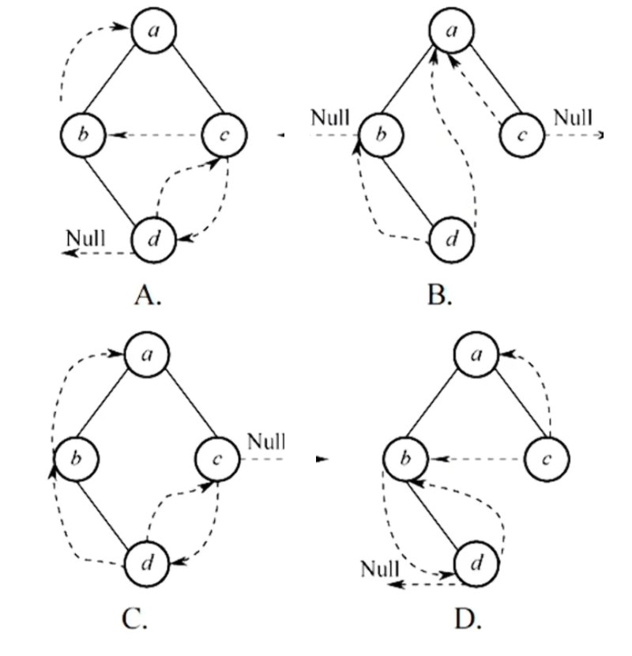
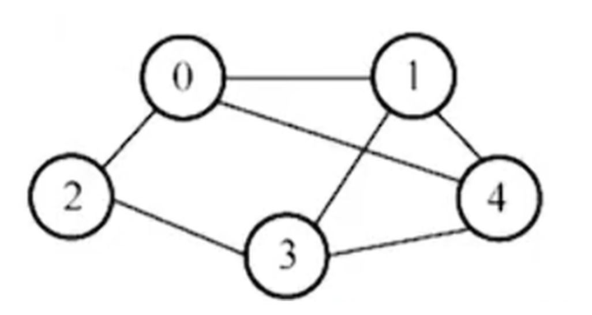
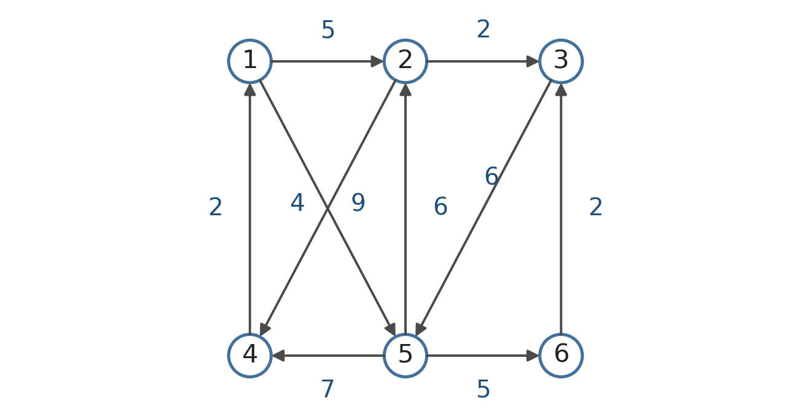
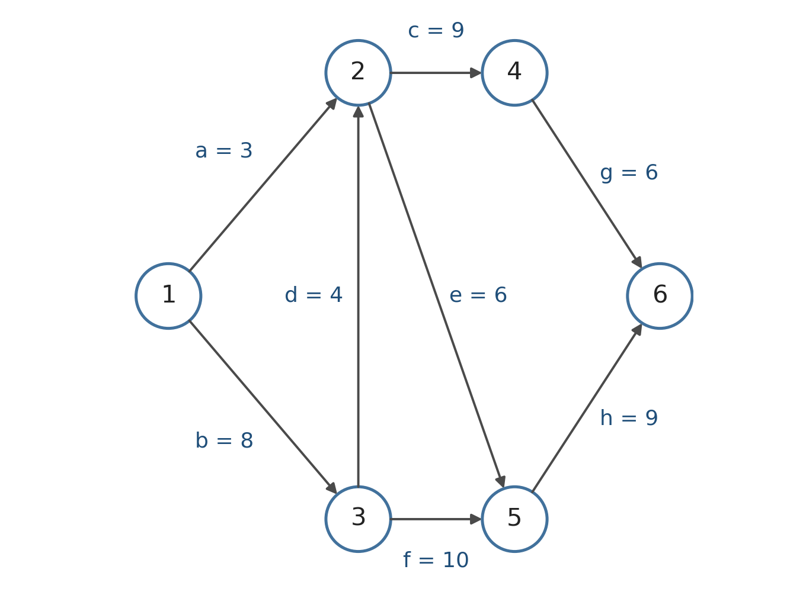
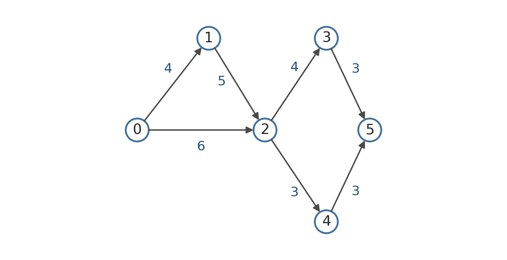
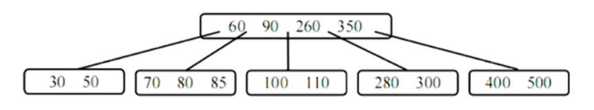

# 一、时间复杂度

## 题型1-单层循环

- 三步：确定基本运算 → 设执行次数为 $t$ 并列表找变化规律 → 代入退出条件，求 $t$ 与 $n$ 的数量级关系。
- 每次乘 / 除以常数：$t \approx \log_2 n$；每次加常数：$t \approx n$；累加自身（如 sum += ++i）：$t \approx \sqrt{2n}$。
- 循环体的执行次数就是基本运算次数，最后取数量级。
- 多段并列循环分别计数后相加，取最大项。

<u>例题：【2011】</u>

设 $n$ 是描述问题规模的非负整数，下面程序片段的时间复杂度是

```c
x = 2;
while(x < n/2)
    x = 2 * x;
```


**第 1 步，找出基本运算。** `x = 2 * x`，设其执行次数为 $t$。

**第 2 步，列表找规律。** 看 $t = 1, 2, 3, \dots$ 时 $x$ 的取值：

| 执行次数 $t$ | $x$ 的取值 |
| --- | --- |
| 1 | $2^2 = 4$ |
| 2 | $2^3 = 8$ |
| 3 | $2^4 = 16$ |
| ⋮ | ⋮ |
| $t$ | $2^{t+1}$ |

可见 $x$ 随 $t$ 指数增长，第 $t$ 次执行后 $x = 2^{t+1}$。

**第 3 步，列式子。** 循环的跳出条件是 $x \ge n/2$，于是在临界处有 $2^{t+1} < n/2$，解得 $t < \log_2 n - 2$——执行次数 $t$ 与 $\log_2 n$ 同数量级，故 $T(n) = O(\log_2 n)$。

> 注：$2^{t+1} < n/2$ 这个式子其实并不严谨，它假设的是“第 $t$ 轮算出来的 $x$ 仍然小于 $n/2$”。不过研究时间复杂度不需要这么严谨，只要能得到 $t$ 和 $n$ 的数量级关系就够了。

**简单方法**：联系归并排序——每次都把长为 $n$ 的表除以 2，一共 $k$ 层，直到长度都为 1（$n / 2^k = 1$，即 $k = \log_2 n$）。本题就类似归并操作里的“合并”部分，循环次数自然是 $O(\log_2 n)$。

完整的方法流程要熟练使用：**跳出条件往往是 $n$ 和 $x$ 的关系**，而 $x$ 和 $t$ 之间的关系可以列表求得，两者一联立就得到 $t$ 和 $n$ 的关系，也就是执行次数与问题规模的关系。


<u>练习：【2017】</u>

下列函数的时间复杂度是

```c
int func(int n){
    int i = 0, sum = 0;
    while(sum < n) sum += ++i;
    return i;
}
```


这道题的变量不止一个，**`i` 和 `sum` 都要在表格里列出来**（这里 `++i` 还是 `i++` 都一样）：

| 执行次数 $t$ | $i$ | $sum$ |
| --- | --- | --- |
| 1 | 1 | $0 + 1 = 1$ |
| 2 | 2 | $1 + 2 = 3$ |
| 3 | 3 | $3 + 3 = 6$ |
| 4 | 4 | $6 + 4 = 10$ |
| ⋮ | ⋮ | ⋮ |
| $t$ | $t$ | $1 + 2 + \dots + t = \dfrac{t(t+1)}{2}$ |

循环的跳出条件是 $sum \ge n$，即 $\dfrac{t(t+1)}{2} \ge n$，也就是 $t \approx \sqrt{2n}$。所以 $T(n) = O(\sqrt n)$。


## 题型2-递归

- $T(n)$ = 每次调用的基本语句数 $\times$ 调用次数；每次调用通常只做 $O(1)$ 条基本语句。
- 调用次数就是递归树的结点数：单分支、规模减 1 → $n$；单分支、规模减半 → $\log n$；双分支、规模减常数 → 指数级；双分支、规模减半 → 约 $2n$。
- 形如 $T(n)=aT(n/b)+f(n)$ 的递归可直接用主定理定数量级。
- 递归调用栈的栈底是最早的调用，栈顶是当前调用；栈深等于递归深度。

<u>例题：【2012】</u>

求整数 $n$（$n \ge 0$）阶乘的算法如下，其时间复杂度是

```c
int fact(int n){
    if(n <= 1) return 1;
    return n * fact(n - 1); }
```


1. **每次调用执行基本语句的次数**：一次比较 + 一次乘法，即 $O(1)$；
2. **调用次数**：每次把 $n$ 减 1，从 $n$ 一路递归到 1，易知调用次数为 $n$；
3. 相乘：$1 \times n = n$，所以 $T(n) = O(n)$。


## 题型3-for循环嵌套

- 层层无关：内外层独立，总次数为外层次数 $\times$ 内层次数。
- 层层制约：内层次数由外层变量决定，按外层轮次列表，把每一轮的次数求和，通常是等差或等比数列。
- 数量级看最外层轮数：外层 i *= 2 → $\log n$；外层条件 i * i <= n → $\sqrt n$。
- 多段并列的循环相加，不乘。

### 层层无关

<u>例题：【2014】</u>

【2014】下列程序段的时间复杂度是

```c
count = 0;
for(k = 1; k <= n; k *= 2)
    for(j = 1; j <= n; j++)
        count++;
```


直接两层的循环次数相乘。此处 for 的循环条件又可以联系到题型1——这里最外层的 for 就是题型1里那个「类归并合并」的算法，是 $O(\log_2 n)$；内层 for 从 1 累加到 $n$、每次加 1，是 $O(n)$。两层相乘即 $O(n \log n)$。


### 层层制约

<u>例题：【2022】</u>

【2022】下列程序段的时间复杂度是

```c
int sum = 0;
for(int i = 1; i < n; i *= 2)
    for(int j = 0; j < i; j++)
        sum++;
```


| 轮次 | $i$ | 内层 $j$ 的范围 | 本轮的 $t$ |
| --- | --- | --- | --- |
| 1 | 1 | $0 \le j < 1$ | 1 |
| 2 | 2 | $0 \le j < 2$ | 2 |
| 3 | 4 | $0 \le j < 4$ | 4 |
| 4 | 8 | $0 \le j < 8$ | 8 |
| ⋮ | ⋮ | ⋮ | ⋮ |
| $k+1$ | $2^k$ | $0 \le j < 2^k$ | $2^k$ |

外层每次 `i *= 2`，所以 $i = 1, 2, 4, \dots, 2^k$，一共约 $\log_2 n$ 轮。把最后一列加起来：

$$t = 1 + 2 + 4 + \dots + 2^k = 2^{k+1} - 1$$

这是个等比数列，又因为 $2^k < n$，所以 $t < 2n$。数量级由最外层决定，故 $T(n) = O(n)$。


<u>练习：【2025】</u>

【2025】下列程序段的时间复杂度是

```c
int count = 0;
for(int i = 1; i * i <= n; i++)
    for(int j = 1; j <= i; j++)
        count++;
```


| 轮次 | $i$ | 内层 $j$ 的范围 | 本轮的 $t$ |
| --- | --- | --- | --- |
| 1 | 1 | $1 \le j \le 1$ | 1 |
| 2 | 2 | $1 \le j \le 2$ | 2 |
| 3 | 3 | $1 \le j \le 3$ | 3 |
| ⋮ | ⋮ | ⋮ | ⋮ |
| $m$ | $m$ | $1 \le j \le m$ | $m$ |

外层的条件是 $i \cdot i \le n$，即 $i \le \sqrt n$，所以外层一共 $\sqrt n$ 轮。求和：

$$t = 1 + 2 + \dots + \sqrt n = \frac{\sqrt n(\sqrt n + 1)}{2} = \frac{n + \sqrt n}{2}$$

所以 $T(n) = O(n)$。


## 习题训练

- 并列循环相加取最大项；嵌套且独立相乘；递归数调用次数；层层制约列表求和。
- 常见结果：$O(n^2)$、$O(n\log n)$、$O(n)$、$O(n^2)$。

**1.** 下列算法的时间复杂度为

```c
void fun(int n){
    for(int i = 1; i < n; i *= 2)
        for(int j = 0; j < n; j++)
            printf("A");

    for(int i = 0; i < n; i++)
        for(int j = 0; j < n; j++)
            printf("B");
}
```


两段循环是**并列**关系，工作量要**相加**而不是相乘：前一段外层 `i *= 2` 是 $O(\log_2 n)$、内层固定 $n$ 次，即 $O(n \log_2 n)$；后一段两层都跑满 $n$，即 $O(n^2)$。两者取大的，所以 $T(n) = O(n^2)$。


**2.** 下列算法的时间复杂度为

```c
void fun(int n){
    for(int i = 0; i < n; i++)
        for(int j = 1; j < n; j *= 2)
            printf("everything's gonna BOK!");
}
```


内外层**互相独立**（层层无关），次数直接相乘：外层 $i$ 从 0 到 $n-1$ 共 $n$ 次；内层 `j *= 2` 从 1 翻倍到 $n$ 共 $\log_2 n$ 次。所以 $T(n) = O(n \log n)$。


**3.** 下列算法的时间复杂度为

```c
int fun(int n){
    if(n <= 1)
        return 1;
    else
        return fun(n - 1) + 1;
}
```


单分支递归，正是题型2里的第一种结构：每次只递归调用一次、$n$ 每次减 1，调用次数就是 $n$；每次调用只做一次比较加一次加法，$O(1)$。相乘得 $T(n) = O(n)$。


**4.** 下列算法的时间复杂度为

```c
int count = 1;
for(int i = 1; i <= n; i++)
{
    for(int j = 2*i; j <= n; j++)
        count = count + j;
}
```


外层 $i$ 从 1 到 $n$；内层 $j$ 从 $2i$ 到 $n$，只有 $i \le n/2$ 时才有内层，这一轮是 $n - 2i + 1$ 次。按「层层制约」把每轮的次数加起来：$t = \sum_{i=1}^{n/2}(n - 2i + 1) = \frac{n}{2}\left(n - \frac{n}{2}\right) = \frac{n^2}{4}$，所以 $T(n) = O(n^2)$。


# 二、线性结构

## 考点1-线性表的基本操作

- 顺序表：按位查找 $O(1)$；按值查找、插入、删除 $O(n)$。
- 链表、静态链表：按位 / 按值查找 $O(n)$；插入、删除先花 $O(n)$ 找前驱，改指针只需 $O(1)$。
- 带头结点循环单链表删除首元素：先 $q=h\to next$、$h\to next=q\to next$ 摘链；若 $p=q$（删除的是尾结点）则 $p=h$；最后 free(q)。
- 边界：尾指针指向被删结点时必须回退，否则会悬空。

<u>例题：【2021】</u>

已知头指针 $h$ 指向一个带头结点的非空循环单链表，结点结构为 `data | next`，其中 `next` 是指向直接后继的指针；$p$ 是尾指针，$q$ 是临时指针。现要删除该链表的第一个元素，正确的语句序列是

```c
A. h->next = h->next->next; q = h->next; free(q);
B. q = h->next; h->next = h->next->next; free(q);
C. q = h->next; h->next = q->next; if (p != q) p = h; free(q);
D. q = h->next; h->next = q->next; if (p == q) p = h; free(q);
```


**选 D。** 删带头结点链表的第一个元素，分「摘链」和「善后尾指针」两步：

- **摘链**：`q = h->next` 先记住第一个元素（要删的就是它），`h->next = q->next` 让头结点直接指向第二个元素。
- **善后尾指针**：如果被删的恰好就是 $p$ 指向的那个结点（也就是链表只剩这一个元素，此时 $p == q$），删完 $p$ 就是悬空指针，必须把它指回头结点 $h$；不是的话 $p$ 不用动。

逐个看选项：

- **A**：先改了 `h->next` 才取 `q`，`q` 拿到的是**第二个**结点，删错对象，而且完全没管 $p$。
- **B**：摘链本身是对的，但没管 $p$——只剩一个元素时会留下悬空的尾指针。
- **C**：判断写反了，`p != q`（不是尾结点）反而去改 $p$。
- **D**：摘链正确，且只在 `p == q` 时把 $p$ 指回 $h$，正确。


## 考点2-栈和队列的基本操作

- 出栈序列合法判据：不存在 $i<j<k$ 使 $\sigma_i>\sigma_k>\sigma_j$；等价于任一元素后面比它小的元素必须递减。
- $n$ 个元素固定入栈顺序时，合法出栈序列数为卡特兰数 $C_n$；限定首元素时可先钉死前缀，再给剩余元素插空。
- 双端队列（$1,\dots,n$ 依次入队后再出队）：两端入一端出、一端入两端出均为 $2^{n-1}$ 个；两端入两端出为 $\binom{2n-2}{n-1}$ 个。
- 两端入一端出：从 $n$ 往下检查最大元素是否在剩余序列两端；一端入两端出：每一步取剩余元素的最小值或最大值。
- 队列 + 栈混合：按目标序列模拟；目标在队首直接出，在栈顶弹出，否则队首入栈；目标被压在栈里则不可能。
- 火车轨道：每条轨道是队列，同轨编号必须递增；最少轨道数 = 最长递减子序列长度。

<u>例题：【2011】</u>

【2011】元素 a, b, c, d, e 依次进入初始为空的栈中，若元素入栈后可停留、可出栈，直到所有元素都出栈，则在所有可能的出栈序列中，以元素 d 开头的序列个数是

- A. 3
- B. 4
- C. 5
- D. 6


**选 B，4 个。** 以 d 开头，说明 d 出栈之前 a、b、c 一定都已经入栈了——入栈顺序固定，d 想第一个出栈，就得先把 a、b、c、d 依次压进去，再弹 d。

d 弹出后：

- 栈里从上到下是 c、b、a，它们的出栈顺序被栈唯一确定成 **c b a**；
- e 还没入栈，可以在 d 之后的**任意时刻**入栈、出栈。

于是只剩「把 e 插进 c b a」这一件事，e 有 4 个位置可选：

- 插在 c 前 → `e c b a`
- 插在 c、b 之间 → `c e b a`
- 插在 b、a 之间 → `c b e a`
- 插在 a 后 → `c b a e`

所以共有 **4** 个。


<u>例题：【2022】</u>

【2022】给定有限符号集 S，in 和 out 均为 S 中所有元素的任意排列。对于初始为空的栈 st，下列叙述中，正确的是

- A. 若 in 是 st 的入栈序列，则不能判断 out 是否为其可能的出栈序列
- B. 若 out 是 st 的出栈序列，则不能判断 in 是否为其可能的入栈序列
- C. 若 in 是 st 的入栈序列，out 是对应 in 的出栈序列，则 in 和 out 一定不同
- D. 若 in 是 st 的入栈序列，out 是对应 in 的出栈序列，则 in 和 out 可能互为倒序


**选 D。**

- A、B 说"不能判断"——其实**都能判断**：给定候选序列，用上面那条「禁模式」判据（或者老实模拟一遍）就能判定它是不是合法出栈序列；反过来也一样，栈的过程是可逆的，把时间倒过来看即可。
- C 说 in 和 out 一定不同——**可以相同**：1 进 1 出、2 进 2 出……出栈序列就是 1, 2, 3, …，和入栈序列一模一样。
- D 说可能互为倒序——**对**：把 1…n 全部压栈再全部弹出，出栈序列就是 n, …, 2, 1，正是入栈序列的倒序。


<u>例题：【2010】（两端入、一端出的出队序列）</u>

【2010】某队列允许在其两端进行入队操作，但仅允许在一端进行出队操作。若元素 a, b, c, d, e 依次入此队列后再进行出队操作，则不可能得到的出队序列是

- A. b, a, c, d, e
- B. d, b, a, c, e
- C. d, b, c, a, e
- D. e, c, b, a, d


**选 C。** 出队只能从一端 → **出队顺序就是队列内容本身**，直接拿①的判据验（从最大的 e 开始，看它是否在当前序列两端，是就剥掉）：

- A. `b a c d e`：e 在右端 ✅ → `b a c d`；d 在右端 ✅ → `b a c`；c 在右端 ✅ → `b a`；b 在左端 ✅ → `a` ✅ 合法。
- B. `d b a c e`：e 右端 ✅ → `d b a c`；d 左端 ✅ → `b a c`；c 右端 ✅ → `b a` ✅ 合法。
- C. `d b c a e`：e 右端 ✅ → `d b c a`；d 左端 ✅ → `b c a`；**c 卡在中间（b 和 a 之间）✗** → 不可能。
- D. `e c b a d`：e 左端 ✅ → `c b a d`；d 右端 ✅ → `c b a`；c 左端 ✅ → `b a` ✅ 合法。

所以得不到的是 C。


<u>例题：【2018】（队列 + 栈的混合操作）</u>

【2018】现有队列 Q 与栈 S，初始时 Q 中的元素依次是 1, 2, 3, 4, 5, 6（1 在队头），S 为空。若仅允许下列 3 种操作：①出队并输出出队元素；②出队并将出队元素入栈；③出栈并输出出栈元素，则不能得到的输出序列是

- A. 1, 2, 5, 6, 4, 3
- B. 2, 3, 4, 5, 6, 1
- C. 3, 4, 5, 6, 1, 2
- D. 6, 5, 4, 3, 2, 1


**选 C（`3, 4, 5, 6, 1, 2`）。** 四个选项都照上面的做法走一遍：

- **A. `1, 2, 5, 6, 4, 3`**：1、2 都在队首，直接输出；接下来要 5，而队首是 3 → 把 3、4 压栈，5 来到队首直接输出，再输出 6；队列空，栈里自上而下是 4、3，依次弹出 → 得到 `1, 2, 5, 6, 4, 3` ✅ 可以。
- **B. `2, 3, 4, 5, 6, 1`**：先把 1 压栈，2 到队首直接输出，3、4、5、6 依次输出；最后把栈里的 1 弹出来 ✅ 可以。
- **C. `3, 4, 5, 6, 1, 2`**：把 1、2 压栈（栈里自上而下是 2、1），3 到队首输出，再依次输出 4、5、6；此时队列已空，栈顶是 **2**，只能先出 2 再出 1——末尾必然是 `2, 1`，而选项要的是 `1, 2` → 1 被 2 压住了，✗ **得不到**。
- **D. `6, 5, 4, 3, 2, 1`**：把 1~5 全部压栈，6 出队输出；再依次弹出 5、4、3、2、1 ✅ 可以。

所以选 C。


<u>例题：【2016】（火车轨道）</u>

【2016】火车车轨的入口和出口之间有 $n$ 条轨道，列车的行进方向均为从左至右，列车可驶入任意一条轨道。现有编号为 1~9 的 9 列列车，驶入的次序依次是 8, 4, 2, 5, 3, 9, 1, 6, 7。若期望驶出的次序依次为 1~9，则 $n$ 至少是

- A. 2
- B. 3
- C. 4
- D. 5


**选 C，至少 4 条轨道。**

每条轨道就是一条**队列**（先进先出）：列车按驶入顺序进去，也只能按这个顺序出来。而期望的驶出次序是 1~9 的**完全升序**，所以**同一条轨道上的列车编号必须是递增的**——否则"大的在前、小的在后"，小的那列会被永久堵在后面出不来。

于是问题变成：**把驶入序列 8, 4, 2, 5, 3, 9, 1, 6, 7 划分成尽量少的递增子序列**。最少要几条，等于这条序列**最长递减子序列的长度**：

> 8, 4, 2, 1（也有 8, 5, 3, 1）—— 长度为 4。

所以至少要 4 条。4 条也确实够：

| 轨道 | 放进哪些车 |
| --- | --- |
| 1 | 8, 9 |
| 2 | 4, 5, 6, 7 |
| 3 | 2, 3 |
| 4 | 1 |

（按驶入顺序往轨道上放，保证每条轨道内部递增。）驶出时按 1 → 2 → 3 → 4 清空，正好得到 1~9 ✅。


<u>例题：不允许连续 4 次出栈</u>

若元素 a, b, c, d, e, f 依次入栈，允许入栈、出栈操作交替进行，但不允许连续 4 次出栈操作，则以下不可能得到的出栈序列是

- A. acbedf
- B. abcdef
- C. fedcba
- D. abcdfe


**选 C。** 判断的关键是：**输出序列里那些"连着弹出来"的段，能不能靠插一次入栈打断。**

- **C 是 `f e d c b a`**：想让 f 第一个出来，只能把 a、b、c、d、e、f **全部压进栈**，然后连着弹出 f、e、d、c、b、a —— **连续 6 次出栈** ✗ 直接出局。
- **A `a c b e d f`**：压 a 弹 a；压 b、压 c 弹 c，弹 b；压 d、压 e 弹 e，弹 d；压 f 弹 f —— 最长只连弹 2 次 ✅。
- **B `a b c d e f`**：压一个弹一个，最多连弹 1 次 ✅。
- **D `a b c d f e`**：前四个各自压一个弹一个，最后压 e、压 f 再弹 f、e —— 连弹 2 次 ✅。

一个够用的快速检查：**输出序列里如果没有连续 4 个递减的元素，就一定没问题**（连弹 k 次在输出里必然表现为 k 个连续递减的值）。但反过来不成立——有些序列虽然没有 4 个连续递减，却因为"想弹的元素一直被压在下面、插不进新的入栈"而被迫连弹 4 次。所以这类题最稳的做法还是**对着选项把操作演一遍**。


<u>例题：$P_3 = 3$ 时 $P_4$ 能取几个值</u>

栈的入栈序列为 1, 2, 3, …, $n$，出栈序列为 $P_1, P_2, P_3, \dots, P_n$。若 $P_3 = 3$，则 $P_4$ 的可能取值的个数是

- A. $n-3$
- B. $n-2$
- C. $n-1$
- D. 无法确定


**选 C（$n-1$ 个）。**

$P_3 = 3$ 说明"3 是第 3 个被弹出的"，所以在弹 3 的那一刻，**3 一定在栈顶**。比 3 先入栈的只有 1、2，它们在 3 下面（1 又在 2 下面），也可能已经作为 $P_1$、$P_2$ 被弹走了。于是紧接着的 $P_4$ 只有三种可能：

1. 栈里还剩 2（1、2 都没弹过）→ 栈顶是 2，$P_4$ 能取 **2**；
2. 栈里只剩 1（2 已被弹走）→ 栈顶是 1，$P_4$ 能取 **1**；
3. 继续压入 4、5、… 再弹 → $P_4$ 能取 **4 ~ $n$ 里的任意值**（一直压到目标值，再把它弹出来）。

三种合起来，$P_4$ 可取的正是 1, 2, 4, 5, …, $n$ —— 除了 3 自己（早弹过了）之外都能取到，共 **$n-1$** 个。

顺手把两个"不容易想到"的取值演一遍：

- **$P_4 = 2$**：压 1、压 2、压 3、压 4、压 5，然后连弹 5、4、3 —— 于是 $P_1 = 5$、$P_2 = 4$、$P_3 = 3$，此时栈顶是 2，$P_4 = 2$ ✅；
- **$P_4 = 1$**：压 1、压 2，弹 2（$P_1 = 2$）；压 3、压 4，弹 4（$P_2 = 4$）、弹 3（$P_3 = 3$）；这时栈里只剩 1，弹出来即 $P_4 = 1$ ✅。


## 考点3-卡特兰数

- $C_n=\frac{1}{n+1}\binom{2n}{n}$；前几项为 $1,1,2,5,14,42,132$。
- 适用于：固定入栈序列的合法出栈序列数；固定先序序列的二叉树数；$n$ 个结点的不同二叉树形状数。
- 递归遍历中，先序序列对应压栈次序，中序序列对应弹栈次序。
- 先序 + 中序能唯一确定树的前提是关键字互异；有重复字符时按相同字符分组，用卡特兰数数形状。

<u>例题：【2015】</u>

【2015】先序序列为 a, b, c, d 的不同二叉树的个数是

- A. 13
- B. 14
- C. 15
- D. 16


**选 B（14 个）。** 关键是认出这题在考卡特兰数。

中序 + 先序可以唯一确定一棵二叉树；再对着**遍历的代码**看：先序序列其实就是**入栈序列**，中序序列就是**出栈序列**（下面单独展开讲了原因）。所以"先序序列固定为 a, b, c, d，能确定多少棵二叉树"，等价于"给定入栈序列，有多少种合法的出栈序列"：

$$C_4 = \frac{1}{4+1}\binom{8}{4} = \frac{70}{5} = 14$$

所以选 B。


<u>例题：先序、中序序列相同（都是 "ooops"）</u>

【题目】具有 5 个结点的二叉树有着相同的先序和中序遍历序列 "ooops"，则这样的二叉树可以确定的不同形状有多少？

- A. 1
- B. 3
- C. 5
- D. 6


**选 C（5 种）。**

**坑在哪**：前面刚说"先序 + 中序唯一确定一棵二叉树"，但那条结论有个前提——**所有结点的值互不相同**。这里 "ooops" 里有三个 o，它们**是三个不同的结点，只是符号恰好都写成 o**。字符串上分不清谁是谁，同一个字符串就可能对应好几棵树，所以不能张口就答"1 棵"。

**怎么数**：把三个 o **编上号**，记作 $O_1, O_2, O_3$（怎么编都行，反正符号都是 o，最后只数形状）。

1. 先序固定成 $O_1 O_2 O_3 p s$ —— 题目给的先序字符串就是"三个 o，然后 p，然后 s"。
2. 中序也必须形如「三个 o 的某个排列 + p + s」，因为中序字符串同样要等于 "ooops"：**p 在第 4 位、s 在第 5 位，这两位已经钉死，不用管**。
3. 于是只剩一件事：**先序是 $O_1 O_2 O_3$ 时，前三个 o 能排出多少种合法的中序？** 这正是栈模型里"入栈序列已定，有多少种合法出栈序列"——$n = 3$ 的卡特兰数：

$$C_3 = \frac{1}{3+1}\binom{6}{3} = 5$$

**为什么能把 p、s 直接忽略**：中序要求 p、s 排在最后两位 ⇒ 弹出 p 之前，三个 o 必须**全部**弹完 ⇒ 也就是说 p 是在三个 o 都出栈之后才入栈的，全程栈里只折腾这三个 o。所以前面三个 o 的合法排列，恰好就是"3 个元素进出栈"的全部合法出栈序列，共 5 种。

**为什么 5 种中序刚好对应 5 种形状**：编号之后各结点互不相同，每个合法的中序都唯一确定一棵二叉树；而这 5 棵树的先序又完全一样（都是 $O_1O_2O_3ps$），**形状相同 + 先序相同 ⇒ 只能是同一棵树**，所以它们的形状两两不同。把编号擦掉，正是 5 种不同的树形。

所以选 C。


## 考点4-假溢出和循环队列

- 假溢出：front 前移腾出了空间，但 rear 已到数组末尾，无法继续后移。
- 循环队列的指针移动一律写成 $(p+1)\bmod M$，$M$ 为数组长度。
- 约定 A（rear 指队尾的下一个空位）：队空 $\text{front}=\text{rear}$；队满 $(\text{rear}+1)\bmod M=\text{front}$；长度 $(\text{rear}-\text{front}+M)\bmod M$。
- 约定 B（rear 指队尾元素）：队空 $(\text{rear}+1)\bmod M=\text{front}$；队满 $(\text{rear}+2)\bmod M=\text{front}$；长度 $(\text{rear}-\text{front}+M+1)\bmod M$。
- 也可用 tag 或 size 区分空满；取模始终对数组长度 $M$，不对“最多能存几个”取模。
- 两端都能进出的循环队列（最多 $M-1$ 个元素）：队空 $\text{end1}=\text{end2}$；队满 $\text{end1}=(\text{end2}+1)\bmod M$。
- 只增不减、空间可复用、出入队 $O(1)$：用链式循环队列；初始一个空结点自环，$\text{front}=\text{rear}$ 为空，$\text{rear}\to next=\text{front}$ 为满；入队写 rear 后后移或新建，出队 front 后移并复用旧结点。

<u>例题：【2014】（数组里的循环队列，两端都能进出）</u>

【2014】循环队列放在一维数组 $A[0\dots M-1]$ 中，end1 指向队首元素，end2 指向队尾元素的后一个位置。假设队列两端均可进行入队和出队操作，队列中最多能容纳 $M-1$ 个元素。初始时为空。下列判断队空和队满的条件中，正确的是

- A. 队空：`end1 == end2`；队满：`end1 == (end2 + 1) mod M`
- B. 队空：`end1 == end2`；队满：`end2 == (end1 + 1) mod (M − 1)`
- C. 队空：`end2 == (end1 + 1) mod M`；队满：`end1 == (end2 + 1) mod M`
- D. 队空：`end1 == (end2 + 1) mod M`；队满：`end2 == (end1 + 1) mod (M − 1)`


**选 A。** 这题就是上面「约定 A + 牺牲一个单元」的翻版：`end1` 相当于 `front`（指向队首元素），`end2` 相当于 `rear`（指向队尾元素的后一个位置）。

- 队空：两个指针重合，`end1 == end2`；
- 队满：牺牲一个单元，`end1 == (end2 + 1) mod M`（最多存 $M-1$ 个）。

B、D 里那个 `mod (M − 1)` 是干扰项——**取模一定是对数组长度 $M$ 取**，跟"最多能存几个"没有关系。


<u>例题：【2019】（设计一个"只增不减、又要能复用"的队列）</u>

【2019】请设计一个队列，要求满足：①初始时队列为空；②入队时，允许增加队列占用空间；③出队后，出队元素所占用的空间可重复使用，即整个队列所占用的空间只增不减；④入队操作和出队操作的时间复杂度始终保持为 $O(1)$。请回答：

1. 该队列是应选择链式存储结构，还是应选择顺序存储结构？
2. 画出队列的初始状态，并给出判断队空和队满的条件。
3. 画出第一个元素入队后的队列状态。
4. 给出入队操作和出队操作的基本过程。


**设计思路（这道题的关键）**：

1. **选存储结构**：要"能动态增长 + 空间只增不减 + 出入队都 $O(1)$" ⇒ 顺序存储扩容得整体搬移（$O(n)$，破坏 ④），只能**链式存储**。
2. **让出队的空间还能再用**：出队时把 front 处的结点腾空、front 后移，腾出来的结点不能丢 ⇒ 让 **rear 的 next 循环回前面**，所以要用**循环链表**。
3. **初始状态不能一个结点都没有**：否则"初始队空"和"所有元素都出队后的队空"没法用同一套办法判别 ⇒ 一开始就造一个**空结点**，`front = rear` 都指向它。
4. **怎么区分空和满**：`front == rear` 既可能是空也可能是满 ⇒ 用最常规的**牺牲一个单元**（永远留一个空结点不用）。
5. **rear 怎么定义**（最容易卡住的一步）：若按直觉定义成"指向队尾元素"，**第一个元素入队和后续入队的操作就不统一**——初始入队时 rear 不动、赋值后再挂一个空结点；后续入队却要 rear 先后移、再赋值、再挂空结点。为了让两处一致，只能把 rear 定义成"**指向最后一个元素的下一个结点**"，也就是那个牺牲的空结点；这样入队永远是"先填 rear 指的空结点，再让 rear 落到下一个空结点上"。
6. 于是：**队空 `front == rear`，队满 `rear->next == front`**。

**（1）链式存储结构。**

**（2）初始状态与判据。** 初始时 `front = rear` 指向同一个空结点，且它的 `next` 指向它自己（自环，让"循环"从一开始就成立）：

```text
front
rear  →   [ 空 ] ↺
```

- **队空**：`front == rear`（两指针重合，一个元素都没有）；
- **队满**：`rear->next == front`。

这里的"队满"要注意语义：它**不是"不能再入队"**，而是"**已经没有任何空闲结点可以复用了，再入队就必须新申请空间**"——正因如此，这个队列才能一路增长下去（要求 ②）。

**（3）第一个元素入队后。** 把数据写进 `rear` 指的那个空结点（它成为队尾元素）；因为后面已经没有空结点了，再新申请一个空结点挂到它后面当缓冲：

```text
front          rear
  ↓             ↓
[ a ]  →  [ 空 ] ↺
```

此时队列里只有 a，却已经没有可复用的空闲结点了，所以"队满"为真——下一次入队得再申请一个结点。

**（4）基本过程。**

- **入队**：① 把 x 写进 `rear` 指的那个空结点（它成为新的队尾）；② 再看 `rear` 后面：如果那里已经是新申请来的空结点，就把 `rear` 直接移过去；如果后面是 `front`（说明没有空闲结点了），就新申请一个空结点挂在队尾之后，`rear` 指向它。
- **出队**：① 若 `front == rear` 则队空，报错返回；② 取出 `front` 所在结点的数据；③ `front` 后移一个结点——腾出来的结点**留在环里**，等 `rear` 转一圈回来时复用（这就是要求 ③）。

**完整代码实现**：

```c
typedef struct LNode {
    ElemType data;
    struct LNode *next;
} LNode, *QueuePtr;

typedef struct {
    QueuePtr front;   // 队首元素所在的结点
    QueuePtr rear;    // 队尾元素的下一个结点（永远是那个空结点）
} LinkQueue;

// 初始化
void InitQueue(LinkQueue &Q) {
    QueuePtr p = (QueuePtr) malloc(sizeof(LNode));
    p->next = p;                     // 自环
    Q.front = Q.rear = p;            // 队空
}

bool QueueEmpty(LinkQueue Q) { return Q.front == Q.rear; }
bool QueueFull (LinkQueue Q) { return Q.rear->next == Q.front; }

// 入队
void EnQueue(LinkQueue &Q, ElemType x) {
    Q.rear->data = x;                        // ① 缓冲结点写入 x，它成为新的队尾
    if (Q.rear->next == Q.front) {           // ② 后面没有空结点 → 新申请一个挂上
        QueuePtr s = (QueuePtr) malloc(sizeof(LNode));
        s->next = Q.front;
        Q.rear->next = s;
        Q.rear = s;
    } else {
        Q.rear = Q.rear->next;               // ③ 后面本来就空着（出队腾出来的）→ 移过去复用
    }
}

// 出队
bool DeQueue(LinkQueue &Q, ElemType &x) {
    if (Q.front == Q.rear) return false;     // 队空
    x = Q.front->data;
    Q.front = Q.front->next;                 // front 后移，旧结点留在环里等复用
    return true;
}
```

出队时**可以不用清空**旧结点：哪些结点是"空闲可复用"的，完全由 `front`、`rear` 的位置关系决定，下一次入队走 ③ 分支时会直接把它覆盖掉。


## 考点5-栈的应用

- 括号匹配：左括号入栈；右括号与栈顶同类则弹出；扫描结束栈空才合法；过程中最大栈深就是所需容量。
- 表达式树：后序遍历 = 后缀表达式，先序遍历 = 前缀表达式；三种表达式中操作数相对次序不变。
- 后缀求值：从左到右扫，操作数入栈，遇运算符弹两个（先弹出的是右操作数）。
- 前缀求值：从右到左扫，操作数入栈，遇运算符弹两个（先弹出的是左操作数）。
- 中缀转后缀：操作数直接输出；运算符弹出栈中优先级 $\ge$ 它的；左括号入栈，右括号弹到左括号；最后清栈。
- 递归：每次调用压栈、返回弹栈；栈底是最早调用，栈顶是当前调用；栈深等于递归深度。

### 括号匹配

<u>例题：【2025】（符号栈容量为 3）</u>

【2025】对于括号匹配问题，符号栈初始为空，容量为 3，不能实现的表达式是

- A. `(a+[b+(c+d)/e]+f)+g−h`
- B. `[a*((b+c)/(d−e)+f/g)]−h`
- C. `[a*(b−(c−d)*e/(f+g))−h]`
- D. `[a−(b+[c*(d+e)−f]+g+h)]`


**选 D。** 演算方法：从左到右扫一遍，遇左括号栈深 $+1$、遇右括号栈深 $-1$，**过程中栈深的最大值就是这条表达式需要的容量**（顺带核对一下配对类型是否一致）。

- A：栈深 1 → 2 → 3 → 2 → 1 → 0，最大 **3** ✅
- B：1 → 2 → 3 → 2 → 3 → 2 → 1 → 0，最大 **3** ✅
- C：1 → 2 → 3 → 2 → 3 → 2 → 1 → 0，最大 **3** ✅
- D：1 → 2 → 3 → **4** ✗ 中途就要 4 个格子，容量 3 放不下

所以选 D。


### 中缀表达式转后缀表达式

<u>例题：【2012】（栈里最多同时存几个运算符）</u>

【2012】已知操作符包括 `+` `-` `*` `/` `(` `)`。将中缀表达式 `a+b-a*((c+d)/e-f)+g` 转换为等价的后缀表达式 `ab+acd+e/f-*-g+` 时，用栈存放暂时还不能确定运算次序的操作符。栈初始时为空，转换过程中同时保存在栈中的操作符的最大个数是

- A. 5
- B. 7
- C. 8
- D. 11


**选 A（5 个）。** 按规则从左到右走一遍（栈里只放运算符，方括号内从左到右是栈底到栈顶）：

| 扫到 | 动作 | 栈 | 已输出 |
| --- | --- | --- | --- |
| `a` | 输出 | [] | a |
| `+` | 入栈 | [+] | a |
| `b` | 输出 | [+] | ab |
| `-` | `+` $\ge$ `-`，弹出 `+` 输出；`-` 入栈 | [- ] | ab+ |
| `a` | 输出 | [- ] | ab+a |
| `*` | `-` < `*`，不弹；`*` 入栈 | [- *] | ab+a |
| `(` | 入栈 | [- * (] | ab+a |
| `(` | 入栈 | [- * ( (] | ab+a |
| `c` | 输出 | [- * ( (] | ab+ac |
| `+` | 栈顶是 `(`，停；`+` 入栈 | [- * ( ( +] ← **5 个** | ab+ac |
| `d` | 输出 | [- * ( ( +] | ab+acd |
| `)` | 弹到 `(` 为止：弹出 `+` 输出，再弹掉 `(` | [- * (] | ab+acd+ |
| `/` | 栈顶是 `(`，停；`/` 入栈 | [- * ( /] | ab+acd+ |
| `e` | 输出 | [- * ( /] | ab+acd+e |
| `-` | `/` $\ge$ `-`，弹出 `/` 输出；栈顶 `(` 停；`-` 入栈 | [- * ( -] | ab+acd+e/ |
| `f` | 输出 | [- * ( -] | ab+acd+e/f |
| `)` | 弹出 `-` 输出，再弹掉 `(` | [- *] | ab+acd+e/f- |
| `+` | `*` $\ge$ `+`、`-` $\ge$ `+`，依次弹出输出；`+` 入栈 | [+] | ab+acd+e/f-*- |
| `g` | 输出 | [+] | ab+acd+e/f-*-g |
| 结束 | 弹出 `+` | [] | ab+acd+e/f-*-g+ |

结果与题目给的后缀表达式一致 ✅。过程中栈里最多同时有 **5** 个运算符（`- * ( ( +`），选 A。


### 递归

<u>例题：【2015】（栈底到栈顶是谁）</u>

【2015】已知程序如下：

```c
int S(int n)
{ return (n<=0) ? 0 : S(n-1)+n; }
void main()
{ cout << S(1); }
```

程序运行时使用栈来保存调用过程的信息，自栈底到栈顶保存的信息依次对应的是

- A. `main() → S(1) → S(0)`
- B. `S(0) → S(1) → main()`
- C. `main() → S(0) → S(1)`
- D. `S(1) → S(0) → main()`


**选 A。** 调用顺序是 `main` 调 `S(1)`、`S(1)` 内部又调 `S(0)`，所以自栈底到栈顶就是 `main() → S(1) → S(0)`：最早进入的压在底下，最后进入的落在顶上。


<u>例题：分析 F(6) 的调用过程</u>

若 F(n) 定义为

```c
int F(int n){
    if (n <= 2) return 1;
    else return F(n-2) + F(n-3) + 1;
}
```

请分析 F(6) 的调用过程。


调用树（两个分支，按源码顺序先走 `F(n-2)`）：

```text
F(6)
├─ F(4)
│  ├─ F(2) = 1
│  └─ F(1) = 1          → F(4) = 1 + 1 + 1 = 3
└─ F(3)
   ├─ F(1) = 1
   └─ F(0) = 1          → F(3) = 1 + 1 + 1 = 3
                        → F(6) = 3 + 3 + 1 = 7
```

栈的变化（栈底 → 栈顶）：

| 时刻 | 动作 | 栈 |
| --- | --- | --- |
| 1 | 调用 F(6) | F(6) |
| 2 | F(6) 调 F(4) | F(6), F(4) |
| 3 | F(4) 调 F(2) | F(6), F(4), F(2) |
| 4 | $F(2)$ 命中 $n\le2$，返回 1 | $F(6),F(4)$ |
| 5 | F(4) 调 F(1) | F(6), F(4), F(1) |
| 6 | F(1) 返回 1 | F(6), F(4) |
| 7 | F(4) 返回 3 | F(6) |
| 8 | F(6) 调 F(3) | F(6), F(3) |
| 9 | F(3) 调 F(1) | F(6), F(3), F(1) |
| 10 | F(1) 返回 1 | F(6), F(3) |
| 11 | F(3) 调 F(0) | F(6), F(3), F(0) |
| 12 | F(0) 返回 1 | F(6), F(3) |
| 13 | F(3) 返回 3 | F(6) |
| 14 | F(6) 返回 7 | 空 |

共 7 次调用，栈最深 3 层，栈底始终是 F(6)。


## 考点7-稀疏矩阵

- 三元组表存（行、列、值），还必须保存矩阵的行数和列数才能还原。
- 对称矩阵只存上三角或下三角；按列存上三角（$i\le j$，0 基）下标为 $\frac{j(j+1)}{2}+i$；按下三角按行存为 $\frac{i(i+1)}{2}+j$。
- 三对角矩阵按行优先（$i,j$ 从 1 起，数组下标从 0 起）：$A[i][j]$ 的下标为 $2i+j-3$。
- 二维数组按行优先：$\text{loc}(A[i][j])=\text{loc}(A[0][0])+i\times\text{列数}+j$（每个元素占 1 个单元）。
- 三角矩阵、带状矩阵同理：数清目标元素前面有多少个元素。

### 特殊矩阵的存储

<u>例题：【2016】（三对角矩阵）</u>

【2016】有一个 100 阶的三对角矩阵 M，其元素 $m_{i,j}$（$1 \le i, j \le 100$）按行优先依次压缩存入下标从 0 开始的一维数组 N 中。元素 $m_{30,30}$ 在 N 中的下标是

- A. 86
- B. 87
- C. 88
- D. 89


**选 B（87）。** 三对角矩阵每行最多 3 个元素（$|i-j| \le 1$）。下标从 0 开始，所以**数 $m_{30,30}$ 前面有多少个元素**即可：

- 第 1 行只有 2 个元素（$m_{1,1}$、$m_{1,2}$）；
- 第 2 ~ 29 行每行 3 个，共 $28 \times 3 = 84$ 个；
- 于是第 30 行之前共 $2 + 84 = 86$ 个；
- 第 30 行依次是 $m_{30,29}$、$m_{30,30}$、$m_{30,31}$，$m_{30,30}$ 是本行第 2 个，前面还有 1 个。

合计前面 $86 + 1 = 87$ 个元素，下标就是 **87**。

通式：三对角矩阵按行优先存储（$i, j$ 从 1 开始、数组下标从 0 开始）时，$A[i][j]$ 的下标 $= 2i + j - 3$，代入 $i = j = 30$ 同样得 87。


<u>例题：【2021】（由两个地址反推每行几个元素）</u>

【2021】二维数组 A 按行优先方式存储，每个元素占用 1 个存储单元。若元素 `A[0][0]` 的存储地址是 100，`A[3][3]` 的存储地址是 220，则元素 `A[5][5]` 的存储地址是

- A. 295
- B. 300
- C. 301
- D. 306


**选 B（300）。** 考的是"行列号 ↔ 一维地址"的换算。

设每行有 $x$ 列。从 $A[0][0]$ 到 $A[3][3]$ 跨过 3 整行、再多 3 个元素：

$$3x + 3 = 220 - 100 = 120 \;\Longrightarrow\; x = 39$$

即每行 39 列，于是

$$A[5][5] = 100 + 5x + 5 = 100 + 5 \times 39 + 5 = 300$$


<u>例题：【2023】（三元组表还要存什么）</u>

【2023】若采用三元组表存储结构存储稀疏矩阵 M，则除三元组表外，下列数据中还需要保存的是

- Ⅰ. M 的行数
- Ⅱ. M 中包含非零元素的行数
- Ⅲ. M 的列数
- Ⅳ. M 中包含非零元素的列数

- A. 仅 Ⅰ、Ⅲ
- B. 仅 Ⅰ、Ⅳ
- C. 仅 Ⅱ、Ⅳ
- D. Ⅰ、Ⅱ、Ⅲ、Ⅳ


**选 A。** 三元组表只记了每个非零元素的（行号、列号、值），要把它**还原成矩阵**，还缺矩阵的形状——**行数和列数**（Ⅰ、Ⅲ）。至于哪几行、哪几列含非零元素，遍历一遍三元组就能统计出来，不必额外保存。


<u>例题：对称矩阵上三角按列存，求下标</u>

有一个 $n \times n$ 的对称矩阵 A，将其上三角部分（含主对角线）**按列**存放在一维数组 B 中，且规定 `A[0][0]` 放在 `B[0]` 处。若 $i \le j$，则 `A[i][j]` 在数组 B 中的下标为

- A. $\frac{j(j+1)}{2} + i$
- B. $\frac{i(i+1)}{2} + j$
- C. $\frac{n(n-1)}{2} - \frac{(n-j)(n-j-1)}{2} + i$
- D. $\frac{j(j-1)}{2} + i$


**选 A。** 按列存上三角，每列存的是一个"竖条"：第 0 列 1 个（$A[0][0]$）、第 1 列 2 个（$A[0][1]$、$A[1][1]$）……第 $j$ 列 $j+1$ 个（$A[0][j]$ 到 $A[j][j]$）。

所以 $A[i][j]$（$i \le j$）前面的元素数：

- 前 $j$ 列：$1 + 2 + \dots + j = \frac{j(j+1)}{2}$ 个；
- 本列之内：$A[0][j]$ 到 $A[i-1][j]$，共 $i$ 个。

即下标为 $\frac{j(j+1)}{2} + i$。核对：$A[0][0] \to 0$、$A[0][1] \to 1$、$A[1][1] \to 2$ ✅。


## 考点8-KMP中的next和nextval数组

- next（从 0 开始的约定）：前两位固定为 $0,1$；其余 $next[i]$ = 该字符之前子串的最长相等真前后缀长度 $+1$。
- 失配时主串指针 $i$ 不回退，$j$ 改为 $next[j]$（这里的 $j$ 按“第几个”从 1 数）。
- nextval：若本位字符与 next 指向的字符相同，取那一位的 nextval；否则取本位的 next。
- 第 $j$ 位失配时模式串右滑 $j-nextval[j]$ 格；最大滑动距离取各位置的最大值。
- 求 next / nextval 与匹配的时间均为 $O(n+m)$；单个字符不算前后缀。

<u>例题：【2015】（首次失配后 i 和 j 的取值）</u>

【2015】已知字符串 s 为 `abaabaabacacaabaabcc`，模式串 t 为 `abaabc`。采用 KMP 算法进行匹配，第一次出现"失配"（$s[i] \ne t[j]$）时，$i = j = 5$，则下次开始匹配时，i 和 j 的值分别为

- A. $i = 1$，$j = 0$
- B. $i = 5$，$j = 0$
- C. $i = 5$，$j = 2$
- D. $i = 6$，$j = 2$


**选 C（i = 5，j = 2）。** 模式串 `abaabc` 的 next 数组（从 0 开始）是：

| 位序 | 1 | 2 | 3 | 4 | 5 | 6 |
| --- | --- | --- | --- | --- | --- | --- |
| 模式串 | a | b | a | a | b | c |
| next | 0 | 1 | 1 | 2 | 2 | 3 |

失配发生在 $j = 5$：KMP 让主串指针 i 原地不动，只把 j 改成 `next[5] = 2`，所以下次开始匹配时是 $i = 5$、$j = 2$。


<u>例题：【2024】（修正后 next 数组的最大滑动距离）</u>

【2024】KMP 算法使用修正后的 next 数组进行模式匹配，模式串 S 为 `aabaab`，当主串的某个字符与 S 的某个字符失配时，S 向右滑动的最长距离是

- A. 5
- B. 4
- C. 3
- D. 2


**选 A（5）。** "修正后的 next 数组"就是 nextval：

| 位序 | 1 | 2 | 3 | 4 | 5 | 6 |
| --- | --- | --- | --- | --- | --- | --- |
| 模式串 | a | a | b | a | a | b |
| next | 0 | 1 | 2 | 1 | 2 | 3 |
| nextval | 0 | 0 | 2 | 0 | 0 | 2 |
| 右滑距离 $j - \mathrm{nextval}[j]$ | 1 | 2 | 1 | 4 | 5 | 4 |

第 $j$ 位失配时，模式串右滑 $j - \mathrm{nextval}[j]$ 格（滑完之后 nextval[j] 就是新的 j）。表里最大的是第 5 位失配时的 5，所以选 A。


# 三、非线性结构（上）

## 考点1-树形推断

- 结点总数 = 所有结点的度之和 $+1$。
- 二叉树：$n_0=n_2+1$；$n=n_0+n_1+n_2$；第 $i$ 层最多 $2^{i-1}$ 个结点；高 $h$ 最多 $2^h-1$ 个结点。
- 完全二叉树：$h=\lceil\log_2(n+1)\rceil$；$n_0=\lceil n/2\rceil$；1 基编号下左孩子 $2i$、右孩子 $2i+1$、父结点 $\lfloor i/2\rfloor$。
- $m$ 叉树：第 $i$ 层最多 $m^{i-1}$ 个；高 $h$ 最多 $\frac{m^h-1}{m-1}$ 个。
- 森林：边数 = 结点数 $-$ 树数；树数 = 结点数 $-$ 边数。
- 正则 $k$ 叉树：$n_0=(k-1)m+1$（$m$ 为非叶结点数）；高 $h$ 最多 $\frac{k^h-1}{k-1}$，最少 $k(h-1)+1$。
- 给定结点总数：满二叉树、哈夫曼树的 $n_0=\frac{n+1}{2}$；完全二叉树 $n_0=\lceil n/2\rceil$；BST 的叶结点数不能确定。

<u>例题：【2010】（由各度的结点数求叶结点数）</u>

【2010】在一棵度为 4 的树 T 中，若有 20 个度为 4 的结点、10 个度为 3 的结点、1 个度为 2 的结点、10 个度为 1 的结点，则树 T 的叶结点的个数是

- A. 41
- B. 82
- C. 113
- D. 122


**选 B（82）。** 直接套 ① 那条恒等式「结点总数 = 所有结点的度之和 + 1」：度之和 $= 20 \times 4 + 10 \times 3 + 1 \times 2 + 10 \times 1 = 122$，于是结点总数 $N = 122 + 1 = 123$，叶结点数 $n_0 = 123 - (20 + 10 + 1 + 10) = 82$。


<u>例题：【2016】（由森林的边数和结点数求树的个数）</u>

【2016】若森林 F 有 15 条边、25 个结点，则 F 包含树的个数是

- A. 8
- B. 9
- C. 10
- D. 11


**选 C（10）。** 每棵树里，除根以外的每个结点都恰好往上连一条边，所以**整个森林的边数 = 非根结点的个数**：25 个结点里非根的有 15 个，根结点就是 $25 - 15 = 10$ 个，而一个根结点对应一棵树，森林里共 10 棵树。


<u>例题：【2016】（正则 k 叉树的叶结点数与结点数范围）</u>

【2016】若一棵非空 k（$k \ge 2$）叉树 T 中的每个非叶结点都有 k 个孩子，则称 T 为正则 k 叉树。请回答下列问题并给出推导过程。
1）若 T 有 m 个非叶结点，则 T 中的叶结点有多少个？
2）若 T 的高度为 h（单结点的树 $h = 1$），则 T 的结点数最多为多少个？最少为多少个？


**1）叶结点有 $m(k-1) + 1$ 个。** 设叶结点数为 $n_0$，结点总数就是 $N = m + n_0$。每个非叶结点都有 k 个孩子，孩子总数是 $mk$；而除根以外每个结点都是别人的孩子，孩子总数又等于 $N - 1$。两式相等：$mk = m + n_0 - 1$，解得 $n_0 = m(k-1) + 1$。

**2）最多 $\frac{k^h - 1}{k - 1}$ 个，最少 $k(h-1) + 1$ 个。**

最多：让每一层都长满——第 1 层 1 个、第 2 层 k 个、第 3 层 $k^2$ 个……第 h 层 $k^{h-1}$ 个，等比求和得 $1 + k + k^2 + \dots + k^{h-1} = \frac{k^h - 1}{k - 1}$。

最少：树高为 h，就要求有结点一直伸到第 h 层。根必须是非叶结点（否则高度只有 1），于是第 2 层固定有 k 个结点；这 k 个里只留一个继续长孩子、其余 $k-1$ 个当叶子，第 3 层又只有 k 个……直到第 h 层，每层都是 k 个。总数 = 第 1 层的 1 个 + 第 2 到第 h 层每层的 k 个 = $1 + k(h-1)$。


<u>例题：完全二叉树有 128 个叶结点，最大深度是多少</u>

已知一棵完全二叉树有 128 个叶子结点，根节点的深度为 1，那么这棵树可能的最大深度是

- A. 7
- B. 8
- C. 9
- D. 10


**选 C（9）。** 完全二叉树的叶结点数由结点总数唯一决定：$n$ 为偶数时 $n_0 = n/2$，$n$ 为奇数时 $n_0 = (n+1)/2$，合起来就是 $n_0 = \lceil n/2 \rceil$。反过来由 $n_0 = 128$ 得 $n = 255$ 或 $n = 256$。

深度要最大，结点数就取多的那个，$n = 256$：前 8 层是满的，共 $2^8 - 1 = 255$ 个结点，多出的 1 个落在第 9 层。这时第 9 层那 1 个是叶结点，第 8 层里它的父结点有了孩子、剩下的 127 个才是叶结点，加起来正好 128。用 ⑤ 的公式核对：$h = \lfloor \log_2 256 \rfloor + 1 = 9$。


<u>例题：给定结点总数，哪种树不能确定叶结点数</u>

给定结点总数 n，则不能确定叶子结点数量的是

- A. 满二叉树
- B. 完全二叉树
- C. 哈夫曼树
- D. 二叉搜索树


**选 D。** 前三种的叶结点数都能由 $n$ 直接算出：满二叉树是 $n_0 = \frac{n+1}{2}$，哈夫曼树也是 $n_0 = \frac{n+1}{2}$（每个非叶结点都有两个孩子，$n_1 = 0$），完全二叉树是 $n_0 = \lceil n/2 \rceil$。

二叉搜索树的形状取决于结点插入的先后顺序，同一个 $n$ 能长出各种形态：$n = 3$ 时，链状的 BST 只有 1 个叶结点，根带两个孩子的那种有 2 个，叶结点数并不唯一。


## 考点2-树的存储

- 二叉树顺序存储：补成完全二叉树；1 基编号的父子关系为 $2i$、$2i+1$、$\lfloor i/2\rfloor$；高 $h$ 的任意二叉树最坏占 $2^h-1$ 个单元。
- 二叉链表 $n$ 个结点有 $n+1$ 个空链域；三叉链表有 $3n-(n-1)=2n+1$ 个空指针域。
- 树的双亲表示法找父方便；孩子表示法找子方便；孩子兄弟表示法按“左孩子右兄弟”，找子方便，加 parent 指针后找父也方便。

### 树的存储

<u>例题：【2020】（顺序存储至少需要多少单元）</u>

【2020】对于任意一棵高度为 5 且有 10 个结点的二叉树，若采用顺序存储结构保存，每个结点占 1 个存储单元（仅存放结点的数据信息），则存放该二叉树需要的存储单元数量至少是

- A. 31
- B. 16
- C. 15
- D. 10


**选 A（31）。** 关键词是「**任意**」和「至少」：问的是"保证任意一棵高 5、10 个结点的二叉树都装得下"需要多少单元，所以按最坏情况算，而不是挑一棵省地方的树（完全二叉树 10 个结点只到下标 15 附近）。顺序存储的下标就是完全二叉树的编号，高度为 5 的树，结点下标最大会落在第 5 层的最后一个位置，也就是 $2^5 - 1 = 31$：让路径一路向右走（$1 \to 3 \to 7 \to 15 \to 31$），最后那个结点就能放到第 5 层最右边；这条斜链只占 5 个结点，剩下 5 个随便挂在别的空位上，照样是高 5、10 个结点的二叉树。所以至少需要 31 个存储单元。


<u>例题：三叉链表的空指针域个数</u>

具有 n 个结点的三叉树用三叉链表表示，则树中空指针域的个数为

- A. $3n+1$
- B. $2n+1$
- C. $3n-1$
- D. $3n$


**选 B（$2n+1$）。** 三叉链表的每个结点有 3 个指针域，$n$ 个结点一共 $3n$ 个。从下往上看，除根结点以外每个结点都恰好被父结点的一个指针指着，所以非空的指针域只有 $n-1$ 个，空指针域就是 $3n - (n-1) = 2n+1$ 个。（同一套算法放在二叉链表上：$2n - (n-1) = n+1$，正好和前面那条对上。）


## 考点3-唯一确定一棵二叉树

- 中序 + 先序、中序 + 后序、中序 + 层序可唯一确定二叉树；先序 + 后序不能（单孩子分不清左右）。
- 先序首元素 / 后序末元素定根，中序按根劈成左右，再递归还原。
- 层序 + 中序：当前子树中，层序最先出现的结点就是子树根。
- 先序 + 后序虽不能定整棵树，但可定根的孩子数：去掉根后，若前序首 = 后序末，则根只有一个孩子。

<u>例题：【2011】（先序 + 后序定不出中序）</u>

【2011】一棵二叉树的前序遍历序列和后序遍历序列分别为 `1, 2, 3, 4` 和 `4, 3, 2, 1`，该二叉树的中序遍历序列不会是

- A. `1, 2, 3, 4`
- B. `2, 3, 4, 1`
- C. `3, 2, 4, 1`
- D. `4, 3, 2, 1`


**选 C。** 先序 `1 2 3 4` 定出 1 是根（后序最后一位也是 1，对上了）、2 是 1 唯一的孩子、3 是 2 唯一的孩子、4 是 3 唯一的孩子——这棵树的骨架就是一条 4 个结点的单链；至于每一节挂在左边还是右边，先序 + 后序看不出来（这正是这对组合定不出树的地方）。

单链里每个结点只有一棵子树，那棵子树的所有结点在中序里必须全排在它同一侧。看 C：`3, 2, 4, 1` 里 2 唯一的孩子子树是 `{3, 4}`，可 3 在 2 左边、4 在 2 右边，被 2 劈成了两半——出不来。另外三个都能构造：`1,2,3,4` 是 2、3、4 依次挂在右边，`4,3,2,1` 是依次挂在左边，`2,3,4,1` 是 2 挂 1 左边、其余挂右边。


<u>例题：【2012】（先序 + 后序能推出根有几个孩子）</u>

【2012】若一棵二叉树的前序遍历序列为 `a, e, b, d, c`，后序遍历序列为 `b, c, d, e, a`，则根结点的孩子结点

- A. 只有 e
- B. 有 e、b
- C. 有 e、c
- D. 无法确定


**选 A（只有 e）。** 先序 + 后序定不出整棵树的形状，那就只挑能确定的部分往下推。

**a 是根**：前序第一个是 a，后序最后一个也是 a，对上了。

**e 是这棵子树的根**：去掉 a，剩下前序 `e b d c`、后序 `b c d e`——前序的第一个、后序的最后一个都是 e。

**e 有没有兄弟**：不妨假设有。先序去掉 a 之后必然是两块——e 的子树整段在前、兄弟的子树整段在后（兄弟那棵子树只可能由 e 后面那些结点 `b d c` 组成）；后序的排法则是「e 的子树 → 兄弟的子树 → a」。e 是它那棵子树的根，在后序里排在 e 的子树那一段的最后，所以兄弟的子树必须整段落在 e 的**后面**。可实际后序 `b c d e a` 里，e 已经紧挨着 a 了（它后面只剩 a 一个），b、c、d 又全排在 e 前面——兄弟的子树无处可放，矛盾。所以 e 没有兄弟。

**另一条路，直接从定义看**：先序的结构是 `a [L] [R]`、后序是 `[L] [R] a`；去掉 a 之后，「前序的第一个」是 L 的根、「后序的最后一个」是 R 的根，而现在这两个位置都是 e，说明 e 既在 L 也在 R——e 只有一个，L 和 R 就不可能同时存在，e 只能是唯一的孩子。

小心别选 D：先序 + 后序定不出来的是「这个孩子挂在左边还是右边」以及往下各层的形状，根有几个孩子是定得出来的。


## 考点4-遍历和线索二叉树

- 先序根左右、中序左根右、后序左右根、层序用队列；递归栈 $O(h)$，层序队列最坏 $O(n)$。
- 线索：ltag / rtag = 0 指孩子，= 1 指前驱 / 后继；左指针空指前驱，右指针空指后继。
- 中序线索：有右孩子时后继 = 右子树最左下结点；有左孩子时前驱 = 左子树最右下结点。
- 后序线索按后序序列定前驱 / 后继；后序第一个结点的左线索、最后一个结点的右线索为空。
- 交换左右子树可用先序或后序框架；释放整棵树必须后序；中序框架会漏掉原左子树。

### 线索化

<u>例题：【2014】（中序线索化后 X 的左右线索）</u>

【2014】若对下图所示的二叉树进行中序线索化，则结点 X 的左、右线索指向的结点分别是


- A. e, c
- B. e, a
- C. d, c
- D. b, a


**选 D（b, a）。** 中序遍历这棵树得到 `e d b X a c`：排在 X 前面的 b 是它的前驱，排在后面的 a 是它的后继。

X 是叶结点，左、右指针本来都空着，线索化时两个都要改成线索——左线索指向前驱 b、右线索指向后继 a，所以是 D。


<u>例题：【2010】（哪棵是后序线索树）</u>

【2010】下列线索二叉树中（用虚线表示线索），符合后序线索树定义的是（四个选项见下图）




**选 D。** 这棵树的后序序列是 `d b c a`，按「左指针空就指前驱、右指针空就指后继」逐个数：

| 结点 | 空的指针 | 该指向谁 |
| --- | --- | --- |
| a | 没有 | 左右都是真孩子，不产生线索 |
| b | 左 | 前驱 d |
| c | 左、右 | 左指前驱 b、右指后继 a |
| d | 左、右 | 左指针是后序第一个、没有前驱（仍是 NULL），右指后继 b |

也就是说虚线该是「b 的左线索指 d、c 的左线索指 b、c 的右线索指 a、d 的右线索指 b」这四条，只有 D 全对得上。

另外三个都能挑出对不上的地方：A 把 d 的右线索指到了 c，B 里有两条线索都指向 a（后序里指向 a 的只该有 c 那一条），C 里 d 的右线索也指到了 c。


<u>例题：下列关于二叉树的叙述中，哪个正确</u>

下列关于二叉树的叙述中，正确的是

- A. 若二叉树的先序遍历结果是 `ABCD`，则其中序遍历结果可以是 `DABC`
- B. 如果二叉树的先序遍历序列和中序遍历序列的最后一个结点相同，那么该结点一定是整棵树最右侧的叶子结点
- C. 要交换二叉树所有分支结点的左右子树，最好利用中序遍历作为框架解决
- D. 删除一棵二叉树可以通过先序递归方式依次释放所有结点


**选 B。**

- **A 错**：先序 `ABCD` 定出根是 A。若中序是 `DABC`，那 A 左边只有 `D`（左子树）、右边是 `BC`（右子树），先序就应该是 A、D、BC 拼起来得 `ADBC`，和题给的 `ABCD` 对不上。
- **B 对**：先序的最后一个结点，是从根出发「有右孩子就往右、没有右孩子才往左」走到底的那个；中序的最后一个结点是顺着右孩子走到底的**最右下**结点（它必然没有右孩子）。这两个位置要是同一个结点，它就连左孩子也不能有——否则先序的最后会拐进它的左子树里。所以它一定是最右侧的叶子结点。
- **C 错**：交换左右子树用**后序**（先序也行）做框架都可以，唯独**中序不行**——中序的框架是「左、根、右」，把根的左右孩子换完再去遍历"左子树"时，走进去的已经是被换过来的原右子树，原左子树整条都被漏掉。
- **D 错**：释放结点必须**最后**释放根，否则根的左右孩子指针一丢，剩下的结点再也找不到。所以要用**后序**递归，而不是先序。


## 考点5-树、森林与二叉树

- 树 / 森林转二叉树：左孩子、右兄弟；森林各棵树的根依次成为右孩子链。
- 二叉树从根一路向右经过的结点数 = 森林中树的棵数。
- 二叉树中无右孩子的结点 = 每个非终端结点的最后一个孩子 + 根链末尾 = 非终端结点数 $+1$；森林有 $n$ 个非终端结点时有 $n+1$ 个。
- 遍历对应：树先根 = 二叉树先序；树后根 = 二叉树中序；森林先序 = 二叉树先序；森林后序 = 二叉树中序。
- 森林转二叉树中，$u$ 是 $v$ 的父结点的父结点：左下 + 右下 → 父子；右右下 → 兄弟；左左 → 祖孙；右左 → 父辈兄弟。

<u>例题：【2009】（森林转二叉树后 u、v 的关系）</u>

【2009】将森林转换为对应的二叉树，若在二叉树中，结点 u 是结点 v 的父结点的父结点，则在原来的森林中，u 和 v 可能具有的关系是

Ⅰ. 父子关系
Ⅱ. 兄弟关系
Ⅲ. u 的父结点和 v 的父结点是兄弟关系

- A. 只有 Ⅱ
- B. Ⅰ 和 Ⅱ
- C. Ⅰ 和 Ⅲ
- D. Ⅰ、Ⅱ 和 Ⅲ


**选 B（Ⅰ 和 Ⅱ）。** 把二叉树里 u → w → v 这条两步路径拆开，每一步只有两种走法：**往左下**进到第一个孩子、**往右下**进到下一个兄弟。

- **左 + 右**：w 是 u 的第一个孩子，v 又是 w 的下一个兄弟 → v 也是 u 的孩子，u、v 是**父子关系**（Ⅰ 成立）；
- **右 + 右**：u、w、v 是同一个父亲的连续三个兄弟 → u、v 是**兄弟关系**（Ⅱ 成立）；
- **左 + 左**：v 是 u 的孙子；
- **右 + 左**：u 是 v 的父亲的兄弟。

后两种都凑不出 Ⅲ 说的那层关系，所以 Ⅲ 不成立，选 B。


<u>例题：【2011】（二叉树中无右孩子的结点个数）</u>

【2011】已知一棵有 2011 个结点的树，其叶结点个数为 116，该树对应的二叉树中无右孩子的结点个数是

- A. 115
- B. 116
- C. 1895
- D. 1896


**选 D（1896）。** 直接套上面那条结论：非终端结点数 $= 2011 - 116 = 1895$，每个非终端结点贡献一个「最后一个孩子」（它在二叉树里没有右孩子），再加上树根（它没有下一个根，也就没有右孩子），一共 $1895 + 1 = 1896$ 个。


<u>例题：【2020】（由森林的遍历推出二叉树的后序）</u>

【2020】已知森林 F 及与之对应的二叉树 T，若 F 的先根遍历序列是 `a, b, c, d, e, f`，后根遍历序列是 `b, a, d, f, e, c`，则 T 的后序遍历序列是

- A. `b, a, d, f, e, c`
- B. `b, d, f, e, c, a`
- C. `b, f, e, d, c, a`
- D. `f, e, d, c, b, a`


**选 C。** 先套两条等价关系：**森林的先根遍历 = 二叉树 T 的先序**、**森林的后根遍历 = 二叉树 T 的中序**。所以 T 的先序是 `a b c d e f`、中序是 `b a d f e c`，题目就变成了"由先序 + 中序求后序"。

- 先序第一个是 a（中序里 a 也在，位置对得上）→ 中序里 a 左边只有 `b`、右边是 `d f e c`；左子树就一个结点 b，右子树的先序段是 `c d e f`。
- 右子树：先序段 `c d e f`、中序段 `d f e c` → 根是 c，中序里 c 排在最末尾 → c 没有右子树，左子树是 `d f e`。
- `d f e`：先序段 `d e f`、中序段 `d f e` → 根是 d，中序里 d 排最前面 → d 没有左子树，右子树是 `f e`。
- `f e`：先序段 `e f`、中序段 `f e` → 根是 e，f 是 e 的左孩子。

按后序「左、右、根」拼起来：左子树给出 `b`，右子树依次给出 `f e d c`，最后才是根 a → `b, f, e, d, c, a`，选 C。


<u>例题：森林有 n 个非终端结点时，二叉树上右指针为空的结点数</u>

森林 F 对应的二叉树是 B，若 F 有 n 个非终端结点，则 B 中右指针域为空的结点个数为

- A. $n-1$
- B. $n$
- C. $n+1$
- D. $n+2$


**选 C（$n+1$）。** 非终端结点就是**有孩子**的结点，落到二叉树上它必定有一棵左子树（左孩子 = 它的第一个孩子）；从这棵左子树**一路往右下**走（右孩子 = 下一个兄弟），走到头的那个结点右指针就是空的——它表示"没有下一个兄弟了"，也就是这个非终端结点的**最后一个孩子**。n 个非终端结点各贡献这样一个结点，已经有 n 个。

还差一个：**根链最末尾的那个结点**（森林里最后一棵树的根），它没有"下一个根"，右指针同样是空的。

合计 $n + 1$ 个，选 C。这条推理也正是前面第三条常用结论的来历。


## 考点6-哈夫曼树和哈夫曼编码

- 每次取两个最小权合并，新结点权 = 两孩子权之和；$n$ 个叶子共建 $2n-1$ 个结点，没有度为 1 的结点。
- $\text{WPL}=\sum w_i l_i$ = 所有非叶结点权值之和；哈夫曼树可能不唯一，但 WPL 最小。
- 哈夫曼编码是前缀编码，字符都在叶子上，频率高的字符编码短。
- $m$ 叉哈夫曼：先补 0 权结点使 $(n_0-1)\bmod(m-1)=0$，再每次合并 $m$ 个最小权结点。
- 多个有序表两两归并：按表长做哈夫曼，每次合并最短两个；长度 $m,n$ 的最坏比较次数为 $m+n-1$；总比较 = $\sum$ 合并后长度 $-$ (表数 $-1$)。
- 前缀编码用二叉树（trie）保存；译码走到叶子输出字符并回到根；判定前缀特性时边建树边查重复和“中途遇到字符”。
- 编码长度 $\le L$ 且已有若干前缀：剩余可用编码数等于各可用前缀子树在剩余层数内的叶子容量之和。

<u>例题：【2015】（两条根到叶的路径能否同属一棵哈夫曼树）</u>

【2015】下列选项给出的是从根分别到达两个叶结点路径上的权值序列，能属于同一棵哈夫曼树的是

- A. 24, 10, 5 和 24, 10, 7
- B. 24, 10, 5 和 24, 12, 7
- C. 24, 10, 10 和 24, 14, 11
- D. 24, 10, 5 和 24, 14, 6


**选 D。** 哈夫曼树里每个非终端结点的值 = 它两个孩子值之和，所以两条从根出发的路径必须处处对得上这个加法。

- **A**：两条路径在 10 处才分叉，说明 10 的两个孩子是 5 和 7，可 $5 + 7 = 12 \ne 10$；
- **B**：两条路径在根处分叉，根的两个孩子是 10 和 12，可 $10 + 12 = 22 \ne 24$；
- **C**：第一条路径是 24 → 10 → 10，结点不可能等于自己孩子的值（那兄弟就得是 0 权值）；
- **D**：根的孩子是 10 和 14（$10 + 14 = 24$）、10 的孩子是 5 和 5（$5 + 5 = 10$）、14 的孩子是 6 和 8（$6 + 8 = 14$）——三个加法全对；而且 5、5、6、8 按哈夫曼的合并顺序（$5+5$、$6+8$、$10+14$）正好能构造出来。


<u>例题：【2018】（哪组编码可能是哈夫曼编码）</u>

【2018】已知字符集 {a, b, c, d, e, f}，若各字符出现的次数分别为 6, 3, 8, 2, 10, 4，则对应字符集中各字符的哈夫曼编码可能是

- A. `00, 1011, 01, 1010, 11, 100`
- B. `00, 100, 110, 00, 0010, 01`
- C. `10, 1011, 11, 0011, 00, 010`
- D. `0011, 10, 11, 0010, 01, 000`


**选 A。** 先把哈夫曼树构出来定编码长度：按频率合并 $2 + 3 = 5$、$4 + 5 = 9$、$6 + 8 = 14$、$9 + 10 = 19$、$14 + 19 = 33$（每一步取的都是当前最小的两个，顺序唯一），于是各字符的位数是 **a 2 位、c 2 位、e 2 位、f 3 位、b 4 位、d 4 位**。

据此看选项：

- **A** 的长度正好是「6→2 位、3→4 位、8→2 位、2→4 位、10→2 位、4→3 位」，逐个核对也没有谁是谁的前缀；
- **B** 里 `00` 出现了两次（a 和 d），本身还和 `0010` 冲突；
- **C** 里 `00`（e）是 `0011`（d）的前缀，前缀编码被破坏；
- **D** 把 a 排成 4 位、b 排成 2 位，和「频率高的编码短」正好拧着。


<u>例题：【2023】（哈夫曼编码的加权平均长度）</u>

【2023】在由 6 个字符组成的字符集 s 中，各字符出现的频次分别为 3, 4, 5, 6, 8, 10，为 s 构造的哈夫曼编码的加权平均长度为

- A. 2.4
- B. 2.5
- C. 2.67
- D. 2.75


**选 B（2.5）。** 先按频次构造哈夫曼树，合并过程是 $3+4=7$、$5+6=11$、$7+8=15$、$10+11=21$、$15+21=36$。

WPL 用累加式直接读：$7+11+15+21+36 = 90$（换成定义式核一下也对：频次 3、4、5、6 的四个字符都占 3 位，8、10 的占 2 位，$3\times3+4\times3+5\times3+6\times3+8\times2+10\times2 = 90$）。

加权平均长度就是 WPL 平均到每个字符上：$90 \div (3+4+5+6+8+10) = 90 \div 36 = 2.5$，选 B。


<u>例题：【2012】（多个有序表两两归并，最坏比较次数最少）</u>

【2012】设有 6 个有序表 A、B、C、D、E、F，分别含有 10、35、40、50、60 和 200 个数据元素，各表中的元素按升序排列。要求通过 5 次两两合并，将 6 个表最终合并为 1 个升序表，并使最坏情况下比较的总次数达到最小。请回答下列问题：

1）给出完整的合并过程，并求出最坏情况下比较的总次数。
2）根据你的合并过程，描述 n（$n \ge 2$）个不等长升序表的合并策略，并说明理由。


**1）按"每次挑最短的两个"合并：**

| 步骤 | 合并 | 合并后长度 | 最坏比较次数 |
| --- | --- | --- | --- |
| ① | 10 + 35 | 45 | 44 |
| ② | 40 + 45 | 85 | 84 |
| ③ | 50 + 60 | 110 | 109 |
| ④ | 85 + 110 | 195 | 194 |
| ⑤ | 195 + 200 | 395 | 394 |

两个长度分别为 m、n 的有序表归并，最坏要比较 $m+n-1$ 次（每比较一次输出一个元素，只剩最后一个时不用再比），所以最坏情况下比较的总次数是

$$44+84+109+194+394 = 825$$

**2）策略：把各个表的长度当作权值，照哈夫曼树的构造过程来合并**——每次从当前所有表里选**长度最短的两个**合并，重复 $n-1$ 次到只剩一个表。

**理由**：这个总次数可以改写成 $\sum(\text{每次合并后新表的长度}) - (n-1)$，而"每次合并后新表的长度之和"正是这棵合并树的 **WPL**（各表长度 $\times$ 它参与合并的层数，加起来）。$n-1$ 是固定的，所以要让总次数最小，就等价于让这棵合并树的 $\text{WPL}$ 最小——而 $\text{WPL}$ 最小的二叉树正是哈夫曼树，也就是"每次合并最短的两个"。


<u>例题：【2020】（前缀编码的数据结构、译码与判定）</u>

【2020】若任意一个字符的编码都不是其他字符编码的前缀，则称这种编码具有前缀特性。现有某字符集（字符个数 $\ge 2$）的不等长编码，每个字符的编码均为二进制的 0、1 序列，最长为 L 位，且具有前缀特性。请回答以下问题：

1）哪种数据结构适宜保存上述具有前缀特性的不等长编码？
2）基于你所设计的数据结构，简述从 0/1 串到字符串的译码过程。
3）简述判定某字符集的不等长编码是否具有前缀特性的过程。


**1）一棵二叉树。** 每个结点带左、右两个孩子指针，字符存放在叶子上：一个字符的编码就是一条从根出发的路径，编码的 0 表示往左孩子走、1 表示往右孩子走，路径的终点存放该字符。因为编码满足前缀特性，任何一条这样的路径都不会中途撞上别的字符，整组编码正好铺成这棵树。（这种树不必是哈夫曼树——前缀编码只要求"编码互不为前缀"，哈夫曼树只是其中**比较常用**的一种。）

**2）译码过程**：把一个指针放在根结点上，从左往右扫描 0/1 串——读到 0 就沿左孩子走一步，读到 1 就沿右孩子走一步；走到存放字符的结点时输出该字符，并把指针**退回根结点**，接着读后面的位。0/1 串扫完，也就译出了完整的字符串。

**3）判定过程**：就是反过来"把这组编码填进一棵二叉树"，边走边建。

- 先准备一棵只有根结点的空树；
- 依次处理每个字符的编码：指针回到根，从左往右逐位扫描——遇到 0 就往左孩子走，左孩子不存在就新建一个；遇到 1 就往右孩子走，右孩子不存在就新建一个；编码扫完之后，在指针停留的那个结点上写下这个字符；
- 处理过程中只要出现下面任意一种情况，就说明这组编码**不具备**前缀特性：一是扫描某个编码时**从头到尾没有新建过任何结点**，说明这条路径之前已经被别的编码走完了——这个编码要么和某个字符的编码完全相同，要么是某个更长编码的前缀；二是扫描**中途走到了一个已经写着字符的结点**，说明前面那个字符的编码是它的前缀；
- 所有编码都这样顺利处理完、上面两种情况都没出现，则说明这组编码**具有**前缀特性。


<u>例题：哪种编码方案不可能是哈夫曼编码</u>

对字符进行哈夫曼编码时，不可能的方案是

- A. `00, 01, 10, 11`
- B. `00, 010, 011, 100, 101, 11`
- C. `00, 100, 101, 110, 111`
- D. `0000, 0001, 001, 01, 1`


**选 C。** 哈夫曼树里**不可能有度为 1 的结点**——构造时每次都是拿两个结点合并成一个新的，所以每个非叶结点必定左右孩子齐全。把每组编码展开成二叉树，逐个看内部结点：

- **A**：根分出 `0`、`1` 两支，每支再各分两个叶子（`00/01` 和 `10/11`），内部结点都是两个孩子 ✓；
- **B**：`0` 这支出 `00` 和 `01`，其中 `01` 再分出 `010`、`011`；`1` 这支出 `10`（再分出 `100`、`101`）和 `11`——每处也都是两个孩子 ✓；
- **C**：以 `0` 开头的只有 `00` 一条，也就是说 `0` 那个结点**只有左孩子、没有右孩子**，出现了**度为 1** 的结点 ✗——这不是哈夫曼树该有的形状，所以不可能；
- **D**：`1` 是叶子；`0` 这支出 `01` 和 `00`，`00` 再出 `001` 和 `000`，`000` 再出 `0000`、`0001`，从头到尾每个内部结点都是两个孩子 ✓。


<u>例题：编码长度不超过 4，已有 0 和 10，最多还能编码几个字符</u>

如果要求哈夫曼编码的长度小于等于 4，并且现在已经对 2 个字符编码为 `0` 和 `10`，则最多还可以对多少个字符进行编码？

- A. 3
- B. 4
- C. 5
- D. 6


**选 B（4）。** 已经用掉 `0` 和 `10` 之后，还能用的编码必须同时躲开这两条：

- 不能以 `0` 开头——否则 `0` 就是它的前缀；
- 不能以 `10` 开头——否则 `10` 是它的前缀。

两条合起来，剩下的编码**只能以 `11` 开头**。从 `11` 这个结点往下算，长度上限 4 位、已经用掉 2 位，还剩 $4-2=2$ 层可供分叉，最多放得下 $2^2 = 4$ 个字符，取满就是 `1100`、`1101`、`1110`、`1111` 这四个四位编码。

（反过来，如果图省事用 `11`、`110` 这种更短的编码，它自己会占掉一整片位置，能放的字符反而更少——想让数量最多，就要把可用位置都用最深的编码填满。）


# 四、非线性结构（下）

## 考点8-图的概念和性质

- 无向图所有顶点度之和 $=2E$；有向图入度之和 = 出度之和 $=E$。
- 无向完全图 $\frac{n(n-1)}{2}$ 条边；有向完全图 $n(n-1)$ 条弧。
- $n$ 个顶点的无向图，实现连通至少 $n-1$ 条边；保证任意摆法都连通需 $\frac{(n-1)(n-2)}{2}+1$ 条边。
- 连通分量是极大连通子图；$n$ 个顶点最多 $n$ 个分量（无边），最少 1 个。
- 生成树含全部顶点、恰 $n-1$ 条边；$n$ 个顶点 $n$ 条边且恰有一个环的连通图，生成树有 $n$ 棵。
- 子图的每条边，其两个端点都必须落在子图的顶点集中。

<u>例题：【2017】（图至少有几个顶点）</u>

【2017】已知无向图 G 含有 16 条边，其中度为 4 的顶点个数为 3、度为 3 的顶点个数为 4，其他顶点的度均小于 3。图 G 所含的顶点个数至少是

- A. 10
- B. 11
- C. 13
- D. 15


**选 B（11）。** 抓手就是「度之和等于边数的 2 倍」：所有顶点的度之和是 $2 \times 16 = 32$。

已经确定的 7 个顶点占掉 $4 \times 3 + 3 \times 4 = 24$ 度，还剩 $32 - 24 = 8$ 度要留给「其他顶点」。**要让顶点个数最少，就得让每个剩余顶点分摊到的度尽量大**——它们的度都小于 3，最大只能取 2，所以至少要 $8 \div 2 = 4$ 个顶点。

顶点总数 $3 + 4 + 4 = 11$，选 B。


<u>例题：【2022】（由顶点数、边数判断连通性）</u>

【2022】对于无向图 $G = (V, E)$，下列选项中，正确的是

- A. 当 $|V| > |E|$ 时，$G$ 一定是连通的
- B. 当 $|V| < |E|$ 时，$G$ 一定是连通的
- C. 当 $|V| = |E| - 1$ 时，$G$ 一定是不连通的
- D. 当 $|V| > |E| + 1$ 时，$G$ 一定是不连通的


**选 D。** 判据就是第 ⑤ 条：$n$ 个顶点的连通无向图**至少要有 $n - 1$ 条边**。

- **D 对**：$|V| > |E| + 1$ 即 $|E| < |V| - 1$，边数连"连通"的门槛都够不着，图必然不连通；
- **A 错**：三角形（3 个顶点 3 条边）再加一个孤立顶点，$|V| = 4 > |E| = 3$，照样不连通；
- **B 错**：两个互不相交的 $K_4$ 一共 8 个顶点 12 条边，$|V| < |E|$ 但图是断成两块的；
- **C 错**：$|V| = |E| - 1$ 即 $|E| = |V| + 1$，比最低要求还多两条边——$K_4$ 去掉一条边就是 4 个顶点 5 条边，连通得好好的。


<u>例题：恰好只有一个环的 n 个顶点 n 条边的连通图，不同生成树的数量</u>

若一个具有 $n$ 个顶点、$n$ 条边的连通无向图中，恰好只有一个环，则它的不同生成树的数量是

- A. 1
- B. $n$
- C. $n - 1$
- D. $n^2$


**选 B（$n$）。** $n$ 个顶点配 $n - 1$ 条边才是树，这个图多出来 1 条边，多出来的这条边正好落在**唯一那个环**上。

要得到生成树就得**破环**：从环上删掉任意一条边，剩下的 $n - 1$ 条边正好把 $n$ 个顶点连成一棵树；删环以外的边则环原样还在，成不了树。所以**生成树的棵数 = 唯一那个环上的边数**，本题里环上共有 $n$ 条边，一共 $n$ 棵，选 B。


<u>例题：35 个顶点、10 条边的无向图最多有几个连通分量</u>

具有 35 个顶点和 10 条边的无向图的连通分量最多是

- A. 35
- B. 30
- C. 31
- D. 32


**选 C（31）。** 想让连通分量**最多**，这 10 条边就得尽量"挤"在少数几个顶点上——只要一条边额外用到一个别的顶点，那个顶点就从"自成一个分量"变成"某个分量的一员"，分量总数就少一个。

那 10 条边最少能用几个顶点装下？$k$ 个顶点的无向完全图有 $\frac{k(k-1)}{2}$ 条边，$\frac{k(k-1)}{2} \ge 10$ 的最小 $k$ 是 5（$\frac{5 \times 4}{2} = 10$）——这 5 个顶点正好拼成一个 $K_5$，合成 **1 个**连通分量。

剩下 $35 - 5 = 30$ 个顶点一条边都不沾，每个自成一个连通分量。所以最多 $1 + 30 = 31$ 个，选 C。


## 考点9-邻接矩阵和邻接表

- 邻接矩阵：无向图顶点度 = 行和 = 列和；有向图出度 = 行和，入度 = 列和。
- $A^m[i][j]$ = 从 $i$ 到 $j$ 长度为 $m$ 的路径条数；非零表示存在这样的路径。
- 邻接表：无向图度 = 边表长度；有向图出度 = 边表长度，入度需扫描全部边表统计。
- 邻接矩阵空间 $O(n^2)$，邻接表空间 $O(n+e)$。

<u>例题：【2015】（邻接矩阵与 $A^m$ 的含义）</u>

【2015】已知含有 5 个顶点的图 G 如下图所示。



请回答下列问题：

1）写出图 G 的邻接矩阵 $A$（行、列下标从 0 开始）。
2）求 $A^2$，矩阵 $A^2$ 中位于 0 行 3 列元素值的含义是什么？
3）若已知具有 $n$（$n \ge 2$）个顶点的图的邻接矩阵为 $B$，则 $B^m$（$2 \le m \le n$）中非零元素的含义是什么？


**1）** 邻接矩阵的第 $i$ 行第 $j$ 列记的是「$i$ 到 $j$ 有没有边」，有边写 1、无边写 0（无向图的邻接矩阵一定对称）：

$$A = \begin{pmatrix}
0 & 1 & 1 & 0 & 1 \\
1 & 0 & 0 & 1 & 1 \\
1 & 0 & 0 & 1 & 0 \\
0 & 1 & 1 & 0 & 1 \\
1 & 1 & 0 & 1 & 0
\end{pmatrix}$$

**2）** 照矩阵乘法算，$A^2[i][j] = \sum_k A[i][k] \cdot A[k][j]$——求和里每一项「1」都对应一条 $i \to k \to j$ 的两步路径：

$$A^2 = \begin{pmatrix}
3 & 1 & 0 & 3 & 1 \\
1 & 3 & 2 & 1 & 2 \\
0 & 2 & 2 & 0 & 2 \\
3 & 1 & 0 & 3 & 1 \\
1 & 2 & 2 & 1 & 3
\end{pmatrix}$$

其中 0 行 3 列的元素值是 3，含义是**从顶点 0 到顶点 3 长度为 2 的路径有 3 条**：$0 \to 1 \to 3$、$0 \to 2 \to 3$、$0 \to 4 \to 3$。

**3）** $B^m$ 中第 $i$ 行第 $j$ 列的元素值，是**从顶点 $i$ 到顶点 $j$ 长度为 $m$ 的路径条数**；非零元素就意味着顶点 $i$ 到 $j$ 存在长度为 $m$ 的路径。


## 考点10-十字链表和邻接多重表

- 十字链表存有向图：顶点 data / firstin / firstout；弧 tailvex / headvex / hlink / tlink；可同时求入度和出度。
- 邻接多重表存无向图：顶点 data / firstedge；边 ivex / ilink / jvex / jlink；每条边只存一个边结点。
- 邻接多重表中顶点 $v$ 的度 = 依附于 $v$ 的边结点个数，即沿 firstedge 链数结点。
- 读表时先把每个边结点的 $(ivex,jvex)$ 还原成一条边，再统计各端点出现次数。

### 节点结构

<u>例题：【2024】（邻接多重表里求顶点的度）</u>

【2024】若无向图 $G = (V, E)$ 的邻接多重表如下图所示，则 G 中顶点 b 与 d 的度分别是


- A. 0, 2
- B. 2, 4
- C. 2, 5
- D. 3, 4


**选 B（2, 4）。** 邻接多重表里**每条边只占一个结点**，结点里的两个编号字段（`ivex`、`jvex`）就是这条边两端的顶点。把表里 7 个边结点逐个读出来，图 G 的边是 $(0,1)$、$(1,3)$、$(2,0)$、$(2,3)$、$(2,4)$、$(0,3)$、$(3,4)$，也就是 a—b、b—d、c—a、c—d、c—e、a—d、d—e 这 7 条。

- **b（编号 1）** 出现在 $(0,1)$、$(1,3)$ 这两条边里 → 度为 **2**；
- **d（编号 3）** 出现在 $(1,3)$、$(2,3)$、$(0,3)$、$(3,4)$ 这四条边里 → 度为 **4**。

所以是 2 和 4，选 B。也可以直接从 b、d 的 `firstedge` 出发，顺着各自那条链数边结点个数，结果一样——这正是邻接多重表「便于计算结点的度」的地方。


## 考点11-DFS和BFS

- DFS：访问即标记，递归未访问的邻接点；BFS：访问即标记并入队，出队时扩展邻接点。
- 邻接矩阵上均 $O(n^2)$，邻接表上均 $O(n+e)$。
- DFS 类似树先序，BFS 类似树层序；BFS 可求无权图单源最短路径，$d[w]=d[u]+1$。
- DFS 判有向环用三状态，遇到“正在访问”的邻接点即有环；无向图还要排除父结点。
- DFS 退出递归前输出，得到逆拓扑序；按 finishTime 从大到小排，得到拓扑序。
- 判连通：从 0 号顶点出发遍历一次，检查是否所有顶点都被访问。

### DFS和BFS的应用

<u>例题：【2020】（输出语句挪到退出递归前，得到什么序列）</u>

【2020】修改递归方式实现的图的深度优先搜索（DFS）算法，将输出（访问）顶点信息的语句移到退出递归前（执行输出语句后立刻退出递归）。采用修改后的算法遍历有向无环图 G，若输出结果中包含 G 中的全部顶点，则输出的顶点序列是 G 的

- A. 拓扑有序序列
- B. 逆拓扑有序序列
- C. 广度优先搜索序列
- D. 深度优先搜索序列


**选 B（逆拓扑有序序列）。** 输出语句挪到递归返回之前，等于**谁先走完谁先输出**。改完的 DFS 是这样：

```c
void DFS(Graph G, int v)
{
    for (w = FirstAdjVex(G, v); w >= 0; w = NextAdjVex(G, v, w))
    {
        if (!visited[w])
            DFS(G, w);
    }
    cout << v;                          // 所有后继都回来了，才输出自己
    visited[v] = true;
}
```

顶点 $v$ 能到达的顶点全在它这次递归里，会先于 $v$ 输出——所以每条边 $u \to v$ 在输出序列里都是"$v$ 在前、$u$ 在后"。而拓扑序要求"$u$ 在前、$v$ 在后"，这正好是它的**逆序**。

换成前面 `finishTime` 的说法就是：输出顺序是 `finishTime` **从小到大**，而拓扑序要按 `finishTime` 从大到小排，两者互为逆序。


## 考点12-拓扑排序

- 反复取入度为 0 的顶点输出，并删除它的出边；输出顶点数少于 $n$ 则有环。
- 邻接表实现 $O(n+e)$，邻接矩阵实现 $O(n^2)$。
- 拓扑序列可能不唯一；拓扑序列唯一 ⇒ 入度为 0、出度为 0 的顶点各只有一个；有环或顶点数大于 1 的强连通图没有拓扑序列。
- 拓扑序中 $A$ 在 $B$ 前，不代表原图有 $A\to B$；唯一拓扑序也不能唯一确定图。
- 邻接矩阵下三角全零 ⇒ 边只从小号指向大号 ⇒ 无环，拓扑序存在但可能不唯一。
- DAG 描述表达式：每个操作数一个叶子，每个不同子表达式一个内部结点，公共子表达式合并；顶点数 = 不同操作数个数 + 不同运算符子表达式个数。

<u>例题：【2012】（邻接矩阵下三角全零时的拓扑排序）</u>

【2012】若用邻接矩阵存储有向图，矩阵中主对角线以下的元素均为零，则关于该图拓扑排序的结论是

- A. 存在，且唯一
- B. 存在，且不唯一
- C. 存在，可能不唯一
- D. 无法确定是否存在


**选 C（存在，可能不唯一）。**

- **一定存在**：主对角线以下全为 0，也就是 $i > j$ 时 $A[i][j] = 0$——边只能从**小号顶点指向大号顶点**。图里不可能有环：沿着环走一圈，顶点编号只能一直变大，绕回起点就矛盾了。没有环，拓扑排序一定存在。
- **但不一定唯一**：一条边都没有的图（邻接矩阵全是 0，当然也满足"下三角全零"）随便什么顺序都是合法拓扑序；而如果图是一条链 $0 \to 1 \to \dots \to n-1$，顺序就被钉死了。所以只能说"存在，**可能**不唯一"。


<u>例题：【2016】（邻接表存有向图，拓扑排序的时间复杂度）</u>

【2016】若对 $n$ 个顶点、$e$ 条弧的有向图采用邻接表存储，则拓扑排序算法的时间复杂度是

- A. $O(n)$
- B. $O(n + e)$
- C. $O(n^2)$
- D. $O(ne)$


**选 B（$O(n + e)$）。** 对着上面那段实现数：开头扫一遍所有顶点建初始栈，$O(n)$；之后每个顶点恰好进栈、出栈各一次，$O(n)$；每出栈一个顶点，顺着它的边表把所有出边扫一遍，所有边加起来是 $e$ 条，$O(e)$。合计 $O(n + e)$。

（用邻接矩阵就退化成 $O(n^2)$——每出栈一个顶点都得扫一整行才找得到它的出边，这正是选项 C 的来历。）


<u>例题：【2019】（DAG 描述表达式至少要几个顶点）</u>

【2019】用有向无环图描述表达式 $(x+y)((x+y)/x)$，需要的顶点个数至少是

- A. 5
- B. 6
- C. 8
- D. 9


**选 A（5）。** 原式的运算分三层：最里面是 $x+y$，然后是 $(x+y)/x$，最后两者相乘。

顶点 = **每个操作数一个叶子 + 每个不同的子表达式一个内部结点**：

- 操作数：$x$、$y$，共 2 个；
- 运算符：$+$（$x+y$）、$/$（$(x+y)/x$）、$*$（最外层的乘法），共 3 个。

$x+y$ 在原式里出现两次，DAG 只画一个结点；$x$ 既是 $x+y$ 的操作数、又是除法的除数，也只画一次。合计 $2 + 3 = 5$ 个，选 A。


## 考点13-最小生成树

- 生成树含全部顶点、$n-1$ 条边；MST 是边权之和最小的生成树。
- Prim 选点：$O(|V|^2)$，适合稠密图；Kruskal 选边：$O(|E|\log|E|)$，适合稀疏图，用并查集判环。
- MST 的代价唯一；MST 本身可能不唯一；各边权互不相等 ⇒ MST 唯一（充分不必要）。
- 权值最小的边不一定出现在所有 MST 中；Prim 从不同起点可能得到不同 MST；MST 唯一时 Prim 与 Kruskal 结果相同。

<u>例题：【2012】（关于最小生成树的四条叙述）</u>

【2012】下列关于最小生成树的叙述中，正确的是

Ⅰ. 最小生成树的代价唯一
Ⅱ. 所有权值最小的边一定会出现在所有的最小生成树中
Ⅲ. 使用 Prim 算法从不同顶点开始得到的最小生成树一定相同
Ⅳ. 使用 Prim 算法和 Kruskal 算法得到的最小生成树总不相同

- A. 仅 Ⅰ
- B. 仅 Ⅱ
- C. 仅 Ⅰ、Ⅲ
- D. 仅 Ⅱ、Ⅳ


**选 A（仅 Ⅰ）。**

- **Ⅰ 对**：最小生成树的**代价**（边权之和）是唯一的——树不唯一时，几棵生成树的权值和一定相等，否则"最小"就无从谈起；
- **Ⅱ 错**：权值最小的边也可能进不了生成树。比如三条权值为 1 的边围成一个三角形，任一棵生成树只能取其中两条，总有一条最小边被排掉；
- **Ⅲ 错**：MST 不唯一时，从不同顶点出发、按 Prim 走出来的不一定是同一棵；
- **Ⅳ 错**：MST 唯一时，Prim 和 Kruskal 只会得到同一棵，所以不是"总不相同"。


<u>例题：【2017】（Prim 求 MST：选边过程、唯一性与唯一条件）</u>

【2017】使用 Prim 算法求带权连通图的最小（代价）生成树（MST）。请回答下列问题：

1）对下列图 G，从顶点 A 开始求 G 的 MST，依次给出按算法选出的边。
2）图 G 的 MST 是唯一的吗？
3）对任意的带权连通图，满足什么条件时，其 MST 是唯一的？



**1）依次选出 (A, D) 4、(D, E) 4、(C, E) 5、(B, C) 4，总代价 17。**

Prim 从 A 出发，每一步都挑"离当前树最近"的顶点：

| 步骤 | 当前树 T | 候选边（权值） | 选中的边 |
| --- | --- | --- | --- |
| 1 | {A} | A—D 4、A—E 5、A—B 6 | (A, D) 4 |
| 2 | {A, D} | D—E 4、A—E 5、A—B 6、D—C 6 | (D, E) 4 |
| 3 | {A, D, E} | C—E 5、A—B 6、C—D 6 | (C, E) 5 |
| 4 | {A, D, E, C} | B—C 4 | (B, C) 4 |

总代价 $4 + 4 + 5 + 4 = 17$。

**2）唯一。** 权值为 4 的三条边（A—D、D—E、B—C）本身不成环，而 4 条边的最小总和只能是 $4+4+4+5$，所以三条都得选上——此时顶点分成 {A, D, E} 与 {B, C} 两块。能把两块接起来的边只有 A—B 6、C—E 5、C—D 6，最小的是 5，且只有 C—E 这一条，没有第二种选法。

**3）** 各边**权值互不相等**时，MST 一定唯一。（这是充分条件：本题里权值有重复，MST 照样唯一。）


## 考点14-最短路径

- 单源无权：BFS；单源带权且非负：Dijkstra，$O(|V|^2)$，不适用负权图。
- Dijkstra 每轮选 dist 最小的未确定顶点，加入后松弛其出边；顶点确定顺序按 dist 递增。
- 多源：Floyd，$O(|V|^3)$，$D[i][j]=\min(D[i][j],D[i][k]+D[k][j])$；不适用负权回路。
- Floyd 依次以 $1,\dots,n$ 为中转点，每轮只改“绕 $k$ 更短”的格子。

### Floyd

<u>例题：【2016】（Dijkstra：依次确定哪些顶点）</u>

【2016】使用 Dijkstra 算法求下图中从顶点 1 到其他各顶点的最短路径，依次得到的各最短路径的目标顶点是



- A. 5, 2, 3, 4, 6
- B. 5, 2, 3, 6, 4
- C. 5, 2, 4, 3, 6
- D. 5, 2, 6, 3, 4


**选 B（5, 2, 3, 6, 4）。** 从 1 出发，初始 `dist[1] = 0`、其余全是 $\infty$；每轮挑 `dist` 最小且还没确定的顶点，再拿它的出边去松弛别人：

| 步骤 | 选中（`dist` 值） | 本轮更新的 `dist` |
| --- | --- | --- |
| ① | 1（0） | $d_2 = 5$（1→2）、$d_5 = 4$（1→5） |
| ② | 5（4） | $d_4 = 11$（1→5→4）、$d_6 = 9$（1→5→6）；5→2 要 $4+6 = 10 > 5$，不改 |
| ③ | 2（5） | $d_3 = 7$（1→2→3）；2→4 要 $5+9 = 14 > 11$，不改 |
| ④ | 3（7） | 3→5 要 $7+6 = 13 > 4$，不改 |
| ⑤ | 6（9） | 6→3 要 $9+2 = 11 > 7$，不改 |
| ⑥ | 4（11） | 4→1 要 $11+2 = 13 > 0$，不改 |

确定顺序是 1 → 5 → 2 → 3 → 6 → 4，去掉起点，依次就是 5、2、3、6、4，选 B。


<u>例题：用 Floyd 求各顶点对的最短路径（31 题）</u>

用 Floyd 算法求下图的最短路径，得到的 dist 矩阵结果是

| A | B | C | D |
| --- | --- | --- | --- |
| $\begin{pmatrix}1&0&0&0\\1&1&1&1\\1&1&1&1\\1&1&1&1\end{pmatrix}$ | $\begin{pmatrix}1&\infty&\infty&0\\2&1&1&1\\3&1&1&2\\1&2&1&1\end{pmatrix}$ | $\begin{pmatrix}0&0&0&0\\2&0&1&1\\3&1&0&2\\1&2&1&0\end{pmatrix}$ | $\begin{pmatrix}0&\infty&\infty&\infty\\2&0&1&1\\3&1&0&2\\1&2&1&0\end{pmatrix}$ |



**选 D。** 图里每条边的权都是 1，先写出初始矩阵（没边记 $\infty$、自己到自己记 0）：

$$D^{(0)} = \begin{pmatrix}
0 & \infty & \infty & \infty \\
\infty & 0 & 1 & 1 \\
\infty & 1 & 0 & \infty \\
1 & \infty & 1 & 0
\end{pmatrix}$$

接着依次拿 1、2、3、4 当中转点，每轮只改"绕一下会更短"的格子：

| 中转点 | 能改哪些格子 |
| --- | --- |
| 1 | 1 没有出边，什么都改不了，$D^{(1)} = D^{(0)}$ |
| 2 | $d_{3,2} = 1$，绕 2 能到 4：$d_{3,4} = 1 + 1 = 2$（原来是 $\infty$） |
| 3 | $d_{4,3} = 1$，绕 3 能到 2：$d_{4,2} = 1 + 1 = 2$ |
| 4 | $d_{2,4} = 1$、$d_{3,4} = 2$：$d_{2,1} = 1 + 1 = 2$、$d_{3,1} = 2 + 1 = 3$ |

四轮走完：

$$D^{(4)} = \begin{pmatrix}
0 & \infty & \infty & \infty \\
2 & 0 & 1 & 1 \\
3 & 1 & 0 & 2 \\
1 & 2 & 1 & 0
\end{pmatrix}$$

和选项 D 一模一样。


## 考点15-关键路径

- 事件最早发生时间 $v_e$：源点为 0，正向取 $\max$；事件最迟发生时间 $v_l$：汇点 $=v_e$，逆向取 $\min$。
- 活动最早开始 $e=v_e(\text{起点})$，最迟开始 $l=v_l(\text{终点})-$ 边权；$l-e=0$ 的活动为关键活动。
- 关键路径是权值之和最大的路径，可能不唯一；关键活动组成关键路径。
- 缩短关键路径不一定缩短工期：只有缩短所有关键路径共有的活动才一定有效；延长任一关键活动一定延长工期。
- 求关键路径以拓扑排序为基础。

<u>例题：【2013】（加快哪两个活动能缩短工期）</u>

【2013】下列 AOE 网表示一项包含 8 个活动的工程。通过同时加快若干活动的进度可缩短整个工程的工期。在下列选项中，加快其进度就可缩短工程工期的是



- A. c 和 e
- B. d 和 c
- C. f 和 d
- D. f 和 h


**选 C（f 和 d）。**

先算事件的时间参数（$v_e$ 从源点往后取 max，$v_l$ 从汇点往前取 min）：

| 事件 | 1 | 2 | 3 | 4 | 5 | 6 |
| --- | --- | --- | --- | --- | --- | --- |
| $v_e$ | 0 | 12 | 8 | 21 | 18 | 27 |
| $v_l$ | 0 | 12 | 8 | 21 | 18 | 27 |

再用 $e$（弧起点的 $v_e$）和 $l$（弧终点的 $v_l$ 减弧权）算余量：只有 a 的余量不为 0（$l - e = 9$），**b、d、c、e、f、g、h 的余量全是 0**，都是关键活动。

于是关键路径有三条，长度都是 27：

- 1→3→2→4→6：$b + d + c + g = 8 + 4 + 9 + 6 = 27$
- 1→3→2→5→6：$b + d + e + h = 8 + 4 + 6 + 9 = 27$
- 1→3→5→6：$b + f + h = 8 + 10 + 9 = 27$

工期被这三条**同时**卡着，只有让三条都变短才会缩短，所以逐个选项看"覆盖了哪几条关键路径"：

- **A（c、e）**：c 只压到第 1 条、e 只压到第 2 条，第 3 条（b、f、h）没动 ✗
- **B（d、c）**：d 压到第 1、2 条，第 3 条仍然没动 ✗
- **C（f、d）**：d 压到第 1、2 条，f 压到第 3 条——三条全覆盖 ✓
- **D（f、h）**：第 1 条（b、d、c、g）完全没被碰到 ✗

所以选 C。


<u>例题：【2011】（上三角存储还原邻接矩阵，求关键路径）</u>

【2011】已知有 6 个顶点（编号为 0~5）的有向带权图 G，其邻接矩阵 A 为上三角矩阵，按行为主序（行优先）保存在如下的一维数组中：

`4, 6, ∞, ∞, ∞, 5, ∞, ∞, ∞, 4, 3, ∞, ∞, 3, 3`

要求：

1）写出图 G 的邻接矩阵 A。
2）画出有向带权图 G。
3）求图 G 的关键路径，并计算该关键路径的长度。


**1）** 上三角只存 $i < j$ 的部分，按行切开正好是 $5 + 4 + 3 + 2 + 1 = 15$ 个数：第 0 行 5 个、第 1 行 4 个、第 2 行 3 个、第 3 行 2 个、第 4 行 1 个。

$$A = \begin{pmatrix}
0 & 4 & 6 & \infty & \infty & \infty \\
\infty & 0 & 5 & \infty & \infty & \infty \\
\infty & \infty & 0 & 4 & 3 & \infty \\
\infty & \infty & \infty & 0 & \infty & 3 \\
\infty & \infty & \infty & \infty & 0 & 3 \\
\infty & \infty & \infty & \infty & \infty & 0
\end{pmatrix}$$

（对角线记 0；下三角没有边，记 $\infty$。）

**2）** 从矩阵里读出的 7 条弧是 0→1（4）、0→2（6）、1→2（5）、2→3（4）、2→4（3）、3→5（3）、4→5（3）：



**3）关键路径是 0→1→2→3→5，长度 16。**

**第一步：从源点往后推每个事件的最早发生时间 $v_e$**（汇合点取 max，取"最晚到齐"的那条路）：

- $v_e(0) = 0$
- $v_e(1) = v_e(0) + 4 = 4$
- $v_e(2) = \max\{v_e(0)+6,\ v_e(1)+5\} = \max\{6,\ 9\} = 9$（两条路进来，取长的）
- $v_e(3) = v_e(2) + 4 = 13$
- $v_e(4) = v_e(2) + 3 = 12$
- $v_e(5) = \max\{v_e(3)+3,\ v_e(4)+3\} = \max\{16,\ 15\} = 16$（汇点，$v_e(5)$ 就是工期）

**第二步：从汇点往前推导每个事件的最迟发生时间 $v_l$**（分叉处取 min，取"最先卡住"的那条路；先令 $v_l(5) = v_e(5) = 16$）：

- $v_l(4) = 16 - 3 = 13$
- $v_l(3) = 16 - 3 = 13$
- $v_l(2) = \min\{v_l(3)-4,\ v_l(4)-3\} = \min\{9,\ 10\} = 9$
- $v_l(1) = v_l(2) - 5 = 4$
- $v_l(0) = \min\{v_l(1)-4,\ v_l(2)-6\} = \min\{0,\ 3\} = 0$

两轮结果合起来：

| 事件 | 0 | 1 | 2 | 3 | 4 | 5 |
| --- | --- | --- | --- | --- | --- | --- |
| $v_e$ | 0 | 4 | 9 | 13 | 12 | 16 |
| $v_l$ | 0 | 4 | 9 | 13 | 13 | 16 |

**第三步：算每条弧（活动）的最早开始时间 $e$、最迟开始时间 $l$**——$e$ 取弧**起点**的 $v_e$，$l$ 取弧**终点**的 $v_l$ 减去这条弧的权，两者之差就是余量：

| 弧 | 权 | $e = v_e(\text{起点})$ | $l = v_l(\text{终点}) - \text{权}$ | 余量 $l - e$ |
| --- | --- | --- | --- | --- |
| 0→1 | 4 | 0 | $4 - 4 = 0$ | **0** |
| 0→2 | 6 | 0 | $9 - 6 = 3$ | 3 |
| 1→2 | 5 | 4 | $9 - 5 = 4$ | **0** |
| 2→3 | 4 | 9 | $13 - 4 = 9$ | **0** |
| 2→4 | 3 | 9 | $13 - 3 = 10$ | 1 |
| 3→5 | 3 | 13 | $16 - 3 = 13$ | **0** |
| 4→5 | 3 | 12 | $16 - 3 = 13$ | 1 |

余量为 0 的四条弧 0→1、1→2、2→3、3→5 是关键活动，串起来就是**关键路径 0→1→2→3→5**，长度 $4 + 5 + 4 + 3 = 16$。经过 4 的那条支路（2→4、4→5）余量都是 1，不在关键路径上。


# 五、查找

## 考点1-线性表的查找

- 折半查找只适用有序顺序表；$\text{mid}=\lfloor(\text{low}+\text{high})/2\rfloor$，整棵判定树必须统一取整方式。
- 最多比较次数 = 判定树高 $=\lceil\log_2(n+1)\rceil$；成功 ASL 按层数加权，失败 ASL 按 $n+1$ 个空隙、比较次数按层数减 1。
- 判定树性质：中序有序；左右子树结点数最多差 1；向下取整时左子树不多于右子树，向上取整时左不少于右。
- 成功 $\text{ASL}\approx\log_2(n+1)-1$，失败 $\text{ASL}\approx\log_2(n+1)$，量级均为 $O(\log n)$。
- 概率不等时，按概率降序排列做顺序查找可能优于折半；等概率时折半仍明显更优。

### 折半查找

<u>例题：600 个元素的最多比较次数</u>

【题目】对含 600 个元素的有序顺序表进行折半查找，关键字间的比较次数最多是

- A. 9
- B. 10
- C. 30
- D. 300


**选 B（10 次）。**

折半查找的最多比较次数就是判定树的高度：

$$h = \lceil \log_2(n+1) \rceil$$

代入 $n = 600$，得 $h = \lceil \log_2 601 \rceil$。因为

$$2^9 = 512 < 601 \le 1024 = 2^{10}$$

所以 $9 < \log_2 601 \le 10$，向上取整为 10，最多比较 10 次。

为什么判定树的高度一定和同结点数的完全二叉树一样？每折半一次，查找区间就尽量对半分：

- 除最后一次划分外，左右两边基本对称，树是一层层"对称生长"的；
- 区间缩到最后，问题规模只会剩下 2 或 3：剩 3 个时，`mid` 正好取中间，左右各一个，仍是完全二叉树的形状；剩 2 个时，向下取整会让 `mid` 取左边那个，最后一次划分长出"只有右孩子"的不对称结构；
- 所以只有最后一层可能不符合完全二叉树"从左到右填满"的规则，但**高度不变**，仍然等于同结点数完全二叉树的高度 $\lceil \log_2(n+1) \rceil$。




<u>例题：【2017】（哪棵可能是折半查找判定树）</u>

【2017】下列二叉树中，可能成为折半查找判定树（不含外部结点）的是



**选 A。**

先看根结点定下这棵树用的是哪种取整，再逐层检查有没有混用：

- 每个结点左、右子树的结点数最多差 1；
- 若 `mid = ⌊(low+high)/2⌋`（向下取整），则**左子树不多于右子树**；
- 若 `mid = ⌈(low+high)/2⌉`（向上取整），则**左子树不少于右子树**。

整棵树必须统一按其中一种来，不能有的结点左多、有的结点右多。

- **A**：根左 5、右 4；根的左孩子左右各 2；根的右孩子左 2、右 1；再往下每棵 2 个结点的子树都是"左 1 右 0"。所有结点都满足"左 $\ge$ 右"，相当于统一按向上取整，**可以**。
- **B**：根左右各 5，没问题；但左边两棵 2 结点子树是"左 1 右 0"（左多），右边两棵是"左 0 右 1"（右多）——同一棵树里混用了两种取整，**不行**。
- **C**：根左右各 4；左孩子的子树是"左 1 右 2"（左少），右孩子的子树是"左 2 右 1"（左多），两种取整混用，**不行**。
- **D**：根左 4、右 5（左少，按向下取整）；但它下面 2 结点的子树都是"左 1 右 0"（左多，按向上取整），同样混用，**不行**。

所以选 A。


<u>例题：【2013】（按概率排列，顺序查找反而更短）</u>

【2013】设包含 4 个数据元素的集合 $S = \{\text{'do'}, \text{'for'}, \text{'repeat'}, \text{'while'}\}$，各元素的查找概率依次为 $p_1 = 0.35$、$p_2 = 0.15$、$p_3 = 0.15$、$p_4 = 0.35$。将 $S$ 保存在一个长度为 4 的顺序表中，采用折半查找法，查找成功时的平均查找长度为 2.2。

1）若采用顺序存储结构保存 $S$，且要求平均查找长度更短，则元素应如何排列？应使用何种查找方法？查找成功时的平均查找长度是多少？

2）若采用链式存储结构保存 $S$，且要求平均查找长度更短，则元素应如何排列？应使用何种查找方法？查找成功时的平均查找长度是多少？


**两问答案相同：按查找概率从大到小排列，采用顺序查找，ASL = 2.1。**

**先看题干的 2.2 是怎么来的。** 折半查找要求表按关键字有序，字符串的自然顺序是字典序：

$$\text{'do'} < \text{'for'} < \text{'repeat'} < \text{'while'}$$

所以顺序表只能排成 `do, for, repeat, while`，概率依次是 0.35、0.15、0.15、0.35。折半查找第一次取 `mid = 2`，判定树是：

- 第 1 层：`for`（0.15），比较 1 次；
- 第 2 层：`do`（0.35）、`repeat`（0.15），各比较 2 次；
- 第 3 层：`while`（0.35），比较 3 次。

不同元素概率不同，ASL 要按概率加权，不能直接除以 4（$c_i$ 是查找第 $i$ 个元素时的比较次数）：

$$\text{ASL} = \sum_{i=1}^{n} p_i c_i$$

代入：

$$\text{ASL}_{\text{折半}} = 0.15 \times 1 + 0.35 \times 2 + 0.15 \times 2 + 0.35 \times 3 = 0.15 + 0.7 + 0.3 + 1.05 = 2.2$$

这正是题干给出的 2.2。

**为什么顺序查找能更短？** 折半查找的比较次数由判定树决定，和概率无关：它把概率只有 0.15 的 `for` 放在根上（只比 1 次），却让概率 0.35 的 `do` 比 2 次、`while` 比 3 次。概率高的元素反而在深层，加权后 ASL 就被拉高了。

把元素按概率从大到小排列：

`do(0.35), while(0.35), for(0.15), repeat(0.15)`

（两个 0.35 谁在前都行，两个 0.15 同理。）顺序查找的比较次数依次是 1、2、3、4：

$$\text{ASL}_{\text{顺序}} = 0.35 \times 1 + 0.35 \times 2 + 0.15 \times 3 + 0.15 \times 4 = 0.35 + 0.7 + 0.45 + 0.6 = 2.1$$

$2.1 < 2.2$，所以**顺序查找反而更优**。

**两问的区别只在存储结构：**

1）顺序存储：可以顺序查找，也可以折半查找；但按概率排好序后表不再按字典序有序，不能再用折半。选顺序查找，ASL = 2.1。

2）链式存储：本来就不能折半（链表无法随机访问 `mid`），只能顺序查找；同样按概率降序排列，ASL = 2.1。

所以两问的排列、方法和结果完全一样：**按概率降序 + 顺序查找 + ASL = 2.1**。

> 注：这里"顺序查找更优"的前提是**各元素查找概率不相等**。等概率时，折半查找的 $O(\log n)$ 仍然明显优于顺序查找的 $O(n)$，不能把这道题的结论推广成"顺序查找总比折半快"。


## 考点3-AVL（平衡二叉树）

- $\text{BF}=$ 左子树高 $-$ 右子树高，AVL 中只能为 $-1,0,1$；查找与 BST 相同，最坏 $O(\log n)$。
- 插入只调整最小不平衡子树：LL 右旋、RR 左旋、LR 先左旋孩子再右旋、RL 先右旋孩子再左旋。
- 删除先按 BST 规则删，再沿路径检查；可能多次旋转；有双孩子时用中序前驱或后继替换。
- 高度 $h$ 的最少结点 $n_h=n_{h-1}+n_{h-2}+1$，$n_1=1$、$n_2=2$；数列 $1,2,4,7,12,20,33,\dots$。
- $n$ 个结点的最小高度 $=\lceil\log_2(n+1)\rceil$；高度 $h$ 最多 $2^h-1$ 个结点。
- 所有非叶结点 $\text{BF}=\pm1$（没有 0）$\Leftrightarrow$ 结点数取到最少 $n_h$。

### AVL插入

<u>例题：【2013】（有序插入 1~7，BF=0 的分支结点）</u>

【2013】若将关键字 1, 2, 3, 4, 5, 6, 7 依次插入初始为空的平衡二叉树 T，则 T 中平衡因子为 0 的分支结点的个数是

- A. 0
- B. 1
- C. 2
- D. 3


**选 D（3 个）。**

$7 = 2^3 - 1$，由上面的结论，1~7 依次插入后是一棵高度为 3 的满二叉树：根是 4，左孩子 2（左右孩子 1、3），右孩子 6（左右孩子 5、7）。

分支结点（非叶结点）是 4、2、6，它们的左右子树高度都相等，BF 全为 0。叶子 1、3、5、7 的 BF 也是 0，但题目问的是**分支结点**，不算叶子。

所以 BF=0 的分支结点有 3 个，选 D。


### AVL删除

<u>例题：【2019】（删除后重新插入，T1 与 T3 是否相同）</u>

【2019】在任意一棵非空平衡二叉树（AVL 树）T1 中，删除某结点 v 之后形成平衡二叉树 T2，再将 v 插入 T2 形成平衡二叉树 T3。下列关于 T1 与 T3 的叙述中，正确的是

- Ⅰ. 若 v 是 T1 的叶结点，则 T1 与 T3 可能不相同
- Ⅱ. 若 v 不是 T1 的叶结点，则 T1 与 T3 一定不相同
- Ⅲ. 若 v 不是 T1 的叶结点，则 T1 与 T3 一定相同

- A. 仅 Ⅰ
- B. 仅 Ⅱ
- C. 仅 Ⅰ、Ⅱ
- D. 仅 Ⅰ、Ⅲ


**选 A（仅 Ⅰ）。**

AVL 的删除和插入不是互逆操作：删除可能触发旋转，插入又可能触发新的旋转，所以 T3 不一定回到 T1。下面用 `根(左, 右)` 简写树形，`_` 表示空。

- **例①（v 是叶子）**：T1 = `2(1, 4(3,5))`。删 1 后根 2 右重，左旋得 T2 = `4(2(_,3),5)`；重插 1 得 T3 = `4(2(1,3),5)`。T1 根 2、T3 根 4，**可能不同**，Ⅰ 对。
- **例②（v 不是叶子，会变）**：T1 = `3(1(_,2), 5(4,6))`。删 1（只有右孩子 2）得 T2 = `3(2,5(4,6))`；重插 1 得 T3 = `3(2(1,_),5(4,6))`，与 T1 **不同**，Ⅲ 错。
- **例③（v 不是叶子，不变）**：T1 = `2(1,3)`。删根 2（用前驱 1 代替）得 T2 = `1(_,3)`；重插 2 后经 RL 旋转回到 `2(1,3)`，与 T1 **相同**，Ⅱ 错。

因此只有 Ⅰ 正确，选 A。


### AVL的性质

<u>例题：【2012】（非叶结点平衡因子全为 1）</u>

【2012】若平衡二叉树的高度为 6，且所有非叶结点的平衡因子均为 1，则该平衡二叉树的结点总数为

- A. 12
- B. 20
- C. 32
- D. 33


**选 B（20）。**

所有非叶结点的 BF 都是 1（没有 0），说明每个内部结点左右子树高度都差 1，整棵树取到了高度 6 时的**最少结点数**。

由性质①：

$$n_6 = n_5 + n_4 + 1$$

查前面的数列，$n_4 = 7$、$n_5 = 12$，所以

$$n_6 = 12 + 7 + 1 = 20$$

选 B。

选项里的 12 正好是 $n_5$、33 是 $n_7$，32 是 $2^5$，都是按相邻高度或满二叉树设的干扰项。


## 考点4-B树和B+树

- $m$ 阶 B 树：每个结点最多 $m$ 棵子树、$m-1$ 个关键字；非根结点至少 $\lceil m/2\rceil$ 棵子树、$\lceil m/2\rceil-1$ 个关键字；所有叶结点同层。
- B 树 $n$ 个关键字对应 $n+1$ 棵子树；B+ 树 $n$ 个关键字对应 $n$ 棵子树，内部只作索引，关键字全在叶子，叶子链表支持范围查询。
- 高度：$\log_m(n+1)\le h\le\log_{\lceil m/2\rceil}\left(\frac{n+1}{2}\right)+1$。
- 插入：叶结点溢出，取第 $\lceil m/2\rceil$ 个关键字上移并分裂；根分裂时树高加 1。
- 删除：非终端结点先以前驱 / 后继替换；终端下溢时兄弟够借就“父下子上”，不够借就“父下子合”，可能向上传播；根空则删根、树高减 1。
- B+ 树插入、删除都在叶子，分裂时复制边界关键字到父结点，删除后要同步索引和叶链。

### 性质

<u>例题：【2014】（15 个关键字最多多少个含关键字结点）</u>

【2014】在一棵有 15 个关键字的 4 阶 B 树中，含关键字的结点个数最多是

- A. 5
- B. 6
- C. 10
- D. 15


**选 D（15）。**

要让含关键字的结点数最多，就让每个结点只放 1 个关键字。4 阶 B 树每个结点最多 3 个关键字、最少 1 个；每个内部结点 1 个关键字时有两个孩子，正好可以长成一棵高度 4 的满二叉树：

- 第 1 层 1 个、第 2 层 2 个、第 3 层 4 个、第 4 层 8 个；
- 合计 $1+2+4+8=15$ 个结点、15 个关键字。

结点数不可能超过关键字数（每个结点至少 1 个关键字），所以最多就是 15，选 D。


<u>例题：【2021】（3 阶 B 树高度 3，第 2 层 4 个关键字）</u>

【2021】在一棵高度为 3 的 3 阶 B 树中，根为第 1 层，若第 2 层中有 4 个关键字，则该树的结点数最多是

- A. 11
- B. 10
- C. 9
- D. 8


**选 A（11）。**

3 阶 B 树每个结点最多 2 个关键字、3 个孩子；根结点关键字数为 1 或 2，非根结点也是 1 或 2。

设根有 $K_1$ 个关键字，则第 2 层有 $K_1+1$ 个结点。要让总结点数最多，先让第 2 层结点数最多，取 $K_1=2$，于是第 2 层有 3 个结点。

第 2 层一共 4 个关键字，分给 3 个结点，每个结点 1 或 2 个关键字，最优分配是 `2,1,1`：

- 2 个关键字的结点有 3 个孩子；
- 1 个关键字的结点有 2 个孩子；
- 第 3 层共有 $3+2+2=7$ 个结点。

总结点数 $=1+3+7=11$，选 A。

（若根只放 1 个关键字，第 2 层只有 2 个结点，要装 4 个关键字只能各放 2 个，第 3 层 6 个结点，总数只有 9。）


### B/B+树的查找

<u>例题：【2017】（适合使用 B+ 树的应用）</u>

【2017】下列应用中，适合使用 B+ 树的是

- A. 编译器中的词法分析
- B. 关系数据库中的索引
- C. 网络中的路由表快速查找
- D. 操作系统的磁盘空闲块管理


**选 B（关系数据库中的索引）。**

B+ 树把全部关键字和记录指针放在叶结点，叶子按关键字顺序链接，内部结点只存索引。这带来两个数据库最需要的能力：

- 内部结点不存记录，扇出大、树矮，查一条记录访问的磁盘块少；
- 叶子链表支持范围查询和顺序扫描（例如 `WHERE id BETWEEN 10 AND 20`）。

其他选项的常用结构：

- 词法分析：DFA/状态机（或哈希表）；
- 路由表：Trie/前缀树、哈希；
- 磁盘空闲块管理：位图、空闲链表/成组链接。


### B/B+树的插入

<u>例题：【2020】（4 阶 B 树插入后的根结点）</u>

【2020】依次将关键字 5, 6, 9, 13, 8, 2, 12, 15 插入初始为空的 4 阶 B 树后，根结点中包含的关键字是

- A. 8
- B. 6, 9
- C. 8, 13
- D. 9, 12


**选 B（6, 9）。**

4 阶 B 树每个结点最多 3 个关键字。插入过程：

| 插入 | 变化 |
| --- | --- |
| 5, 6, 9 | 根结点 `[5,6,9]`，已满 |
| 13 | `[5,6,9,13]` 溢出，6 上移；根 `[6]`，孩子 `[5]`、`[9,13]` |
| 8 | $8>6$，进入右子树，变 `[8,9,13]` |
| 2 | $2<6$，进入左子树，变 `[2,5]` |
| 12 | 右子树 `[8,9,12,13]` 溢出，9 上移；根 `[6,9]`，孩子 `[2,5]`、`[8]`、`[12,13]` |
| 15 | $15>9$，进入最右子树，变 `[12,13,15]` |

最后根结点是 `[6,9]`，选 B。


### B/B+树的删除

<u>例题：【2022】（5 阶 B 树删除 260 后的根）</u>

【2022】在下图所示的 5 阶 B 树 T 中，删除关键字 260 之后需要进行必要的调整，得到新的 B 树 T1。下列选项中，不可能是 T1 根结点中关键字序列的是



- A. 60, 90, 280
- B. 60, 90, 350
- C. 60, 85, 110, 350
- D. 60, 90, 110, 350


**选 D。**

5 阶 B 树每个结点最多 4 个关键字；非根结点最少 2 个关键字，所以 `[100,110]` 和 `[280,300]` 删掉一个就下溢。

260 在根结点，先按 B 树删除规则用前驱或后继替代：

**① 用前驱 110 替代 260**：根暂时变成 `[60,90,110,350]`，左孩子 `[100]` 下溢。

- 左兄弟 `[70,80,85]` 有 3 个关键字，够借：父结点 90 下移、85 上移，根变成 `[60,85,110,350]`——C 可能；
- 不借而与右兄弟合并：父结点 110 下移，`[100] + 110 + [280,300]` 合成 `[100,110,280,300]`，根变成 `[60,90,350]`——B 可能。

**② 用后继 280 替代 260**：根暂时变成 `[60,90,280,350]`，右孩子 `[300]` 下溢；左右兄弟都只有 2 个关键字，不够借，只能合并。

- 与左兄弟合并：`[100,110] + 280 + [300]` 合成 `[100,110,280,300]`，根变成 `[60,90,350]`——B 可能；
- 与右兄弟合并：`[300] + 350 + [400,500]` 合成 `[300,350,400,500]`，根变成 `[60,90,280]`——A 可能。

**D `[60,90,110,350]` 只是用前驱 110 替代 260 后的中间状态**：此时 `[100]` 还下溢，必须继续借或合并，根一定会变（变成 B 或 C），所以 D 不可能是调整后的 T1 根结点序列。

所以选 D。


## 考点5-散列表

- 装填因子 $\alpha=n/m$；ASL 主要取决于 $\alpha$ 和冲突处理方法，不直接取决于 $n,m$ 的绝对大小。
- 线性探测 $H_i=(H(key)+i)\bmod m$，容易产生堆积；平方探测 $d_i=1^2,-1^2,2^2,-2^2,\dots$，减少堆积但不保证覆盖全表；还有双散列、伪随机、链地址法。
- 开放定址法删除必须做删除标记，不能直接置空；表长 $m$ 与散列函数除数 $p$ 要分清：初始地址用 $p$，探测回绕用 $m$。
- 线性探测失败 ASL 从每个可能的初始地址出发，探测到真正的空槽为止，删除标记不算空。
- 链地址法：失败比较次数 = 链长 $+1$；成功 $\text{ASL}=\frac{1}{n}\sum k_i(k_i+1)/2$；失败 $\text{ASL}=\frac{1}{m}\sum(k_i+1)$；$\alpha$ 可以大于 1。
- 堆积直接影响 ASL，不改变散列函数、装填因子和存储效率。

<u>例题：【2014】（堆积现象直接影响什么）</u>

【2014】用哈希（散列）方法处理冲突（碰撞）时可能出现堆积（聚集）现象，下列选项中，会受堆积现象直接影响的是

- A. 存储效率
- B. 散列函数
- C. 装填（装载）因子
- D. 平均查找长度


**选 D（平均查找长度）。**

堆积是用线性探测处理冲突时，冲突的关键字挤占了后面的槽，导致本来散列地址不同的关键字也被迫继续往后探测。它直接拉长的是**探测序列**，所以平均查找长度（ASL）变长。

其他选项：

- 存储效率：堆积不改变表长和关键字个数，不直接改变空间利用率；
- 散列函数：它是映射规则，堆积是冲突处理造成的，不会反过来改变散列函数；
- 装填因子：$\alpha=n/m$ 由关键字数和表长决定，堆积不改变 $\alpha$。


### 处理冲突的方法

<u>例题：【2023】（线性探测删除后的失败 ASL）</u>

【2023】现有长度为 5、初始为空的散列表 HT，散列函数 $H(k)=(k+4)\bmod 5$，用线性探查再散列法解决冲突。若将关键字序列 2022, 12, 25 依次插入 HT，然后删除关键字 25，则 HT 中查找失败的平均查找长度为

- A. 1
- B. 1.6
- C. 1.8
- D. 2.2


**选 C（1.8）。**

插入过程：

- $H(2022)=(2022+4)\bmod 5=2026\bmod 5=1$，放在地址 1；
- $H(12)=16\bmod 5=1$，冲突，线性探测到地址 2；
- $H(25)=29\bmod 5=4$，放在地址 4。

表为 `[空, 2022, 12, 空, 25]`。

删除 25 时不能把地址 4 直接置空，否则会截断探测链；要做删除标记。删除后：

| 地址 | 0 | 1 | 2 | 3 | 4 |
| --- | --- | --- | --- | --- | --- |
| 状态 | 空 | 2022 | 12 | 空 | 删除标记 |

失败查找从每个可能的散列地址 0~4 出发，探测到**真正的空槽**为止（删除标记不算空）：

| 起始地址 | 0 | 1 | 2 | 3 | 4 |
| --- | --- | --- | --- | --- | --- |
| 比较次数 | 1 | 3 | 2 | 1 | 2 |

- 从 4 出发：地址 4 是删除标记（算一次比较），继续回绕到 0，0 为空，共 2 次；
- 其余：0 空 → 1 次；1→2→3 空 → 3 次；2→3 空 → 2 次；3 空 → 1 次。

$$\text{ASL}_{失败}=\frac{1+3+2+1+2}{5}=1.8$$

选 C。

> 易错：如果删除 25 时直接把地址 4 置空，从 4 出发一次就失败，$\text{ASL}_{失败}=8/5=1.6$，会误选 B。开放定址法必须用删除标记。


<u>例题：【2024】（平方探测构造散列表与查找）</u>

【2024】将关键字序列 20, 3, 11, 18, 9, 14, 7 依次存储到初始为空、长度为 11 的散列表 HT 中，散列函数 $H(key)=(key\times3)\bmod 11$。$H(key)$ 计算出的初始散列地址为 $H_0$，发生冲突时探查地址序列是 $H_1,H_2,H_3,\dots$，其中 $H_k=(H_0+k^2)\bmod 11$，$k=1,2,3,\dots$。

请回答下列问题：

1）画出所构造的 HT，并计算 HT 的装填因子。
2）给出在 HT 中查找关键字 14 的关键字比较序列。
3）在 HT 中查找关键字 8，确认查找失败时的散列地址是多少？


**1）HT 如下，装填因子 $\alpha=7/11\approx0.64$。**

| 地址 | 0 | 1 | 2 | 3 | 4 | 5 | 6 | 7 | 8 | 9 | 10 |
| --- | --- | --- | --- | --- | --- | --- | --- | --- | --- | --- | --- |
| 关键字 | 11 | 空 | 14 | 7 | 空 | 20 | 9 | 空 | 空 | 3 | 18 |

插入过程：

- 20：$H_0=5$，放地址 5；
- 3：$H_0=9$，放地址 9；
- 11：$H_0=0$，放地址 0；
- 18：$H_0=10$，放地址 10；
- 9：$H_0=5$ 冲突，$H_1=6$，放地址 6；
- 14：$H_0=9$ 冲突，$H_1=10$ 冲突，$H_2=2$，放地址 2；
- 7：$H_0=10$ 冲突，$H_1=0$ 冲突，$H_2=3$，放地址 3。

共有 $n=7$ 个关键字，表长 $m=11$，所以 $\alpha=7/11\approx0.64$。

**2）查找 14：关键字比较序列是 3, 18, 14。**

$H(14)=42\bmod11=9$：地址 9 是 3，$H_1=10$ 是 18，$H_2=2$ 是 14，命中。对应地址序列 $9\to10\to2$。

**3）查找 8 失败，确认失败的散列地址是 7。**

$H(8)=24\bmod11=2$：地址 2 是 14，$H_1=3$ 是 7，$H_2=6$ 是 9，$H_3=0$ 是 11，$H_4=7$ 为空，查找失败。探测地址序列是 $2\to3\to6\to0\to7$。


<u>例题：表长 14、$H(key)=key\bmod 11$ 的二次探测</u>

【题目】散列表长 $m=14$，$H(key)=key\bmod 11$，若插入关键字 15、38、61、84，并使用二次探测法解决冲突，则 49 的散列地址是

- A. 8
- B. 3
- C. 5
- D. 9


**选 D（9）。**

先算初始地址（除数是 11）：

- $15\bmod11=4$，放地址 4；
- $38\bmod11=5$，放地址 5；
- $61\bmod11=6$，放地址 6；
- $84\bmod11=7$，放地址 7。

49 的初始地址是 $49\bmod11=5$，地址 5 已被 38 占用。按正向平方探测，回绕对**表长 14** 取模：

- $H_1=(5+1^2)\bmod14=6$，被 61 占用；
- $H_2=(5+2^2)\bmod14=9$，空，放地址 9。

所以 49 的散列地址是 9，选 D。

> 注意：这题用 11 回绕碰巧也会得到 9，但规则上探测地址必须对表长 $m=14$ 取模；换一组数据就可能不同。


# 六、排序

## 考点1-内部排序思想

| 算法 | 思想 | 最好 / 最坏 / 平均时间 | 空间 | 稳定 |
| --- | --- | --- | --- | --- |
| 直接插入 | 有序区逐个插入 | $O(n)$ / $O(n^2)$ / $O(n^2)$ | $O(1)$ | 稳定 |
| 折半插入 | 折半找插入位置 | $O(n\log n)$ 次比较，移动 $O(n^2)$ | $O(1)$ | 稳定 |
| 希尔 | 按增量分组插入 | 依赖增量，最坏 $O(n^2)$，平均约 $O(n^{1.3})$ | $O(1)$ | 不稳定 |
| 冒泡 | 相邻逆序交换 | $O(n)$（带 flag）/ $O(n^2)$ / $O(n^2)$ | $O(1)$ | 稳定 |
| 快速 | 枢轴划分后递归 | $O(n\log n)$ / $O(n^2)$ / $O(n\log n)$ | $O(\log n)\sim O(n)$ | 不稳定 |
| 简单选择 | 每趟选最小 | $O(n^2)$ / $O(n^2)$ / $O(n^2)$ | $O(1)$ | 不稳定 |
| 堆 | 建堆 + 反复取堆顶 | $O(n\log n)$ / $O(n\log n)$ / $O(n\log n)$ | $O(1)$ | 不稳定 |
| 归并 | 两两合并有序表 | $O(n\log n)$ / $O(n\log n)$ / $O(n\log n)$ | $O(n)$ | 稳定 |
| 基数 | 按位分配、收集 | $O(d(n+r))$ | $O(r)$ 或 $O(n+r)$ | 稳定 |

- 直接插入逆序：比较 $\frac{n(n-1)}{2}$ 次，移动 $\frac{(n+4)(n-1)}{2}$ 次（含哨兵复制）。
- 折半插入只省比较，不省移动；只适用顺序表。
- 希尔排序依赖增量序列，最后一趟增量必须为 1；只适用顺序表。
- 快速排序一次划分只定死枢轴一个元素；最坏出现在枢轴总取到端点时。
- 堆排序建堆 $O(n)$，每趟调整 $O(\log n)$，总 $O(n\log n)$；只适用顺序表；大根堆放末尾得到递增序列。
- 归并排序每层 $O(n)$，共 $\lceil\log_2 n\rceil$ 层；数组版需要 $O(n)$ 辅助空间。
- 基数排序不比较关键字，LSD 从低位到高位，分配和收集都必须稳定。
- 简单选择比较次数固定 $\frac{n(n-1)}{2}$，交换次数最多 $n-1$。

### 直接插入排序

<u>例题：逆序序列的比较与移动次数</u>

【题目】对含 6 个元素的逆序序列进行直接插入排序，关键字比较次数和元素移动次数分别是

- A. 15，21
- B. 15，25
- C. 30，25
- D. 21，15


**选 B（15，25）。**

比较次数：$n=6$，最坏情况

$$\frac{n(n-1)}{2}=\frac{6\times5}{2}=15$$

移动次数：

$$\frac{(n+4)(n-1)}{2}=\frac{10\times5}{2}=25$$

也可以按趟数：第 $i$ 趟移动 $i+1$ 次，$i=2,\dots,6$，共 $3+4+5+6+7=25$ 次。其中每趟有 2 次是哨兵复制，真正的元素后移是 $1+2+3+4+5=15$ 次。


### 堆排序

<u>例题：【2021】（依次插入建大根堆）</u>

【2021】将关键字 `6, 9, 1, 5, 8, 4, 7` 依次插入初始为空的大根堆 H，得到的 H 是

- A. 9,8,7,6,5,4,1
- B. 9,8,7,5,6,1,4
- C. 9,8,7,5,6,4,1
- D. 9,6,7,5,8,4,1


**选 B（9,8,7,5,6,1,4）。**

每插入一个元素，先放到堆底（数组末尾），再和父结点比较、向上调整：

| 插入 | 插入后（调整前） | 调整后 |
| --- | --- | --- |
| 6 | `6` | `6` |
| 9 | `6,9` | `9,6`（9 上浮） |
| 1 | `9,6,1` | `9,6,1` |
| 5 | `9,6,1,5` | `9,6,1,5`（5 < 6） |
| 8 | `9,6,1,5,8` | `9,8,1,5,6`（8 与 6 交换） |
| 4 | `9,8,1,5,6,4` | `9,8,4,5,6,1`（4 与 1 交换） |
| 7 | `9,8,4,5,6,1,7` | `9,8,7,5,6,1,4`（7 与 4 交换） |

所以最终是 `9,8,7,5,6,1,4`，选 B。

> 注意：A、B、C 都是合法的大根堆，单看"是不是堆"选不出来；题目是"依次插入空堆"，必须按上浮过程走。不要用 `BuildMaxHeap` 的从后往前下坠法代替，两者可能得到不同的合法堆。


### 归并排序

<u>例题：比较次数与初始状态无关的排序</u>

【题目】下列排序算法中，排序过程中比较次数的数量级与序列初始状态无关的是

- A. 归并排序
- B. 插入排序
- C. 快速排序
- D. 冒泡排序


**选 A（归并排序）。**

归并排序总是把区间对半分，每层合并都要扫描这一层的全部元素，层数是 $\lceil\log_2 n\rceil$，所以最好、最坏、平均的比较次数数量级都是 $\Theta(n\log n)$，与初始序列无关。

前面的"最多 $m+n-1$、最少 $\min\{m,n\}$"说的是**单次 Merge** 的精确范围；它只影响常数因子，不改变 $\Theta(n\log n)$ 这个数量级。

其余三个都会随初始状态变化：

| 算法 | 最好 | 最坏 | 是否与初始状态有关 |
| --- | --- | --- | --- |
| 归并排序 | $\Theta(n\log n)$ | $\Theta(n\log n)$ | 无关 |
| 插入排序 | $n-1$ | $\frac{n(n-1)}{2}$ | 有关 |
| 快速排序 | $\Theta(n\log n)$ | $O(n^2)$ | 有关 |
| 冒泡排序 | $n-1$（带 `flag`） | $\frac{n(n-1)}{2}$ | 有关 |

> 注意：题目问的是"数量级"。插入排序最好 $O(n)$、最坏 $O(n^2)$，冒泡同理；快速排序最好 / 平均 $O(n\log n)$、最坏 $O(n^2)$，所以都不能说与初始状态无关。

> 补充：简单选择排序的比较次数固定为 $\frac{n(n-1)}{2}$，数量级也与初始状态无关；本题选项里没有它，不要误以为只有归并排序一个。


<u>例题：二路归并的第二趟结果</u>

【题目】一组经过第一趟二路归并排序后的记录关键字为 `{25, 50, 15, 35, 80, 85, 20, 40, 36, 70}`，其中包含 5 个长度为 2 的有序表。用二路归并排序算法对该序列进行第二趟归并后的结果是

- A. 15,25,35,50,80,20,85,40,70,36
- B. 15,25,35,50,20,40,80,85,36,70
- C. 15,25,50,35,80,85,20,36,40,70
- D. 15,25,35,50,80,20,36,40,70,85


**选 B。**

先把题干的 5 个有序表按相邻顺序排开：

`[25,50] [15,35] [80,85] [20,40] [36,70]`

第二趟相邻两两归并：

- 第 1、2 个 → `15,25,35,50`
- 第 3、4 个 → `20,40,80,85`
- 第 5 个没有配对，原样保留 `36,70`

拼起来是 `15,25,35,50,20,40,80,85,36,70`，选 B。


## 考点2-内部排序总结

- 稳定：直接插入、折半插入、冒泡、归并、基数；不稳定：希尔、快速、简单选择、堆（记“希快选堆”）。
- 一趟能确定最终位置：冒泡、简单选择、快速（枢轴）、堆；不能：插入类、希尔、归并、基数。
- 比较次数与初始状态无关：折半插入（数量级）、冒泡（未优化）、简单选择（固定 $\frac{n(n-1)}{2}$）、归并（数量级）、基数（0 次比较）。
- 比较次数与初始状态有关：直接插入、希尔、快速、堆（堆只是精确次数变，数量级仍 $O(n\log n)$）。
- 移动次数与初始状态无关：归并、基数；其余有关。
- 总趟数固定：直接 / 折半插入、希尔（固定增量）、简单选择、堆、归并、基数；冒泡（带 flag）和快速与初始状态有关。
- 冒泡交换次数 = 逆序对数；单次归并比较次数在 $\min\{m,n\}$ 到 $m+n-1$ 之间。

### 总趟数与序列初始状态有关的算法

<u>例题：【2009】（第二趟排序后的结果）</u>

【2009】若数据元素序列 `{11, 12, 13, 7, 8, 9, 23, 4, 5}` 是采用下列排序算法之一得到的第二趟排序后的结果，则该排序算法只能是

- A. 冒泡排序
- B. 插入排序
- C. 选择排序
- D. 二路归并排序


**选 B（插入排序）。**

插入排序前两趟只处理前三个元素：先放入 11，再插入 12、13，得到 `11,12,13`，后面的元素原封不动——正好是题干的序列。

其余三个都对不上：

| 算法 | 两趟后的特征 | 本题序列 |
| --- | --- | --- |
| 插入排序 | 前 3 个有序，后面不动 | `11,12,13` 有序，符合 |
| 冒泡排序 | 左→右：末尾是最大两个 13、23；右→左：开头是最小两个 4、5 | 末尾是 4、5、开头是 11、12，不符合 |
| 选择排序 | 前两个是最小的两个 4、5 | 开头是 11、12，不符合 |
| 二路归并排序 | 第二趟后每 4 个一组应有序 | `11,12,13,7` 不是有序，不符合 |

所以只能是插入排序，选 B。

> 注：二路归并这里按自底向上的口径（第一趟长度 2、第二趟长度 4）；递归实现的中间分组可能不同，但这道题按考试口径判断。


<u>例题：【2022】（为什么选直接插入而不是快排）</u>

【2022】对数据进行排序时，若采用直接插入排序而不采用快速排序，则可能的原因是

- **I.** 大部分元素已有序
- **II.** 待排序元素数量很少
- **III.** 要求空间复杂度为 $O(1)$
- **IV.** 要求排序算法是稳定的

- A. 仅 I、II
- B. 仅 III、IV
- C. 仅 I、II、IV
- D. I、II、III、IV


**选 D（I、II、III、IV）。**

- **I 大部分元素已有序**：直接插入排序接近 $O(n)$；快排如果枢轴取得不好（例如总取首元素），在基本有序时容易退化。
- **II 元素数量很少**：插入排序常数小、没有递归开销，通常比快排更合适。
- **III 要求空间 $O(1)$**：直接插入是 $O(1)$；快排的递归栈平均 $O(\log n)$、最坏 $O(n)$。
- **IV 要求稳定**：直接插入稳定；标准原地快排不稳定。

四条都可能，选 D。

> 注：这里讨论的是标准原地快排；如果允许额外空间或特殊实现，稳定性和空间结论可能改变。


<u>例题：【2017】（为什么选归并而不是插入）</u>

【2017】在内部排序时，若选择了归并排序而未选择插入排序，则可能的理由是

- **I.** 归并排序的程序代码更短
- **II.** 归并排序的占用空间更少
- **III.** 归并排序的运行效率更高

- A. 仅 II
- B. 仅 III
- C. 仅 I、II
- D. 仅 I、III


**选 B（仅 III）。**

- **I 错**：归并排序要写递归、合并和辅助数组，代码通常比直接插入长。
- **II 错**：归并排序需要 $O(n)$ 的辅助数组，插入排序只要 $O(1)$。
- **III 对**：归并排序是 $O(n\log n)$，插入排序最坏 / 平均是 $O(n^2)$。

所以只有 III，选 B。

> 注：如果数据已经基本有序，插入排序可能达到 $O(n)$，这时它可能更快；但题目问的是一般理由，III 成立。


<u>例题：【2019】（快排第二趟不可能的结果）</u>

【2019】排序过程中，对尚未确定最终位置的所有元素进行一遍处理称为一趟。下列序列中，不可能是快速排序第二趟结果的是

- A. 5, 2, 16, 12, 28, 60, 32, 72
- B. 2, 16, 5, 28, 12, 60, 32, 72
- C. 2, 12, 16, 5, 28, 32, 72, 60
- D. 5, 2, 12, 28, 16, 32, 72, 60


**选 D。**

题干说的"一趟"是：把所有尚未确定最终位置的元素处理一遍。快排第一趟定下第一个枢轴；第二趟要把第一趟分出的**每个当前子表**都划分一次（如果第一趟枢轴在端点，就只有一边）。

最终有序序列是 `2,5,12,16,28,32,60,72`。逐个看：

| 选项 | 可作第一枢轴 | 第二趟 | 结论 |
| --- | --- | --- | --- |
| A | 72 | 左段以 28 为枢轴 | 可能 |
| B | 2 | 右段以 28 为枢轴 | 可能 |
| C | 28 | 左段以 2、右段以 32 为枢轴 | 可能 |
| D | 12 或 32 | 12 的左侧 `[5,2]` 没有到位元素；32 的右侧 `[72,60]` 没有到位元素 | 不可能 |

D 无论第一枢轴选 12 还是 32，都会有一侧的非空子表找不到能当枢轴的到位元素，所以不可能，选 D。

> 注：判断"能不能"时，枢轴可以选任意元素，只要存在一种选法即可；A、B、C 都能找到对应的枢轴安排。


## 考点3-外部排序

- 初始归并段数 $m=\lceil N/B\rceil$，$B$ 为内存可容纳的记录数；$k$ 路归并趟数 $s=\lceil\log_k m\rceil$。
- 每趟读 $x$ 块、写 $x$ 块；总 I/O $=2x(1+s)$；总时间 = 内部排序时间 + 外存读写时间 + 内部归并时间。
- 减少 I/O：增大 $k$（用败者树压低比较次数）、用置换-选择减少初始段数、段长不等时用最佳归并树。
- 置换-选择：工作区 $m$ 个记录，每次输出不小于刚输出记录的最小者；新记录更小则冻结到下一段；段长平均约 $2m$，最大 $n$，最小 $m$。
- 最佳归并树是严格 $k$ 叉哈夫曼树：$n_0=(k-1)n_k+1$；补虚段数 $=(k-1)-((n_0-1)\bmod(k-1))$；总 I/O $=2\times$ 所有内部结点权值之和。
- 段长相等时任意平衡归并树总 I/O 相同；段长不等时才需要最佳归并树。

### 最佳归并树

<u>例题：【2019】（12 路归并补虚段）</u>

【2019】设外存上有 120 个初始归并段，进行 12 路归并时，为实现最佳归并，需要补充的虚段个数是

- A. 1
- B. 2
- C. 3
- D. 4


**选 B（2 个）。**

12 路归并的最佳归并树必须是一棵严格 12 叉树。严格 $k$ 叉树满足

$$n_0=(k-1)n_k+1$$

现在 $k=12$、$n_0=120$，先看叶子数是否满足这个同余关系：

$$(120-1)\bmod(12-1)=119\bmod 11=9$$

余数不为 0，说明 120 个叶子凑不成严格 12 叉树。需要补的虚段数为

$$(k-1)-\big((n_0-1)\bmod(k-1)\big)=11-9=2$$

补 2 个长度为 0 的虚段后，$n_0=122$，内部结点数 $n_k=(122-1)/11=11$，正好是严格 12 叉树。

> 常见错误：拿 $120\bmod 12=0$ 去判断，误以为不用补。严格 $k$ 叉树的判据是 $(n_0-1)\bmod(k-1)$，不是 $n_0\bmod k$。


<u>例题：【2023】（置换-选择排序生成的初始归并段）</u>

【2023】对含有 $n$（$n>0$）个记录的文件进行外部排序，采用置换-选择排序生成初始归并段时需要使用一个工作区，工作区中能保存 $m$ 个记录。请回答：

1. 若文件中含有 19 个记录，其关键字依次是 51, 94, 37, 92, 14, 63, 15, 99, 48, 56, 23, 60, 31, 17, 43, 8, 90, 166, 100，则当 $m=4$ 时，可生成几个初始归并段？各是什么？
2. 对任意的 $m$（$n\gg m>0$），生成的第一个初始归并段的长度最大值和最小值分别是多少？


**（1）3 个初始归并段：**

| 归并段 | 记录 |
| --- | --- |
| 第 1 段 | 37, 51, 63, 92, 94, 99 |
| 第 2 段 | 14, 15, 23, 31, 48, 56, 60, 90, 166 |
| 第 3 段 | 8, 17, 43, 100 |

置换-选择排序的规则：工作区里同时放着当前段和下一段的候选记录。每次输出工作区中**不小于刚输出记录**的最小者，再用下一条输入记录补位——新记录比刚输出的大，就留在本段继续参与；比刚输出的小，就冻结到下一段。工作区全部冻结时，本段结束，再解冻开始下一段。

第 1 段（初始工作区 51, 94, 37, 92）：

| 输出 | 读入 | 比较 | 处理 |
| --- | --- | --- | --- |
| 37 | 14 | 14 < 37 | 冻结 |
| 51 | 63 | 63 > 51 | 进入本段 |
| 63 | 15 | 15 < 63 | 冻结 |
| 92 | 99 | 99 > 92 | 进入本段 |
| 94 | 48 | 48 < 94 | 冻结 |
| 99 | 56 | 56 < 99 | 冻结 |

此时工作区为 14, 15, 48, 56，全部冻结，第 1 段结束。

第 2 段（工作区解冻）：

| 输出 | 读入 | 比较 | 处理 |
| --- | --- | --- | --- |
| 14 | 23 | 23 > 14 | 进入本段 |
| 15 | 60 | 60 > 15 | 进入本段 |
| 23 | 31 | 31 > 23 | 进入本段 |
| 31 | 17 | 17 < 31 | 冻结 |
| 48 | 43 | 43 < 48 | 冻结 |
| 56 | 8 | 8 < 56 | 冻结 |
| 60 | 90 | 90 > 60 | 进入本段 |
| 90 | 166 | 166 > 90 | 进入本段 |
| 166 | 100 | 100 < 166 | 冻结 |

此时输入记录已读完，工作区为 8, 17, 43, 100，全部属于下一段，第 2 段结束。

第 3 段：输入已空，把工作区剩下的记录按升序输出，得到 8, 17, 43, 100。

核对：三段长度分别为 6、9、4，合计 19，正好覆盖全部记录。

**（2）第一个归并段长度的最大值是 $n$，最小值是 $m$。**

- **最大值 $n$**：若文件本身按关键字递增，每读入一条新记录都大于刚输出的记录，都能留在本段，所以第一段可以一直延伸到文件末尾，长度达到 $n$。
- **最小值 $m$**：工作区最初装入的 $m$ 个记录一定都属于第一段，所以第一段至少有 $m$ 个记录。若文件按关键字严格递减，每读入的新记录都小于刚输出的记录，全部被冻结；输出完最初 $m$ 个记录后工作区全冻结，第一段恰好结束，长度为 $m$。

> 置换-选择排序的平均段长约为 $2m$，但具体长度取决于输入顺序：最好可到 $n$，最坏只有 $m$。这也是它能减少初始段数的原因——平均比"每段恰好 $m$ 个"的简单分段多一倍。



