# 前言

本文是 408 数据结构的一轮**考点强化**笔记，依托 BOK408 数据结构强化课（26 版）整理，按「时间复杂度 → 线性结构 → 非线性结构 → 查找 → 排序」五个板块推进。

与按教材章节从头捋一遍的复习不同，这里更强调**考点的横向串联与易错点的集中对照**：同一个知识点在选择题里怎么设干扰项、在大题里怎么出计算、哪些结论必须能现场推导而不能死记。每一部分都尽量落到「考试怎么考」这一层，便于冲刺阶段快速扫盲补漏。

笔记随课程进度持续补充，新增内容按板块顺序追加到对应章节末尾。

# 主要内容

本文按以下五个板块组织，各板块覆盖的核心范围如下：

- **时间复杂度**：算法效率的度量方式，大 O / Ω / Θ 记号的差别与用法，常见代码段的复杂度推导，以及递归式的求解。
- **线性结构**：顺序表与链表（单链表、双链表、循环链表、静态链表）的存储方式、基本操作与效率对比；栈、队列与数组（含特殊矩阵的压缩存储）及其典型应用。
- **非线性结构**：树与二叉树（含二叉树的遍历、线索二叉树、树 / 森林的转换与存储），哈夫曼树与并查集；图的基本概念、存储结构、遍历（DFS / BFS）与经典应用（最小生成树、最短路径、拓扑排序、关键路径）。
- **查找**：顺序查找、折半查找、分块查找，二叉排序树、平衡二叉树与红黑树，B 树与 B+ 树，散列表（散列函数、冲突处理与查找效率分析）。
- **排序**：插入排序、希尔排序、交换排序（冒泡、快速）、选择排序（简单选择、堆排序）、归并排序、基数排序，以及各算法的时间 / 空间复杂度、稳定性对比与外部排序。

# 一、时间复杂度

单层循环是时间复杂度里最基础、也最常考的一类。分析时可以先固化成一个三步流程：

1. **确定基本运算**：找出循环体里被反复执行的那条语句；
2. **找出变化规律**：把与循环次数相关的变量列成表，看它随执行次数 $t$ 怎么变化；
3. **联系跳出条件**：用循环的结束条件把 $t$ 和问题规模 $n$ 联系起来，得到二者的数量级关系。

## 题型1-单层循环

<u>例题：【2011】</u>

设 $n$ 是描述问题规模的非负整数，下面程序片段的时间复杂度是

```c
x = 2;
while(x < n/2)
    x = 2 * x;
```

**第 1 步，找出基本运算。** `x = 2 * x`，设其执行次数为 $t$。

**第 2 步，列表找规律。** 看 $t = 1, 2, 3, \dots$ 时 $x$ 的取值：

| 执行次数 $t$ | $x$ 的取值 |
| --- | --- |
| 1 | $2^2 = 4$ |
| 2 | $2^3 = 8$ |
| 3 | $2^4 = 16$ |
| ⋮ | ⋮ |
| $t$ | $2^{t+1}$ |

可见 $x$ 随 $t$ 指数增长，第 $t$ 次执行后 $x = 2^{t+1}$。

**第 3 步，列式子。** 循环的跳出条件是 $x \ge n/2$，于是在临界处有 $2^{t+1} < n/2$，解得 $t < \log_2 n - 2$——执行次数 $t$ 与 $\log_2 n$ 同数量级，故 $T(n) = O(\log_2 n)$。

> 注：$2^{t+1} < n/2$ 这个式子其实并不严谨，它假设的是“第 $t$ 轮算出来的 $x$ 仍然小于 $n/2$”。不过研究时间复杂度不需要这么严谨，只要能得到 $t$ 和 $n$ 的数量级关系就够了。

**简单方法**：联系归并排序——每次都把长为 $n$ 的表除以 2，一共 $k$ 层，直到长度都为 1（$n / 2^k = 1$，即 $k = \log_2 n$）。本题就类似归并操作里的“合并”部分，循环次数自然是 $O(\log_2 n)$。

完整的方法流程要熟练使用：**跳出条件往往是 $n$ 和 $x$ 的关系**，而 $x$ 和 $t$ 之间的关系可以列表求得，两者一联立就得到 $t$ 和 $n$ 的关系，也就是执行次数与问题规模的关系。

---

<u>练习：【2017】</u>

下列函数的时间复杂度是

```c
int func(int n){
    int i = 0, sum = 0;
    while(sum < n) sum += ++i;
    return i;
}
```

这道题的变量不止一个，**`i` 和 `sum` 都要在表格里列出来**（这里 `++i` 还是 `i++` 都一样）：

| 执行次数 $t$ | $i$ | $sum$ |
| --- | --- | --- |
| 1 | 1 | $0 + 1 = 1$ |
| 2 | 2 | $1 + 2 = 3$ |
| 3 | 3 | $3 + 3 = 6$ |
| 4 | 4 | $6 + 4 = 10$ |
| ⋮ | ⋮ | ⋮ |
| $t$ | $t$ | $1 + 2 + \dots + t = \dfrac{t(t+1)}{2}$ |

循环的跳出条件是 $sum \ge n$，即 $\dfrac{t(t+1)}{2} \ge n$，也就是 $t \approx \sqrt{2n}$。所以 $T(n) = O(\sqrt n)$。

---

<u>小结：单层循环怎么分析</u>

单层循环的复杂度分析，本质上只有一句话——**数清循环体到底执行了多少次**。落到流程上：

1. 锁定基本运算，设执行次数为 $t$；
2. 把循环变量的取值随 $t$ 列成表（变量多就都列上），归纳出“第 $t$ 次时它等于什么”；
3. 代入跳出条件，解出 $t$ 与 $n$ 的关系，取数量级即得时间复杂度。

难点基本都在第 2 步，按变量每次的变化方式分三类：

| 变量每次的变化 | 典型写法 | $t$ 与 $n$ 的关系 | 复杂度 |
| --- | --- | --- | --- |
| 乘 / 除一个常数 | `x = 2 * x` | $t \approx \log_2 n$ | $O(\log n)$ |
| 加一个常数 | `i++` | $t \approx n$ | $O(n)$ |
| 累加自身 | `sum += ++i` | $t \approx \sqrt{2n}$ | $O(\sqrt n)$ |

## 题型2-递归

递归类题目也是看两个量，乘起来就是总时间：

1. **每次调用执行了多少次基本语句**——通常是一个常数，即 $O(1)$；
2. **一共调用了多少次**——也就是递归的调用次数。

$$T(n) = \text{每次调用的基本语句次数} \times \text{调用次数}$$

<u>例题：【2012】</u>

求整数 $n$（$n \ge 0$）阶乘的算法如下，其时间复杂度是

```c
int fact(int n){
    if(n <= 1) return 1;
    return n * fact(n - 1); }
```

1. **每次调用执行基本语句的次数**：一次比较 + 一次乘法，即 $O(1)$；
2. **调用次数**：每次把 $n$ 减 1，从 $n$ 一路递归到 1，易知调用次数为 $n$；
3. 相乘：$1 \times n = n$，所以 $T(n) = O(n)$。

---

<u>通用方法：怎么数递归的调用次数</u>

调用次数本身就是一个递归结构。设 $C(n)$ 表示“执行 $f(n)$ 一共会发生多少次调用（含 $f(n)$ 自己这一次）”，则

$$C(n) = 1 + \sum_i C(n_i)$$

其中 $n_i$ 是每次递归进去的子问题规模，边界取 $C(\text{基例}) = 1$。这个式子数出来的正好是**递归调用树的结点总数**——所以数调用次数就是数这棵树有多少个结点，关键是两个量：**每层有几个结点**（由分支数决定）和**一共有几层**（由规模衰减的速度决定）。

按结构分几类就很清楚了：

| 递归结构 | 调用次数递推式 | 调用次数 | 典型例子 |
| --- | --- | --- | --- |
| 单分支，规模每次减 1 | $C(n) = C(n-1) + 1$ | $O(n)$ | 阶乘、递归求最大值 |
| 单分支，规模每次减半 | $C(n) = C(n/2) + 1$ | $O(\log n)$ | 递归的折半查找 |
| 双分支，规模减常数 | $C(n) = C(n-1) + C(n-2) + 1$ | $O(2^n)$ | 朴素递归求斐波那契 |
| 双分支，规模减半 | $C(n) = 2C(n/2) + 1$ | $O(n)$ | 归并排序的调用数 |

---

**① 单分支、规模每次减 1 —— 调用 $n$ 次。**

```text
Fact(n):
    if n <= 1: return 1
    return n * Fact(n - 1)
```

从 `Fact(n)` 一路递归到 `Fact(1)`，正好 $n$ 次（$n = 8$ 就是 8 次）。

**② 单分支、规模每次减半 —— 调用约 $\log_2 n$ 次。**

```text
BinarySearch(A, l, r, key):
    if l > r: return FAIL
    m := (l + r) / 2
    if A[m] == key: return m
    if A[m] > key: return BinarySearch(A, l, m - 1, key)
    return BinarySearch(A, m + 1, r, key)
```

每次把区间减半，递归深度就是 $\log_2 n$（$n = 8$：$8 \to 4 \to 2 \to 1$，一共 4 次）。

**③ 双分支、规模减常数 —— 调用次数指数级。**

```text
Fib(n):
    if n <= 1: return n
    return Fib(n - 1) + Fib(n - 2)
```

每层多一个分叉，结点数按指数膨胀（$n = 8$ 已经要 67 次，再大就爆掉了）。

**④ 双分支、规模减半 —— 调用约 $2n$ 次。**

```text
MergeSort(A, l, r):
    if l >= r: return
    m := (l + r) / 2
    MergeSort(A, l, m)
    MergeSort(A, m + 1, r)
    Merge(A, l, m, r)
```

虽然也是两个分支，但规模同时减半：从根往下每层结点数翻倍、层数只有 $\log n$，累计结点数约 $2n$（$n = 8$：15 次）。

---

**两条要点**：

- 单分支时“调用次数 = 递归深度”：规模每次减 1 → 深度 $n$；规模每次折半 → 深度 $\log_2 n$。
- 多分支时不能只看深度，还要乘上每层的结点数：斐波那契每减一层就多一个分叉，结点数指数膨胀；归并排序虽然也是两个分支，但规模同时减半，从根往下每层结点数翻倍、层数只有 $\log n$，累计仍是 $O(n)$。

更一般地，凡是能写成 $T(n) = aT(n/b) + f(n)$ 的递归（把“每次调用的基本语句次数”也并进 $f(n)$），都可以直接用**主定理**定出数量级——这也是大题里推导分治算法复杂度的标准工具。

## 题型3-for循环嵌套

### 层层无关

【2014】下列程序段的时间复杂度是

```c
count = 0;
for(k = 1; k <= n; k *= 2)
    for(j = 1; j <= n; j++)
        count++;
```

直接两层的循环次数相乘。此处 for 的循环条件又可以联系到题型1——这里最外层的 for 就是题型1里那个「类归并合并」的算法，是 $O(\log_2 n)$；内层 for 从 1 累加到 $n$、每次加 1，是 $O(n)$。两层相乘即 $O(n \log n)$。

### 层层制约

两层的循环次数**不独立**（内层跑多少次由外层变量决定）时，就不能像「层层无关」那样直接相乘了，得改用**列表求和**。表格按「外层的一轮作一行」来列：

- **外层变量**（如 $i$）：第几轮、这一轮取什么值——它同时也决定了外层一共跑多少轮；
- **内层循环次数**（如 $j$）：$j$ 与 $i$ 的关系，也就是这一轮内层跑了多少次；
- **基本运算次数**（如 $t$）：$t$ 与 $j$ 的关系；如果基本运算或跳出条件里还牵扯别的变量（比如题型1里的 $x$），就把它再单列一列。

**和单层循环最大的区别是「要不要对 $t$ 求和」。** 单层循环里一行就是一层的全部工作，表上的 $t$ 本身就是「到这一轮为止一共执行了多少次」，所以取最后一行就够了，**不用求和**；这里每一行的 $t$ 只代表「第 $i$ 轮这一轮内部执行了多少次」，所以**必须把各行的 $t$ 全部加起来**，才是总的执行次数。

求和的结果通常是等差或等比数列，能直接套公式；算完会发现数量级基本由**最外层循环的次数与 $n$ 的关系**决定——而最外层往往正是我们熟悉的结构（每次 `*2` → $\log_2 n$；每次 `i++` 而条件是 $i^2 \le n$ → $\sqrt n$）。

一句话：**列表 → 对 $t$ 求和 → 用最外层次数与 $n$ 的关系定数量级。**

【2022】下列程序段的时间复杂度是

```c
int sum = 0;
for(int i = 1; i < n; i *= 2)
    for(int j = 0; j < i; j++)
        sum++;
```

| 轮次 | $i$ | 内层 $j$ 的范围 | 本轮的 $t$ |
| --- | --- | --- | --- |
| 1 | 1 | $0 \le j < 1$ | 1 |
| 2 | 2 | $0 \le j < 2$ | 2 |
| 3 | 4 | $0 \le j < 4$ | 4 |
| 4 | 8 | $0 \le j < 8$ | 8 |
| ⋮ | ⋮ | ⋮ | ⋮ |
| $k+1$ | $2^k$ | $0 \le j < 2^k$ | $2^k$ |

外层每次 `i *= 2`，所以 $i = 1, 2, 4, \dots, 2^k$，一共约 $\log_2 n$ 轮。把最后一列加起来：

$$t = 1 + 2 + 4 + \dots + 2^k = 2^{k+1} - 1$$

这是个等比数列，又因为 $2^k < n$，所以 $t < 2n$。数量级由最外层决定，故 $T(n) = O(n)$。

---

练习：【2025】下列程序段的时间复杂度是

```c
int count = 0;
for(int i = 1; i * i <= n; i++)
    for(int j = 1; j <= i; j++)
        count++;
```

| 轮次 | $i$ | 内层 $j$ 的范围 | 本轮的 $t$ |
| --- | --- | --- | --- |
| 1 | 1 | $1 \le j \le 1$ | 1 |
| 2 | 2 | $1 \le j \le 2$ | 2 |
| 3 | 3 | $1 \le j \le 3$ | 3 |
| ⋮ | ⋮ | ⋮ | ⋮ |
| $m$ | $m$ | $1 \le j \le m$ | $m$ |

外层的条件是 $i \cdot i \le n$，即 $i \le \sqrt n$，所以外层一共 $\sqrt n$ 轮。求和：

$$t = 1 + 2 + \dots + \sqrt n = \frac{\sqrt n(\sqrt n + 1)}{2} = \frac{n + \sqrt n}{2}$$

所以 $T(n) = O(n)$。

## 习题训练

下面四题都是求时间复杂度，可以拿前面几个题型里的方法练手。

**1.** 下列算法的时间复杂度为

```c
void fun(int n){
    for(int i = 1; i < n; i *= 2)
        for(int j = 0; j < n; j++)
            printf("A");

    for(int i = 0; i < n; i++)
        for(int j = 0; j < n; j++)
            printf("B");
}
```


两段循环是**并列**关系，工作量要**相加**而不是相乘：前一段外层 `i *= 2` 是 $O(\log_2 n)$、内层固定 $n$ 次，即 $O(n \log_2 n)$；后一段两层都跑满 $n$，即 $O(n^2)$。两者取大的，所以 $T(n) = O(n^2)$。


**2.** 下列算法的时间复杂度为

```c
void fun(int n){
    for(int i = 0; i < n; i++)
        for(int j = 1; j < n; j *= 2)
            printf("everything's gonna BOK!");
}
```


内外层**互相独立**（层层无关），次数直接相乘：外层 $i$ 从 0 到 $n-1$ 共 $n$ 次；内层 `j *= 2` 从 1 翻倍到 $n$ 共 $\log_2 n$ 次。所以 $T(n) = O(n \log n)$。


**3.** 下列算法的时间复杂度为

```c
int fun(int n){
    if(n <= 1)
        return 1;
    else
        return fun(n - 1) + 1;
}
```


单分支递归，正是题型2里的第一种结构：每次只递归调用一次、$n$ 每次减 1，调用次数就是 $n$；每次调用只做一次比较加一次加法，$O(1)$。相乘得 $T(n) = O(n)$。


**4.** 下列算法的时间复杂度为

```c
int count = 1;
for(int i = 1; i <= n; i++)
{
    for(int j = 2*i; j <= n; j++)
        count = count + j;
}
```


外层 $i$ 从 1 到 $n$；内层 $j$ 从 $2i$ 到 $n$，只有 $i \le n/2$ 时才有内层，这一轮是 $n - 2i + 1$ 次。按「层层制约」把每轮的次数加起来：$t = \sum_{i=1}^{n/2}(n - 2i + 1) = \frac{n}{2}\left(n - \frac{n}{2}\right) = \frac{n^2}{4}$，所以 $T(n) = O(n^2)$。


# 二、线性结构

## 考点1-线性表的基本操作

| <span style="white-space:nowrap">基本操作</span> | 顺序表 | 链表 | 静态链表 |
| --- | --- | --- | --- |
| <span style="white-space:nowrap">按位查找</span> | $O(1)$<br>顺序表支持随机访问 | $O(n)$<br>查找第 $i$ 个元素只能从头遍历 | $O(n)$<br>查找第 $i$ 个元素只能从头遍历 |
| <span style="white-space:nowrap">按值查找</span> | $O(n)$<br>需要一个个遍历元素、与查找值对比，才能确定是否成功 | $O(n)$<br>需要一个个遍历元素、与查找值对比，才能确定是否成功 | $O(n)$<br>需要一个个遍历元素、与查找值对比，才能确定是否成功 |
| <span style="white-space:nowrap">插入</span> | $O(n)$<br>需要大量移动元素腾出空位；若剩余连续空间不够，还得把整个顺序表复制到一片新的更大的连续空间 | $O(n)+O(1)$<br>需先遍历找到插入位置的前驱结点，再改指针插入 | $O(n)+O(1)$<br>需先遍历找到插入位置的前驱结点，再改数组插入 |
| <span style="white-space:nowrap">删除</span> | $O(n)$<br>需要大量移动元素覆盖被删元素 | $O(n)+O(1)$<br>需先遍历找到删除位置的前驱结点，再改指针删除 | $O(n)+O(1)$<br>需先遍历找到删除位置的前驱结点，再改数组删除 |

---

**链表的操作是常考题**，而做插入 / 删除时最容易漏的就是**边界情况**：要动的结点是不是**尾指针指向的那个**。

<u>例题：【2021】</u>

已知头指针 $h$ 指向一个带头结点的非空循环单链表，结点结构为 `data | next`，其中 `next` 是指向直接后继的指针；$p$ 是尾指针，$q$ 是临时指针。现要删除该链表的第一个元素，正确的语句序列是

```c
A. h->next = h->next->next; q = h->next; free(q);
B. q = h->next; h->next = h->next->next; free(q);
C. q = h->next; h->next = q->next; if (p != q) p = h; free(q);
D. q = h->next; h->next = q->next; if (p == q) p = h; free(q);
```


**选 D。** 删带头结点链表的第一个元素，分「摘链」和「善后尾指针」两步：

- **摘链**：`q = h->next` 先记住第一个元素（要删的就是它），`h->next = q->next` 让头结点直接指向第二个元素。
- **善后尾指针**：如果被删的恰好就是 $p$ 指向的那个结点（也就是链表只剩这一个元素，此时 $p == q$），删完 $p$ 就是悬空指针，必须把它指回头结点 $h$；不是的话 $p$ 不用动。

逐个看选项：

- **A**：先改了 `h->next` 才取 `q`，`q` 拿到的是**第二个**结点，删错对象，而且完全没管 $p$。
- **B**：摘链本身是对的，但没管 $p$——只剩一个元素时会留下悬空的尾指针。
- **C**：判断写反了，`p != q`（不是尾结点）反而去改 $p$。
- **D**：摘链正确，且只在 `p == q` 时把 $p$ 指回 $h$，正确。


## 考点2-栈和队列的基本操作

<u>例题：【2011】</u>

【2011】元素 a, b, c, d, e 依次进入初始为空的栈中，若元素入栈后可停留、可出栈，直到所有元素都出栈，则在所有可能的出栈序列中，以元素 d 开头的序列个数是

- A. 3
- B. 4
- C. 5
- D. 6


**选 B，4 个。** 以 d 开头，说明 d 出栈之前 a、b、c 一定都已经入栈了——入栈顺序固定，d 想第一个出栈，就得先把 a、b、c、d 依次压进去，再弹 d。

d 弹出后：

- 栈里从上到下是 c、b、a，它们的出栈顺序被栈唯一确定成 **c b a**；
- e 还没入栈，可以在 d 之后的**任意时刻**入栈、出栈。

于是只剩「把 e 插进 c b a」这一件事，e 有 4 个位置可选：

- 插在 c 前 → `e c b a`
- 插在 c、b 之间 → `c e b a`
- 插在 b、a 之间 → `c b e a`
- 插在 a 后 → `c b a e`

所以共有 **4** 个。


---

<u>方法论：给一个入栈序列，怎么判断 / 求它的出栈序列</u>

**判断某个序列是否合法，用一条「禁模式」判据**：把入栈序列编号成 1, 2, …, n，某个排列是合法出栈序列**当且仅当**它不含「大-小-中」模式——不存在 $i < j < k$ 使 $\sigma_i > \sigma_k > \sigma_j$。换成更好用的说法：

> 在出栈序列里任取一个元素，**它后面出现的、比它小的元素，必须按从大到小排列**。

例：n = 3 时 3 2 1 合法（3 后面比 3 小的 2、1 是递减的）；3 1 2 非法（1、2 递增）——这正是 n = 3 唯一的非法序列。

**数个数分两类**：

- **总数**：n 个元素依次入栈，可能的出栈序列总数是卡特兰数 $C_n = \frac{1}{n+1}\binom{2n}{n}$（n = 3 → 5，n = 4 → 14，n = 5 → 42）。
- **限定开头 / 结尾的**（本题就是）：若固定第一个出栈元素为 x，则 x 之前入栈的元素全压在栈里、顺序被唯一确定成逆序；x 之后入栈的元素再想办法插进去（它们自己也得满足栈约束）。本题 x 后面只剩 e 一个，所以就是数插空位置。

---

<u>例题：【2022】</u>

【2022】给定有限符号集 S，in 和 out 均为 S 中所有元素的任意排列。对于初始为空的栈 st，下列叙述中，正确的是

- A. 若 in 是 st 的入栈序列，则不能判断 out 是否为其可能的出栈序列
- B. 若 out 是 st 的出栈序列，则不能判断 in 是否为其可能的入栈序列
- C. 若 in 是 st 的入栈序列，out 是对应 in 的出栈序列，则 in 和 out 一定不同
- D. 若 in 是 st 的入栈序列，out 是对应 in 的出栈序列，则 in 和 out 可能互为倒序


**选 D。**

- A、B 说"不能判断"——其实**都能判断**：给定候选序列，用上面那条「禁模式」判据（或者老实模拟一遍）就能判定它是不是合法出栈序列；反过来也一样，栈的过程是可逆的，把时间倒过来看即可。
- C 说 in 和 out 一定不同——**可以相同**：1 进 1 出、2 进 2 出……出栈序列就是 1, 2, 3, …，和入栈序列一模一样。
- D 说可能互为倒序——**对**：把 1…n 全部压栈再全部弹出，出栈序列就是 n, …, 2, 1，正是入栈序列的倒序。


---

<u>队列：三种限制下的出队序列怎么判</u>

先认清三种限制——区别只在"哪几个端口能用"：

| 类型 | 入队端 | 出队端 | 别名 |
| --- | --- | --- | --- |
| ① 两端入、一端出 | 两端 | 一端 | 输出受限的双端队列 |
| ② 一端入、两端出 | 一端 | 两端 | 输入受限的双端队列 |
| ③ 两端入、两端出 | 两端 | 两端 | 双端队列（无限制） |

下面都按考试默认的前提：元素 1, 2, …, n **依次入队，全部入完再出队**。

**① 两端入、一端出 —— 用「从大到小剥两端」**

出队只能从一端，所以**出队顺序就是最终的队列内容本身**（从出队那一端读过去）。而"1…n 依次两端入队"能形成的队列内容有个很干净的特征：

> 内容里**最大的 n 一定在两端之一**；去掉它之后，剩下部分里最大的 n−1 也一定在两端之一；依此类推。

（因为每个元素入队时都是当时的"最大者"，只能贴在某一端。）

所以判据是：**从 n 开始，每次看当前最大的元素在不在剩下序列的两端，在就剥掉，一路剥到空** —— 全程成立才合法。

【2010】某队列允许在其两端进行入队操作，但仅允许在一端进行出队操作。若元素 a, b, c, d, e 依次入此队列后再进行出队操作，则不可能得到的出队序列是

- A. b, a, c, d, e
- B. d, b, a, c, e
- C. d, b, c, a, e
- D. e, c, b, a, d


**选 C。** 出队只能从一端 → **出队顺序就是队列内容本身**，直接拿①的判据验（从最大的 e 开始，看它是否在当前序列两端，是就剥掉）：

- A. `b a c d e`：e 在右端 ✅ → `b a c d`；d 在右端 ✅ → `b a c`；c 在右端 ✅ → `b a`；b 在左端 ✅ → `a` ✅ 合法。
- B. `d b a c e`：e 右端 ✅ → `d b a c`；d 左端 ✅ → `b a c`；c 右端 ✅ → `b a` ✅ 合法。
- C. `d b c a e`：e 右端 ✅ → `d b c a`；d 左端 ✅ → `b c a`；**c 卡在中间（b 和 a 之间）✗** → 不可能。
- D. `e c b a d`：e 左端 ✅ → `c b a d`；d 右端 ✅ → `c b a`；c 左端 ✅ → `b a` ✅ 合法。

所以得不到的是 C。


**② 一端入、两端出 —— 用「每一步取最小或最大」**

入队只能在一端，所以不管怎么入，**队列内容永远是 1, 2, …, n 的递增顺序**（前端是 1、后端是 n）。从两端出队，等价于反复取当前队列的两端，也就是：

> 每一步取出的，必须是**剩下元素里的最小值或最大值**（即当前区间 [lo, hi] 的 lo 或 hi）。

判据：从左到右读输出序列，每一步都问"它是剩下元素的最小值还是最大值？"，一路成立就合法。

**③ 两端入、两端出 —— 两个剥法联立，或直接记结论**

这种最自由，但**并不是"任意排列都行"**：n = 4 的 24 个排列里就有 4 个得不到（`2 3 4 1`、`2 3 1 4`、`1 3 4 2`、`1 3 2 4`），n = 5 有 50 个得不到。

- **结论（可以直接记）**：合法序列的个数是 $\binom{2n-2}{n-1}$（n = 3 → 6，n = 4 → 20，n = 5 → 70）。
- **手算判断用构造法**：出队的逆过程就是"往两端塞"，所以 σ 合法 ⟺ 存在一条队列内容 C，同时满足
  1. **C 能按 σ 的顺序从两端依次剥出来**（等价于：把 σ 倒过来，依次塞到两端，能塞出 C）；
  2. **C 能按 n, n−1, …, 1 的顺序从两端依次剥出来**（也就是①的判据——C 必须是"1…n 依次两端入队"能形成的）。

  手算时先按条件 2 把可能的 C 摆出来（候选很少），再检查能不能按 σ 剥。

**三种限制横向对比**（按上面模型逐个枚举得到）：

| 类型 | n = 3 | n = 4 | n = 5 | 规律 |
| --- | --- | --- | --- | --- |
| ① 两端入、一端出 | 4 | 8 | 16 | $2^{n-1}$ |
| ② 一端入、两端出 | 4 | 8 | 16 | $2^{n-1}$ |
| ③ 两端入、两端出 | 6 | 20 | 70 | $\binom{2n-2}{n-1}$ |

注意 ① 和 ② **个数相同、但能得到的序列集合不同**（常考）：例如 n = 4 时的 `3 2 1 4`，在②里得不到，在①里却能拿到。

---

<u>队列 + 栈 的混合题：对着目标序列一项一项模拟</u>

这类题（一个队列一个栈，只有"出队输出 / 出队入栈 / 出栈输出"三种操作）不用推导，**拿笔照着目标序列模拟一遍就行**。设目标输出序列为 σ，维护队列 Q 和栈 S：

- σ 的当前项**在队首** → 用操作①直接输出；
- σ 的当前项**在栈顶** → 用操作③出栈输出；
- **两处都不是** → 反复用操作②把队首元素压栈，直到目标元素来到队首，再按前两条处理；
- 如果目标元素**已经压在栈里、却不在栈顶**（Q、S 里也找不到它）→ **这个序列不可能**。

处理完当前项就看下一项，重复。判断"不可能"的信号只有一个：**想要的元素被压在栈里上不来**。

【2018】现有队列 Q 与栈 S，初始时 Q 中的元素依次是 1, 2, 3, 4, 5, 6（1 在队头），S 为空。若仅允许下列 3 种操作：①出队并输出出队元素；②出队并将出队元素入栈；③出栈并输出出栈元素，则不能得到的输出序列是

- A. 1, 2, 5, 6, 4, 3
- B. 2, 3, 4, 5, 6, 1
- C. 3, 4, 5, 6, 1, 2
- D. 6, 5, 4, 3, 2, 1


**选 C（`3, 4, 5, 6, 1, 2`）。** 四个选项都照上面的做法走一遍：

- **A. `1, 2, 5, 6, 4, 3`**：1、2 都在队首，直接输出；接下来要 5，而队首是 3 → 把 3、4 压栈，5 来到队首直接输出，再输出 6；队列空，栈里自上而下是 4、3，依次弹出 → 得到 `1, 2, 5, 6, 4, 3` ✅ 可以。
- **B. `2, 3, 4, 5, 6, 1`**：先把 1 压栈，2 到队首直接输出，3、4、5、6 依次输出；最后把栈里的 1 弹出来 ✅ 可以。
- **C. `3, 4, 5, 6, 1, 2`**：把 1、2 压栈（栈里自上而下是 2、1），3 到队首输出，再依次输出 4、5、6；此时队列已空，栈顶是 **2**，只能先出 2 再出 1——末尾必然是 `2, 1`，而选项要的是 `1, 2` → 1 被 2 压住了，✗ **得不到**。
- **D. `6, 5, 4, 3, 2, 1`**：把 1~5 全部压栈，6 出队输出；再依次弹出 5、4、3、2、1 ✅ 可以。

所以选 C。


---

<u>例题：【2016】（火车轨道）</u>

【2016】火车车轨的入口和出口之间有 $n$ 条轨道，列车的行进方向均为从左至右，列车可驶入任意一条轨道。现有编号为 1~9 的 9 列列车，驶入的次序依次是 8, 4, 2, 5, 3, 9, 1, 6, 7。若期望驶出的次序依次为 1~9，则 $n$ 至少是

- A. 2
- B. 3
- C. 4
- D. 5


**选 C，至少 4 条轨道。**

每条轨道就是一条**队列**（先进先出）：列车按驶入顺序进去，也只能按这个顺序出来。而期望的驶出次序是 1~9 的**完全升序**，所以**同一条轨道上的列车编号必须是递增的**——否则"大的在前、小的在后"，小的那列会被永久堵在后面出不来。

于是问题变成：**把驶入序列 8, 4, 2, 5, 3, 9, 1, 6, 7 划分成尽量少的递增子序列**。最少要几条，等于这条序列**最长递减子序列的长度**：

> 8, 4, 2, 1（也有 8, 5, 3, 1）—— 长度为 4。

所以至少要 4 条。4 条也确实够：

| 轨道 | 放进哪些车 |
| --- | --- |
| 1 | 8, 9 |
| 2 | 4, 5, 6, 7 |
| 3 | 2, 3 |
| 4 | 1 |

（按驶入顺序往轨道上放，保证每条轨道内部递增。）驶出时按 1 → 2 → 3 → 4 清空，正好得到 1~9 ✅。


---

<u>例题：不允许连续 4 次出栈</u>

若元素 a, b, c, d, e, f 依次入栈，允许入栈、出栈操作交替进行，但不允许连续 4 次出栈操作，则以下不可能得到的出栈序列是

- A. acbedf
- B. abcdef
- C. fedcba
- D. abcdfe


**选 C。** 判断的关键是：**输出序列里那些"连着弹出来"的段，能不能靠插一次入栈打断。**

- **C 是 `f e d c b a`**：想让 f 第一个出来，只能把 a、b、c、d、e、f **全部压进栈**，然后连着弹出 f、e、d、c、b、a —— **连续 6 次出栈** ✗ 直接出局。
- **A `a c b e d f`**：压 a 弹 a；压 b、压 c 弹 c，弹 b；压 d、压 e 弹 e，弹 d；压 f 弹 f —— 最长只连弹 2 次 ✅。
- **B `a b c d e f`**：压一个弹一个，最多连弹 1 次 ✅。
- **D `a b c d f e`**：前四个各自压一个弹一个，最后压 e、压 f 再弹 f、e —— 连弹 2 次 ✅。

一个够用的快速检查：**输出序列里如果没有连续 4 个递减的元素，就一定没问题**（连弹 k 次在输出里必然表现为 k 个连续递减的值）。但反过来不成立——有些序列虽然没有 4 个连续递减，却因为"想弹的元素一直被压在下面、插不进新的入栈"而被迫连弹 4 次。所以这类题最稳的做法还是**对着选项把操作演一遍**。


---

<u>例题：$P_3 = 3$ 时 $P_4$ 能取几个值</u>

栈的入栈序列为 1, 2, 3, …, $n$，出栈序列为 $P_1, P_2, P_3, \dots, P_n$。若 $P_3 = 3$，则 $P_4$ 的可能取值的个数是

- A. $n-3$
- B. $n-2$
- C. $n-1$
- D. 无法确定


**选 C（$n-1$ 个）。**

$P_3 = 3$ 说明"3 是第 3 个被弹出的"，所以在弹 3 的那一刻，**3 一定在栈顶**。比 3 先入栈的只有 1、2，它们在 3 下面（1 又在 2 下面），也可能已经作为 $P_1$、$P_2$ 被弹走了。于是紧接着的 $P_4$ 只有三种可能：

1. 栈里还剩 2（1、2 都没弹过）→ 栈顶是 2，$P_4$ 能取 **2**；
2. 栈里只剩 1（2 已被弹走）→ 栈顶是 1，$P_4$ 能取 **1**；
3. 继续压入 4、5、… 再弹 → $P_4$ 能取 **4 ~ $n$ 里的任意值**（一直压到目标值，再把它弹出来）。

三种合起来，$P_4$ 可取的正是 1, 2, 4, 5, …, $n$ —— 除了 3 自己（早弹过了）之外都能取到，共 **$n-1$** 个。

顺手把两个"不容易想到"的取值演一遍：

- **$P_4 = 2$**：压 1、压 2、压 3、压 4、压 5，然后连弹 5、4、3 —— 于是 $P_1 = 5$、$P_2 = 4$、$P_3 = 3$，此时栈顶是 2，$P_4 = 2$ ✅；
- **$P_4 = 1$**：压 1、压 2，弹 2（$P_1 = 2$）；压 3、压 4，弹 4（$P_2 = 4$）、弹 3（$P_3 = 3$）；这时栈里只剩 1，弹出来即 $P_4 = 1$ ✅。


---

以上这些栈 / 队列的序列题，**结论记不住也不要紧**：它们基本都能靠**演算**做出来——拿张纸把入栈、出栈（或入队、出队）一步步写下来，或者先按已知条件把"必须成立"的那部分钉死，再看剩下的能取什么。上面几道题的解析其实都是这么走出来的。

## 考点3-卡特兰数

<u>公式与常见取值</u>

$$C_n = \frac{1}{n+1}\binom{2n}{n}$$

（也常写成 $C_n = \frac{1}{n+1}C_{2n}^{n}$。）前几项：$C_0 = 1$、$C_1 = 1$、$C_2 = 2$、$C_3 = 5$、$C_4 = 14$、$C_5 = 42$、$C_6 = 132$。

<u>什么时候用</u>

凡是「**固定一种顺序，问另一种合法顺序有多少种**」的计数题，基本都落到卡特兰数上。最常考的两个：

1. $n$ 个元素依次入栈（**入栈序列已定**），有多少种**合法的出栈序列**；
2. 先序序列含 $n$ 个不同元素时（**先序序列已定**），能确定多少种**不同的二叉树**。

<u>例题：【2015】</u>

【2015】先序序列为 a, b, c, d 的不同二叉树的个数是

- A. 13
- B. 14
- C. 15
- D. 16


**选 B（14 个）。** 关键是认出这题在考卡特兰数。

中序 + 先序可以唯一确定一棵二叉树；再对着**遍历的代码**看：先序序列其实就是**入栈序列**，中序序列就是**出栈序列**（下面单独展开讲了原因）。所以"先序序列固定为 a, b, c, d，能确定多少棵二叉树"，等价于"给定入栈序列，有多少种合法的出栈序列"：

$$C_4 = \frac{1}{4+1}\binom{8}{4} = \frac{70}{5} = 14$$

所以选 B。


<u>为什么"先序 = 入栈序列、中序 = 出栈序列"</u>

把两个递归遍历并排看，每个结点都只有三句话：

```c
// 先序
visit(p);
preorder(p->lchild);
preorder(p->rchild);

// 中序
inorder(p->lchild);
visit(p);
inorder(p->rchild);
```

**递归本身就是在用栈**：想先钻进左子树，就得把当前结点**暂存起来（压栈）**；左子树办完、回到它，就是**弹栈**。这个"进入结点＝压栈、左子树归来＝弹栈"的对照，在两次遍历里是**完全一样**的——两段代码的唯一区别，只是 `visit(p)` 这一句放在了哪儿：

| 遍历 | `visit(p)` 的位置 | 打印发生在什么时刻 | 结论 |
| --- | --- | --- | --- |
| 先序 | 第一句（还没进子树就打印） | 结点**刚被压进栈** | 打印次序 = **压栈**次序 |
| 中序 | 第二句（`inorder(p->lchild)` 返回之后才打印） | 左子树办完、**焦点重新回到 p**，也就是 p **弹出**的时刻 | 打印次序 = **弹栈**次序 |

一句话：**先序是"压栈即打印"，中序是"弹栈即打印"。**

拿一棵小树验一下——`b` 带左孩子 `a`、右孩子 `c`：

```text
      b
     / \
    a   c
```

先序是 `b a c`，中序是 `a b c`。注意两次遍历的**到达（压栈）次序是同一个**：先到 b、再到 a（进 a 的左孩子时发现是空的），处理完回来；之后要去 c 再压 c。于是

- 压栈次序 b, a, c —— 正是**先序**；
- 弹栈次序 a, b, c —— 正是**中序**。

极端形状上更好记：

| 树的形状 | 先序 / 中序 | 栈的样子 |
| --- | --- | --- |
| 一路向右斜（每个结点只有右孩子） | 先序 = 中序 = a b c | 压一个弹一个 |
| 一路向左斜（每个结点只有左孩子） | 先序 c b a，中序 a b c（互为倒序） | 全压进去，再连着弹出 |

（顺带澄清一个容易混的地方：这里的"出栈"对应的是**"左子树办完"**，不是"左右子树都办完"。如果把 `visit(p)` 放到最后一句——右子树之后——得到的是后序序列，那是"递归调用返回"的次序，和这里的出栈序列不是一回事。）

所以"给定先序序列，能确定多少棵不同的二叉树"，就等价于"给定入栈序列，有多少种合法的出栈序列"——两者都是卡特兰数 $C_n$。

---

<u>扩展：如果先序序列本身也不固定</u>

- **先序序列可以是这 4 个元素的任意排列**（元素和位置都不固定）：总数 = $C_4 \times 4! = 14 \times 24 = 336$。先挑一个先序序列（$4!$，也就是 $A_4^4$ 种），每一种再对应 $C_4$ 棵二叉树。
- **如果只问"不同的树形"**（只看形状、与结点上的数值无关）：那还是卡特兰数 $C_4 = 14$ —— 4 个结点的二叉树形状恰好 14 种，先序序列是什么都不影响形状的计数。

---

<u>例题：先序、中序序列相同（都是 "ooops"）</u>

【题目】具有 5 个结点的二叉树有着相同的先序和中序遍历序列 "ooops"，则这样的二叉树可以确定的不同形状有多少？

- A. 1
- B. 3
- C. 5
- D. 6


**选 C（5 种）。**

**坑在哪**：前面刚说"先序 + 中序唯一确定一棵二叉树"，但那条结论有个前提——**所有结点的值互不相同**。这里 "ooops" 里有三个 o，它们**是三个不同的结点，只是符号恰好都写成 o**。字符串上分不清谁是谁，同一个字符串就可能对应好几棵树，所以不能张口就答"1 棵"。

**怎么数**：把三个 o **编上号**，记作 $O_1, O_2, O_3$（怎么编都行，反正符号都是 o，最后只数形状）。

1. 先序固定成 $O_1 O_2 O_3 p s$ —— 题目给的先序字符串就是"三个 o，然后 p，然后 s"。
2. 中序也必须形如「三个 o 的某个排列 + p + s」，因为中序字符串同样要等于 "ooops"：**p 在第 4 位、s 在第 5 位，这两位已经钉死，不用管**。
3. 于是只剩一件事：**先序是 $O_1 O_2 O_3$ 时，前三个 o 能排出多少种合法的中序？** 这正是栈模型里"入栈序列已定，有多少种合法出栈序列"——$n = 3$ 的卡特兰数：

$$C_3 = \frac{1}{3+1}\binom{6}{3} = 5$$

**为什么能把 p、s 直接忽略**：中序要求 p、s 排在最后两位 ⇒ 弹出 p 之前，三个 o 必须**全部**弹完 ⇒ 也就是说 p 是在三个 o 都出栈之后才入栈的，全程栈里只折腾这三个 o。所以前面三个 o 的合法排列，恰好就是"3 个元素进出栈"的全部合法出栈序列，共 5 种。

**为什么 5 种中序刚好对应 5 种形状**：编号之后各结点互不相同，每个合法的中序都唯一确定一棵二叉树；而这 5 棵树的先序又完全一样（都是 $O_1O_2O_3ps$），**形状相同 + 先序相同 ⇒ 只能是同一棵树**，所以它们的形状两两不同。把编号擦掉，正是 5 种不同的树形。

所以选 C。


## 考点4-假溢出和循环队列

<u>假溢出：循环队列要解决的正是这个</u>

普通顺序队列靠"出队时 front 后移、入队时 rear 后移"来管理，会撞上**假溢出**：

- 一路入队到满：front 停在开头，rear 顶到最后（rear == MAXSIZE）；
- 这时出队几个元素，front 往后移了，**前面确实空出了格子**；
- 可 rear 已经到底、没法再往后走，再入队就越界 —— **明明有空位却用不上**。

这种"有空间却判成溢出"的情况就叫假溢出。**循环队列**就是为它准备的：把存储区看成**首尾相接的环**，指针移动一律写成 `(p + 1) % MAXSIZE`，rear 走到末尾后自动绕回开头，空出来的格子就能接着用了。

<u>两种指针约定（关键看 rear 指哪儿）</u>

**代码里"先赋值还是先移指针"正好暴露了 rear 的含义**，别被表面写法骗了：

| | 约定 A（常用） | 约定 B |
| --- | --- | --- |
| front | 指向队头元素 | 指向队头元素 |
| rear | 指向**队尾元素的下一个位置**（即下一个空位） | 指向**队尾元素本身** |
| 入队 | `Q.data[rear] = x;`<br>`rear = (rear + 1) % MAXSIZE;` | `rear = (rear + 1) % MAXSIZE;`<br>`Q.data[rear] = x;` |
| 出队 | `x = Q.data[front];`<br>`front = (front + 1) % MAXSIZE;` | `x = Q.data[front];`<br>`front = (front + 1) % MAXSIZE;` |


<u>队空 / 队满怎么区分：三种方案 × 两种约定</u>

循环队列的天然麻烦是：**front 和 rear 撞在一起时，既可能是空、也可能是满**。三种常见解法：

1. **牺牲一个单元**：留一格永远不用，队列最多存 MAXSIZE − 1 个元素；
2. **设 tag**：插入成功时 `tag = 1`，删除成功时 `tag = 0`，靠它记住"上一次动的是入队还是出队"；
3. **设 size**：直接记元素个数。

把 MAXSIZE 记作 M，六种组合的判据如下：

| 方案 | 约定 A（rear 指队尾的下一个位置） | 约定 B（rear 指队尾元素） |
| --- | --- | --- |
| ① 牺牲一个单元 | 队空 `front == rear`<br>队满 `(rear + 1) % M == front` | 队空 `(rear + 1) % M == front`<br>队满 `(rear + 2) % M == front` |
| ② 设 tag | 队空 `front == rear && tag == 0`<br>队满 `front == rear && tag == 1` | 队空 `(rear + 1) % M == front && tag == 0`<br>队满 `(rear + 1) % M == front && tag == 1` |
| ③ 设 size | 队空 `size == 0`<br>队满 `size == M` | 队空 `size == 0`<br>队满 `size == M` |


<u>循环队列的长度（元素个数）</u>

个数公式在两种约定下**也不一样**，别混：

| 约定 | 元素个数 |
| --- | --- |
| A：rear 指队尾的下一个位置 | `(rear - front + M) % M` |
| B：rear 指队尾元素 | `(rear - front + M + 1) % M` |

---

<u>例题：【2014】（数组里的循环队列，两端都能进出）</u>

【2014】循环队列放在一维数组 A[0…M−1] 中，end1 指向队首元素，end2 指向队尾元素的后一个位置。假设队列两端均可进行入队和出队操作，队列中最多能容纳 M−1 个元素。初始时为空。下列判断队空和队满的条件中，正确的是

- A. 队空：`end1 == end2`；队满：`end1 == (end2 + 1) mod M`
- B. 队空：`end1 == end2`；队满：`end2 == (end1 + 1) mod (M − 1)`
- C. 队空：`end2 == (end1 + 1) mod M`；队满：`end1 == (end2 + 1) mod M`
- D. 队空：`end1 == (end2 + 1) mod M`；队满：`end2 == (end1 + 1) mod (M − 1)`


**选 A。** 这题就是上面「约定 A + 牺牲一个单元」的翻版：`end1` 相当于 `front`（指向队首元素），`end2` 相当于 `rear`（指向队尾元素的后一个位置）。

- 队空：两个指针重合，`end1 == end2`；
- 队满：牺牲一个单元，`end1 == (end2 + 1) mod M`（最多存 M−1 个）。

B、D 里那个 `mod (M − 1)` 是干扰项——**取模一定是对数组长度 M 取**，跟"最多能存几个"没有关系。


---

<u>例题：【2019】（设计一个"只增不减、又要能复用"的队列）</u>

【2019】请设计一个队列，要求满足：①初始时队列为空；②入队时，允许增加队列占用空间；③出队后，出队元素所占用的空间可重复使用，即整个队列所占用的空间只增不减；④入队操作和出队操作的时间复杂度始终保持为 $O(1)$。请回答：

1. 该队列是应选择链式存储结构，还是应选择顺序存储结构？
2. 画出队列的初始状态，并给出判断队空和队满的条件。
3. 画出第一个元素入队后的队列状态。
4. 给出入队操作和出队操作的基本过程。


**设计思路（这道题的关键）**：

1. **选存储结构**：要"能动态增长 + 空间只增不减 + 出入队都 $O(1)$" ⇒ 顺序存储扩容得整体搬移（$O(n)$，破坏 ④），只能**链式存储**。
2. **让出队的空间还能再用**：出队时把 front 处的结点腾空、front 后移，腾出来的结点不能丢 ⇒ 让 **rear 的 next 循环回前面**，所以要用**循环链表**。
3. **初始状态不能一个结点都没有**：否则"初始队空"和"所有元素都出队后的队空"没法用同一套办法判别 ⇒ 一开始就造一个**空结点**，`front = rear` 都指向它。
4. **怎么区分空和满**：`front == rear` 既可能是空也可能是满 ⇒ 用最常规的**牺牲一个单元**（永远留一个空结点不用）。
5. **rear 怎么定义**（最容易卡住的一步）：若按直觉定义成"指向队尾元素"，**第一个元素入队和后续入队的操作就不统一**——初始入队时 rear 不动、赋值后再挂一个空结点；后续入队却要 rear 先后移、再赋值、再挂空结点。为了让两处一致，只能把 rear 定义成"**指向最后一个元素的下一个结点**"，也就是那个牺牲的空结点；这样入队永远是"先填 rear 指的空结点，再让 rear 落到下一个空结点上"。
6. 于是：**队空 `front == rear`，队满 `rear->next == front`**。

**（1）链式存储结构。**

**（2）初始状态与判据。** 初始时 `front = rear` 指向同一个空结点，且它的 `next` 指向它自己（自环，让"循环"从一开始就成立）：

```text
front
rear  →   [ 空 ] ↺
```

- **队空**：`front == rear`（两指针重合，一个元素都没有）；
- **队满**：`rear->next == front`。

这里的"队满"要注意语义：它**不是"不能再入队"**，而是"**已经没有任何空闲结点可以复用了，再入队就必须新申请空间**"——正因如此，这个队列才能一路增长下去（要求 ②）。

**（3）第一个元素入队后。** 把数据写进 `rear` 指的那个空结点（它成为队尾元素）；因为后面已经没有空结点了，再新申请一个空结点挂到它后面当缓冲：

```text
front          rear
  ↓             ↓
[ a ]  →  [ 空 ] ↺
```

此时队列里只有 a，却已经没有可复用的空闲结点了，所以"队满"为真——下一次入队得再申请一个结点。

**（4）基本过程。**

- **入队**：① 把 x 写进 `rear` 指的那个空结点（它成为新的队尾）；② 再看 `rear` 后面：如果那里已经是新申请来的空结点，就把 `rear` 直接移过去；如果后面是 `front`（说明没有空闲结点了），就新申请一个空结点挂在队尾之后，`rear` 指向它。
- **出队**：① 若 `front == rear` 则队空，报错返回；② 取出 `front` 所在结点的数据；③ `front` 后移一个结点——腾出来的结点**留在环里**，等 `rear` 转一圈回来时复用（这就是要求 ③）。

**完整代码实现**：

```c
typedef struct LNode {
    ElemType data;
    struct LNode *next;
} LNode, *QueuePtr;

typedef struct {
    QueuePtr front;   // 队首元素所在的结点
    QueuePtr rear;    // 队尾元素的下一个结点（永远是那个空结点）
} LinkQueue;

// 初始化
void InitQueue(LinkQueue &Q) {
    QueuePtr p = (QueuePtr) malloc(sizeof(LNode));
    p->next = p;                     // 自环
    Q.front = Q.rear = p;            // 队空
}

bool QueueEmpty(LinkQueue Q) { return Q.front == Q.rear; }
bool QueueFull (LinkQueue Q) { return Q.rear->next == Q.front; }

// 入队
void EnQueue(LinkQueue &Q, ElemType x) {
    Q.rear->data = x;                        // ① 缓冲结点写入 x，它成为新的队尾
    if (Q.rear->next == Q.front) {           // ② 后面没有空结点 → 新申请一个挂上
        QueuePtr s = (QueuePtr) malloc(sizeof(LNode));
        s->next = Q.front;
        Q.rear->next = s;
        Q.rear = s;
    } else {
        Q.rear = Q.rear->next;               // ③ 后面本来就空着（出队腾出来的）→ 移过去复用
    }
}

// 出队
bool DeQueue(LinkQueue &Q, ElemType &x) {
    if (Q.front == Q.rear) return false;     // 队空
    x = Q.front->data;
    Q.front = Q.front->next;                 // front 后移，旧结点留在环里等复用
    return true;
}
```

出队时**可以不用清空**旧结点：哪些结点是"空闲可复用"的，完全由 `front`、`rear` 的位置关系决定，下一次入队走 ③ 分支时会直接把它覆盖掉。


## 考点5-栈的应用

### 括号匹配

括号匹配要解决三个问题：

1. 左括号必须用相同类型的右括号闭合；
2. 左括号必须以正确的顺序闭合；
3. 每个右括号都有一个对应的相同类型的左括号。

用栈检验，本质是"**等待**"：每遇到一个左括号就压栈（表示"正在等它对应的右括号"）；这期间如果又来了另一类左括号，就把它当成优先级更高的新任务压上去，转而去等它；一旦遇到与**栈顶**同类型的右括号，就弹栈、成对消除。

落到代码上：遇左括号入栈；遇右括号，若栈空或栈顶不是同类型左括号 → 不合法，否则弹栈；**扫描结束后栈非空也不合法**（还有左括号没被闭合）。

<u>例题：【2025】（符号栈容量为 3）</u>

【2025】对于括号匹配问题，符号栈初始为空，容量为 3，不能实现的表达式是

- A. `(a+[b+(c+d)/e]+f)+g−h`
- B. `[a*((b+c)/(d−e)+f/g)]−h`
- C. `[a*(b−(c−d)*e/(f+g))−h]`
- D. `[a−(b+[c*(d+e)−f]+g+h)]`


**选 D。** 演算方法：从左到右扫一遍，遇左括号栈深 +1、遇右括号栈深 −1，**过程中栈深的最大值就是这条表达式需要的容量**（顺带核对一下配对类型是否一致）。

- A：栈深 1 → 2 → 3 → 2 → 1 → 0，最大 **3** ✅
- B：1 → 2 → 3 → 2 → 3 → 2 → 1 → 0，最大 **3** ✅
- C：1 → 2 → 3 → 2 → 3 → 2 → 1 → 0，最大 **3** ✅
- D：1 → 2 → 3 → **4** ✗ 中途就要 4 个格子，容量 3 放不下

所以选 D。


### 表达式求值

三种表达式求值的对照表：

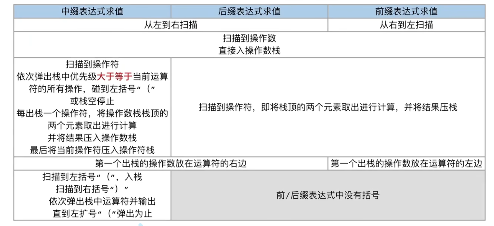

**一、中缀怎么转后缀 / 前缀：画表达式树**

- 运算符按优先级和结合性往下管住它的两个运算对象，画成一棵二叉树：**操作数全在叶子上，运算符全在内部结点**；
- 这棵树**后序遍历 = 后缀表达式**、**先序遍历 = 前缀表达式**、中序遍历 = 中缀表达式；
- 所以三种表达式里**操作数的相对顺序完全一样**（都是原表达式里从左到右的顺序），变的只是运算符插在哪儿；
- 手算就用「**从树底往上合并**」：先找优先级最高、最靠里的小单元合成一个整体，再往上接。

以 `A+B*(C−D)−E/F` 为例：

| 合并到哪一步 | 后缀 | 前缀 |
| --- | --- | --- |
| `C−D` | `C D −` | `− C D` |
| `B*(C−D)` | `B C D − *` | `* B − C D` |
| `A+B*(C−D)` | `A B C D − * +` | `+ A * B − C D` |
| `E/F` | `E F /` | `/ E F` |
| 整体 | `A B C D − * + E F / −` | `− + A * B − C D / E F` |

**二、代码怎么算**（对应上面那张表）：

- **后缀**：从左到右扫；操作数入栈；遇运算符弹出两个（**先弹出的是右操作数**），算完压回；
- **前缀**：**从右到左**扫；操作数入栈；遇运算符同样弹两个，但**先弹出的是左操作数**；
- **中缀**：两个栈（操作数栈 + 运算符栈），遇运算符先把栈里优先级 ≥ 它的都算掉，括号单独处理。

举一个前缀的例子：`+ * 3 4 5`（即 `3*4+5`），**从右往左**扫：

| 扫到 | 动作 | 栈（底 → 顶） |
| --- | --- | --- |
| `5` | 入栈 | 5 |
| `4` | 入栈 | 5, 4 |
| `3` | 入栈 | 5, 4, 3 |
| `*` | 弹出 3、4，先弹的是**左**操作数 → 3×4=12，压回 | 5, 12 |
| `+` | 弹出 12、5 → 12+5=17，压回 | 17 |

得 17 ✅。

### 中缀表达式转后缀表达式

从栈的角度看，它和"中缀求值"差不多，**区别是不用维护操作数栈**：操作数直接输出，栈里只留暂时定不了次序的运算符。

- 从左到右扫描中缀表达式；
- 遇到**操作数**，直接输出；
- 遇到**运算符**：依次弹出栈中优先级 **≥ 它**的运算符并输出（碰到左括号或栈空就停），最后把当前运算符入栈；
- 遇到**左括号**入栈；遇到**右括号**就一直弹栈输出，直到把那个左括号弹掉为止；
- 扫描结束，把栈里剩下的运算符依次弹出输出。

<u>例题：【2012】（栈里最多同时存几个运算符）</u>

【2012】已知操作符包括 `+` `-` `*` `/` `(` `)`。将中缀表达式 `a+b-a*((c+d)/e-f)+g` 转换为等价的后缀表达式 `ab+acd+e/f-*-g+` 时，用栈存放暂时还不能确定运算次序的操作符。栈初始时为空，转换过程中同时保存在栈中的操作符的最大个数是

- A. 5
- B. 7
- C. 8
- D. 11


**选 A（5 个）。** 按规则从左到右走一遍（栈里只放运算符，方括号内从左到右是栈底到栈顶）：

| 扫到 | 动作 | 栈 | 已输出 |
| --- | --- | --- | --- |
| `a` | 输出 | [] | a |
| `+` | 入栈 | [+] | a |
| `b` | 输出 | [+] | ab |
| `-` | `+` ≥ `-`，弹出 `+` 输出；`-` 入栈 | [- ] | ab+ |
| `a` | 输出 | [- ] | ab+a |
| `*` | `-` < `*`，不弹；`*` 入栈 | [- *] | ab+a |
| `(` | 入栈 | [- * (] | ab+a |
| `(` | 入栈 | [- * ( (] | ab+a |
| `c` | 输出 | [- * ( (] | ab+ac |
| `+` | 栈顶是 `(`，停；`+` 入栈 | [- * ( ( +] ← **5 个** | ab+ac |
| `d` | 输出 | [- * ( ( +] | ab+acd |
| `)` | 弹到 `(` 为止：弹出 `+` 输出，再弹掉 `(` | [- * (] | ab+acd+ |
| `/` | 栈顶是 `(`，停；`/` 入栈 | [- * ( /] | ab+acd+ |
| `e` | 输出 | [- * ( /] | ab+acd+e |
| `-` | `/` ≥ `-`，弹出 `/` 输出；栈顶 `(` 停；`-` 入栈 | [- * ( -] | ab+acd+e/ |
| `f` | 输出 | [- * ( -] | ab+acd+e/f |
| `)` | 弹出 `-` 输出，再弹掉 `(` | [- *] | ab+acd+e/f- |
| `+` | `*` ≥ `+`、`-` ≥ `+`，依次弹出输出；`+` 入栈 | [+] | ab+acd+e/f-*- |
| `g` | 输出 | [+] | ab+acd+e/f-*-g |
| 结束 | 弹出 `+` | [] | ab+acd+e/f-*-g+ |

结果与题目给的后缀表达式一致 ✅。过程中栈里最多同时有 **5** 个运算符（`- * ( ( +`），选 A。


### 递归

结合栈看递归，就是看调用过程：**最早进入的那次调用在栈底，最新进入的在栈顶**；每进入一层压一个栈帧，返回时弹出、恢复上一层。

<u>例题：【2015】（栈底到栈顶是谁）</u>

【2015】已知程序如下：

```c
int S(int n)
{ return (n<=0) ? 0 : S(n-1)+n; }
void main()
{ cout << S(1); }
```

程序运行时使用栈来保存调用过程的信息，自栈底到栈顶保存的信息依次对应的是

- A. `main() → S(1) → S(0)`
- B. `S(0) → S(1) → main()`
- C. `main() → S(0) → S(1)`
- D. `S(1) → S(0) → main()`


**选 A。** 调用顺序是 `main` 调 `S(1)`、`S(1)` 内部又调 `S(0)`，所以自栈底到栈顶就是 `main() → S(1) → S(0)`：最早进入的压在底下，最后进入的落在顶上。


<u>例题：分析 F(6) 的调用过程</u>

若 F(n) 定义为

```c
int F(int n){
    if (n <= 2) return 1;
    else return F(n-2) + F(n-3) + 1;
}
```

请分析 F(6) 的调用过程。


调用树（两个分支，按源码顺序先走 `F(n-2)`）：

```text
F(6)
├─ F(4)
│  ├─ F(2) = 1
│  └─ F(1) = 1          → F(4) = 1 + 1 + 1 = 3
└─ F(3)
   ├─ F(1) = 1
   └─ F(0) = 1          → F(3) = 1 + 1 + 1 = 3
                        → F(6) = 3 + 3 + 1 = 7
```

栈的变化（栈底 → 栈顶）：

| 时刻 | 动作 | 栈 |
| --- | --- | --- |
| 1 | 调用 F(6) | F(6) |
| 2 | F(6) 调 F(4) | F(6), F(4) |
| 3 | F(4) 调 F(2) | F(6), F(4), F(2) |
| 4 | F(2) 命中 n ≤ 2，返回 1 | F(6), F(4) |
| 5 | F(4) 调 F(1) | F(6), F(4), F(1) |
| 6 | F(1) 返回 1 | F(6), F(4) |
| 7 | F(4) 返回 3 | F(6) |
| 8 | F(6) 调 F(3) | F(6), F(3) |
| 9 | F(3) 调 F(1) | F(6), F(3), F(1) |
| 10 | F(1) 返回 1 | F(6), F(3) |
| 11 | F(3) 调 F(0) | F(6), F(3), F(0) |
| 12 | F(0) 返回 1 | F(6), F(3) |
| 13 | F(3) 返回 3 | F(6) |
| 14 | F(6) 返回 7 | 空 |

共 7 次调用，栈最深 3 层，栈底始终是 F(6)。


## 考点6-队列的应用

这部分一般出选择题，记住下面几组场景就够了。

**用队列辅助实现的算法**：二叉树的层次遍历、BFS、BFS 求单源最短路径。

**队列的常用场景**：

1. 要求**公平调度**：就绪队列、阻塞队列、各种请求队列等；
2. 需要**排队处理数据的缓冲区**；
3. **多级反馈队列**调度算法。

## 考点7-稀疏矩阵

### 稀疏矩阵的存储

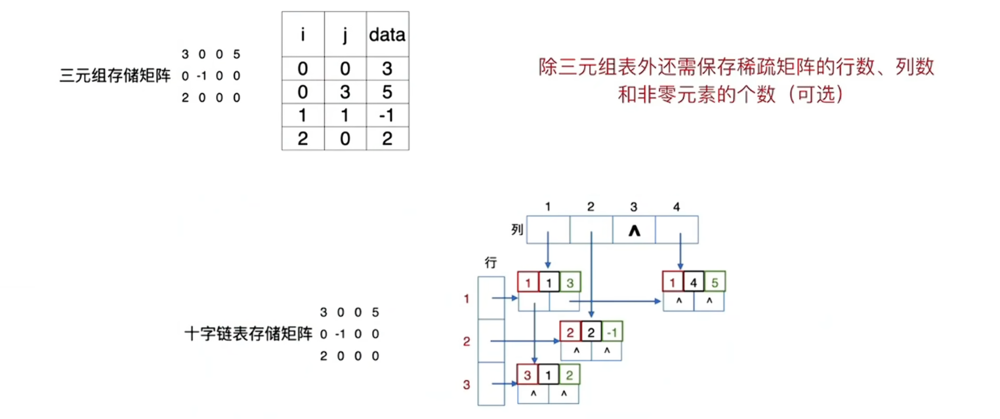

### 特殊矩阵的存储

<u>对称矩阵</u>

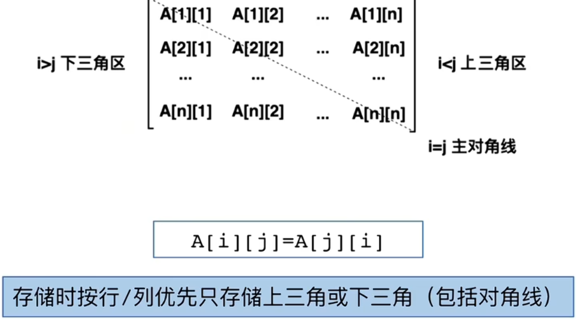

<u>三角矩阵 / 对角（带状）矩阵</u>

存储思路和对称矩阵一样，也是按行优先或列优先压缩进一维数组。

![A[i][j] 在一维数组中的下标：下标从 0 开始看"前面有几个元素"，从 1 开始看"它是第几个元素"](408考点强化-数据结构/compressed-array-index.png)

<u>例题：【2016】（三对角矩阵）</u>

【2016】有一个 100 阶的三对角矩阵 M，其元素 $m_{i,j}$（$1 \le i, j \le 100$）按行优先依次压缩存入下标从 0 开始的一维数组 N 中。元素 $m_{30,30}$ 在 N 中的下标是

- A. 86
- B. 87
- C. 88
- D. 89


**选 B（87）。** 三对角矩阵每行最多 3 个元素（$|i-j| \le 1$）。下标从 0 开始，所以**数 $m_{30,30}$ 前面有多少个元素**即可：

- 第 1 行只有 2 个元素（$m_{1,1}$、$m_{1,2}$）；
- 第 2 ~ 29 行每行 3 个，共 $28 \times 3 = 84$ 个；
- 于是第 30 行之前共 $2 + 84 = 86$ 个；
- 第 30 行依次是 $m_{30,29}$、$m_{30,30}$、$m_{30,31}$，$m_{30,30}$ 是本行第 2 个，前面还有 1 个。

合计前面 $86 + 1 = 87$ 个元素，下标就是 **87**。

通式：三对角矩阵按行优先存储（$i, j$ 从 1 开始、数组下标从 0 开始）时，$A[i][j]$ 的下标 $= 2i + j - 3$，代入 $i = j = 30$ 同样得 87。


<u>例题：【2021】（由两个地址反推每行几个元素）</u>

【2021】二维数组 A 按行优先方式存储，每个元素占用 1 个存储单元。若元素 `A[0][0]` 的存储地址是 100，`A[3][3]` 的存储地址是 220，则元素 `A[5][5]` 的存储地址是

- A. 295
- B. 300
- C. 301
- D. 306


**选 B（300）。** 考的是"行列号 ↔ 一维地址"的换算。

设每行有 $x$ 列。从 $A[0][0]$ 到 $A[3][3]$ 跨过 3 整行、再多 3 个元素：

$$3x + 3 = 220 - 100 = 120 \;\Longrightarrow\; x = 39$$

即每行 39 列，于是

$$A[5][5] = 100 + 5x + 5 = 100 + 5 \times 39 + 5 = 300$$


<u>例题：【2023】（三元组表还要存什么）</u>

【2023】若采用三元组表存储结构存储稀疏矩阵 M，则除三元组表外，下列数据中还需要保存的是

- Ⅰ. M 的行数
- Ⅱ. M 中包含非零元素的行数
- Ⅲ. M 的列数
- Ⅳ. M 中包含非零元素的列数

- A. 仅 Ⅰ、Ⅲ
- B. 仅 Ⅰ、Ⅳ
- C. 仅 Ⅱ、Ⅳ
- D. Ⅰ、Ⅱ、Ⅲ、Ⅳ


**选 A。** 三元组表只记了每个非零元素的（行号、列号、值），要把它**还原成矩阵**，还缺矩阵的形状——**行数和列数**（Ⅰ、Ⅲ）。至于哪几行、哪几列含非零元素，遍历一遍三元组就能统计出来，不必额外保存。


<u>例题：对称矩阵上三角按列存，求下标</u>

有一个 $n \times n$ 的对称矩阵 A，将其上三角部分（含主对角线）**按列**存放在一维数组 B 中，且规定 `A[0][0]` 放在 `B[0]` 处。若 $i \le j$，则 `A[i][j]` 在数组 B 中的下标为

- A. $\frac{j(j+1)}{2} + i$
- B. $\frac{i(i+1)}{2} + j$
- C. $\frac{n(n-1)}{2} - \frac{(n-j)(n-j-1)}{2} + i$
- D. $\frac{j(j-1)}{2} + i$


**选 A。** 按列存上三角，每列存的是一个"竖条"：第 0 列 1 个（$A[0][0]$）、第 1 列 2 个（$A[0][1]$、$A[1][1]$）……第 $j$ 列 $j+1$ 个（$A[0][j]$ 到 $A[j][j]$）。

所以 $A[i][j]$（$i \le j$）前面的元素数：

- 前 $j$ 列：$1 + 2 + \dots + j = \frac{j(j+1)}{2}$ 个；
- 本列之内：$A[0][j]$ 到 $A[i-1][j]$，共 $i$ 个。

即下标为 $\frac{j(j+1)}{2} + i$。核对：$A[0][0] \to 0$、$A[0][1] \to 1$、$A[1][1] \to 2$ ✅。


## 考点8-KMP中的next和nextval数组

朴素匹配失配后，主串指针要退回本趟起点、模式串指针回到开头，前面比过的全白比。KMP 的改进是**主串指针永不回退**，失配时只把模式串指针挪到某个合适位置继续比——挪到哪儿，查 next 数组即可。

next 数组刻画的是模式串自身的结构：失配处**前面那一段已经和主串匹配上了**，而这段里前缀和后缀相等，所以能把前缀挪到后缀的位置接着比，不必从头来。

**next 的算法**（默认从 0 开始）：

- 前两位固定是 **0 和 1**；
- 从第三个字符起，next 值 = **该字符之前那段子串的最长相等前后缀长度 + 1**。

两条注意事项：**单个字符本身不能算作前后缀**（前后缀都必须是真子串）；**前缀和后缀都从左到右读**。

以模式串 `A B C A C` 为例（位序从 1 数）：

| 位序 | 1 | 2 | 3 | 4 | 5 |
| --- | --- | --- | --- | --- | --- |
| 模式串 | A | B | C | A | C |
| next（从 0 开始） | 0 | 1 | 1 | 1 | 2 |
| next（从 −1 开始） | −1 | 0 | 0 | 0 | 1 |

逐位看：第 3 位 C 之前是 `AB`，最长相等前后缀长度为 0 → next = 1；第 4 位 A 之前是 `ABC`，也是 0 → 1；第 5 位 C 之前是 `ABCA`，前缀 `A` = 后缀 `A`，长度 1 → next = 1 + 1 = 2。

**失配时怎么用**（设在模式串下标为 $i$ 的位置失配）：

- next 从 0 开始：让模式串**第 next[i] 个**位置（"第几个"从 1 数）重新与主串当前位置比较；
- next 从 −1 开始：让模式串**下标为 next[i]** 的位置重新与主串当前位置比较（各值都减了 1，正好把"第几个"和"下标"对齐）。

注意区分：所谓"从 0 开始 / 从 −1 开始"，说的是 **next 数组第一个元素的值**（0 还是 −1）；**数组本身永远从下标 0 开始索引**。

---

<u>为什么需要 nextval：next 数组的冗余比较</u>

模式串 `A B C A C` 的 next 数组是 `0 1 1 1 2`，下图是它和主串匹配到一半、第 4 位失配时的情形：

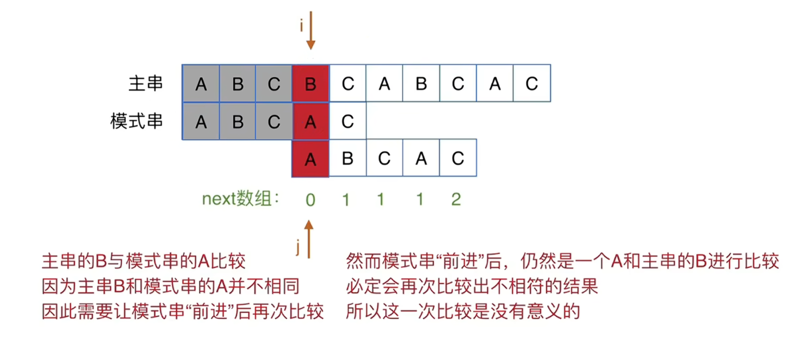

主串第 4 位是 `B`、模式串第 4 位是 `A`，两者不同，于是按 `next[4] = 1` 让模式串“前进”后接着比——可模式串第 1 位也是 `A`：上一步刚刚证明过主串这里不是 `A`，这一比注定再次失配。

nextval 就是用来压掉这类“滑过去还是同一个字符”的冗余比较的。

---

<u>nextval 数组的求法</u>

依次看 next 数组的每一位，拿**本位字符**和**本位 next 值所指的那一位字符**作比较：

- 二者**相同** → nextval 值改为**那一位的 nextval 值**；
- 二者**不同** → nextval 值和本位的 next 值相同。

仍以 `A B C A C` 为例（位序从 1 数）：

| 位序 | 1 | 2 | 3 | 4 | 5 |
| --- | --- | --- | --- | --- | --- |
| 模式串 | A | B | C | A | C |
| next | 0 | 1 | 1 | 1 | 2 |
| nextval | 0 | 1 | 1 | 0 | 2 |

只有第 4 位变了：`next[4] = 1` 指向的第 1 位字符 `A` 与本位字符 `A` 相同，于是 nextval 取那一位的 nextval（0）；其余各位两字符都不同，nextval 照抄 next。（换成从 −1 开始的约定，各位减 1：`−1 0 0 −1 1`。）

---



字符串按下标从 1 开始存放，`ch[0]` 空着不用。

**KMP 匹配**

```c
int Index_KMP(SString S, SString T, int next[]) {
    int i = 1, j = 1;
    while (i <= S.length && j <= T.length) {
        if (j == 0 || S.ch[i] == T.ch[j]) {
            ++i; ++j;                        // 继续比较后继字符
        } else {
            j = next[j];                     // 模式串向右滑动（主串指针 i 不回溯）
        }
    }
    if (j > T.length)
        return i - T.length;                 // 匹配成功
    else
        return 0;
}
```

**求 next**

```c
void get_next(SString T, int next[]) {
    int i = 1, j = 0;
    next[1] = 0;
    while (i < T.length) {
        if (j == 0 || T.ch[i] == T.ch[j]) {
            ++i; ++j;
            next[i] = j;
        } else {
            j = next[j];
        }
    }
}
```

**求 nextval**

```c
void get_nextval(SString T, int nextval[]) {
    int i = 1, j = 0;
    nextval[1] = 0;
    while (i < T.length) {
        if (j == 0 || T.ch[i] == T.ch[j]) {
            ++i; ++j;
            if (T.ch[i] != T.ch[j])
                nextval[i] = j;              // 滑过去字符不同，没有冗余
            else
                nextval[i] = nextval[j];     // 滑过去还是同一个字符，继续往下退
        } else {
            j = nextval[j];
        }
    }
}
```



---

<u>例题：【2015】（首次失配后 i 和 j 的取值）</u>

【2015】已知字符串 s 为 `abaabaabacacaabaabcc`，模式串 t 为 `abaabc`。采用 KMP 算法进行匹配，第一次出现"失配"（$s[i] \ne t[j]$）时，$i = j = 5$，则下次开始匹配时，i 和 j 的值分别为

- A. $i = 1$，$j = 0$
- B. $i = 5$，$j = 0$
- C. $i = 5$，$j = 2$
- D. $i = 6$，$j = 2$


**选 C（i = 5，j = 2）。** 模式串 `abaabc` 的 next 数组（从 0 开始）是：

| 位序 | 1 | 2 | 3 | 4 | 5 | 6 |
| --- | --- | --- | --- | --- | --- | --- |
| 模式串 | a | b | a | a | b | c |
| next | 0 | 1 | 1 | 2 | 2 | 3 |

失配发生在 $j = 5$：KMP 让主串指针 i 原地不动，只把 j 改成 `next[5] = 2`，所以下次开始匹配时是 $i = 5$、$j = 2$。


<u>例题：【2024】（修正后 next 数组的最大滑动距离）</u>

【2024】KMP 算法使用修正后的 next 数组进行模式匹配，模式串 S 为 `aabaab`，当主串的某个字符与 S 的某个字符失配时，S 向右滑动的最长距离是

- A. 5
- B. 4
- C. 3
- D. 2


**选 A（5）。** "修正后的 next 数组"就是 nextval：

| 位序 | 1 | 2 | 3 | 4 | 5 | 6 |
| --- | --- | --- | --- | --- | --- | --- |
| 模式串 | a | a | b | a | a | b |
| next | 0 | 1 | 2 | 1 | 2 | 3 |
| nextval | 0 | 0 | 2 | 0 | 0 | 2 |
| 右滑距离 $j - \mathrm{nextval}[j]$ | 1 | 2 | 1 | 4 | 5 | 4 |

第 $j$ 位失配时，模式串右滑 $j - \mathrm{nextval}[j]$ 格（滑完之后 nextval[j] 就是新的 j）。表里最大的是第 5 位失配时的 5，所以选 A。


# 三、非线性结构（上）

## 考点1-树形推断

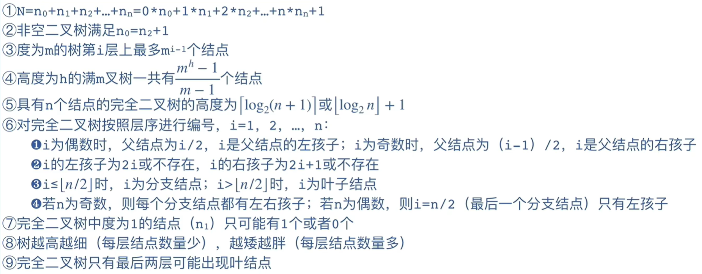

这九条里有三条能顺着推出来，不用一条条背：

- **① 推出 ②**：① 的两半其实是同一个量——「结点总数」和「所有结点的度之和 + 1」（除根之外每个结点都是别人的孩子，度之和正好是结点数减一）。对二叉树写开，只有度为 0、1、2 的结点，于是 $n_0 + n_1 + n_2 = n_1 + 2n_2 + 1$，移项即 $n_0 = n_2 + 1$。这条在九条里用得最多。
- **③ 推出 ④**：③ 管的是单层（第 $i$ 层最多 $m^{i-1}$ 个），把 $h$ 层的上界加起来就是 ④：$1 + m + m^2 + \dots + m^{h-1} = \frac{m^h - 1}{m - 1}$。取 $m = 2$ 就落回二叉树的两条结论——**第 $i$ 层最多 $2^{i-1}$ 个结点**、**高度为 $h$ 的满二叉树共 $2^h - 1$ 个结点**；一条的指数是「层号减 1」、另一条是「高度」，这两条最容易张冠李戴。
- **④ 推出 ⑤**：高度为 $h - 1$ 的满二叉树有 $2^{h-1} - 1$ 个结点，高度为 $h$ 的有 $2^h - 1$ 个。$n$ 个结点的完全二叉树，$n$ 必然大于前者、不超过后者，即 $2^{h-1} - 1 < n \le 2^h - 1$，于是 $2^{h-1} < n + 1 \le 2^h$，解得 $h = \lceil \log_2(n+1) \rceil$。

---

<u>例题：【2010】（由各度的结点数求叶结点数）</u>

【2010】在一棵度为 4 的树 T 中，若有 20 个度为 4 的结点、10 个度为 3 的结点、1 个度为 2 的结点、10 个度为 1 的结点，则树 T 的叶结点的个数是

- A. 41
- B. 82
- C. 113
- D. 122


**选 B（82）。** 直接套 ① 那条恒等式「结点总数 = 所有结点的度之和 + 1」：度之和 $= 20 \times 4 + 10 \times 3 + 1 \times 2 + 10 \times 1 = 122$，于是结点总数 $N = 122 + 1 = 123$，叶结点数 $n_0 = 123 - (20 + 10 + 1 + 10) = 82$。


<u>例题：【2016】（由森林的边数和结点数求树的个数）</u>

【2016】若森林 F 有 15 条边、25 个结点，则 F 包含树的个数是

- A. 8
- B. 9
- C. 10
- D. 11


**选 C（10）。** 每棵树里，除根以外的每个结点都恰好往上连一条边，所以**整个森林的边数 = 非根结点的个数**：25 个结点里非根的有 15 个，根结点就是 $25 - 15 = 10$ 个，而一个根结点对应一棵树，森林里共 10 棵树。


<u>例题：【2016】（正则 k 叉树的叶结点数与结点数范围）</u>

【2016】若一棵非空 k（$k \ge 2$）叉树 T 中的每个非叶结点都有 k 个孩子，则称 T 为正则 k 叉树。请回答下列问题并给出推导过程。
1）若 T 有 m 个非叶结点，则 T 中的叶结点有多少个？
2）若 T 的高度为 h（单结点的树 $h = 1$），则 T 的结点数最多为多少个？最少为多少个？


**1）叶结点有 $m(k-1) + 1$ 个。** 设叶结点数为 $n_0$，结点总数就是 $N = m + n_0$。每个非叶结点都有 k 个孩子，孩子总数是 $mk$；而除根以外每个结点都是别人的孩子，孩子总数又等于 $N - 1$。两式相等：$mk = m + n_0 - 1$，解得 $n_0 = m(k-1) + 1$。

**2）最多 $\frac{k^h - 1}{k - 1}$ 个，最少 $k(h-1) + 1$ 个。**

最多：让每一层都长满——第 1 层 1 个、第 2 层 k 个、第 3 层 $k^2$ 个……第 h 层 $k^{h-1}$ 个，等比求和得 $1 + k + k^2 + \dots + k^{h-1} = \frac{k^h - 1}{k - 1}$。

最少：树高为 h，就要求有结点一直伸到第 h 层。根必须是非叶结点（否则高度只有 1），于是第 2 层固定有 k 个结点；这 k 个里只留一个继续长孩子、其余 $k-1$ 个当叶子，第 3 层又只有 k 个……直到第 h 层，每层都是 k 个。总数 = 第 1 层的 1 个 + 第 2 到第 h 层每层的 k 个 = $1 + k(h-1)$。


<u>例题：完全二叉树有 128 个叶结点，最大深度是多少</u>

已知一棵完全二叉树有 128 个叶子结点，根节点的深度为 1，那么这棵树可能的最大深度是

- A. 7
- B. 8
- C. 9
- D. 10


**选 C（9）。** 完全二叉树的叶结点数由结点总数唯一决定：$n$ 为偶数时 $n_0 = n/2$，$n$ 为奇数时 $n_0 = (n+1)/2$，合起来就是 $n_0 = \lceil n/2 \rceil$。反过来由 $n_0 = 128$ 得 $n = 255$ 或 $n = 256$。

深度要最大，结点数就取多的那个，$n = 256$：前 8 层是满的，共 $2^8 - 1 = 255$ 个结点，多出的 1 个落在第 9 层。这时第 9 层那 1 个是叶结点，第 8 层里它的父结点有了孩子、剩下的 127 个才是叶结点，加起来正好 128。用 ⑤ 的公式核对：$h = \lfloor \log_2 256 \rfloor + 1 = 9$。


<u>例题：给定结点总数，哪种树不能确定叶结点数</u>

给定结点总数 n，则不能确定叶子结点数量的是

- A. 满二叉树
- B. 完全二叉树
- C. 哈夫曼树
- D. 二叉搜索树


**选 D。** 前三种的叶结点数都能由 $n$ 直接算出：满二叉树是 $n_0 = \frac{n+1}{2}$，哈夫曼树也是 $n_0 = \frac{n+1}{2}$（每个非叶结点都有两个孩子，$n_1 = 0$），完全二叉树是 $n_0 = \lceil n/2 \rceil$。

二叉搜索树的形状取决于结点插入的先后顺序，同一个 $n$ 能长出各种形态：$n = 3$ 时，链状的 BST 只有 1 个叶结点，根带两个孩子的那种有 2 个，叶结点数并不唯一。


## 考点2-树的存储

### 二叉树的存储方式

**顺序存储**：把二叉树补成完全二叉树，再按下标放进数组。一般从下标 1 开始存——这样父子关系直接算得出来（$i$ 的左孩子是 $2i$、右孩子是 $2i+1$、父结点是 $\lfloor i/2 \rfloor$）；下标 0 一般空出来存结点总数。

**链式存储**：二叉链表，每个结点是「数据域 + 左孩子指针 + 右孩子指针」。$n$ 个结点的二叉链表一共有 $n+1$ 个空链域。

两种存法按查找代价对照：

| 存储方式 | 存储结构 | 找父结点 | 找子结点 |
| --- | --- | --- | --- |
| 顺序存储 | 按完全二叉树补空放进数组，一般从下标 1 开始 | 方便 | 方便 |
| 二叉链表 | 数据域 + 左孩子指针 + 右孩子指针 | 不方便 | 方便 |

### 树的存储

**双亲表示法**：数组存储，每个位置存 data 和父结点下标 parent。找父结点方便，找子结点要遍历整个数组。

**孩子表示法**：每个结点的所有孩子串成一条单链表，所有孩子链表的头指针放在一个顺序表里。找孩子方便，找父结点不方便。

**孩子兄弟表示法**：用二叉链表，每个结点是「数据域 + 指向下一个孩子的指针 + 指向下一个兄弟的指针」。用法灵活、能复用二叉树的算法；再加一个 parent 指针变成三叉链表，就能高效查找父结点。

三种表示法按查找代价对照：

| 存储方式 | 存储结构 | 找父结点 | 找子结点 |
| --- | --- | --- | --- |
| 双亲表示法 | 数组，每个位置存 data 和父结点下标 parent | 方便 | 不方便，要遍历整个数组 |
| 孩子表示法 | 顺序表存各孩子链表的头指针，孩子串成单链表 | 不方便 | 方便 |
| 孩子兄弟表示法 | 二叉链表：数据域 + 第一个孩子的指针 + 下一个兄弟的指针 | 不方便（再加 parent 指针就可以） | 方便 |

---

<u>例题：【2020】（顺序存储至少需要多少单元）</u>

【2020】对于任意一棵高度为 5 且有 10 个结点的二叉树，若采用顺序存储结构保存，每个结点占 1 个存储单元（仅存放结点的数据信息），则存放该二叉树需要的存储单元数量至少是

- A. 31
- B. 16
- C. 15
- D. 10


**选 A（31）。** 关键词是「**任意**」和「至少」：问的是"保证任意一棵高 5、10 个结点的二叉树都装得下"需要多少单元，所以按最坏情况算，而不是挑一棵省地方的树（完全二叉树 10 个结点只到下标 15 附近）。顺序存储的下标就是完全二叉树的编号，高度为 5 的树，结点下标最大会落在第 5 层的最后一个位置，也就是 $2^5 - 1 = 31$：让路径一路向右走（$1 \to 3 \to 7 \to 15 \to 31$），最后那个结点就能放到第 5 层最右边；这条斜链只占 5 个结点，剩下 5 个随便挂在别的空位上，照样是高 5、10 个结点的二叉树。所以至少需要 31 个存储单元。


<u>例题：三叉链表的空指针域个数</u>

具有 n 个结点的三叉树用三叉链表表示，则树中空指针域的个数为

- A. $3n+1$
- B. $2n+1$
- C. $3n-1$
- D. $3n$


**选 B（$2n+1$）。** 三叉链表的每个结点有 3 个指针域，$n$ 个结点一共 $3n$ 个。从下往上看，除根结点以外每个结点都恰好被父结点的一个指针指着，所以非空的指针域只有 $n-1$ 个，空指针域就是 $3n - (n-1) = 2n+1$ 个。（同一套算法放在二叉链表上：$2n - (n-1) = n+1$，正好和前面那条对上。）


## 考点3-唯一确定一棵二叉树

能唯一确定一棵二叉树的组合是**中序 + 先序**、**中序 + 后序**、层序 + 中序——都离不开中序（中序定左右，另一种序定根）；只有**先序 + 后序不行**：某个结点只带一个孩子时，从这两种序列里分不出它是左孩子还是右孩子。

---

<u>中序 + 先序</u>

先序的第一个元素就是根；拿它去中序里一劈，左边是左子树、右边是右子树，再对这两段递归。下图是先序 `2 1 5 4 3 6`、中序 `5 1 2 4 6 3` 的还原过程：

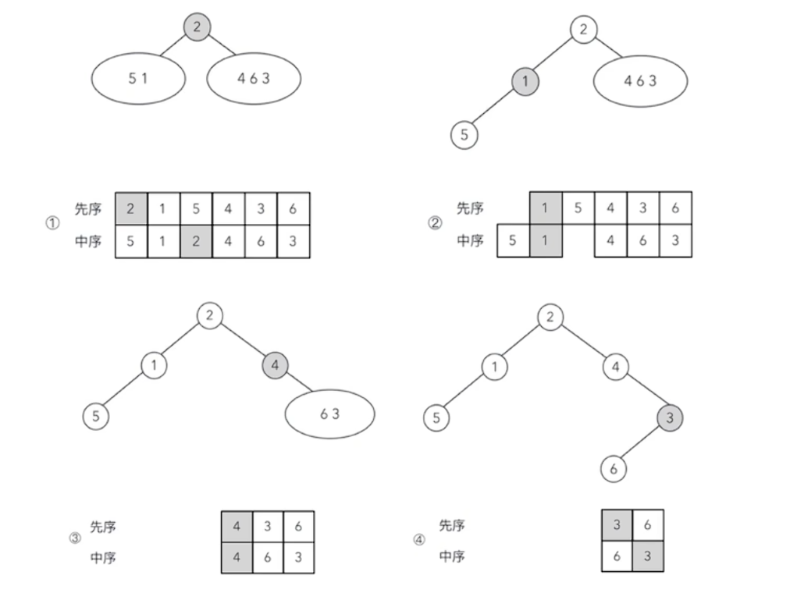

① 先序第一个是 2 → 根是 2；中序里 2 左边是 `5 1`、右边是 `4 6 3`。
② 左子树那两个结点对应先序开头的 `1 5`，第一个 1 就是它的根；中序里 5 在 1 左边 → 5 是 1 的左孩子。
③ 右子树那三个结点对应先序的 `4 3 6` → 4 是根；中序里 4 左边为空，所以 4 没有左子树，右边的 `6 3` 是它的右子树。
④ `6 3` 在先序里是 `3 6` → 3 是根；中序里 6 在 3 左边 → 6 是 3 的左孩子。

---

<u>中序 + 后序</u>

换成后序，根就跑到序列的最后一位，切法完全一样。下图是后序 `2 1 5 4 3 6`、中序 `5 1 2 4 6 3` 的还原过程：

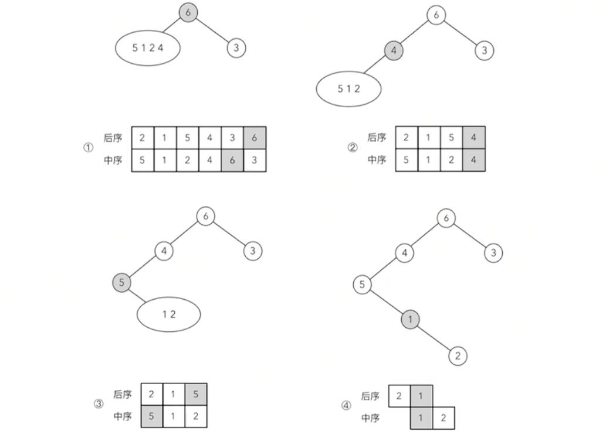

① 后序最后一个是 6 → 根是 6；中序里 6 左边是 `5 1 2 4`、右边是 `3`。
② 左子树那四个结点对应后序的 `2 1 5 4`，最后一位 4 是它的根；中序里 4 左边是 `5 1 2`、右边为空 → 4 没有右子树。
③ `5 1 2` 对应后序的 `2 1 5` → 5 是根；中序里 5 左边为空、右边是 `1 2` → 5 没有左子树。
④ `1 2` 对应后序的 `2 1` → 1 是根；中序里 1 左边为空、右边是 2 → 2 是 1 的右孩子。

---

<u>中序 + 层序</u>

层序的第一个元素就是根；把剩下的结点按中序里排在根的哪一侧分成两组，每组里**层序中最先出现的那个**就是这棵子树的根，然后一路往下分组。下图是层序 `2 1 4 5 3 6`、中序 `5 1 2 4 6 3` 的还原过程：

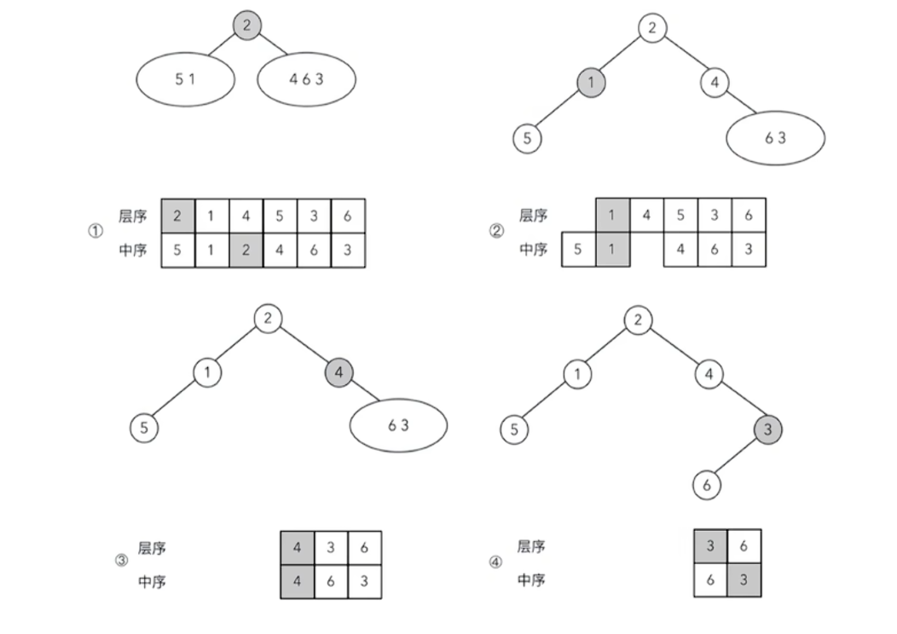

① 层序第一个是 2 → 根是 2；中序里 2 把它劈成左 `5 1`、右 `4 6 3`。
② 从左往右扫剩下的 `1 4 5 3 6`，看每个结点在中序里落在 2 的哪一侧：`1 5` 是左子树、`4 3 6` 是右子树，两边最先出现的结点各是 1 和 4 → 左子树的根是 1、右子树的根是 4。
③ 左子树 `5 1`：中序里 5 在 1 左边 → 5 是 1 的左孩子。右子树那一段的层序是 `4 3 6`、中序是 `4 6 3`，4 左边为空 → 4 没有左子树，`6 3` 全在它右边。
④ `6 3` 里层序是 `3 6` → 3 是根；中序里 6 在 3 左边 → 6 是 3 的左孩子。

---

<u>例题：【2011】（先序 + 后序定不出中序）</u>

【2011】一棵二叉树的前序遍历序列和后序遍历序列分别为 `1, 2, 3, 4` 和 `4, 3, 2, 1`，该二叉树的中序遍历序列不会是

- A. `1, 2, 3, 4`
- B. `2, 3, 4, 1`
- C. `3, 2, 4, 1`
- D. `4, 3, 2, 1`


**选 C。** 先序 `1 2 3 4` 定出 1 是根（后序最后一位也是 1，对上了）、2 是 1 唯一的孩子、3 是 2 唯一的孩子、4 是 3 唯一的孩子——这棵树的骨架就是一条 4 个结点的单链；至于每一节挂在左边还是右边，先序 + 后序看不出来（这正是这对组合定不出树的地方）。

单链里每个结点只有一棵子树，那棵子树的所有结点在中序里必须全排在它同一侧。看 C：`3, 2, 4, 1` 里 2 唯一的孩子子树是 `{3, 4}`，可 3 在 2 左边、4 在 2 右边，被 2 劈成了两半——出不来。另外三个都能构造：`1,2,3,4` 是 2、3、4 依次挂在右边，`4,3,2,1` 是依次挂在左边，`2,3,4,1` 是 2 挂 1 左边、其余挂右边。


<u>例题：【2012】（先序 + 后序能推出根有几个孩子）</u>

【2012】若一棵二叉树的前序遍历序列为 `a, e, b, d, c`，后序遍历序列为 `b, c, d, e, a`，则根结点的孩子结点

- A. 只有 e
- B. 有 e、b
- C. 有 e、c
- D. 无法确定


**选 A（只有 e）。** 先序 + 后序定不出整棵树的形状，那就只挑能确定的部分往下推。

**a 是根**：前序第一个是 a，后序最后一个也是 a，对上了。

**e 是这棵子树的根**：去掉 a，剩下前序 `e b d c`、后序 `b c d e`——前序的第一个、后序的最后一个都是 e。

**e 有没有兄弟**：不妨假设有。先序去掉 a 之后必然是两块——e 的子树整段在前、兄弟的子树整段在后（兄弟那棵子树只可能由 e 后面那些结点 `b d c` 组成）；后序的排法则是「e 的子树 → 兄弟的子树 → a」。e 是它那棵子树的根，在后序里排在 e 的子树那一段的最后，所以兄弟的子树必须整段落在 e 的**后面**。可实际后序 `b c d e a` 里，e 已经紧挨着 a 了（它后面只剩 a 一个），b、c、d 又全排在 e 前面——兄弟的子树无处可放，矛盾。所以 e 没有兄弟。

**另一条路，直接从定义看**：先序的结构是 `a [L] [R]`、后序是 `[L] [R] a`；去掉 a 之后，「前序的第一个」是 L 的根、「后序的最后一个」是 R 的根，而现在这两个位置都是 e，说明 e 既在 L 也在 R——e 只有一个，L 和 R 就不可能同时存在，e 只能是唯一的孩子。

小心别选 D：先序 + 后序定不出来的是「这个孩子挂在左边还是右边」以及往下各层的形状，根有几个孩子是定得出来的。


## 考点4-遍历和线索二叉树

### 二叉树的四种遍历

**先序遍历**（根 → 左 → 右）：先访问根结点，再递归遍历左子树，最后递归遍历右子树。

**中序遍历**（左 → 根 → 右）：先递归遍历左子树，再访问根结点，最后递归遍历右子树。

**后序遍历**（左 → 右 → 根）：先递归遍历左子树、再递归遍历右子树，最后才访问根结点。

**层次遍历**：自上而下、自左向右逐层访问——根结点入队，此后每出队一个结点就访问它，并把它的左、右孩子依次入队。

前三种都是递归实现的（本质是栈），栈深不超过树高 h，空间为 $O(h)$；层次遍历是唯一不用递归的那个，队列里最多同时放着"最宽的那一层"，空间最坏 $O(n)$。



**二叉树的结点（链式存储）**

```c
typedef struct BiTNode {
    ElemType data;
    struct BiTNode *lchild, *rchild;
} BiTNode, *BiTree;
```

**先序遍历**

```c
void PreOrder(BiTree T) {
    if (T != NULL) {
        visit(T);                        // 访问根结点
        PreOrder(T->lchild);             // 递归遍历左子树
        PreOrder(T->rchild);             // 递归遍历右子树
    }
}
```

**中序遍历**

```c
void InOrder(BiTree T) {
    if (T != NULL) {
        InOrder(T->lchild);              // 递归遍历左子树
        visit(T);                        // 访问根结点
        InOrder(T->rchild);              // 递归遍历右子树
    }
}
```

**后序遍历**

```c
void PostOrder(BiTree T) {
    if (T != NULL) {
        PostOrder(T->lchild);            // 递归遍历左子树
        PostOrder(T->rchild);            // 递归遍历右子树
        visit(T);                        // 访问根结点
    }
}
```

**层次遍历（辅助队列）**

```c
// 链式队列结点
typedef struct LinkNode {
    BiTNode *data;                       // 存指针而不是结点
    struct LinkNode *next;
} LinkNode;

typedef struct {
    LinkNode *front, *rear;              // 队头、队尾
} LinkQueue;

void LevelOrder(BiTree T) {
    LinkQueue Q;
    InitQueue(Q);                        // 初始化辅助队列
    BiTree p;
    EnQueue(Q, T);                       // 根结点入队
    while (!IsEmpty(Q)) {                // 队列不空则循环
        DeQueue(Q, p);                   // 队头结点出队
        visit(p);                        // 访问出队结点
        if (p->lchild != NULL)
            EnQueue(Q, p->lchild);       // 左孩子入队
        if (p->rchild != NULL)
            EnQueue(Q, p->rchild);       // 右孩子入队
    }
}
```



### 非递归遍历

三种非递归遍历都用**栈**——递归"本质是栈"，非递归版本只是把这个栈显式写出来。有一点要抓住：**三种遍历压栈、出栈的时机完全一样**（一路向左压到底，左孩子空了就出栈、转向右孩子），**区别只在什么时候输出**：

- **先序**：入栈前输出（第一次碰到这个结点）——只有先序序列和**入栈顺序**一致；
- **中序**：出栈时输出（左子树回来了才轮到根）——只有中序序列和**出栈顺序**一致；
- **后序**：要麻烦一点，出栈时还不能输出，得先确认右子树也遍历完了。

对照着看这三份代码，差别就在 `cout` 那一行的位置。



**先序**

```c
void PreOrderTraverse(BiTree T) {
    InitStack(S);
    BiTree p = T;
    BiTree q;
    while (p || !StackEmpty(S)) {
        if (p) {
            cout << p->data;               // 先序：入栈之前就输出
            Push(S, p);
            p = p->lchild;
        } else {
            Pop(S, q);
            p = q->rchild;
        }
    }
}
```

**中序**

```c
void InOrderTraverse(BiTree T) {
    InitStack(S);
    BiTree p = T;
    BiTree q;
    while (p || !StackEmpty(S)) {
        if (p) {
            Push(S, p);
            p = p->lchild;
        } else {
            Pop(S, q);
            cout << q->data;               // 中序：出栈的时候才输出
            p = q->rchild;
        }
    }
}
```

**后序**

麻烦在于：出栈时栈顶 `q` 的右子树可能还没遍历过。办法是用 `r` 手动记录「刚刚输出的那个结点」，然后看栈顶：

- 取栈顶 `q`，如果【`q` 的右孩子非空】且【它不是刚访问过的 `r`】，说明 `q` 的右子树还没碰过——此时不能输出 `q`，转去遍历右子树；
- 否则（右孩子为空，或右孩子就是刚访问完的 `r`）——可以正常输出 `q`，并用 `r` 记下它。

```c
void PostOrderTraverse(BiTree T) {
    InitStack(S);
    BiTree p = T, r = NULL;                // r 记录上一个访问输出的结点
    BiTree q;
    while (p || !StackEmpty(S)) {
        if (p) {
            Push(S, p);
            p = p->lchild;
        } else {
            GetTop(S, q);
            if (q->rchild && q->rchild != r)   // 右子树还没遍历过
                p = q->rchild;
            else {
                Pop(S, q);
                cout << q->data;
                r = q;
                p = NULL;
            }
        }
    }
}
```



### 线索化

线索二叉树说的是**物理结构**：每个结点是 `[lchild][lTag][data][rTag][rchild]`，多出来的两个 tag 用来交代旁边的指针到底指什么。

- **tag = 0**：指针指向**孩子**（还是原来那个二叉链表）；
- **tag = 1**：指针指向**前驱 / 后继**（这就是"线索"）。

实现上不用另写一套遍历：**在遍历的基础上，把输出语句换成线索化的核心代码**就行。



核心代码里 `pre` 始终指向上一个访问过的结点，也就是当前结点的前驱；`pre` 一开始置成 NULL。

```c
pre = NULL;
...
if (!p->lchild) {                 // 左孩子为空 → 左指针改指前驱
    p->lchild = pre;
    p->ltag = 1;
}
if (pre && !pre->rchild) {        // 前驱的右孩子为空 → 它的右指针改指后继 p
    pre->rchild = p;
    pre->rtag = 1;
}
pre = p;                          // 这个结点走完了，它就是下一个结点的前驱
```

填进前面的先序遍历，原本写 `cout << p->data;` 的位置就换成这段：

```c
void PreOrderTraverse(BiTree T) {
    InitStack(S);
    BiTree p = T;
    BiTree q;
    BiTree pre = NULL;
    while (p || !StackEmpty(S)) {
        if (p) {
            if (!p->lchild) {
                p->lchild = pre;
                p->ltag = 1;
            }
            if (pre && !pre->rchild) {
                pre->rchild = p;
                pre->rtag = 1;
            }
            pre = p;
            Push(S, p);
            p = p->lchild;
        } else {
            Pop(S, q);
            p = q->rchild;
        }
    }
}
```



中序线索树里找前驱、找后继的两条规律：

- 某个结点**有右孩子**时，它的后继是它**右子树中最左下**的结点；
- 某个结点**有左孩子**时，它的前驱是它**左子树中最右下**的结点。

<u>例题：【2014】（中序线索化后 X 的左右线索）</u>

【2014】若对下图所示的二叉树进行中序线索化，则结点 X 的左、右线索指向的结点分别是

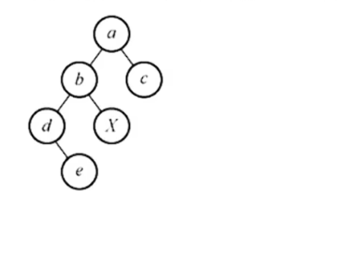

- A. e, c
- B. e, a
- C. d, c
- D. b, a


**选 D（b, a）。** 中序遍历这棵树得到 `e d b X a c`：排在 X 前面的 b 是它的前驱，排在后面的 a 是它的后继。

X 是叶结点，左、右指针本来都空着，线索化时两个都要改成线索——左线索指向前驱 b、右线索指向后继 a，所以是 D。


<u>例题：【2010】（哪棵是后序线索树）</u>

【2010】下列线索二叉树中（用虚线表示线索），符合后序线索树定义的是（四个选项见下图）



**选 D。** 这棵树的后序序列是 `d b c a`，按「左指针空就指前驱、右指针空就指后继」逐个数：

| 结点 | 空的指针 | 该指向谁 |
| --- | --- | --- |
| a | 没有 | 左右都是真孩子，不产生线索 |
| b | 左 | 前驱 d |
| c | 左、右 | 左指前驱 b、右指后继 a |
| d | 左、右 | 左指针是后序第一个、没有前驱（仍是 NULL），右指后继 b |

也就是说虚线该是「b 的左线索指 d、c 的左线索指 b、c 的右线索指 a、d 的右线索指 b」这四条，只有 D 全对得上。

另外三个都能挑出对不上的地方：A 把 d 的右线索指到了 c，B 里有两条线索都指向 a（后序里指向 a 的只该有 c 那一条），C 里 d 的右线索也指到了 c。


<u>例题：下列关于二叉树的叙述中，哪个正确</u>

下列关于二叉树的叙述中，正确的是

- A. 若二叉树的先序遍历结果是 `ABCD`，则其中序遍历结果可以是 `DABC`
- B. 如果二叉树的先序遍历序列和中序遍历序列的最后一个结点相同，那么该结点一定是整棵树最右侧的叶子结点
- C. 要交换二叉树所有分支结点的左右子树，最好利用中序遍历作为框架解决
- D. 删除一棵二叉树可以通过先序递归方式依次释放所有结点


**选 B。**

- **A 错**：先序 `ABCD` 定出根是 A。若中序是 `DABC`，那 A 左边只有 `D`（左子树）、右边是 `BC`（右子树），先序就应该是 A、D、BC 拼起来得 `ADBC`，和题给的 `ABCD` 对不上。
- **B 对**：先序的最后一个结点，是从根出发「有右孩子就往右、没有右孩子才往左」走到底的那个；中序的最后一个结点是顺着右孩子走到底的**最右下**结点（它必然没有右孩子）。这两个位置要是同一个结点，它就连左孩子也不能有——否则先序的最后会拐进它的左子树里。所以它一定是最右侧的叶子结点。
- **C 错**：交换左右子树用**后序**（先序也行）做框架都可以，唯独**中序不行**——中序的框架是「左、根、右」，把根的左右孩子换完再去遍历"左子树"时，走进去的已经是被换过来的原右子树，原左子树整条都被漏掉。
- **D 错**：释放结点必须**最后**释放根，否则根的左右孩子指针一丢，剩下的结点再也找不到。所以要用**后序**递归，而不是先序。


## 考点5-树、森林与二叉树

核心就是**孩子兄弟表示法**：转换永远按「**左孩子、右兄弟**」来——原来的第一个孩子变成左孩子，其余的兄弟依次串在它右边。

| 转换方向 | 规则 |
| --- | --- |
| <span style="white-space:nowrap">树 ↔ 二叉树</span> | 左孩子、右兄弟 |
| <span style="white-space:nowrap">二叉树 → 森林</span> | 二叉树的根、根的右孩子、根的右孩子的右孩子……依次是森林里各棵树的根结点；其余结点按「左孩子右兄弟」还原 |
| <span style="white-space:nowrap">森林 → 二叉树</span> | 森林里各棵树的根结点，依次做二叉树的根、根的右孩子、根的右孩子的右孩子……；其余按「左孩子右兄弟」转换 |

由此能读出三条最常用的结论：

- 二叉树**从根出发一路往右**经过的结点个数，就是森林里**树的数量**；
- 森林里的结点**没有右兄弟**、或者根结点**没有下一个根**，对应到二叉树上就是：这个结点**没有右孩子**。
- 二叉树上**没有右孩子**的结点，正好是每个**非终端结点的最后一个孩子**，再加上**根链最末尾的那个结点**（它没有下一个根）。

遍历的对应关系也是同一套转换带来的：

| 树的遍历 | 二叉树的遍历 | 森林的遍历 |
| --- | --- | --- |
| 先根遍历 | 先序遍历 | 先序遍历 |
| 后根遍历 | 中序遍历 | 中（后）序遍历 |

> 注：树、森林不知道怎么遍历时，先转成二叉树，再对到上表里相应的遍历即可。

<u>例题：【2009】（森林转二叉树后 u、v 的关系）</u>

【2009】将森林转换为对应的二叉树，若在二叉树中，结点 u 是结点 v 的父结点的父结点，则在原来的森林中，u 和 v 可能具有的关系是

Ⅰ. 父子关系
Ⅱ. 兄弟关系
Ⅲ. u 的父结点和 v 的父结点是兄弟关系

- A. 只有 Ⅱ
- B. Ⅰ 和 Ⅱ
- C. Ⅰ 和 Ⅲ
- D. Ⅰ、Ⅱ 和 Ⅲ


**选 B（Ⅰ 和 Ⅱ）。** 把二叉树里 u → w → v 这条两步路径拆开，每一步只有两种走法：**往左下**进到第一个孩子、**往右下**进到下一个兄弟。

- **左 + 右**：w 是 u 的第一个孩子，v 又是 w 的下一个兄弟 → v 也是 u 的孩子，u、v 是**父子关系**（Ⅰ 成立）；
- **右 + 右**：u、w、v 是同一个父亲的连续三个兄弟 → u、v 是**兄弟关系**（Ⅱ 成立）；
- **左 + 左**：v 是 u 的孙子；
- **右 + 左**：u 是 v 的父亲的兄弟。

后两种都凑不出 Ⅲ 说的那层关系，所以 Ⅲ 不成立，选 B。


<u>例题：【2011】（二叉树中无右孩子的结点个数）</u>

【2011】已知一棵有 2011 个结点的树，其叶结点个数为 116，该树对应的二叉树中无右孩子的结点个数是

- A. 115
- B. 116
- C. 1895
- D. 1896


**选 D（1896）。** 直接套上面那条结论：非终端结点数 $= 2011 - 116 = 1895$，每个非终端结点贡献一个「最后一个孩子」（它在二叉树里没有右孩子），再加上树根（它没有下一个根，也就没有右孩子），一共 $1895 + 1 = 1896$ 个。


<u>例题：【2020】（由森林的遍历推出二叉树的后序）</u>

【2020】已知森林 F 及与之对应的二叉树 T，若 F 的先根遍历序列是 `a, b, c, d, e, f`，后根遍历序列是 `b, a, d, f, e, c`，则 T 的后序遍历序列是

- A. `b, a, d, f, e, c`
- B. `b, d, f, e, c, a`
- C. `b, f, e, d, c, a`
- D. `f, e, d, c, b, a`


**选 C。** 先套两条等价关系：**森林的先根遍历 = 二叉树 T 的先序**、**森林的后根遍历 = 二叉树 T 的中序**。所以 T 的先序是 `a b c d e f`、中序是 `b a d f e c`，题目就变成了"由先序 + 中序求后序"。

- 先序第一个是 a（中序里 a 也在，位置对得上）→ 中序里 a 左边只有 `b`、右边是 `d f e c`；左子树就一个结点 b，右子树的先序段是 `c d e f`。
- 右子树：先序段 `c d e f`、中序段 `d f e c` → 根是 c，中序里 c 排在最末尾 → c 没有右子树，左子树是 `d f e`。
- `d f e`：先序段 `d e f`、中序段 `d f e` → 根是 d，中序里 d 排最前面 → d 没有左子树，右子树是 `f e`。
- `f e`：先序段 `e f`、中序段 `f e` → 根是 e，f 是 e 的左孩子。

按后序「左、右、根」拼起来：左子树给出 `b`，右子树依次给出 `f e d c`，最后才是根 a → `b, f, e, d, c, a`，选 C。


<u>例题：森林有 n 个非终端结点时，二叉树上右指针为空的结点数</u>

森林 F 对应的二叉树是 B，若 F 有 n 个非终端结点，则 B 中右指针域为空的结点个数为

- A. $n-1$
- B. $n$
- C. $n+1$
- D. $n+2$


**选 C（$n+1$）。** 非终端结点就是**有孩子**的结点，落到二叉树上它必定有一棵左子树（左孩子 = 它的第一个孩子）；从这棵左子树**一路往右下**走（右孩子 = 下一个兄弟），走到头的那个结点右指针就是空的——它表示"没有下一个兄弟了"，也就是这个非终端结点的**最后一个孩子**。n 个非终端结点各贡献这样一个结点，已经有 n 个。

还差一个：**根链最末尾的那个结点**（森林里最后一棵树的根），它没有"下一个根"，右指针同样是空的。

合计 $n + 1$ 个，选 C。这条推理也正是前面第三条常用结论的来历。


## 考点6-哈夫曼树和哈夫曼编码

把 n 个**字符出现的频率**作为权，构造一棵带权路径长度最小的二叉树，由它求出来的编码就是哈夫曼编码。**带权路径长度 WPL** 只看叶子：每个叶子的「权 × 它到根的边数」加在一起。

下图这棵树是频率 a 3、b 5、c 11、d 23 构出来的，边上的 0/1 就是编码：

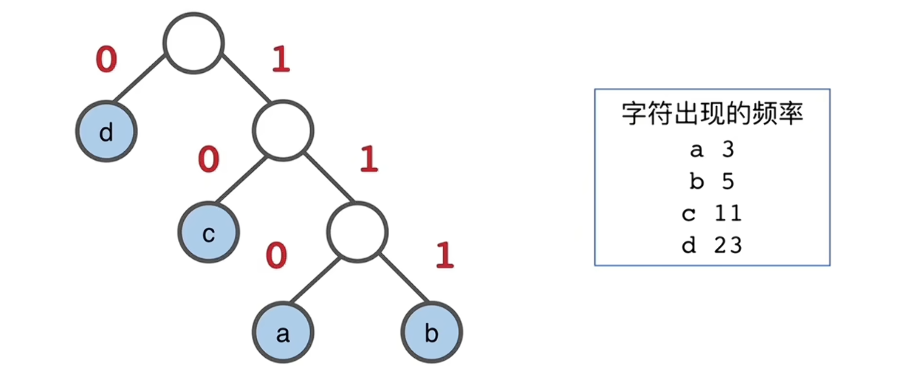

- 频率高的字符离根近、编码短：d 频率最高，一位码 `0` 就够了；a、b 频率最低，被压到最深的第三层（三位码）；
- 字符一定落在**叶子结点**上——这是构造过程决定的；
- 哈夫曼编码是**前缀编码**：任何一个字符的编码都不是另一个字符的前缀，所以两个字符不可能出现在「从根到某个叶子」的同一条路径上。

**定长还是变长**：所有字符的叶子落在**同一层**时，各字符编码长度相同（定长哈夫曼编码，各字符频率相同的时候就是这种）；频率有高有低时，叶子分布在不同层次，得到的才是变长编码——码短给高频字符，这才省下空间。



哈夫曼编码和计网里的**变长子网划分**（VLSM）是同一个思路：都是按"需求量"把不等长的资源分下去——需求大的（频率高的字符 / 需要地址多的子网）分到短的（短编码 / 短前缀、大地址块），需求小的分到长的。

两头也都要求"互相不冲突"：哈夫曼编码要求谁都不是别人的前缀；子网划分要求各子网的地址块不重叠，而且每个子网的网络前缀同样不能是另一个子网前缀的前缀。


**WPL 的两种算法**：

- **定义式**：所有叶子的带权路径长度之和，$\text{WPL} = \sum w_i \, l_i$（$l_i$ 是第 $i$ 个叶子到根的**边数**）；
- **累加式**：把每个**非终端结点的值**加起来，而每个非终端结点的值就是它两个孩子权值之和。

拿上图验一下：定义式 $23 \times 1 + 11 \times 2 + 3 \times 3 + 5 \times 3 = 69$；图上非终端结点是 8、19、42 三个，$8 + 19 + 42 = 69$——两种算法结果一致。

**几条常用结论**：

- 有 n 个叶子时，构造过程中新建了 $n - 1$ 个结点，最后一共 $2n - 1$ 个结点；
- 哈夫曼树只有度为 0 和 2 的结点，不存在度为 1 的结点，即 $n = n_0 + n_2$；
- 由非空二叉树的 $n_0 = n_2 + 1$ 得 $n = 2n_0 - 1 = 2n_2 + 1$；
- 权值（频率）越小的结点一般离根越远——正是这条保证了出现最多的字符拿到最短的编码；
- **同一组权值构造出的哈夫曼树可能不唯一**。

**m 叉哈夫曼树**：只有度为 0 和 m 的结点。设初始有 $n_0$ 个结点，先算 $k = (n_0 - 1) \bmod (m - 1)$，若 $k \ne 0$ 就补充 $m - 1 - k$ 个权值为 0 的结点凑数；然后照二叉的老办法，每次合并 **m 个权值最小**的结点，重复到只剩一个。

<u>例题：【2015】（两条根到叶的路径能否同属一棵哈夫曼树）</u>

【2015】下列选项给出的是从根分别到达两个叶结点路径上的权值序列，能属于同一棵哈夫曼树的是

- A. 24, 10, 5 和 24, 10, 7
- B. 24, 10, 5 和 24, 12, 7
- C. 24, 10, 10 和 24, 14, 11
- D. 24, 10, 5 和 24, 14, 6


**选 D。** 哈夫曼树里每个非终端结点的值 = 它两个孩子值之和，所以两条从根出发的路径必须处处对得上这个加法。

- **A**：两条路径在 10 处才分叉，说明 10 的两个孩子是 5 和 7，可 $5 + 7 = 12 \ne 10$；
- **B**：两条路径在根处分叉，根的两个孩子是 10 和 12，可 $10 + 12 = 22 \ne 24$；
- **C**：第一条路径是 24 → 10 → 10，结点不可能等于自己孩子的值（那兄弟就得是 0 权值）；
- **D**：根的孩子是 10 和 14（$10 + 14 = 24$）、10 的孩子是 5 和 5（$5 + 5 = 10$）、14 的孩子是 6 和 8（$6 + 8 = 14$）——三个加法全对；而且 5、5、6、8 按哈夫曼的合并顺序（$5+5$、$6+8$、$10+14$）正好能构造出来。


<u>例题：【2018】（哪组编码可能是哈夫曼编码）</u>

【2018】已知字符集 {a, b, c, d, e, f}，若各字符出现的次数分别为 6, 3, 8, 2, 10, 4，则对应字符集中各字符的哈夫曼编码可能是

- A. `00, 1011, 01, 1010, 11, 100`
- B. `00, 100, 110, 00, 0010, 01`
- C. `10, 1011, 11, 0011, 00, 010`
- D. `0011, 10, 11, 0010, 01, 000`


**选 A。** 先把哈夫曼树构出来定编码长度：按频率合并 $2 + 3 = 5$、$4 + 5 = 9$、$6 + 8 = 14$、$9 + 10 = 19$、$14 + 19 = 33$（每一步取的都是当前最小的两个，顺序唯一），于是各字符的位数是 **a 2 位、c 2 位、e 2 位、f 3 位、b 4 位、d 4 位**。

据此看选项：

- **A** 的长度正好是「6→2 位、3→4 位、8→2 位、2→4 位、10→2 位、4→3 位」，逐个核对也没有谁是谁的前缀；
- **B** 里 `00` 出现了两次（a 和 d），本身还和 `0010` 冲突；
- **C** 里 `00`（e）是 `0011`（d）的前缀，前缀编码被破坏；
- **D** 把 a 排成 4 位、b 排成 2 位，和「频率高的编码短」正好拧着。


<u>例题：【2023】（哈夫曼编码的加权平均长度）</u>

【2023】在由 6 个字符组成的字符集 s 中，各字符出现的频次分别为 3, 4, 5, 6, 8, 10，为 s 构造的哈夫曼编码的加权平均长度为

- A. 2.4
- B. 2.5
- C. 2.67
- D. 2.75


**选 B（2.5）。** 先按频次构造哈夫曼树，合并过程是 $3+4=7$、$5+6=11$、$7+8=15$、$10+11=21$、$15+21=36$。

WPL 用累加式直接读：$7+11+15+21+36 = 90$（换成定义式核一下也对：频次 3、4、5、6 的四个字符都占 3 位，8、10 的占 2 位，$3\times3+4\times3+5\times3+6\times3+8\times2+10\times2 = 90$）。

加权平均长度就是 WPL 平均到每个字符上：$90 \div (3+4+5+6+8+10) = 90 \div 36 = 2.5$，选 B。


<u>例题：【2012】（多个有序表两两归并，最坏比较次数最少）</u>

【2012】设有 6 个有序表 A、B、C、D、E、F，分别含有 10、35、40、50、60 和 200 个数据元素，各表中的元素按升序排列。要求通过 5 次两两合并，将 6 个表最终合并为 1 个升序表，并使最坏情况下比较的总次数达到最小。请回答下列问题：

1）给出完整的合并过程，并求出最坏情况下比较的总次数。
2）根据你的合并过程，描述 n（$n \ge 2$）个不等长升序表的合并策略，并说明理由。


**1）按"每次挑最短的两个"合并：**

| 步骤 | 合并 | 合并后长度 | 最坏比较次数 |
| --- | --- | --- | --- |
| ① | 10 + 35 | 45 | 44 |
| ② | 40 + 45 | 85 | 84 |
| ③ | 50 + 60 | 110 | 109 |
| ④ | 85 + 110 | 195 | 194 |
| ⑤ | 195 + 200 | 395 | 394 |

两个长度分别为 m、n 的有序表归并，最坏要比较 $m+n-1$ 次（每比较一次输出一个元素，只剩最后一个时不用再比），所以最坏情况下比较的总次数是

$$44+84+109+194+394 = 825$$

**2）策略：把各个表的长度当作权值，照哈夫曼树的构造过程来合并**——每次从当前所有表里选**长度最短的两个**合并，重复 $n-1$ 次到只剩一个表。

**理由**：这个总次数可以改写成 $\sum(\text{每次合并后新表的长度}) - (n-1)$，而"每次合并后新表的长度之和"正是这棵合并树的 **WPL**（各表长度 × 它参与合并的层数，加起来）。$n-1$ 是固定的，所以要让总次数最小，就等价于让这棵合并树的 WPL 最小——而 WPL 最小的二叉树正是哈夫曼树，也就是"每次合并最短的两个"。


<u>例题：【2020】（前缀编码的数据结构、译码与判定）</u>

【2020】若任意一个字符的编码都不是其他字符编码的前缀，则称这种编码具有前缀特性。现有某字符集（字符个数 $\ge 2$）的不等长编码，每个字符的编码均为二进制的 0、1 序列，最长为 L 位，且具有前缀特性。请回答以下问题：

1）哪种数据结构适宜保存上述具有前缀特性的不等长编码？
2）基于你所设计的数据结构，简述从 0/1 串到字符串的译码过程。
3）简述判定某字符集的不等长编码是否具有前缀特性的过程。


**1）一棵二叉树。** 每个结点带左、右两个孩子指针，字符存放在叶子上：一个字符的编码就是一条从根出发的路径，编码的 0 表示往左孩子走、1 表示往右孩子走，路径的终点存放该字符。因为编码满足前缀特性，任何一条这样的路径都不会中途撞上别的字符，整组编码正好铺成这棵树。（这种树不必是哈夫曼树——前缀编码只要求"编码互不为前缀"，哈夫曼树只是其中**比较常用**的一种。）

**2）译码过程**：把一个指针放在根结点上，从左往右扫描 0/1 串——读到 0 就沿左孩子走一步，读到 1 就沿右孩子走一步；走到存放字符的结点时输出该字符，并把指针**退回根结点**，接着读后面的位。0/1 串扫完，也就译出了完整的字符串。

**3）判定过程**：就是反过来"把这组编码填进一棵二叉树"，边走边建。

- 先准备一棵只有根结点的空树；
- 依次处理每个字符的编码：指针回到根，从左往右逐位扫描——遇到 0 就往左孩子走，左孩子不存在就新建一个；遇到 1 就往右孩子走，右孩子不存在就新建一个；编码扫完之后，在指针停留的那个结点上写下这个字符；
- 处理过程中只要出现下面任意一种情况，就说明这组编码**不具备**前缀特性：一是扫描某个编码时**从头到尾没有新建过任何结点**，说明这条路径之前已经被别的编码走完了——这个编码要么和某个字符的编码完全相同，要么是某个更长编码的前缀；二是扫描**中途走到了一个已经写着字符的结点**，说明前面那个字符的编码是它的前缀；
- 所有编码都这样顺利处理完、上面两种情况都没出现，则说明这组编码**具有**前缀特性。


<u>例题：哪种编码方案不可能是哈夫曼编码</u>

对字符进行哈夫曼编码时，不可能的方案是

- A. `00, 01, 10, 11`
- B. `00, 010, 011, 100, 101, 11`
- C. `00, 100, 101, 110, 111`
- D. `0000, 0001, 001, 01, 1`


**选 C。** 哈夫曼树里**不可能有度为 1 的结点**——构造时每次都是拿两个结点合并成一个新的，所以每个非叶结点必定左右孩子齐全。把每组编码展开成二叉树，逐个看内部结点：

- **A**：根分出 `0`、`1` 两支，每支再各分两个叶子（`00/01` 和 `10/11`），内部结点都是两个孩子 ✓；
- **B**：`0` 这支出 `00` 和 `01`，其中 `01` 再分出 `010`、`011`；`1` 这支出 `10`（再分出 `100`、`101`）和 `11`——每处也都是两个孩子 ✓；
- **C**：以 `0` 开头的只有 `00` 一条，也就是说 `0` 那个结点**只有左孩子、没有右孩子**，出现了**度为 1** 的结点 ✗——这不是哈夫曼树该有的形状，所以不可能；
- **D**：`1` 是叶子；`0` 这支出 `01` 和 `00`，`00` 再出 `001` 和 `000`，`000` 再出 `0000`、`0001`，从头到尾每个内部结点都是两个孩子 ✓。


<u>例题：编码长度不超过 4，已有 0 和 10，最多还能编码几个字符</u>

如果要求哈夫曼编码的长度小于等于 4，并且现在已经对 2 个字符编码为 `0` 和 `10`，则最多还可以对多少个字符进行编码？

- A. 3
- B. 4
- C. 5
- D. 6


**选 B（4）。** 已经用掉 `0` 和 `10` 之后，还能用的编码必须同时躲开这两条：

- 不能以 `0` 开头——否则 `0` 就是它的前缀；
- 不能以 `10` 开头——否则 `10` 是它的前缀。

两条合起来，剩下的编码**只能以 `11` 开头**。从 `11` 这个结点往下算，长度上限 4 位、已经用掉 2 位，还剩 $4-2=2$ 层可供分叉，最多放得下 $2^2 = 4$ 个字符，取满就是 `1100`、`1101`、`1110`、`1111` 这四个四位编码。

（反过来，如果图省事用 `11`、`110` 这种更短的编码，它自己会占掉一整片位置，能放的字符反而更少——想让数量最多，就要把可用位置都用最深的编码填满。）


# 四、非线性结构（下）

## 考点7-并查集的基本操作

并查集（Disjoint Set）管理的是**若干互不相交的集合**，每个集合用一棵树表示，**树根就是集合的代表元**。它对外只提供三种操作：

| 操作 | 作用 |
| --- | --- |
| `Initial(S)` | 初始化：每个元素各自成一个只有根结点的集合 |
| `Find(S, x)` | 查找：找出元素 x 所在集合的根 |
| `Union(S, x, y)` | 合并：把 x、y 所在的两个集合并成一个 |

用起来就是「**先查后并**」：合并之前必须先用 `Find` 查到 x、y 各自的根，再把其中一个根挂到另一个根下面，两个集合这才开始共用同一个根。

### 初始化

存储是**双亲表示法**的数组：下标就是元素本身，`S[i]` 里存的是 i 的**父结点下标**，顺着它一路往上走。初始时每个元素各自成一个集合，即每个元素都当根，双亲一律置成 `-1`：

```c
#define MAXSIZE 10
void Initial(int S[])
{
    for (int i = 0; i < MAXSIZE; i++)
        S[i] = -1;
}
```

`-1` 表示**没有父结点**——也就是这个元素自己就是所在树的根。

### 查找

从 x 出发，顺着双亲一路往上走，走到双亲为负数的那个结点，它就是根：

```c
int Find(int S[], int x)
{
    while (S[x] >= 0)
        x = S[x];
    return x;
}
```

不做优化时，一次查找的代价就是 x 到根的路径长度；合并时总是把新根挂到旧根下面，树会退化成一条长链，这时单次查找是 $O(n)$。**路径压缩**改的就是这一点：查完之后顺手把这条路径上的结点全部挂到根下面。

```c
int FindWithPathCompression(int S[], int x)
{
    int root = x;
    while (S[root] >= 0)             // 这个 while 是在找集合的根
        root = S[root];
    while (x != root) {
        int t = S[x];                // t 是为了标记 x 的父结点
        S[x] = root;                 // 把 x 挂在 root 下
        x = t;                       // 接下来一直往上处理 x 的父结点，全部挂到 root 下
    }
    return root;
}
```

### 合并

传进来的直接是**两个根**（合并前先用 `Find` 各查一次）。把一个根挂到另一个根下面，同时把两个集合的规模累加到新根上：

```c
void Union(int S[], int root1, int root2)
{
    if (root1 == root2) return;      // 已经在同一个集合里，不用并
    S[root1] += S[root2];            // 两个根存的都是 -结点数，相加就是合并后的 -结点数
    S[root2] = root1;                // root2 挂到 root1 下
}
```

**按秩合并**：上面这种写法里谁当根全看参数顺序，树容易越长越高；改成让小集合挂到大集合下面，树高就能压住。

```c
void Union(int S[], int root1, int root2)
{
    if (root1 == root2) return;
    if (S[root1] > S[root2]) {       // root1 的结点更少 → 小的挂到大的下面
        S[root2] += S[root1];
        S[root1] = root2;
    } else {
        S[root1] += S[root2];
        S[root2] = root1;
    }
}
```

不等号的方向要盯住：根结点里存的是 **`-结点数`**，所以值越**大**（越接近 0）说明集合越**小**。`S[root1] > S[root2]` 说的是「root1 规模更小」，该被挂上去的是 root1。

> 注：这里的「秩」直接拿结点数来当，换成树高也一样用——效果都是把矮的挂到高的下面。

---

按秩合并的收益直接体现在树高上：**集合树的高度不超过 $\lfloor \log_2 n \rfloor$**。

道理是「小挂大」让每一步都翻倍：某个根被挂到另一棵树下时，它自己的规模不比新的兄弟子树大，**合并之后这棵子树的规模至少是它原来规模的两倍**；反过来说，从任意结点往上数 $k$ 步，它所在子树的规模已经 $\ge 2^k$，而这个规模不会超过 $n$，于是 $k \le \log_2 n$。

| 做法 | 树高 | Find / Union 的代价 |
| --- | --- | --- |
| 只按秩合并 | $\le \lfloor \log_2 n \rfloor$ | 单次 $O(\log_2 n)$ |
| 路径压缩 + 按秩合并 | 只会更矮 | **均摊** $O(\alpha(n))$ |

**$O(\alpha(n))$ 是怎么算出来的**：

- $\alpha(n)$ 是**反阿克曼函数**。阿克曼函数增长得快到离谱，它的反函数就相应地慢到几乎不动——只要 $n < 2^{65536}$ 就有 $\alpha(n) \le 4$，408 里的 $n$ 离这个数还差着十万八千里，所以**当常数看**，直接记 $O(\alpha(n)) \approx O(1)$。
- 注意它**不是单次的界**。单次 `Find` 最坏仍然是 $O(\log_2 n)$（就是上面那条树高），$O(\alpha(n))$ 说的是**把一连串操作摊开之后每次的均摊代价**：路径压缩把整条查找路径上的结点都挂到根下面，这些结点下次再查一步就到根，节省下来的正好抵消掉走长链的开销；严格的界由摊还分析给出（把每个结点「被压缩掉的深度」记成一笔总账，摊到每次操作上）。
- 所以优化后的基本操作是「**先 `Find` 再 `Union`**」，写开就是 `Union(Find(x), Find(y))`，整体记 $O(\alpha(n))$。

### 并查集的应用

三个应用走的是**同一个循环骨架**：初始化并查集 → 遍历所有边 → 对每条边 (u, v) 先 `Find` 出 u、v 所在集合的根，再判断这两个根是不是同一个。区别只在"两个根相同 / 不同"时各自做什么：

| 应用 | 根相同时 | 根不同时 |
| --- | --- | --- |
| 检测图中是否有环 | 加入 (u, v) 会**形成环** | 用 `Union` 合并两个集合 |
| 实现 Kruskal 算法 | **跳过**这条边，看下一条 | (u, v) 加入最小生成树，再 `Union` |
| 判断无向图的连通性 | 什么都不做（已经连通） | `Union` 合并，u、v 就此连通 |

<u>检测图中是否有环</u>

1. 初始化并查集，每个顶点各自成一个集合；
2. 遍历所有边 (u, v)，分别 `Find` 出 u、v 所在集合的根：
   - 两个根相同 → 说明 u、v 在加这条边之前就已经连通，加入 (u, v) 会**形成环**；
   - 两个根不同 → 用 `Union` 合并这两个集合；
3. 所有边遍历完，全程没有出现过"根相同"，图里就没有环。

> 注：这个办法只对**无向图**有效——它判的是"u、v 早就连通了"；有向图里 u、v 连通不等于有环，得改用拓扑排序或 DFS 来判。

<u>实现 Kruskal 算法</u>

1. 初始化并查集；
2. 把图中所有边按**权值从小到大**排序；
3. 依次遍历每条边 (u, v)，分别 `Find` 出 u、v 所在集合的根：
   - 两个根相同 → 跳过这条边，看下一条；
   - 两个根不同 → 加上 (u, v) 不会成环，把这条边加入最小生成树，再用 `Union` 合并两个集合；
4. 最小生成树的边数达到 $|V| - 1$ 就可以停；边还不够却已经没有边可选，说明原图**不连通**，生成不出最小生成树。

<u>判断无向图的连通性</u>

1. 初始化并查集；
2. 遍历所有边 (u, v)，分别 `Find` 出 u、v 所在集合的根：
   - 两个根相同 → 什么都不做（本来就连通）；
   - 两个根不同 → 用 `Union` 合并这两个集合，意味着 u 和 v 就此连通；
3. 边遍历完，再遍历图中所有顶点，用 `Find` 找出各自所属集合的根：**所有顶点的根相同**，图就是连通的。

## 考点8-图的概念和性质

**① 子图**：设有两个图 $G = (V, E)$ 和 $G' = (V', E')$，若 $V' \subseteq V$ 且 $E' \subseteq E$，则称 $G'$ 是 $G$ 的子图。定义之外还得盯住一句：**$V'$ 和 $E'$ 要能扯上关系**——$E'$ 里每条边的两个端点都必须落在 $V'$ 里，不能「边留着、端点却不在」。

**② 完全图**：无向完全图有 $\frac{n(n-1)}{2}$ 条边，有向完全图有 $n(n-1)$ 条弧。完全图一定是连通的（有向则强连通），而且顶点数给定的时候，完全图的边数就是最多的。

**③ 连通分量 / 强连通分量**：连通分量 = 无向图中的**极大连通子图**；强连通分量 = 有向图中的**极大强连通子图**（有向图里任意两个顶点互相都能到达）。

「极大」说的是：**在"连通"这个前提下，能要的都要满**——

- **顶点要拉满**：从一个顶点出发，凡是和它连通的顶点，一个都不能落下；
- **边也要取满**：顶点集合定下来之后，原图中**两端都落在这个集合里**的边要全部收进来（少收一条就说明还能再加，那就不叫极大）。

举个例子：$V = \{1, 2, 3, 4, 5\}$、$E = \{(1,2), (2,3), (1,3), (3,4)\}$，那么

- $\{1, 2, 3, 4\}$ 连同这四条边是一个连通分量，$\{5\}$ 单独是另一个——连通分量就是把顶点分成这样几组；
- 子图 $\{1, 2, 3\}$ 只带边 $(1,2)$、$(2,3)$ 是连通的，却**不极大**：顶点 4 和 3 相邻、没被拉进来，边 $(1,3)$ 也漏了。它只是**连通子图**，不是连通分量。

有向图里「极大」的读法一样，只是把"连通"换成"强连通"、要求来回都走得到：比如 $1 \to 2$、$2 \to 1$、$2 \to 3$ 这个有向图，强连通分量是 $\{1,2\}$ 和 $\{3\}$。

**④ 生成树**：无向**连通**图中一个包含图中所有顶点的**极小连通子图**。

- 「极小」说的是**保证连通的前提下边数最少**——$n$ 个顶点正好 $n - 1$ 条边，多一条就成环、少一条就断开；
- 「极小连通子图」本身**不要求包含图中所有顶点**（比如非连通图里某个连通分量内部的生成树也算），是「生成树」这个说法额外加了"顶点一个不少"，所以它只对连通图存在；
- 各边带权时，**所有生成树里边权之和最小的那一棵**叫最小生成树（MST）。

**⑤ 边数的最少值**：无向图至少需要 $n - 1$ 条边才可能连通，边数**大于** $n - 1$ 时必定有回路；有向图至少需要 $n$ 条弧才能保证强连通（这时 $n$ 条弧正好围成一个环）。

**⑥ 度与边数的关系**：无向图中所有顶点的度之和**等于边数的 2 倍**；有向图中所有顶点的入度之和 $=$ 出度之和 $=$ 弧数。

**⑦ 连通分量的个数**：$n$ 个顶点的无向图**最少有 1 个**连通分量、**最多有 $n$ 个**。最少时 $n$ 个顶点两两之间都有路径，整张图就是它自己唯一的一个连通分量；最多时一条边都没有，每个顶点独立自成一个连通分量。

**⑧「保证连通」和「可以实现连通」**：

- **可以实现连通**：边摆在合适的位置上能连成一个连通图就行——但换个摆法可能就不连通了；
- **保证连通**：不管边怎么摆，图都必须连通。

| 问法 | 最少边数 |
| --- | --- |
| $n$ 个顶点的无向图**实现**连通 | $n - 1$ |
| $n$ 个顶点的无向图**保证**连通 | $\frac{(n-1)(n-2)}{2} + 1$ |

$n - 1$ 就是一条链把 $n$ 个顶点串起来。下面那个式子要按**最坏情况**倒着推：想让图不连通、还想把边塞到最多，就把顶点分成两块——一块 $n-1$ 个顶点做成完全图，边数正好是 $\frac{(n-1)(n-2)}{2}$，另一块只剩 1 个孤立顶点，这就已经是最费边的不连通摆法；再多加 1 条边，这个孤立顶点必定连进前面那一块，图就无论如何都连通了。

<u>例题：【2017】（图至少有几个顶点）</u>

【2017】已知无向图 G 含有 16 条边，其中度为 4 的顶点个数为 3、度为 3 的顶点个数为 4，其他顶点的度均小于 3。图 G 所含的顶点个数至少是

- A. 10
- B. 11
- C. 13
- D. 15


**选 B（11）。** 抓手就是「度之和等于边数的 2 倍」：所有顶点的度之和是 $2 \times 16 = 32$。

已经确定的 7 个顶点占掉 $4 \times 3 + 3 \times 4 = 24$ 度，还剩 $32 - 24 = 8$ 度要留给「其他顶点」。**要让顶点个数最少，就得让每个剩余顶点分摊到的度尽量大**——它们的度都小于 3，最大只能取 2，所以至少要 $8 \div 2 = 4$ 个顶点。

顶点总数 $3 + 4 + 4 = 11$，选 B。


<u>例题：【2022】（由顶点数、边数判断连通性）</u>

【2022】对于无向图 $G = (V, E)$，下列选项中，正确的是

- A. 当 $|V| > |E|$ 时，$G$ 一定是连通的
- B. 当 $|V| < |E|$ 时，$G$ 一定是连通的
- C. 当 $|V| = |E| - 1$ 时，$G$ 一定是不连通的
- D. 当 $|V| > |E| + 1$ 时，$G$ 一定是不连通的


**选 D。** 判据就是第 ⑤ 条：$n$ 个顶点的连通无向图**至少要有 $n - 1$ 条边**。

- **D 对**：$|V| > |E| + 1$ 即 $|E| < |V| - 1$，边数连"连通"的门槛都够不着，图必然不连通；
- **A 错**：三角形（3 个顶点 3 条边）再加一个孤立顶点，$|V| = 4 > |E| = 3$，照样不连通；
- **B 错**：两个互不相交的 $K_4$ 一共 8 个顶点 12 条边，$|V| < |E|$ 但图是断成两块的；
- **C 错**：$|V| = |E| - 1$ 即 $|E| = |V| + 1$，比最低要求还多两条边——$K_4$ 去掉一条边就是 4 个顶点 5 条边，连通得好好的。


<u>例题：恰好只有一个环的 n 个顶点 n 条边的连通图，不同生成树的数量</u>

若一个具有 $n$ 个顶点、$n$ 条边的连通无向图中，恰好只有一个环，则它的不同生成树的数量是

- A. 1
- B. $n$
- C. $n - 1$
- D. $n^2$


**选 B（$n$）。** $n$ 个顶点配 $n - 1$ 条边才是树，这个图多出来 1 条边，多出来的这条边正好落在**唯一那个环**上。

要得到生成树就得**破环**：从环上删掉任意一条边，剩下的 $n - 1$ 条边正好把 $n$ 个顶点连成一棵树；删环以外的边则环原样还在，成不了树。所以**生成树的棵数 = 唯一那个环上的边数**，本题里环上共有 $n$ 条边，一共 $n$ 棵，选 B。


<u>例题：35 个顶点、10 条边的无向图最多有几个连通分量</u>

具有 35 个顶点和 10 条边的无向图的连通分量最多是

- A. 35
- B. 30
- C. 31
- D. 32


**选 C（31）。** 想让连通分量**最多**，这 10 条边就得尽量"挤"在少数几个顶点上——只要一条边额外用到一个别的顶点，那个顶点就从"自成一个分量"变成"某个分量的一员"，分量总数就少一个。

那 10 条边最少能用几个顶点装下？$k$ 个顶点的无向完全图有 $\frac{k(k-1)}{2}$ 条边，$\frac{k(k-1)}{2} \ge 10$ 的最小 $k$ 是 5（$\frac{5 \times 4}{2} = 10$）——这 5 个顶点正好拼成一个 $K_5$，合成 **1 个**连通分量。

剩下 $35 - 5 = 30$ 个顶点一条边都不沾，每个自成一个连通分量。所以最多 $1 + 30 = 31$ 个，选 C。


## 考点9-邻接矩阵和邻接表

邻接矩阵和邻接表是图的两种基本存储结构，考得最多的是**怎么从存储结构里读出顶点的度**：

| 存储结构 | 图 | 怎么读度 |
| --- | --- | --- |
| 邻接矩阵 | 无向图 | 顶点 $v_i$ 的度 = 第 $i$ 行元素之和 = 第 $i$ 列元素之和 |
| 邻接矩阵 | 有向图 | 出度 = 第 $i$ 行元素之和；入度 = 第 $i$ 列元素之和 |
| 邻接表 | 无向图 | 顶点 $v_i$ 的度 = 第 $i$ 个边表中的结点个数 |
| 邻接表 | 有向图 | 出度 = 第 $i$ 个边表中的结点个数；入度得遍历所有顶点的边表，数出 $v_i$ 在边表里出现的次数 |

<u>例题：【2015】（邻接矩阵与 $A^m$ 的含义）</u>

【2015】已知含有 5 个顶点的图 G 如下图所示。


请回答下列问题：

1）写出图 G 的邻接矩阵 $A$（行、列下标从 0 开始）。
2）求 $A^2$，矩阵 $A^2$ 中位于 0 行 3 列元素值的含义是什么？
3）若已知具有 $n$（$n \ge 2$）个顶点的图的邻接矩阵为 $B$，则 $B^m$（$2 \le m \le n$）中非零元素的含义是什么？


**1）** 邻接矩阵的第 $i$ 行第 $j$ 列记的是「$i$ 到 $j$ 有没有边」，有边写 1、无边写 0（无向图的邻接矩阵一定对称）：

$$A = \begin{pmatrix}
0 & 1 & 1 & 0 & 1 \\
1 & 0 & 0 & 1 & 1 \\
1 & 0 & 0 & 1 & 0 \\
0 & 1 & 1 & 0 & 1 \\
1 & 1 & 0 & 1 & 0
\end{pmatrix}$$

**2）** 照矩阵乘法算，$A^2[i][j] = \sum_k A[i][k] \cdot A[k][j]$——求和里每一项「1」都对应一条 $i \to k \to j$ 的两步路径：

$$A^2 = \begin{pmatrix}
3 & 1 & 0 & 3 & 1 \\
1 & 3 & 2 & 1 & 2 \\
0 & 2 & 2 & 0 & 2 \\
3 & 1 & 0 & 3 & 1 \\
1 & 2 & 2 & 1 & 3
\end{pmatrix}$$

其中 0 行 3 列的元素值是 3，含义是**从顶点 0 到顶点 3 长度为 2 的路径有 3 条**：$0 \to 1 \to 3$、$0 \to 2 \to 3$、$0 \to 4 \to 3$。

**3）** $B^m$ 中第 $i$ 行第 $j$ 列的元素值，是**从顶点 $i$ 到顶点 $j$ 长度为 $m$ 的路径条数**；非零元素就意味着顶点 $i$ 到 $j$ 存在长度为 $m$ 的路径。


## 考点10-十字链表和邻接多重表

有向图里一条弧是**从弧尾（tail）指向弧头（head）**的。十字链表存**有向图**、邻接多重表存**无向图**，两者的结点都拆成"顶点结点 + 边/弧结点"两套。

### 节点结构

**十字链表的顶点结点**：`data | firstin | firstout`

| 字段 | 含义 |
| --- | --- |
| `data` | 用于存放数据 |
| `firstin` | 指向以 data 为**弧头**的第一条弧 |
| `firstout` | 指向以 data 为**弧尾**的第一条弧 |

**十字链表的弧结点**：`tailvex | headvex | hlink | tlink | (info)`

| 字段 | 含义 |
| --- | --- |
| `tailvex` | 弧尾指向的顶点的编号 |
| `headvex` | 弧头指向的顶点的编号 |
| `hlink` | 弧头相同的下一条弧 |
| `tlink` | 弧尾相同的下一条弧 |
| `info` | 弧的信息，一般省略 |

**邻接多重表的顶点结点**：`data | firstedge`

| 字段 | 含义 |
| --- | --- |
| `data` | 用于存放数据 |
| `firstedge` | 指向第一条依附于该顶点的边 |

**邻接多重表的边结点**：`ivex | ilink | jvex | jlink | (info)`

| 字段 | 含义 |
| --- | --- |
| `ivex` | 该边依附的两个顶点的编号之一 |
| `ilink` | 指向下一条依附于 ivex 的边 |
| `jvex` | 该边依附的另一个顶点的编号 |
| `jlink` | 指向下一条依附于 jvex 的边 |
| `info` | 边的信息，一般省略 |

把这些字段串起来，十字链表存一张有向图就是下面这个样子（有向图 $G_3$）：

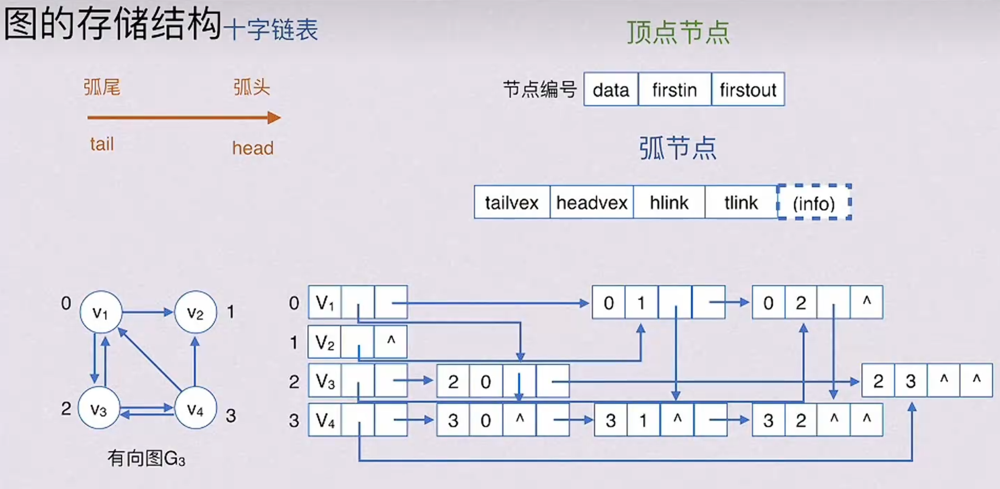

邻接多重表存一张无向图，就是下面这个样子（无向图 $G_2$）：

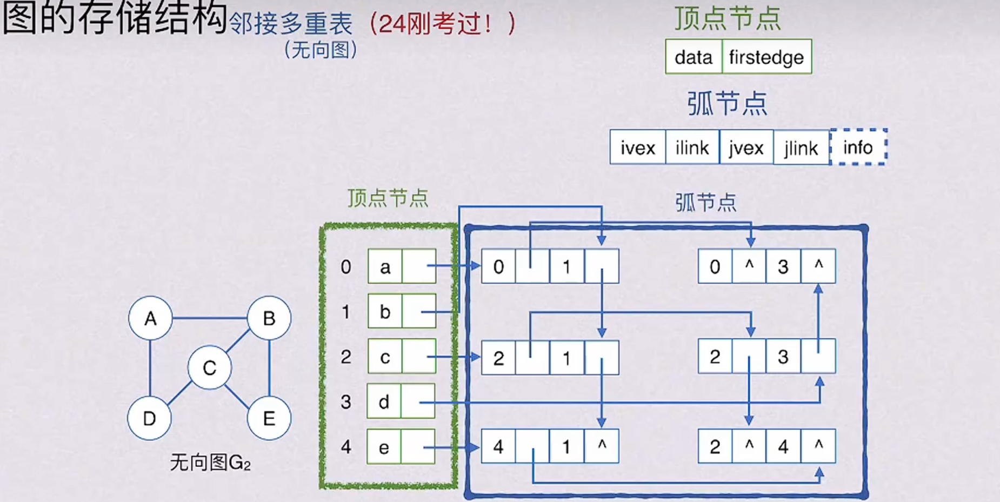

两种结构各自擅长的地方：

| 结构 | 它擅长什么 |
| --- | --- |
| 十字链表 | 结合了**邻接表和逆邻接表**：能方便地算出 $v_i$ 的**入度和出度**，也能找齐依附于某个顶点的所有弧 |
| 邻接多重表 | 每条边**只存一次**，依附于同一顶点的边串成一条链：便于算**结点的度**、找齐依附于某个顶点的所有边 |

<u>例题：【2024】（邻接多重表里求顶点的度）</u>

【2024】若无向图 $G = (V, E)$ 的邻接多重表如下图所示，则 G 中顶点 b 与 d 的度分别是

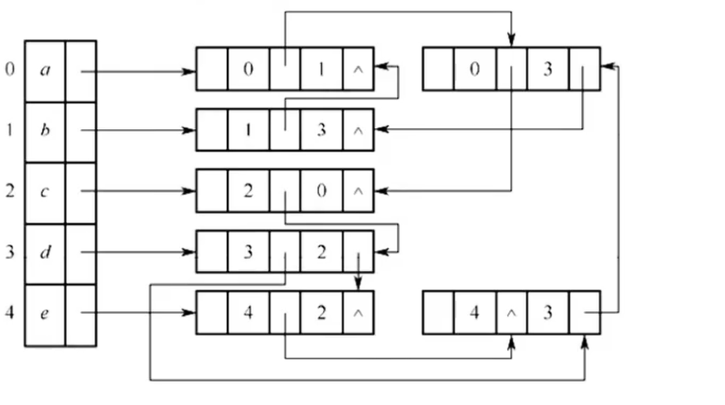

- A. 0, 2
- B. 2, 4
- C. 2, 5
- D. 3, 4


**选 B（2, 4）。** 邻接多重表里**每条边只占一个结点**，结点里的两个编号字段（`ivex`、`jvex`）就是这条边两端的顶点。把表里 7 个边结点逐个读出来，图 G 的边是 $(0,1)$、$(1,3)$、$(2,0)$、$(2,3)$、$(2,4)$、$(0,3)$、$(3,4)$，也就是 a—b、b—d、c—a、c—d、c—e、a—d、d—e 这 7 条。

- **b（编号 1）** 出现在 $(0,1)$、$(1,3)$ 这两条边里 → 度为 **2**；
- **d（编号 3）** 出现在 $(1,3)$、$(2,3)$、$(0,3)$、$(3,4)$ 这四条边里 → 度为 **4**。

所以是 2 和 4，选 B。也可以直接从 b、d 的 `firstedge` 出发，顺着各自那条链数边结点个数，结果一样——这正是邻接多重表「便于计算结点的度」的地方。


## 考点11-DFS和BFS

### DFS思想在不同存储结构上的实现

DFS 的思想就三步：

1. 从一个顶点出发，**先标记访问并输出它**，再去检查它的邻接点；
2. 邻接点如果还没被访问过，就**以它为参数再调一次 DFS**；
3. 一直重复，直到所有顶点都被标记访问。

```c
bool visited[MVNum];
void DFSTraverse(Graph G)
{
    for (v = 0; v < G.vexnum; ++v)
        visited[v] = false;                 // 初始化：全部置成未访问
    for (v = 0; v < G.vexnum; ++v)
        if (!visited[v]) DFS(G, v);         // 非连通图会从这里多次出发
}

void DFS(Graph G, int v)
{
    cout << v;                              // 先访问、再输出
    visited[v] = true;
    for (w = FirstAdjVex(G, v); w >= 0; w = NextAdjVex(G, v, w))
    {
        if (!visited[w])
            DFS(G, w);                      // 没访问过的邻接点，递归进去
    }
}
```

核心就是那个 `for` + `if`：**把 $v$ 的邻接点一个个取出来，没访问过的就递归**。换存储结构，真正变的只是"怎么取邻接点"这一步。

**邻接矩阵**：从 $v$ 出发就是**扫描第 $v$ 行**——第 $w$ 列不为 0，说明 $v$、$w$ 之间有边；$w$ 还没被访问，就递归进去。

以 3 个顶点的图 G 为例（$A$ 连着 $B$、$C$，编号 $A = 0$、$B = 1$、$C = 2$）：

$$\begin{pmatrix}
0 & 1 & 1 \\
1 & 0 & 0 \\
1 & 0 & 0
\end{pmatrix}$$

从 0 号出发，扫第 0 行得到邻接点 1、2，再依次递归进去。$n$ 个顶点、每个都要扫完一行，时间复杂度是 $O(n^2)$。

**邻接表**：取 $v$ 的边表，顺着链表一个个往下取邻接点 $w$，没访问过就递归。同一张图的邻接表是：

| 顶点 | 边表 |
| --- | --- |
| 0（A） | 1 → 2 |
| 1（B） | 0 |
| 2（C） | 0 |

每个顶点只扫自己那条边表，扫过的结点一共是 $n$ 个顶点结点加 $2e$ 个边表结点（无向图每条边在两端各出现一次），所以时间复杂度是 $O(n + e)$。

### BFS思想在不同存储结构上的实现

BFS 的流程是：从一个顶点出发，**先标记访问并输出它，再把它入队**；然后不断从队列里取出队头顶点，检查它的所有邻接点——没访问过的就标记访问、输出、入队；一直重复到队列为空。

```c
bool visited[MVNum];
void BFSTraverse(Graph G)
{
    for (v = 0; v < G.vexnum; ++v)
        visited[v] = false;                 // 初始化：全部置成未访问
    for (v = 0; v < G.vexnum; ++v)
        if (!visited[v]) BFS(G, v);         // 非连通图会从这里多次出发
}

void BFS(Graph G, int v)
{
    cout << v;                              // 先访问、再输出
    visited[v] = true;
    InitQueue(Q);                           // 辅助队列
    EnQueue(Q, v);
    while (!QueueEmpty(Q))
    {
        DeQueue(Q, u);                      // 取出队头，接下来由它往下铺一层
        for (w = FirstAdjVex(G, u); w >= 0; w = NextAdjVex(G, u, w))
            if (!visited[w])
            {
                cout << w;                  // 第一次碰到就输出、标记、入队
                visited[w] = true;
                EnQueue(Q, w);
            }
    }
}
```

和 DFS 对着看，差别就在 `if (!visited[w])` 里面：DFS 是一路递归下去，BFS 是输出、标记、**入队**，等这一层的顶点都处理完再从队头接着往下走。

**邻接矩阵**：取出队头 $u$ 后，遍历第 $u$ 行的所有元素，依次检查每个顶点 $w$——`G.arcs[u][w]` 不为 0 说明 $u$、$w$ 之间有边；$w$ 还没被访问，就输出、标记、入队，再接着检查这一行剩下的列，直到整行扫完。

$n$ 个顶点、每个都要扫一行，所以时间复杂度是 $O(n^2)$。

**邻接表**：取出队头 $u$ 后，拿 $u$ 的边表（第一个邻接点指针 $p$），沿着链表不断向后遍历，每次取出当前边指向的邻接点 $w$；$w$ 还没被访问，就输出、标记、入队，然后继续看边表的下一项，直到指针 $p$ 为 `NULL`。

每个顶点只扫自己那条边表，时间复杂度是 $O(n + e)$。

### DFS和BFS的应用

图的 DFS 类似于**树的先序遍历**，图的 BFS 类似于**树的层序遍历**。

| 应用 | DFS | BFS |
| --- | --- | --- |
| 判断环路 | 常用 | 改代码也能做，但不常用 |
| 拓扑排序 | 常用 | 改代码也能做，但不常用 |
| 单源最短路径（无权图，或各边权值都相同） | — | 常用 |
| 判断图是否连通 | 可以 | 可以 |

**DFS 判断有向图是否存在环路**

1. 从某个顶点出发做 DFS；
2. 遍历过程中，如果遇到某个邻接点正处于「正在访问」状态，说明该有向图存在环路；
3. 为了准确判断，通常要给每个顶点维护三种状态：**未访问、正在访问、已访问**。



```c
void CheckGraphCycle(Graph G)
{
    for (v = 0; v < G.vexnum; v++)
        if (status[v] == Unvisited)
            DetectCycleDFS(G, v);

    if (hasCycle)
        cout << "图中存在回路";
    else
        cout << "图中无回路";
}

bool hasCycle = false;
void DetectCycleDFS(Graph G, int v)
{
    status[v] = Visiting;                     // 正在访问
    for (w = FirstAdjVex(G, v); w >= 0; w = NextAdjVex(G, v, w))
    {
        if (status[w] == Visiting)            // 又撞上正在访问的点 → 有环
            hasCycle = true;
        if (status[w] == Unvisited)
            DetectCycleDFS(G, w);
    }
    status[v] = Visited;                      // 已访问
}
```

**核心在这一段的三个状态标记**：

- `status[v] = Visiting;`：一进递归就标成「正在访问」，意思是"它还在递归栈上，没走完"；
- `if (status[w] == Visiting) hasCycle = true;`：邻接点 $w$ 还挂在栈上，说明有一条边指回 $v$ 的某个祖先（**回边**），有向图有回边就是有环；
- `status[v] = Visited;`（最后一行）：递归要返回了，改标「已访问」——它已经彻底走完，之后再被遇到都不能算环。



**DFS 判断无向图是否存在环路**

口径和有向图只差一点：遇到处于「正在访问」状态的邻接点 $w$ 时，**还要 $w$ 不是上一步访问的那个结点**（也就是 $v$ 的父结点）才算有环——无向图里父子之间那条边来回都通，不排掉它就会被误判成环。所以递归时要把父结点一起传下去。



```c
void CheckGraphCycle(Graph G)
{
    for (v = 0; v < G.vexnum; v++)
        if (status[v] == Unvisited)
            DetectCycleDFS(G, v, -1);         // 初始结点没有父结点

    if (hasCycle)
        cout << "图中存在回路";
    else
        cout << "图中无回路";
}

bool hasCycle = false;
void DetectCycleDFS(Graph G, int v, int parent)
{
    status[v] = Visiting;                     // 正在访问
    for (w = FirstAdjVex(G, v); w >= 0; w = NextAdjVex(G, v, w))
    {
        if (status[w] == Visiting && w != parent)
            hasCycle = true;
        if (status[w] == Unvisited)
            DetectCycleDFS(G, w, v);          // 把 v 当作 w 的父结点传下去
    }
    status[v] = Visited;                      // 已访问
}
```

**核心在那个 `parent` 参数**：

- 调用处的 `DetectCycleDFS(G, v, -1)`：起点没有父结点，拿 `-1` 占位；
- `if (status[w] == Visiting && w != parent)`：只排掉"顺着父子那条边原路返回"这一次，其余撞上「正在访问」的邻接点都是真的环；
- `DetectCycleDFS(G, w, v)`：递归进去时把当前顶点 $v$ 当成 $w$ 的父结点传下去，每一层的 `parent` 都对得上。



**DFS 实现拓扑排序**

1. 每个顶点 $v$ 在**退出递归之前**记录当前时间戳 `time`，并赋给 `finishTime[v]`；
2. 后继结点的 DFS 会先于 $v$ 完成，所以它们的 `finishTime` 比 $v$ **小**（越早退出，时间戳越小）；
3. 最后按 `finishTime` **从大到小**排序所有顶点，就得到一个合法的拓扑序列。



```c
bool visited[MVNum];
int finishTime[MVNum];
int time;
void TopoSortDFS(Graph G, int v)
{
    visited[v] = true;
    for (w = FirstNeighbor(G, v); w >= 0; w = NextNeighbor(G, v, w))
    {
        if (!visited[w])
            TopoSortDFS(G, w);
    }
    time = time + 1;
    finishTime[v] = time;                     // 退出递归之前盖时间戳
}
```

**核心是最后两行的位置**：

- `time = time + 1; finishTime[v] = time;` 写在 **for 循环之后**，意思是"等所有邻居都递归回来、自己这趟走完了，才盖时间戳"；
- 所以后继的时间戳一定比 $v$ 小，$v$ 的更大——按 `finishTime` 从大到小排，后继就排在 $v$ 后面，正好是拓扑序。



**BFS 计算单源最短路径**

1. 从起点出发，把它的距离初始化成 0，其余顶点都初始化成 $\infty$，并把起点入队作为搜索起点；
2. 每次从队列里取出顶点 $u$，访问它所有未访问的邻接点 $w$，令 $d[w] = d[u] + 1$；
3. BFS 是一层层往外推进的，第一个访问到的路径一定最短，最终 `d[]` 里存的就是起点到各个顶点的最短路径长度。



```c
void BFS_DISTANCE(Graph G, int u)
{
    for (i = 0; i < G.vexnum; i++)
        d[i] = INF;
    visited[u] = TRUE;
    d[u] = 0;
    EnQueue(Q, u);
    while (!IsEmpty(Q))
    {
        DeQueue(Q, u);
        for (w = FirstNeighbor(G, u); w >= 0; w = NextNeighbor(G, u, w))
        {
            if (!visited[w])
            {
                visited[w] = TRUE;
                d[w] = d[u] + 1;
                EnQueue(Q, w);
            }
        }
    }
}
```

**核心就是一行** `d[w] = d[u] + 1;`：$w$ 是从 $u$ 往外走一步到的，所以它到起点的距离就是 $u$ 的距离加 1。

`if (!visited[w])` 保证每个顶点只在**第一回被碰到时**赋值——先赋的那次必然最短，这就是"BFS 一层层推进、第一个访问到的路径一定最短"落在代码上的样子。



**DFS / BFS 判断图是否连通**

图是连通的 $\Leftrightarrow$ 从任意一个顶点出发都能访问到所有其他顶点。



```c
bool visited[MVNum];
void DFSTraverse(Graph G)
{
    for (v = 0; v < G.vexnum; ++v)
        visited[v] = false;
    DFS(G, 0);
    for (v = 0; v < G.vexnum; ++v)
        if (!visited[v])
            return false;
    return true;
}
```

BFS 版只把 `DFS(G, 0)` 换成 `BFS(G, 0)`：

```c
bool visited[MVNum];
void BFSTraverse(Graph G)
{
    for (v = 0; v < G.vexnum; ++v)
        visited[v] = false;
    BFS(G, 0);
    for (v = 0; v < G.vexnum; ++v)
        if (!visited[v])
            return false;
    return true;
}
```

**和前面遍历的写法差在哪**：这里**只从 0 号顶点出发一次**，不再"对每个未访问的顶点重新开始"——判连通看的就是这一趟能不能走遍全图。走完扫一遍 `visited`，只要还剩 `false` 的顶点，就说明从 0 号到不了它，图不连通。



<u>例题：【2020】（输出语句挪到退出递归前，得到什么序列）</u>

【2020】修改递归方式实现的图的深度优先搜索（DFS）算法，将输出（访问）顶点信息的语句移到退出递归前（执行输出语句后立刻退出递归）。采用修改后的算法遍历有向无环图 G，若输出结果中包含 G 中的全部顶点，则输出的顶点序列是 G 的

- A. 拓扑有序序列
- B. 逆拓扑有序序列
- C. 广度优先搜索序列
- D. 深度优先搜索序列


**选 B（逆拓扑有序序列）。** 输出语句挪到递归返回之前，等于**谁先走完谁先输出**。改完的 DFS 是这样：

```c
void DFS(Graph G, int v)
{
    for (w = FirstAdjVex(G, v); w >= 0; w = NextAdjVex(G, v, w))
    {
        if (!visited[w])
            DFS(G, w);
    }
    cout << v;                          // 所有后继都回来了，才输出自己
    visited[v] = true;
}
```

顶点 $v$ 能到达的顶点全在它这次递归里，会先于 $v$ 输出——所以每条边 $u \to v$ 在输出序列里都是"$v$ 在前、$u$ 在后"。而拓扑序要求"$u$ 在前、$v$ 在后"，这正好是它的**逆序**。

换成前面 `finishTime` 的说法就是：输出顺序是 `finishTime` **从小到大**，而拓扑序要按 `finishTime` 从大到小排，两者互为逆序。


## 考点12-拓扑排序

拓扑排序是对**有向无环图**的顶点的一种排序：若存在一条从顶点 A 到顶点 B 的路径，则排序中 **B 一定出现在 A 的后面**。

求法就是反复"挑入度为 0 的顶点"：

1. 在有向图里挑一个**入度为 0** 的顶点，输出它；
2. 从图中删掉这个顶点**以及它的所有出边**（这些边的终点入度随之减 1）；
3. 重复这两步，直到图中再也找不到入度为 0 的顶点。

收尾的时候看输出的顶点数：**比图里的顶点数少，说明图中存在环**（环上的顶点入度永远降不到 0）；一个不差，输出的序列就是一个拓扑序列。

**六条常考结论**：

- 拓扑序列**可能不唯一**——同时有好几个入度为 0 的顶点时，先挑谁都可以；
- 有向图里**只要有环，就不存在拓扑序列**；
- 拓扑序列唯一 ⇒ 入度为 0 的顶点、出度为 0 的顶点都**各只有一个**；
- **顶点数大于 1 的强连通图**不能做拓扑排序（强连通就意味着有环）；
- 序列里 A 排在 B 前面，**不代表**原图中就有 $A \to B$ 这条边；
- 拓扑序列唯一，**并不能唯一确定**这张图。

一般实现（邻接表 + 栈）：



```c
bool TopologicalSort(Graph G)
{
    InitStack(S);                        // 初始化栈，用来存放入度为 0 的顶点
    int i;
    for (i = 0; i < G.vexnum; i++)
        if (indegree[i] == 0)
            Push(S, i);                  // 把所有入度为 0 的顶点入栈
    int count = 0;                       // 计数：当前已经输出了多少个顶点
    while (!IsEmpty(S))                  // 栈不空，说明还有入度为 0 的顶点
    {
        Pop(S, i);                       // 栈顶元素出栈
        print[count++] = i;              // 输出顶点 i
        for (p = G.vertices[i].firstarc; p; p = p->nextarc)
        {
            v = p->adjvex;               // 把 i 的这条出边"删掉"：终点的入度减 1
            if (!(--indegree[v]))
                Push(S, v);              // 减到 0 就入栈
        }
    }
    if (count < G.vexnum)
        return false;                    // 输出的顶点不够：有向图里有回路
    else
        return true;                     // 拓扑排序成功
}
```

**核心是那行 `if (!(--indegree[v]))`**：删掉 $i$ 的一条出边，等价于把终点 $v$ 的入度减 1；减到 0 说明 $v$ 的前驱都已经输出，$v$ 可以入栈了。

`count` 则负责判环——环上的顶点入度永远降不到 0，进不了栈，最后 `count < G.vexnum` 就说明有环。



<u>例题：【2012】（邻接矩阵下三角全零时的拓扑排序）</u>

【2012】若用邻接矩阵存储有向图，矩阵中主对角线以下的元素均为零，则关于该图拓扑排序的结论是

- A. 存在，且唯一
- B. 存在，且不唯一
- C. 存在，可能不唯一
- D. 无法确定是否存在


**选 C（存在，可能不唯一）。**

- **一定存在**：主对角线以下全为 0，也就是 $i > j$ 时 $A[i][j] = 0$——边只能从**小号顶点指向大号顶点**。图里不可能有环：沿着环走一圈，顶点编号只能一直变大，绕回起点就矛盾了。没有环，拓扑排序一定存在。
- **但不一定唯一**：一条边都没有的图（邻接矩阵全是 0，当然也满足"下三角全零"）随便什么顺序都是合法拓扑序；而如果图是一条链 $0 \to 1 \to \dots \to n-1$，顺序就被钉死了。所以只能说"存在，**可能**不唯一"。


<u>例题：【2016】（邻接表存有向图，拓扑排序的时间复杂度）</u>

【2016】若对 $n$ 个顶点、$e$ 条弧的有向图采用邻接表存储，则拓扑排序算法的时间复杂度是

- A. $O(n)$
- B. $O(n + e)$
- C. $O(n^2)$
- D. $O(ne)$


**选 B（$O(n + e)$）。** 对着上面那段实现数：开头扫一遍所有顶点建初始栈，$O(n)$；之后每个顶点恰好进栈、出栈各一次，$O(n)$；每出栈一个顶点，顺着它的边表把所有出边扫一遍，所有边加起来是 $e$ 条，$O(e)$。合计 $O(n + e)$。

（用邻接矩阵就退化成 $O(n^2)$——每出栈一个顶点都得扫一整行才找得到它的出边，这正是选项 C 的来历。）


---

**用有向无环图描述表达式**

用**有向无环图（DAG）**表示表达式时，**叶子结点是操作数、内部结点是运算符**；两个结点只要代表同一个子表达式（运算符相同、参与运算的两部分也相同），就**合并成一个结点**。这么做的好处就是**共享公共子表达式**，结点数比表达式二叉树少得多。

画法四步：

| 步骤 | 做什么 |
| --- | --- |
| ① | 把各个操作数**不重复地**排成一排，作为最底层的叶子 |
| ② | 标出各个运算符的**生效顺序** |
| ③ | 按顺序**分层**加入运算符，每个运算符只作用于它下面已经画好的那部分 |
| ④ | **从底向上**逐层检查，把相同的子表达式**合体**成一个结点 |

以 $((a+b)*(b*(c+d))+(c+d)*e)*((c+d)*e)$ 为例，合体之后是这样：


原式里 `c+d` 出现了 3 次、`(c+d)*e` 出现了 2 次，合体后各只留一个结点，`a`~`e` 这些操作数也只画一次——这就是 DAG 比二叉树省结点的地方。

合并时的两条判据：**依据是"同一个子表达式"**（运算符相同、两部分也相同），**合完不能打乱原来的运算先后**。

<u>例题：【2019】（DAG 描述表达式至少要几个顶点）</u>

【2019】用有向无环图描述表达式 $(x+y)((x+y)/x)$，需要的顶点个数至少是

- A. 5
- B. 6
- C. 8
- D. 9


**选 A（5）。** 原式的运算分三层：最里面是 $x+y$，然后是 $(x+y)/x$，最后两者相乘。

顶点 = **每个操作数一个叶子 + 每个不同的子表达式一个内部结点**：

- 操作数：$x$、$y$，共 2 个；
- 运算符：$+$（$x+y$）、$/$（$(x+y)/x$）、$*$（最外层的乘法），共 3 个。

$x+y$ 在原式里出现两次，DAG 只画一个结点；$x$ 既是 $x+y$ 的操作数、又是除法的除数，也只画一次。合计 $2 + 3 = 5$ 个，选 A。


## 考点13-最小生成树

| 名字 | 含义 |
| --- | --- |
| 生成树 | 无向连通图中一个包含图中所有顶点的**极小连通子图** |
| 最小生成树（MST） | 所有生成树中**边权之和最小**的那一棵 |

**五条要点**：

1. 只有**无向连通图**才有生成树的概念；
2. $n$ 个顶点的图，最小生成树有 $n-1$ 条边；
3. 最小生成树**再加一条边就形成环，再减一条边就不连通**；
4. 原图中**有权值相同的边**时，最小生成树**可能**不唯一；
5. 原图的**各边权值互不相等**时，最小生成树**一定**唯一。

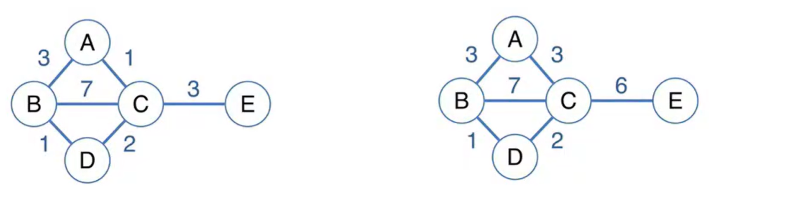

> 注：左图 A—B 与 C—E 同为 3，但 C—E 是通向 E 的必经边、A—B 又用不上，最小生成树仍然唯一；右图把 A—C 也改成 3 之后，A—B 与 A—C 任选其一都能拼出权值相同的生成树，就不唯一了。

| | Prim 算法 | Kruskal 算法 |
| --- | --- | --- |
| 思路 | **选点** | **选边** |
| 适用 | 边稠密、顶点少的图 | 边稀疏、顶点多的图 |
| 时间复杂度 | $O(\lvert V\rvert^2)$ | $O(\lvert E\rvert\log_2\lvert E\rvert)$ |

**Prim（选点）**：

1. 初始时任取一个顶点加入树 T；
2. 每次挑一个**离当前 T 中顶点集合最近**的顶点，把它和相应的边一起加入 T——每做一次，T 的顶点数和边数各加 1；
3. 直到所有顶点都进了 T，此时 T 正好有 $n-1$ 条边。

**Kruskal（选边）**：

1. 初始时 T 只有 $n$ 个顶点、一条边都没有，每个顶点自成一个连通分量；
2. 把边按权值从小到大排序，依次取当前还没选过、权值最小的边：两端的顶点**落在 T 中不同的连通分量**上就把它加入 T，否则（加进去会成环）舍弃，看下一条；
3. 直到 T 中所有顶点都落在同一个连通分量上。

> 注：Kruskal 第 2 步"两端是否已经在同一个连通分量里"，用并查集判最省事——`Find` 出两个根比一比，不同就 `Union` 并把边收进 T（见考点7「并查集的应用」里的 Kruskal）。

<u>例题：【2012】（关于最小生成树的四条叙述）</u>

【2012】下列关于最小生成树的叙述中，正确的是

Ⅰ. 最小生成树的代价唯一
Ⅱ. 所有权值最小的边一定会出现在所有的最小生成树中
Ⅲ. 使用 Prim 算法从不同顶点开始得到的最小生成树一定相同
Ⅳ. 使用 Prim 算法和 Kruskal 算法得到的最小生成树总不相同

- A. 仅 Ⅰ
- B. 仅 Ⅱ
- C. 仅 Ⅰ、Ⅲ
- D. 仅 Ⅱ、Ⅳ


**选 A（仅 Ⅰ）。**

- **Ⅰ 对**：最小生成树的**代价**（边权之和）是唯一的——树不唯一时，几棵生成树的权值和一定相等，否则"最小"就无从谈起；
- **Ⅱ 错**：权值最小的边也可能进不了生成树。比如三条权值为 1 的边围成一个三角形，任一棵生成树只能取其中两条，总有一条最小边被排掉；
- **Ⅲ 错**：MST 不唯一时，从不同顶点出发、按 Prim 走出来的不一定是同一棵；
- **Ⅳ 错**：MST 唯一时，Prim 和 Kruskal 只会得到同一棵，所以不是"总不相同"。


<u>例题：【2017】（Prim 求 MST：选边过程、唯一性与唯一条件）</u>

【2017】使用 Prim 算法求带权连通图的最小（代价）生成树（MST）。请回答下列问题：

1）对下列图 G，从顶点 A 开始求 G 的 MST，依次给出按算法选出的边。
2）图 G 的 MST 是唯一的吗？
3）对任意的带权连通图，满足什么条件时，其 MST 是唯一的？

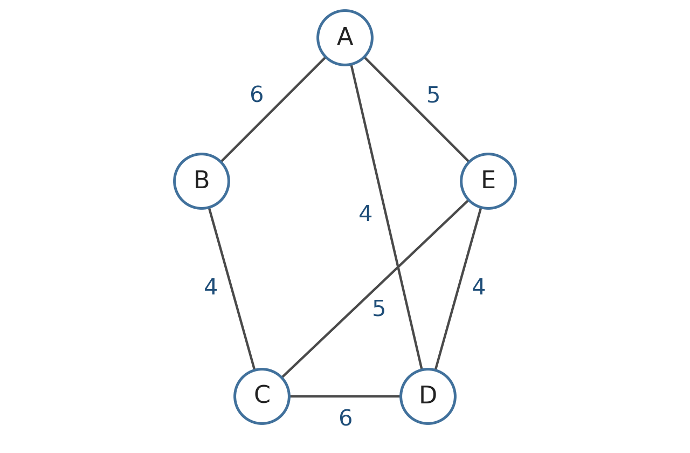


**1）依次选出 (A, D) 4、(D, E) 4、(C, E) 5、(B, C) 4，总代价 17。**

Prim 从 A 出发，每一步都挑"离当前树最近"的顶点：

| 步骤 | 当前树 T | 候选边（权值） | 选中的边 |
| --- | --- | --- | --- |
| 1 | {A} | A—D 4、A—E 5、A—B 6 | (A, D) 4 |
| 2 | {A, D} | D—E 4、A—E 5、A—B 6、D—C 6 | (D, E) 4 |
| 3 | {A, D, E} | C—E 5、A—B 6、C—D 6 | (C, E) 5 |
| 4 | {A, D, E, C} | B—C 4 | (B, C) 4 |

总代价 $4 + 4 + 5 + 4 = 17$。

**2）唯一。** 权值为 4 的三条边（A—D、D—E、B—C）本身不成环，而 4 条边的最小总和只能是 $4+4+4+5$，所以三条都得选上——此时顶点分成 {A, D, E} 与 {B, C} 两块。能把两块接起来的边只有 A—B 6、C—E 5、C—D 6，最小的是 5，且只有 C—E 这一条，没有第二种选法。

**3）** 各边**权值互不相等**时，MST 一定唯一。（这是充分条件：本题里权值有重复，MST 照样唯一。）


## 考点14-最短路径

最短路径分两类问题：

- **单源**（一个起点到其余各点）：无权图用 **BFS**（一层层推进，见考点11）；带权图用 **Dijkstra**；
- **顶点对**（各顶点之间的最短路径）：用 **Floyd**。

### Dijkstra

靠三个数组打天下：

| 数组 | 作用 |
| --- | --- |
| `final[]` | 标注各顶点是否已找到最短路径 |
| `dist[]` | 当前的最短路径长度 |
| `path[]` | 路径上的前驱 |

步骤：

1. 初始化这三个数组；
2. 在 `final[i] = 0` 的顶点里挑 `dist[i]` 最小的那个，把 `final[i]` 改成 1，把它收进"已找到最短路径"的集合；
3. 看 $v_i$ 的每个邻接点 $v_j$：若 `dist[i]` 加上边 $\langle v_i, v_j \rangle$ 的权值**小于** `dist[j]`，就更新 `dist[j]` 和 `path[j]`；
4. 重复第 2、3 步，直到所有顶点都找到最短路径。

**用于求解单源最短路径，不适用于带负权值的图**；时间复杂度 $O(|V|^2)$。

### Floyd

在邻接矩阵上反复"借中转点"：

1. 初始化矩阵（$D[i][j]$ 就是 $i$ 到 $j$ 的边权，没有边记 $\infty$）；
2. 依次把每个顶点当作**中转点** $k$；
3. 以 $k$ 为中心画出横、竖、对角线三条"彩带"，彩带上的数字不变；逐个检查彩带外的每个 $D[i][j]$——若它所在行、列对应彩带上的两个值相加比它更小，就用更小的值替换，否则保持原样；
4. 重复第 2、3 步，直到所有顶点都当中转点试过一轮。

第 3 步写成式子就是 $D[i][j] = \min(D[i][j],\ D[i][k] + D[k][j])$。

**用于求解各顶点之间的最短路径，不适用于带负权回路的图**；时间复杂度 $O(|V|^3)$。

<u>例题：【2016】（Dijkstra：依次确定哪些顶点）</u>

【2016】使用 Dijkstra 算法求下图中从顶点 1 到其他各顶点的最短路径，依次得到的各最短路径的目标顶点是


- A. 5, 2, 3, 4, 6
- B. 5, 2, 3, 6, 4
- C. 5, 2, 4, 3, 6
- D. 5, 2, 6, 3, 4


**选 B（5, 2, 3, 6, 4）。** 从 1 出发，初始 `dist[1] = 0`、其余全是 $\infty$；每轮挑 `dist` 最小且还没确定的顶点，再拿它的出边去松弛别人：

| 步骤 | 选中（`dist` 值） | 本轮更新的 `dist` |
| --- | --- | --- |
| ① | 1（0） | $d_2 = 5$（1→2）、$d_5 = 4$（1→5） |
| ② | 5（4） | $d_4 = 11$（1→5→4）、$d_6 = 9$（1→5→6）；5→2 要 $4+6 = 10 > 5$，不改 |
| ③ | 2（5） | $d_3 = 7$（1→2→3）；2→4 要 $5+9 = 14 > 11$，不改 |
| ④ | 3（7） | 3→5 要 $7+6 = 13 > 4$，不改 |
| ⑤ | 6（9） | 6→3 要 $9+2 = 11 > 7$，不改 |
| ⑥ | 4（11） | 4→1 要 $11+2 = 13 > 0$，不改 |

确定顺序是 1 → 5 → 2 → 3 → 6 → 4，去掉起点，依次就是 5、2、3、6、4，选 B。


<u>例题：用 Floyd 求各顶点对的最短路径（31 题）</u>

用 Floyd 算法求下图的最短路径，得到的 dist 矩阵结果是

| A | B | C | D |
| --- | --- | --- | --- |
| $\begin{pmatrix}1&0&0&0\\1&1&1&1\\1&1&1&1\\1&1&1&1\end{pmatrix}$ | $\begin{pmatrix}1&\infty&\infty&0\\2&1&1&1\\3&1&1&2\\1&2&1&1\end{pmatrix}$ | $\begin{pmatrix}0&0&0&0\\2&0&1&1\\3&1&0&2\\1&2&1&0\end{pmatrix}$ | $\begin{pmatrix}0&\infty&\infty&\infty\\2&0&1&1\\3&1&0&2\\1&2&1&0\end{pmatrix}$ |

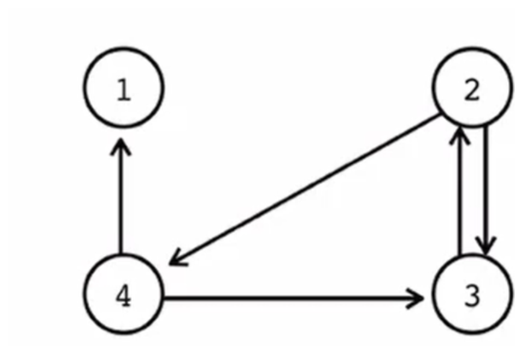


**选 D。** 图里每条边的权都是 1，先写出初始矩阵（没边记 $\infty$、自己到自己记 0）：

$$D^{(0)} = \begin{pmatrix}
0 & \infty & \infty & \infty \\
\infty & 0 & 1 & 1 \\
\infty & 1 & 0 & \infty \\
1 & \infty & 1 & 0
\end{pmatrix}$$

接着依次拿 1、2、3、4 当中转点，每轮只改"绕一下会更短"的格子：

| 中转点 | 能改哪些格子 |
| --- | --- |
| 1 | 1 没有出边，什么都改不了，$D^{(1)} = D^{(0)}$ |
| 2 | $d_{3,2} = 1$，绕 2 能到 4：$d_{3,4} = 1 + 1 = 2$（原来是 $\infty$） |
| 3 | $d_{4,3} = 1$，绕 3 能到 2：$d_{4,2} = 1 + 1 = 2$ |
| 4 | $d_{2,4} = 1$、$d_{3,4} = 2$：$d_{2,1} = 1 + 1 = 2$、$d_{3,1} = 2 + 1 = 3$ |

四轮走完：

$$D^{(4)} = \begin{pmatrix}
0 & \infty & \infty & \infty \\
2 & 0 & 1 & 1 \\
3 & 1 & 0 & 2 \\
1 & 2 & 1 & 0
\end{pmatrix}$$

和选项 D 一模一样。


## 考点15-关键路径

四个量，两个按事件算、两个按活动算：

| 量 | 怎么算 |
| --- | --- |
| 事件 $v_i$ 的**最早**发生时间 $v_e$ | $v_e(\text{源点}) = 0$；$v_e(k) = \max\{\,v_e(j) + \text{Weight}(v_j, v_k)\,\}$，$v_k$ 是 $v_j$ 的任意后继 |
| 事件 $v_i$ 的**最迟**发生时间 $v_l$ | $v_l(\text{汇点}) = v_e(\text{汇点})$；$v_l(k) = \min\{\,v_l(j) - \text{Weight}(v_k, v_j)\,\}$，$v_k$ 是 $v_j$ 的任意前驱 |
| 活动 $a_i$ 的最早开始时间 $e$ | 该弧**起点**顶点的 $v_e$ |
| 活动 $a_i$ 的最迟开始时间 $l$ | 该弧**终点**顶点的 $v_l$ 减去这条弧的权值 |

活动的时间余量就是 $l - e$：**余量为 0（$l = e$）的活动叫关键活动**，关键活动连起来就是**关键路径**。

**六条常考结论**：

1. 活动的时间余量 $= l - e$；
2. 关键活动的时间余量为 0（$l = e$），关键活动组成了关键路径；
3. 关键路径**可能不唯一**；
4. 关键路径就是**持续时间最长**（权值之和最大）的那条路径；
5. 缩短关键路径，**并不一定**让整个工期加快：
   - 只有一条关键路径时，缩短它一定加快；
   - 有多条关键路径时，只缩短其中一条不一定加快——被缩短的那条就不再是关键路径了，工期还卡在另一条上；
   - 只有缩短**所有关键路径上共有**的某个关键活动，工期才会加快；
   - 反过来，延长**任意一条**关键路径上的关键活动，工期一定变慢；
6. 求关键路径是以**拓扑排序**为基础的。

<u>例题：【2013】（加快哪两个活动能缩短工期）</u>

【2013】下列 AOE 网表示一项包含 8 个活动的工程。通过同时加快若干活动的进度可缩短整个工程的工期。在下列选项中，加快其进度就可缩短工程工期的是


- A. c 和 e
- B. d 和 c
- C. f 和 d
- D. f 和 h


**选 C（f 和 d）。**

先算事件的时间参数（$v_e$ 从源点往后取 max，$v_l$ 从汇点往前取 min）：

| 事件 | 1 | 2 | 3 | 4 | 5 | 6 |
| --- | --- | --- | --- | --- | --- | --- |
| $v_e$ | 0 | 12 | 8 | 21 | 18 | 27 |
| $v_l$ | 0 | 12 | 8 | 21 | 18 | 27 |

再用 $e$（弧起点的 $v_e$）和 $l$（弧终点的 $v_l$ 减弧权）算余量：只有 a 的余量不为 0（$l - e = 9$），**b、d、c、e、f、g、h 的余量全是 0**，都是关键活动。

于是关键路径有三条，长度都是 27：

- 1→3→2→4→6：$b + d + c + g = 8 + 4 + 9 + 6 = 27$
- 1→3→2→5→6：$b + d + e + h = 8 + 4 + 6 + 9 = 27$
- 1→3→5→6：$b + f + h = 8 + 10 + 9 = 27$

工期被这三条**同时**卡着，只有让三条都变短才会缩短，所以逐个选项看"覆盖了哪几条关键路径"：

- **A（c、e）**：c 只压到第 1 条、e 只压到第 2 条，第 3 条（b、f、h）没动 ✗
- **B（d、c）**：d 压到第 1、2 条，第 3 条仍然没动 ✗
- **C（f、d）**：d 压到第 1、2 条，f 压到第 3 条——三条全覆盖 ✓
- **D（f、h）**：第 1 条（b、d、c、g）完全没被碰到 ✗

所以选 C。


<u>例题：【2011】（上三角存储还原邻接矩阵，求关键路径）</u>

【2011】已知有 6 个顶点（编号为 0~5）的有向带权图 G，其邻接矩阵 A 为上三角矩阵，按行为主序（行优先）保存在如下的一维数组中：

`4, 6, ∞, ∞, ∞, 5, ∞, ∞, ∞, 4, 3, ∞, ∞, 3, 3`

要求：

1）写出图 G 的邻接矩阵 A。
2）画出有向带权图 G。
3）求图 G 的关键路径，并计算该关键路径的长度。


**1）** 上三角只存 $i < j$ 的部分，按行切开正好是 $5 + 4 + 3 + 2 + 1 = 15$ 个数：第 0 行 5 个、第 1 行 4 个、第 2 行 3 个、第 3 行 2 个、第 4 行 1 个。

$$A = \begin{pmatrix}
0 & 4 & 6 & \infty & \infty & \infty \\
\infty & 0 & 5 & \infty & \infty & \infty \\
\infty & \infty & 0 & 4 & 3 & \infty \\
\infty & \infty & \infty & 0 & \infty & 3 \\
\infty & \infty & \infty & \infty & 0 & 3 \\
\infty & \infty & \infty & \infty & \infty & 0
\end{pmatrix}$$

（对角线记 0；下三角没有边，记 $\infty$。）

**2）** 从矩阵里读出的 7 条弧是 0→1（4）、0→2（6）、1→2（5）、2→3（4）、2→4（3）、3→5（3）、4→5（3）：


**3）关键路径是 0→1→2→3→5，长度 16。**

**第一步：从源点往后推每个事件的最早发生时间 $v_e$**（汇合点取 max，取"最晚到齐"的那条路）：

- $v_e(0) = 0$
- $v_e(1) = v_e(0) + 4 = 4$
- $v_e(2) = \max\{v_e(0)+6,\ v_e(1)+5\} = \max\{6,\ 9\} = 9$（两条路进来，取长的）
- $v_e(3) = v_e(2) + 4 = 13$
- $v_e(4) = v_e(2) + 3 = 12$
- $v_e(5) = \max\{v_e(3)+3,\ v_e(4)+3\} = \max\{16,\ 15\} = 16$（汇点，$v_e(5)$ 就是工期）

**第二步：从汇点往前推导每个事件的最迟发生时间 $v_l$**（分叉处取 min，取"最先卡住"的那条路；先令 $v_l(5) = v_e(5) = 16$）：

- $v_l(4) = 16 - 3 = 13$
- $v_l(3) = 16 - 3 = 13$
- $v_l(2) = \min\{v_l(3)-4,\ v_l(4)-3\} = \min\{9,\ 10\} = 9$
- $v_l(1) = v_l(2) - 5 = 4$
- $v_l(0) = \min\{v_l(1)-4,\ v_l(2)-6\} = \min\{0,\ 3\} = 0$

两轮结果合起来：

| 事件 | 0 | 1 | 2 | 3 | 4 | 5 |
| --- | --- | --- | --- | --- | --- | --- |
| $v_e$ | 0 | 4 | 9 | 13 | 12 | 16 |
| $v_l$ | 0 | 4 | 9 | 13 | 13 | 16 |

**第三步：算每条弧（活动）的最早开始时间 $e$、最迟开始时间 $l$**——$e$ 取弧**起点**的 $v_e$，$l$ 取弧**终点**的 $v_l$ 减去这条弧的权，两者之差就是余量：

| 弧 | 权 | $e = v_e(\text{起点})$ | $l = v_l(\text{终点}) - \text{权}$ | 余量 $l - e$ |
| --- | --- | --- | --- | --- |
| 0→1 | 4 | 0 | $4 - 4 = 0$ | **0** |
| 0→2 | 6 | 0 | $9 - 6 = 3$ | 3 |
| 1→2 | 5 | 4 | $9 - 5 = 4$ | **0** |
| 2→3 | 4 | 9 | $13 - 4 = 9$ | **0** |
| 2→4 | 3 | 9 | $13 - 3 = 10$ | 1 |
| 3→5 | 3 | 13 | $16 - 3 = 13$ | **0** |
| 4→5 | 3 | 12 | $16 - 3 = 13$ | 1 |

余量为 0 的四条弧 0→1、1→2、2→3、3→5 是关键活动，串起来就是**关键路径 0→1→2→3→5**，长度 $4 + 5 + 4 + 3 = 16$。经过 4 的那条支路（2→4、4→5）余量都是 1，不在关键路径上。


# 五、查找

## 考点1-线性表的查找

### 顺序查找

**顺序查找**：从表的一端开始逐个比较，相等就返回位置；走到另一端还没遇到，就说明查找失败。

三条特点：

1. 顺序存储、链式存储**都能用**，也**不要求元素有序**；
2. 算法简单，但 ASL（平均查找长度）较大，查找效率不高；
3. 表规模较大时，不适合用顺序查找。

**ASL**：等概率时

$$\text{ASL}_{\text{成功}} = \frac{1 + 2 + \cdots + n}{n} = \frac{n+1}{2} \approx \frac{n}{2}$$

失败时的比较次数分三种情况：

| 情形 | $\text{ASL}_{\text{失败}}$ |
| --- | --- |
| 有哨兵（key 放在 0 号位，省掉每次的越界判断） | $n + 1$ |
| 无哨兵 | $n$ |
| 有序表（比较到比 key 大就能停） | $\frac{n}{2} + \frac{n}{n+1}$ |

有序表那个式子的来路：key 可能落在相邻元素之间的 $n+1$ 个空隙里，落在前 $n$ 个空隙依次比较 $1, 2, \dots, n$ 次，落在最后一个空隙要比完全表再加一次"到表尾"，平均下来是

$$\frac{1 + 2 + \cdots + n + n}{n+1} = \frac{\frac{n(n+1)}{2} + n}{n+1} = \frac{n}{2} + \frac{n}{n+1}$$

### 折半查找

**折半查找（二分查找）**：每次取当前查找区间的中间位置 $\text{mid} = \lfloor (low + high) / 2 \rfloor$ 与关键字比较。相等就查找成功；关键字比 `mid` 位置的元素小，就到左半区继续找；比它大，就到右半区继续找。区间缩到 `low > high` 还没命中，就是查找失败。

以 11 个元素 `7 10 13 16 19 29 32 33 37 41 43` 为例，查找 32 的过程是：

| 步骤 | 查找区间 | `mid` | 与 32 比较 | 走向 |
| --- | --- | --- | --- | --- |
| 1 | `[1, 11]` | 6 | 29 | 32 > 29，去右半区 `[7, 11]` |
| 2 | `[7, 11]` | 9 | 37 | 32 < 37，去左半区 `[7, 8]` |
| 3 | `[7, 8]` | 7 | 32 | 相等，查找成功 |

三次比较就命中。查找 30 则走 29 → 37 → 32，三次比较后 `low = 7 > high = 6`，落进空隙 `(29, 32)`，查找失败。

把每一次参与比较的 `mid` 作为结点、按"往左半区还是右半区"连起来，就得到一棵**折半查找判定树**：

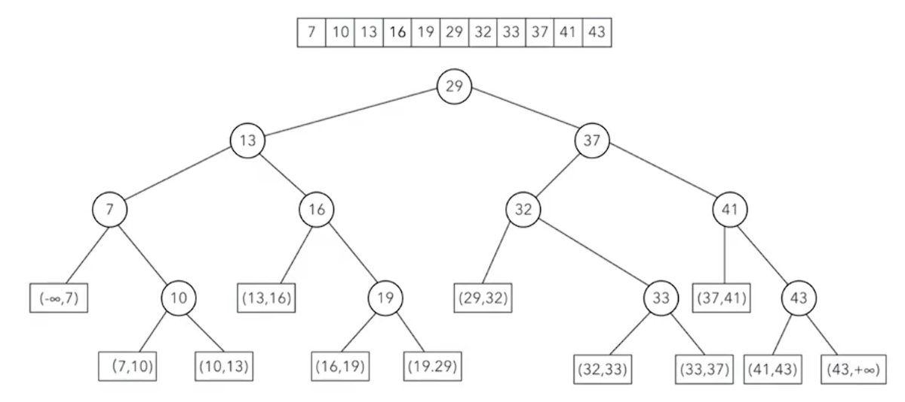

> 注：圆形结点对应查找成功时命中的元素（共 $n$ 个），方形结点对应查找失败时落到的空隙（共 $n+1$ 个）；方形结点的层数比实际比较次数多 1，因为最后一次比较发生在它的父结点上。

**四条要点**：

1. **只适用于顺序存储，且要求元素有序**。折半要靠下标直接跳到 `mid`，所以必须能随机访问；链表想找第 `mid` 个结点得从头走，折半就退化成 $O(n)$ 了。有序则是"往哪半边找"的依据，无序表没法折半。
2. **`mid` 的取法必须整棵树统一**，默认取靠左的那个中点，即向下取整 $\lfloor (low+high)/2 \rfloor$。如果换成向上取整，整棵判定树会左右镜像：每个结点的左子树结点数不少于右子树，甚至可能出现只有左孩子、没有右孩子的情况。做题时若发现一棵树里有的结点按向下取整、有的按向上取整，它就不可能是折半查找判定树。
3. 每比较一次，查找区间就缩小一半，时间复杂度为 $O(\log_2 n)$，比顺序查找的 $O(n)$ 快得多。
4. **最多比较次数 = 判定树的树高（不计方形失败结点）= 相同结点数的完全二叉树的高度 = $\lceil \log_2(n+1) \rceil$**。图中 $n = 11$，$\lceil \log_2 12 \rceil = 4$，所以成功、失败最多都只要比较 4 次。

**判定树的两条性质**（选择题常用来判断"哪棵树可能是折半查找判定树"）：

- 中序遍历得到的序列必须有序——判定树本质上是一棵二叉排序树；
- 对每个结点，左、右子树的结点数最多相差 1，且按向下取整时有**左子树不多于右子树**：若子树共有 $m$ 个结点，两边规模只能是 $\lfloor (m-1)/2 \rfloor$ 与 $\lceil (m-1)/2 \rceil$。

**平均查找长度**：直接从判定树上数比较次数。

$$\text{ASL}_{\text{成功}} = \frac{\text{所有关键字查找成功时的比较次数之和}}{\text{查找元素个数 } n}$$

$$\text{ASL}_{\text{失败}} = \frac{\text{所有失败位置查找失败时的比较次数之和}}{\text{不成功位置个数 } n+1}$$

圆形结点的层数就是查找该元素的比较次数；方形结点按层数减 1 计——失败时最后一次比较发生在它的父结点上。分母上，成功是 $n$ 个元素，失败是 $n+1$ 个空隙。

以图中 $n=11$ 为例，第 1～4 层分别有 1、2、4、4 个圆形结点；12 个方形结点里有 4 个在第 4 层（比较 3 次）、8 个在第 5 层（比较 4 次）。

| 情形 | 计算式 | 结果 |
| --- | --- | --- |
| 成功 | $\frac{1 \times 1 + 2 \times 2 + 3 \times 4 + 4 \times 4}{11}$ | $\frac{33}{11} = 3$ |
| 失败 | $\frac{3 \times 4 + 4 \times 8}{12}$ | $\frac{44}{12} \approx 3.67$ |

一般地，$\text{ASL}_{\text{成功}} \approx \log_2(n+1) - 1$，$\text{ASL}_{\text{失败}} \approx \log_2(n+1)$，量级都是 $O(\log_2 n)$。

<u>例题：600 个元素的最多比较次数</u>

【题目】对含 600 个元素的有序顺序表进行折半查找，关键字间的比较次数最多是

- A. 9
- B. 10
- C. 30
- D. 300


**选 B（10 次）。**

折半查找的最多比较次数就是判定树的高度：

$$h = \lceil \log_2(n+1) \rceil$$

代入 $n = 600$，得 $h = \lceil \log_2 601 \rceil$。因为

$$2^9 = 512 < 601 \le 1024 = 2^{10}$$

所以 $9 < \log_2 601 \le 10$，向上取整为 10，最多比较 10 次。

为什么判定树的高度一定和同结点数的完全二叉树一样？每折半一次，查找区间就尽量对半分：

- 除最后一次划分外，左右两边基本对称，树是一层层"对称生长"的；
- 区间缩到最后，问题规模只会剩下 2 或 3：剩 3 个时，`mid` 正好取中间，左右各一个，仍是完全二叉树的形状；剩 2 个时，向下取整会让 `mid` 取左边那个，最后一次划分长出"只有右孩子"的不对称结构；
- 所以只有最后一层可能不符合完全二叉树"从左到右填满"的规则，但**高度不变**，仍然等于同结点数完全二叉树的高度 $\lceil \log_2(n+1) \rceil$。

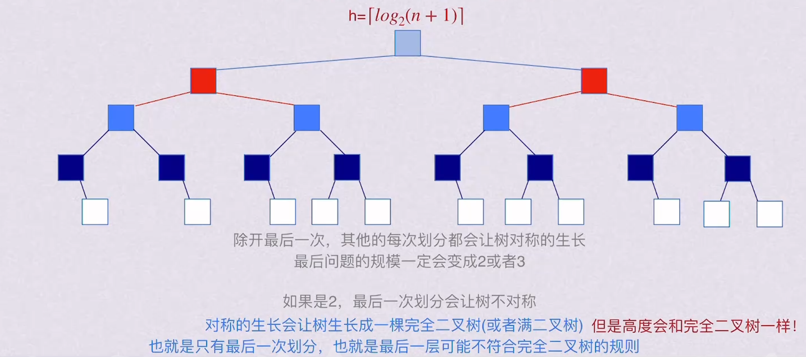


<u>例题：【2017】（哪棵可能是折半查找判定树）</u>

【2017】下列二叉树中，可能成为折半查找判定树（不含外部结点）的是

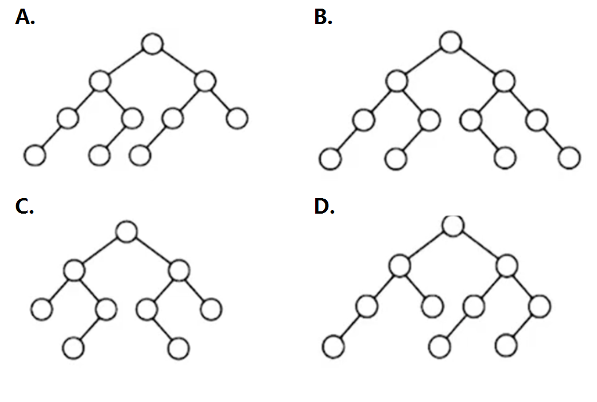


**选 A。**

先看根结点定下这棵树用的是哪种取整，再逐层检查有没有混用：

- 每个结点左、右子树的结点数最多差 1；
- 若 `mid = ⌊(low+high)/2⌋`（向下取整），则**左子树不多于右子树**；
- 若 `mid = ⌈(low+high)/2⌉`（向上取整），则**左子树不少于右子树**。

整棵树必须统一按其中一种来，不能有的结点左多、有的结点右多。

- **A**：根左 5、右 4；根的左孩子左右各 2；根的右孩子左 2、右 1；再往下每棵 2 个结点的子树都是"左 1 右 0"。所有结点都满足"左 ≥ 右"，相当于统一按向上取整，**可以**。
- **B**：根左右各 5，没问题；但左边两棵 2 结点子树是"左 1 右 0"（左多），右边两棵是"左 0 右 1"（右多）——同一棵树里混用了两种取整，**不行**。
- **C**：根左右各 4；左孩子的子树是"左 1 右 2"（左少），右孩子的子树是"左 2 右 1"（左多），两种取整混用，**不行**。
- **D**：根左 4、右 5（左少，按向下取整）；但它下面 2 结点的子树都是"左 1 右 0"（左多，按向上取整），同样混用，**不行**。

所以选 A。


<u>例题：【2013】（按概率排列，顺序查找反而更短）</u>

【2013】设包含 4 个数据元素的集合 $S = \{\text{'do'}, \text{'for'}, \text{'repeat'}, \text{'while'}\}$，各元素的查找概率依次为 $p_1 = 0.35$、$p_2 = 0.15$、$p_3 = 0.15$、$p_4 = 0.35$。将 $S$ 保存在一个长度为 4 的顺序表中，采用折半查找法，查找成功时的平均查找长度为 2.2。

1）若采用顺序存储结构保存 $S$，且要求平均查找长度更短，则元素应如何排列？应使用何种查找方法？查找成功时的平均查找长度是多少？

2）若采用链式存储结构保存 $S$，且要求平均查找长度更短，则元素应如何排列？应使用何种查找方法？查找成功时的平均查找长度是多少？


**两问答案相同：按查找概率从大到小排列，采用顺序查找，ASL = 2.1。**

**先看题干的 2.2 是怎么来的。** 折半查找要求表按关键字有序，字符串的自然顺序是字典序：

$$\text{'do'} < \text{'for'} < \text{'repeat'} < \text{'while'}$$

所以顺序表只能排成 `do, for, repeat, while`，概率依次是 0.35、0.15、0.15、0.35。折半查找第一次取 `mid = 2`，判定树是：

- 第 1 层：`for`（0.15），比较 1 次；
- 第 2 层：`do`（0.35）、`repeat`（0.15），各比较 2 次；
- 第 3 层：`while`（0.35），比较 3 次。

不同元素概率不同，ASL 要按概率加权，不能直接除以 4（$c_i$ 是查找第 $i$ 个元素时的比较次数）：

$$\text{ASL} = \sum_{i=1}^{n} p_i c_i$$

代入：

$$\text{ASL}_{\text{折半}} = 0.15 \times 1 + 0.35 \times 2 + 0.15 \times 2 + 0.35 \times 3 = 0.15 + 0.7 + 0.3 + 1.05 = 2.2$$

这正是题干给出的 2.2。

**为什么顺序查找能更短？** 折半查找的比较次数由判定树决定，和概率无关：它把概率只有 0.15 的 `for` 放在根上（只比 1 次），却让概率 0.35 的 `do` 比 2 次、`while` 比 3 次。概率高的元素反而在深层，加权后 ASL 就被拉高了。

把元素按概率从大到小排列：

`do(0.35), while(0.35), for(0.15), repeat(0.15)`

（两个 0.35 谁在前都行，两个 0.15 同理。）顺序查找的比较次数依次是 1、2、3、4：

$$\text{ASL}_{\text{顺序}} = 0.35 \times 1 + 0.35 \times 2 + 0.15 \times 3 + 0.15 \times 4 = 0.35 + 0.7 + 0.45 + 0.6 = 2.1$$

$2.1 < 2.2$，所以**顺序查找反而更优**。

**两问的区别只在存储结构：**

1）顺序存储：可以顺序查找，也可以折半查找；但按概率排好序后表不再按字典序有序，不能再用折半。选顺序查找，ASL = 2.1。

2）链式存储：本来就不能折半（链表无法随机访问 `mid`），只能顺序查找；同样按概率降序排列，ASL = 2.1。

所以两问的排列、方法和结果完全一样：**按概率降序 + 顺序查找 + ASL = 2.1**。

> 注：这里"顺序查找更优"的前提是**各元素查找概率不相等**。等概率时，折半查找的 $O(\log n)$ 仍然明显优于顺序查找的 $O(n)$，不能把这道题的结论推广成"顺序查找总比折半快"。


### 分块查找

**分块查找（索引顺序查找）**：把表分成 $b$ 块、每块 $s$ 个记录，另建一张索引表。索引表的每一项存两样东西：**该块的最大关键字**和**该块第一个元素的地址**。查找分两步：先查索引表确定关键字可能落在哪一块，再到该块内顺序查找。

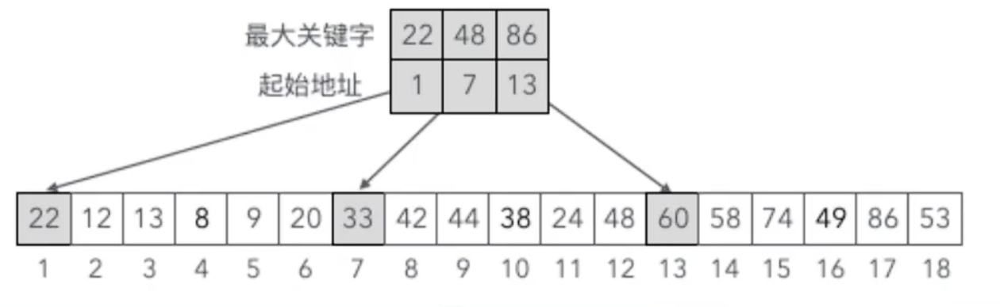

**两条约束**：

- **块间有序**：前一块的所有关键字都必须小于后一块的所有关键字（图中第 1 块最大 22 < 第 2 块最小 33，第 2 块最大 48 < 第 3 块最小 60），因此索引表里的最大关键字一列严格递增；
- **块内可以无序**：图中第 1 块 `22 12 13 8 9 20` 就是乱的，所以进块之后只能逐个比较。

四条结论：

1. 索引表的每个元素 = 该块的**最大关键字** + 该块**第一个元素的地址**；
2. 块内元素可以无序，但块间必须有序；
3. 索引表是有序表，可以顺序查找，也可以折半查找；块内无序，只能顺序查找；
4. 既要保证查找效率，又要能满足表中元素动态变化的需求，首选分块查找——它比顺序查找快，又不像折半查找那样要求全表有序，插入、删除只影响所在的那一块。

**查找 38**（图中第 2 块）：

- 先查索引表的最大关键字 22、48、86：$22 < 38 \le 48$，落在第 2 块（起始地址 7）；
- 再在第 2 块内从 33 开始顺序比较：33、42、44、38，第 4 次命中。

索引表若顺序查找，比较 22、48 共 2 次；若折半查找，比较 48、22 也是 2 次。整个查找共比较 $2 + 4 = 6$ 次。

**ASL**：设共 $b$ 块、每块 $s$ 个记录（$n = bs$），等概率查找。

索引表这一层：

- 顺序查找：$\frac{b+1}{2}$；
- 折半查找：按索引表的判定树算，约为 $\log_2(b+1)-1$（块数很少时直接数更准）。

块内这一层只能顺序查找，平均要比较 $\frac{s+1}{2}$ 次。所以

$$\text{ASL}_{\text{成功}} = \text{ASL}_{\text{索引表}} + \frac{s+1}{2}$$

注意第一项只统计**索引表内部**的比较次数，不是把全部 $n$ 个元素都比较一遍。

两种常见组合：

| 索引表 | 块内 | $\text{ASL}_{\text{成功}}$ |
| --- | --- | --- |
| 顺序查找 | 顺序查找 | $\frac{b+1}{2} + \frac{s+1}{2}$ |
| 折半查找 | 顺序查找 | $\text{ASL}_{\text{索引折半}} + \frac{s+1}{2}$ |

以图中 $b=3$、$s=6$ 为例：

- **顺序 + 顺序**：$\frac{3+1}{2} + \frac{6+1}{2} = 2 + 3.5 = 5.5$；
- **折半 + 顺序**：索引表 3 个关键字 22、48、86 的判定树以 48 为根，22、86 在第二层，比较次数之和为 $1 + 2 + 2 = 5$，平均 $\frac{5}{3}$；总 ASL 为 $\frac{5}{3} + \frac{6+1}{2} = \frac{31}{6} \approx 5.17$。

失败时要看关键字落在哪个索引区间、块内又比较到哪，分支较多，一般不展开讨论；这里重点掌握成功时的 ASL。

## 考点2-BST（二叉搜索树）

**定义**：二叉搜索树（BST）满足：对任意结点，左子树上所有关键字都小于它，右子树上所有关键字都大于它；左、右子树也分别是 BST。

由此得到最重要的性质：**中序遍历 BST，得到递增有序序列**。

### 查找

BST 查找和折半查找是同一个思路：每比较一次，就排除一整棵子树。

1. 从根开始，`key` 等于当前结点，查找成功；
2. `key` 小于当前结点，去左子树；
3. `key` 大于当前结点，去右子树；
4. 走到空指针，查找失败。

比较次数等于路径上经过的**非空结点数**：成功时数到目标结点，失败时数到最后一个非空结点。把每个结点看成一次比较，这条路径就是一株判定树；树平衡时，查找长度和折半查找同量级。

| 对比项 | 折半查找 | BST 查找 |
| --- | --- | --- |
| 存储 | 顺序表 | 二叉链表 |
| 前提 | 表按关键字有序 | 满足 BST 性质 |
| 比较路径 | 折半判定树 | BST 本身 |
| 平均时间复杂度 | $O(\log_2 n)$ | $O(\log_2 n)$ |
| 最坏时间复杂度 | $O(\log_2 n)$ | $O(n)$（退化成单支链） |

⚠ 这是 BST 和折半查找最容易考的区别：折半查找的判定树始终平衡，BST 的形状却取决于结点的插入顺序，同样的 $n$ 个关键字可能长成一条链。

### 删除

先找到待删结点 `p`，再按它的孩子个数分三种情况：

| 情况 | 做法 |
| --- | --- |
| `p` 是叶子 | 直接删除，把父结点对应的孩子指针置空（`p` 是根时直接把根置空） |
| `p` 只有一个孩子 | 用**唯一的孩子**顶替它，父结点改为指向这个孩子（`p` 是根时根改为这个孩子） |
| `p` 有两个孩子 | 用**直接前驱**或**直接后继**的值替代 `p`，再删除那个前驱/后继结点 |

两个概念：

- **直接前驱**：中序遍历中 `p` 的前一个结点，即 `p` 左子树中**最右**的结点（左子树的最大值）；
- **直接后继**：中序遍历中 `p` 的后一个结点，即 `p` 右子树中**最左**的结点（右子树的最小值）。

两种选法都合法，题目没有额外要求时选任意一种即可；不同选法得到的树形可能不同。用前驱/后继的值替代后，BST 性质仍然成立。并且前驱没有右孩子、后继没有左孩子，所以替代结点最多只有一个孩子——删它时只会落回前两种情况，不会一直递归下去。

删除的时间复杂度也是 $O(h)$（$h$ 为树高）：平均 $O(\log_2 n)$，最坏 $O(n)$。

## 考点3-AVL（平衡二叉树）

**定义**：AVL 树是一棵平衡的二叉搜索树：任意结点的左、右子树高度之差的绝对值不超过 1。

平衡因子：

$$\text{BF}(x) = h(\text{左子树}) - h(\text{右子树})$$

所以 AVL 树中每个结点的 BF 只能是 $-1$、$0$、$1$。插入、删除后要沿路径更新高度和 BF。

### AVL查找

和 BST 完全一样：从根开始，`key` 小往左、大往右，相等命中，走到空指针失败。

区别在复杂度：AVL 树高始终是 $O(\log_2 n)$，所以查找最坏也是 $O(\log_2 n)$；普通 BST 可能退化成单支链，最坏 $O(n)$。

### AVL插入

插入新结点后，可能从插入点向上出现不平衡。**只调整最小不平衡子树**，整棵树就恢复平衡。

**最小不平衡子树**：从插入结点向上找，第一个 $|\text{BF}| = 2$ 的结点为根的子树——它是离插入点最近的不平衡结点。

按新结点相对最小不平衡子树根的位置分四种：

| 类型 | 插入位置 | 调整 |
| --- | --- | --- |
| LL | 左孩子的左子树 | 右旋最小不平衡结点 |
| RR | 右孩子的右子树 | 左旋最小不平衡结点 |
| LR | 左孩子的右子树 | 先左旋左孩子，再右旋最小不平衡结点 |
| RL | 右孩子的左子树 | 先右旋右孩子，再左旋最小不平衡结点 |

**两种基本旋转**（都以被旋转的结点为轴）：

| 旋转 | 操作 |
| --- | --- |
| 左旋 | ① 右孩子变为旋转结点的父结点；② 右孩子的**左子树**变为旋转结点的**右子树** |
| 右旋 | ① 左孩子变为旋转结点的父结点；② 左孩子的**右子树**变为旋转结点的**左子树** |

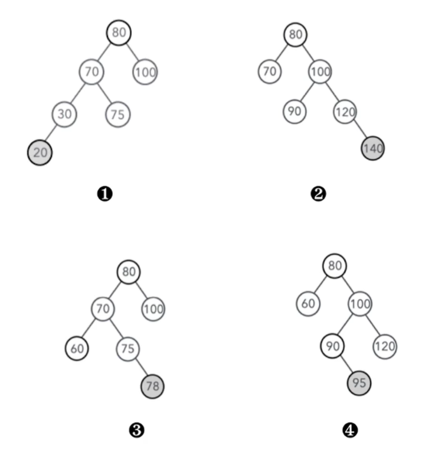

| 例 | 类型 | 调整 | 调整后的根 |
| --- | --- | --- | --- |
| ① | LL | 右旋 80 | 70 |
| ② | RR | 左旋 80 | 100 |
| ③ | LR | 先左旋 70，再右旋 80 | 75 |
| ④ | RL | 先右旋 100，再左旋 80 | 90 |

> 注：LL/RR 是单旋，LR/RL 是双旋；双旋的第一步旋的是"不平衡结点的孩子"，第二步才是"不平衡结点"。

**有序插入的特殊结论**：按 $1,2,\dots,2^n-1$ 的顺序依次插入空 AVL，最终会得到一棵高度为 $n$ 的**满二叉树**；根是 $2^{n-1}$，左右子树分别由前一半和后一半递归构成。

<u>例题：【2013】（有序插入 1~7，BF=0 的分支结点）</u>

【2013】若将关键字 1, 2, 3, 4, 5, 6, 7 依次插入初始为空的平衡二叉树 T，则 T 中平衡因子为 0 的分支结点的个数是

- A. 0
- B. 1
- C. 2
- D. 3


**选 D（3 个）。**

$7 = 2^3 - 1$，由上面的结论，1~7 依次插入后是一棵高度为 3 的满二叉树：根是 4，左孩子 2（左右孩子 1、3），右孩子 6（左右孩子 5、7）。

分支结点（非叶结点）是 4、2、6，它们的左右子树高度都相等，BF 全为 0。叶子 1、3、5、7 的 BF 也是 0，但题目问的是**分支结点**，不算叶子。

所以 BF=0 的分支结点有 3 个，选 D。


### AVL删除

先按 BST 的删除规则处理，再检查平衡。按被删结点的孩子情况分四种：

| 情况 | 处理 |
| --- | --- |
| ① 删除叶子结点 | 删除后仍平衡就直接删；不平衡就转成插入的四种情况调整 |
| ② 删除结点只有一个孩子（左或右） | 让这个孩子上位，再转成插入情况检查、调整 |
| ③ 有左右孩子，且左子树更深 | 与中序前驱交换，再转成插入情况调整 |
| ④ 有左右孩子，且右子树更深 | 与中序后继交换，再转成插入情况调整 |

- 中序前驱 = 左子树最右结点（左子树最大值）；中序后继 = 右子树最左结点（右子树最小值）。
- ③④交换后，待删结点变成前驱/后继原来的位置，而前驱没有右孩子、后继没有左孩子，所以最多只有一个孩子，化归为①②。

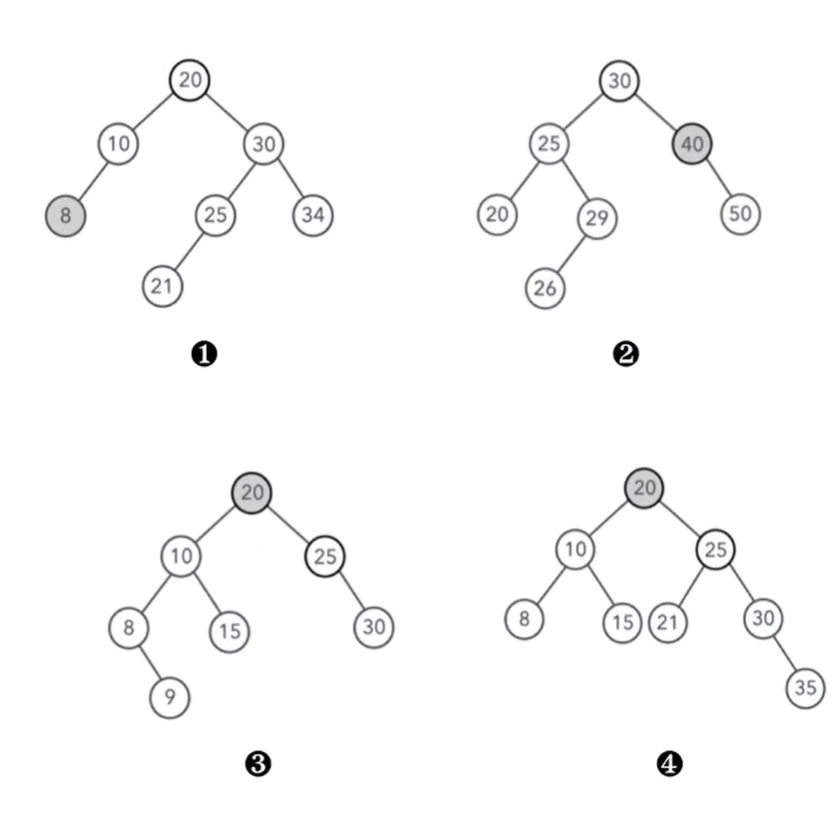

> 注：图中灰色结点是待删除的结点；③④ 交换后，真正删除的是前驱/后继原来的位置。

| 例 | 待删结点 | 情形 |
| --- | --- | --- |
| ① | 8（叶子） | 删除叶子 |
| ② | 40（只有右孩子 50） | 孩子上位 |
| ③ | 20（左右孩子，左子树更深） | 与中序前驱 15 交换 |
| ④ | 20（左右孩子，右子树更深） | 与中序后继 21 交换 |

> 注：插入只需要调整最小不平衡子树一次；删除可能在调整后让更高层的祖先继续失衡，所以要沿路径继续检查，可能需要多次旋转。

<u>例题：【2019】（删除后重新插入，T1 与 T3 是否相同）</u>

【2019】在任意一棵非空平衡二叉树（AVL 树）T1 中，删除某结点 v 之后形成平衡二叉树 T2，再将 v 插入 T2 形成平衡二叉树 T3。下列关于 T1 与 T3 的叙述中，正确的是

- Ⅰ. 若 v 是 T1 的叶结点，则 T1 与 T3 可能不相同
- Ⅱ. 若 v 不是 T1 的叶结点，则 T1 与 T3 一定不相同
- Ⅲ. 若 v 不是 T1 的叶结点，则 T1 与 T3 一定相同

- A. 仅 Ⅰ
- B. 仅 Ⅱ
- C. 仅 Ⅰ、Ⅱ
- D. 仅 Ⅰ、Ⅲ


**选 A（仅 Ⅰ）。**

AVL 的删除和插入不是互逆操作：删除可能触发旋转，插入又可能触发新的旋转，所以 T3 不一定回到 T1。下面用 `根(左, 右)` 简写树形，`_` 表示空。

- **例①（v 是叶子）**：T1 = `2(1, 4(3,5))`。删 1 后根 2 右重，左旋得 T2 = `4(2(_,3),5)`；重插 1 得 T3 = `4(2(1,3),5)`。T1 根 2、T3 根 4，**可能不同**，Ⅰ 对。
- **例②（v 不是叶子，会变）**：T1 = `3(1(_,2), 5(4,6))`。删 1（只有右孩子 2）得 T2 = `3(2,5(4,6))`；重插 1 得 T3 = `3(2(1,_),5(4,6))`，与 T1 **不同**，Ⅲ 错。
- **例③（v 不是叶子，不变）**：T1 = `2(1,3)`。删根 2（用前驱 1 代替）得 T2 = `1(_,3)`；重插 2 后经 RL 旋转回到 `2(1,3)`，与 T1 **相同**，Ⅱ 错。

因此只有 Ⅰ 正确，选 A。


### AVL的性质

下面的 $h$ 都按**层数**算，根为第 1 层。

**① 最少结点数**：设 $n_h$ 表示高度为 $h$ 的 AVL 树最少需要的结点数，则

$$n_h = n_{h-1} + n_{h-2} + 1, \qquad n_1 = 1,\ n_2 = 2$$

理由：根占 1 个；左右子树高度差最多 1，要让总数最少，就取一棵高度 $h-1$、另一棵高度 $h-2$，各自取最少结点数。

| $h$ | 1 | 2 | 3 | 4 | 5 | 6 | 7 |
| --- | --- | --- | --- | --- | --- | --- | --- |
| $n_h$ | 1 | 2 | 4 | 7 | 12 | 20 | 33 |

**② $n$ 个结点的 AVL 最小高度**：

$$h_{\min} = \lceil \log_2(n+1) \rceil$$

因为高度为 $h$ 的二叉树最多 $2^h - 1$ 个结点，要装下 $n$ 个结点必须 $2^h - 1 \ge n$，即 $h \ge \log_2(n+1)$，取最小的整数就是向上取整。

> 注：这里是**向上取整**。例如 $n=4$ 时 $h_{\min} = \lceil \log_2 5 \rceil = 3$，不能用向下取整算成 2。

**③ 最多结点数**：高度为 $h$ 的 AVL 树最多有

$$2^h - 1$$

个结点，取满二叉树时达到。每层最多 $1,2,4,\dots,2^{h-1}$ 个，求和即可。

**合起来看**：同样高度 $h$，AVL 的结点数在 $[n_h,\ 2^h-1]$ 之间；同样 $n$ 个结点，AVL 的高度在 $[\lceil \log_2(n+1) \rceil,\ h_{\max}]$ 之间（$h_{\max}$ 是 $n$ 个结点时 AVL 可能达到的最大高度）。令 $m_h = n_h + 1$，则 $m_h = m_{h-1} + m_{h-2}$，所以 $n_h$ 按 Fibonacci 速度增长，$h_{\max} = O(\log_2 n)$——这正是 AVL 查找最坏仍为 $O(\log_2 n)$ 的原因。

例如 $n=8$：$h_{\min} = \lceil \log_2 9 \rceil = 4$；高度 4 的 AVL 最少 7 个结点、最多 15 个结点，8 个结点正好能构成高度 4 的 AVL。

**记忆**：高度固定时，**非叶结点的 BF 全为 $\pm 1$（没有 $0$）$\Leftrightarrow$ 结点数取最少 $n_h$**。只要有一个非叶结点的 BF 为 $0$，说明它左右子树一样高，这棵子树比"最少"更满，总结点数就会大于 $n_h$。

<u>例题：【2012】（非叶结点平衡因子全为 1）</u>

【2012】若平衡二叉树的高度为 6，且所有非叶结点的平衡因子均为 1，则该平衡二叉树的结点总数为

- A. 12
- B. 20
- C. 32
- D. 33


**选 B（20）。**

所有非叶结点的 BF 都是 1（没有 0），说明每个内部结点左右子树高度都差 1，整棵树取到了高度 6 时的**最少结点数**。

由性质①：

$$n_6 = n_5 + n_4 + 1$$

查前面的数列，$n_4 = 7$、$n_5 = 12$，所以

$$n_6 = 12 + 7 + 1 = 20$$

选 B。

选项里的 12 正好是 $n_5$、33 是 $n_7$，32 是 $2^5$，都是按相邻高度或满二叉树设的干扰项。


## 考点4-B树和B+树

**B 树（m 阶）**：一种多路平衡查找树。每个结点最多有 $m$ 棵子树、$m-1$ 个关键字；除根结点外的非叶结点至少有 $\lceil m/2 \rceil$ 棵子树；所有叶结点在同一层。

### 节点结构

B 树的结点通常存成：

`n | p0 | k1 | p1 | k2 | p2 | ... | kn | pn`

- $n$：结点内关键字个数（实现中常省略）；
- $k_1<k_2<\cdots<k_n$：关键字，按升序排列；
- $p_0$ 指向的子树中所有关键字都小于 $k_1$；
- $p_i$（$1\le i<n$）指向的子树中所有关键字都大于 $k_i$、小于 $k_{i+1}$；
- $p_n$ 指向的子树中所有关键字都大于 $k_n$。

所以 **n 个关键字把关键字空间分成 n+1 段，对应 n+1 棵子树**。B+ 树不是这样：它的 n 个关键字只对应 n 棵子树。

### 性质

B 树和 B+ 树的核心区别：

| 项目 | B 树 | B+ 树 |
| --- | --- | --- |
| 关键字与子树 | $n$ 个关键字对应 $n+1$ 棵子树 | $n$ 个关键字对应 $n$ 棵子树 |
| 根结点子树 | $[2,m]$ | $[2,m]$ |
| 根结点关键字 | $[1,m-1]$ | $[2,m]$ |
| 非根结点子树 | $[\lceil m/2 \rceil,m]$ | $[\lceil m/2 \rceil,m]$ |
| 非根结点关键字 | $[\lceil m/2 \rceil-1,m-1]$ | $[\lceil m/2 \rceil,m]$ |
| 叶子结点 | 同一层、不带信息（失败结点） | 含全部关键字和记录指针，按关键字顺序链接 |
| 查找方式 | 随机查找 | 随机查找 + 顺序查找 |
| 高度 | 见下式 | 同 B 树量级 |

B 树的高度（$n$ 为关键字总数，$h$ 为层数）：

$$\log_m(n+1) \le h \le \log_{\lceil m/2 \rceil}\left(\frac{n+1}{2}\right)+1$$

- 下界：每个结点最多 $m$ 棵子树，高度 $h$ 最多容纳 $m^h-1$ 个关键字，所以树不能太矮；
- 上界：每个非根结点至少 $\lceil m/2 \rceil$ 棵子树，分叉不会太少，所以树不会长得太高。

**B 树**：每个结点都可能存数据（或记录指针），查找可能在内部结点就命中，不必走到叶子；叶子是失败结点，不带信息，所有叶子同层。

**B+ 树**：

- 内部结点只存索引关键字，所有关键字和记录指针都在叶子，查找必须走到叶子；
- 叶子按关键字从小到大顺序链接，支持范围查询和顺序查找；
- 同样扇出下，内部结点不存数据，能容纳更多索引项，树更矮，适合做数据库/文件索引。

> 注：B+ 树的内部关键字是叶子关键字的副本，只作分隔符；B 树的关键字在整棵树中只出现一次。

<u>例题：【2014】（15 个关键字最多多少个含关键字结点）</u>

【2014】在一棵有 15 个关键字的 4 阶 B 树中，含关键字的结点个数最多是

- A. 5
- B. 6
- C. 10
- D. 15


**选 D（15）。**

要让含关键字的结点数最多，就让每个结点只放 1 个关键字。4 阶 B 树每个结点最多 3 个关键字、最少 1 个；每个内部结点 1 个关键字时有两个孩子，正好可以长成一棵高度 4 的满二叉树：

- 第 1 层 1 个、第 2 层 2 个、第 3 层 4 个、第 4 层 8 个；
- 合计 $1+2+4+8=15$ 个结点、15 个关键字。

结点数不可能超过关键字数（每个结点至少 1 个关键字），所以最多就是 15，选 D。


**追问：如果是 14 个关键字呢？**

4 阶 B 树高度为 4 时，至少要 15 个关键字：每个内部结点至少 1 个关键字、每个终端结点至少 1 个关键字，最小的形状就是上面那棵 15 结点的满二叉树。所以 14 个关键字不可能保持 4 层，树高必须降到 3。

高度 3 时，要让结点数最多，仍尽量让每个结点少放关键字。设第 1、2 层关键字数为 $K_1,K_2$，则三层结点数为

$$N=3+2K_1+K_2$$

终端结点数为 $K_1+K_2+1$。剩余 $14-K_1-K_2$ 个关键字要放进这些终端结点，且每个终端结点至少 1 个，于是

$$14-K_1-K_2 \ge K_1+K_2+1 \Rightarrow K_1+K_2 \le 6$$

又第二层每个结点至少 1 个关键字，$K_2\ge K_1+1$，所以 $K_1\le2$；于是 $N\le 3+4+4=11$。

这个上限能达到：第 1 层 1 个结点 2 个关键字；第 2 层 3 个结点共 4 个关键字（2、1、1）；第 3 层 7 个终端结点共 8 个关键字（2、1、1、1、1、1、1）。合计 11 个结点、14 个关键字，所有终端结点都在第 3 层。

所以 14 个关键字时，含关键字的结点数最多是 **11**，不是 14；终端结点仍同层，只是通过让部分结点多放关键字来补足。

从 15 个关键字的满 4 层树删掉一个关键字，也不能简单摘掉一个叶子——那样父结点只剩一个孩子，违反 B 树性质；删除算法会借/合并，最终把树高降到 3。

<u>例题：【2021】（3 阶 B 树高度 3，第 2 层 4 个关键字）</u>

【2021】在一棵高度为 3 的 3 阶 B 树中，根为第 1 层，若第 2 层中有 4 个关键字，则该树的结点数最多是

- A. 11
- B. 10
- C. 9
- D. 8


**选 A（11）。**

3 阶 B 树每个结点最多 2 个关键字、3 个孩子；根结点关键字数为 1 或 2，非根结点也是 1 或 2。

设根有 $K_1$ 个关键字，则第 2 层有 $K_1+1$ 个结点。要让总结点数最多，先让第 2 层结点数最多，取 $K_1=2$，于是第 2 层有 3 个结点。

第 2 层一共 4 个关键字，分给 3 个结点，每个结点 1 或 2 个关键字，最优分配是 `2,1,1`：

- 2 个关键字的结点有 3 个孩子；
- 1 个关键字的结点有 2 个孩子；
- 第 3 层共有 $3+2+2=7$ 个结点。

总结点数 $=1+3+7=11$，选 A。

（若根只放 1 个关键字，第 2 层只有 2 个结点，要装 4 个关键字只能各放 2 个，第 3 层 6 个结点，总数只有 9。）


### B/B+树的查找

**B 树的查找**：

1. 从根结点开始，在结点内按关键字有序比较；
2. 命中就成功——B 树的内部结点也可能存记录，不必走到叶子；
3. 没命中，就根据 key 落在哪两个关键字之间，沿对应指针下降到子树；
4. 走到空指针，查找失败。

每下降一层通常对应一次磁盘 I/O，所以查找代价主要看树高，为 $O(\log_m n)$。结点内既可以顺序比较，也可以折半比较。

以图中查找 29 为例：

- 根块 `[17, 35]`：$17<29<35$，走 p2 到磁盘块 3；
- 块 3 `[26, 30]`：$26<29<30$，走 p2 到磁盘块 8；
- 块 8 `[28, 29]`：找到 29。

一共访问 3 个结点。

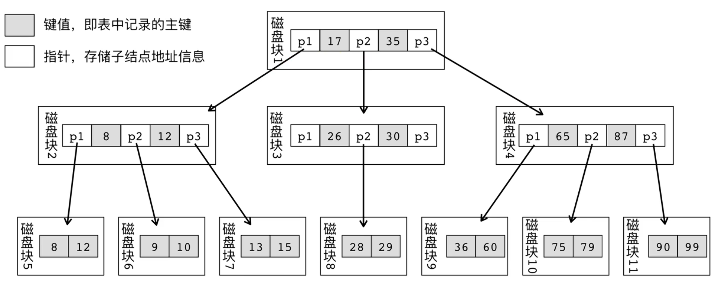

**B+ 树的查找**：

- 内部结点只作索引，查找必须一路走到叶子；即使内部结点出现了要查的 key，也不能在那里返回；
- 到叶子后，在叶内找 key，找到后通过记录指针取记录；
- 所有查找都要到叶子，访问的结点数固定为树高（叶内再比较），查找长度稳定；
- 叶子按关键字顺序链接，找到一个 key 后可以沿链继续扫描，支持范围查询和顺序查找。

同样以查找 29 为例：

- 根块 `[26, 99]`：$29>26$，走 p2 到磁盘块 3；
- 块 3 `[35, 75, 99]`：$29<35$，走 p1 到磁盘块 7；
- 块 7 `[28, 29, 30, 35]`：找到 29；沿叶链继续还能读出 30、35……

同样访问 3 个结点。

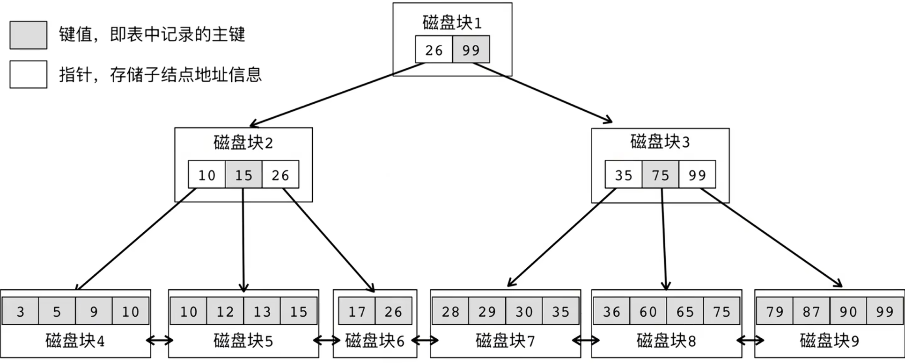

**两者的关键差别**：

- B 树可能在内部结点就命中，B+ 树必须到叶子；
- B+ 树内部结点不存记录，同样扇出下能容纳更多索引项，树更矮、磁盘 I/O 更少；
- B+ 树所有查找都到叶子，查找长度更稳定；B 树可能提前成功；
- B+ 树的叶子链表支持范围查询，B 树做范围查询要中序遍历或回溯。

<u>例题：【2017】（适合使用 B+ 树的应用）</u>

【2017】下列应用中，适合使用 B+ 树的是

- A. 编译器中的词法分析
- B. 关系数据库中的索引
- C. 网络中的路由表快速查找
- D. 操作系统的磁盘空闲块管理


**选 B（关系数据库中的索引）。**

B+ 树把全部关键字和记录指针放在叶结点，叶子按关键字顺序链接，内部结点只存索引。这带来两个数据库最需要的能力：

- 内部结点不存记录，扇出大、树矮，查一条记录访问的磁盘块少；
- 叶子链表支持范围查询和顺序扫描（例如 `WHERE id BETWEEN 10 AND 20`）。

其他选项的常用结构：

- 词法分析：DFA/状态机（或哈希表）；
- 路由表：Trie/前缀树、哈希；
- 磁盘空闲块管理：位图、空闲链表/成组链接。


### B/B+树的插入

**B 树的插入**：

1. 先按查找路径找到应插入的终端结点（最底层）；
2. 插入后关键字个数 $\le m-1$：直接插入；
3. 插入后关键字个数 $>m-1$（即变成 $m$ 个）：取第 $\lceil m/2 \rceil$ 个关键字移到父结点，原结点一分为二——左边 $\lceil m/2 \rceil-1$ 个，右边 $m-\lceil m/2 \rceil$ 个；
4. 父结点若也因此超过 $m-1$，继续向上分裂；根结点分裂时新建根，树高加 1。

**B+ 树的插入**：

1. 所有关键字最终都插入叶子；先按索引找到目标叶；
2. 插入后关键字个数 $\le m$：直接插入；
3. 插入后关键字个数 $>m$（即 $m+1$ 个）：把结点分成左右两半，两边都不少于 $\lceil m/2 \rceil$ 个关键字；把左半的最大值（第 $\lceil m/2 \rceil$ 个）复制到父结点，作为新的索引项（本图索引取的是左子树最大值；若教材取右子树最小值，则复制右半第一个关键字，原理相同）；
4. 父结点若超过 $m$，继续向上分裂；根分裂时新建根，树高加 1；
5. 插入、分裂后都要检查父结点索引：如果新 key 成了某个子树的最大值，即使没有分裂，也要更新对应的索引关键字。

用 $m=3$ 各看一个溢出分裂：

| 树 | 溢出后的结点 | 分裂结果 | 父结点得到 |
| --- | --- | --- | --- |
| B 树 | `[10, 20, 30]` | `[10]` + `[30]` | 20（移动上去） |
| B+ 树 | `[10, 20, 25, 30]` | `[10, 20]` + `[25, 30]` | 20（复制上去，仍留在左叶） |

> 注：B 树分裂是"中间关键字搬家"；B+ 树是"边界关键字复印"——原关键字仍留在叶子里，父结点只多一个索引副本。插入过程中要时刻注意是否需要修改索引中的关键字。

<u>例题：【2020】（4 阶 B 树插入后的根结点）</u>

【2020】依次将关键字 5, 6, 9, 13, 8, 2, 12, 15 插入初始为空的 4 阶 B 树后，根结点中包含的关键字是

- A. 8
- B. 6, 9
- C. 8, 13
- D. 9, 12


**选 B（6, 9）。**

4 阶 B 树每个结点最多 3 个关键字。插入过程：

| 插入 | 变化 |
| --- | --- |
| 5, 6, 9 | 根结点 `[5,6,9]`，已满 |
| 13 | `[5,6,9,13]` 溢出，6 上移；根 `[6]`，孩子 `[5]`、`[9,13]` |
| 8 | $8>6$，进入右子树，变 `[8,9,13]` |
| 2 | $2<6$，进入左子树，变 `[2,5]` |
| 12 | 右子树 `[8,9,12,13]` 溢出，9 上移；根 `[6,9]`，孩子 `[2,5]`、`[8]`、`[12,13]` |
| 15 | $15>9$，进入最右子树，变 `[12,13,15]` |

最后根结点是 `[6,9]`，选 B。


### B/B+树的删除

> 先明确：这里说的**终端结点**，指最下一层**含关键字**的结点，不是 B 树中那个不带信息的外部/失败结点。

**B 树的删除**：

1. 若被删关键字在非终端结点：用它的直接前驱（左子树最大）或直接后继（右子树最小）替代，转化为删除终端结点中的关键字；
2. 在终端结点删除后：
   - 关键字个数 $\ge \lceil m/2 \rceil-1$：直接删除；
   - 关键字个数 $<\lceil m/2 \rceil-1$（下溢），且兄弟够借（兄弟关键字个数 $\ge \lceil m/2 \rceil$）：**父下子上**——父结点的分隔关键字下移，兄弟的一个关键字上移；
   - 兄弟不够借：**父下与子合并**——父结点的分隔关键字下移，与当前结点、兄弟合并成一个结点；父结点少一个关键字和一个孩子，若父结点也下溢，继续向上处理。

借的时候看方向：左兄弟够借，取左兄弟最大关键字上移；右兄弟够借，取右兄弟最小关键字上移。

**B+ 树的删除**：

B+ 树所有关键字都在终端结点，内部结点只是索引，所以删除总从终端结点开始；删完还要同步索引。

1. 删除后关键字个数 $\ge \lceil m/2 \rceil$：直接删除；如果删的是该结点的边界值，还要检查父结点索引是否要改；
2. 关键字个数 $<\lceil m/2 \rceil$（下溢），且兄弟够借（兄弟关键字个数 $\ge \lceil m/2 \rceil+1$）：从兄弟借一个关键字到当前结点，并更新父结点索引；
3. 兄弟不够借：当前结点与兄弟合并；删掉父结点对应的索引项，调整叶子链表；父结点若下溢，继续向上处理。

> 删除过程中要时刻保持终端结点关键字和非终端结点关键字的一致性：B+ 树的内部关键字只是叶子关键字的副本，借、并、删边界值后不同步索引，就会出现"索引里有、叶子里没有"或边界值对不上。

> 根结点特殊：若根在合并后没有关键字，就删掉根，让它的唯一孩子成为新根，树高减 1（B 树、B+ 树都一样）。

**对照记**：

| 项目 | B 树 | B+ 树 |
| --- | --- | --- |
| 删除位置 | 可能在非终端，先替换成终端删除 | 总在终端叶子 |
| 下溢阈值 | $\lceil m/2 \rceil-1$ | $\lceil m/2 \rceil$ |
| 够借 | 父下子上 | 兄弟给一个 + 改索引 |
| 不够借 | 父下与子合并 | 与兄弟合并 + 改索引/叶链 |

**记法**：B 树"先换后删，少了先借后并；借是父下子上，并是父下子合"；B+ 树"叶删，少了先借后并，借并都要改索引"。

<u>例题：【2022】（5 阶 B 树删除 260 后的根）</u>

【2022】在下图所示的 5 阶 B 树 T 中，删除关键字 260 之后需要进行必要的调整，得到新的 B 树 T1。下列选项中，不可能是 T1 根结点中关键字序列的是


- A. 60, 90, 280
- B. 60, 90, 350
- C. 60, 85, 110, 350
- D. 60, 90, 110, 350


**选 D。**

5 阶 B 树每个结点最多 4 个关键字；非根结点最少 2 个关键字，所以 `[100,110]` 和 `[280,300]` 删掉一个就下溢。

260 在根结点，先按 B 树删除规则用前驱或后继替代：

**① 用前驱 110 替代 260**：根暂时变成 `[60,90,110,350]`，左孩子 `[100]` 下溢。

- 左兄弟 `[70,80,85]` 有 3 个关键字，够借：父结点 90 下移、85 上移，根变成 `[60,85,110,350]`——C 可能；
- 不借而与右兄弟合并：父结点 110 下移，`[100] + 110 + [280,300]` 合成 `[100,110,280,300]`，根变成 `[60,90,350]`——B 可能。

**② 用后继 280 替代 260**：根暂时变成 `[60,90,280,350]`，右孩子 `[300]` 下溢；左右兄弟都只有 2 个关键字，不够借，只能合并。

- 与左兄弟合并：`[100,110] + 280 + [300]` 合成 `[100,110,280,300]`，根变成 `[60,90,350]`——B 可能；
- 与右兄弟合并：`[300] + 350 + [400,500]` 合成 `[300,350,400,500]`，根变成 `[60,90,280]`——A 可能。

**D `[60,90,110,350]` 只是用前驱 110 替代 260 后的中间状态**：此时 `[100]` 还下溢，必须继续借或合并，根一定会变（变成 B 或 C），所以 D 不可能是调整后的 T1 根结点序列。

所以选 D。


## 考点5-散列表

**散列表**：用散列函数 $H(key)$ 把关键字直接映射到存储地址，理想情况下一次就能定位。

| 术语 | 含义 |
| --- | --- |
| 同义词 | 具有相同散列函数值的关键字 |
| 非同义词 | 散列函数值不同的关键字 |
| 冲突/碰撞 | 不同关键字映射到同一散列地址 |
| 堆积/二次聚集 | 用线性探测处理同义词冲突时，又占用了非同义词的位置，造成连锁拥挤 |
| 装填因子 | $\alpha = n/m$，$n$ 为表中关键字个数，$m$ 为散列表长度 |

**影响散列表效率的三个因素**：

**① 装填因子 $\alpha$**：

- $\alpha=n/m$，即表中关键字个数 / 散列表长度；
- $\alpha$ 表示散列表的装满程度：$\alpha$ 越大，空闲槽越少，产生冲突的可能性越大；
- **ASL 与 $n$ 或 $m$ 没有直接关系，而是依赖于 $\alpha$**（散列函数均匀、冲突处理方法固定时）。不能单看表长：$m=1000$ 时，$n=100$ 的 $\alpha=0.1$，$n=900$ 的 $\alpha=0.9$，后者冲突多得多。

**② 散列函数**：设计得越好，关键字分布越均匀，产生冲突的可能性越小，查找路径越短。

**③ 处理冲突的方法**：决定发生冲突后的查找效率；有些方法还会引入新的冲突（例如线性探测的堆积），使查找距离变长。

> 一句话：ASL 不直接看 $n$、$m$ 的绝对大小，而看 $\alpha$ 和冲突处理方法；$\alpha$ 越大，ASL 越大。

<u>例题：【2014】（堆积现象直接影响什么）</u>

【2014】用哈希（散列）方法处理冲突（碰撞）时可能出现堆积（聚集）现象，下列选项中，会受堆积现象直接影响的是

- A. 存储效率
- B. 散列函数
- C. 装填（装载）因子
- D. 平均查找长度


**选 D（平均查找长度）。**

堆积是用线性探测处理冲突时，冲突的关键字挤占了后面的槽，导致本来散列地址不同的关键字也被迫继续往后探测。它直接拉长的是**探测序列**，所以平均查找长度（ASL）变长。

其他选项：

- 存储效率：堆积不改变表长和关键字个数，不直接改变空间利用率；
- 散列函数：它是映射规则，堆积是冲突处理造成的，不会反过来改变散列函数；
- 装填因子：$\alpha=n/m$ 由关键字数和表长决定，堆积不改变 $\alpha$。


### 散列函数的构造方法

| 方法 | 做法 | 特点 |
| --- | --- | --- |
| 直接定址法 | $H(key)=a\cdot key+b$ | 简单；$a\ne0$ 时无冲突，但要求关键字分布已知，可能浪费空间 |
| 除留余数法 | $H(key)=key \bmod p$，$p\le m$ | 最常用；$p$ 取不大于 $m$ 的质数，分布较均匀 |
| 数字分析法 | 选取关键字中分布均匀的若干位 | 适合关键字集合已知、位数较多的情况 |
| 平方取中法 | 关键字平方后取中间几位 | 适合关键字各位分布不均匀的情况 |

### 处理冲突的方法

| 方法 | 探测序列/结构 | 特点 |
| --- | --- | --- |
| 线性探测 | $d_i=1,2,3,\dots$，$H_i=(H(key)+d_i)\bmod m$ | 简单；容易产生堆积/二次聚集 |
| 平方探测 | $d_i=1^2,-1^2,2^2,-2^2,\dots$ | 减少堆积；某些 $m$ 下不能探测到所有槽 |
| 双散列 | $d_i=i\cdot H_2(key)$ | 分布更均匀；需要多算一个散列函数 |
| 伪随机序列 | $d_i$ 取伪随机数 | 依赖随机序列 |
| 链地址法 | 每个槽挂一条同义词链表 | 无堆积；$\alpha$ 可以大于 1；删除方便；需要额外指针空间 |

**线性探测法**（开放定址法的一种）：

1. 冲突发生时，顺序查看表中的下一个单元，直到找到空单元或查遍全表；
2. 探测到表尾后，下一个探测地址回到表头（循环探测）；
3. 处理同义词冲突的过程中，可能又占用非同义词的位置，造成堆积/二次聚集；
4. 删除不能直接把槽置空，否则会截断后面的探测链，一般只做删除标记（墓碑）。这条对所有开放定址法都成立。

**例**：散列表长 $m=13$，散列函数 $H(key)=key\bmod 10$，依次插入 $10,21,32,42,52,75$。

| 关键字 | $H(key)$ | 实际地址 | 比较次数 |
| --- | --- | --- | --- |
| 10 | 0 | 0 | 1 |
| 21 | 1 | 1 | 1 |
| 32 | 2 | 2 | 1 |
| 42 | 2 | 3（2 被占，后移一位） | 2 |
| 52 | 2 | 4（2、3 被占，后移两位） | 3 |
| 75 | 5 | 5 | 1 |

最终表：

| 地址 | 0 | 1 | 2 | 3 | 4 | 5 | 6 | 7 | 8 | 9 | 10 | 11 | 12 |
| --- | --- | --- | --- | --- | --- | --- | --- | --- | --- | --- | --- | --- | --- |
| 关键字 | 10 | 21 | 32 | 42 | 52 | 75 | 空 | 空 | 空 | 空 | 空 | 空 | 空 |

$$\text{ASL}_{成功}=\frac{1+1+1+2+3+1}{6}=1.5$$

失败查找从每个可能的散列地址 $0\sim9$ 出发，一直探测到空槽：

| 起始地址 | 0 | 1 | 2 | 3 | 4 | 5 | 6 | 7 | 8 | 9 |
| --- | --- | --- | --- | --- | --- | --- | --- | --- | --- | --- |
| 比较次数 | 7 | 6 | 5 | 4 | 3 | 2 | 1 | 1 | 1 | 1 |

$$\text{ASL}_{失败}=\frac{7+6+5+4+3+2+1+1+1+1}{10}=3.1$$

> 注意：表长是 13，但 $H(key)=key\bmod 10$ 只能映射到 0~9；地址 10、11、12 不会成为任何关键字的初始散列地址，所以计算失败 ASL 时只看 0~9，分母是 10，不是 13。

<u>例题：【2023】（线性探测删除后的失败 ASL）</u>

【2023】现有长度为 5、初始为空的散列表 HT，散列函数 $H(k)=(k+4)\bmod 5$，用线性探查再散列法解决冲突。若将关键字序列 2022, 12, 25 依次插入 HT，然后删除关键字 25，则 HT 中查找失败的平均查找长度为

- A. 1
- B. 1.6
- C. 1.8
- D. 2.2


**选 C（1.8）。**

插入过程：

- $H(2022)=(2022+4)\bmod 5=2026\bmod 5=1$，放在地址 1；
- $H(12)=16\bmod 5=1$，冲突，线性探测到地址 2；
- $H(25)=29\bmod 5=4$，放在地址 4。

表为 `[空, 2022, 12, 空, 25]`。

删除 25 时不能把地址 4 直接置空，否则会截断探测链；要做删除标记。删除后：

| 地址 | 0 | 1 | 2 | 3 | 4 |
| --- | --- | --- | --- | --- | --- |
| 状态 | 空 | 2022 | 12 | 空 | 删除标记 |

失败查找从每个可能的散列地址 0~4 出发，探测到**真正的空槽**为止（删除标记不算空）：

| 起始地址 | 0 | 1 | 2 | 3 | 4 |
| --- | --- | --- | --- | --- | --- |
| 比较次数 | 1 | 3 | 2 | 1 | 2 |

- 从 4 出发：地址 4 是删除标记（算一次比较），继续回绕到 0，0 为空，共 2 次；
- 其余：0 空 → 1 次；1→2→3 空 → 3 次；2→3 空 → 2 次；3 空 → 1 次。

$$\text{ASL}_{失败}=\frac{1+3+2+1+2}{5}=1.8$$

选 C。

> 易错：如果删除 25 时直接把地址 4 置空，从 4 出发一次就失败，$\text{ASL}_{失败}=8/5=1.6$，会误选 B。开放定址法必须用删除标记。


**平方探测法**（开放定址法的一种）：

1. $H_i=(H(key)+d_i)\bmod m$，$d_i=1^2,-1^2,2^2,-2^2,\dots$；有的题目用 $1^2,2^2,3^2,\dots$，具体公式以题目为准；
2. 散列表长度 $m$ 必须是一个可以表示成 $4k+3$ 的素数；
3. 可以避免线性探测的堆积，但不能保证探测到散列表上的所有单元；
4. 删除同样不能直接把槽置空，要做删除标记。

> 注：不同教材对平方探测能覆盖多少槽的结论不完全一致；按课件记"避免堆积，但不保证覆盖全表"，做题时以题目给定的探测序列为准。

<u>例题：【2024】（平方探测构造散列表与查找）</u>

【2024】将关键字序列 20, 3, 11, 18, 9, 14, 7 依次存储到初始为空、长度为 11 的散列表 HT 中，散列函数 $H(key)=(key\times3)\bmod 11$。$H(key)$ 计算出的初始散列地址为 $H_0$，发生冲突时探查地址序列是 $H_1,H_2,H_3,\dots$，其中 $H_k=(H_0+k^2)\bmod 11$，$k=1,2,3,\dots$。

请回答下列问题：

1）画出所构造的 HT，并计算 HT 的装填因子。
2）给出在 HT 中查找关键字 14 的关键字比较序列。
3）在 HT 中查找关键字 8，确认查找失败时的散列地址是多少？


**1）HT 如下，装填因子 $\alpha=7/11\approx0.64$。**

| 地址 | 0 | 1 | 2 | 3 | 4 | 5 | 6 | 7 | 8 | 9 | 10 |
| --- | --- | --- | --- | --- | --- | --- | --- | --- | --- | --- | --- |
| 关键字 | 11 | 空 | 14 | 7 | 空 | 20 | 9 | 空 | 空 | 3 | 18 |

插入过程：

- 20：$H_0=5$，放地址 5；
- 3：$H_0=9$，放地址 9；
- 11：$H_0=0$，放地址 0；
- 18：$H_0=10$，放地址 10；
- 9：$H_0=5$ 冲突，$H_1=6$，放地址 6；
- 14：$H_0=9$ 冲突，$H_1=10$ 冲突，$H_2=2$，放地址 2；
- 7：$H_0=10$ 冲突，$H_1=0$ 冲突，$H_2=3$，放地址 3。

共有 $n=7$ 个关键字，表长 $m=11$，所以 $\alpha=7/11\approx0.64$。

**2）查找 14：关键字比较序列是 3, 18, 14。**

$H(14)=42\bmod11=9$：地址 9 是 3，$H_1=10$ 是 18，$H_2=2$ 是 14，命中。对应地址序列 $9\to10\to2$。

**3）查找 8 失败，确认失败的散列地址是 7。**

$H(8)=24\bmod11=2$：地址 2 是 14，$H_1=3$ 是 7，$H_2=6$ 是 9，$H_3=0$ 是 11，$H_4=7$ 为空，查找失败。探测地址序列是 $2\to3\to6\to0\to7$。


**注意表长 $m$ 与散列函数除数的区别**：

- 表长 $m$ 是槽的个数，线性探测、平方探测回绕时都对 $m$ 取模；
- $H(key)=key\bmod p$ 里的 $p$ 只决定初始散列地址的范围，$p$ 可以小于 $m$；
- 算初始地址用 $p$，算探测地址用 $m$，两者不要混。

<u>例题：表长 14、$H(key)=key\bmod 11$ 的二次探测</u>

【题目】散列表长 $m=14$，$H(key)=key\bmod 11$，若插入关键字 15、38、61、84，并使用二次探测法解决冲突，则 49 的散列地址是

- A. 8
- B. 3
- C. 5
- D. 9


**选 D（9）。**

先算初始地址（除数是 11）：

- $15\bmod11=4$，放地址 4；
- $38\bmod11=5$，放地址 5；
- $61\bmod11=6$，放地址 6；
- $84\bmod11=7$，放地址 7。

49 的初始地址是 $49\bmod11=5$，地址 5 已被 38 占用。按正向平方探测，回绕对**表长 14** 取模：

- $H_1=(5+1^2)\bmod14=6$，被 61 占用；
- $H_2=(5+2^2)\bmod14=9$，空，放地址 9。

所以 49 的散列地址是 9，选 D。

> 注意：这题用 11 回绕碰巧也会得到 9，但规则上探测地址必须对表长 $m=14$ 取模；换一组数据就可能不同。


**链地址法**：

1. 所有同义词存在一条链表里，链表由散列地址唯一标识——数组的每个槽存对应链表的头指针；
2. 插入、删除都只改链表指针，可以直接删除关键字，不需要墓碑；
3. 查找时先算 $H(key)$ 找到槽，再沿链表逐个比较；
4. **空指针也算一次比较**：成功时比较到目标结点为止，次数等于结点在链中的序号；失败时要走完整条链，再判断一次空指针，次数 $=$ 链长 $+1$。

等概率、散列函数均匀映射到 $m$ 个槽时：

$$\text{ASL}_{成功}=\frac{1}{n}\sum_{i=1}^{m}\frac{k_i(k_i+1)}{2}$$

$$\text{ASL}_{失败}=\frac{1}{m}\sum_{i=1}^{m}(k_i+1)$$

其中 $k_i$ 是第 $i$ 个槽的链长，$n=\sum k_i$。

**例**：$m=5$，各槽链长 $k=(2,1,0,3,0)$：

| 槽 | 0 | 1 | 2 | 3 | 4 |
| --- | --- | --- | --- | --- | --- |
| 链长 $k_i$ | 2 | 1 | 0 | 3 | 0 |
| 失败比较次数 $k_i+1$ | 3 | 2 | 1 | 4 | 1 |

$$\text{ASL}_{失败}=\frac{3+2+1+4+1}{5}=2.2$$

若 6 个关键字在链中的位置分别为 1、2（槽 0）、1（槽 1）、1、2、3（槽 3），则

$$\text{ASL}_{成功}=\frac{1+2+1+1+2+3}{6}=\frac{10}{6}\approx1.67$$

**查找过程**：先算 $H(key)$ 并比较；冲突就按探测序列或链表继续找；找到关键字成功，遇到空槽或链尾失败。

- 开放定址法要求 $\alpha<1$（表不能满）；
- 链地址法的 $\alpha$ 可以大于 1，平均链长就是 $\alpha$；
- ASL 与 $\alpha$ 和冲突处理方法都有关，但总体趋势是 $\alpha$ 越大、ASL 越大。

## 考点6-红黑树

红黑树是一种**近似平衡的二叉搜索树**：每个结点增加一个颜色位（红/黑），用颜色约束把树高控制在 $O(\log n)$。它首先是一棵 BST，中序遍历仍然得到有序序列。

### 定义与性质

一棵红黑树满足：

1. 每个结点是红色或黑色；
2. 根结点是黑色；所有叶子结点（NIL/外部空结点）也是黑色；
3. 红结点的两个子结点都必须是黑色——等价于**不能出现两个连续的红结点**；
4. 从任一结点到其每个叶子结点的所有路径上，黑色结点数目相同。

> 这里的"叶子"通常指 NIL/外部空结点（黑哨兵），不是带关键字的终端结点；不同教材表述可能略有差异，做题时看题目口径。

**黑高 $\text{bh}(x)$**：从结点 $x$ 出发（不含 $x$）到达任一叶子结点（含叶子）的路径上的黑结点总数。整棵树的 black height 指根的黑高。

**由四条性质推出的结论**：

1. **根的黑高 $\text{bh}\ge h/2$**：路径上不能有连续红结点，红结点最多占一半，所以黑结点至少一半。
2. **从根到叶的最长路径 $\le$ 最短路径的 2 倍**：任一路径都有 $\text{bh}$ 个黑结点；无连续红结点使路径长度最多 $2\text{bh}$，而最短路径至少 $\text{bh}$，所以比值不超过 2。
3. **$n$ 个内部结点的红黑树，高度 $h\le 2\log_2(n+1)$**：黑高为 $\text{bh}$ 的红黑树至少有 $2^{\text{bh}}-1$ 个内部结点；又 $\text{bh}\ge h/2$，所以

$$n\ge 2^{h/2}-1 \Rightarrow h\le 2\log_2(n+1)$$

这里 $h$ 按内部结点的层数算（根为第 1 层，不把 NIL 层算进去）。

所以红黑树的查找、插入、删除都是 $O(\log n)$。它不像 AVL 那样严格要求左右子树高度差不超过 1，平衡稍松，但插入/删除时旋转更少，常用作 `map`/`set` 的底层结构。

### 红黑树的插入

**两条总原则**：

1. 新插入的结点先染成**红色**；
2. 调整时的"染色"通常是把父亲和祖父的颜色互换（父红变黑、祖父黑变红）。

为什么新结点染红：插入红结点不会改变任何路径上的黑结点数，不会破坏黑高，只会可能出现"红-红"冲突；如果插入黑结点，经过它的路径黑高会多 1，直接破坏性质④。

插入步骤：

1. 按 BST 查找插入位置，插入红结点；
2. 若树为空，插入后把根染黑；
3. 若父结点是黑色，直接结束；
4. 若父结点是红色，看叔叔（父结点的兄弟）：
   - **叔红**：父、叔染黑，祖父染红；若祖父是根，再染黑；否则把祖父看作"新结点"，重新判断类型并调整；
   - **叔黑**（包括 NIL）：按 LL/LR/RR/RL 旋转调整。
5. 最后确保根结点是黑色。

| 情况 | 判定 | 处理 |
| --- | --- | --- |
| ① 空树 | 新结点就是根 | 插入后染黑 |
| ② 父黑 | 父结点是黑色 | 直接插入，结束 |
| ③ 父红叔红 | 父、叔都是红色 | 父、叔染黑，祖父染红；祖父是根则再染黑；否则把祖父看作新结点，重新判断 |
| ④ 父红叔黑：LL | 父是祖父的左孩子，新结点是父的左孩子 | 祖父右旋，父亲、祖父换色 |
| 父红叔黑：LR | 父左、新结点右 | 先左旋父亲，把父亲看作新结点重新判断（转成 LL），再右旋祖父、换色 |
| 父红叔黑：RR | 父是祖父的右孩子，新结点是父的右孩子 | 祖父左旋，父亲、祖父换色 |
| 父红叔黑：RL | 父右、新结点左 | 先右旋父亲，把父亲看作新结点重新判断（转成 RR），再左旋祖父、换色 |

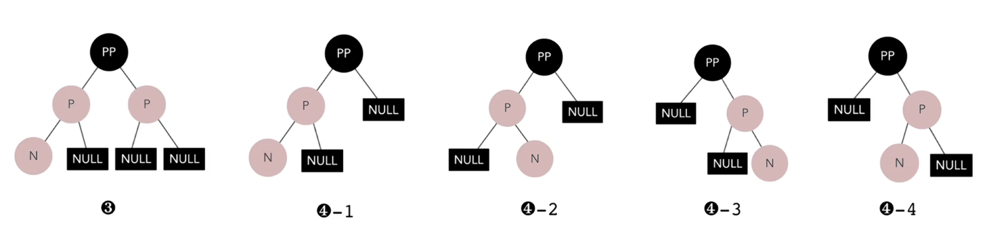

> 记忆：新结点染红 → 父黑就结束；父红看叔——叔红只变色，叔黑看形状：LL/RR 单旋，LR/RL 先转成 LL/RR 再单旋；最后根染黑。

红黑树插入的**旋转最多两次**（LL/RR 一次，LR/RL 两次），但变色可能沿路径向上传播 $O(\log n)$ 层。

# 参考来源

- 【BOK408数据结构强化课（26版，25年录制）】 https://www.bilibili.com/video/BV1sXZ8BrEZB/?share_source=copy_web&vd_source=a677cb27fe552ba80620cd3e521c0e83
