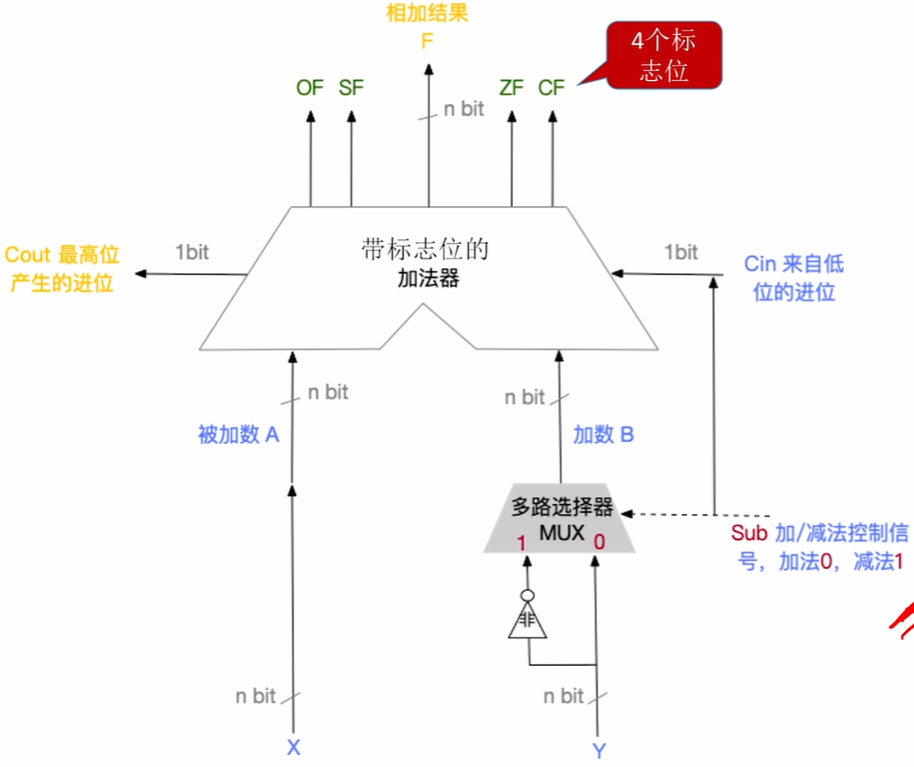
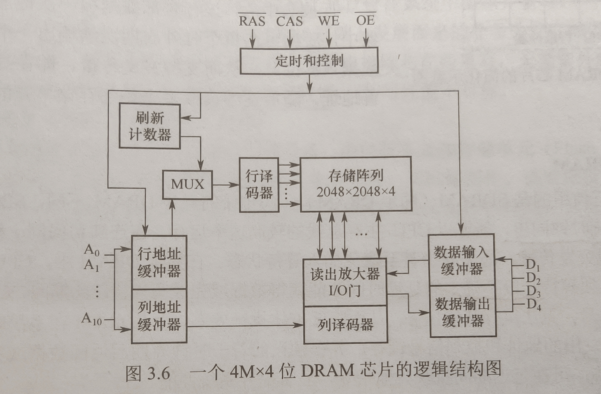
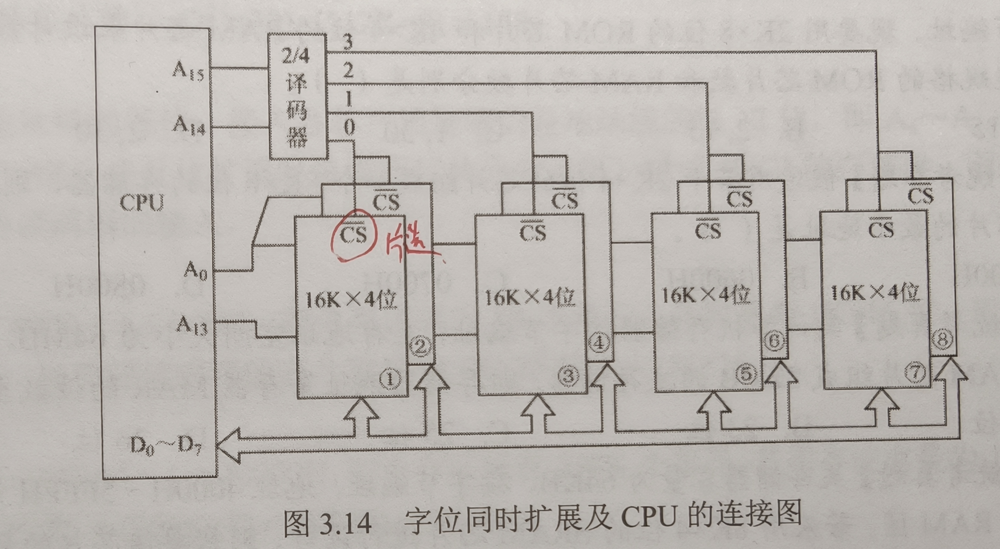
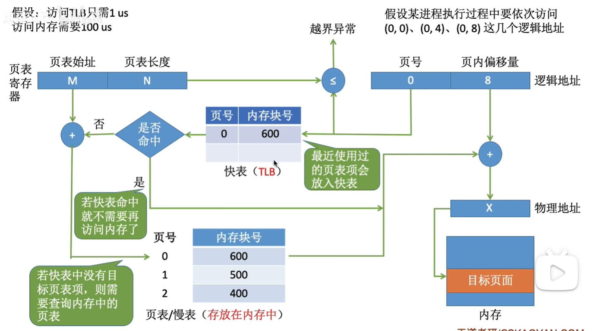
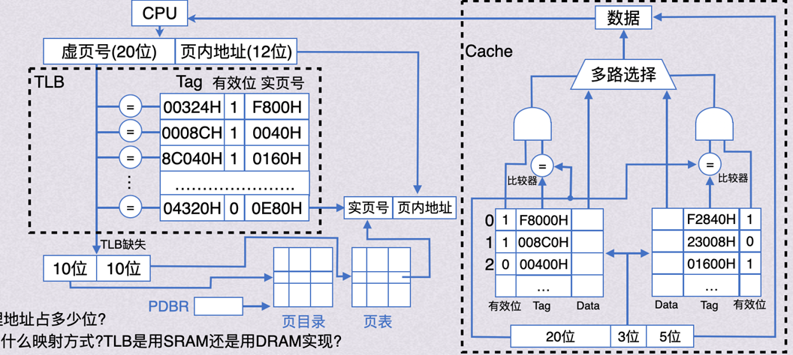
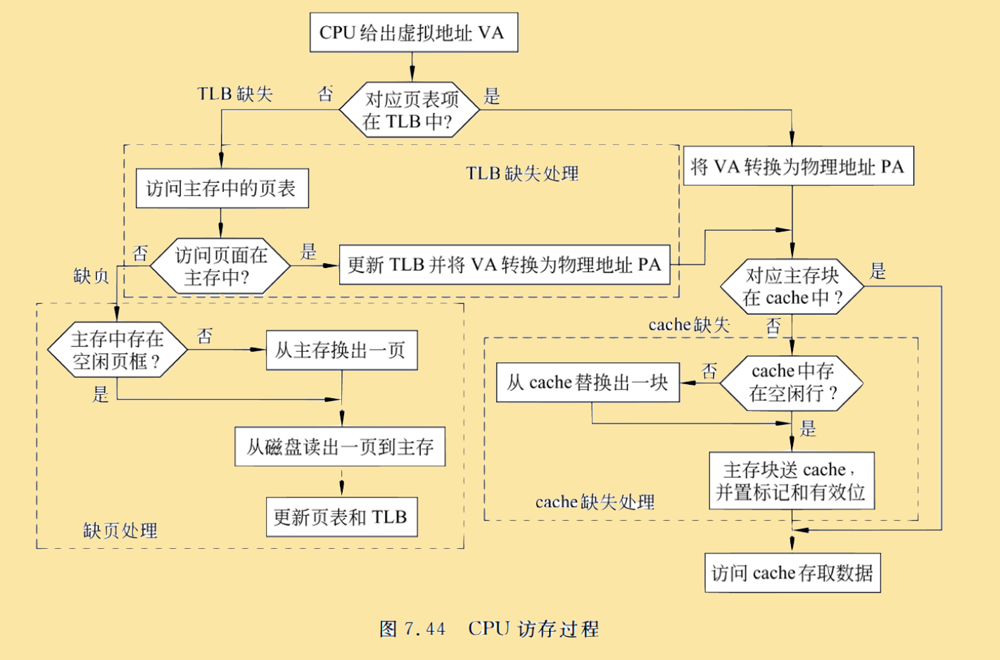
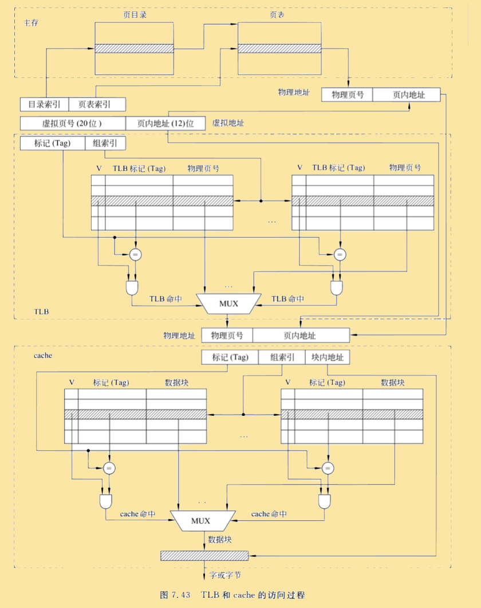
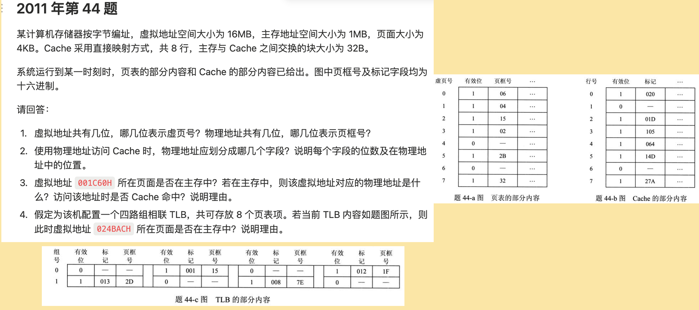
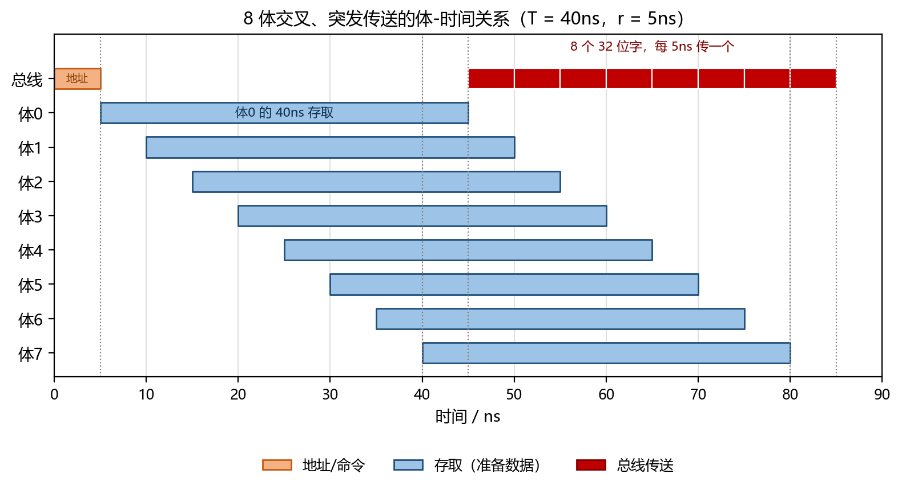

# 前言

本文是 408 计算机组成原理的一轮**考点强化**笔记，依托 BOK408 计算机组成原理精讲课（25/26 版，24 年录制）整理，按「计算机系统概述 → 数据的表示与运算 → 存储系统 → 指令系统 → 中央处理器 → 总线 → 输入输出系统」七个板块推进。

笔记先从整机组成和性能指标建立全局框架，再依次讨论数据表示、运算部件、存储层次、指令系统和 CPU 执行机制，最后落到总线与输入输出。正文按考点顺序持续推进，后续内容随课程进度继续补充。

1. **计算机系统概述**：计算机硬件、软件、层次结构、工作原理与性能指标。
2. **数据的表示与运算**：数制与编码、符号扩展、定点数运算、运算部件、浮点数与 IEEE 754。
3. **存储系统**：存储器层次、多模块存储器、芯片扩展、Cache、虚拟存储器与外存。
4. **指令系统**：机器指令、寻址方式、程序机器级表示、CISC 与 RISC。
5. **中央处理器**：CPU 结构、指令执行、数据通路、微程序、流水线与多处理器。
6. **总线**：总线的基本概念、分类、性能指标与典型结构。
7. **输入输出系统**：异常与中断、I/O 接口、程序查询、中断、DMA 等方式。

> 阅读约定：普通正文给出核心考点、公式和推导主线；引用块用于补充理解方式；例题、具体计算、特殊情境和额外补充统一收进折叠块。

---

# 一、计算机系统概述

> 这一部分不再按教材逐节展开，而是围绕几个贯穿全章的问题组织：
>
> 1. 冯·诺依曼机靠什么把指令和数据组织成可执行的程序？
> 2. CPU、主存和 I/O 设备分别负责什么，彼此通过什么连接？
> 3. 一条指令是怎样被取出并执行的？
> 4. 主频、CPI、MIPS 和执行时间之间是什么关系？
>
> 这几个问题既对应选择题里的基本概念，也是后面理解存储系统、指令系统和 CPU 的数据通路的基础。

## 考点1-冯·诺依曼机与“存储程序”

冯·诺依曼计算机由 <mark>运算器、控制器、存储器、输入设备和输出设备</mark> 五大部分组成。运算器和控制器合称中央处理器 CPU；随着集成电路发展，现代计算机又把运算器、控制器以及寄存器等集中在 CPU 中，但“五大部件”的划分仍然是理解整机结构的基本模型。

冯·诺依曼结构最核心的思想是**存储程序**：

- 事先把程序以及程序需要处理的数据装入主存；
- 指令和数据都以二进制形式存放；
- CPU 从程序入口开始，按照地址逐条取指令、译码并执行；
- 执行过程中，程序计数器 PC 指示下一条待取指令的位置。

从整机连接关系看，CPU 通过系统总线访问主存和 I/O 接口，外设再经过接口接入系统：


%%{init: {
  "theme": "base",
  "themeVariables": {
    "primaryColor": "#5b9bd5",
    "primaryTextColor": "#ffffff",
    "primaryBorderColor": "#41719c",
    "lineColor": "#41719c",
    "secondaryColor": "#ffffff",
    "tertiaryColor": "#e2f0d9",
    "fontSize": "16px",
    "fontFamily": "-apple-system, BlinkMacSystemFont, \"Segoe UI\", Roboto, \"Helvetica Neue\", Arial, \"Noto Sans\", sans-serif"
  },
  "flowchart": {
    "nodeSpacing": 8,
    "rankSpacing": 26,
    "curve": "basis",
    "htmlLabels": true,
    "subGraphTitleMargin": { "top": 0, "bottom": 14 },
    "padding": 4,
    "useMaxWidth": false,
    "wrappingWidth": 1000
  }
}}%%
graph LR
  CPU["CPU<br>运算器 / 控制器<br>寄存器"]
  BUS["系统总线<br>地址 / 数据 / 控制"]
  MEM["主存<br>当前程序的<br>指令和数据"]
  IO["I/O 接口<br>数据 / 状态 / 控制"]
  DEV["外部设备"]

  CPU <-->|"访问主存或接口"| BUS
  BUS <--> MEM
  BUS <--> IO
  IO <--> DEV

  classDef root fill:#5b9bd5,stroke:#41719c,color:#ffffff,font-size:20px
  classDef lvl1 fill:#9dc3e6,stroke:#2e6da4,stroke-width:2px,color:#0d2f4d,font-size:19px
  classDef lvl2d fill:#dbe8f6,stroke:#1f4e79,stroke-width:2px,color:#0d2f4d,font-size:16px
  classDef lvl3d fill:#dbe8f6,stroke:#1f4e79,stroke-width:1.5px,color:#0d2f4d,font-size:15px

  class CPU root;
  class BUS lvl1;
  class MEM,IO lvl2d;
  class DEV lvl3d;


---

从主存里的二进制内容本身看，指令和数据没有天然区别，同一串位模式既可能被解释成指令，也可能被解释成整数、浮点数或地址。真正的区别来自 <mark>CPU 当前处于什么阶段、这个地址从哪里来</mark>：

- 取指阶段，CPU 把 PC 给出的地址送到存储器，读出的内容作为**指令**送进指令寄存器 IR；
- 译码阶段，控制器解释 IR 中的操作码，并据此判断这次操作需要哪些操作数；
- 执行阶段，CPU 按指令给出的寻址方式或寄存器内容去访问数据。

> `0000000000000001` 既可能是整数 1，也可能是一条指令的编码；只有放入“取指—译码—执行”的控制过程，它才获得确定含义。

因此，“指令和数据同等地位存储”强调的是：

- 二者可以存放在同一个存储器中；
- 二者都使用二进制表示；
- 二者都通过相同的存储访问机制读取。

它并不意味着 CPU 无法区分二者。取指时由 PC 和控制器规定访问指令，执行时由指令中的地址字段规定访问数据。哈佛结构则把指令存储器和数据存储器分开，但 408 中讨论的一般仍是冯·诺依曼结构。

---

程序开始运行前，入口地址被送入 PC。之后循环执行：

1. **取指**：把 PC 中的地址送入 MAR，主存按地址读出内容并送入 MDR，再把 MDR 中的指令送入 IR；
2. **更新 PC**：PC 自动加上当前指令的长度，指向下一条指令；
3. **译码**：控制器分析 IR 中的操作码和地址字段；
4. **执行**：完成运算、访存、寄存器传送或转移等操作；
5. **回到第 1 步**，继续取下一条指令。

把取指阶段的寄存器传送写清楚，可以压缩成下面几行：

```text
(PC) → MAR              // PC 给出下一条指令的地址
M(MAR) → MDR            // 主存读出指令
(MDR) → IR              // 当前指令进入指令寄存器
(PC) + 指令长度 → PC     // PC 指向下一条待取指令
```

这条循环可以表示成：


%%{init: {
  "theme": "base",
  "themeVariables": {
    "primaryColor": "#5b9bd5",
    "primaryTextColor": "#ffffff",
    "primaryBorderColor": "#41719c",
    "lineColor": "#41719c",
    "secondaryColor": "#ffffff",
    "tertiaryColor": "#e2f0d9",
    "fontSize": "16px",
    "fontFamily": "-apple-system, BlinkMacSystemFont, \"Segoe UI\", Roboto, \"Helvetica Neue\", Arial, \"Noto Sans\", sans-serif"
  },
  "flowchart": {
    "nodeSpacing": 8,
    "rankSpacing": 26,
    "curve": "basis",
    "htmlLabels": true,
    "subGraphTitleMargin": { "top": 0, "bottom": 14 },
    "padding": 4,
    "useMaxWidth": false,
    "wrappingWidth": 1000
  }
}}%%
graph LR
  FETCH["取指<br>PC → MAR → MDR → IR"]
  UPDATE["更新 PC<br>加上指令长度"]
  DECODE["译码<br>分析操作码与地址"]
  EXEC["执行<br>运算 / 访存 / 转移"]
  STOP(["停机或异常"])

  FETCH --> UPDATE
  UPDATE --> DECODE
  DECODE --> EXEC
  EXEC -->|"继续取下一条"| FETCH
  EXEC -->|"结束当前程序"| STOP

  classDef root fill:#5b9bd5,stroke:#41719c,color:#ffffff,font-size:20px
  classDef lvl1 fill:#9dc3e6,stroke:#2e6da4,stroke-width:2px,color:#0d2f4d,font-size:19px
  classDef lvl2d fill:#dbe8f6,stroke:#1f4e79,stroke-width:2px,color:#0d2f4d,font-size:16px
  classDef lvl3d fill:#dbe8f6,stroke:#1f4e79,stroke-width:1.5px,color:#0d2f4d,font-size:15px
  classDef lvl3l fill:#f6fafe,stroke:#c3d9ef,stroke-width:1.5px,color:#0d2f4d,font-size:15px

  class FETCH root;
  class UPDATE lvl1;
  class DECODE lvl2d;
  class EXEC lvl3d;
  class STOP lvl3l;


---

这里最容易混淆的是 PC 的“加 1”。在原理图或文字描述中经常写成

$$\mathrm{PC}\leftarrow \mathrm{PC}+1$$

这里的“1”通常是**一条指令所占的地址单元数**，而不是字节数。所以看到“PC+1”时，要先确认题目默认的编址单位和指令长度。


若指令定长为 4 字节，主存按字节编址，则取完一条指令后应执行

$$\mathrm{PC}\leftarrow \mathrm{PC}+4$$

若主存按字编址，且一条指令正好占一个存储字，那么地址加 1 就确实表示取下一条指令。

题目：某机按字节编址，指令长度固定为 4 字节。PC 初值为 `0x1000`，取出这条指令后 PC 变成

$$\mathrm{PC}=0x1000+4=0x1004$$


PC 的自动更新可以由 ALU 中的加法器完成，也可以由专用的 PC 增量器完成。原理上关心的是“PC 指向下一条待取指令”，具体用哪个硬件部件属于数据通路设计问题。转移指令、调用指令和中断响应则会在执行阶段直接改写 PC，因此“自动加 1”不是无条件覆盖 PC，而是取指阶段的默认动作。

> 记忆：PC 中存放的是下一条**指令**的地址，不是下一条数据的地址。操作数地址一般来自指令的地址字段、寄存器内容或寻址方式计算。

## 考点2-CPU、主存、I/O 与总线

408 题经常根据功能倒推寄存器名称，因此不能只记缩写：

| 部件 | 主要作用 | 易错点 |
| --- | --- | --- |
| PC | 保存下一条待取指令的地址 | 它指向指令，执行阶段可能被转移类指令改写 |
| IR | 保存当前正在译码、执行的指令 | 保存整条指令，不只是操作码 |
| MAR | 保存本次要访问的存储单元地址 | MAR 位数决定可寻址空间，不直接决定存储器总容量 |
| MDR | 保存与主存交换的数据或指令 | 又称 MBR，408 中其位数等于存储字长；按字节编址时通常为 8 位，不由机器字长决定 |
| 通用寄存器 | 暂存操作数、中间结果、地址 | 程序员通常可见，由指令直接使用 |
| PSW | 保存标志位、中断允许位、运行状态等 | 其中条件码可能决定条件转移 |
| ALU | 完成算术运算和逻辑运算 | ALU 本身不存放指令，也不单独决定执行顺序 |
| 控制器 | 对指令译码并产生控制信号 | 微程序控制器还会访问控制存储器 |

CPU 与主存之间一次典型的信息传递可以写成：

```text
CPU 内部地址 → MAR → 主存
主存数据     → MDR → CPU 内部寄存器
```

<mark>PC 指向指令，IR 保存当前指令，MAR 送地址，MDR 接数据</mark>，四者不能因为都与“访存”有关而混用。

---

“主存”指 CPU 能直接按地址访问、用于存放当前运行程序和数据的那一层存储器。完整存储层次通常可以概括为：

1. 寄存器：位于 CPU 内，速度最快、容量最小；
2. Cache：位于 CPU 内或紧邻 CPU，对程序员透明，缓存主存中的活跃数据；
3. 主存：存放当前要执行的指令和数据；
4. 外存：如磁盘、SSD，容量大、价格低，但 CPU 不能直接执行其中的指令，程序和数据必须先调入主存。


%%{init: {
  "theme": "base",
  "themeVariables": {
    "primaryColor": "#5b9bd5",
    "primaryTextColor": "#ffffff",
    "primaryBorderColor": "#41719c",
    "lineColor": "#41719c",
    "secondaryColor": "#ffffff",
    "tertiaryColor": "#e2f0d9",
    "fontSize": "16px",
    "fontFamily": "-apple-system, BlinkMacSystemFont, \"Segoe UI\", Roboto, \"Helvetica Neue\", Arial, \"Noto Sans\", sans-serif"
  },
  "flowchart": {
    "nodeSpacing": 8,
    "rankSpacing": 26,
    "curve": "basis",
    "htmlLabels": true,
    "subGraphTitleMargin": { "top": 0, "bottom": 14 },
    "padding": 4,
    "useMaxWidth": false,
    "wrappingWidth": 1000
  }
}}%%
graph LR
  REG["寄存器<br>最快 / 最小<br>位于 CPU 内"]
  CACHE["Cache<br>硬件自动管理<br>缓存活跃数据"]
  MAIN["主存<br>按地址直接访问<br>存放当前程序"]
  DISK["外存<br>容量最大<br>持久保存"]

  REG --> CACHE
  CACHE --> MAIN
  MAIN --> DISK

  classDef root fill:#5b9bd5,stroke:#41719c,color:#ffffff,font-size:20px
  classDef lvl1 fill:#9dc3e6,stroke:#2e6da4,stroke-width:2px,color:#0d2f4d,font-size:19px
  classDef lvl2d fill:#dbe8f6,stroke:#1f4e79,stroke-width:2px,color:#0d2f4d,font-size:16px
  classDef lvl3d fill:#dbe8f6,stroke:#1f4e79,stroke-width:1.5px,color:#0d2f4d,font-size:15px

  class REG root;
  class CACHE lvl1;
  class MAIN lvl2d;
  class DISK lvl3d;


> 上图展示的是**完整存储层次**，主存只是其中一层。寄存器也不全相同：既有指令可直接访问的通用寄存器，也有 PC、IR、MAR、MDR 这类专用寄存器。Cache 虽由高速存储单元构成，但逻辑上处于 CPU 与主存之间。

---

CPU 通常不能直接驱动键盘、磁盘等设备，中间需要 I/O 接口完成地址译码、数据缓冲、状态保存和格式转换。接口中常见三类寄存器：

- 数据寄存器：暂存取入或送出的数据；
- 状态寄存器：保存忙、就绪、错误等状态；
- 控制寄存器：接收 CPU 发出的启动、读写模式等命令。

I/O 的主要控制方式包括程序查询、中断和 DMA。前两种通常仍由 CPU 参与数据传送，DMA 则让 DMA 控制器在设备与主存之间成批搬运数据，CPU 主要负责启动和收尾。

总线是一组能为多个部件共享的信息传输线。按所传信息可分为：

- 数据总线：传送数据、指令和状态信息，宽度影响一次能传多少位；
- 地址总线：传送存储单元或 I/O 端口地址，宽度决定可寻址范围；
- 控制总线：传送读/写命令、中断请求、总线请求、时钟和应答等控制信号。

存储器和 I/O 设备都通过总线或相应的接口连接 CPU。现代计算机常采用多级总线结构，但无论结构怎样变化，“地址指出找谁，数据完成传输，控制信号规定何时做什么”这三类信息始终存在。

> 记忆：<mark>地址线决定“找哪里”，数据线负责“送什么”，控制线规定“何时、怎么做”</mark>。

## 考点3-按字节编址、按字编址与存储字长

这部分是系统概述与存储系统之间的连接点，也是后续计算主存容量、Cache 地址划分和指令地址的基础。

- 按字节编址：每个地址对应 1 字节，地址加 1 表示移动到下一字节；
- 按字编址：每个地址对应 1 个存储字，地址加 1 表示移动到下一个存储字；
- 若一个存储字长 32 位，则每个存储字占 4 个字节。

| 编址方式 | 一个地址代表的数据 | 地址加 1 的含义 | 32 位地址的最大容量 |
| --- | --- | --- | --- |
| 按字节编址 | 1 字节 | 移动到下一字节 | $2^{32}\,\mathrm{B}=4\,\mathrm{GB}$ |
| 按 32 位字编址 | 32 位，即 4 字节 | 移动到下一存储字 | $2^{32}\times4\,\mathrm{B}=16\,\mathrm{GB}$ |

因此，“按字节编址且存储字长为 32 位”时，一个存储字会占用连续的 4 个字节地址。若某存储字从地址 `A` 开始，它的四个字节分别位于 `A、A+1、A+2、A+3`；下一条存储字从 `A+4` 开始。

---

存储字长是一个存储单元中实际存放的二进制位数，常见为 8、16、32 或 64 位。它不一定等于：

- 指令字长：机器指令的位数；
- 数据字长：CPU 一次处理的数据位数；
- 数据总线宽度：一次总线传输的位数。

三者可能相同，也可能通过多次访存或总线传输完成匹配。例如存储字长为 32 位、数据总线宽度为 16 位时，一次读出或写入一个完整存储字可能需要两个总线传送周期。

> 判断容量的固定顺序：先看**一个地址对应多少数据**，再数**一共有多少个地址**，最后相乘。不要看到 MAR 有 $n$ 位就直接写容量为 $2^n$ 字节。

若设 MAR 位数为 $n$，按字节编址，则最多有 $2^n$ 个字节地址，主存最大容量为

$$\text{容量}=2^n\,\mathrm{B}$$

如果按字编址、每个存储字为 $w$ 位，则

$$\text{容量}=2^n\times w\quad(\mathrm{bit})$$


按字节编址时：

$$2^{32}\,\mathrm{B}=4\,\mathrm{GB}$$

若同一机器改成按 32 位字编址，则可寻址 $2^{32}$ 个字，最大容量相当于 16 GB。地址位数没变，但每个地址所代表的数据量变了。



设地址线为 24 位：

- 按字节编址：共有 $2^{24}$ 个字节地址，容量为

$$2^{24}\,\mathrm{B}=16\,\mathrm{MB}$$

- 若按 16 位字编址：每个地址对应 2 字节，容量变为

$$2^{24}\times2\,\mathrm{B}=32\,\mathrm{MB}$$

地址位数完全没变，只是“一个地址代表多少数据”变了。题目若同时给出 MAR 位数和编址方式，必须按后者修正。


> MAR 有 32 位并不自动等于存储容量 4 GB。必须先看编址单位；若按字编址且字长为 32 位，容量还要乘每个字的字节数。

## 考点4-主频、CPI、CPU时间与MIPS

主频 $f$ 表示 CPU 每秒钟产生多少个时钟周期，时钟周期 $T_c$ 是它的倒数：

$$T_c=\frac{1}{f}$$


主频为 $2\,\mathrm{GHz}$ 时：

$$T_c=\frac{1}{2\times10^9}=0.5\,\mathrm{ns}$$


频率使用十进制单位：$1\,\mathrm{kHz}=10^3\,\mathrm{Hz}$，$1\,\mathrm{MHz}=10^6\,\mathrm{Hz}$，$1\,\mathrm{GHz}=10^9\,\mathrm{Hz}$。存储容量中的 K、M、G 则经常使用 $2^{10}$、$2^{20}$、$2^{30}$，两类单位不要混用。

---

CPI 是 clock cycles per instruction，即平均执行一条指令所需的时钟周期数。若程序共执行 $N$ 条指令，平均 CPI 为 $\overline{\mathrm{CPI}}$，则总时钟周期数和执行时间分别为

$$C=N\times\overline{\mathrm{CPI}}$$

$$T_{\mathrm{CPU}}=N\times\overline{\mathrm{CPI}}\times T_c
=\frac{N\times\overline{\mathrm{CPI}}}{f}$$

可以把这套关系压缩成一条“性能链”：

```text
指令条数 × 平均 CPI = 所需时钟周期数
时钟周期数 × 时钟周期 = CPU 执行时间

CPU 时间 = N × CPI × Tc
         = N × CPI / f
```

不同指令的 CPI 可能不同，因此平均 CPI 必须按各类指令的条数加权：

$$\overline{\mathrm{CPI}}
=\frac{\sum_i (N_i\times\mathrm{CPI}_i)}{N}$$


一个程序执行 10 亿条指令，平均 CPI 为 2.5，主频为 2 GHz：

$$T_{\mathrm{CPU}}
=10^9\times2.5\times\frac{1}{2\times10^9}
=1.25\,\mathrm{s}$$


若只提高主频，但 CPI 因流水线加深、访存等待等原因上升，执行时间不一定下降。考试中比较“优化前后”，必须重新把指令条数、CPI 和主频三项一起代入。

---

MIPS 表示每秒执行多少百万条指令，即

$$\mathrm{MIPS}
=\frac{\text{指令条数}}{\text{执行时间}\times10^6}$$


把前面 CPU 时间公式 $T_{\mathrm{CPU}}=N\times\overline{\mathrm{CPI}}/f$ 代入：

$$\mathrm{MIPS}
=\frac{N}{\dfrac{N\times\overline{\mathrm{CPI}}}{f}\times10^6}
=\frac{f}{\overline{\mathrm{CPI}}\times10^6}$$

也可以先求每秒指令数 IPS：

$$\mathrm{IPS}
=\frac{1}{T_{\mathrm{CPU}}/N}
=\frac{f}{\overline{\mathrm{CPI}}}$$

再除以 $10^6$ 得到 MIPS。注意 $f$ 要使用 Hz，而不是 MHz 或 GHz；若 $f$ 取 GHz，则分母中的 $10^6$ 要相应换成 $10^3$。

以上式为例，2 GHz 主频、平均 CPI 为 2.5 时：

$$\mathrm{MIPS}
=\frac{2\times10^9}{2.5\times10^6}
=800$$

反过来，若已知 MIPS 和指令条数 $N$，程序执行时间为

$$T=\frac{N}{\mathrm{MIPS}\times10^6}$$


---

两台机器的指令集不同，完成同一个任务所需的指令条数可能相差很多；同一条高级语言语句也可能编译成不同数量的机器指令。因此 MIPS 只能在指令集、编译器以及程序特征大致相同时作粗略参考，比较计算机性能的核心指标仍是 <mark>完成同一任务所需的执行时间</mark>。

> 主频提高只缩短了 $T_c$。如果优化导致程序指令数增加，或流水线加深、访存等待使平均 CPI 上升，最终执行时间仍可能变长。比较性能时必须把三个量一起代入。

若题目讨论流水线、访存缺失、Cache 等情况，所谓实际 CPI 还应包含这些停顿周期。可以把总周期拆为

$$C=N\times\mathrm{CPI}_{\text{ideal}}+
\text{停顿周期}$$

再用总周期乘时钟周期求执行时间。这一思路会在 CPU 流水线部分继续使用。

## 本部分常见易错点


> 做概念题时先排掉“绝对化表述”。例如“指令和数据完全无法区分”“主频越高运行越快”“MIPS 越大机器性能一定越强”，这些说法都忽略了控制过程和应用条件。

| 易混内容 | 正确理解 |
| --- | --- |
| 指令和数据是否“完全无法区分” | 二进制形式相同，但按 PC 取指还是按地址取操作数，由控制过程和地址来源决定 |
| PC 是否指向数据 | PC 通常指向下一条指令；操作数地址来自指令或寄存器 |
| PC+1 是否一定是加 1 字节 | 取决于编址单位和指令长度，原理图中的“1”常表示一条指令或一个存储字 |
| MAR 位数是否直接等于容量 | 还要看编址单位和每个地址对应的数据宽度 |
| 存储字长是否等于指令字长 | 可以不同，要通过多次访存等方式匹配 |
| 主频越高是否一定越快 | 还要看总指令数和 CPI，不能单独比较主频 |
| MIPS 是否可跨机器绝对比较 | 不适合跨指令集直接比较，只反映单位时间执行的指令条数 |

一分钟复盘：

1. <mark>存储程序</mark>：程序和数据先放入主存，CPU 按 PC 逐条取指执行。
2. <mark>指令与数据</mark>：位模式本身无标签，由取指/执行阶段和地址来源决定解释方式。
3. <mark>存储容量</mark>：地址数 × 每个地址对应的数据宽度，不能只看 MAR 位数。
4. <mark>执行时间</mark>：$T_{\mathrm{CPU}}=N\times\mathrm{CPI}\times T_c$；MIPS 只是间接指标。


# 二、数值的表示与运算

## 考点1-进位计数制及其转换

数值表示题最常见的错误，不是不会算，而是<mark>把不同层次的概念混在一起比较</mark>。先看一个总框架：

- 按“有没有符号”先分成无符号数和有符号数；
- 无符号数直接按二进制位权解释，常用于地址、计数和边界检查；
- 有符号数才需要进一步指定原码、反码、补码或移码；
- 同一个位模式在不同编码下可能得到完全不同的真值。

因此，“原码”和“无符号数”并不是同一层的分类：<mark>无符号数是一类解释方式，原码是带符号数的一种具体编码</mark>。


%%{init: {
  "theme": "base",
  "themeVariables": {
    "primaryColor": "#5b9bd5",
    "primaryTextColor": "#ffffff",
    "primaryBorderColor": "#41719c",
    "lineColor": "#41719c",
    "secondaryColor": "#ffffff",
    "tertiaryColor": "#e2f0d9",
    "fontSize": "16px",
    "fontFamily": "-apple-system, BlinkMacSystemFont, \"Segoe UI\", Roboto, \"Helvetica Neue\", Arial, \"Noto Sans\", sans-serif"
  },
  "flowchart": {
    "nodeSpacing": 8,
    "rankSpacing": 26,
    "curve": "basis",
    "htmlLabels": true,
    "subGraphTitleMargin": { "top": 0, "bottom": 14 },
    "padding": 4,
    "useMaxWidth": false,
    "wrappingWidth": 1000
  }
}}%%
graph TB
  ROOT["数值表示"]
  UNSIGNED["无符号数<br>直接按位权解释<br>常用于地址运算"]
  SIGNED["有符号数<br>先确定编码方式<br>再还原真值"]
  YUAN["原码"]
  FAN["反码"]
  BU["补码"]
  YI["移码"]

  ROOT --> UNSIGNED
  ROOT --> SIGNED
  SIGNED --> YUAN
  SIGNED --> FAN
  SIGNED --> BU
  SIGNED --> YI

  classDef root fill:#5b9bd5,stroke:#41719c,color:#ffffff,font-size:20px
  classDef lvl1 fill:#9dc3e6,stroke:#2e6da4,stroke-width:2px,color:#0d2f4d,font-size:19px
  classDef lvl2d fill:#dbe8f6,stroke:#1f4e79,stroke-width:2px,color:#0d2f4d,font-size:16px

  class ROOT root;
  class UNSIGNED,SIGNED lvl1;
  class YUAN,FAN,BU,YI lvl2d;


---

机器数是在机器中实际存放的**固定位宽位模式**，真值是这个位模式按照某种编码解释后得到的**数学意义上的数**。

两个概念不能用“二进制/十进制”来区分：

- 机器数除了写成二进制，也常写成十六进制或一串位；
- 真值不一定写成十进制，也可以写成 $+1100_2$、$-101_2$；
- 真值的标志是用 $+$、$-$ 表示正负，而机器数用最高位等规则编码符号。


| 解释方式 | 真值 | 计算过程 |
| --- | ---: | --- |
| 无符号数 | $12$ | $8+4$ |
| 原码 | $-4$ | 符号位为 1，数值位 `100` 表示 4 |
| 反码 | $-3$ | 负数反码的数值位取反得 `100`，表示 3 |
| 补码 | $-4$ | $-2^3+2^2=-8+4$ |
| 4 位移码（偏置 8） | $4$ | 无符号值 $12-8=4$ |


所以，单说“`1100` 等于多少”是不完整的。必须先问：<mark>它按无符号数还是某种有符号编码解释？位宽是多少？</mark>

> 注：真值 `+1100` 与 4 位机器数 `1100` 看起来字符相同，但前者已经把正号单独写出来，是一个带符号真值；后者仍只是一个需要指定编码才能解释的位模式。

---

**无符号数**没有符号位，所有位都按权值相加：

$$V=\sum_{i=0}^{n-1}b_i2^i$$


8 位无符号数 `10110100`：

$$V=128+32+16+4=180$$


无符号数的 $n$ 位表示范围是

$$0\sim 2^n-1$$

地址通常是非负整数，而且要覆盖整个地址空间，因此常按无符号数处理。例如比较两个地址大小时使用无符号比较；若误把它们当成有符号补码，地址最高位为 1 时就会被判成负数。

---

**原码**的规则最直接：最高位表示符号，其余位直接表示绝对值。

- 正数：符号位为 0，数值位就是真值的二进制；
- 负数：符号位为 1，数值位仍写绝对值的二进制；
- 由原码求真值：去掉符号位，把数值位直接转成十进制，再加上符号。


$$[+5]_{\text{原}}=0101
\qquad
[-5]_{\text{原}}=1101$$

零有两种表示：

$$[+0]_{\text{原}}=0000
\qquad
[-0]_{\text{原}}=1000$$


> 原码的优点是符号和绝对值一目了然，缺点是加法和减法不能直接统一成补码加法，而且零有两种表示。

---

**反码**由原码得到：

- 正数的反码与原码相同；
- 负数保持符号位不变，数值位逐位取反；
- 由负数反码求真值时，把数值位再取反得到绝对值的二进制。


$$[-5]_{\text{原}}=1101
\qquad
[-5]_{\text{反}}=1010$$


> 反码同样有正零和负零，实际运算中主要用于理解它与补码之间的关系。

---

**补码**是现代计算机中最常用的定点整数编码。正数补码与原码相同；负数补码可由原码“数值位取反再加 1”得到，也可以由反码末位加 1 得到。

更统一的理解是<mark>最高位带负权</mark>。对于 $n$ 位补码 $b_{n-1}\cdots b_1b_0$：

$$V=-b_{n-1}2^{n-1}+\sum_{i=0}^{n-2}b_i2^i$$


$$1100_{\text{补}}
=-2^3+2^2
=-8+4
=-4$$


> 负补码可以快速还原：最高位为 1 时，先写下最高位的负权值，再把其余位按普通无符号数相加。比如
>
> $$11101010_{\text{补}}=-128+64+32+8+2=-22$$
>
> 这比“先取反、再加 1、再按无符号数读”更不容易丢步骤。

补码求相反数也很方便：把补码连同符号位一起逐位取反，再在末位加 1：

$$[-X]_{\text{补}}=\sim[X]_{\text{补}}+1$$

所以两个补码相减可以直接改成“加相反数”：

$$[X-Y]_{\text{补}}=[X]_{\text{补}}+[-Y]_{\text{补}}$$

> 这正是补码适合统一实现加减法的原因。

---

**符号扩展不会改变真值。** 把较短补码放入更宽寄存器时：

- 正数高位补 0；
- 负数高位补 1；
- 扩展前后补码表示的真值完全相同。


4 位补码 `1100` 表示 $-4$，扩展到 8 位后是

$$11111100_{\text{补}}=-128+64+32+16+8+4=-4$$

反过来说，一个很长的补码如果高位有大量重复的符号位，可以化简为能保持真值的最短补码：

$$111111111100_{\text{补}}
\rightarrow
1100_{\text{补}}=-4$$



短补码 `1100` 表示 $-4$。每次把它符号扩展到左边一位，相当于新增一个权值为 $+2^k$ 的位，同时原来负权最高位从 $-2^k$ 变成更高一层的负权：

$$-2^{k+1}+2^k=-2^k$$

新增的 1 与符号扩展造成的权值变化恰好抵消，所以真值不变。

这就是“连续相同的符号位可以删到最短”的原因，但最低有效位和符号位不能随意删。


---

**移码**通常用“真值 + 偏置”得到编码：

$$[X]_{\text{移}}=X+\text{偏置}$$

对普通 $n$ 位整数移码，常用偏置是

$$2^{n-1}$$


4 位移码的偏置为 8：

| 真值 | 移码 |
| ---: | ---: |
| $-8$ | `0000` |
| $0$ | `1000` |
| $7$ | `1111` |


把移码当无符号数看，其大小顺序与真值顺序一致，因此浮点数常用来表示阶码，便于直接比较大小。

> 同一真值的移码与补码相比，**符号位相反，数值位相同**。

> 普通 $n$ 位整数移码的偏置是 $2^{n-1}$；IEEE 754 的阶码字段有 $k$ 位时，偏置是 $2^{k-1}-1$。
>
> 例如单精度阶码有 8 位，偏置是 127，而不是 128。IEEE 754 还需要把全 0 和全 1 阶码留给零、非规格化数、无穷大和 NaN，因此规格化数的阶码字段只用 $1\sim254$，对应实际指数 $-126\sim127$。

---

设机器字长为 $n$，并把这些编码按**定点整数**理解，则固定位数真值的上下限为：

| 编码 | $n$ 位真值范围 | 8 位范围 | 零的表示 |
| --- | --- | --- | --- |
| 无符号数 | $0\sim2^n-1$ | $0\sim255$ | 唯一 |
| 原码 | $-(2^{n-1}-1)\sim2^{n-1}-1$ | $-127\sim127$ | 正零、负零 |
| 反码 | $-(2^{n-1}-1)\sim2^{n-1}-1$ | $-127\sim127$ | 正零、负零 |
| 补码 | $-2^{n-1}\sim2^{n-1}-1$ | $-128\sim127$ | 唯一 |
| 移码 | $-2^{n-1}\sim2^{n-1}-1$ | $-128\sim127$ | 唯一 |

补码比原码、反码多表示一个负数，是因为 `1000...0` 不再浪费在负零上，而被规定为 $-2^{n-1}$。


按最高位负权计算：

$$1000_{\text{补}}=-2^3=-8$$

如果按“符号位 + 绝对值”理解，就会误以为它是负零。原码、反码和补码必须使用各自的解释规则，不能把原码规则套到补码上。

同理，8 位补码的表示范围是 $-128\sim127$；`10000000` 表示 $-128$，它的模 8 位相反数仍然是自身。



如果题目表示的是定点小数，而不是整数，则范围随隐含小数点位置缩放。若低 $k$ 位是小数位，实际真值要整体乘 $2^{-k}$，表示间隔和范围也同步缩放。


---

移位的题目要先问两个问题：<mark>操作对象是哪一个位模式，右移时高位该补什么</mark>。

对于补码：

- **算术左移**：低位补 0，高位直接移出；
- **算术右移**：高位补原来的符号位；
- **逻辑右移**：高位一律补 0，不保留符号。

逻辑左移也是低位补 0、高位移出，但“逻辑”与“算术”的差别主要体现在右移：逻辑右移把整个位模式看成一串二进制位，算术右移则把最高位解释成负权。


```text
补码 1101    算术右移 1 位 → 1110
             (-3)          (-2)

补码 1101    逻辑右移 1 位 → 0110
           （若按无符号看）   (13 → 6)
```


算术右移相当于对补码做“除以 2 后向负无穷取整”。所以负数右移时可能看起来只变了 1：

$$-3\gg 1=-2$$

<mark>逻辑移位通常用于无符号数，算术移位用于补码</mark>。若把负数补码直接做逻辑右移，符号位会被清成 0，真值语义随即被破坏。

左移 1 位时，可以直接观察移位前后的符号位：

- 符号位没有改变，通常没有有符号溢出；
- 符号位改变，发生有符号溢出。


4 位补码中：

$$0101_2=5
\quad\xrightarrow{\text{算术左移 1 位}}\quad
1010_2=-6$$

从正数移成了负数，说明 $5\times2=10$ 已超出 4 位补码范围，发生溢出。若结果是 $1100\rightarrow1000$，二者仍都是负数；$-4\times2=-8$ 恰好在 4 位补码范围内，所以不溢出。


> 左移相当于乘 2，右移相当于除 2 的幂；但只有在目标结果仍能由当前位宽表示时，移位后的位模式和数学结果才一致。

## 考点2-补码加减运算与加法器

补码加减法的核心是：<mark>减法先改成加相反数，剩下的全部交给加法器</mark>。

$$X-Y=X+\overline{Y}+1$$

下面这张图把“加法”和“减法”统一到了同一套硬件：



读图时抓住三个信号：

1. 左输入 $X$ 直接进入加法器；
2. 右输入 $Y$ 先经过多路选择器；
3. 控制信号 `Sub` 同时控制“是否取反”和“最低位进位”。

具体工作过程如下：

| `Sub` | 第二操作数 | 最低位进位 $C_0$ | 加法器实际完成 |
| ---: | --- | ---: | --- |
| 0 | $Y$ | 0 | $F=X+Y$ |
| 1 | $\overline{Y}$ | 1 | $F=X+\overline{Y}+1=X-Y$ |

最低位进位 $C_0$ 就是图中右侧从 `Sub` 引来的一根控制线。做减法时如果没有把 $C_0$ 置 1，电路实际计算的是“反码相加”，结果会与补码差值相差 1。

> 8421 口诀：<mark>加法 0 与 0，减法 1 与 1</mark>。`Sub=0` 时第二操作数不取反、进位为 0；`Sub=1` 时取反、进位为 1。

加法器输出的结果只保留低 $n$ 位，更高位的进位会单独成为 $C_{\text{out}}$。因此它天然服从 $2^n$ 取模运算：

$$F=(X\pm Y)\bmod 2^n$$

是否把这个结果解释为有效真值，要看后面四类标志位。

---

图中顶部的四个标志位分别回答四个不同问题：

| 标志 | 名称 | 由图中的哪个输出得到 | 含义 |
| --- | --- | --- | --- |
| ZF | 零标志 | 所有结果位都为 0 | 结果是否为 0 |
| SF | 符号标志 | 结果最高位 $F_{n-1}$ | 按补码解释时结果为正还是负 |
| CF | 进位/借位标志 | 最高位进位 $C_{\text{out}}$ 结合 `Sub` | **无符号数**运算是否越界 |
| OF | 溢出标志 | 符号位进位与符号位输入进位 | **有符号补码**运算是否越界 |

设最高位为第 $n-1$ 位：

- $C_n$ 表示加法器最终向外产生的进位，也就是图中的 `Cout`；
- $C_{n-1}$ 表示由低一位送进符号位的进位，也就是“符号位下面的进位”；
- $F_{n-1}$ 是结果的最高位。

四个标志可写成：

$$ZF=1\iff F=000\cdots0$$

$$SF=F_{n-1}$$

$$OF=C_n\oplus C_{n-1}$$

$$CF=
\begin{cases}
C_n, & \text{加法 }(\mathrm{Sub}=0)\\[4pt]
\overline{C_n}, & \text{减法 }(\mathrm{Sub}=1)
\end{cases}
$$

也可把 CF 合并写成

$$CF=C_n\oplus\mathrm{Sub}$$

> `CF` 面向**无符号数**，表示加法有进位或减法不够减需要借位；`OF` 面向**有符号补码**，表示正负号组合已经超出当前位宽。
>
> 同一次运算完全可能“CF=1、OF=0”，也可能“CF=0、OF=1”。

---

补码溢出有三种等价判断法，分别适合不同题型：

| 方法 | 观察对象 | 判断规则 |
| --- | --- | --- |
| 符号法 | 两个操作数和结果的符号 | 正 + 正得负，上溢；负 + 负得正，下溢 |
| 进位法 | 符号位进位 $C_{n-1}$ 与最终进位 $C_n$ | 两者不同则溢出：$V=C_n\oplus C_{n-1}$ |
| 双符号位法 | 两个符号位 $S_1S_2$ | 结果双符号位不同则溢出：$V=S_1\oplus S_2$ |

设 $A_s,B_s,F_s$ 分别是两个加数和结果的符号位，则单符号位法的逻辑表达式为

$$V=A_sB_s\overline{F_s}
+\overline{A_s}\overline{B_s}F_s$$

其中 $V=1$ 表示溢出。第一项对应“负 + 负 = 正”，第二项对应“正 + 正 = 负”。

**双符号位法**可以先对操作数做符号扩展，使符号位变成两位，再参加运算：

- 正数变成 `00...`；
- 负数变成 `11...`；
- 结果的两个符号位相同 → 未溢出；
- 结果的两个符号位不同 → 溢出。


4 位操作数扩展成 5 位双符号位：

```text
  00111      7 + 1 = 8
+ 00001
-------
  01000
   ↑↑
   01：双符号位不同，发生上溢
```



以 4 位运算为例子。

**（1）`1111 + 0001 = 0000`**

- 无符号数：$15+1=16$，超出 4 位无符号数范围，CF=1；
- 补码：$-1+1=0$，结果完全正确，OF=0；
- 结果最高位为 0，所以 SF=0、ZF=1。

**（2）`0111 + 0001 = 1000`**

- 无符号数：$7+1=8$，没有超过 4 位无符号数范围，CF=0；
- 补码：$7+1=8$ 已超出 $-8\sim7$，OF=1；
- 结果的符号位为 1，所以 SF=1，但零标志 ZF=0。

这两个例子说明：<mark>CF 与 OF 服务的是两套不同的数值解释</mark>。


---

加法器的速度瓶颈在于进位传递方式。

**串行进位加法器**把 $n$ 个全加器首尾相连，每一级的进位都等待前一级算完：

```text
FA₀ ──C₁──> FA₁ ──C₂──> FA₂ ──> … ──Cₙ──> FAₙ₋₁
```

结构简单、硬件少，但最坏情况下进位要从最低位一路传到最高位，延迟随位数近似线性增长。

**并行进位加法器**也称先行进位加法器。它增加专门的进位逻辑，使各高位进位不等前一级逐级算完，而是尽可能同时产生。

因此，并行进位的主要优点是<mark>缩短进位延迟</mark>，代价是门电路和连线更多、结构更复杂。408 中掌握这层区别即可，不需要展开具体进位公式。

## 考点3-IEEE 754浮点数

浮点数的一般形式可以先写成：

$$V=(-1)^S\times M\times2^E$$

其中：

- $S$ 是符号位，0 表示正、1 表示负；
- $M$ 是有效数，也就是尾数；
- $E$ 是不带偏置的**实际二进制指数**。

IEEE 754 并不直接存储 $E$，而是存储一个无符号阶码字段 $e$。由 $e$ 恢复实际指数时，要减去偏置：

$$E=e-\mathrm{bias}$$

规格化数的有效数为

$$M=(1.f)_2$$

其中实际存储的是小数点后的部分 $f$，最前面的 1 是<mark>隐藏位</mark>。因此完整的规格化数真值为

$$V=(-1)^S\times(1.f)_2\times2^{e-\mathrm{bias}}$$

单精度、双精度的字段划分如下：

| 格式 | 总位数 | 符号 $S$ | 阶码字段 $e$ | 尾数字段 $f$ | 偏置 |
| --- | ---: | ---: | ---: | ---: | ---: |
| 单精度 | 32 | 1 | 8 | 23 | 127 |
| 双精度 | 64 | 1 | 11 | 52 | 1023 |

---

**单精度的五种取值类型。** 注意“阶码全 0”和“阶码全 1”都不是普通规格化数：

| 值的类型 | 符号 $S$ | 阶码 $e$ | 尾数 $f$ | 值 |
| --- | ---: | --- | --- | --- |
| 正零、负零 | 0 / 1 | 全 0 | 全 0 | $+0$、$-0$ |
| 非规格化数 | 0 / 1 | 全 0 | 非 0 | $(-1)^S\times(0.f)_2\times2^{-126}$ |
| 规格化数 | 0 / 1 | $1\sim254$ | 任意 | $(-1)^S\times(1.f)_2\times2^{e-127}$ |
| 正无穷、负无穷 | 0 / 1 | 全 1 | 全 0 | $+\infty$、$-\infty$ |
| NaN | 0 / 1 | 全 1 | 非 0 | 非数 |

**双精度的五种取值类型。**

| 值的类型 | 符号 $S$ | 阶码 $e$ | 尾数 $f$ | 值 |
| --- | ---: | --- | --- | --- |
| 正零、负零 | 0 / 1 | 全 0 | 全 0 | $+0$、$-0$ |
| 非规格化数 | 0 / 1 | 全 0 | 非 0 | $(-1)^S\times(0.f)_2\times2^{-1022}$ |
| 规格化数 | 0 / 1 | $1\sim2046$ | 任意 | $(-1)^S\times(1.f)_2\times2^{e-1023}$ |
| 正无穷、负无穷 | 0 / 1 | 全 1 | 全 0 | $+\infty$、$-\infty$ |
| NaN | 0 / 1 | 全 1 | 非 0 | 非数 |

> 记住两个关键例外：<mark>阶码全 0 时隐藏位变成 0，阶码全 1 时用来表示无穷大或 NaN</mark>。普通规格化数的阶码字段既不能全 0，也不能全 1。

---

真值转成 IEEE 754 浮点数，可以固定成五步：

1. **确定符号位**：负数 $S=1$，非负数 $S=0$；
2. **把绝对值写成二进制**；
3. **规格化成 $1.xxx_2\times2^k$**，从而确定实际指数 $E=k$；
4. **求阶码字段**：$e=E+\mathrm{bias}$；
5. **填写尾数字段**：删去隐藏位 1，只保留小数点后的位，并按目标格式舍入。

编码排列始终是

```text
符号 S | 阶码 e | 尾数 f
  1位  | 8位/11位| 23位/52位
```


$$12.75=(1100.11)_2=1.10011_2\times2^3$$

于是：

- $S=0$；
- $e=3+127=130=10000010_2$；
- 尾数字段删去隐藏位后是 `10011`，后面补 0 到 23 位。

按 4 位一组写出：

```text
0 10000010 10011000000000000000000
= 0100 0001 0100 1100 0000 0000 0000 0000
= 0x414C0000
```



把 `0x414C0000` 还原成单精度浮点数：

```text
0100 0001 0100 1100 0000 0000 0000 0000
S  eeeeeeee fffffffffffffffffffffff
0  10000010 10011000000000000000000
```

先判断类型：阶码字段

$$e=10000010_2=130$$

它位于 $1\sim254$，所以是规格化数：

$$E=130-127=3$$

尾数字段以 `10011` 开始，补上隐藏位：

$$1.10011_2$$

最后恢复符号和指数：

$$V=(+1.10011)_2\times2^3=(1100.11)_2=12.75$$

整个过程的顺序是：<mark>先看阶码判类型，再恢复隐藏位，最后乘实际指数</mark>。


IEEE 754 转真值时，则反过来做：

1. 按字段宽度拆出 $S,e,f$；
2. 根据 $e$ 是否为全 0、全 1 判断数值类型；
3. 规格化数在前面补隐藏位 1，非规格化数补 0；
4. 根据 $e-\mathrm{bias}$ 确定小数点移动方向和位数；
5. 最后根据 $S$ 加正负号。

---


对阶码边界要特别小心，因为舍入可能使尾数产生进位，从而把阶码推入相邻区间。

| 临界情况 | 处理方式 |
| --- | --- |
| 尾数舍入后继续向整数位进位 | 隐藏位变为 `10`，把尾数恢复成 `1.xxx`，同时令 $E\leftarrow E+1$ |
| 阶码即将达到全 1 | 如果再进位就进入保留编码，按舍入规则变成无穷大，而不是继续当普通数 |
| 规格化数逐渐变小 | 实际指数降到 $-126$（单精度）或 $-1022$（双精度）以后，切换成非规格化表示 |
| 阶码字段已经全 0 | 隐藏位从 1 变为 0，用 $0.f\times2^{1-\mathrm{bias}}$ 继续表示更小的数 |
| 小于最小非规格化数的一半 | 在就近舍入下可能变成零；更小的结果发生下溢 |

这里“阶码即将全 0”不等于立即变成 0。以单精度为例：

- 最小规格化正数是 $1.0\times2^{-126}$；
- 更小的数可以进入非规格化区间 $0.f\times2^{-126}$；
- 最小非规格化正数是 $2^{-149}$；
- 再往下才会舍入到 0。

> IEEE 754 常用“就近舍入、偶数优先”。如果尾数原本全为 1，舍入进位会使 $1.111\cdots1$ 变成 $10.000\cdots0$。这时应把结果重新写成 $1.000\cdots0\times2^{E+1}$，并同步增加阶码。
>
> 如果增加后阶码字段变成全 1，这个结果已经不再是普通规格化数，而应编码为无穷大。

用单精度看两个“阶码即将全 0”的例子，差别在于<mark>尾数有没有在阶码耗尽前左移到 1 开头</mark>。

**情形一：已经左规完成。** 设尚未规格化的中间结果是

$$0.0101_2\times2^{-124}$$

尾数连续左移 2 位：

$$0.0101_2\times2^{-124}
\rightarrow
1.01_2\times2^{-126}$$

在阶码真正变成全 0 之前，尾数已经成为 $1.xxx$，所以仍按规格化数编码：

```text
S=0
e = -126 + 127 = 1 = 00000001
f = 01000000000000000000000

0 | 00000001 | 01000000000000000000000
= 0x00A00000
```

**情形二：尾数还没有左规完成。** 设中间结果是

$$0.000101_2\times2^{-123}$$

尾数左移 3 位后：

$$0.000101_2\times2^{-123}
\rightarrow
0.101_2\times2^{-126}$$

此时阶码字段已经到达最低规格化状态，尾数却仍然是 $0.xxx$。如果继续左移，会得到

$$1.01_2\times2^{-127}$$

但单精度的实际指数不能再降为 $-127$ 后又使用隐藏位 1，因为阶码字段一旦变成全 0，就必须切换为非规格化规则。因此停止左规，改写为

$$0.101_2\times2^{-126}=\frac58\times2^{-126}$$

此时阶码字段填全 0，尾数字段保留 `101...`：

```text
S=0
e = 00000000
f = 10100000000000000000000

0 | 00000000 | 10100000000000000000000
= 0x00500000
```

两个例子的判断点可以概括成：

| 情况 | 停止时的形式 | 阶码字段 | 尾数隐藏位 |
| --- | --- | ---: | ---: |
| 阶码耗尽前已左规完成 | $1.01\times2^{-126}$ | 1 | 1 |
| 阶码耗尽时仍未左规完成 | $0.101\times2^{-126}$ | 0 | 0 |

> 不再把 $1.01\times2^{-127}$ 写成普通规格化单精度数。它对应的可编码形式是 $0.101\times2^{-126}$，也就是非规格化数。

如果阶码全 0 仍按

$$1.f\times2^{1-\mathrm{bias}}$$

解释，那么最小正数只能到 $2^{-126}$ 左右，无法表示更小的数。

IEEE 754 把阶码全 0 单独规定成非规格化数：

$$0.f\times2^{1-\mathrm{bias}}$$

隐藏位从 1 变成 0 后，可以继续向右细分，形成“渐进下溢”：数值越靠近 0，可用的有效位逐渐减少，而不是直接从最小规格化数跳到 0。


## 考点4-浮点数加减运算

浮点数不能直接对齐最低位相加，因为阶码不同意味着两个数的数量级不同。标准流程是：

1. **对阶**；
2. **尾数加减**；
3. **规格化**；
4. **舍入**。

---

**对阶。** 比较两个数的实际指数，使<mark>小阶向大阶看齐</mark>。阶差为

$$\Delta E=E_{\text{大}}-E_{\text{小}}$$

小阶数的尾数向右移动 $\Delta E$ 位，同时把它的阶码增加 $\Delta E$。

右移会移出有效数字。设两个单精度尾数相差很大，小数的尾数可能要右移几十位，真正影响最终结果的只有最前面的几位，而更靠后的位只能通过辅助位概括。

> 对阶只能把小阶改成大阶。若反过来把大阶改小，会主动降低大数的精度，还可能使数值直接越界。

---

**尾数加减。** 对阶完成后，两个数的阶码相同，可以只对尾数做定点加或减。

结果可能出现两类不规范形式：

- 加法进位，尾数变成 `1x.xxx` 或更高，需要**右规**：尾数右移，阶码增加；
- 减法抵消，尾数最高位变成 0，需要**左规**：尾数左移，阶码减少。


$$0.0101_2\times2^{-124}
\rightarrow
1.01_2\times2^{-126}$$

这里尾数左移 2 位、阶码减 2，数值不变。


> 前面的阶码临界例子说明：若阶码已经降到底，而尾数仍未左移到 1 开头，就必须停止左规并转入非规格化表示。

---

**舍入的三个辅助位。** 为了在不保存完整被移出尾数的前提下正确舍入，运算时可以在正常尾数右侧保留三位：

> 辅助位用于保存“正常尾数右侧被移出的信息”。

| 辅助位 | 名称 | 含义 |
| --- | --- | --- |
| $G$ | 保护位 Guard | 第一个正常尾数之外的位，决定是否已经达到半个最低保留单位 |
| $R$ | 舍入位 Round | 第二个额外位，用于区分“恰好一半”和“略多一半” |
| $S$ | 粘滞位 Sticky | 第二个额外位之后所有残余位的逻辑或，只要有任意一个 1 就置 1 |

> $R$ 不是额外凭空制造的一位：在扩展尾数中，它就是紧跟在 $G$ 后面的那一位，也就是原中间尾数中的真实二进制位。每经过一次左移或右移，各有效位的位置会变化，因此最终哪一位落到 $G,R$ 的位置，要按移位完成后的扩展尾数来确定。
>
> 对阶和规格化都需要**保留** $G,R,S$，但都不应各自先做一次最终舍入：
>
> - 对阶右移时，被移出的第一位进入 $G$，第二位进入 $R$，其余位统一压入 $S$；
> - 规格化左移或右移时，整个扩展尾数随之移动，$G,R,S$ 也跟着重新确定；
> - 真正舍入只放在最后一次规格化之后。
>
> 这样做是为了避免“对阶时舍入一次、规格化时又舍入一次”造成误差累积。若最终舍入又导致尾数进位，才需要再做一次右规，并修正阶码。
>
> $S$ 位不是某一个原始位，而是<mark>把后面所有无法完整保留的位压缩成一个信息</mark>。它能保证判断舍入方向时不会把“略大于一半”误认为“恰好一半”。

---

**四种舍入模式。**

| 舍入模式 | 规则 | 典型特点 |
| --- | --- | --- |
| 就近舍入到偶数 | 取最近的表示；正好位于两数中间时取最低保留位为 0 的那个 | IEEE 754 默认模式，误差较小且不易累积偏向 |
| 向零舍入 | 直接丢弃多余位，结果向数轴原点方向靠近 | 等价于截断 |
| 向正无穷舍入 | 始终向数轴正方向取可表示数 | 正数可能进位，负数可能直接截断 |
| 向负无穷舍入 | 始终向数轴负方向取可表示数 | 负数绝对值可能增大，正数可能直接截断 |

> 除“就近舍入”外，其余三种都属于定向舍入。题目如果没有特别说明，通常默认<mark>就近舍入、并列时取偶数</mark>。

---

**就近舍入的判断方法。**

设正常尾数最低保留位为 $L$，三个辅助位为 $G,R,S$：

1. $G=0$：丢弃部分不足半个最低单位，直接截断；
2. $G=1$ 且 $R\lor S=1$：丢弃部分大于一半，正常尾数末位加 1；
3. $G=1,R=0,S=0$：恰好一半，按“偶数优先”处理：
   - 最低保留位 $L=0$，已经是偶数，直接舍去；
   - 最低保留位 $L=1$，加 1 后变偶数。

可写成：

| $G$ | $R$ | $S$ | 丢弃部分与半个单位的关系 | 处理 |
| ---: | ---: | ---: | --- | --- |
| 0 | 任意 | 任意 | 小于一半 | 截断 |
| 1 | 任意 | 1 | 大于一半 | 末位加 1 |
| 1 | 1 | 0 | 大于一半 | 末位加 1 |
| 1 | 0 | 0 | 恰好一半 | 使最低保留位成为偶数 |


假设准备舍去三位 `GRS`，正常尾数最低保留位为 $L$。

**（1）丢弃 `011`**

它小于半个保留单位，直接截断：

$$1.010\,011\rightarrow1.010$$

**（2）丢弃 `101`**

它大于一半，末位加 1：

$$1.010\,101\rightarrow1.011$$

**（3）丢弃 `100`，发生正好一半**

- $L=0$：`1.010100` 舍入为 `1.010`，保留偶数；
- $L=1$：`1.011100` 舍入为 `1.100`，向偶数靠近。

若末位加 1 后又产生进位，例如 `1.111... + 1 ulp = 10.000...`，要再右规一次并增加阶码。


---

舍入完成后还要再检查两点：

1. 尾数是否因舍入再次产生进位；
2. 阶码是否越过最大值或最小值。

若舍入把阶码推到全 1，结果为无穷大；若结果持续向左进入非规格化区间，则逐渐切换到 $0.f$ 形式，直至舍入为 0。

## 考点5-数据存放、边界对齐与寻址

**大小端存储方式。** 这个问题只出现在**一个数据或指令占用多个字节**时。它规定这些字节在内存中按什么顺序存放，而不改变每个字节内部的 0/1 位顺序。

| 方式 | 最低地址存放 | 例子（32 位指令 `0x12345678`） |
| --- | --- | --- |
| 大端 Big-endian | 最高有效字节 | `12 34 56 78` |
| 小端 Little-endian | 最低有效字节 | `78 56 34 12` |


假设一条 32 位机器指令从地址 `0x1000` 开始存放：

```text
地址        1000  1001  1002  1003
大端内容     12    34    56    78
小端内容     78    56    34    12
```

两种机器最终都能从连续 4 个字节拼出同一个 32 位指令字 `0x12345678`，区别只在于各字节落在哪个地址。CPU 的取指部件和总线会按体系结构规定的字节次序组装指令。


> 大小端不是“一个字节内部的 0/1 是否反过来”。字节内部的位序由硬件规定，大小端描述的是<mark>多字节数据的字节排列顺序</mark>。

---

边界对齐要求一个对象的起始地址通常能被它的对齐要求整除。在常见的 32 位数据模型中，设：

- `int` 占 4 字节，要求 4 字节对齐；
- `short` 占 2 字节，要求 2 字节对齐；
- `char` 占 1 字节，不增加对齐限制。

结构体成员会按声明顺序依次放置，但每个成员都要从满足自身对齐要求的地址开始，成员之间和结构体末尾可能需要填充字节。


**顺序一：`struct A { int a; char b; short c; };`**

```text
偏移  0  1  2  3 | 4 | 5 | 6  7
内容  a  a  a  a | b |填充| c  c
```

- `a`：偏移 0～3；
- `b`：偏移 4；
- 为让 `short c` 从偶数地址开始，偏移 5 填充 1 字节；
- `c`：偏移 6～7；
- 最大对齐要求为 4，当前大小正好是 8，故 `sizeof(struct A)=8`。

**顺序二：`struct B { char b; int a; short c; };`**

```text
偏移  0 | 1  2  3 | 4  5  6  7 | 8  9 | 10 11
内容  b |  填充   | a  a  a  a | c  c | 填充
```

- `b`：偏移 0；
- 偏移 1～3 填充，让 `a` 从 4 的倍数开始；
- `a`：偏移 4～7；
- `c`：偏移 8～9；
- 整个结构体大小必须是最大对齐要求的整数倍，因此末尾补到 12；
- `sizeof(struct B)=12`。

**顺序三：`struct C { char b; short c; int a; };`**

```text
偏移  0 | 1 | 2  3 | 4  5  6  7
内容  b |填充| c  c | a  a  a  a
```

该结构体占用 8 字节。成员内容完全相同，仅仅改变声明顺序，占用空间就可能从 8 字节变成 12 字节。


> 408 题默认使用自然对齐，不考虑 `#pragma pack` 等强制取消填充的措施；题目若给出结构体总大小，则用最大成员对齐要求检查末尾是否需要补齐。

---

> 对齐的主要目的是提高访存效率：
>
> - CPU、总线和主存通常按存储字或 Cache 行成批访问；
> - 对齐的数据一般能在一个存储字或一次总线事务内取完；
> - 未对齐的数据可能横跨两个存储字，需要多次访存、拼接结果，某些体系结构甚至不允许直接访问。
>
> 代价是结构中可能出现填充字节。因此边界对齐是在<mark>空间利用率与访问速度之间做取舍</mark>：通过牺牲少量空间，换取更简单的地址计算和更高的访存效率。

---


**“按什么编址”说的是地址粒度。**

- 按字节编址：每个地址对应 1 个字节，地址加 1 移动到下一字节；
- 按字编址：每个地址对应 1 个存储字，地址加 1 移动到下一存储字。

**“按什么寻址”说的是 CPU 以什么粒度区分和访问内存。**

严格来说，教材最常用的是“按字节编址 / 按字编址”；有些题目会写成“按字节寻址 / 按字寻址”，这时通常仍是在描述地址粒度。判断含义时抓住两件事：

- 若题目问地址加 1、地址空间、每个地址对应多少位，看**编址单位**；
- 若题目问一次访存能取多少位，看**存储字长和 MDR**，不能直接由编址单位推成机器字长。

**寻址能力**通常指 CPU 能区分多少个不同地址，也就是地址空间中有多少个可编号的位置：

$$\text{地址数}=2^n$$

其中 $n$ 是地址位数，也就是 MAR 的位数。若每个地址对应 1 字节，则总容量是 $2^n$ 字节；若每个地址对应 1 个 $w$ 位存储字，则总容量是 $2^n\times w$ 位。

在 408 的简化模型中，<mark>MDR 长度等于存储字长</mark>。如果题目说按字节编址，通常就直接取存储字长为 8 位，因此 MDR 为 8 位；不要因为机器字长是 32 位，或现实中 CPU 一次可能取 4 字节，就把 MDR 改成 32 位。

现实计算机确实可能按字节编址，却通过更宽的总线一次传送多个字节；但 408 的基础模型不把这种现代实现混进来。考试中遇到 MDR、MAR 和编址单位时，应按题目设定的简化模型分别判断：

| 概念 | 决定什么 |
| --- | --- |
| MAR 位数 | 能编出多少个不同地址，即地址数上限 |
| 编址单位 | 每个地址对应 1 字节还是 1 个存储字 |
| 存储字长 | 主存一次读写的基本位数；408 中用于确定 MDR 长度 |
| MDR 长度 | 在 408 模型中等于存储字长 |
| 机器字长 | CPU 通用寄存器和 ALU 通常处理的位数，不能拿来直接替代 MDR 长度 |

例如某机地址线为 20 位、按字节编址、机器字长为 32 位：

- 可编址的字节地址数为 $2^{20}$，地址空间为 $1\,\mathrm{MB}$；
- 408 模型中按字节编址对应存储字长 8 位，因此 MDR 为 8 位；
- “机器字长 32 位”描述的是 CPU 的数据处理宽度，不能据此把 MDR 写成 32 位；
- 现实 CPU 可能一次从主存取 4 字节，但这不是 408 基础模型中的 MDR 长度结论。


# 三、存储系统

## 考点1-存储器概述

存储器可以从四个常用维度分类，这些分类角度彼此并不互斥：

| 分类依据 | 主要类型 | 判断方式或例子 |
| --- | --- | --- |
| 存储元件 | 半导体存储器、磁表面存储器、光存储器 | RAM/ROM 属于半导体；磁盘属于磁表面；光盘属于光存储 |
| 存取方式 | 随机存取、顺序存取、直接存取 | RAM 可随机访问任意地址；磁带偏顺序存取；磁盘先定位磁道再顺序读扇区 |
| 信息的可更改性 | 可读可写、只读 | RAM 通常可读可写；ROM 主要读取，但有可编程版本 |
| 信息的可保存性 | 易失性、非易失性 | SRAM、DRAM 断电丢失；ROM、Flash、磁盘断电仍保存 |

> “RAM 是随机存取，ROM 是只读”描述的是两个不同维度。RAM 和 ROM 都可以随机访问地址，主要区别在正常工作时能否方便地改写以及是否易失。

---

主存的基本组成可以概括为：

```text
CPU 地址 → MAR → 地址译码器
                     ↓
              存储矩阵 / 存储体
                     ↕
             读写电路、读出放大器
                     ↕
                   MDR ↔ CPU 数据总线

控制部件：读/写命令、片选信号、时序控制
```

主存依靠地址译码选中目标存储单元，再由读写电路完成数据写入或读出；控制部件负责确定操作方向并协调时序。

---

存储层次从 CPU 向外通常是：

| 层次 | 常见实现 | 特点 |
| --- | --- | --- |
| 寄存器 | CPU 内通用寄存器和专用寄存器 | 最快、容量最小、每位成本最高 |
| Cache | SRAM，位于 CPU 内或附近 | 缓存主存中的活跃数据，对程序员透明 |
| 主存 | DRAM | CPU 可按地址直接访问，存放当前运行的程序和数据 |
| 辅存 | SSD、磁盘等 | 容量最大、每位成本最低，信息可持久保存 |

> 层次越靠近 CPU，速度越快、容量越小、每位成本越高。Cache 和主存之间的数据交换主要由硬件完成；主存与辅存之间的页面调度通常由操作系统和硬件共同完成。

---

存储器的三个基本性能指标：

| 指标 | 含义 |
| --- | --- |
| 存取时间 $T_a$ | 从发出一次读/写请求到数据可用或写入完成所需的时间 |
| 存取周期 $T_m$ | 连续进行两次独立访问之间必须间隔的最短时间 |
| 存储器带宽 $B$ | 单位时间内能够传送的数据量 |

通常

$$T_m\ge T_a$$

因为一次访问结束后，存储器可能还需要恢复时间、预充电时间或总线切换时间。若一次连续传送的数据宽度为 $W$，连续访存周期为 $T_m$，则

$$B=\frac{W}{T_m}$$

> 存取时间只描述“这一次访问多快”，存取周期描述“两次访问至少隔多久”，两者不能混用。


若存储器一次并行传送 32 位，存取周期为 10 ns，并且能够连续无间隔访问：

$$B=\frac{32}{8}\div(10\times10^{-9})=4\times10^8\,\mathrm{B/s}=400\,\mathrm{MB/s}$$

实际带宽还要扣除刷新、行列地址分时传送、总线等待等开销。


## 考点2-RAM与DRAM芯片

RAM 是可随机读写、断电后通常不能保存信息的半导体存储器。408 主要比较 SRAM 和 DRAM：

| 比较维度 | SRAM | DRAM |
| --- | --- | --- |
| 基本存储元 | 双稳态触发器，常见为 6 个 MOS 管 | 电容加访问管，常见为 1T1C |
| 数据保存 | 通电期间保持，不需要刷新 | 电容会漏电，必须周期性刷新 |
| 读出性质 | 非破坏性读出 | 破坏性读出，读出后需要重写 |
| 地址输入 | 行、列地址可一次送入 | 行地址、列地址通常分两次复用同一组引脚 |
| 速度 | 快 | 较慢 |
| 集成度 | 较低 | 较高 |
| 每位成本 | 较高 | 较低 |
| 典型用途 | Cache | 主存 |
| 易失性 | 易失 | 易失 |

> SRAM 的“静态”是指只要不断电，存储单元无需刷新就能保持数据，并不意味着断电后还能保存；SRAM 和 DRAM 都属于易失性存储器。

---

存储芯片内部常出现以下概念：

| 概念 | 含义 |
| --- | --- |
| 存储元 | 能保存 1 位二进制信息的最小物理结构，如一个 SRAM 触发器或一个 DRAM 电容单元 |
| 存储单元 | 被同一个地址选中的一组存储元，一次并行读写若干位；位数就是芯片的数据宽度 |
| 存储矩阵 / 存储体 | 大量存储单元按行、列排列形成的整体 |
| 存储阵列 | 从物理结构角度强调由存储元组成的二维阵列，408 中通常可与存储矩阵按同一层理解 |

> 这些层次不是按“容量大小”随意排列的名称：存储元保存 1 位，存储单元保存一个多位字，存储矩阵或存储阵列再把大量存储单元组织成一个可寻址的整体。

例如 `4M×4` 位芯片共有 $4\mathrm{M}$ 个存储单元，每个单元并行输出 4 位，总容量为

$$4\mathrm{M}\times4\,\mathrm{bit}=16\,\mathrm{Mbit}=2\,\mathrm{MB}$$

---

一个 4M×4 位 DRAM 芯片的逻辑结构如下：



图中的主要信号与部件：

| 部件或信号 | 含义 |
| --- | --- |
| $A_0\sim A_{10}$ | 11 根地址引脚，分时传送行地址和列地址 |
| $\overline{\mathrm{RAS}}$ | 行地址选通信号，有效时锁存行地址 |
| $\overline{\mathrm{CAS}}$ | 列地址选通信号，有效时锁存列地址 |
| $\overline{\mathrm{WE}}$ | 写使能；有效时写入，无效时读出 |
| $\overline{\mathrm{OE}}$ | 输出使能；有效时允许数据输出 |
| $D_1\sim D_4$ | 4 根数据引脚，对应每个存储单元的 4 位数据宽度 |
| 行、列地址缓冲器 | 暂存从同一组地址引脚分两次送来的行、列地址 |
| 行、列译码器 | 分别选中存储矩阵中的一行和一列 |
| 存储矩阵 | 图中为 $2048\times2048\times4$ 位 |
| 读出放大器 / I/O | 放大 DRAM 读出的微弱电信号，并连接到数据通路 |
| 刷新计数器与 MUX | 刷新时产生依次变化的行地址，并由 MUX 送入行译码器 |

`4M×4` 位芯片需要

$$\log_2(4\mathrm{M})=22$$

位地址信息。图中只有 11 根地址引脚，因此地址采用**行、列复用**：

1. 先由 $A_0\sim A_{10}$ 送 11 位行地址，$\overline{\mathrm{RAS}}=0$ 将其锁存；
2. 再由同一组 $A_0\sim A_{10}$ 送 11 位列地址，$\overline{\mathrm{CAS}}=0$ 将其锁存；
3. 行译码器选中 2048 行中的一行，列译码器在选中行中选出目标列，最后通过 $D_1\sim D_4$ 读写 4 位数据。

> 地址复用减少了芯片引脚数和封装成本，但一次访问要分“送行地址、送列地址”两个阶段，因此增加了访问延迟。SRAM 通常不需要这种复用。

---

DRAM 用微小电容保存信息，而电容会漏电，所以必须在信息丢失前按行刷新。

刷新时只需要给出**行地址**，不需要列地址：

- 行译码选中一整行；
- 该行所有列的内容同时由读出放大器读出并重新写回；
- 因而没有“选中某一列”这一步，$\overline{\mathrm{CAS}}$ 和列地址不参与刷新；
- 刷新计数器可以自动产生下一条行地址，通过 MUX 送入行译码器。

> 刷新按照“行数”计数，而不是按照总存储单元数计数。对图中 $2048\times2048$ 的阵列，一次刷新一整行，共需要刷新 2048 行。

---

**行缓冲器。** 一行被激活后，整行数据会被送入行缓冲器或读出放大器阵列。后续访问若仍落在同一行，可以从行缓冲器连续取出不同列的数据，不必重新激活整行，这就是<mark>突发传输</mark>的基础。

行缓冲器容量为

$$\text{行缓冲器容量}=\text{列数}\times\text{每个存储单元位数}$$


图中存储矩阵为 $2048\times2048\times4$ 位：

- 行数为 2048；
- 每行有 2048 列；
- 每个存储单元为 4 位。

因此一个行缓冲器可容纳

$$2048\times4=8192\,\mathrm{bit}=1\,\mathrm{KB}$$

同一行内的连续列数据可直接突发输出；跨到另一行时才需要再次完成行激活。


## 考点3-主存容量的扩展

主存容量通常写成

$$\text{字数}\times\text{每个字的位数}$$

当单块存储芯片的容量不够时，需要把多块芯片组合起来。扩展前先看目标与单片芯片分别在哪一维不足：

| 扩展方式 | 解决的问题 | 地址与控制方式 | 数据线方式 |
| --- | --- | --- | --- |
| 位扩展 | 字数够，但一个字的数据位数不够 | 所有芯片共享同一组片内地址和片选 | 把数据总线按位分给不同芯片 |
| 字扩展 | 每个字的位数够，但可寻址的字数不够 | 低地址位送入各芯片，高地址位译码产生片选 | 各芯片的数据线并接到同一数据总线 |
| 字位同时扩展 | 字数和位数都不够 | 同一字宽下的一组芯片先做位扩展，再由高位地址选择不同组 | 先分组扩展数据位，再在组间扩展字数 |

> 判断扩展方式可以看两个比例：目标数据宽度比单片宽多少，就是每组需要几片；目标字数比单片多多少，就是需要几个这样的芯片组。

---

**位扩展。** 芯片字数相同、数据位数不足时，让多片芯片同时工作，各自贡献数据字中的一部分。

例如用 2 片 `16K×4` 芯片组成 `16K×8`：

- 两片共享 $A_0\sim A_{13}$；
- 两片共享同一个片选信号，必须同时选中；
- 第 1 片负责 $D_0\sim D_3$，第 2 片负责 $D_4\sim D_7$；
- 一次访问由两片并行提供完整的 8 位数据。

所需位扩展芯片数为

$$N_{\text{位}}=\frac{\text{目标字长}}{\text{单片字长}}$$

> 位扩展只增加一个字的宽度，不增加可寻址字数，因此不需要用新增地址位来选择“哪一片”。

---

**字扩展。** 每片的数据位数已经满足要求，但总字数不足时，把多个芯片分成不同存储区。

例如用 4 片 `16K×4` 芯片组成 `64K×4`：

- 每片内部仍由 $A_0\sim A_{13}$ 选择；
- 数据线都接到同一组 4 位数据总线上；
- 用 $A_{14},A_{15}$ 经过 2:4 译码器产生 4 个片选信号；
- 任一时刻只允许一个芯片输出，避免多个芯片同时驱动数据总线。

所需字扩展芯片数为

$$N_{\text{字}}=\frac{\text{目标字数}}{\text{单片字数}}$$

> 字扩展新增的地址位不进入芯片内部，而是用于片选。高地址位回答“访问哪一块芯片”，低地址位回答“访问该芯片中的哪一个字”。

---

**字位同时扩展。** 当字数和数据位数都不足时，先按数据位分组，再用高位地址选择不同组。

图中使用 8 片 `16K×4` 芯片组成 `64K×8`：



把目标拆开计算：

$$\frac{64\mathrm{K}\times8}{16\mathrm{K}\times4}
=\frac{64\mathrm{K}}{16\mathrm{K}}\times\frac{8}{4}
=4\times2=8\text{ 片}$$

对应关系如下：

| 结构 | 图中实现 |
| --- | --- |
| 每组扩展数据位 | 每组 2 片，每片 4 位，并联后组成 8 位 |
| 扩展总字数 | 共 4 组，每组 16K 字，合计 64K 字 |
| 片内地址 | $A_0\sim A_{13}$，共 14 位，可选中 16K 个字 |
| 片选地址 | $A_{14},A_{15}$ 送入 2:4 译码器，选择 4 个芯片组之一 |
| 数据总线 | $D_0\sim D_7$，每组两片分别提供其中 4 位 |

2:4 译码器的四个输出分别连接四组芯片的 $\overline{\mathrm{CS}}$：

- 输出 0 有效：选中第 1 组芯片；
- 输出 1 有效：选中第 2 组芯片；
- 输出 2 有效：选中第 3 组芯片；
- 输出 3 有效：选中第 4 组芯片。

> $\overline{\mathrm{CS}}$ 上的横线表示低电平有效。未被选中的芯片不会驱动数据总线，因此多个字扩展芯片可以共用同一组数据线。


`64K` 个字的地址范围是 `0000H～FFFFH`。每片有 16K 个字，相当于 `4000H` 个地址：

| 芯片组 | $A_{15}A_{14}$ | 地址范围 |
| --- | --- | --- |
| 第 1 组 | 00 | `0000H～3FFFH` |
| 第 2 组 | 01 | `4000H～7FFFH` |
| 第 3 组 | 10 | `8000H～BFFFH` |
| 第 4 组 | 11 | `C000H～FFFFH` |

这些高两位不参与芯片内部的 16K 字寻址，只用来决定哪一组芯片被片选。


## 考点4-多模块存储器

主存可以由多个独立的存储模块（体）组成，每个体有自己的地址寄存器和数据寄存器。多模块存储器让多个体并行工作，提高主存的带宽；按地址怎样分到各体，分为高位交叉和低位交叉。

**高位交叉（连续）编址。** 地址的高位是体号，低位是体内地址：

$$\text{体号}\mid\text{体内地址}$$

一个体占一段连续地址。顺序访问时地址一直落在同一个体内，其他体闲着，所以不能提高访问速度，只方便扩充容量。

**低位交叉（交叉）编址。** 地址的高位是体内地址，低位是体号：

$$\text{体内地址}\mid\text{体号}$$

相邻地址轮流分到不同体，顺序访问时各体交替工作，可以流水起来。

| 编址方式 | 地址结构 | 连续地址的分布 | 顺序访问 |
| --- | --- | --- | --- |
| 高位交叉（连续） | 体号 + 体内地址 | 同一体内连续 | 只访问一个体，不能并行 |
| 低位交叉（交叉） | 体内地址 + 体号 | 在各体间轮流 | 相邻地址分散到不同体，可并行 |

**轮流启动。** 各体不同时开始，而是每隔一个总线传送时间 $r$ 启动下一个体，形成流水。设存取周期为 $T$、模块数为 $m$，理想情况下

$$m=\frac{T}{r}$$

即每隔 $1/m$ 个存取周期送出一个数据；转回第一个体时，该体的上一次读/写恰好完成。连续读 $m$ 个字的时间为

$$T+(m-1)r$$

> 如果相邻 $m$ 次访问的地址落在同一个体内，这个体还没完成上一次存取，就会发生访存冲突。低位交叉编址把连续地址分散到各体，正是为了避免这种冲突。

**同时启动。** 所有体同时读写，一次读出的总位数必须等于总线宽度：

$$\text{总位数}=m\times\text{单体位数}=\text{总线宽度}$$

它适合一次取一批连续且对齐的数据；如果数据没有按总线宽度对齐、跨了边界，就无法用一次并行访问取完。

例如 $T=200\,\mathrm{ns}$、$r=50\,\mathrm{ns}$，则 $m=4$；4 体低位交叉连续读 4 个字约需 $200+3\times50=350\,\mathrm{ns}$，而高位交叉顺序读 4 个字要 $4\times200=800\,\mathrm{ns}$。

## 考点5-ROM与Flash

ROM 是非易失性半导体存储器，断电后仍能保存信息。各类 ROM 的主要区别在于“能否写入、怎样擦除、能否重复改写”：

| 类型 | 写入方式 | 擦除与改写 | 典型特点 |
| --- | --- | --- | --- |
| MROM | 制造时由掩膜固定 | 不能由用户改写 | 成本低，适合大批量固定程序 |
| PROM | 用户一次写入 | 一次可编程，写入后不可撤销 | 使用熔丝或反熔丝等结构 |
| EPROM | 用户用专门设备写入 | 通常用紫外线整片擦除后重写 | 可重复编程，但擦除不方便 |
| EEPROM | 电信号写入 | 可按字节或小块电擦除、重写 | 可在线改写，但容量和寿命受限 |
| Flash | 电信号按页编程 | 按块擦除，可重复改写 | 集成度高、非易失，广泛用于固件和 SSD |

> ROM 常被叫作“只读存储器”，但 PROM、EPROM、EEPROM 和 Flash 都能通过特定方式写入。考试里应重点区分是否易失以及擦写粒度，而不只是看名称。

---

**Flash** 属于可电擦写的非易失性半导体存储器。它的写入通常以页为单位，擦除通常以块为单位，因此不能像普通 RAM 一样随意覆盖某一位。

> Flash 断电不丢失数据，但每个存储块的擦写次数有限，因此实际设备需要进行垃圾回收和磨损均衡。

## 考点6-外部存储器与磁盘阵列

磁盘属于非易失性的直接存取存储器。它的容量大、每位成本低，但访问需要机械定位，速度远低于主存。

| 概念 | 含义 |
| --- | --- |
| 盘片 | 磁盘中用于记录信息的圆形基片，双面都可能涂有记录介质 |
| 记录面 | 盘片表面能够记录数据的一面，每个记录面通常对应一个读写磁头 |
| 磁道 | 一个记录面上按同心圆划分出的圆形轨迹 |
| 柱面 | 所有记录面上半径相同的磁道组成的圆柱面 |
| 扇区 | 磁道按圆周方向划分出的基本存储区域，是磁盘读写的最小物理单位之一 |

> 磁头沿半径方向移动时，会同时对准各记录面上同一半径的磁道，所以先切到同一柱面、再切换不同记录面，通常比移动到另一个柱面更便宜。

---

**记录密度。** 磁盘性能与容量常用三种密度描述：

| 指标 | 含义 |
| --- | --- |
| 道密度 | 沿半径方向单位长度上能安排的磁道数，例如 track/inch |
| 位密度 | 沿磁道单位长度上记录的二进制位数，例如 bit/inch |
| 面密度 | 单位面积存储的位数，近似等于道密度 × 位密度 |

---

**磁盘地址通常写成“柱面—盘面—扇区”。** 记作

$$(C,H,S)$$

分别表示柱面号、盘面号或磁头号、扇区号。

若磁盘共有 $H$ 个可用记录面、$C$ 个柱面、每道 $S$ 个扇区、每扇区 $b$ 字节，则非格式化容量为

$$Capacity=C\times H\times S\times b$$

> 地址顺序先柱面、再盘面、最后扇区，与机械访问成本一致：换柱面需要寻道，换盘面通常只需切换磁头，旋转到不同扇区则只需等待盘片转动。

格式化容量小于非格式化容量。原始盘面中包含扇区头、地址信息、同步字段、间隔、纠错码以及备用区域，低层格式化后并不是所有原始位都能由用户直接使用。


若磁盘有 4 个盘片、双面记录、每面 1000 个磁道、每道 200 个扇区、每扇区 512 字节：

- 记录面数 $H=4\times2=8$；
- 柱面数 $C=1000$；
- 每道扇区数 $S=200$；
- 每扇区 $b=512$ 字节。

$$Capacity=1000\times8\times200\times512
=819200000\,\mathrm{B}\approx819.2\,\mathrm{MB}$$

这是按题目给定扇区计算出的容量。若题目区分“非格式化容量”和“格式化容量”，还要分别考虑原始记录位与格式化开销。


---

磁盘的存取时间由三部分构成：

$$T_{\text{access}}
=T_{\text{seek}}+T_{\text{rotation}}+T_{\text{transfer}}$$

| 时间 | 来源 | 计算方法 |
| --- | --- | --- |
| 寻道时间 $T_{\text{seek}}$ | 移动磁头到目标柱面 | 题目通常给平均值；若只给最小和最大寻道时间，常用 $(T_{\min}+T_{\max})/2$ 估算平均 |
| 旋转延迟 $T_{\text{rotation}}$ | 等待目标扇区转到磁头下 | 平均为半圈：若转速为 $r$ 转/秒，则 $1/(2r)$ 秒 |
| 传输时间 $T_{\text{transfer}}$ | 真正读写目标扇区 | 读取 $k$ 个扇区时约为 $\dfrac{k}{S}\times$ 转一圈的时间 |

若题目给出转速为每分钟 $r$ 转，转一圈时间为

$$T_{\text{rev}}=\frac{60}{r}\,\mathrm{s}$$

平均旋转延迟为

$$T_{\text{rotation,avg}}=\frac{60}{2r}\,\mathrm{s}$$

响应时间则还可能包含请求排队等待：

$$T_{\text{response}}=T_{\text{queue}}+T_{\text{access}}$$

> 寻道时间、旋转延迟和传输时间分别对应“移到目标柱面”“等目标扇区转来”“按磁道速度读走数据”。控制器开销、换道和跨磁道访问在题目明确给定时再额外相加。


某磁盘转速为 7200 rpm，平均寻道时间为 8 ms，每道 1000 个扇区。读取同一磁道上的 100 个连续扇区。

转一圈时间：

$$T_{\text{rev}}=\frac{60}{7200}=8.333\,\mathrm{ms}$$

平均旋转延迟：

$$T_{\text{rotation,avg}}=\frac{8.333}{2}=4.167\,\mathrm{ms}$$

传输 100 个扇区：

$$T_{\text{transfer}}=\frac{100}{1000}\times8.333=0.833\,\mathrm{ms}$$

因此平均存取时间约为

$$8+4.167+0.833=13\,\mathrm{ms}$$


---

**磁盘阵列 RAID 0～5。**

| 级别 | 数据组织 | 冗余方式 | 最少磁盘数 | 容量与可靠性特点 |
| --- | --- | --- | ---: | --- |
| RAID 0 | 数据按块条带化，分散到各盘 | 无冗余 | 2 | 容量约为 $N\times C$；吞吐高，任一块盘故障都会丢数据 |
| RAID 1 | 多块盘互为镜像 | 完全镜像 | 2 | 可用容量随镜像对数减半；单盘故障可由镜像恢复 |
| RAID 2 | 按位条带化 | 汉明纠错码，多块校验盘 | 取决于编码 | 可纠错但硬件复杂，实际很少使用 |
| RAID 3 | 按字节或位条带化 | 专用校验盘 | 3 | 可容忍一块盘故障；各盘同步工作，适合大块连续传输 |
| RAID 4 | 按块条带化 | 专用校验盘 | 3 | 可容忍一块盘故障；小写操作会集中访问唯一校验盘，形成瓶颈 |
| RAID 5 | 按块条带化 | 校验块分布在各盘 | 3 | 可容忍一块盘故障；容量约为 $(N-1)\times C$，读写负载较均衡 |

> RAID 2～5 的“可纠错或容错”不等于可以无限坏盘：RAID 3、4、5 通常只保证一块磁盘故障时仍可继续工作；RAID 0 没有冗余，不能把“速度高”误解为可靠。

---

**SSD 的组成。** SSD 通常由 NAND Flash 芯片、闪存翻译层 FTL、控制器、缓存和纠错模块等组成：

| 层次 | 作用 |
| --- | --- |
| 闪存翻译层 FTL | 把操作系统访问的逻辑块地址映射到 Flash 的物理页、物理块，并管理垃圾回收、坏块和磨损均衡 |
| Flash 芯片 | 保存数据的非易失性 NAND 存储介质 |
| 块 | 擦除操作的基本单位，一个块包含多个页 |
| 页 | Flash 读、写操作的基本单位，一页通常为若干 KB |

Flash 的访问规则是：<mark>读写以页为单位，擦除必须整块进行</mark>。

当已有页被修改时，SSD 通常不能直接在原物理页覆盖，而会：

1. 在一个新的已擦除页中写入新数据；
2. 更新 FTL 中的逻辑地址到物理页映射；
3. 把旧页标记为无效；
4. 当某个块中的无效页较多时，复制仍有效的页到新块，再擦除旧块。

这个过程称为垃圾回收，也会产生写放大。磨损均衡把擦写操作分散到不同块，避免少数块过早损坏。

> SSD 没有磁盘的机械寻道和旋转等待，随机访问很快；但随机写可能需要垃圾回收、复制有效页和擦除整块。FTL 正是把“按页可读写的逻辑设备”映射到“必须先擦后写的 Flash 物理结构”。

## 考点7-Cache

程序访问具有局部性：短时间内可能反复访问同一数据，或访问相邻地址。Cache 利用<mark>时间局部性</mark>和<mark>空间局部性</mark>，把主存中的活跃块复制到更快的 SRAM 中。

Cache 的访问过程如下：


%%{init: {
  "theme": "base",
  "themeVariables": {
    "primaryColor": "#5b9bd5",
    "primaryTextColor": "#ffffff",
    "primaryBorderColor": "#41719c",
    "lineColor": "#41719c",
    "secondaryColor": "#ffffff",
    "tertiaryColor": "#e2f0d9",
    "fontSize": "16px",
    "fontFamily": "-apple-system, BlinkMacSystemFont, \"Segoe UI\", Roboto, \"Helvetica Neue\", Arial, \"Noto Sans\", sans-serif"
  },
  "flowchart": {
    "nodeSpacing": 8,
    "rankSpacing": 26,
    "curve": "basis",
    "htmlLabels": true,
    "subGraphTitleMargin": { "top": 0, "bottom": 14 },
    "padding": 4,
    "useMaxWidth": false,
    "wrappingWidth": 1000
  }
}}%%
graph TD
  ADDR["CPU发出<br>主存地址"]
  SPLIT["拆分地址<br>标记 / 组号 / 块内偏移"]
  CHECK{"有效位为1<br>且标记相同？"}
  HIT["命中<br>按块内偏移取数"]
  MISS["缺失<br>选择被替换行"]
  DIRTY{"被替换行<br>是否为脏？"}
  WRITE["把旧块<br>写回主存"]
  FETCH["从主存调入新块<br>更新标记和控制位"]
  RETURN["返回数据"]

  ADDR --> SPLIT
  SPLIT --> CHECK
  CHECK -->|"命中"| HIT
  CHECK -->|"缺失"| MISS
  MISS --> DIRTY
  DIRTY -->|"是"| WRITE
  WRITE --> FETCH
  DIRTY -->|"否"| FETCH
  HIT --> RETURN
  FETCH --> RETURN

  classDef root fill:#5b9bd5,stroke:#41719c,color:#ffffff,font-size:20px
  classDef lvl1 fill:#9dc3e6,stroke:#2e6da4,stroke-width:2px,color:#0d2f4d,font-size:19px
  classDef lvl2d fill:#dbe8f6,stroke:#1f4e79,stroke-width:2px,color:#0d2f4d,font-size:16px
  classDef lvl2l fill:#f6fafe,stroke:#c3d9ef,stroke-width:2px,color:#0d2f4d,font-size:16px
  classDef lvl3d fill:#dbe8f6,stroke:#1f4e79,stroke-width:1.5px,color:#0d2f4d,font-size:15px
  classDef lvl3l fill:#f6fafe,stroke:#c3d9ef,stroke-width:1.5px,color:#0d2f4d,font-size:15px

  class ADDR root;
  class SPLIT lvl1;
  class CHECK lvl2d;
  class HIT lvl2l;
  class MISS lvl2l;
  class DIRTY lvl3d;
  class WRITE,FETCH lvl3d;
  class RETURN lvl3l;


命中时直接得到数据；缺失时若被替换行是脏行，还要先写回主存，再从主存调入新块。

---

Cache 的一行通常包含：

| 字段 | 作用 |
| --- | --- |
| 标记 Tag | 与地址中的标记比较，判断是否命中 |
| 数据块 | 真正缓存的主存块内容 |
| 有效位 V | 该行是否装着有效数据 |
| 脏位 D | 回写法中记录数据是否比主存新 |
| 替换控制位 | LRU/LFU 等信息，供选择被替换行 |

行号或组号通常不单独保存，因为它在 Cache 中的位置本身就能反映索引。


按题目常用的逐行计法：

$$\text{单行位数}
=\text{Tag 位数}+\text{数据块位数}
+1\text{（有效位）}
+1\text{（脏位，回写时需要）}
+\log_2 E\text{（组内替换信息）}$$

其中 $E$ 是组相联的组内行数。直接映射没有组内替换选择，所以通常没有 LRU 位；全相联或组相联需要替换控制信息。

Cache 数据容量为

$$C_{\text{data}}=\text{行数}\times\text{每行数据字节数}$$

若题目问“总存储位数”，还要把标记位、有效位、脏位和替换控制位一起加进去。严格硬件实现中 LRU 状态通常按组维护，408 题若按单行列出 $\log_2 E$ 位，则按题目口径计算。


---

**地址结构。** 主存地址可分成：

$$\text{主存地址}=\text{Tag}+\text{索引 Index}+\text{块内偏移 Offset}$$

块内偏移位数由 Cache 行大小决定：

$$b=\log_2(\text{块大小})$$

不同映射方式的地址结构不同：

| 映射方式 | Cache 位置关系 | 地址结构 | 特点 |
| --- | --- | --- | --- |
| 直接映射 | 每个主存块只能放入固定的一行 | Tag + 行索引 + Offset | 硬件简单、命中判断快，但冲突缺失明显 |
| 全相联映射 | 任意主存块可放任意 Cache 行 | Tag + Offset | 冲突少、需要比较所有 Tag，硬件贵 |
| 组相联映射 | 先定位组，再放入组内任一行 | Tag + 组索引 + Offset | 直接映射与全相联的折中 |

> 全相联就是“只有一个大组”的组相联，直接映射就是“每组只有一行”的组相联。地址中的索引位用来选组，Tag 用来确认选中的组里究竟是哪个主存块。

---

**命中率与平均访问时间。** 设命中率为 $H$，Cache 访问时间为 $T_c$，主存访问时间为 $T_m$。

若先访问 Cache，缺失后才访问主存：

$$T_{\text{avg}}
=H T_c+(1-H)(T_c+T_m)
=T_c+(1-H)T_m$$

若 Cache 与主存同时访问，命中时采用 Cache 的结果，缺失时等待主存取回：

$$T_{\text{avg}}
=H T_c+(1-H)T_m$$

> 两种公式的差别只在缺失时是否把这次 Cache 查询时间重复计算。题目说“未命中后再访问主存”，使用前式；题目说“同时访问 Cache 和主存”，使用后式。


设 $H=0.95$，$T_c=1\,\mathrm{ns}$，$T_m=100\,\mathrm{ns}$。

未命中后才访问主存：

$$T_{\text{avg}}
=1+0.05\times100
=6\,\mathrm{ns}$$

同时访问：

$$T_{\text{avg}}
=0.95\times1+0.05\times100
=5.95\,\mathrm{ns}$$


---

**替换算法。** 直接映射没有选择余地；全相联和组相联需要从候选行中淘汰一行。

| 算法 | 规则 | 计数器行为 |
| --- | --- | --- |
| RAND | 随机选择被替换行 | 不维护访问计数 |
| FIFO | 先进先出 | 记录进入 Cache 的先后，命中不改变进入顺序 |
| LRU | 淘汰最久未访问的行 | 命中或插入时更新时间戳；淘汰时间戳最早者 |
| LFU | 淘汰访问次数最少的行 | 命中时计数加 1；淘汰计数最小者，必要时用 LRU 打破平局 |

> LRU 关心“最近有没有访问”，LFU 关心“总共访问了多少次”。一个块过去被访问很多次但近期不再使用，LRU 会淘汰它，LFU 仍可能长期保留。


**LRU 时间戳法。** 每次访问都令全局计数加 1，并把当前值写入该行的时间戳。命中也要更新时间戳；选择时间戳最小的行淘汰。

**LFU 频率法。** 每次命中给该行的访问计数加 1，选择计数最小的行淘汰。若同频，再用 LRU 或 FIFO 决定。

关键区别：

- LRU 的计数器表示“最近一次访问有多新”；
- LFU 的计数器表示“访问次数有多少”；
- LRU 会随访问模式改变排序，LFU 的历史计数不会自动清零，可能需要定期衰减。


---

**写策略。**

| 情形 | 方法 | 做法 |
| --- | --- | --- |
| 写命中 | 全写法 | 同时修改 Cache 和主存，保证主存始终较新，写入流量较大 |
| 写命中 | 回写法 | 只修改 Cache 并置脏位；替换该行时再写回主存 |
| 写缺失 | 写分配 | 先把主存块调入 Cache，再修改 Cache |
| 写缺失 | 非写分配 | 不调入 Cache，直接写到主存 |

> 全写法常配合写缓冲区减少 CPU 等待；回写法常配合写分配。两者的核心区别是：全写法追求主存及时更新，回写法追求减少写主存次数。

---

**分离 Cache 与多级 Cache。** 统一 Cache 同时存放指令和数据；分离 Cache 把 L1 指令 Cache 与 L1 数据 Cache 分开，可以并行取指和取数，也避免取指流量挤占数据缓存。

多级 Cache 中，L1 容量小、速度最快；L1 缺失时访问 L2，L2 缺失时再访问 L3 或主存。L2 通常比 L1 容量大但速度慢。

> 常见实现中 L1 数据 Cache 采用分离式组织、写分配和回写策略；指令 Cache 是只读的，因此不讨论写命中和脏位。

## 考点8-虚拟存储器

虚拟存储器把进程看到的虚拟地址空间与主存实际使用的物理地址空间分开。程序访问虚拟地址，由地址转换机构找到对应的物理页框。

页式虚拟存储器通常采用以下策略：

- 主存按固定的页框划分；
- 虚拟页可以装入任意一个可用的物理页框，不需要固定位置关系；
- 主存与磁盘之间采用**回写**策略，用脏页记录比磁盘更新的数据；
- 虚拟页不在主存时产生缺页异常，再从磁盘调入。

> “任一虚页可装入任一可用物理页框”相当于页一级的全相联映射，因此页表必须保存虚页到物理页框的映射，替换时可以从所有可用页框中选择。回写策略能避免每次修改都写磁盘，但换出脏页时要先写回。

---

页表把<mark>虚拟页号 VPN</mark>映射到<mark>物理页框号 PFN</mark>。每个页表项 PTE 通常包含：

| 字段 | 作用 |
| --- | --- |
| 有效位 | 该页当前是否在主存；有效位为 0 时访问会触发缺页 |
| 脏位 | 该页调入主存后是否被修改；换出脏页时需写回磁盘 |
| 引用位 | 记录该页近期是否被访问，供 LRU/CLOCK 等替换算法使用 |
| 物理页框号 | 该页在主存中的页框编号 |
| 磁盘地址 | 页面不在主存时对应的外存位置 |
| 保护信息 | 读、写、执行权限等 |

> 页表项并不是“物理地址”或“磁盘地址”二选一：页在主存时重点使用物理页框号，页不在主存时由磁盘地址指出从哪里调入；两者可以同时保存在页表项中。

设虚拟地址为

$$\mathrm{VA}=\mathrm{VPN}\parallel\mathrm{Offset}$$

页表项所在的物理地址为

$$\text{PTE 地址}
=\text{页表基地址}+\mathrm{VPN}\times\text{PTE 大小}$$

若页表项给出物理页框号，则物理地址为

$$\mathrm{PA}=\mathrm{PFN}\parallel\mathrm{Offset}$$

页内偏移在转换前后保持不变。

页表的基地址来自页表基址寄存器 PTBR，页表长度用于检查页号是否越界。页号合法且有效位为 1 时，才能取得物理页框号；有效位为 0 时进入缺页处理。

> 若访问主存一次需要 $T_m$、访问一次 TLB 需要 $T_{\mathrm{TLB}}$，则 TLB 命中可以直接取得页框号；TLB 缺失时还要访问页表，可能再经过一次或多次主存访问。

---

不带 TLB 的页式地址转换流程：

1. 从虚拟地址中拆出虚拟页号 VPN 和页内偏移；
2. 用 PTBR 找到页表基地址；
3. 用 VPN 作为索引找到对应页表项；
4. 检查页号是否越界、PTE 是否有效；
5. 若有效，则取出物理页框号 PFN；
6. 将 PFN 与页内偏移拼接，得到物理地址；
7. 若有效位为 0，则触发缺页异常，调入页面后重新执行访问。

> 不考虑 TLB 时，一次虚拟地址转换至少可能需要访问主存中的页表，再用转换后的物理地址访问 Cache 或主存；页表项也可能已经缓存在 Cache 中。

---

TLB 是页表项的高速缓存，通常保存：

| TLB 字段 | 含义 |
| --- | --- |
| 虚拟页号 VPN | 用来与 CPU 给出的页号比较 |
| 物理页框号 PFN | 命中后直接用于拼接物理地址 |
| 有效位 | 该 TLB 项是否有效 |
| 脏位 | 对应页面是否已经修改 |
| 保护信息 | 读写、执行权限等 |

TLB 容量很小，通常采用全相联或组相联，以减少冲突缺失。

带 TLB 的地址转换流程：

1. 将虚拟地址拆为 VPN 和页内偏移；
2. 根据 TLB 的组织方式定位候选表项：全相联时比较所有项，组相联时先按索引找到对应组，再比较组内标记；
3. **TLB 命中**：取得 PFN，不访问内存中的页表；
4. **TLB 缺失**：用 PTBR 和 VPN 访问页表；
5. 若页表项有效，取得 PFN，并把该映射装入 TLB；
6. 若页表项无效，触发缺页异常；页面调入后再更新页表和 TLB；
7. 最后用 $\mathrm{PFN}\parallel\mathrm{Offset}$ 得到物理地址，并访问 Cache 或主存。

> TLB 命中只代表“地址转换命中”，并不代表数据一定在 Cache 中。TLB 命中后仍要按物理地址访问 Cache 或主存。

下面这张图同时画出了页表、TLB 和内存页面的转换关系：



对图中的逻辑地址 `(0,8)`：

- 页号为 0，页内偏移为 8；
- TLB 中存在 `0 → 600`，若命中则直接取得 600；
- 若 TLB 缺失，则查询页表，得到 `页号 0 → 内存块号 600`，再把该页表项装入 TLB；
- 物理地址由页框号 600 和页内偏移 8 拼接而成；
- 最后访问主存中第 600 个页框内的目标页面。

> 图中的 `M` 是页表基地址，`N` 是页表长度；查询页号超过 `N` 会触发越界异常。TLB 命中时省掉的是页表访问，而不是最终的数据访问。


TLB 只是页表项的一份小型副本。TLB 缺失意味着目标 VPN 当前不在高速副本中，必须回到主存中的页表查找完整页表项。

如果页表项有效，则取得物理页框号并把它装入 TLB；如果有效位为 0，则页面不在主存，需要先进行缺页处理。TLB 缺失不必然等于缺页，页表项可能有效，只是尚未被装入 TLB。


---

**段式存储管理。**

段是按照程序逻辑划分的可变长度单位，如代码段、数据段和栈段。段表项通常保存段的基地址、段长和访问权限。

虚拟地址写成

$$\text{段号}+\text{段内偏移}$$

访问时先检查偏移是否小于段长，再用“段基址 + 段内偏移”得到物理地址。段式便于按逻辑模块保护和共享，但会产生外部碎片。

**段页式存储管理。**

段页式先把程序按逻辑划分为段，再把每个段划分为固定大小的页。地址通常写成：

$$\text{段号}+\text{段内页号}+\text{页内偏移}$$

段表项指向该段的页表，页表项再给出物理页框号。它兼有分段便于保护和分页便于内存管理的优点，代价是地址转换层次更多，通常依赖 TLB 加速。

# 三*、存储专题

## 题型1-地址映射与字段划分

**地址划分只有两步。** 所有地址字段划分，本质都是先定位存储对象，再定位对象内部的单元：

1. **大定位**：先确定数据落在哪个存储对象——哪个主存块、哪个 Cache 行或组、哪个页；
2. **小定位**：再用块内地址或页内地址，确定对象内部的哪个单元。

同一条地址，硬件按不同规则解释，就得到三种划分：

| 面向 | 地址字段 | 定位方式 |
| --- | --- | --- |
| 主存单元 | 主存块号 + 块内地址 | 块号定位主存块，块内地址定位块中的单元 |
| Cache | Tag（+ Index）+ 块内地址 | Index 在直接映射中是行号，组相联中是组号，全相联没有 |
| 虚拟存储 | 实页号 + 页内地址<br>虚页号 + 页内地址 | 页号定位页框或虚页，页内地址定位页中的单元 |

> 地址本身没有意义，意义来自硬件怎么解释它。


一个完整的地址解析过程按“虚 → 实 → Cache”走：先用虚拟地址的虚页号查 TLB 或页表，得到页框号；页框号拼上页内地址就是物理地址；同一条物理地址再按 Cache 的划分拆成 Tag、组号和块内地址，去访问 Cache。页内地址在转换前后不变，主存地址面向页和面向 Cache 只是对同一条物理地址的两种解释。


**先把几个名词摆清楚。**

- **页（页面）**：虚拟地址空间按固定大小划分出的单位，进程按页分配内存；
- **页框（物理页、页帧）**：主存中与页等大的划分单位，页装入页框，页框号就是实页号（物理页号）；
- **主存块**：主存与 Cache 之间交换数据的单位，通常 32B 或 64B；
- **Cache 行**：Cache 中存放一个主存块的单元，由标记、数据块和控制位组成，其中数据块部分有时直接叫 Cache 块；
- **磁盘块（盘块）**：主存与外存之间交换数据的单位；
- **段**：按程序逻辑划分的单位，段页式里先分段、段内再分页。

> 单说“块”时，看它和谁交换：和 Cache 交换的是主存块，和磁盘交换的是磁盘块；按页划分出来、用来装页的是页框。

cache 行内部装的是 cache 块（数据部分），行是“块 + 标记 + 控制位”的整体。

**“物理块”这个词最容易混。** 操作系统从软件角度出发，常把页（页框）叫作物理块；计组从硬件角度出发，物理块指主存里划分出来的一块，也就是主存块。同一个词，两套视角，大小自然不同。

**硬件视角：cache 块为什么小。** 如果 cache 块只有 1B，标记、有效位、脏位、替换控制位这些附加信息会占掉很大比例；如果 cache 块太大，而 Cache 容量有限，行数就会很少，容易冲突不命中。为了方便从主存调入，主存也按块划分，主存块通常 32B，cache 块与它对应。

**软件视角：页为什么大。** 进程按页分配内存。如果页也按 32B 这种粒度，程序稍大就会占用大量页：页在主存与外存之间频繁换入换出，开销很大；每个进程的页表也会变得很大，存储和检索都不方便。所以页通常取 4KB；操作系统里也把这个分配单位叫物理块（虚拟存储 = 主存 + 外存）。

**TLB 与 cache 行类比。** TLB 行也有标记，与 cache 块对应的内容是页表项里的实页号；实页号位数 = 物理地址位数 − 页内地址位数。例如虚拟地址 36 位、物理地址 32 位、页内地址 12 位，则虚页号 24 位、实页号 20 位。

**结论：**

1. Cache 的换入换出在主存与 Cache 之间，页的换入换出在主存与外存之间，功能不同。
2. 页内地址和块内地址都在地址低位；VA→PA 时页内地址不变，而页内地址比块内地址位数多，块内地址直接取自页内地址的低位。
3. cache 块与页大小不同，原因就是上面硬件、软件两套考量。


具体算位数时，可以拆成 10 个固定动作：前 5 个面向 Cache，后 5 个面向虚拟存储。每个动作只回答一个“多少位 / 多少行 / 多少组”，按顺序套完，地址字段就排好了。

**1. 块大小 → 块内地址位数**

块内地址数的是“一个块里有多少个可编址单位”，先确认编址单位是字节还是字：

$$b=\log_2\frac{\text{块大小}}{\text{编址单位}}$$

按字节编址、块 64B 是 6 位；按字编址、字长 32 位时一块只有 16 个字，4 位就够。块内地址只负责块内定位，不参与选行。


主存按字编址，字长 32 位，Cache 块大小 128B。求块内地址位数；若改为按字节编址呢？

**解：** 按字编址时一块有 $128/4=32$ 个字，块内地址 $\log_2 32=5$ 位；按字节编址则是 $\log_2 128=7$ 位。


---

**2. Cache 总行数**

总行数数的是“数据区能装下多少个主存块”：

$$L=\frac{\text{Cache 数据区容量}}{\text{块大小}}$$

题目说的“Cache 容量”一般指数据区；如果给的是包含标记阵列的总容量，不能直接除，要先换回数据区。


Cache 数据区 64KB，块大小 32B，求总行数；若块大小改为 64B 呢？

**解：** $64\mathrm{K}/32=2048$ 行；块改为 64B 后 $64\mathrm{K}/64=1024$ 行。


---

**3. Cache 组数**

组数由总行数和路数决定：

$$S=\frac{L}{E}$$

直接映射相当于每组一行（$E=1$），全相联相当于只有一个组（$E=L$）。


Cache 共 512 行，8 路组相联，求组数；若改成直接映射或全相联呢？

**解：** $512/8=64$ 组；直接映射 $E=1$，512 组；全相联只有 1 组。


---

**4. Cache 行号 / 组号位数**

索引位数取决于映射方式：直接映射取行号，组相联取组号，全相联没有索引。

| 映射方式 | 索引 | 位数 |
| --- | --- | --- |
| 直接映射 | 行号 | $\log_2 L$ |
| 组相联 | 组号 | $\log_2 S$ |
| 全相联 | 无 | 0 |


Cache 数据区 16KB，块大小 32B，4 路组相联，求索引位数；若改为直接映射呢？

**解：** 共 $16\mathrm{K}/32=512$ 行，4 路 → 128 组，索引 $\log_2 128=7$ 位；直接映射取行号，$\log_2 512=9$ 位。


---

**5. Tag 位数**

Tag 不用单独推：先算完索引和块内地址，剩下的位数就是 Tag。

$$t=\text{主存地址位数}-b-\text{索引位数}$$

同一行里还有几个固定控制位：有效位 1 位；回写法的脏位 1 位；LRU 位 $\log_2 E$（直接映射没有替换选择，不计）。


主存地址 32 位，Cache 数据区 32KB，块大小 64B，8 路组相联、回写，求 Tag 位数以及一行中有效位、脏位、LRU 位各几位。

**解：** $32\mathrm{K}/64=512$ 行，8 路 → 64 组，组号 6 位；块内地址 6 位；Tag $=32-6-6=20$ 位。有效位 1 位，脏位 1 位，LRU $\log_2 8=3$ 位。


---

**6. 页面大小 → 页内地址位数**

页内地址和块内地址是一回事，只是单位换成了页：

$$o=\log_2\frac{\text{页大小}}{\text{编址单位}}$$


页面大小 16KB，分别求按字节编址、按字编址（字长 32 位）时的页内地址位数。

**解：** 按字节编址 $\log_2 16\mathrm{K}=14$ 位；按字编址 $16\mathrm{K}/4=4\mathrm{K}$，$\log_2 4\mathrm{K}=12$ 位。


---

**7. 实页号（页框号）位数**

物理地址去掉页内地址，剩下的就是页框号：

$$\text{页框号}=\text{物理地址位数}-o$$


物理地址 30 位，页面大小 4KB，求页框号位数；若物理地址只有 20 位呢？

**解：** $30-12=18$ 位；物理地址 20 位时 $20-12=8$ 位。


---

**8. 虚页号位数**

虚拟地址去掉页内地址，剩下的就是虚页号：

$$\text{虚页号}=\text{虚拟地址位数}-o$$


虚拟地址 32 位，页面大小 4KB，求虚页号位数；若虚拟地址空间为 16MB 呢？

**解：** $32-12=20$ 位；16MB 对应 24 位虚拟地址，$24-12=12$ 位。


---

**9. TLB 组号位数**

TLB 是 VPN 的 Cache：项数除以路数得组数，组号取 VPN 的低位。

$$S_{\mathrm{TLB}}=\frac{N}{E},\qquad \text{组号位数}=\log_2 S_{\mathrm{TLB}}$$


TLB 共 32 项，8 路组相联，求 TLB 组数、组号位数；若改为全相联呢？

**解：** $32/8=4$ 组，组号 $\log_2 4=2$ 位；全相联只有 1 组，组号 0 位。


---

**10. TLB tag 位数**

TLB tag 是虚页号去掉组号后剩下的高位，页内地址不参与比较：

$$\text{TLB tag}=\text{虚页号位数}-\text{TLB 组号位数}$$


虚拟地址 32 位，页面大小 4KB，TLB 共 64 项、4 路组相联，求 TLB tag 位数。

**解：** 页内地址 12 位，虚页号 $32-12=20$ 位；TLB 组数 $64/4=16$，组号 4 位；TLB tag $=20-4=16$ 位。


> 综合题里先给虚拟地址的，按 6→8→9→10 拿到页框号，再用 7 拼物理地址，最后按 1→2→3→4→5 拆 Cache 字段。

---

<u>例题：【2021】第 44 题</u>

假设计算机 M 的主存地址为 24 位，按字节编址；采用分页存储管理方式，虚拟地址为 30 位，页大小为 4KB；TLB 采用 2 路组相联方式和 LRU 替换策略，共 8 组。请回答下列问题。

1. 虚拟地址中哪几位表示虚页号？哪几位表示页内地址？
2. 已知访问 TLB 时虚页号高位部分用作 TLB 标记，低位部分用作 TLB 组号，M 的虚拟地址中哪几位是 TLB 标记？哪几位是 TLB 组号？


**1. 虚页号 VA[29:12]（18 位）；页内地址 VA[11:0]（12 位）。**

页大小 $4\mathrm{KB}=2^{12}$，页内地址 12 位；虚拟地址 30 位，虚页号 $30-12=18$ 位。

**2. TLB 标记 VA[29:15]（15 位）；TLB 组号 VA[14:12]（3 位）。**

TLB 共 8 组，组号 $\log_2 8=3$ 位，取虚页号的低 3 位；虚页号共 18 位，剩下的高 15 位是 TLB 标记。

题目虽然提到 LRU，但虚拟地址本身没有功能位，LRU 位是 TLB 表项里的，所以划分虚拟地址时不需要减去 LRU 位。


---

<u>例题：【2018】第 44 题</u>

某计算机采用页式虚拟存储管理方式，按字节编址。CPU 进行存储访问的过程如题 44 图所示：



1. 主存物理地址占多少位？
2. TLB 采用什么映射方式？TLB 是用 SRAM 还是 DRAM 实现？
3. Cache 采用什么映射方式？若 Cache 采用 LRU 替换算法和回写（Write Back）策略，则 Cache 每行中除数据（Data）、Tag 和有效位外，还应有哪些附加位？Cache 的总容量是多少？Cache 中有效位的作用是什么？
4. 若 CPU 给出的虚拟地址为 `0008 C040H`，则对应的物理地址是多少？是否在 Cache 中命中？说明理由。若 CPU 给出的虚拟地址为 `0007 C260H`，则该地址所在主存块映射到的 Cache 组号是多少？


**1. 物理地址 28 位。**

实页号 16 位（TLB 中的实页号是 4 位十六进制数），页内地址 12 位，共 $16+12=28$ 位。

**2. 全相联映射；用 SRAM 实现。**

TLB 的 4 项并行比较，没有组索引，标记就是整个虚页号（20 位），所以是全相联。TLB 和 Cache 一样追求速度，用 SRAM。

**3. 2 路组相联；附加位为修改位（脏位）1 位、LRU 位 1 位；总容量 558B；有效位标记该行是否装有有效主存块。**

路数看 Cache 的结构：图中有左右两路 Tag 阵列和两个比较器，比较结果经多路选择器二选一，所以每组 2 路。

data 大小看物理地址的低位：Cache 下方标出物理地址划分为 20 位 | 3 位 | 5 位，5 位块内地址说明一个块有 $2^5=32$ 个字节，即每行数据 32B；3 位组号说明有 $2^3=8$ 组，每组 2 路，共 16 行。每行位数：

$$20\text{（Tag）}+32\times8\text{（数据）}+1\text{（有效位）}+1\text{（脏位）}+1\text{（LRU）}=279\text{ 位}$$

$$16\times279=4464\text{ 位}=558\mathrm{B}$$

有效位用于区分“这一行恰好标记相同”和“这一行根本没装过有效块”，初始时 Cache 内容随机，必须靠有效位判断。

**4. 物理地址 `0040040H`，不命中；第二个地址的组号是 3。**

`0008 C040H` 的虚页号是 `0008CH`，页内地址是 `040H`。TLB 中 `0008CH` 有效，实页号为 `0040H`，所以

$$\text{PA}=0040\mathrm{H}\times 2^{12}+040\mathrm{H}=0040040\mathrm{H}$$

用 PA 查 Cache：组号 $=(0040040\mathrm{H}\gg 5)\bmod 8=2$，标记 $=0040040\mathrm{H}\gg 8=00400\mathrm{H}$。第 2 组中标记 `00400H` 的那一行有效位为 0，所以不命中。

`0007 C260H` 的 Cache 组号取物理地址的第 7～5 位。页内地址 12 位，Cache 索引加块内地址 8 位，都落在页内地址里，转换前后不变。取 `260H` 的第 7～5 位：

$$(260\mathrm{H}\gg 5)\bmod 8=3$$

所以组号为 3。


## 题型2-Cache 命中率与数组访问优化

题型2 按四步走：

1. **确定访问粒度**：访问对象是数组、指令，还是随机地址；
2. **计算 Cache 块包含多少元素**：块大小 ÷ 数据大小；
3. **找访问规律**：连续访问利用空间局部性，命中率高；跳跃访问破坏空间局部性，命中率低；
4. **考虑特殊情况**：Cache 总容量装不下会发生替换；直接映射可能冲突，组相联减少冲突；Cache 初始为空，第一次一定缺失。

C 语言数组默认按行存储：行访问利用空间局部性，列访问破坏空间局部性。

> 地址从全 0 加到全 1，每次末位 +1。块内地址加满才进位到主存块号；面向 Cache 时，行内地址加满才进位到组号和 Tag。所以连续访问只改块内地址，跳行访问每次都会进位、换块。

<u>例题：【2010】第 44 题</u>

主存地址空间 256MB，按字节编址。指令 Cache 与数据 Cache 分离，均有 8 行，行大小 64B，数据 Cache 采用直接映射。`int a[256][256]` 按行优先存放，首地址 320，`int` 占 32 位，`i`、`j`、`sum` 在寄存器中：

```c
// 程序 A
for (i = 0; i < 256; i++)
    for (j = 0; j < 256; j++)
        sum += a[i][j];

// 程序 B
for (j = 0; j < 256; j++)
    for (i = 0; i < 256; i++)
        sum += a[i][j];
```

求两个程序的数据访问命中率，并说明哪个执行时间更短。


**A 的命中率 15/16 = 93.75%，B 的命中率 0，A 更快。**

一个块 64B、一个 `int` 4B，每块装 16 个元素；一行 256 个 `int` 占 1024B，正好 16 个主存块。

**程序 A（按行）**：`a[i][0..15]` 在同一个块里，访问 `a[i][0]` 时缺失并调入整块，接下来的 15 个元素连续命中，到 `a[i][16]` 才换下一块。每 16 次访问缺 1 次：

$$H_A=\frac{15}{16}=93.75\%$$

**程序 B（按列）**：相邻两次访问 `a[i][j]` 和 `a[i+1][j]` 相差 1024B，即跨过 16 个主存块。数据 Cache 只有 8 行，块号相差 16 的两个块对 8 取模相同，映射到同一行，每次访问都把前一行刚调入的块换出去：

$$H_B=0$$

A 的访存次数远少于 B，执行时间更短。


---

<u>例题：【2020】第 44 题（第 2 问）</u>

主存地址 32 位，按字节编址，8 路组相联，直写（Write Through），LRU，主存块 64B，数据区 32KB，开始时 Cache 为空：

```c
for (k = 0; k < 1024; k++)
    s[k] = 2 * s[k];
```

`s` 为 `int`（4B），`k` 在寄存器中，`s` 的起始地址为 `0080 00C0H`，求访问 `s` 的数据 Cache 缺失次数。


**缺失 64 次。**

题中的 64B 是主存块大小，也就是 Cache 行里的数据块；Cache 行 = 64B 数据块 + Tag + 有效位 + LRU 位等，整行比 64B 大。算块数（行数）时只用数据块大小，只有问 Cache 总容量时，才把标记和控制位加进去。

先算 Cache 的组数：数据区 $32\mathrm{KB}$、块 $64\mathrm{B}$，共 $32\mathrm{KB}/64\mathrm{B}=512$ 行；8 路组相联，组数 $=512/8=64$。

`s` 占 $1024\times4=4\mathrm{KB}$，共 $4\mathrm{KB}/64\mathrm{B}=64$ 个主存块。起始地址的低 6 位为 0，64 个块连续排列；64 个块对 64 组取模，正好各占一个组，不发生冲突。开始时 Cache 为空，每个块第一次访问都要调入，共缺失 64 次；每块装 16 个 `int`，调入后块内其余 15 次访问命中。

> 这里能正好算 64 个块，是因为起始地址 `0080 00C0H` 的低 6 位为 0、正好落在块边界上。数组的起始地址不一定对齐到主存块：若起点在块中间，首块和末块都只被占一部分，4KB 会跨 65 个块，缺失次数要按实际跨过的块数算。


---

<u>例题：【2023】第 43 题</u>

32 位计算机，请求分页，虚拟地址 32 位，页大小 4KB；Cache 采用 4 路组相联，主存块 32B，数据区 8KB。`int a[24][64]` 按行优先存放，`int` 占 4B，起始虚拟地址 `0042 2000H`。分别按行、按列执行 `a[i][j] = 10`，求数组共占多少主存块，以及两种访问方式的 Cache 命中率。


**数组占 192 块；按行、按列的命中率都是 87.5%。**

数组大小 $24\times64\times4=6144$ 字节，每块 32B，占 $6144/32=192$ 块；每块装 $32/4=8$ 个 `int`。Cache 共 $8\mathrm{K}/32=256$ 行，4 路 → 64 组。

**按行访问**：一块里的 8 个元素连续访问，首元素缺失、其余 7 次命中：

$$H=\frac{7}{8}=87.5\%$$

**按列访问**：相邻两行同一列相差 256B，即相差 8 个主存块。第 `i` 行的块号是“起点 $+8i$”，$8i$ 对 64 取模只有 8 种结果，24 个块只落在 8 个组里，每组 3 块。4 路组相联每组能放 4 块，这 3 块可以同时驻留；每个块装的是同一行连续的 8 个 `j`，后续 7 次列访问都命中：

$$H=\frac{7}{8}=87.5\%$$


## 题型3-Cache 访问过程（命中/缺失处理）

CPU 给出主存地址 AD 后：

1. 地址拆成 Tag、组号、块内地址，用组号选中一组，比较组内各行的有效位和 Tag；
2. **命中**：直接从 Cache 存取信息，时间开销为 $T_c$；
3. **缺失**：组内有空闲行就用空闲行，否则按替换算法替换出一块；主存块送入 Cache，置标记和有效位，再从 Cache 读取数据送 CPU。总开销为 $T_c+T_m$。

有效位标记该行是否装有有效块；回写法的行还有脏位，替换到脏行时先写回主存。

---

<u>例题：【2020】第 44 题</u>

主存地址 32 位，按字节编址，指令 Cache 和数据 Cache 与主存之间均采用 8 路组相联、直写（Write Through）和 LRU 替换，主存块 64B，数据区容量各 32KB，开始时 Cache 均为空。

1. Cache 每一行中 Tag、LRU 位各占几位？是否有修改位？
2. `for (k = 0; k < 1024; k++) s[k] = 2 * s[k];` 中，`s` 为 `int`（4B），`k` 在寄存器中，`s` 的起始地址为 `0080 00C0H`，求访问 `s` 的数据 Cache 缺失次数。
3. 若 CPU 最先的访问是读取主存单元 `0001 0003H` 中的指令，简述从 Cache 中访问该指令的过程，包括缺失处理。


**1. Tag 20 位，LRU 3 位，没有修改位。**

$32\mathrm{K}/64=512$ 行，8 路 → $512/8=64$ 组，组号 6 位；块内地址 $\log_2 64=6$ 位。于是

$$\text{Tag}=32-6-6=20\text{ 位}$$

LRU 需区分组内 8 行的新旧，$\log_2 8=3$ 位。写策略是直写，Cache 与主存始终一致，不需要脏位。

**2. 缺失 64 次。**（过程见题型2 第 2 问。）

**3. 取指过程。**

`0001 0003H` 按 Cache 字段拆开：

| 字段 | 位数 | 该地址的值 |
| --- | --- | --- |
| Tag | 20 | `00010H` |
| 组号 | 6 | `00H` |
| 块内地址 | 6 | `03H` |

按组号 0 找到指令 Cache 的第 0 组，比较组内 8 行的有效位和 Tag。开始时 Cache 为空，有效位全为 0，判定缺失。于是选一个空闲行（若组已满则按 LRU 选一行；指令 Cache 只读，没有脏位，不需要写回），从主存地址 `0001 0000H` 开始读出一个 64B 主存块写入该行数据区，并置 Tag 为 `00010H`、有效位为 1。最后按块内地址 `03H` 从该行取出指令送 CPU。之后再访问这一块就能直接命中。


## 题型4-虚拟地址、页表、TLB 综合转换

题型4 考察三件事：**页表查询、TLB 查询、地址转换**。CPU 的完整访存流程如图 7.44：



TLB、页表与 Cache 之间的连接如图 7.43：



表 7.1 TLB、page、cache 的 3 种缺失组合：

| 序号 | TLB | 页 | Cache | 说明 |
| --- | --- | --- | --- | --- |
| 1 | 命中 | 命中 | 命中 | 可能，页在内存，块在 Cache |
| 2 | 命中 | 命中 | 缺失 | 可能，页在内存，块不在 Cache |
| 3 | 缺失 | 命中 | 命中 | 可能，TLB 无此映射，块在 Cache |
| 4 | 缺失 | 命中 | 缺失 | 可能，TLB 无此映射，块不在 Cache |
| 5 | 缺失 | 缺失 | 缺失 | 可能，缺页，块一定不在 Cache |
| 6 | 命中 | 缺失 | 缺失 | 不可能，页缺失说明 TLB 中一定没有该页表项 |
| 7 | 命中 | 缺失 | 命中 | 不可能，页缺失说明 TLB 中一定没有该页表项 |
| 8 | 缺失 | 缺失 | 命中 | 不可能，缺页说明块不在主存，Cache 中也没有 |

> 页缺失一定意味着 TLB 缺失、Cache 缺失；TLB 命中则页一定在主存。

---

<u>例题：【2011】第 44 题</u>




**1. 虚拟地址 24 位，虚页号 12 位；物理地址 20 位，页框号 8 位。**

$16\mathrm{MB}=2^{24}$，$1\mathrm{MB}=2^{20}$，页大小 $4\mathrm{KB}=2^{12}$，所以

$$\text{虚页号}=24-12=12\text{ 位（第 23～12 位）}$$

$$\text{页框号}=20-12=8\text{ 位（第 19～12 位）}$$

**2. 标记 12 位、组号 3 位、块内地址 5 位。**

Cache 共 8 行，直接映射 → 行号（组号）$\log_2 8=3$ 位（第 7～5 位）；块 32B → 块内地址 5 位（第 4～0 位）；剩下的标记

$$20-3-5=12\text{ 位（第 19～8 位）}$$

**3. 页面在主存，物理地址 `04C60H`，Cache 不命中。**

`001C60H` 的低 12 位是页内偏移 `C60H`，高 12 位是虚页号 `001H`。查页表，虚页 1 的有效位为 1，页框号为 `04H`，所以

$$\text{PA}=04\mathrm{H}\times 2^{12}+\mathrm{C60H}=04\mathrm{C60H}$$

用 `04C60H` 查 Cache：组号 $=(04\mathrm{C60H}\gg 5)\bmod 8=3$，标记 $=04\mathrm{C60H}\gg 8=04\mathrm{CH}$。Cache 第 3 行有效，但标记是 `105H`，与 `04CH` 不同，因此不命中。

**4. 页面在主存。**

`024BACH` 的虚页号是 `024H`，页内偏移是 `BACH`。TLB 共 8 项、4 路 → 2 组，组号取虚页号的最低位：

$$\text{组号}=024\mathrm{H}\bmod 2=0,\qquad \text{TLB 标记}=024\mathrm{H}\gg 1=012\mathrm{H}$$

组 0 中存在有效项，标记恰好是 `012H`，所以 TLB 命中，页框号为 `1FH`，该页在主存（物理地址为 `1F BACH`）。


## 题型5-缺页异常与页面数量计算

页表项有效位为 0 时触发缺页异常，从磁盘调页、更新页表和 TLB 后重新执行。数组跨几个页，看首、尾地址各落在哪一页：

$$N_{\text{页}}=\left\lfloor\frac{\text{末地址}}{\text{页大小}}\right\rfloor-\left\lfloor\frac{\text{首地址}}{\text{页大小}}\right\rfloor+1$$

页框足够、页面不会被换出时，缺页次数等于被访问的页数；页框不够、发生页面置换时，同一页可能反复缺页。

---

<u>例题：【2025】第 43 题</u>

计算机 M 字长 32 位，按字节编址。数据 Cache 数据区 32KB，8 路组相联，主存块 64B；Cache 命中时间 2 个时钟周期，缺失损失 200 个时钟周期。M 采用页式虚拟存储，页面大小 4KB。数组 `d` 的起始地址为 `0180 0020H`：

```c
int x, d[2048], i;
for (i = 0; i < 2048; i++)
    d[i] = d[i] / x;
```

1. 主存地址中的 Cache 组号、块内地址各占几位？虚拟地址 VA 中哪些位可以作为 Cache 索引？
2. `d[100]` 的虚拟地址是多少？所在主存块对应的 Cache 组号是多少？
3. 设代码已在 Cache 中，`i`、`x` 已装入内存但不在 Cache 中。`d[0]` 在其主存块内的偏移量是多少？执行 `for` 循环时访问 `d` 的 Cache 缺失率和数组元素的平均访问时间各是多少？
4. `d` 分布在几个页中？若代码已在主存、`d` 不在主存，执行 `for` 循环时访问 `d` 引起的缺页次数是多少？


**1. 组号 6 位，块内地址 6 位；VA 的第 11～6 位可作索引。**

数据区 $32\mathrm{KB}$、块 $64\mathrm{B}$，共 $32\mathrm{K}/64=512$ 行；8 路 → $512/8=64$ 组，组号 $\log_2 64=6$ 位，块内地址 $\log_2 64=6$ 位。

页大小 4KB → 页内偏移 12 位。Cache 索引加块内地址正好 $6+6=12$ 位，全部落在页内偏移里，所以虚拟地址的第 11～6 位可以直接当索引。

**2. `d[100]` 的虚拟地址是 `0180 01B0H`，组号是 6。**

$$0180\,0020\mathrm{H}+100\times4=0180\,01\mathrm{B0H}$$

组号取地址的第 11～6 位：`1B0H` 的二进制为 `0001 1011 0000`，中间 6 位是 `000110`，即 6。

**3. 偏移量 32B；缺失率 6.30%，平均访问时间 14.60 个时钟周期。**

起始地址低 6 位是 `100000B`，即 32，所以 `d[0]` 在块内偏移 32B 处。

数组 8KB，从偏移 32B 处开始，跨过 129 个主存块：首块放 8 个元素，中间 127 块各放 16 个，末块放 8 个。Cache 有 64 组、8 路，129 个块中每组最多 3 块，不会冲突，每个块只需调入一次：

$$\text{缺失率}=\frac{129}{2048}=6.30\%$$

$$T_a=2+6.30\%\times200=14.60\text{ 个时钟周期}$$

**4. `d` 分布在 3 个页中，缺页 3 次。**

`d` 的地址范围是 `0180 0020H`～`0180 201FH`：第一页 `0180 0000H`～`0180 0FFFH`，第二页 `0180 1000H`～`0180 1FFFH`，末尾 32 字节落在第三页 `0180 2000H` 起。顺序访问时每页第一次访问触发一次缺页，共 3 次。


## 题型6-Cache 性能分析（AMAT）

CPU 在 Cache-主存层次的平均访问时间：

$$T_a=pT_c+(1-p)(T_c+T_m)=T_c+(1-p)T_m$$

若 Cache 与主存同时访问、命中时取 Cache 的结果：

$$T_a=pT_c+(1-p)T_m$$

其中 $p$ 为命中率，$T_c$ 为 Cache 命中时的访问时间，$T_m$ 为主存的访问时间。题目给的是缺失代价时：

$$T_a=T_c+(1-p)\times\text{缺失代价}$$

算到程序执行时间：

$$T_{\text{CPU}}=\text{指令数}\times\mathrm{CPI}\times T_{\text{clk}}+\text{缺失次数}\times\text{缺失代价}$$

---

<u>例题：【2013】第 43 题</u>

某 32 位计算机，CPU 主频 800MHz，Cache 命中时 CPI 为 4，Cache 块大小 32B。主存采用 8 体交叉存储，每个体的存储字长 32 位，存储周期 40ns；存储器总线宽度 32 位，总线时钟频率 200MHz，支持突发传送。每次读突发传送总线事务包括送首地址和命令、存储器准备数据、传送数据；每次突发传送 32B，传送地址或 32 位数据均需要一个总线时钟周期。

1. CPU 和总线的时钟周期各是多少？总线带宽是多少？
2. Cache 缺失时，需要几个读突发传送总线事务来完成一个主存块的读取？
3. 存储器总线完成一次读突发传送总线事务需要多少时间？
4. 程序 BP 共执行 100 条指令，平均每条指令访存 1.2 次，Cache 缺失率 5%，不考虑替换等开销，BP 的 CPU 执行时间是多少？


**1. CPU 周期 1.25ns，总线周期 5ns，带宽 800MB/s。**

$$T_{\text{CPU}}=\frac{1}{800\mathrm{MHz}}=1.25\,\mathrm{ns},\qquad T_{\text{bus}}=\frac{1}{200\mathrm{MHz}}=5\,\mathrm{ns}$$

总线每个时钟传 32 位，即 4B：

$$\text{带宽}=\frac{4\mathrm{B}}{5\,\mathrm{ns}}=800\,\mathrm{MB/s}$$

**2. 1 个突发事务。**

突发传送是“只送一次首地址和命令，随后连续传送一串地址相邻的数据”，地址由存储器内部自动递增，不必每个字都重新送地址。本题一次突发传送 32B，总线宽度 32 位（4B），即一次事务连续传 $32/4=8$ 个数据，正好覆盖一个 32B 的主存块，所以取一个块只需 1 个事务。

**什么时候用。** 搬一整段连续数据时才会用，典型场景是 Cache 缺失后调入一个主存块、DMA 成块搬运外设数据、磁盘按块读写主存。只读一个孤立的字、或地址不连续时，按普通单字传送算。

**怎么判断。** 看三点：①要搬的数据是连续的一整块；②题目明确“支持突发传送”或给出突发长度；③数据量是总线宽度的整数倍。本题三条都满足：Cache 缺块，32B 连续，每次突发 32B（即 8 个 32 位字），所以一个块只需一次事务。

**3. 85ns。**

准备数据和传送数据是重叠的，画成体-时间图：



- 0～5ns：送首地址和命令；
- 体 0 在 5ns 启动，之后每隔 5ns 启动下一个体，体 7 在 $5+7\times5=40\mathrm{ns}$ 启动；
- 每个体的存取周期是 40ns，体 0 在 $5+40=45\mathrm{ns}$ 准备好第一个字，总线从 45ns 起每隔 5ns 传送一个 32 位字；
- 体 7 在 $40+40=80\mathrm{ns}$ 准备好，最后一个字在 80～85ns 传完。

$$5+(8-1)\times5+40+5=85\,\mathrm{ns}$$

**4. 1010ns。**

$$100\times4\times1.25=500\,\mathrm{ns}$$

CPI = 4 是 Cache 命中时的 CPI，取指和 1.2 次访存在命中情况下的时间已经包含在这 500ns 里；1.2 只用来数访存次数、求缺失次数，不能再乘一次命中时间。

访存 $100\times1.2=120$ 次，缺失 $120\times5\%=6$ 次：

$$6\times85=510\,\mathrm{ns}$$

$$T_{\text{CPU}}=500+510=1010\,\mathrm{ns}$$


---

回到题型5 的 2025 年第 43 题，数组跨 129 个块、共 2048 次访问，缺失率 6.30%，命中时间 2 个周期，缺失损失 200 个周期：

$$T_a=2+0.0630\times200\approx14.60\text{ 个时钟周期}$$


# 参考来源

- 【408计算机组成原理强化（24版，23年录制）】 https://www.bilibili.com/video/BV1nr421n7qZ/?share_source=copy_web&vd_source=a677cb27fe552ba80620cd3e521c0e83
- 【BOK408计算机组成原理精讲课（25/26版，24年录制）】 https://www.bilibili.com/video/BV18TZuBQE5q/?share_source=copy_web&vd_source=a677cb27fe552ba80620cd3e521c0e83
