# 一、计算机系统概述

## 1.1 计算机发展历程

> 408 不考，跳过。

## 1.2 计算机系统层次结构

### 1.2.1 计算机系统的组成

计算机系统由**硬件**和**软件**两部分组成。硬件是计算机的物理实体，软件是程序、数据及相关文档的集合。两者缺一不可：没有软件，硬件只是电子器件；没有硬件，软件也没有运行载体。

### 1.2.2 计算机硬件的基本组成

早期冯·诺依曼计算机由五大部分组成：


%%{init: {
  "theme": "base",
  "themeVariables": {
    "primaryColor": "#5b9bd5",
    "primaryTextColor": "#ffffff",
    "primaryBorderColor": "#41719c",
    "lineColor": "#41719c",
    "secondaryColor": "#ffffff",
    "tertiaryColor": "#e2f0d9",
    "fontSize": "16px",
    "fontFamily": "-apple-system, BlinkMacSystemFont, \"Segoe UI\", Roboto, \"Helvetica Neue\", Arial, \"Noto Sans\", sans-serif"
  },
  "flowchart": {
    "nodeSpacing": 8,
    "rankSpacing": 26,
    "curve": "basis",
    "htmlLabels": true,
    "subGraphTitleMargin": { "top": 0, "bottom": 14 },
    "padding": 4,
    "useMaxWidth": false,
    "wrappingWidth": 1000
  }
}}%%
graph LR
  Root["计算机硬件"]
  Root --> Input["输入设备<br>信息→机器可识别形式"]
  Root --> Output["输出设备<br>结果→人们熟悉的形式"]
  Root --> Host["主机<br>主存 + CPU"]
  Host --> Mem["主存储器<br>存放数据和程序"]
  Host --> CPU["CPU<br>运算器 + 控制器"]
  CPU --> ALU["运算器<br>算术、逻辑运算"]
  CPU --> CU["控制器<br>指挥各部件运行"]

  classDef root fill:#5b9bd5,stroke:#41719c,stroke-width:2px,color:#fff,font-weight:bold,font-size:20px;
  classDef lvl1 fill:#9dc3e6,stroke:#2e6da4,stroke-width:2px,color:#0d2f4d,font-size:19px;
  classDef lvl2d fill:#dbe8f6,stroke:#1f4e79,stroke-width:2px,color:#000000,font-size:16px;
  classDef lvl2l fill:#f6fafe,stroke:#c3d9ef,stroke-width:2px,color:#000000,font-size:16px;
  classDef lvl3d fill:#dbe8f6,stroke:#1f4e79,stroke-width:2px,color:#000000,font-size:15px;

  class Root root;
  class Input,Output,Host lvl1;
  class Mem lvl2d;
  class CPU lvl2l;
  class ALU,CU lvl3d;


因此，**主机 = 主存 + CPU**，**CPU = 运算器 + 控制器**。输入设备和输出设备不属于主机。

冯·诺依曼结构首次提出“存储程序”概念，并以运算器为中心；现代计算机则通常以存储器为中心。程序和数据都先放入主存，CPU 按地址取指令、按顺序执行，遇到转移指令时才改变执行顺序。

.png)

> 注：图中实线表示数据或指令的流动，虚线表示控制器发出的控制信号。

从内部组成看，主存、运算器和控制器各自包含一组关键部件：

| 部件 | 寄存器或单元 | 作用 |
| --- | --- | --- |
| 主存 | 存储体 | 按地址存放指令和数据 |
| 主存 | MAR | 地址寄存器，存放要读写的存储单元地址；位数反映存储单元数量 |
| 主存 | MDR | 数据寄存器，暂存读出或写入的数据；位数等于存储字长 |
| 运算器 | ACC | 累加器，存放操作数或运算结果 |
| 运算器 | MQ | 乘商寄存器，进行乘、除法时使用 |
| 运算器 | X | 通用寄存器，存放操作数 |
| 运算器 | ALU | 算术逻辑单元，用电路实现算术运算和逻辑运算 |
| 控制器 | PC | 程序计数器，存放下一条指令的地址 |
| 控制器 | IR | 指令寄存器，存放当前正在执行的指令 |
| 控制器 | CU | 控制单元，分析指令并发出控制信号 |

程序开始运行时，指令和数据已经装入主存，PC 指向第一条指令。取指阶段把指令从主存送入 IR，PC 自动指向下一条指令；分析阶段由 CU 识别操作码；执行阶段再由 CU 指挥各部件完成操作。下面 1.2.6 会用一条具体的取数指令展开这个过程。

**主存按地址访问。** 每个地址对应一个存储单元，MAR 负责给出地址，MDR 负责暂存数据。

.png)

| 概念 | 含义 |
| --- | --- |
| 存储元 | 存放 1 位二进制的电子元件，每个存储元可存 1 bit |
| 存储单元 | 每个地址对应的单元，存放一个存储字 |
| 存储字 | 存储单元中二进制代码的组合 |
| 存储字长 | 存储字包含的二进制位数 |
| 地址 | 存储单元的编号 |

若 MAR 有 $n$ 位，则可编址的存储单元数为 $2^n$；若 MDR 有 $m$ 位，则每个存储单元的字长为 $m$ 位。因此：

$$
\text{存储容量}=2^{n}\times m\ \text{bit}
$$

例如 MAR 为 4 位、MDR 为 16 位时，共有 $2^4=16$ 个存储单元，每个单元 16 bit，总容量为

$$
2^4\times 16\ \text{bit}=256\ \text{bit}=32\ \text{B}
$$

> 注：教材例子默认“按字编址”，所以一个存储单元就是一个存储字；若按字节编址，一个地址对应 1 B，存储字长和存储单元大小要分开看。

==1 B = 8 bit，1 b = 1 bit==。`B` 表示字节（Byte），`b` 表示位（bit），这两个单位在容量题里经常被拿来设陷阱。

### 1.2.3 计算机软件

计算机软件分为两类：

| 类别 | 作用 | 典型例子 |
| --- | --- | --- |
| <span style="white-space:nowrap">系统软件</span> | 管理计算机硬件资源，向上层应用程序提供服务，提供运行环境 | 操作系统、编译器、汇编器、链接器、数据库管理系统 |
| <span style="white-space:nowrap">应用软件</span> | 按具体应用场景编制，直接为用户提供服务 | 办公软件、浏览器、游戏、各类业务程序 |

按照与硬件的接近程度，编程语言可分为三个级别：

| 语言 | 形式 | 能否被硬件直接执行 | 特点 |
| --- | --- | --- | --- |
| <span style="white-space:nowrap">机器语言</span> | 由 0 和 1 组成的指令序列 | 能 | 唯一能被计算机直接识别和执行的语言，编写和记忆困难 |
| <span style="white-space:nowrap">汇编语言</span> | 用英文助记符或缩写代替二进制指令，如 `mov`、`add` | 不能 | 可读性比机器语言好，但仍依赖具体机器结构，需经汇编程序翻译 |
| <span style="white-space:nowrap">高级语言</span> | 接近自然语言的程序设计语言，如 C、C++、Java | 不能 | 与具体硬件关系较弱，开发效率高，需经编译程序或解释程序处理 |

把源程序转换成机器语言程序的系统软件叫**翻译程序**，转换后得到的程序叫**目标程序**。三种常见翻译程序的区别如下：

| 翻译程序 | 输入 | 输出或结果 | 工作方式 |
| --- | --- | --- | --- |
| <span style="white-space:nowrap">汇编程序（汇编器）</span> | 汇编语言源程序 | 机器语言目标程序 | 把汇编指令翻译成机器指令 |
| <span style="white-space:nowrap">编译程序（编译器）</span> | 高级语言源程序 | 汇编语言或机器语言目标程序 | 一次性翻译，生成独立的目标程序 |
| <span style="white-space:nowrap">解释程序（解释器）</span> | 高级语言源程序 | 不生成独立目标程序 | 逐条翻译并立即执行 |

> 注：广义的“编译过程”还包括预处理、汇编和链接；408 题目里说“编译程序”时，通常特指把高级语言翻译成汇编语言或机器语言的那一环。

**软件和硬件在逻辑功能上是等价的**：同一个功能既可以用硬件实现，也可以用软件实现。例如乘法既可以用硬件乘法器完成，也可以用加法与移位程序完成。硬件实现通常速度快、成本高、灵活性差；软件实现通常灵活、成本低，但速度较慢。

**指令集体系结构（ISA）**是软件和硬件之间的关键接口。它从程序员和编译器的视角，定义一台计算机可以支持哪些指令、每条指令的作用是什么、指令格式和寻址方式如何、可以访问哪些寄存器等。ISA 是软件能够“感知”到的计算机功能视图，也叫**软件可见部分**。

### 1.2.4 计算机系统的层次结构

计算机系统是分层构建的。越往上越接近用户和问题，越往下越接近电路和器件；ISA 位于软件和硬件的交界处。

| 层次（自下而上） | 主要工作 | 一个小例子 | 典型角色 |
| --- | --- | --- | --- |
| <span style="white-space:nowrap">电路与器件</span> | 门电路、存储器件、逻辑电路 | 用 MOS 管搭成反相器，实现“非”运算 | 电子工程师 |
| <span style="white-space:nowrap">功能部件 / RTL</span> | 用寄存器传输级描述部件 | 用 `R1 ← R2 + R3` 描述一次寄存器之间的加法传送 | 电子工程师 |
| <span style="white-space:nowrap">微体系结构</span> | 数据通路、控制器、流水线、Cache、分支预测 | 同一条 `ADD` 指令可做成单周期执行，也可拆成五级流水线 | 架构师 |
| <span style="white-space:nowrap">指令集体系结构（ISA）</span> | 指令格式、操作类型、寻址方式、寄存器等 | 规定 `ADD R1,R2,R3` 的操作码、寄存器编号和 `R1 ← R2 + R3` 的含义 | 架构师、编译器开发者 |
| <span style="white-space:nowrap">操作系统 / 虚拟机</span> | 管理资源、抽象硬件、提供运行环境 | 程序调用 `read()` 读文件，由操作系统把文件操作映射为磁盘 I/O | 系统程序员 |
| <span style="white-space:nowrap">算法与编程</span> | 把问题抽象为算法，再编写程序 | 用 C 写循环 `for(i=0;i<n;i++) sum+=a[i]` 求数组元素之和 | 应用程序员 |
| <span style="white-space:nowrap">应用</span> | 面向最终用户完成具体任务 | 用浏览器打开网页，用户只关心页面内容，不关心底层如何传输 | 最终用户 |

**ISA 与微体系结构要分清。** ISA 回答“机器能做什么”，微体系结构回答“内部怎么做”。ISA 对软件可见，微体系结构对软件不可见；同一套 ISA 可以有多种不同的微体系结构。例如 Intel 的 Core、Skylake、Alder Lake 都遵循 x86 ISA，但内部的数据通路、流水线、缓存和分支预测设计并不相同。

| 对比项 | ISA | 微体系结构 |
| --- | --- | --- |
| 回答的问题 | 做什么 | 怎么做 |
| 是否对软件可见 | 可见 | 不可见 |
| 主要内容 | 指令格式、操作类型、寻址方式、寄存器、数据类型 | 数据通路组织、控制器实现、流水线级数、Cache 层次、分支预测 |
| 二者关系 | 同一 ISA 可有多种实现 | 某种 ISA 的具体硬件实现 |

> 注：这里的“透明”是“上层看不见、也不需要关心”，不是“能看穿”。ISA 以下的硬件实现对高级语言程序员是透明的。

操作系统是对硬件的抽象，它把底层硬件包装成一台可供程序员使用的“虚拟机”；各种语言处理程序也都在操作系统提供的运行环境中执行。应用程序员通常只面对高级语言和操作系统接口，不需要了解 ISA 以下的电路细节。

### 1.2.5 计算机系统的不同用户

按照使用计算机完成任务的性质，可以把用户分为四类：

| 角色 | 工作层面 | 主要职责 |
| --- | --- | --- |
| <span style="white-space:nowrap">最终用户</span> | 应用层 | 直接操作应用程序完成特定任务，如办公、浏览网页；不需要了解底层技术细节 |
| <span style="white-space:nowrap">系统管理员</span> | 操作系统层 | 配置、管理和维护计算机系统，如安装软硬件、管理账户、备份数据、系统升级 |
| <span style="white-space:nowrap">应用程序员</span> | 高级语言层 | 使用高级语言开发应用程序，满足办公、娱乐等领域的特定需求 |
| <span style="white-space:nowrap">系统程序员</span> | 机器语言 / ISA 层 | 设计并开发操作系统、编译器、数据库管理系统等核心系统软件 |

同一个用户在不同场景下可以承担多种角色。例如，一名计算机专业的学生：网上购物时是最终用户，管理磁盘和备份数据时是系统管理员，编写应用程序作业时是应用程序员，参与操作系统开发时是系统程序员。

系统程序员直接面向 ISA；系统管理员工作在操作系统层；应用程序员工作在高级语言层；最终用户位于最上层，通过应用程序完成任务。

### 1.2.6 计算机系统的工作原理

“存储程序”是理解计算机工作原理的主线：程序和数据先装入主存，CPU 按 PC 给出的地址取指令，译码后执行，然后再取下一条指令，如此循环。


%%{init: {
  "theme": "base",
  "themeVariables": {
    "primaryColor": "#5b9bd5",
    "primaryTextColor": "#ffffff",
    "primaryBorderColor": "#41719c",
    "lineColor": "#41719c",
    "secondaryColor": "#ffffff",
    "tertiaryColor": "#e2f0d9",
    "fontSize": "16px",
    "fontFamily": "-apple-system, BlinkMacSystemFont, \"Segoe UI\", Roboto, \"Helvetica Neue\", Arial, \"Noto Sans\", sans-serif"
  },
  "flowchart": {
    "nodeSpacing": 8,
    "rankSpacing": 26,
    "curve": "basis",
    "htmlLabels": true,
    "subGraphTitleMargin": { "top": 0, "bottom": 14 },
    "padding": 4,
    "useMaxWidth": false,
    "wrappingWidth": 1000
  }
}}%%
graph LR
  Start["程序开始执行"] --> Fetch["根据 PC 取指令"]
  Fetch --> Decode["指令译码<br>PC ← PC + 1"]
  Decode --> Exec["取操作数并执行"]
  Exec --> Write["送结果"]
  Write --> Fetch

  classDef root fill:#5b9bd5,stroke:#41719c,stroke-width:2px,color:#fff,font-weight:bold,font-size:20px;
  classDef lvl1 fill:#9dc3e6,stroke:#2e6da4,stroke-width:2px,color:#0d2f4d,font-size:19px;
  classDef lvl2d fill:#dbe8f6,stroke:#1f4e79,stroke-width:2px,color:#000000,font-size:16px;
  classDef lvl3d fill:#dbe8f6,stroke:#1f4e79,stroke-width:2px,color:#000000,font-size:15px;
  classDef lvl4d fill:#dbe8f6,stroke:#1f4e79,stroke-width:1.5px,color:#000000,font-size:14px;

  class Start root;
  class Fetch lvl1;
  class Decode lvl2d;
  class Exec lvl3d;
  class Write lvl4d;


> 注：图中的“PC ← PC + 1”表示指向下一条指令，实际增加的是该指令占用的地址单位数；只有定长指令且按字编址时，才恰好是加 1。

取指阶段对所有指令都是相同的；分析阶段由操作码决定指令类型；执行阶段则因指令不同而走不同的数据通路。

一个 C 程序从源文件到可执行文件，通常要经过下面几个阶段：


| 阶段 | 输入 → 输出 | 主要工作 |
| --- | --- | --- |
| <span style="white-space:nowrap">预处理</span> | `hello.c` → `hello.i` | 展开宏、包含头文件、处理条件编译、删除注释 |
| <span style="white-space:nowrap">编译</span> | `hello.i` → `hello.s` | 词法、语法、语义分析，生成汇编代码并优化 |
| <span style="white-space:nowrap">汇编</span> | `hello.s` → `hello.o` | 把汇编指令翻译成机器指令，形成可重定位目标模块 |
| <span style="white-space:nowrap">链接</span> | `hello.o` + 其他目标模块 → `hello.exe` | 符号解析、重定位，合并代码段和数据段，生成可执行文件 |

==目标模块还不是可执行文件==，它里面可能还有未确定的外部符号和待重定位的地址；链接器把这些模块合并、定位之后，才得到可以直接装入运行的 `hello.exe`。

一条指令通常由**操作码**和**地址码**组成：操作码指出要做什么，地址码给出操作数或下一条指令的地址。下面用一条“取数”指令，把取指、分析、执行三个阶段串起来。主存 0～4 号单元放指令，5～8 号单元放原始数据；PC 初值为 0，指向第一条指令。

.png)

| 阶段 | 微操作 | 结果 |
| --- | --- | --- |
| 取指 | `(PC) → MAR` | MAR = 0 |
| 取指 | `M(MAR) → MDR` | MDR = `000001 0000000101` |
| 取指 | `(MDR) → IR` | IR 中装入取数指令 |
| 取指 | `(PC) + 1 → PC` | PC = 1，指向下一条指令 |
| 分析 | `OP(IR) → CU` | CU 识别出这是“取数”指令 |
| 执行 | `Ad(IR) → MAR` | 地址码 5 送入 MAR |
| 执行 | `M(MAR) → MDR` | MDR = 2 |
| 执行 | `(MDR) → ACC` | ACC = 2 |

之后 PC = 1，CPU 取下一条乘法指令，把 ACC 中的 2 与地址 6 中的 3 相乘，ACC 变为 6；再执行加法，ACC 变为 7；执行存数指令后，地址 8 中的结果为 7；最后执行停机指令。整段程序的指令和数据都放在主存里，CPU 只是按 PC 逐条取指、译码、执行。

> 注：取指阶段对所有指令都一样，执行阶段才由操作码决定。把“取数”换成“乘法”“加法”或“存数”，分析阶段仍然相同，执行阶段的数据通路不同。

## 1.3 计算机的性能指标

描述存储容量、文件大小时，K、M、G、T 按 2 的幂递增；描述频率、速率时，按 10 的幂递增。两套单位不能混用。

| 用途 | K | M | G | T |
| --- | --- | --- | --- | --- |
| 存储容量、文件大小 | $2^{10}$ | $2^{20}$ | $2^{30}$ | $2^{40}$ |
| 频率、速率 | $10^{3}$ | $10^{6}$ | $10^{9}$ | $10^{12}$ |

==同样是 1K，表示容量时是 1024，表示频率时是 1000==。

主存容量由“存储单元数”和“每个存储单元的位数”共同决定。MAR 的位数决定存储单元数量，MDR 的位数反映每个存储单元的大小：

$$
\text{主存容量}=2^{\text{MAR 位数}}\times \text{MDR 位数}\ \text{bit}
$$

若结果要写成字节，再除以 8。MAR 位数决定的是地址空间中的单元数，不是容量本身；容量还要乘上每个单元的位数。

CPU 的时间指标围绕时钟周期、主频、CPI 和指令条数展开：

| 指标 | 含义 |
| --- | --- |
| 时钟周期 $T$ | CPU 中最小的时间单位，每个动作至少需要一个时钟周期 |
| 主频 $f$ | 时钟频率，$f=1/T$，单位为 Hz |
| CPI | 执行一条指令平均所需的时钟周期数 |
| CPU 执行时间 | 运行一个程序所花费的时间 |
| IPS | 每秒执行的指令条数 |
| FLOPS | 每秒执行的浮点运算次数 |

设程序共有 $IN$ 条指令，平均每条指令需要 $CPI$ 个时钟周期，主频为 $f$，则：

$$
T_{\text{CPU}}=\frac{IN\times CPI}{f}=IN\times CPI\times T
$$

$$
IPS=\frac{f}{CPI},\qquad IPC=\frac{1}{CPI}
$$

如果程序中包含多种指令，平均 CPI 按各类指令的比例加权：

$$
CPI=\sum_i CPI_i\times p_i
$$

其中 $p_i$ 是第 $i$ 类指令占总指令数的比例。`IPC` 表示每个时钟周期完成的指令数，在同一程序、同一 ISA 下，IPC 越大通常越快。

> 例：主频 $f=2\ \text{GHz}$，平均 $CPI=4$，执行 $10^9$ 条指令，则
>
> $$
> T_{\text{CPU}}=\frac{10^9\times 4}{2\times 10^9}=2\ \text{s}
> $$

~~主频越高，计算机一定越快~~。程序执行时间还取决于指令条数和 CPI；主频只是其中一个因素。

除了容量和速度，常见的性能指标还有：

| 指标 | 含义 |
| --- | --- |
| 数据通路宽度 | 数据总线或数据通路一次能传输的位数 |
| 吞吐量 | 单位时间内完成的任务量 |
| 响应时间 | 从发出请求到得到响应的时间 |
| 基准程序 | 用一组有代表性的标准程序评测计算机性能 |

几个“字长”容易混：

| 名称 | 含义 |
| --- | --- |
| 机器字长 | CPU 一次整数运算能处理的二进制位数，通常与通用寄存器、ALU 的宽度对应 |
| 存储字长 | 一个存储单元存放的二进制位数，通常与 MDR 宽度对应 |
| 指令字长 | 一条指令包含的二进制位数，不一定等于存储字长 |
| 数据通路宽度 | 一次数据传输能并行传输的位数 |


1. MAR 有 20 位、MDR 有 32 位，按字编址的主存容量是多少？

   答：$2^{20}\times 32\ \text{bit}=2^{20}\times 4\ \text{B}=4\ \text{MB}$。

2. 主频 3 GHz、平均 CPI 为 2，IPS 是多少？

   答：$IPS=3\times10^9/2=1.5\times10^9$ 条/秒。

3. “ISA 对软件透明”这句话对吗？

   答：不对。ISA 是软件可见的接口；对软件透明的是 ISA 以下的微体系结构和电路实现。

4. PC 自动加 1 一定是加 1 字节吗？

   答：不一定。PC 增加的是一个指令长度或地址单位；只有定长指令且按字编址时，才恰好是加 1。

# 二、数据的表示与运算

## 2.1 数制与编码

### 2.1.1 进位计数制

`r` 进制数有 `r` 个不同数码，基数为 `r`，每一位的权是 `r` 的整数次幂。一个 `r` 进制数的数值等于各数码位与对应位权乘积之和。


%%{init: {
  "theme": "base",
  "themeVariables": {
    "primaryColor": "#5b9bd5",
    "primaryTextColor": "#ffffff",
    "primaryBorderColor": "#41719c",
    "lineColor": "#41719c",
    "secondaryColor": "#ffffff",
    "tertiaryColor": "#e2f0d9",
    "fontSize": "16px",
    "fontFamily": "-apple-system, BlinkMacSystemFont, \"Segoe UI\", Roboto, \"Helvetica Neue\", Arial, \"Noto Sans\", sans-serif"
  },
  "flowchart": {
    "nodeSpacing": 8,
    "rankSpacing": 26,
    "curve": "basis",
    "htmlLabels": true,
    "subGraphTitleMargin": { "top": 0, "bottom": 14 },
    "padding": 4,
    "useMaxWidth": false,
    "wrappingWidth": 1000
  }
}}%%
graph LR
  Root["进位计数制"]
  Root --> R["r 进制数<br>基数 r，每位有 r 种字符<br>逢 r 进 1"]
  Root --> D["r 进制数→十进制<br>各位数字乘位权后求和"]
  Root --> O["二进制↔八进制<br>每 3 位二进制对应 1 位八进制<br>不足位补 0"]
  Root --> H["二进制↔十六进制<br>每 4 位二进制对应 1 位十六进制<br>不足位补 0"]
  Root --> Dec["十进制→r 进制"]
  Root --> Val["真值和机器数"]
  Dec --> DecI["整数部分<br>除基取余，先得余数为低位"]
  Dec --> DecF["小数部分<br>乘基取整，先得整数为高位"]
  Val --> TrueV["真值<br>带正负号的实际数值"]
  Val --> Mach["机器数<br>把正负号数字化的编码"]

  classDef root fill:#5b9bd5,stroke:#41719c,stroke-width:2px,color:#fff,font-weight:bold,font-size:20px;
  classDef lvl1 fill:#9dc3e6,stroke:#2e6da4,stroke-width:2px,color:#0d2f4d,font-size:19px;
  classDef lvl2d fill:#dbe8f6,stroke:#1f4e79,stroke-width:2px,color:#000000,font-size:15px;
  classDef lvl2l fill:#f6fafe,stroke:#c3d9ef,stroke-width:2px,color:#000000,font-size:15px;

  class Root root;
  class R,D,O,H,Dec,Val lvl1;
  class DecI,DecF lvl2d;
  class TrueV,Mach lvl2l;


设一个 `r` 进制数为

$$
(K_nK_{n-1}\cdots K_0.K_{-1}\cdots K_{-m})_r
=\sum_{i=-m}^{n}K_i r^i
$$

例如，$(1011.101)_2=8+2+1+0.5+0.125=11.625$。

二进制与八进制、十六进制之间可以按位分组转换：

| 转换 | 分组方法 | 例子 |
| --- | --- | --- |
| 二进制 → 八进制 | 每 3 位一组 | `1011010.1011` → `132.54₈` |
| 二进制 → 十六进制 | 每 4 位一组 | `1011010.1011` → `5A.B₁₆` |

分组时，整数部分从右向左分，小数部分从左向右分；不足一组时在小数点外侧补 0。以 `1011010.1011` 为例，转八进制要看成 `001 011 010 . 101 100`，转十六进制要看成 `0101 1010 . 1011`。

十进制转 `r` 进制时，整数和小数分开处理：

| 部分 | 方法 | 读数方向 |
| --- | --- | --- |
| 整数部分 | 除基取余，直到商为 0 | 先得到的余数是低位，最后从下往上读 |
| 小数部分 | 乘基取整，直到小数部分为 0 或达到所需精度 | 先得到的整数是高位，从上往下读 |

例如，$(13.625)_{10}=(1101.101)_2$：整数部分 $13$ 反复除以 2 得到 `1101`；小数部分 $0.625\times2=1.25$、$0.25\times2=0.5$、$0.5\times2=1.0$，依次取整数部分得到 `.101`。

**真值**是带正负号的实际数值，例如 $-1011_2$；**机器数**是把符号也数字化后存进机器的编码，例如用最高位 `1` 表示负数、用数值位表示绝对值。后面的原码、反码、补码和移码，讨论的就是机器数怎样表示真值。

### 2.1.2 定点数的编码表示

定点数的小数点位置固定。设机器字长为 $n+1$ 位，其中最高位 $x_0$ 是符号位，其余 $n$ 位是数值位。

四种常见编码的构造和表示范围如下：

| <span style="white-space:nowrap">编码</span> | 负数的构造 | 零的表示 | 表示范围 |
| --- | --- | --- | --- |
| <span style="white-space:nowrap">原码</span> | 符号位为 1，数值位不变 | `+0=00…0`，`-0=10…0` | $-(2^n-1)\le x\le 2^n-1$ |
| <span style="white-space:nowrap">反码</span> | 符号位为 1，数值位按位取反，末位不加 1 | `+0=00…0`，`-0=11…1` | $-(2^n-1)\le x\le 2^n-1$ |
| <span style="white-space:nowrap">补码</span> | 符号位为 1，数值位取反后加 1 | 只有一种 `00…0` | $-2^n\le x\le 2^n-1$ |
| <span style="white-space:nowrap">移码</span> | $[x]_{\text{移}}=2^n+x$；在字长相同且偏置为 $2^n$ 时，等于补码符号位取反 | 只有一种 `10…0` | $-2^n\le x\le 2^n-1$ |

正数的原码、反码和补码相同；负数的补码也可以写成 $[x]_{\text{补}}=2^{n+1}+x$（$x<0$）。==原码和反码有 $+0$、$-0$ 两种零，补码和移码的零唯一==。

四种编码不只是写法不同，它们在机器中的用途也不同：

| <span style="white-space:nowrap">编码</span> | 作用与体现 |
| --- | --- |
| <span style="white-space:nowrap">原码</span> | 符号位加绝对值，最直观，便于由真值写出编码；但加减法要单独处理符号，运算电路较复杂。浮点数的符号位与尾数绝对值分开存储，也体现了这种“符号—绝对值”思想。 |
| <span style="white-space:nowrap">反码</span> | 可以看成从原码求补码的中间形式：负数把原码的数值位取反，末位不加 1；现代计算机很少直接用它作为整数表示。 |
| <span style="white-space:nowrap">补码</span> | 现代计算机表示有符号整数的标准编码。它把减法统一成加法，符号位可以和数值位一起参加运算；零唯一，而且比原码、反码多表示一个最小负数 $-2^n$。 |
| <span style="white-space:nowrap">移码</span> | 把真值整体加上偏移量，编码大小顺序与真值大小顺序一致，便于比较阶码。408 中移码通常用于整数；IEEE 754 的阶码也用偏移编码的思想，但偏置取 127 或 1023，是移码的特例。 |

以 8 位机器数为例，$n=7$：

| 真值 | 原码 | 反码 | 补码 | 移码 |
| --- | --- | --- | --- | --- |
| $+5$ | `0000 0101` | `0000 0101` | `0000 0101` | `1000 0101` |
| $-5$ | `1000 0101` | `1111 1010` | `1111 1011` | `0111 1011` |

从表里可以直接看出：正数的前三种编码相同，移码与补码的符号位相反；负数的反码是原码数值位取反，补码是反码再加 1。移码全 0 对应最小真值 $-2^n$，全 1 对应最大真值 $2^n-1$，所以无符号比较移码的大小，就能比较真实数值的大小。

> **补充：移码与补码的符号位关系有前提。**
>
> 只有在**字长相同**、并且采用教材定义 $[x]_{\text{移}}=2^n+x$（偏置为 $2^n$）时，才有“移码 = 补码符号位取反”。IEEE 754 的阶码偏置是 127 或 1023，不能直接把补码符号位翻一下就当成阶码，必须按具体的 $x+\text{偏置值}$ 计算。

> **补充：补码为什么能把减法变成加法？**
>
> 在 $n+1$ 位机器中，所有运算按模 $M=2^{n+1}$ 进行。对负数 $x$，有 $[x]_{\text{补}}=M+x$，所以
>
> $$
> a-b\equiv a+(M-b)\equiv a+[-b]_{\text{补}}\pmod M
> $$
>
> 也就是说，减去 $b$ 等价于加上 $b$ 的相反数的补码；最高位产生的进位直接丢弃。以 8 位为例，$5-3=5+(-3)$：$[5]_{\text{补}}=$ `0000 0101`，$[-3]_{\text{补}}=$ `1111 1101`，相加得到 `1 0000 0010`，丢掉最高进位后是 `0000 0010`，即 2。实际电路中可用“把减数按位取反，再让加法器最低位进位输入 1”实现 $A+\overline B+1$。

**双符号位**（也叫变形补码）是在补码符号位前面再增加一位符号位，用两个符号位共同表示正负和溢出：

| 双符号位 | 含义 |
| --- | --- |
| `00` | 正数 |
| `11` | 负数 |
| `01` | 正溢出 |
| `10` | 负溢出 |

双符号位不是“两种符号”，而是给符号位增加一位冗余。正常结果的两个符号位必须相同；如果运算后出现 `01` 或 `10`，说明结果超出当前字长能表示的范围，发生了溢出，结果不能直接当作真实数值使用。例如用 5 位双符号补码：$+5$ 写成 `00 101`，$+4$ 写成 `00 100`，相加得到 `01 001`，表示正溢出；$-5$ 写成 `11 011`，$-4$ 写成 `11 100`，相加并舍去最高进位后得到 `10 111`，表示负溢出。

### 2.1.3 整数的表示

| 类型 | $n$ 位表示范围 | 8 位例子 | 典型用途 |
| --- | --- | --- | --- |
| 无符号整数 | $0\sim 2^n-1$ | `0000 0000` 到 `1111 1111`，即 $0\sim255$ | 地址、指针、只涉及非负数的计数 |
| 有符号整数（补码） | $-2^{n-1}\sim2^{n-1}-1$ | `1000 0000` 到 `0111 1111`，即 $-128\sim127$ | 一般带正负号的整数运算 |

无符号整数的所有二进制位都用来表示数值，没有符号位，所以在相同字长下最大值比有符号整数更大，但不能表示负数。无符号整数常用于地址运算、指针和不会产生负值的场景。

有符号整数通常把最高位作为符号位：`0` 表示正数，`1` 表示负数。现代计算机统一采用补码表示有符号整数，因为它具有三个优势：零的表示唯一；符号位可以和数值位一起参加运算，使减法统一成加法；比同字长的原码、反码多表示一个最小负数 $-2^{n-1}$。

同一个二进制串按不同类型解释，数值可能完全不同。例如 8 位 `1111 1111` 按无符号整数是 255，按补码有符号整数是 $-1$；==数据内容没有变，变的是解释方式==。

### 2.1.4 C语言中的强制类型转换

C 语言中的定点整数通常用补码存储。强制类型转换时，先要区分两种情况：宽度不变时，通常只是改变解释方式；宽度改变时，则会发生扩展或截断。

**位扩展、符号扩展和零扩展**：

| <span style="white-space:nowrap">操作</span> | 适用对象 | 规则 | 例子 |
| --- | --- | --- | --- |
| <span style="white-space:nowrap">位扩展</span> | 加宽数据宽度 | 是一个总称；有符号数按符号扩展，无符号数按零扩展 | 8 位扩展到 16 位 |
| <span style="white-space:nowrap">符号扩展</span> | 有符号补码 | 把原符号位复制到所有新增加的高位 | `1111 1011`（$-5$）→ `1111 1111 1111 1011` |
| <span style="white-space:nowrap">零扩展</span> | 无符号数 | 新增加的高位全部填 0 | `1111 1011`（251）→ `0000 0000 1111 1011` |

如果把位数变窄，就是**截断**：保留低位、丢掉高位，数值可能改变，也可能发生溢出。扩展和截断都只改变数据的位宽，不改变内存中已有的低位内容。

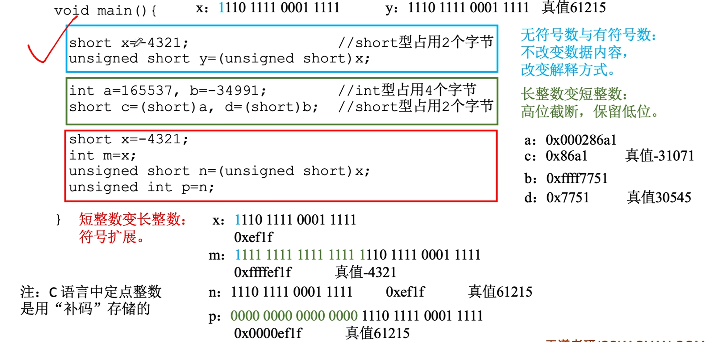

| 代码 | 位级变化 | 结果 |
| --- | --- | --- |
| `short x=-4321; unsigned short y=(unsigned short)x;` | 16 位内容不变，按无符号重新解释 | `0xEF1F` 表示 61215 |
| `int a=165537; short c=(short)a;` | 保留低 16 位，高 16 位截断 | `0x86A1`，按 16 位补码是 $-31071$ |
| `int b=-34991; short d=(short)b;` | 保留低 16 位，高 16 位截断 | `0x7751`，按 16 位补码是 30545 |
| `short x=-4321; int m=x;` | 负数做符号扩展 | `0xEF1F` → `0xFFFFEF1F`，真值仍为 $-4321$ |
| `unsigned short n=(unsigned short)x; unsigned int p=n;` | 先重解释为无符号，再做零扩展 | `0xEF1F` → `0x0000EF1F`，真值为 61215 |

> 注：该例按 `short` 16 位、`int` 32 位讲解；C 标准并没有在所有平台上固定这些类型的宽度，408 题目通常按题目给出的宽度计算。


1. 8 位补码 `1000 0000` 和 `1111 1111` 的真值分别是多少？

   答：分别是 $-128$ 和 $-1$。

2. 为什么移码便于比较阶码大小？

   答：移码把真值整体加上固定偏移量，编码的大小顺序与真值大小顺序一致，所以可以直接按无符号数比较。

3. 双符号位出现 `01`、`10` 分别表示什么？

   答：`01` 表示正溢出，`10` 表示负溢出；正常的正数、负数应分别是 `00`、`11`。

4. 8 位补码 `1111 1011` 扩展到 16 位，符号扩展和零扩展分别得到什么？

   答：符号扩展得到 `1111 1111 1111 1011`；零扩展得到 `0000 0000 1111 1011`。


## 2.2 运算方法与运算电路

运算器并不是“直接算出答案”的黑盒。它把算术运算拆成若干次逻辑门操作，再由 ALU、寄存器、移位器和控制逻辑按时钟节拍完成。理解这一节可以抓住三层关系：

1. **逻辑门**完成与、或、非等基本判断；
2. **加法器、比较器、多路选择器和移位器**把这些门组合成基本运算部件；
3. **控制信号**选择数据通路和运算功能，并决定乘法、除法等多步运算何时结束。

因此，乘法并不神秘：它的本质是“判断乘数某一位、决定加不加被乘数、再移位”；除法则是“比较当前余数与除数、决定商位、再移位”。这正好对应小学竖式中的“逐位相乘、错位相加”和“试商、相减、落下一位”。

### 2.2.0 逻辑电路基础

数字电路中的高、低电平分别表示逻辑 `1`、`0`。在正逻辑下，高电平为 `1`、低电平为 `0`；负逻辑下则相反。408 的电路图如无特别说明，默认采用正逻辑。

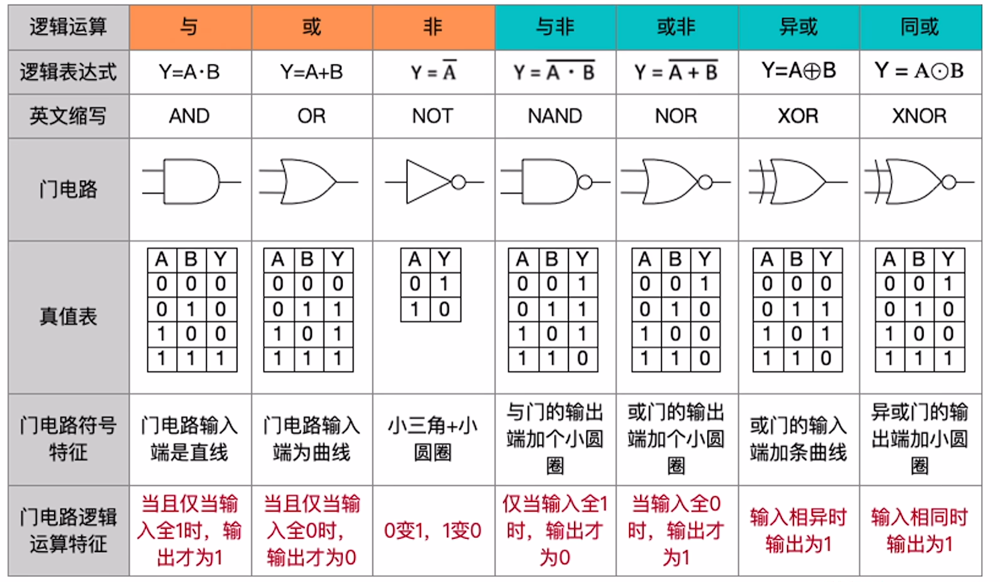

最基础的是与、或、非：

| 运算 | 表达式 | 记忆方式 |
| --- | --- | --- |
| 与 | $Y=A\cdot B$ | 只有输入全为 `1`，输出才为 `1` |
| 或 | $Y=A+B$ | 只有输入全为 `0`，输出才为 `0` |
| 非 | $Y=\overline A$ | `0`、`1` 互换 |

复合门是在基本门上增加取反：与非、或非分别是在与门、或门输出端加一个小圆圈；异或门输入端多一条弧线。需要特别记住：

- 异或 $A\oplus B$：两个输入不同时为 `1`；
- 同或 $A\odot B$：两个输入相同时为 `1`；
- 与非、或非的取反发生在**整个与/或表达式的外层**，不能把非随意分配进去。

异或还有一个高频结论：把一串比特连续异或，结果为 `1` 当且仅当其中 `1` 的个数为奇数。

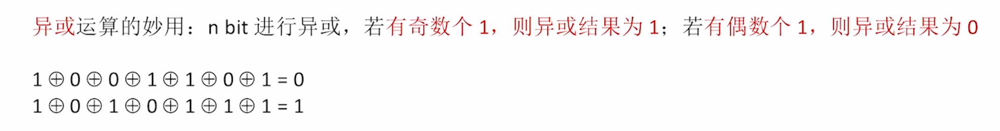

这个性质直接用于奇偶校验。若校验位要使整组数据的 `1` 的总数为偶数，就令校验位等于数据各比特的异或值；这称为偶校验，奇校验则把校验位再取反。

逻辑运算优先级为“非 > 与 > 或”，括号优先。例如 $A\overline B+C$ 先计算 $\overline B$，再计算与，最后计算或；$\overline{AB}+C$ 则先把 $A$ 与 $B$ 的乘积作为整体取反。必须区分横线的覆盖范围。

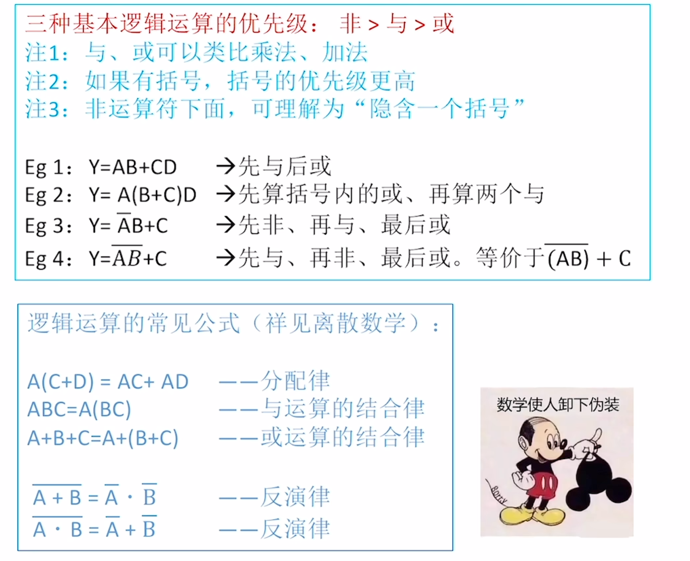

常用公式与普通代数既有联系也有区别。与、或满足交换律、结合律和分配律，多个 `1` 相加仍为 `1`，而不是普通的算术相加。反演律即摩根定律：

$$
\overline{A+B}=\overline A\cdot\overline B,\qquad
\overline{A\cdot B}=\overline A+\overline B
$$

电路设计中常出现两类组合部件：

- **多路选择器 MUX**：从 $k$ 路输入中选一路送到输出。数字选择端至少需要

$$
m=\left\lceil\log_2 k\right\rceil
$$

  位；如果有 $2^m$ 个输入，则 `m` 位控制信号可以一一对应地选择所有输入端。
- **三态门**：控制信号为有效值时，把输入正常送到输出；无效时输出处于高阻态 `Z`。高阻态表示“当前门没有驱动总线”，并不是输出逻辑 `0`。

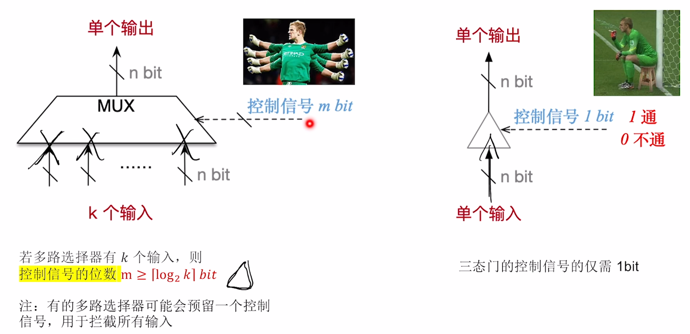

多个三态门可以共享一条总线，但同一时刻只能有一个门获得总线使用权。这也是题图里常看到“某寄存器的 `out` 控制信号”的原因：控制信号为 `1` 时，寄存器内容才被送上内部总线。

### 2.2.1 基本运算部件

<u>一位全加器与并行加法器</u>

一位全加器有被加数 $A_i$、加数 $B_i$ 和低位进位 $C_{i-1}$，产生本位和 $S_i$ 与向高位的进位 $C_i$：

$$
S_i=A_i\oplus B_i\oplus C_{i-1}
$$

$$
C_i=A_iB_i+(A_i\oplus B_i)C_{i-1}
$$

第二式的含义是：只要 $A_i$、$B_i$ 都为 `1`，本位一定产生进位；若二者恰好有一个为 `1`，则只有当低位进位 $C_{i-1}$ 也为 `1` 时才向高位进位。

把 $n$ 个一位全加器串起来，低位的进位逐级传向高位，就是**串行进位加法器**。它结构简单，但最高位必须等进位一路传播过来，延迟随位数增加。

**并行进位加法器**增加了进位先行逻辑，不再等待进位逐级传播，而是根据各操作数位直接并行生成进位。它比串行进位快，但门电路更多、成本更高。

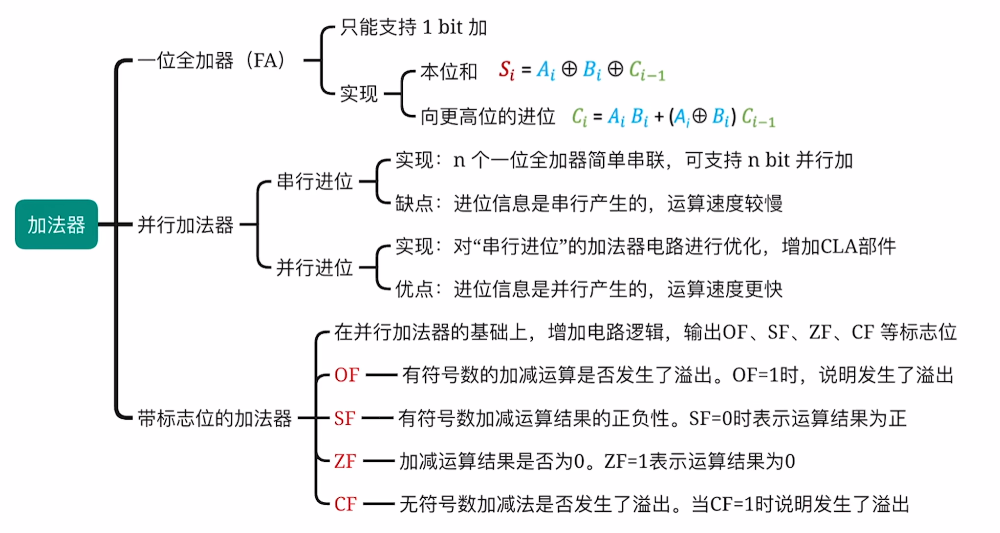

---

<u>四个常用标志位</u>

加法器除了输出 $n$ 位结果 $F$，通常还产生零标志 `ZF`、符号标志 `SF`、有符号溢出标志 `OF` 和无符号进位/借位标志 `CF`：

| 标志位 | 含义 | 常见判断 |
| --- | --- | --- |
| `ZF` | 结果是否为零 | $F=00\cdots0$ 时，`ZF=1` |
| `SF` | 有符号结果的符号 | `SF` 等于结果的最高位 |
| `OF` | 有符号运算是否溢出 | 结果超出补码可表示范围时，`OF=1` |
| `CF` | 无符号加法的进位或减法的借位 | 无符号运算超出表示范围时，`CF=1` |

若记进入符号位的进位为 $C_{n-1}$，符号位产生的进位为 $C_n$，则

$$
OF=C_n\oplus C_{n-1}
$$

进入和离开符号位的进位不同，说明最高数值部分的进位与符号位不一致，发生了有符号溢出。

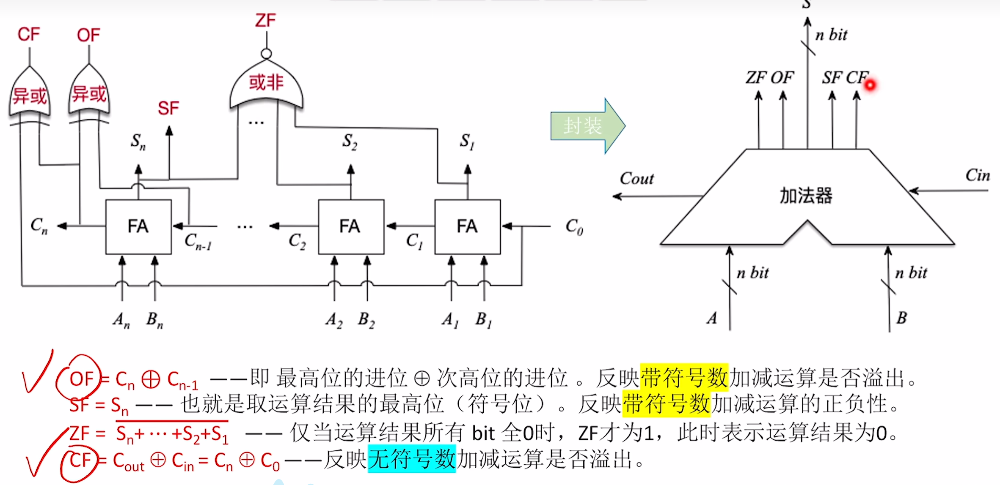

在统一加减法电路中，记 $Sub=0$ 表示加法、$Sub=1$ 表示减法：

- 加法时，`CF` 通常取最终进位 $C_{\text{out}}$；
- 减法实际执行 $X+\overline Y+1$，若最终进位为 `0`，说明 $X<Y$，产生借位，因此 `CF` 与 $C_{\text{out}}$ 的极性可能相反；
- 有的图中直接写成 $CF=Sub\oplus C_{\text{out}}$，就是为了把“加法看进位、减法看借位”统一到一个标志位中。

> 做题时先看题干对 `CF` 的定义。它始终表示无符号数运算是否越界，但在“原始进位输出”和“借位解释”之间可能相差一次取反。

---

<u>ALU 与数据通路</u>

算术逻辑单元 ALU 是运算器的核心，能完成加减、逻辑运算、取反、直送等操作。最简单的实现方式是：让多个功能电路的输出同时接到一个多路选择器，由控制信号选择本次采用哪一路。

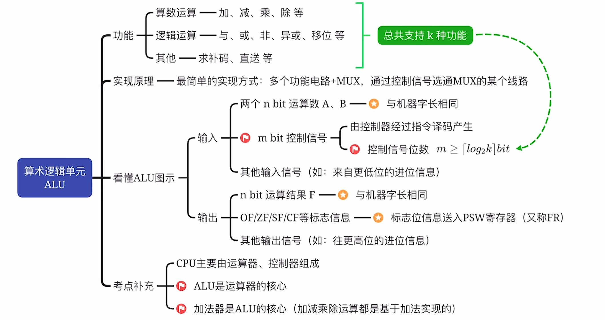

若 ALU 支持 $k$ 种功能，则操作控制码至少需要 $\lceil\log_2 k\rceil$ 位。ALU 的操作数宽度和结果宽度通常都等于机器字长；控制信号由控制器根据指令译码产生。

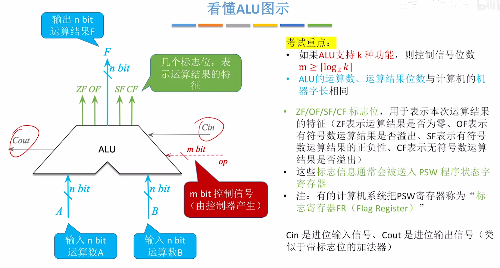

ALU 本身主要完成一次组合运算。真正执行一条指令时，还需要寄存器、暂存器和内部总线配合。例如在 2022 统考数据通路中，GPRs 可以提供操作数，经内部总线送入锁存器 Y；ALU 计算后先把结果放入 Z，再由 `Zout` 送上总线，最后由 `GPRin` 写回通用寄存器。多步操作的中间结果不能都同时占用一条单总线，所以要按节拍逐次传送。

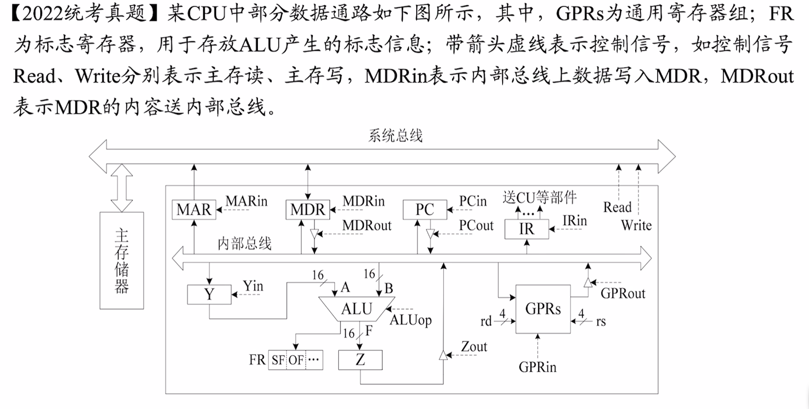

读这类图时，可以把每个寄存器看成一个带入口和出口的房间：`MARin`、`MDRin`、`Yin`、`GPRin` 等控制信号决定“是否写入”，带 `out` 的控制信号决定“是否把内容送到总线上”。ALU 的操作码 `ALUop` 只选择运算功能，并不负责操作数在总线上的搬运。

### 2.2.2 定点数的移位运算

移位运算把整个二进制位序列向左或向右移动，空出的位置按规则补 `0` 或符号位。

| 运算 | 移出 | 空位补入 | 典型用途 |
| --- | --- | --- | --- |
| 逻辑左移 | 丢弃最高位 | 最低位补 `0` | 无符号数乘 2 |
| 逻辑右移 | 丢弃最低位 | 最高位补 `0` | 无符号数除 2 |
| 算术左移 | 丢弃最高位 | 最低位补 `0` | 有符号数乘 2，需判溢出 |
| 算术右移 | 丢弃最低位 | 最高位补原符号位 | 有符号数除 2，保持符号 |

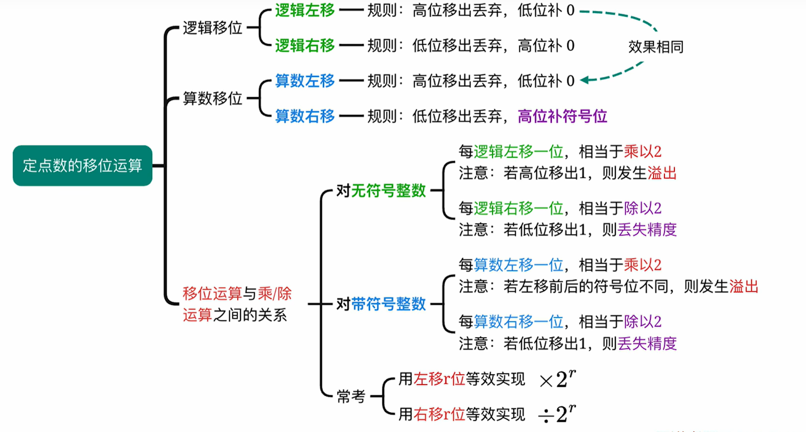

左移一位，在位权上相当于把每一位从 $2^i$ 移到 $2^{i+1}$，所以数值乘以 2；右移一位相当于除以 2。算术左移和逻辑左移的位级操作相同，区别在于算术左移把最高位解释为符号位：

- 无符号数左移时，若移出的最高位为 `1`，结果已经越界；
- 有符号数左移时，若移位前后的符号发生变化，通常说明发生溢出。

算术右移时最高位复制符号位，因此负数右移后仍为负数。例如 4 位补码 `1101` 表示 $-3$，算术右移一位得到 `1110`，表示 $-2$。它执行的是向下取整的除法，并不是简单地向 0 截断；$-3/2$ 若向 0 截断会得到 $-1$，而算术右移得到 $-2$。低位被移出的 `1` 就是丢失的精度。

左移 $r$ 位近似实现乘 $2^r$，右移 $r$ 位近似实现除以 $2^r$。移位器本身只需要连线、选择器和少量控制逻辑，因此乘除 2 的整数次幂常优先用移位完成。

### 2.2.3 定点数的加减运算

<u>原码加减法</u>

原码把符号位和绝对值分开，所以加减时不能天真地“符号位也相加”：

- 同号相加：绝对值相加，结果符号取公共符号；
- 异号相加：用较大的绝对值减去较小的绝对值，结果符号取绝对值较大者；
- 减法：把减数取相反数，再按加法处理。

原码运算符合人的直觉，但机器必须先比较绝对值，还要单独决定符号，控制较复杂。这正是补码在加减法中更重要的原因。

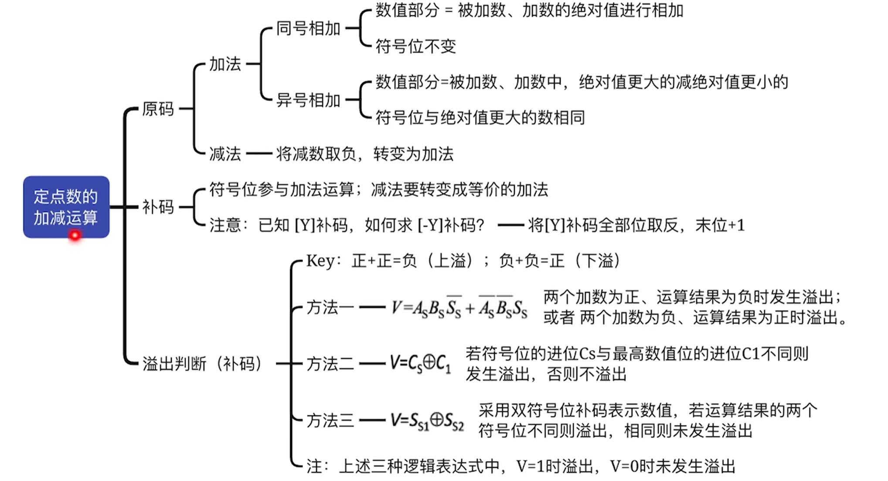

---

<u>补码统一加减法</u>

在 $n$ 位补码中，所有运算按模 $2^n$ 进行。减法满足

$$
[X-Y]_{\text{补}}=[X]_{\text{补}}+[-Y]_{\text{补}}
$$

而 $[-Y]_{\text{补}}$ 可由 $[Y]_{\text{补}}$ 全部位取反再在最低位加 1 得到。因此，一个加法器配合取反器和最低位进位输入，就能同时实现加法和减法：

$$
X-Y=X+\overline Y+1
$$

统一电路可以概括为：

1. 被减数或加数 $X$ 直接送入加法器一端；
2. 控制信号 $Sub=0$ 时，$Y$ 原样送入；$Sub=1$ 时，$Y$ 按位取反；
3. 同一个 $Sub$ 信号接到加法器最低位进位输入端，所以减法时再加 1；
4. 加法器输出 $n$ 位结果，同时生成 `ZF`、`SF`、`OF`、`CF`。

无符号数按同一套位级电路运算时，解释方式不同：

- 加法最终有进位，即 $C_{\text{out}}=1$，表示无符号结果超出 $0\sim2^n-1$ 的范围；
- 减法化为 $X+\overline Y+1$ 后，若最终无进位，说明 $X<Y$，产生借位；
- 溢出判断依据的是无符号表示范围，而不是 `OF`。

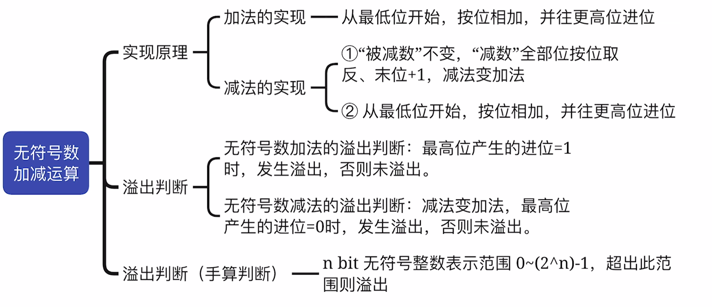

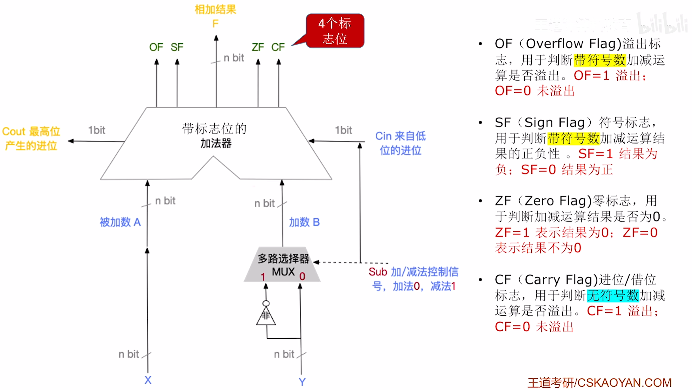

---

<u>有符号溢出的三种判断</u>

设符号位产生的进位为 $C_s$，最高数值位送入符号位的进位为 $C_1$，两个结果符号位分别为 $S_{s1}$、$S_{s2}$：

| 方法 | 判断式 | 直观解释 |
| --- | --- | --- |
| 按操作数和结果 | 正 + 正得负，或负 + 负得正 | 同号相加却得到异号 |
| 按符号位进位 | $V=C_s\oplus C_1$ | 进入、离开符号位的进位不同 |
| 双符号位 | $V=S_{s1}\oplus S_{s2}$ | 正常为 `00` 或 `11`，溢出为 `01` 或 `10` |

减法 $X-Y$ 可以先转成 $X+(-Y)$ 再判断。两个异号数相减，可能发生溢出；同号数相减不会产生有符号溢出。

例：4 位补码中 $5+4$。

```
  0101
+ 0100
------
  1001
```

按位结果为 `1001`，若解释为有符号数就是 $-7$；“正数加正数得到负数”显然不合理，因此发生正溢出。原始 5 位结果为 `01001`，说明真实值 9 超出 4 位补码的 $-8\sim7$。

---

<u>无符号数与有符号数的大小比较</u>

执行减法 $A-B$ 后，可以直接利用标志位比较：

| 类型 | 相等 | $A>B$ | $A<B$ |
| --- | --- | --- | --- |
| 无符号数 | `ZF=1` | `ZF=0, CF=0` | `CF=1` |
| 有符号数 | `ZF=1` | `ZF=0, OF\oplus SF=0` | `ZF=0, OF\oplus SF=1` |

有符号比较要把溢出标志和符号标志异或，原因是发生溢出时，结果的真实符号与 `SF` 位所显示的符号相反。无符号比较则直接看是否产生借位。


下面两页补充了题图中容易忽略的电路细节，尤其是 `Sub` 同时控制“取反”和“最低位加 1”，以及 `CF`、`OF`、`SF` 为什么只对特定解释有意义。

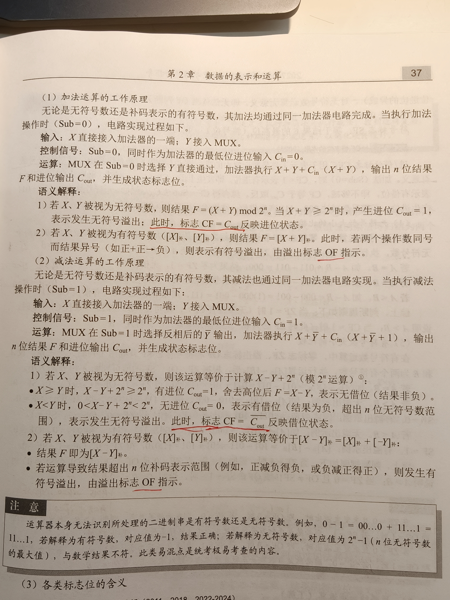

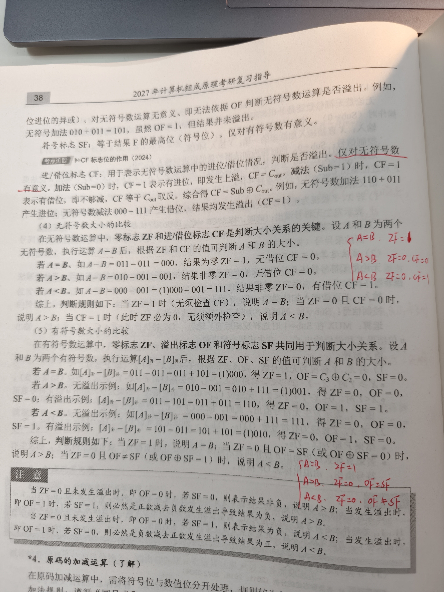


### 2.2.4 定点数的乘除运算

乘法和除法都可由“加法/减法 + 移位 + 控制判断”反复迭代完成：

| 竖式动作 | 乘法中的对应 | 除法中的对应 |
| --- | --- | --- |
| 看当前位 | 检查乘数最低位 `Y₀` | 比较当前余数与除数 |
| 做一次加减 | `Y₀=1` 时加被乘数，否则加 `0` | 够减则减去除数，不够减则商 `0` |
| 处理位权 | `(C,P,Y)` 整体右移 | `(R,Q)` 整体左移 |
| 保存结果 | 高半积在 `P`，低半积在 `Y` | 商在 `Q`，余数在 `R` |

<u>乘法：手算的“错位相加”怎样变成硬件迭代</u>

无符号整数乘法的手算方法是：从乘数最低位开始，若该位为 `1`，就写下被乘数；为 `0` 就写 `0`。每处理下一位，部分积左移一位，最后把所有部分积相加。

硬件顺序乘法器使用三个关键寄存器：

- `X`：保存被乘数；
- `Y`：保存乘数，同时逐步接收乘积低位；
- `P`：保存累加中的部分积高位；
- 另外还有 1 位进位触发器 `C` 和计数器 `Cn`。

每轮执行：

1. 检查 `Y` 的最低位 `Y₀`；
2. 若 `Y₀=1`，执行 `P←P+X`，并保存本次加法产生的进位；若 `Y₀=0`，本次加 `0`；
3. 把 `(C,P,Y)` 视为一个整体，逻辑右移一位；
4. 计数器减 1，重复 $n$ 轮。

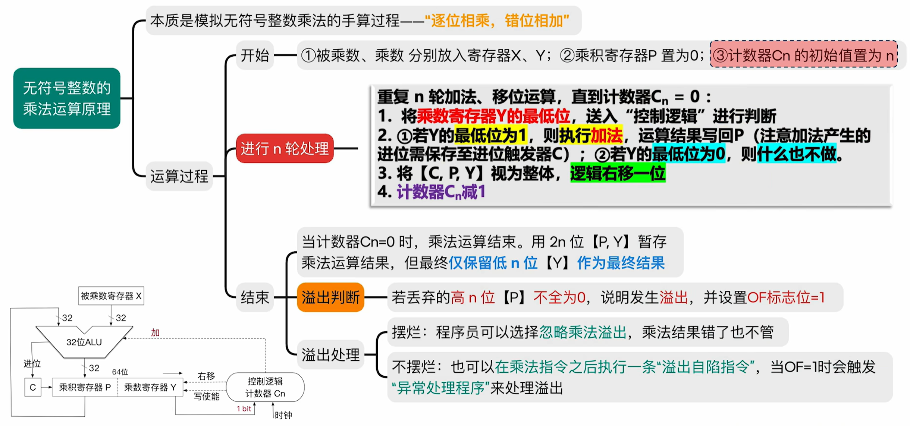

手算时，第 $i$ 个部分积要左移 $i$ 位；硬件改为每轮把已经累加的结果右移一位，使下一轮加入的 $X$ 相对前进一位，两种做法的**相对位移相同**。整体右移还会把 `P` 的最低位挤入 `Y` 的最高位，而 `Y` 原最低位正好已经使用完毕。右移 $n$ 次后，已确定的 $n$ 个乘积低位全部落在 `Y` 中。

例如 $13\times11$：

```
         1101       ← 13
       × 1011       ← 11
       ------
         1101       ← 乘数最低位为 1
        1101        ← 错位一位
       0000         ← 乘数为 0，本行全 0
      1101          ← 错位三位
      --------
      10001111      ← 143
```


取 `X=1101`、`Y=1011`、`P=0000`、`C=0`，把 `C,P,Y` 拼起来后每轮右移：

| 轮次 | 检查 $Y_0$ | 本轮加法后的 `C,P` | 整体右移后的 `C,P,Y` |
| --- | --- | --- | --- |
| 初始 | — | `0,0000` | `0 0000 1011` |
| 1 | `1`，加 `1101` | `0,1101` | `0 0110 1101` |
| 2 | `1`，加 `1101` | `1,0011` | `0 1001 1110` |
| 3 | `0`，加 `0000` | `0,1001` | `0 0100 1111` |
| 4 | `1`，加 `1101` | `1,0001` | `0 1000 1111` |

结束后高半积 `P=1000`、低半积 `Y=1111`，所以完整 8 位乘积为 `1000 1111`，即 143。可以看到，手算中的四个错位部分积，被压缩成了“每轮最多一次加法，再共同右移一次”。


如果完整保留 `2n` 位，$n$ 位乘 $n$ 位的乘积可以精确保存。若乘法指令最终只返回低 $n$ 位，则高半积用来判断是否溢出：

- 无符号乘法：高 $n$ 位全为 `0`，低 $n$ 位才是精确结果；否则溢出；
- 有符号乘法：完整乘积的高 $n$ 位必须等于低 $n$ 位符号位的符号扩展；等价地说，`2n` 位结果的高 $n+1$ 位必须完全相同。

---

<u>补码乘法与 Booth 法</u>

补码乘法可以直接处理有符号数，也可以把符号位单独处理、数值位按无符号乘法计算。Booth 法让符号位和数值位一起参加运算，它的核心是利用乘数中相邻两位的变化来改写乘法：

$$
y=-y_{n-1}2^{n-1}+\sum_{i=0}^{n-2}y_i2^i
=\sum_{i=0}^{n-1}(y_{i-1}-y_i)2^i
$$

其中 $y_i$ 是补码乘数的各位，$y_{-1}=0$。相邻两位从 `0` 变到 `1` 时产生 $+X$，从 `1` 变到 `0` 时产生 $-X$，连续相同的位不需要操作。这解释了为什么一串连续的 `1` 可以被写成“高端减一次、低端加一次”。

实现时增加一个辅助位 `Q₋₁`，初值为 `0`。每轮检查 `(Y₀,Q₋₁)`：

| `Y₀` | `Q₋₁` | 本轮操作 |
| --- | --- | --- |
| `0` | `0` | 加 `0` |
| `0` | `1` | 加 $[X]_{\text{补}}$ |
| `1` | `0` | 减 $[X]_{\text{补}}$，即加 $[-X]_{\text{补}}$ |
| `1` | `1` | 加 `0` |

做完本轮加减后，把 `(P,Y,Q₋₁)` 作为一个整体进行**算术右移**，符号位保持不变。重复 $n$ 轮，结束后的 `P||Y` 就是 $2n$ 位补码乘积。

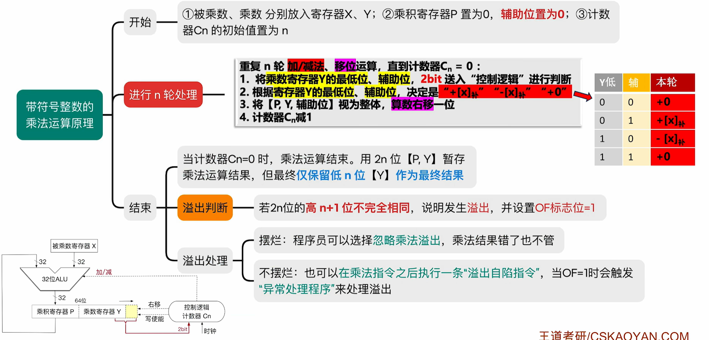


用 4 位补码计算 $-3\times3$。初始 `P=0000`、`Y=0011`、辅助位 `Q₋₁=0`；被乘数 $[X]_{\text{补}}=1101$。

| 轮次 | 检查 `(Y₀,Q₋₁)` | 本轮操作 | 算术右移后的 `P,Y,Q₋₁` |
| --- | --- | --- | --- |
| 初始 | — | — | `0000, 0011, 0` |
| 1 | `(1,0)` | $P←P-X=0011$ | `0001, 1001, 1` |
| 2 | `(1,1)` | 加 `0` | `0000, 1100, 1` |
| 3 | `(0,1)` | $P←P+X=1101$ | `1110, 1110, 0` |
| 4 | `(0,0)` | 加 `0` | `1111, 0111, 0` |

最终乘积 `P||Y=1111 0111`，按 8 位补码解释为 $-9$，与 $-3\times3=-9$ 一致。

注意第 1 轮看到 `(Y₀,Q₋₁)=(1,0)` 时执行的是减 $X$；不要把表中的顺序记成“`1` 就加、`0` 就不加”。Booth 判断的是乘数相邻位的**跳变**，而不是单独一位的奇偶。


---

<u>三种乘法实现方式</u>


从执行代价看：

1. **阵列乘法器**把大量部分积同时生成并归约，属于快速乘法器，教材层面可把它看成吞吐率很高、接近一次组合延迟完成乘法；
2. **ALU + 移位器 + 寄存器 + 控制逻辑**按节拍迭代，通常需要多个时钟周期；
3. **只有加减和移位指令的软件乘法**把每轮判断、加法和移位都展开成多条指令，速度最慢。

三者计算的是同一个数学乘积，差别主要在硬件面积、控制复杂度和执行时间。

---

<u>乘法溢出与典型统考问法</u>

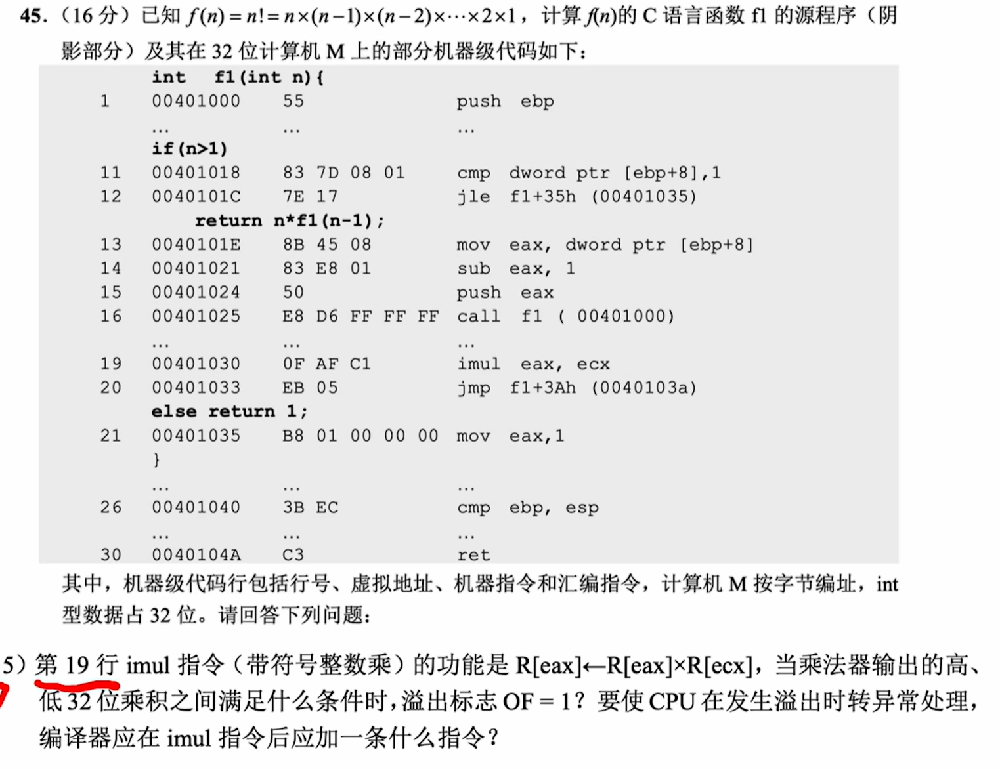

带符号乘法只返回低 $n$ 位时，判断溢出的关键不是“乘积超过 $2^n-1$”这一句简单的无符号标准，而是看完整乘积能否由低 $n$ 位符号扩展得到。若不能，则 `OF=1`。编译器若希望发生溢出时进入异常处理程序，可以在 `imul` 后紧接条件转移指令 `jo 异常处理入口`，由 `OF` 决定是否跳转。

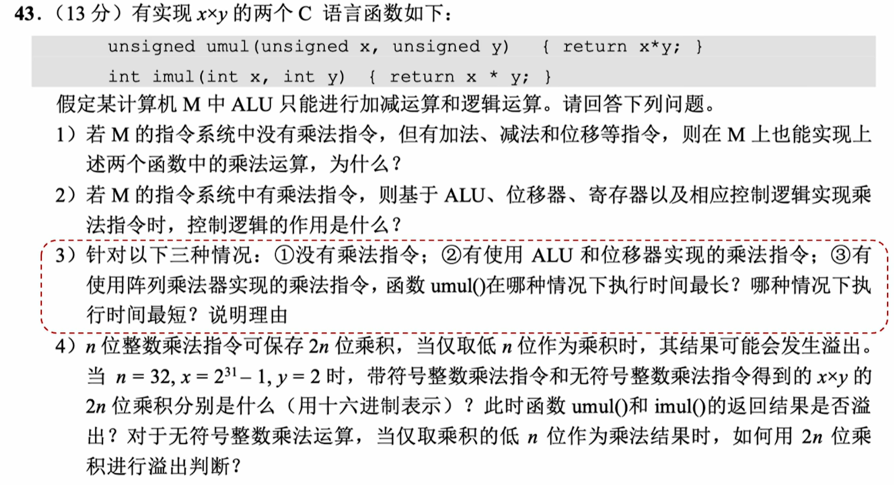


1. 没有乘法指令时，只能用软件循环展开“判断、加法、移位”，执行时间最长；阵列乘法器硬件并行生成并累加部分积，执行时间最短。
2. 在 ALU 迭代乘法中，控制逻辑负责检查乘数当前位、选择本轮执行的加法或减法、控制寄存器整体移位，并在计数器归零时结束。
3. $n=32$、$x=2^{31}-1$、$y=2$ 时，完整 64 位乘积为 `00000000 FFFFFFFE`，无符号和有符号乘法得到相同的位串。
4. `unsigned` 返回值取低 32 位 `FFFFFFFE`，数值为 $2^{32}-2$，没有超出无符号 32 位范围；`int` 返回值同样取 `FFFFFFFE`，按补码解释为 $-2$，显然不等于 $2^{31}-1$ 的两倍，因此 `imul` 溢出。
5. 对无符号乘法，若高 32 位全为 `0`，低 32 位就是精确结果；高 32 位非零则溢出。


---

<u>除法：为什么是“左移 + 试减”</u>

除法满足

$$
\text{被除数}=\text{商}\times\text{除数}+\text{余数}
$$

十进制竖式每写一位商，都要判断“除数最多能从当前余数中减去几次”；二进制商位只有 `0` 和 `1`，所以每次只需试减一次：

- 当前余数大于等于除数：商位上 `1`，执行减法；
- 当前余数小于除数：商位上 `0`，不做减法，或把刚才减掉的除数恢复回来。

硬件除法器把被除数放在 `Q`，当前余数放在 `R`，除数放在 `Y`。每轮执行：

1. 左移 `(R,Q)`：`Q` 的最高位进入 `R` 的最低位，相当于竖式中的“落下下一位”；`Q` 空出的最低位用于写本轮商；
2. 试算 $R-Y$：非负则保留差并写商 `1`，为负则写商 `0`；
3. 恢复余数法要把负的试减结果加回除数；加减交替法则把负余数留给下一轮，并根据符号改用加法；
4. 计数器减 1，直到求出规定位数的商。


无符号单精度除法在正式求 $n$ 位商前，还要根据零扩展后的高半 `R` 判断首位商是否溢出：高半已经不小于除数时，首位商为 `1`，真实商超过 $n$ 位；否则丢掉这个前导 `0`，再继续 $n$ 轮。

以 $13\div3$ 为例，手算竖式的核心动作是：

```
         0100
       ______
11 ) 1101
     11
     ---
      001
        0
      ---
        01       ← 商 0100，余数 0001
```

硬件并不把被除数一直保持不动、把除数不断挪位置，而是让当前余数 `R` 和被除数剩余位 `Q` 整体左移；被移出 `Q` 的最高位进入 `R` 的最低位，效果与手算时“落下下一位”完全相同。


被除数是 8 位 `1101 0110`，即 214；除数是 4 位 `1111`，即 15。`R`、`Q`、`Y` 都是 4 位寄存器，因此 `R||Q` 正好有 8 位，可以在循环前完整放入被除数。

左移 `(R,Q)` 时，`R` 的最高位会暂时移出 4 位寄存器，所以再加一个 1 位进位触发器 `C` 接住它。试减时比较的是 5 位复合值 `C||R` 和 4 位除数 `Y`。

**循环前**

- 把 8 位被除数拆成高低两半：`R=1101`，`Q=0110`；
- 除数放入 4 位寄存器：`Y=1111`；
- 进位触发器清零：`C=0`；
- 计数器置为商寄存器位数：`Cn=4`；
- 先检查除数不为 `0`；
- 再做首位商检查：当前 `R=1101<Y=1111`，首位商为 `0`，不会商溢出；这个前导 `0` 不保存，也不让 `Cn` 减 1，下面只执行正常的 4 轮。

**循环中每一轮**

1. 把 `C,R,Q` 作为整体左移一位：`R` 的最高位进入 `C`，`Q` 的最高位进入 `R` 的最低位，`Q` 空出最低位；
2. 比较 `C||R` 与 `Y`；
3. 若 `(C||R)≥Y`，把差写回 `R`，并在 `Q` 的最低位上商 `1`；
4. 若 `(C||R)<Y`，把左移后的 `R` 恢复为减法前的值，并在 `Q` 的最低位上商 `0`；
5. 本轮成功后 `C` 回到 `0`；若本轮不够减，由于 `Y≤1111`，此时 `C` 也必为 `0`；
6. `Cn` 减 1。

| 轮次 | 左移后的 `C,R,Q` | `(C,R)-Y` | 本轮处理 | 轮末 `C` | 轮末 `R` | 轮末 `Q` | 轮末 `Cn` |
| --- | --- | --- | --- | --- | --- | --- | --- |
| 初始 | `0, 1101, 0110` | `1101-1111`，首位检查为负 | 前导商 `0`，不保存 | `0` | `1101` | `0110` | `4` |
| 1 | `1, 1010, 1100` | $11010_2-1111_2=1011_2$ | 够减，`R←R-Y`，上商 `1` | `0` | `1011` | `1101` | `3` |
| 2 | `1, 0111, 1010` | $10111_2-1111_2=1000_2$ | 够减，`R←R-Y`，上商 `1` | `0` | `1000` | `1011` | `2` |
| 3 | `1, 0001, 0110` | $10001_2-1111_2=0010_2$ | 够减，`R←R-Y`，上商 `1` | `0` | `0010` | `0111` | `1` |
| 4 | `0, 0100, 1110` | $00100_2-1111_2<0$ | 不够减，恢复 `R`，上商 `0` | `0` | `0100` | `1110` | `0` |

**循环结束**

- `Q=1110` 是 4 位商，即 14；
- `R=0100` 是 4 位余数，即 4；
- `Y=1111` 一直没有变化；
- `C=0`；
- `Cn=0`，循环结束。

因此

$$
214=14\times15+4
$$

第 1～3 轮需要借助 `C` 暂存左移产生的高位；如果只看低 4 位 `R`，会错误地把 `11010`、`10111`、`10001` 当成 `1010`、`0111`、`0001`。


---

<u>单精度、双精度与商溢出</u>

设机器字长为 $n$：

- **单精度除法**：$n$ 位被除数除以 $n$ 位除数，得到 $n$ 位商和 $n$ 位余数；
- **双精度除法**：$2n$ 位被除数除以 $n$ 位除数，仍只保留 $n$ 位商和 $n$ 位余数。

双精度除法的真实商可能超过 $n$ 位，因此存在“商溢出”。无符号单精度除法的真实商一定不超过 $n$ 位，所以不会产生商溢出。硬件通常先多求一位商：若最高商位为 `1`，说明商需要 $n+1$ 位，立即报告商溢出；若为 `0`，丢掉这个前导 `0`，继续求剩余 $n$ 位。

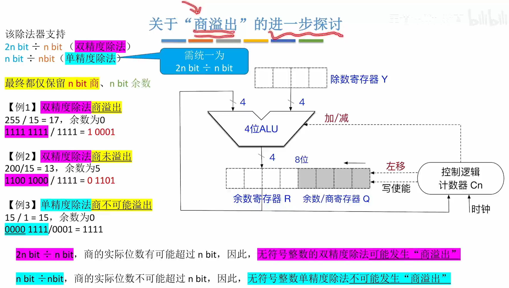

整数除法在下列情况通常触发异常或未定义行为：

- 除数为 `0`；
- 双精度除法的商无法放入目标位数；
- 补码单精度除法中，绝对值最大的负数除以 $-1$，例如 8 位补码的 $-128\div(-1)$，真实结果 $128$ 无法用 8 位补码表示。

在 x86 中，除零和商溢出都可能归入 `Divide Error` 异常。编程题中不能只检查分母是否为 0，还要考虑 `INT_MIN / -1`。

---

<u>带符号整数除法</u>

补码除法可以直接利用补码加减完成，也可以先把绝对值做无符号除法，再根据符号修正。无论采用哪种实现，最终都要满足

$$
\text{被除数}=\text{商}\times\text{除数}+\text{余数}
$$

按 C 语言和 408 常见约定，整数商向 0 截断，余数与被除数同号。例如：

$$
-7=(-2)\times3+(-1)
$$

所以 $-7\div3$ 的商为 $-2$，余数为 $-1$。不能只把绝对值除完后把余数一律取正，否则商和余数代回等式会不一致。

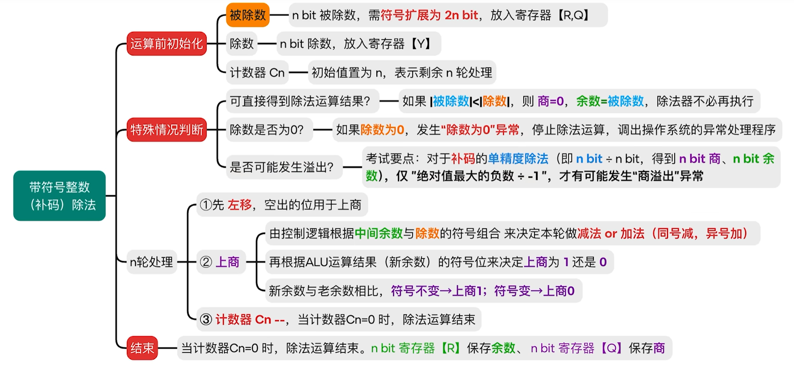

直接补码除法的每轮步骤可以概括为：

1. 把 $n$ 位被除数符号扩展成 $2n$ 位，放入 `(R,Q)`；除数放入 `Y`；
2. 先左移 `(R,Q)`：`Q` 的最高位进入 `R`，`Q` 的最低位置空，等待写本轮商；
3. 中间余数与除数同号时执行 `R←R-Y`，异号时执行 `R←R+Y`；
4. 由本轮加减前后的余数符号是否改变决定商位：符号不变记 `1`，符号改变记 `0`；
5. 重复 $n$ 轮，结束时 `R` 为余数、`Q` 为商。

**恢复余数法与加减交替法的联系**：恢复余数法中，试减得到负余数后马上加回除数；加减交替法不立即恢复，而是允许余数暂时为负。下一轮若余数为负就改为加除数，若为正则继续减除数。两种方法求得的最终商和余数相同，后者减少了“恢复—再减”的重复操作，所以速度更快。


下面展示“符号位单独处理，再按无符号除法求绝对值”的实现。直接补码除法则在每轮根据余数和除数的符号选择加或减，不在循环前另求绝对值；两者最终都必须得到同一组商和余数。

原始数据：

- 8 位被除数 `-13` 的补码是 `1111 0011`；
- 4 位除数 `+3` 的补码是 `0011`；
- 商符由两个操作数符号异或得到：$S_Q=1\oplus0=1$，最终商为负；
- 余数符号与被除数相同：$S_R=1$，最终余数为负。

**循环前**

取绝对值 `13=0000 1101`，拆成两个 4 位半字：

- `R=0000`；
- `Q=1101`；
- 除数放入 `Y=0011`；
- 进位触发器 `C=0`；
- `Cn=4`；
- 除数为 0 的检查已通过；
- 首位商检查：`R=0000<Y=0011`，首位商为 `0`，不会商溢出，不保存这个前导 `0`，`Cn` 保持为 4。

**循环中每一轮**

每轮仍执行同一组动作：`(C,R,Q)` 左移，比较 `C||R` 与 `Y`；够减则把差写回 `R`、上商 `1`，不够减则恢复 `R`、上商 `0`。`Y` 不变，`Cn` 每轮减 1。

| 轮次 | 左移后的 `C,R,Q` | `(C,R)-Y` | 本轮处理 | 轮末 `C` | 轮末 `R` | 轮末 `Q` | 轮末 `Cn` |
| --- | --- | --- | --- | --- | --- | --- | --- |
| 初始 | `0, 0000, 1101` | `0-3<0`，首位检查 | 前导商 `0`，不保存 | `0` | `0000` | `1101` | `4` |
| 1 | `0, 0001, 1010` | $1-3=-2$ | 不够减，恢复 `R`，上商 `0` | `0` | `0001` | `1010` | `3` |
| 2 | `0, 0011, 0100` | $3-3=0$ | 够减，`R←R-Y=0`，上商 `1` | `0` | `0000` | `0101` | `2` |
| 3 | `0, 0000, 1010` | $0-3=-3$ | 不够减，恢复 `R`，上商 `0` | `0` | `0000` | `1010` | `1` |
| 4 | `0, 0001, 0100` | $1-3=-2$ | 不够减，恢复 `R`，上商 `0` | `0` | `0001` | `0100` | `0` |

**循环结束**

循环得到的是绝对值的商和余数：

- `Q=0100`，即商绝对值 4；
- `R=0001`，即余数绝对值 1。

再回填循环前记录的符号：

- 4 位商取负：`0100` 变成补码 `1100`，即 $-4$；
- 4 位余数与被除数同号：`0001` 变成补码 `1111`，即 $-1$。

所以

$$
-13=(-4)\times3+(-1)
$$

C 语言按向 0 截断得到商 $-4$、余数 $-1$。若除数是负数，商符需要翻转，但余数仍与被除数同号。



1. 逻辑右移与算术右移的区别是什么？

   答：逻辑右移高位补 `0`，用于无符号数；算术右移高位补原符号位，用于有符号数并保持符号。

2. 4 位补码 `0111` 再左移一位得到 `1110`，是否溢出？

   答：溢出。原数 7，算术左移后按补码解释为 $-2$，符号从正变负，真实值 14 已超出 4 位补码范围。

3. 顺序乘法器中为什么把 `(C,P,Y)` 整体右移，而不是把被乘数每轮左移？

   答：把累加结果右移与把被乘数相对左移效果等价。这样可复用同一组寄存器和加法器，控制电路也更规整。

4. Booth 法检查到 `(Y₀,Q₋₁)=(1,0)` 时执行什么？

   答：执行 $P←P-[X]_{\text{补}}$，也就是加上 $[-X]_{\text{补}}$。

5. 为什么恢复余数法需要“恢复”，加减交替法不需要？

   答：恢复余数法要求每轮结束时 `R` 为非负；加减交替法允许负余数保留到下一轮，再根据符号选择加法或减法。

6. 8 位有符号整数中，$-128\div(-1)$ 为什么可能异常？

   答：真实结果是 128，超出 8 位补码的 $-128\sim127$ 范围，发生商溢出。


## 2.3 浮点数的表示与运算

### 2.3.1 IEEE 754标准的浮点数

IEEE 754 浮点数采用类似二进制科学计数法的形式：

$$
(-1)^S\times M\times 2^e
$$

| 部分 | 含义 |
| --- | --- |
| `S` | 符号位，`0` 表示正、`1` 表示负；浮点数用符号—绝对值表示，不是补码 |
| `E` | 阶码字段，按无符号整数解释；真正阶码为 $e=E-\text{偏置值}$ |
| `f` | 尾数字段，保存规范化有效数字小数点后的部分 |
| `M` | 实际有效数字；规格化数为 `1.f`，非规格化数为 `0.f` |

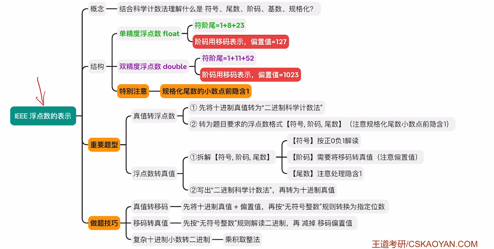

| 格式 | 总位数 | 符号 `S` | 阶码 `E` | 尾数 `f` | 偏置值 |
| --- | --- | --- | --- | --- | --- |
| 单精度 `float` | 32 | 1 | 8 | 23 | 127 |
| 双精度 `double` | 64 | 1 | 11 | 52 | 1023 |

阶码字段使用移码，但 IEEE 754 的偏置值与普通 $n$ 位移码不同：单精度偏置 127，双精度偏置 1023。把真阶码写成阶码字段时，

$$
E=e+\text{偏置值}
$$

并把得到的非负整数按无符号二进制放入指定位数；反向读取时再减去偏置值。

---

<u>规格化数与非规格化数</u>

当阶码字段既不全为 `0`、也不全为 `1` 时，数据是规格化数。规格化二进制科学计数法的小数点前一定是 `1`，IEEE 754 约定这个 `1` 不实际存储，读取时自动补回：

$$
X=(-1)^S\times(1.f)_2\times2^{E-\text{偏置值}}
$$

因此单精度尾数虽然只有 23 个存储位，实际有效数字有 $1+23=24$ 位；双精度实际有 $1+52=53$ 位。

当阶码字段全为 `0`、尾数字段非 `0` 时，数据是非规格化数。此时小数点前隐含 `0`，真实阶码固定为

$$
e=1-\text{偏置值}
$$

即单精度为 $-126$，双精度为 $-1022$：

$$
X=(-1)^S\times(0.f)_2\times2^{1-\text{偏置值}}
$$

非规格化数用来表示比最小规格化数更接近 0 的数，代价是有效位数减少。

---

<u>特殊值</u>

阶码字段全为 `0` 或全为 `1` 时，解释规则如下：

| 阶码 `E` | 尾数 `f` | 含义 | 单精度数值形式 | 双精度数值形式 |
| --- | --- | --- | --- | --- |
| 全 `0` | 全 `0` | 正零或负零 | $\pm0$ | $\pm0$ |
| 全 `0` | 非 `0` | 非规格化数 | $\pm(0.f)_2\times2^{-126}$ | $\pm(0.f)_2\times2^{-1022}$ |
| 全 `1` | 全 `0` | 正无穷或负无穷 | $\pm\infty$ | $\pm\infty$ |
| 全 `1` | 非 `0` | 非数 `NaN` | `NaN` | `NaN` |

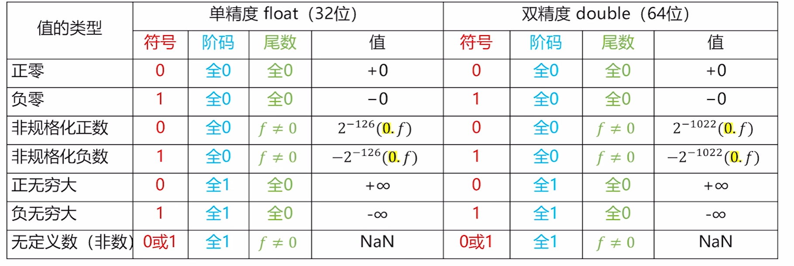

`+0` 和 `-0` 在数值比较中相等，但符号位不同。非数 `NaN` 用于表示没有确定数值的结果，例如 $0\div0$、$\infty-\infty$ 等非法运算。

---

<u>表示范围</u>

以单精度为例，阶码字段 `0000 0001`～`1111 1110` 对应真阶码 $-126\sim127$。规格化数的范围是

$$
2^{-126}\le |X|\le(2-2^{-23})\times2^{127}
$$

最大有限数约为 $3.4028\times10^{38}$，最小规格化正数约为 $1.1755\times10^{-38}$。更小的非零数落在非规格化区，最小可达

$$
2^{-149}\approx1.4013\times10^{-45}
$$

数量轴上的排列为：

```text
负上溢 | 负规格化数 | 非规格化负数 | -0 | +0 | 非规格化正数 | 正规格化数 | 正上溢
```

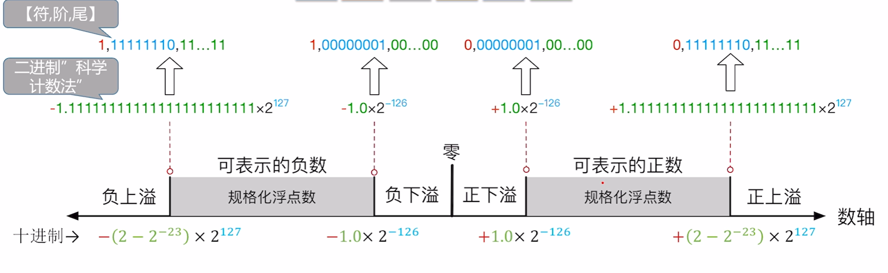

| 边界 | 单精度 | 双精度 |
| --- | --- | --- |
| 真阶码范围 | $-126\sim127$ | $-1022\sim1023$ |
| 最小规格化正数 | $2^{-126}$ | $2^{-1022}$ |
| 最大有限正数 | $(2-2^{-23})2^{127}$ | $(2-2^{-52})2^{1023}$ |
| 最小非零正数 | $2^{-149}$ | $2^{-1074}$ |

正数和负数关于 0 对称；绝对值越大，数值越接近两端的上溢区。

---

<u>上溢与下溢</u>

运算结果的绝对值超过最大有限数时发生上溢，按符号舍入成同号的无穷大：

$$
X\to+\infty\quad\text{或}\quad X\to-\infty
$$

同时设置浮点上溢异常标志位。IEEE 754 默认不因为上溢或下溢中断程序，除非程序主动开启对应异常响应。

结果绝对值小于最小规格化数时进入下溢区：

- 仍能用非规格化数表示时，以非规格化数保存，只是精度降低；
- 小到无法与 0 区分时，按机器零保存；
- 下溢为机器零时设置下溢异常标志位。

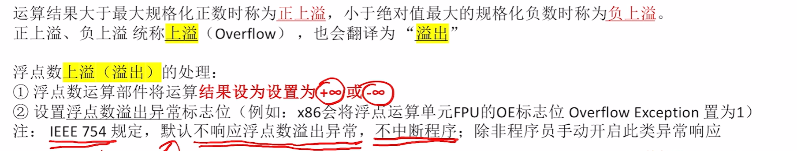

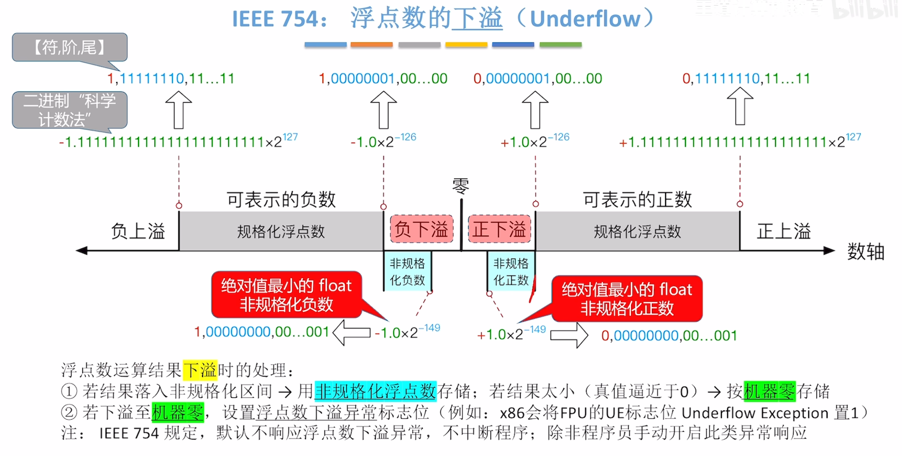

---

<u>IEEE 754 与十进制之间的转换</u>

由十进制真值求浮点编码：

1. 把绝对值转成二进制；
2. 写成规格化形式 $\pm1.f\times2^e$；
3. 符号位按正负填写；
4. 阶码字段填 $E=e+\text{偏置值}$；
5. 把规格化尾数去掉隐含的 `1.`，写成 `f` 并补齐到 23 位或 52 位。

由浮点编码求真值：

1. 按 `S | E | f` 拆成三段；
2. 根据 `E` 判断是规格化数、非规格化数、零、无穷大还是 `NaN`；
3. 规格化数恢复隐含的 `1.`，非规格化数恢复隐含的 `0.`；
4. 按 $(-1)^S\times M\times2^e$ 展开，再转成十进制。

十进制小数转二进制时，整数部分除 2 取余，小数部分乘 2 取整数位。尾数位数固定，因此不能精确表示的十进制小数会被舍入，例如十进制 `0.1` 就无法用有限位二进制小数精确表示。


先转二进制：

$$
12.25=1100.01_2=1.10001_2\times2^3
$$

各部分为：

- 符号位：`S=1`；
- 阶码字段：$E=3+127=130=10000010_2$；
- 尾数字段：去掉 `1.10001` 的隐含整数位 `1`，余下 `10001`，右侧补 0 到 23 位，得到 `10001000000000000000000`。

拼接：

```text
1 | 10000010 | 10001000000000000000000
```

即 `C1440000H`。反向读取时，$E=10000010_2=130$，真阶码 $e=130-127=3$；恢复隐含位后：

$$
(-1)^1\times1.10001_2\times2^3=-1100.01_2=-12.25
$$


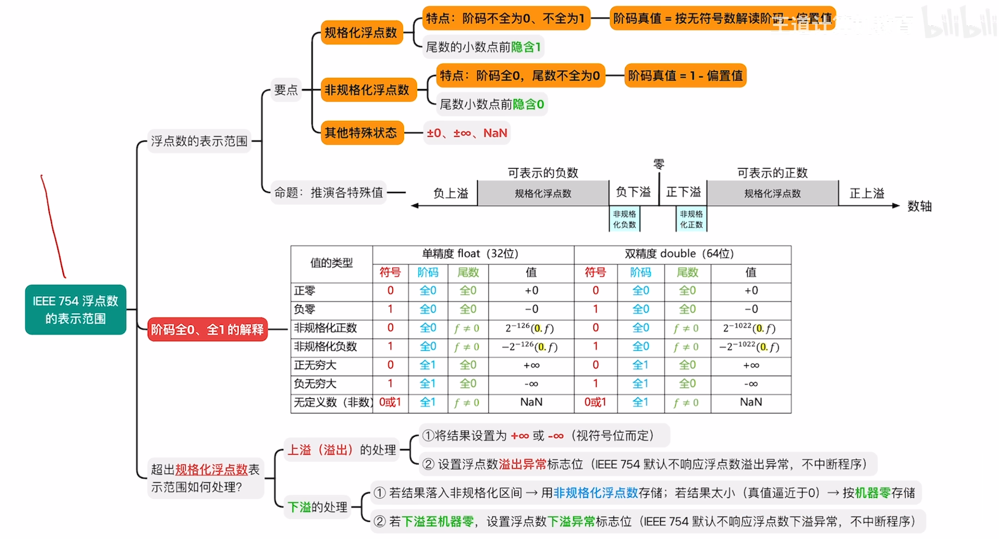


1. 单精度和双精度的符号位、阶码位、尾数位、偏置值分别是什么？

   答：单精度为 `1+8+23`，偏置 127；双精度为 `1+11+52`，偏置 1023。

2. 规格化数和非规格化数的小数点前分别隐含什么？

   答：规格化数隐含 `1.`，非规格化数隐含 `0.`。

3. 阶码字段全为 `0` 时，非零尾数对应的真阶码是多少？

   答：单精度为 $1-127=-126$，双精度为 $1-1023=-1022$。

4. 阶码全为 `1` 时，尾数全 `0` 和非 `0` 分别表示什么？

   答：尾数全 `0` 表示正负无穷大；尾数非 `0` 表示 `NaN`。

5. 单精度最大有限数和最小非零正数分别是多少？

   答：最大有限数为 $(2-2^{-23})2^{127}$，最小非零正数为 $2^{-149}$。

6. 浮点数结果下溢时一定直接变成 0 吗？

   答：不一定。仍能表示为非规格化数时先保存为非规格化数；小到无法区分时才成为机器零并设置下溢标志。


### 2.3.2 浮点数的加减运算

浮点数采用符号—绝对值表示，尾数不能像补码整数那样直接相加。两个浮点数

$$
X=(-1)^{S_X}M_X2^{e_X},\qquad
Y=(-1)^{S_Y}M_Y2^{e_Y}
$$

做加减时，必须先把阶码统一，再把有效数字对齐到同一个权值。

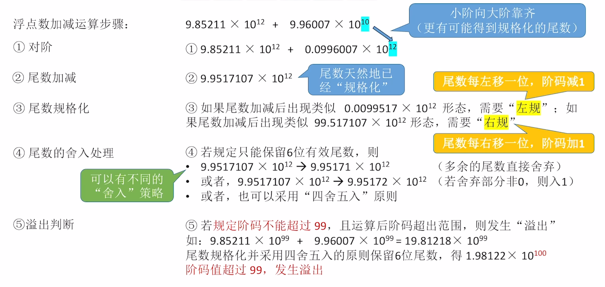

<u>五步运算</u>

1. **对阶**：比较两个真阶码，把阶码较小的尾数右移，同时增大它的阶码，直到两个数的阶码相同。小阶向大阶看齐，通常比把大阶向小阶降下来损失更小。
2. **尾数加减**：阶码相同后，把有效数字按符号相加或相减；减法可转成加上相反数。
3. **尾数规格化**：把结果恢复成二进制科学计数法。规格化时，尾数每左移一位，阶码减 1；尾数每右移一位，阶码加 1。
4. **舍入**：有效数字超过规定位数时，按舍入模式处理多余低位。
5. **溢出判断**：检查最终阶码。阶码超过最大值是上溢；进入非规格化区或最终接近 0 时按下溢处理。

对阶时小阶尾数右移会丢失低位。为正确舍入，硬件通常暂时保留保护位、舍入位和粘滞位；不能在对阶时立刻把这些位全部丢掉。

<u>规格化和溢出</u>

- 相加产生进位，得到 `10.xxx`，执行**右规**：尾数右移一位，阶码加 1。
- 相减使结果出现 `0.00...1xxx`，执行**左规**：尾数左移，阶码减 1，直到最高有效位重新到达隐含位。
- 尾数临时多出一位不代表溢出。右规可以把尾数的进位吸收掉；真正的上溢主要看阶码是否超过可表示上限。
- 当前阶码已经是最小规格化阶码，但尾数仍需左规时，不能继续按普通方式减阶；结果进入非规格化区，阶码字段置全 `0`。
- 舍入后再次超过最大阶码，结果才最终变成 $\pm\infty$；小到无法保留时成为机器零。

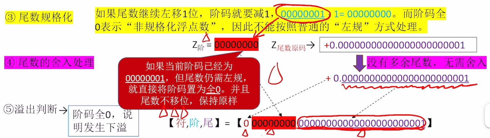

课件中的十进制示例：

$$
9.85211\times10^{12}+9.96007\times10^{10}
$$

先把第二个数对阶：

$$
9.96007\times10^{10}=0.0996007\times10^{12}
$$

再相加：

$$
9.85211+0.0996007=9.9517107
$$

若规定保留 6 位有效尾数，结果为

$$
9.95171\times10^{12}
$$


写成二进制规格化形式：

$$
1.625=1.101_2\times2^3
$$

$$
1.5=1.100_2\times2^1
$$

**对阶**：把 $1.5\times2^1$ 对齐到阶码 3：

$$
1.100_2\times2^1=0.011_2\times2^3
$$

**尾数相加**：

$$
1.101_2+0.011_2=10.000_2
$$

**右规**：

$$
10.000_2\times2^3=1.000_2\times2^4
$$

结果是 $2^4=16$。单精度下真阶码为 4，阶码字段为 $4+127=131=10000011_2$，尾数小数部分全为 `0`，编码为 `01000001100000000000000000000000`，即 `40000000H`。


<u>舍入模式</u>

| 舍入模式 | 规则 |
| --- | --- |
| 就近舍入 | IEEE 754 默认。普通情况类似“0 舍 1 入”；恰好位于两个可表示数正中间时，保留偶数尾数，即 ties-to-even |
| 正向舍入 | 向 $+\infty$ 方向取相邻可表示值；正数进位，负数截断 |
| 负向舍入 | 向 $-\infty$ 方向取相邻可表示值；负数远离 0，正数截断 |
| 向零舍入 | 直接截断多余尾数，结果向 0 靠拢 |

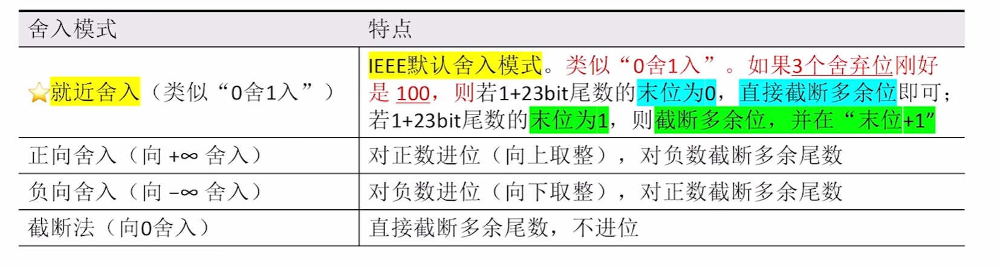

“就近舍入”不是简单的一律四舍五入。恰好一半时，要让保留部分的末位保持为 `0`：末位已经为 `0` 就截断，末位为 `1` 才进位。


---

### 2.3.3 C语言中的浮点数类型：int、float、double 强制转换

C 的强制类型转换执行**数值转换**，不是把同一串二进制原样重新解释。整数和浮点数分别使用补码与 IEEE 754 编码，转换后既可能改变位模式，也可能改变数值精度。

| 转换方向 | 主要变化 | 是否一定精确 |
| --- | --- | --- |
| `int → float` | 整数变成 24 位有效数字的浮点数 | 不一定；超出 24 位有效位的低位会舍入 |
| `int → double` | 整数变成 53 位有效数字的浮点数 | 32 位 `int` 通常都能精确表示 |
| `float → double` | 指数范围和尾数精度都扩大 | 一定精确 |
| `double → float` | 指数范围缩小，尾数精度降低 | 不一定；可能舍入、变成非规格化数、0 或无穷大 |
| `float/double → int` | 丢弃小数部分，向 0 截断 | 仅在转换后的值处于 `int` 范围内才有定义 |

`float` 实际有 24 位有效数字，因此所有绝对值不超过 $2^{24}$ 的整数都能精确表示；超过后只保留间隔为 2、4、8 等的可表示值。`double` 有 53 位有效数字，所以 32 位 `int` 的每个值都能被 `double` 精确保存。

```c
int i = 16777217;        /* 2^24 + 1 */
float f = (float)i;      /* 常见 IEEE 就近舍入结果为 16777216.0f */
double d = (double)i;    /* 精确 */

int a = (int)3.9;        /* 3，向 0 截断 */
int b = (int)-3.9;       /* -3，向 0 截断 */
```

`16777217` 正好位于 `16777216` 和 `16777218` 两个相邻 `float` 的正中间。就近舍入采用 ties-to-even，最终选择尾数末位为偶数的 `16777216`。

浮点数转整数时：

- 小数部分直接丢弃，不执行四舍五入；
- 转换结果超出 `int` 范围时，C 标准不保证结果；`NaN` 或无穷大转为整数也属于未定义行为；
- `(int)4294967296.0` 在 32 位 `int` 环境中不能按“取低 32 位”来理解，因为这不是 float 到 int 的合法范围内转换。


```c
float a = 1.0f / 3.0f;
double b = (double)a;     /* 把已经舍入过的 float 原样扩展为 double */
double c = 1.0 / 3.0;     /* 直接用 double 计算 */
```

`a` 已经舍入到 24 位有效数字，再转成 `double` 不会恢复原先丢失的位，所以 `b` 与 `c` 通常不同。反过来，任何有限的 `float` 都能被 `double` 精确保存，因为 `double` 的阶码范围和尾数精度都更大。

```c
double huge = 1e40;
float f1 = (float)huge;   /* 超出 float 范围，得到 +inf */

double tiny = 1e-50;
float f2 = (float)tiny;   /* 小于最小 float 非零数，通常舍入为 0 */
```


混合表达式遵循寻常算术转换：`int + float` 先把 `int` 转成 `float`，结果是 `float`；`int + double` 先把 `int` 转成 `double`，结果是 `double`。

---

### 2.3.4 数据的宽度与存储：大小端模式、边界对齐存储

数据类型决定对象占多少字节以及各字节如何排列。C 只规定各类型之间的大小关系，不保证所有平台都采用相同宽度：

| 类型 | 常见 32 位环境 | 常见 x86-64 Windows | 常见 x86-64 Linux |
| --- | --- | --- | --- |
| `char` | 1 B | 1 B | 1 B |
| `short` | 2 B | 2 B | 2 B |
| `int` | 4 B | 4 B | 4 B |
| `long` | 4 B | 4 B | 8 B |
| 指针 | 4 B | 8 B | 8 B |
| `float` | 4 B | 4 B | 4 B |
| `double` | 8 B | 8 B | 8 B |

做题时以题目给定的机器字长、编译器模型和数据模型为准；没有额外说明时，408 常用的 `int` 是 32 位。

<u>大小端模式</u>

多字节数据在内存中有两种字节排列方式：

- **小端模式**：最低有效字节放在最低地址，低地址到高地址依次写 `LSB → MSB`；
- **大端模式**：最高有效字节放在最低地址，低地址到高地址依次写 `MSB → LSB`。

以 32 位整数

```c
uint32_t x = 0x12345678;
```

放在地址 `1000H～1003H` 为例：

| 地址 | 小端模式 | 大端模式 |
| --- | --- | --- |
| `1000H` | `78H` | `12H` |
| `1001H` | `56H` | `34H` |
| `1002H` | `34H` | `56H` |
| `1003H` | `12H` | `78H` |

```c
uint32_t x = 0x12345678;
unsigned char *p = (unsigned char *)&x;

/* 小端机器通常输出：78 56 34 12 */
printf("%02X %02X %02X %02X\n", p[0], p[1], p[2], p[3]);
```

大小端只影响多字节对象内部的字节顺序。`char` 字符串 `"AB"` 在大端和小端机器上都依次存为 `41H 42H`；一个字节内部的 8 个 bit 顺序也不因此反转。

<u>边界对齐存储</u>

许多体系结构要求变量地址是某个值的整数倍，这个值叫对齐边界。常见规则是变量的起始地址按其大小或 ABI 指定的对齐数对齐；结构体还要在成员之间、最后一个成员之后插入填充字节。

```c
struct A {
    char  a;   /* 1 B, align 1 */
    int   b;   /* 4 B, align 4 */
    short c;   /* 2 B, align 2 */
};
```

假定结构体从 `1000H` 开始，`a=12H`、`b=12345678H`、`c=9ABCH`：

| 地址 | 内容 | 说明 |
| --- | --- | --- |
| `1000H` | `12H` | 成员 `a` |
| `1001H～1003H` | 填充 | 为了让 `b` 从 4 的倍数地址开始 |
| `1004H～1007H` | `78 56 34 12` | 小端机器上的成员 `b` |
| `1008H～1009H` | `BC 9AH` | 小端机器上的成员 `c` |
| `100AH～100BH` | 尾部填充 | 让整个结构体大小是最大对齐数 4 的倍数 |

因此这个结构体在常见 32 位 ABI 下有：

$$
\operatorname{offsetof}(\texttt{A},b)=4,\qquad
\operatorname{sizeof}(\texttt{A})=12
$$

填充字节的内容没有可移植保证，不能依赖它们一定是 `0`。

只改变成员顺序，就可能减少填充：

```c
struct B {
    int   b;   /* offset 0  */
    short c;   /* offset 4  */
    char  a;   /* offset 6  */
};
```

`B` 的布局为 `b:0～3`、`c:4～5`、`a:6`、尾部填充到 `7`，所以常见环境中

```text
sizeof(struct A) = 12
sizeof(struct B) = 8
```

结构体数组的每个元素还必须满足结构体对齐要求，所以尾部填充不能省略，否则下一个元素的成员可能错位。


1. 浮点数加减时为什么要先对阶？

   答：两个数的阶码不同，尾数每一位代表的权值就不同，不能直接相加减。把小阶尾数右移、阶码增大后，才能在同一权值下运算。

2. 尾数相加得到 `10.101`，是否说明发生上溢？

   答：不一定。执行一次右规得到 `1.0101`，阶码加 1；真正是否上溢还要继续看最终阶码范围。

3. `float` 能精确表示所有 32 位 `int` 吗？

   答：不能。`float` 只有 24 位有效数字，部分绝对值超过 $2^{24}$ 的整数会被舍入；`double` 有 53 位有效数字，能精确表示常见 32 位 `int`。

4. `double` 转 `float` 一定只发生尾数截断吗？

   答：不一定。还会缩小阶码范围，可能舍入、变成非规格化数、下溢为 0，或上溢为无穷大。

5. 32 位整数 `12345678H` 在小端机器中的低地址字节是什么？

   答：最低有效字节 `78H` 放在最低地址。

6. 结构体成员已经满足自然对齐后，为什么末尾还可能有填充？

   答：为了让整个结构体大小是最大成员对齐数的整数倍，保证结构体数组中后续元素仍正确对齐。

