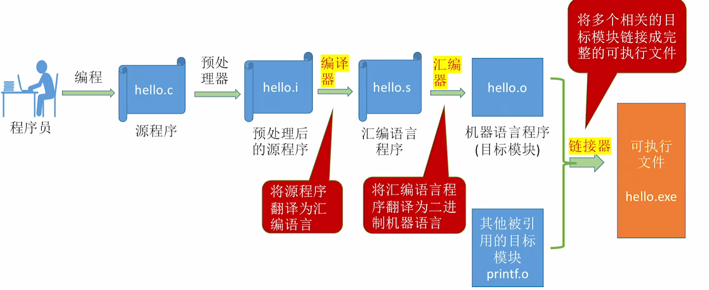

# 一、计算机系统概述

## 1.1 计算机发展历程

> 408 不考，跳过。

## 1.2 计算机系统层次结构

### 1.2.1 计算机系统的组成

计算机系统由**硬件**和**软件**两部分组成。硬件是计算机的物理实体，软件是程序、数据及相关文档的集合。两者缺一不可：没有软件，硬件只是电子器件；没有硬件，软件也没有运行载体。

### 1.2.2 计算机硬件的基本组成

早期冯·诺依曼计算机由五大部分组成：


%%{init: {
  "theme": "base",
  "themeVariables": {
    "primaryColor": "#5b9bd5",
    "primaryTextColor": "#ffffff",
    "primaryBorderColor": "#41719c",
    "lineColor": "#41719c",
    "secondaryColor": "#ffffff",
    "tertiaryColor": "#e2f0d9",
    "fontSize": "16px",
    "fontFamily": "-apple-system, BlinkMacSystemFont, \"Segoe UI\", Roboto, \"Helvetica Neue\", Arial, \"Noto Sans\", sans-serif"
  },
  "flowchart": {
    "nodeSpacing": 8,
    "rankSpacing": 26,
    "curve": "basis",
    "htmlLabels": true,
    "subGraphTitleMargin": { "top": 0, "bottom": 14 },
    "padding": 4,
    "useMaxWidth": false,
    "wrappingWidth": 1000
  }
}}%%
graph LR
  Root["计算机硬件"]
  Root --> Input["输入设备 信息→机器可识别形式"]
  Root --> Output["输出设备 结果→人们熟悉的形式"]
  Root --> Host["主机 主存 + CPU"]
  Host --> Mem["主存储器 存放数据和程序"]
  Host --> CPU["CPU 运算器 + 控制器"]
  CPU --> ALU["运算器 算术、逻辑运算"]
  CPU --> CU["控制器 指挥各部件运行"]

  classDef root fill:#5b9bd5,stroke:#41719c,stroke-width:2px,color:#fff,font-weight:bold,font-size:20px;
  classDef lvl1 fill:#9dc3e6,stroke:#2e6da4,stroke-width:2px,color:#0d2f4d,font-size:19px;
  classDef lvl2d fill:#dbe8f6,stroke:#1f4e79,stroke-width:2px,color:#000000,font-size:16px;
  classDef lvl2l fill:#f6fafe,stroke:#c3d9ef,stroke-width:2px,color:#000000,font-size:16px;
  classDef lvl3d fill:#dbe8f6,stroke:#1f4e79,stroke-width:2px,color:#000000,font-size:15px;

  class Root root;
  class Input,Output,Host lvl1;
  class Mem lvl2d;
  class CPU lvl2l;
  class ALU,CU lvl3d;


因此，**主机 = 主存 + CPU**，**CPU = 运算器 + 控制器**。输入设备和输出设备不属于主机。

冯·诺依曼结构首次提出“存储程序”概念，并以运算器为中心；现代计算机则通常以存储器为中心。程序和数据都先放入主存，CPU 按地址取指令、按顺序执行，遇到转移指令时才改变执行顺序。

.png)

> 注：图中实线表示数据或指令的流动，虚线表示控制器发出的控制信号。

从内部组成看，主存、运算器和控制器各自包含一组关键部件：

| 部件 | 寄存器或单元 | 作用 |
| --- | --- | --- |
| 主存 | 存储体 | 按地址存放指令和数据 |
| 主存 | MAR | 地址寄存器，存放要读写的存储单元地址；位数反映存储单元数量 |
| 主存 | MDR | 数据寄存器，暂存读出或写入的数据；位数等于存储字长 |
| 运算器 | ACC | 累加器，存放操作数或运算结果 |
| 运算器 | MQ | 乘商寄存器，进行乘、除法时使用 |
| 运算器 | X | 通用寄存器，存放操作数 |
| 运算器 | ALU | 算术逻辑单元，用电路实现算术运算和逻辑运算 |
| 控制器 | PC | 程序计数器，存放下一条指令的地址 |
| 控制器 | IR | 指令寄存器，存放当前正在执行的指令 |
| 控制器 | CU | 控制单元，分析指令并发出控制信号 |

程序开始运行时，指令和数据已经装入主存，PC 指向第一条指令。取指阶段把指令从主存送入 IR，PC 自动指向下一条指令；分析阶段由 CU 识别操作码；执行阶段再由 CU 指挥各部件完成操作。下面 1.2.6 会用一条具体的取数指令展开这个过程。

**主存按地址访问。** 每个地址对应一个存储单元，MAR 负责给出地址，MDR 负责暂存数据。

.png)

| 概念 | 含义 |
| --- | --- |
| 存储元 | 存放 1 位二进制的电子元件，每个存储元可存 1 bit |
| 存储单元 | 每个地址对应的单元，存放一个存储字 |
| 存储字 | 存储单元中二进制代码的组合 |
| 存储字长 | 存储字包含的二进制位数 |
| 地址 | 存储单元的编号 |

若 MAR 有 $n$ 位，则可编址的存储单元数为 $2^n$；若 MDR 有 $m$ 位，则每个存储单元的字长为 $m$ 位。因此：

$$
\text{存储容量}=2^{n}\times m\ \text{bit}
$$

例如 MAR 为 4 位、MDR 为 16 位时，共有 $2^4=16$ 个存储单元，每个单元 16 bit，总容量为

$$
2^4\times 16\ \text{bit}=256\ \text{bit}=32\ \text{B}
$$

> 注：教材例子默认“按字编址”，所以一个存储单元就是一个存储字；若按字节编址，一个地址对应 1 B，存储字长和存储单元大小要分开看。

==1 B = 8 bit，1 b = 1 bit==。`B` 表示字节（Byte），`b` 表示位（bit），这两个单位在容量题里经常被拿来设陷阱。

### 1.2.3 计算机软件

计算机软件分为两类：

| 类别 | 作用 | 典型例子 |
| --- | --- | --- |
| 系统软件 | 管理计算机硬件资源，向上层应用程序提供服务，提供运行环境 | 操作系统、编译器、汇编器、链接器、数据库管理系统 |
| 应用软件 | 按具体应用场景编制，直接为用户提供服务 | 办公软件、浏览器、游戏、各类业务程序 |

按照与硬件的接近程度，编程语言可分为三个级别：

| 语言 | 形式 | 能否被硬件直接执行 | 特点 |
| --- | --- | --- | --- |
| 机器语言 | 由 0 和 1 组成的指令序列 | 能 | 唯一能被计算机直接识别和执行的语言，编写和记忆困难 |
| 汇编语言 | 用英文助记符或缩写代替二进制指令，如 `mov`、`add` | 不能 | 可读性比机器语言好，但仍依赖具体机器结构，需经汇编程序翻译 |
| 高级语言 | 接近自然语言的程序设计语言，如 C、C++、Java | 不能 | 与具体硬件关系较弱，开发效率高，需经编译程序或解释程序处理 |

把源程序转换成机器语言程序的系统软件叫**翻译程序**，转换后得到的程序叫**目标程序**。三种常见翻译程序的区别如下：

| 翻译程序 | 输入 | 输出或结果 | 工作方式 |
| --- | --- | --- | --- |
| 汇编程序（汇编器） | 汇编语言源程序 | 机器语言目标程序 | 把汇编指令翻译成机器指令 |
| 编译程序（编译器） | 高级语言源程序 | 汇编语言或机器语言目标程序 | 一次性翻译，生成独立的目标程序 |
| 解释程序（解释器） | 高级语言源程序 | 不生成独立目标程序 | 逐条翻译并立即执行 |

> 注：广义的“编译过程”还包括预处理、汇编和链接；408 题目里说“编译程序”时，通常特指把高级语言翻译成汇编语言或机器语言的那一环。

**软件和硬件在逻辑功能上是等价的**：同一个功能既可以用硬件实现，也可以用软件实现。例如乘法既可以用硬件乘法器完成，也可以用加法与移位程序完成。硬件实现通常速度快、成本高、灵活性差；软件实现通常灵活、成本低，但速度较慢。

**指令集体系结构（ISA）**是软件和硬件之间的关键接口。它从程序员和编译器的视角，定义一台计算机可以支持哪些指令、每条指令的作用是什么、指令格式和寻址方式如何、可以访问哪些寄存器等。ISA 是软件能够“感知”到的计算机功能视图，也叫**软件可见部分**。

### 1.2.4 计算机系统的层次结构

计算机系统是分层构建的。越往上越接近用户和问题，越往下越接近电路和器件；ISA 位于软件和硬件的交界处。

| 层次（自下而上） | 主要工作 | 典型角色 |
| --- | --- | --- |
| 电路与器件 | 门电路、存储器件、逻辑电路 | 电子工程师 |
| 功能部件 / RTL | 用寄存器传输级描述部件 | 电子工程师 |
| 微体系结构 | 数据通路、控制器、流水线、Cache、分支预测 | 架构师 |
| 指令集体系结构（ISA） | 指令格式、操作类型、寻址方式、寄存器等 | 架构师、编译器开发者 |
| 操作系统 / 虚拟机 | 管理资源、抽象硬件、提供运行环境 | 系统程序员 |
| 算法与编程 | 把问题抽象为算法，再编写程序 | 应用程序员 |
| 应用 | 面向最终用户完成具体任务 | 最终用户 |

**ISA 与微体系结构要分清。** ISA 回答“机器能做什么”，微体系结构回答“内部怎么做”。ISA 对软件可见，微体系结构对软件不可见；同一套 ISA 可以有多种不同的微体系结构。例如 Intel 的 Core、Skylake、Alder Lake 都遵循 x86 ISA，但内部的数据通路、流水线、缓存和分支预测设计并不相同。

| 对比项 | ISA | 微体系结构 |
| --- | --- | --- |
| 回答的问题 | 做什么 | 怎么做 |
| 是否对软件可见 | 可见 | 不可见 |
| 主要内容 | 指令格式、操作类型、寻址方式、寄存器、数据类型 | 数据通路组织、控制器实现、流水线级数、Cache 层次、分支预测 |
| 二者关系 | 同一 ISA 可有多种实现 | 某种 ISA 的具体硬件实现 |

> 注：这里的“透明”是“上层看不见、也不需要关心”，不是“能看穿”。ISA 以下的硬件实现对高级语言程序员是透明的。

操作系统是对硬件的抽象，它把底层硬件包装成一台可供程序员使用的“虚拟机”；各种语言处理程序也都在操作系统提供的运行环境中执行。应用程序员通常只面对高级语言和操作系统接口，不需要了解 ISA 以下的电路细节。

### 1.2.5 计算机系统的不同用户

按照使用计算机完成任务的性质，可以把用户分为四类：

| 角色 | 工作层面 | 主要职责 |
| --- | --- | --- |
| 最终用户 | 应用层 | 直接操作应用程序完成特定任务，如办公、浏览网页；不需要了解底层技术细节 |
| 系统管理员 | 操作系统层 | 配置、管理和维护计算机系统，如安装软硬件、管理账户、备份数据、系统升级 |
| 应用程序员 | 高级语言层 | 使用高级语言开发应用程序，满足办公、娱乐等领域的特定需求 |
| 系统程序员 | 机器语言 / ISA 层 | 设计并开发操作系统、编译器、数据库管理系统等核心系统软件 |

同一个用户在不同场景下可以承担多种角色。例如，一名计算机专业的学生：网上购物时是最终用户，管理磁盘和备份数据时是系统管理员，编写应用程序作业时是应用程序员，参与操作系统开发时是系统程序员。

系统程序员直接面向 ISA；系统管理员工作在操作系统层；应用程序员工作在高级语言层；最终用户位于最上层，通过应用程序完成任务。

### 1.2.6 计算机系统的工作原理

“存储程序”是理解计算机工作原理的主线：程序和数据先装入主存，CPU 按 PC 给出的地址取指令，译码后执行，然后再取下一条指令，如此循环。


%%{init: {
  "theme": "base",
  "themeVariables": {
    "primaryColor": "#5b9bd5",
    "primaryTextColor": "#ffffff",
    "primaryBorderColor": "#41719c",
    "lineColor": "#41719c",
    "secondaryColor": "#ffffff",
    "tertiaryColor": "#e2f0d9",
    "fontSize": "16px",
    "fontFamily": "-apple-system, BlinkMacSystemFont, \"Segoe UI\", Roboto, \"Helvetica Neue\", Arial, \"Noto Sans\", sans-serif"
  },
  "flowchart": {
    "nodeSpacing": 8,
    "rankSpacing": 26,
    "curve": "basis",
    "htmlLabels": true,
    "subGraphTitleMargin": { "top": 0, "bottom": 14 },
    "padding": 4,
    "useMaxWidth": false,
    "wrappingWidth": 1000
  }
}}%%
graph LR
  Start["程序开始执行"] --> Fetch["根据 PC 取指令"]
  Fetch --> Decode["指令译码 PC ← PC + 1"]
  Decode --> Exec["取操作数并执行"]
  Exec --> Write["送结果"]
  Write --> Fetch

  classDef root fill:#5b9bd5,stroke:#41719c,stroke-width:2px,color:#fff,font-weight:bold,font-size:20px;
  classDef lvl1 fill:#9dc3e6,stroke:#2e6da4,stroke-width:2px,color:#0d2f4d,font-size:19px;
  classDef lvl2d fill:#dbe8f6,stroke:#1f4e79,stroke-width:2px,color:#000000,font-size:16px;
  classDef lvl3d fill:#dbe8f6,stroke:#1f4e79,stroke-width:2px,color:#000000,font-size:15px;
  classDef lvl4d fill:#dbe8f6,stroke:#1f4e79,stroke-width:1.5px,color:#000000,font-size:14px;

  class Start root;
  class Fetch lvl1;
  class Decode lvl2d;
  class Exec lvl3d;
  class Write lvl4d;


> 注：图中的“PC ← PC + 1”表示指向下一条指令，实际增加的是该指令占用的地址单位数；只有定长指令且按字编址时，才恰好是加 1。

取指阶段对所有指令都是相同的；分析阶段由操作码决定指令类型；执行阶段则因指令不同而走不同的数据通路。

一个 C 程序从源文件到可执行文件，通常要经过下面几个阶段：

| 阶段 | 输入 → 输出 | 主要工作 |
| --- | --- | --- |
| 预处理 | `hello.c` → `hello.i` | 展开宏、包含头文件、处理条件编译、删除注释 |
| 编译 | `hello.i` → `hello.s` | 词法、语法、语义分析，生成汇编代码并优化 |
| 汇编 | `hello.s` → `hello.o` | 把汇编指令翻译成机器指令，形成可重定位目标模块 |
| 链接 | `hello.o` + 其他目标模块 → `hello.exe` | 符号解析、重定位，合并代码段和数据段，生成可执行文件 |

==目标模块还不是可执行文件==，它里面可能还有未确定的外部符号和待重定位的地址；链接器把这些模块合并、定位之后，才得到可以直接装入运行的 `hello.exe`。

一条指令通常由**操作码**和**地址码**组成：操作码指出要做什么，地址码给出操作数或下一条指令的地址。下面用一条“取数”指令，把取指、分析、执行三个阶段串起来。主存 0～4 号单元放指令，5～8 号单元放原始数据；PC 初值为 0，指向第一条指令。

.png)

| 阶段 | 微操作 | 结果 |
| --- | --- | --- |
| 取指 | `(PC) → MAR` | MAR = 0 |
| 取指 | `M(MAR) → MDR` | MDR = `000001 0000000101` |
| 取指 | `(MDR) → IR` | IR 中装入取数指令 |
| 取指 | `(PC) + 1 → PC` | PC = 1，指向下一条指令 |
| 分析 | `OP(IR) → CU` | CU 识别出这是“取数”指令 |
| 执行 | `Ad(IR) → MAR` | 地址码 5 送入 MAR |
| 执行 | `M(MAR) → MDR` | MDR = 2 |
| 执行 | `(MDR) → ACC` | ACC = 2 |

之后 PC = 1，CPU 取下一条乘法指令，把 ACC 中的 2 与地址 6 中的 3 相乘，ACC 变为 6；再执行加法，ACC 变为 7；执行存数指令后，地址 8 中的结果为 7；最后执行停机指令。整段程序的指令和数据都放在主存里，CPU 只是按 PC 逐条取指、译码、执行。

> 注：取指阶段对所有指令都一样，执行阶段才由操作码决定。把“取数”换成“乘法”“加法”或“存数”，分析阶段仍然相同，执行阶段的数据通路不同。

## 1.3 计算机的性能指标

描述存储容量、文件大小时，K、M、G、T 按 2 的幂递增；描述频率、速率时，按 10 的幂递增。两套单位不能混用。

| 用途 | K | M | G | T |
| --- | --- | --- | --- | --- |
| 存储容量、文件大小 | $2^{10}$ | $2^{20}$ | $2^{30}$ | $2^{40}$ |
| 频率、速率 | $10^{3}$ | $10^{6}$ | $10^{9}$ | $10^{12}$ |

==同样是 1K，表示容量时是 1024，表示频率时是 1000==。

主存容量由“存储单元数”和“每个存储单元的位数”共同决定。MAR 的位数决定存储单元数量，MDR 的位数反映每个存储单元的大小：

$$
\text{主存容量}=2^{\text{MAR 位数}}\times \text{MDR 位数}\ \text{bit}
$$

若结果要写成字节，再除以 8。MAR 位数决定的是地址空间中的单元数，不是容量本身；容量还要乘上每个单元的位数。

CPU 的时间指标围绕时钟周期、主频、CPI 和指令条数展开：

| 指标 | 含义 |
| --- | --- |
| 时钟周期 $T$ | CPU 中最小的时间单位，每个动作至少需要一个时钟周期 |
| 主频 $f$ | 时钟频率，$f=1/T$，单位为 Hz |
| CPI | 执行一条指令平均所需的时钟周期数 |
| CPU 执行时间 | 运行一个程序所花费的时间 |
| IPS | 每秒执行的指令条数 |
| FLOPS | 每秒执行的浮点运算次数 |

设程序共有 $IN$ 条指令，平均每条指令需要 $CPI$ 个时钟周期，主频为 $f$，则：

$$
T_{\text{CPU}}=\frac{IN\times CPI}{f}=IN\times CPI\times T
$$

$$
IPS=\frac{f}{CPI},\qquad IPC=\frac{1}{CPI}
$$

如果程序中包含多种指令，平均 CPI 按各类指令的比例加权：

$$
CPI=\sum_i CPI_i\times p_i
$$

其中 $p_i$ 是第 $i$ 类指令占总指令数的比例。`IPC` 表示每个时钟周期完成的指令数，在同一程序、同一 ISA 下，IPC 越大通常越快。

> 例：主频 $f=2\ \text{GHz}$，平均 $CPI=4$，执行 $10^9$ 条指令，则
>
> $$
> T_{\text{CPU}}=\frac{10^9\times 4}{2\times 10^9}=2\ \text{s}
> $$

~~主频越高，计算机一定越快~~。程序执行时间还取决于指令条数和 CPI；主频只是其中一个因素。

除了容量和速度，常见的性能指标还有：

| 指标 | 含义 |
| --- | --- |
| 数据通路宽度 | 数据总线或数据通路一次能传输的位数 |
| 吞吐量 | 单位时间内完成的任务量 |
| 响应时间 | 从发出请求到得到响应的时间 |
| 基准程序 | 用一组有代表性的标准程序评测计算机性能 |

几个“字长”容易混：

| 名称 | 含义 |
| --- | --- |
| 机器字长 | CPU 一次整数运算能处理的二进制位数，通常与通用寄存器、ALU 的宽度对应 |
| 存储字长 | 一个存储单元存放的二进制位数，通常与 MDR 宽度对应 |
| 指令字长 | 一条指令包含的二进制位数，不一定等于存储字长 |
| 数据通路宽度 | 一次数据传输能并行传输的位数 |


1. MAR 有 20 位、MDR 有 32 位，按字编址的主存容量是多少？

   答：$2^{20}\times 32\ \text{bit}=2^{20}\times 4\ \text{B}=4\ \text{MB}$。

2. 主频 3 GHz、平均 CPI 为 2，IPS 是多少？

   答：$IPS=3\times10^9/2=1.5\times10^9$ 条/秒。

3. “ISA 对软件透明”这句话对吗？

   答：不对。ISA 是软件可见的接口；对软件透明的是 ISA 以下的微体系结构和电路实现。

4. PC 自动加 1 一定是加 1 字节吗？

   答：不一定。PC 增加的是一个指令长度或地址单位；只有定长指令且按字编址时，才恰好是加 1。

