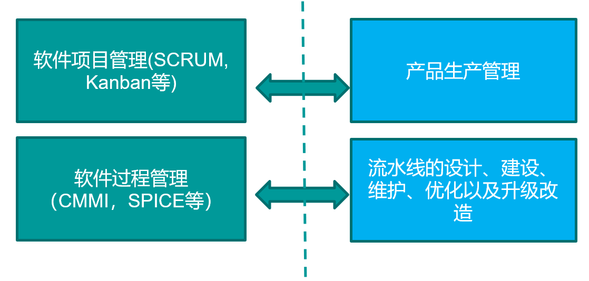
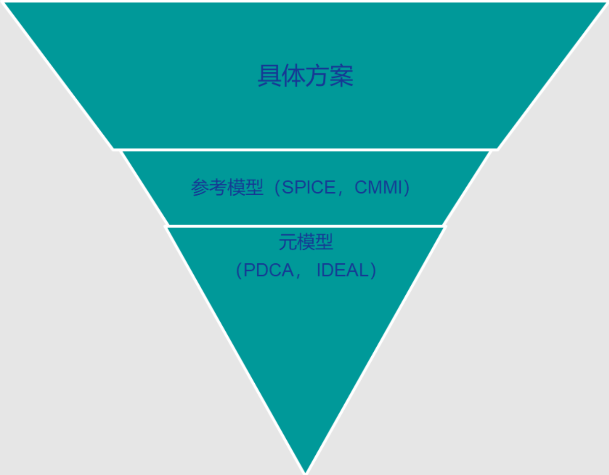
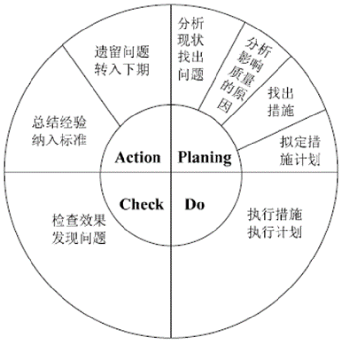
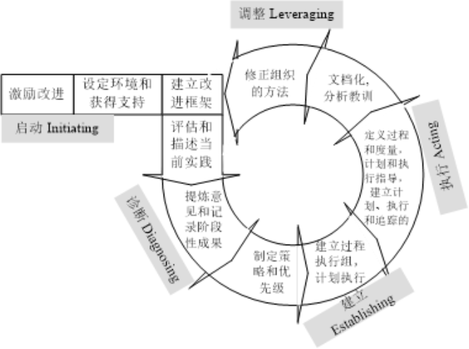
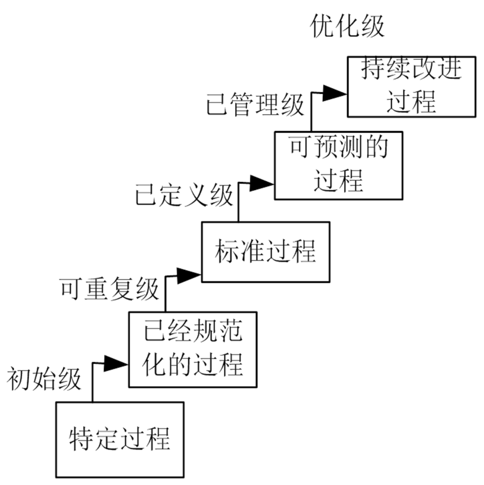
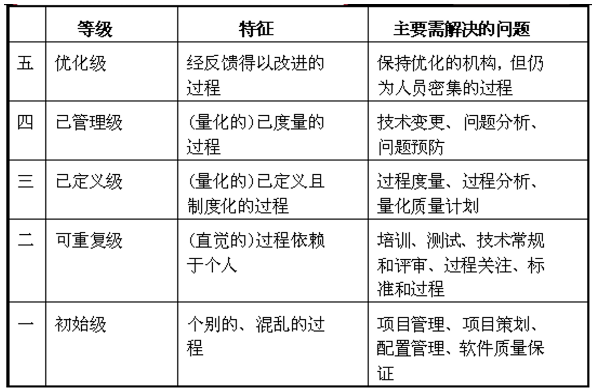

# 1. 概述

## 1.1 软件危机 VS. 软件工程

**软件危机**

- 软件危机是指**落后的软件生产方式**无法满足迅速增长的计算机软件需求，从而导致软件开发与维护过程中出现一系列严重问题的现象。
- 主要体现有：
  1. 软件开发费用和进度失控
  2. 软件可靠性差
  3. 生产出来的软件难以维护
  4. 用户对“已完成”系统不满意现象经常发现
- 《人月神话》——软件的**四大本质困难和挑战**：
  1. **不可见性**：软件项目是一个逻辑实体
  2. **复杂性**：实体数量众多
  3. **可变性**
  4. **一致性**

**软件工程**

- 软件工程是一门研究用**工程化方法**构建和维护有效的、实用的和高质量的软件的学科。

软件工程的两大视角

1. 管理视角——能否复制成功？

2. 技术视角——是否可以将问题解决得更好？

## 1.2 软件项目管理

### 1.2.1 概念

管理的三大关键要素：**目标、状态、纠偏**

> 大部分情况下，管理仅仅是试图复制其他地方（场景）的成功，但是这种复制一般不容易。
>
> 软件项目管理是为了降低/减少各种无谓的损耗来实现本该有的性能。
>
> 软件过程改进是为了达到更好的效能，其中质量/缺陷是首要目标或限制。

软件项目管理

- 典型的三大目标：**成本、质量、工期**

- 软件项目管理是应用方法、工具、技术以及人员能力来完成软件项目，实现项目目标的过程。 

- 估算、计划、跟踪、风险管理、范围管理、人员管理、沟通管理，等等

>  质量实践和质量管理是不一样的：
>
> 1. 质量实践包括测试等等
> 2. 质量管理是对质量的管理，而不是实践，管理必须有上面所说的三个要素

### 1.2.2 管理视角

**管理视角的核心问题：“成功是否可以复制？”**

1. **软件过程**

   - 软件过程是为了实现一个或者多个事先定义的目标而建立起来的一组实践的集合

   - 这组实践之间往往有一定的先后顺序，作为一个整体来实现事先定义的一个或者多个目标。 

2. 生命周期模型：对软件过程的一种人为的划分

## 1.3 软件过程管理

### 1.3.1 广义软件过程

广义软件过程包括**技术**、**人员**以及**狭义过程**

- 同义词：软件开发方法、软件开发过程
- 理论基石：软件产品和服务的质量，很大程度上取决于生产和维护该软件或者服务的过程的质量。
- 净室Cleanroom方法、极限编程方法、SCRUM方法、Gate方法；Cleanroom 工程过程和 CMM 管理过程互为补充；Cleanroom 比 CMM 更注重质量，更偏向于使用一些数学工具
- 而更一般的，敏捷软件过程／方法、轻量型过程／方法以及重型过程／方法等描述也是恰当的

### 1.3.2 生命周期模型

1. 生命周期模型是对一个软件开发过程的人为划分
2. 生命周期模型是软件开发过程的主框架，是对软件开发过程的一种**粗粒度划分**
3. 生命周期模型往往**不包括技术实践**

>  典型的生命周期模型：瀑布模型、迭代式模型、增量模型、螺旋模型、原型法等等

### 1.3.3 软件过程管理

管理对象是软件过程

管理的目的是为了让**软件过程**在开发效率、质量等方面有着更好**性能绩效**（performance）

> 左侧是软件开发部分，右侧是传统生产部分。

## 1.4 软件过程管理与软件过程改进

两者意思接近：

1. 软件过程管理参考模型 CMM/CMMI, SPICE 等
2. 软件过程改进参考元模型 PDCA，IDEAL

软件过程改进模型

1. 重点关注“过程质量”，强调“持续改进”
2. 获得 ISO 9000 标准认证的企业应该具有 CMM 第 2~3 级的水平

### 1.4.1 软件过程管理模型：ISO/IEC 1504

1. 也叫 SPICE（Software Process Improvement and Capability Determination）
2. 过程类别共有五种，分别是
   1. 客户-供应商（CUS）过程
   2. 工程（ENG）过程
   3. 支持（SUP）过程
   4. 管理（MAN）过程
   5. 组织（ORG）过程

### 1.4.2 软件过程改进模型：PDCA 模型

PDCA 模型的步骤：

1. 分析现状，找出问题

2. 分析影响质量的原因

3. 找出措施

4. 拟定措施计划

5. 执行措施，执行计划

6. 检查效果，发现问题

7. 总结经验，纳入标准

8. 遗留问题转入下期 PDCA 循环

   

   ### 1.4.3 软件过程改进模型：IDEAL 模型

   IDEAL 模型解决了软件组织在各种质量改进环境下的需要。它包括了软件过程改进周期中的五个阶段，IDEAL 是代表这五个阶段的单词的首字母。

   1. I: Initiating 初始

   2. D: Diagnosing 诊断

   3. E: Establishing 建立

   4. A: Acting 执行

   5. L: Leveraging 调整

      

   ### 1.4.4 软件过程管理/改进模型：CMM

   定义：CMM 是一种用于评价软件承包能力并帮助其改善软件质量的方法，侧重于软件开发过程的管理及工程能力的提高与评估。

   级别：分为五个级别，一级为初始级，二级为可重复级，三级为已定义级，四级为已管理级，五级为优化级。

   

   

   

   
